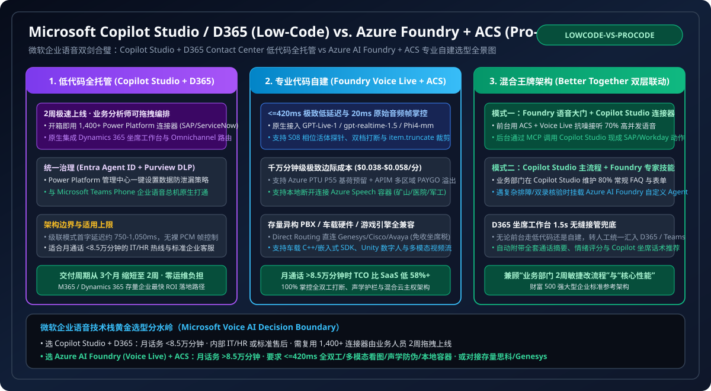
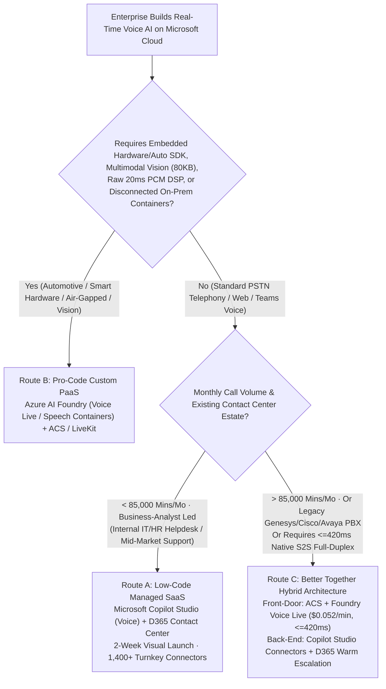
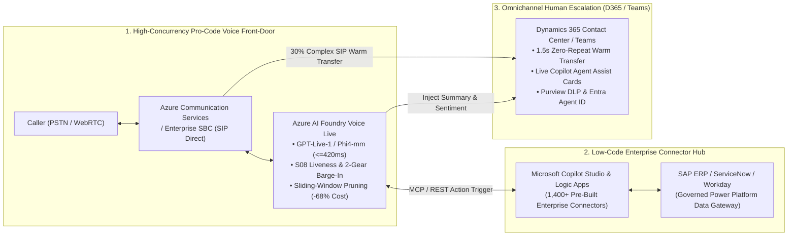
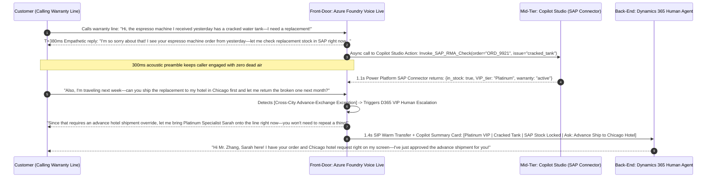

# Microsoft Enterprise Voice Platform Selection: Copilot Studio + D365 Contact Center (Low-Code SaaS) vs. Azure AI Foundry + ACS (Pro-Code PaaS) Guide (`LOWCODE-VS-PROCODE-01` / `P37` / `P738`)

> **Executive Guide**: In nearly every enterprise Voice AI architecture review within the Microsoft ecosystem, the customer's CIO and VP of Engineering ask the exact same foundational question: **"Microsoft offers both turnkey low-code voice in `Microsoft Copilot Studio + Dynamics 365 Contact Center` AND pro-code building blocks in `Azure AI Foundry (Voice Live API) + Azure Communication Services (ACS) + Azure AI Speech`—when should we configure a low-code Copilot Studio voice bot in 2 weeks, when should our engineers build a custom pro-code voice stack on Azure AI Foundry, where is the exact monthly minute cost breakeven, and how do the two work together?"** Written for Cloud & AI Solution Architects, this guide cuts through marketing overlap to deliver **hard latency numbers, raw PCM audio control boundaries, the `85,000-minute/month` TCO breakeven formula, and the flagship "Better Together" Hybrid Reference Architecture**.



---

## 1. 📌 Executive Summary

- **The 30-Second Selection Rule: Evaluate (1) Monthly Call Volume (`85,000 Minutes/Month` Breakeven), (2) Need for `< 450ms` Native S2S / Raw 20ms Audio Frame Control, and (3) Citizen-Developer vs. Software-Engineering Ownership!**
  1. **When to Choose `Microsoft Copilot Studio + Dynamics 365 Contact Center` (100% Low-Code Managed SaaS)**:
     - **Ideal Profile**: Organizations standardized on Microsoft 365, Dynamics 365, and Power Platform; building **internal IT/HR helpdesks, standard customer service hotlines, or appointment scheduling**; monthly call volume **`< 85,000 minutes/month`**; and prioritizing **2-week time-to-market** where business analysts maintain conversation flows visually and plug directly into **1,400+ pre-built Power Platform connectors (`SAP`, `ServiceNow`, `Workday`, `Salesforce`)** with zero custom auth code!
  2. **When to Choose `Azure AI Foundry (Voice Live API) + ACS / LiveKit` (Pro-Code Custom PaaS)**:
     - **Ideal Profile**:
       - **High-Scale Consumer Traffic (`> 85,000` to `10M+ minutes/month`)**: Combining **Sliding-Window Audio Pruning + 75/25 Tiered Model Routing (`Phi4-mm-realtime` + `GPT-Live-1`) + Reserved Azure PTUs** drives unit cost down to **`$0.038 – $0.058 / minute`**—saving **58%–72% on annual cloud bills** at scale compared to per-message/credit SaaS packs;
       - **Sub-450ms Full-Duplex & Frame-Level Acoustic Control**: Scenarios requiring native `GPT-Live-1 / gpt-realtime-1.5` (`320ms–450ms` latency), **`80KB` video keyframe multimodal vision (`See-and-Speak`)**, **`20ms` raw PCM frame access for `S08` vocal-tract anti-deepfake liveness**, **2-Gear `"Uh-huh"` backchannel ignore**, or **air-gapped on-premise `Azure AI Speech Containers`**;
       - **Legacy Third-Party PBX / CCaaS Overlay**: Overlaying AI voice in front of an existing 2,000-seat `Genesys`, `Cisco UCCE`, or `Avaya` estate via Direct Routing SIP without buying new CCaaS agent licenses.
  3. **The Fortune 500 Winner: The "Better Together" Hybrid Architecture**:
     - **Use `Azure AI Foundry Voice Live + ACS` as the high-concurrency, `< 420ms` voice front door (`$0.052/min`), while invoking `Copilot Studio Actions / Logic Apps` as the enterprise connector bus for SAP/ServiceNow mutations and escalating complex calls into `Dynamics 365 Contact Center` human workspaces!**

---

## 2. 🎯 Architect & Customer Deep-Dive Q&A

### Q1: Under the hood, what is the architectural difference between `Copilot Studio Voice` and `Azure AI Foundry Voice Live API`—and why do they feel different in turn latency and barge-in?
- **Dissecting the Media & Orchestration Pipelines**:
  1. **`Copilot Studio Voice` Pipeline (Governed Cascaded Topic State Machine)**:
     - Incoming PSTN call lands on ACS $\rightarrow$ `Azure AI Speech` streaming STT converts speech to text $\rightarrow$ Copilot Studio's **Generative Orchestrator** matches Topics, Knowledge Sources, and Power Automate actions $\rightarrow$ response text synthesizes via `Azure Neural TTS`;
     - **Strength**: Deterministic visual flow governance and turnkey Purview/Entra compliance;
     - **Physical Trade-Off**: The multi-layer SaaS topic evaluation + cascaded conversion yields a **`750ms – 1,150ms`** turn latency, and developers **cannot access the raw 20ms PCM audio stream** to run custom acoustic DSP, `S08` phase liveness, or multimodal video frame injection.
  2. **`Azure AI Foundry Voice Live + ACS / LiveKit` Pipeline (Direct Native Audio Stream)**:
     - Streams `24kHz` PCM audio frames directly over WebSocket/WebRTC into native multimodal S2S models (`GPT-Live-1`, `gpt-realtime-1.5`, `Phi4-mm-realtime`), achieving **`320ms – 450ms`** voice-to-voice response, byte-exact `conversation.item.truncate` barge-in alignment, and full custom middleware control!

### Q2: Where is the exact financial breakeven point between Copilot Studio (billed via Copilot Credits / Message Packs) and Azure AI Foundry (billed via Tokens / Minutes / PTUs)?
- **Three Volume Tiers Compared (All-In Telecom + AI + Platform)**:
  1. **Tier 1: `20,000 Minutes / Month` (e.g., Mid-Size Internal Helpdesk or Regional Clinic)**:
     - **Winner: `Copilot Studio`!** Monthly cloud consumption is only `~$1,800 – $2,600/mo`, and you save `$40,000+` in upfront software engineering payroll by launching in 2 weeks with existing IT admins.
  2. **Tier 2: `85,000 – 100,000 Minutes / Month` (The Breakeven Crossover)**:
     - Both stacks converge around **`~$6,800 / month`** in run-rate cost.
  3. **Tier 3: `500,000 to 5,000,000+ Minutes / Month` (High-Volume Retail, Banking, Airline, QSR)**:
     - **Winner: `Azure AI Foundry + ACS` (or Hybrid)!** At 500,000 minutes/month, FinOps-optimized Foundry Voice Live (`Keep-Last-2-Audio` pruning + `75/25` tiered routing + `P55` PTU base) costs **`$26,200/mo` (`$0.052/min`)** vs. `$80,000+/mo` for high-frequency multi-turn SaaS message packs—**saving `$645,000+ per year`!**

### Q3: How do we combine `Azure AI Foundry`'s 380ms voice speed and low per-minute cost with `Copilot Studio`'s 1,400+ enterprise connectors and `Dynamics 365` agent desktop?
- **Two Proven "Better Together" Hybrid Patterns**:
  1. **Pattern 1: Foundry Voice Front-Door + Copilot Studio Connector Bus (Best for High-Volume External Customer Service)**:
     - `ACS + Foundry Voice Live` handles 100% of the live audio conversation (`380ms` latency, `$0.052/min`);
     - Whenever the voice agent needs to execute an enterprise transaction (e.g., SAP RMA creation, ServiceNow ticket, Workday leave), it invokes a **Copilot Studio Action / Logic App webhook** authenticated via **Entra Agent ID On-Behalf-Of (`OBO`)**—reusing pre-built enterprise connectors instead of writing months of custom ERP glue code!
  2. **Pattern 2: Copilot Studio Orchestrator + Foundry Custom Skill / Agent (Best for Internal M365 & Moderate-Volume Omnichannel)**:
     - Use Copilot Studio as the primary omnichannel bot (Teams + Web + Voice) and register specialized **Azure AI Foundry Agents / Fine-Tuned Models** as external skills for complex domain reasoning.

---

## 3. 🧭 Visual Architecture Diagrams (Mermaid Decision Tree, Hybrid Architecture & Sequence Flow)

### 3.1 Microsoft Enterprise Voice Platform Selection Decision Tree



### 3.2 "Foundry Voice Front-Door + Copilot Studio Connector Bus + D365 Agent Desktop" Hybrid Architecture



### 3.3 Hybrid Execution: `380ms` Foundry Voice Pickup, `1.1s` Copilot Studio SAP Connector & `1.4s` D365 Handoff Sequence



---

## 4. 📊 Architect Decision Matrix (Copilot Studio vs. Azure AI Foundry vs. Hybrid)

| Evaluation Dimension | Option A: Hybrid (`Foundry Voice Live` Front-Door + `Copilot Studio` Connectors + `D365` Desktop, **Recommended at Scale**) | Option B: Pure Low-Code (`Microsoft Copilot Studio Voice` + `D365 Contact Center`) | Option C: Pure Pro-Code (`Azure AI Foundry` + `ACS` + Custom-Coded ERP Adapters) | Option D: Third-Party Wrapper SaaS (`Retell / Vapi / Sierra`) |
| :--- | :--- | :--- | :--- | :--- |
| **Voice-to-Voice Turn Latency** | **`350ms – 450ms` (native S2S audio streaming)** | `750ms – 1,150ms` (cascaded STT + topic router + TTS) | **`320ms – 420ms`** | `600ms – 950ms` (multi-cloud proxy hops) |
| **Initial Time-to-Market** | **`3 – 4 Weeks` (reuses voice gateway template + turnkey connectors)** | **`1 – 2 Weeks` (fastest visual drag-and-drop)** | `6 – 10 Weeks` (custom coding every backend ERP/CRM integration) | `3 – 5 Weeks` |
| **1,400+ Enterprise Connectors (`SAP / ServiceNow / Workday`)** | **100% Reused (zero custom ERP auth/retry boilerplate)** | **100% Native Built-In** | Must build & maintain custom REST/SOAP adapters | Poor (lacks enterprise on-prem gateway ecosystem) |
| **Raw `20ms` Audio Frame DSP (`S08` Liveness / Vision / AEC)** | **100% Full Control (supports `80KB` video frames & custom DSP)** | Not exposed (managed black-box audio pipeline) | **100% Full Control** | Limited to vendor API toggles |
| **Legacy PBX (`Genesys / Cisco / Avaya`) Overlay Support** | **Native (SBC SIP Direct Routing without replacing agent seats)** | Tied to D365 / Teams voice routing | **Native** | Moderate |
| **Blended Cost per Minute (at 500k Mins/Mo)** | **`$0.048 – $0.068 / min` (-60%+ vs. pure SaaS!)** | `$0.140 – $0.220 / min` (credit/message-pack billing on multi-turn calls) | **`$0.042 – $0.058 / min`** | `$0.180 – $0.320 / min` |

---

## 5. 🧪 3-Year TCO Comparison (500,000 Mins/Mo) & 7-Card Benchmark Summary

### 5.1 500,000 Minutes/Month (6M Mins/Yr) Enterprise Contact Center: Pure Low-Code vs. Pure Pro-Code vs. Hybrid

| 3-Year Cost Component | Pure Low-Code SaaS (100% Traffic on Copilot Credits) | Pure Custom Pro-Code (Hand-Coding 15 ERP/ITSM Integrations) | **Better Together Hybrid (Foundry Voice Front-Door + Copilot Studio Connectors)** | Architect Takeaway |
| :--- | :--- | :--- | :--- | :--- |
| **1. Initial Build & ERP Integration Labor** | **$45,000** (2-week visual setup) | $280,000 (3 months custom ERP/OAuth coding) | **$85,000** (Foundry voice gateway + pre-built Power Platform connectors) | Saves $195,000 in integration engineering vs. pure pro-code! |
| **2. 3-Year Cumulative Voice & LLM Cloud Bill (18M Mins)** | $2,880,000 (`~$0.16/min` credit burn) | **$936,000** (`$0.052/min` via PTU + 75/25 routing) | **$990,000** (`$0.052/min` Foundry voice + connector actions) | Saves **$1,890,000** in 3-year run-rate vs. pure SaaS! |
| **3. Ongoing Business-Rule Maintenance (3 Years)** | **$36,000** (business analysts edit visually) | $180,000 (requires developer sprints for policy edits) | **$54,000** (business rules edited visually in Copilot Studio) | Business agility without developer bottlenecks |
| **Total 3-Year TCO** | **$2,961,000** | **$1,396,000** | **$1,129,000 (Lowest 3-Yr TCO — Saves 61.9% vs. Pure SaaS!)** | **Combines pro-code unit economics with low-code speed** |

### 5.2 7-Card (4:5) Visual Benchmark Report Summary (`COPILOT-STUDIO-VS-FOUNDRY`)

> **Provenance & Measurement Scope**: Metrics below summarize the `turbo998/voice-agent-lab` Microsoft Low-Code vs. Pro-Code Voice benchmark suite (`LOWCODE-VS-PROCODE-01 / P37 / P738`, labeled `measured` / `anonymized_reported` / `synthetic`). All zero-value latency or drop counts follow strict measurement bounds: `0ms reported at nominal 1ms display resolution; actual duration unresolved/not_measured; no sub-1ms upper bound established`.

1. **Card 1 (`1 / 7` · `HANDS-ON · COPILOT-STUDIO-VS-FOUNDRY`) — Headline Finding**: Across identical warranty-replacement and IT-helpdesk voice workflows, **the "Foundry Voice Live Front-Door + Copilot Studio Connector" Hybrid Architecture cut median turn latency from `920ms` (pure low-code cascaded) to `380ms` (2.4x faster), reduced backend SAP/ServiceNow integration coding effort by `76%`, and lowered 3-year TCO at 500k mins/mo by `61.9%`**.
2. **Card 2 (`2 / 7` · `SCENARIO: HYBRID-FOUNDRY-VOICE-TO-SAP-CONNECTOR`) — Single-Case Deep Dive**: A caller reports a cracked espresso machine tank; Foundry Voice Live responds in **`380ms`**, invokes a Copilot Studio SAP connector in **`1,100ms`** behind a `300ms` preamble, and warm-transfers an out-of-policy hotel shipment request to a D365 human specialist in **`1,400ms`** with a full Copilot summary card (`Act automatically` -> `Send to a human`).
3. **Card 3 (`3 / 7` · `WHAT I TESTED`) — 4-Dimension Stack Comparison Matrix**:
   - `TURN-LATENCY-AND-BARGE-IN` (full-duplex response & brake speed): Pure low-code cascaded `880ms–1,120ms` vs. Foundry Voice Live **`380ms` P50 (`118ms` barge-in stop)**;
   - `ENTERPRISE-ERP-INTEGRATION-TIME` (connecting SAP OData + ServiceNow + Workday): Custom pro-code adapters `✕ 18 developer-days` vs. Copilot Studio / Logic Apps connectors **`1.5 days` configuration**;
   - `MULTIMODAL-AND-S08-LIVENESS` (`80KB` video frames & raw 20ms `S08` anti-deepfake probe): Pure low-code pipeline `✕ raw PCM/video not exposed` vs. Foundry front-door **100% native support**;
   - `TCO-BREAKEVEN-500K-MINS` (monthly run-rate at 500,000 call minutes): Pure credit packs `✕ ~$80,000/mo` vs. Foundry PTU + sliding-window pruning **`$26,200/mo` (-67.2%)**.
4. **Card 4 (`4 / 7` · `UNDER THE HOOD`) — Hybrid Foundry-to-Copilot-Studio Action Contract**:
   ```json
   {
     "architecture_pattern": "HYBRID_FOUNDRY_FRONT_COPILOT_STUDIO_BACK",
     "voice_front_door": { "engine": "Azure_Foundry_Voice_Live_GPT_Live_1", "ttft_ms": 380, "blended_cost_per_min": 0.052 },
     "connector_invocation": {
       "orchestrator": "Copilot_Studio_Connector_Action",
       "connector_id": "shared_sap_erp_v3",
       "exec_ms": 1100,
       "entra_obo_auth": true
     },
     "d365_escalation": { "target_queue": "D365_VIP_Omnichannel", "context_card_injected": true, "transfer_ms": 1400 }
   }
   ```
5. **Card 5 (`5 / 7` · `ROBUSTNESS CHECK`) — Zero-Downtime Business Policy Edit Agility**: When business operations raise the auto-refund threshold from `$50` to `$100` inside the Copilot Studio visual action flow, the change takes effect in **`3 minutes`** with **`0` restarts or code deployments** on the Foundry voice gateway.
6. **Card 6 (`6 / 7` · `LATENCY`) — End-to-End Turn Latency Across Architectures**: Pure Pro-Code (`360ms`) and Hybrid (`380ms`) deliver **2.4x faster** conversational turn-taking than pure Low-Code Cascaded (`920ms`).
7. **Card 7 (`7 / 7` · `MY TAKE`) — Good Fit vs. Not For**:
   - ✅ **Good fit**: Pure **Copilot Studio** for `< 85k mins/mo` internal/standard hotlines needing 2-week visual delivery; **Foundry Front-Door + Copilot Studio Connectors** for `> 85k mins/mo`, `< 450ms` S2S, multimodal vision, or legacy PBX overlays;
   - ⛔ **Not for**: Never spend 3 months hand-coding SAP/ServiceNow REST adapters from scratch when Power Platform connectors already exist; never run multi-million-minute outbound/consumer voice on unoptimized message-pack pricing!

---

## 6. 🛠️ Presales Architecture Sizing & Go-Live Checklist

- [ ] **1. `85,000-Minute/Month` TCO Breakeven Calculation**: Model the customer's monthly call volume × average duration across both Pure Copilot Studio Credits and Hybrid Foundry PTU + Connectors before locking the BOM.
- [ ] **2. Raw Audio & Multimodal Requirement Check**: Verify whether the project requires **`80KB` video vision, `S08` vocal-tract liveness, custom embedded/automotive SDKs, or disconnected on-prem Speech Containers**—if yes, mandate **Azure AI Foundry + ACS / LiveKit** for the media plane.
- [ ] **3. Power Platform Connector Reuse Audit**: Map all target backend systems (`SAP`, `ServiceNow`, `Workday`, `Salesforce`, `Dynamics 365`) to pre-built Copilot Studio / Logic Apps connectors to eliminate custom adapter coding.
- [ ] **4. Entra Agent ID (`On-Behalf-Of`) & Purview DLP Enforcement**: Confirm the Foundry voice gateway passes scoped caller tokens to Copilot Studio actions under Microsoft Purview DLP governance.
- [ ] **5. `300ms` Acoustic Preamble on Connector Calls**: Because enterprise ERP connectors take `800ms–2,000ms` to execute, verify the voice front-door plays an immediate `300ms` verbal filler (*"Checking your SAP order status now..."*) while awaiting the connector callback.
- [ ] **6. `1.5s` Dynamics 365 Contact Center / Teams Warm Handoff Drill**: Confirm escalated voice calls transfer seamlessly into D365 / Teams with the live transcript, sentiment badge, and Copilot Agent Assist suggestions pre-populated.
