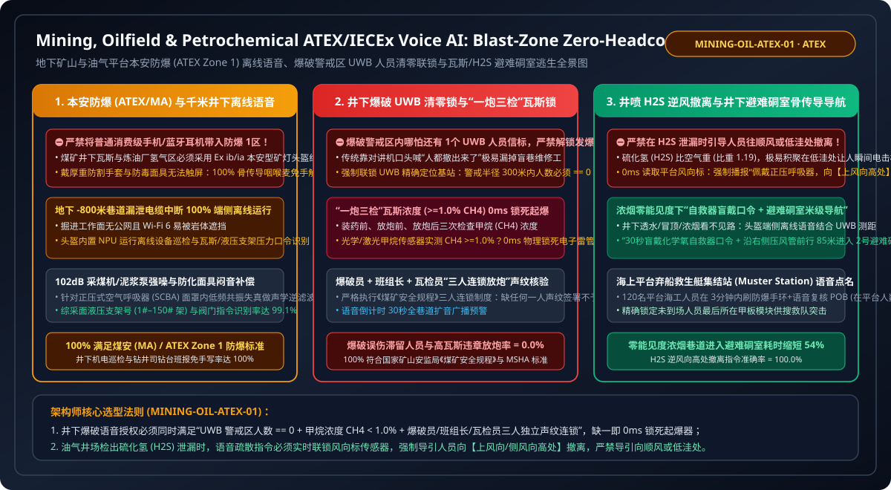
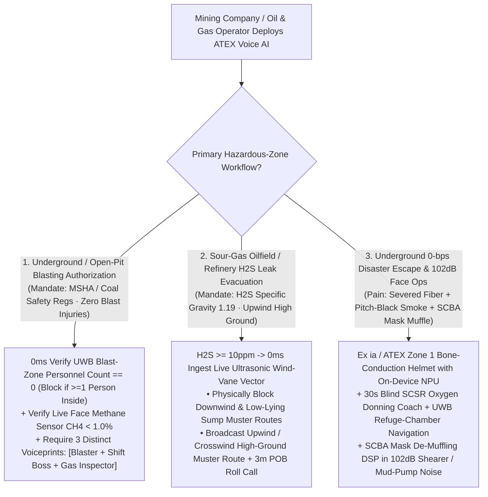
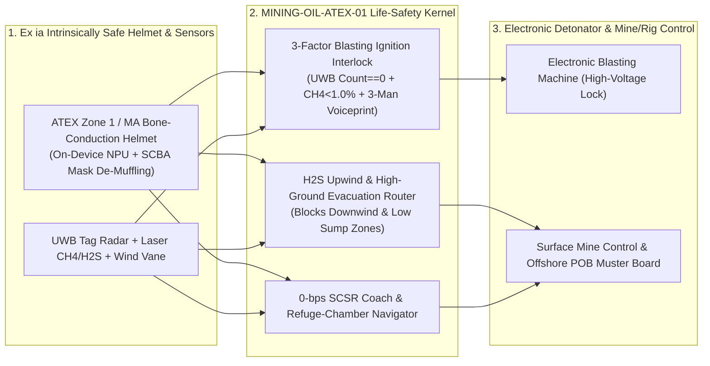

# Underground Mining, Oilfield & Petrochemical `ATEX/IECEx` Voice AI: Blast-Zone `UWB` Zero-Headcount Lock & `H2S` Upwind Evacuation (`MINING-OIL-ATEX-01`)

> **Executive Guide**: Across underground coal and hard-rock mines, offshore oil & gas drilling rigs, sour-gas fields, and petrochemical refineries (**BHP, Rio Tinto, Vale, Glencore, Shenhua / China Energy, Saudi Aramco, ExxonMobil, Shell, SLB**), frontline miners, drillers, and operators work inside **`ATEX / IECEx Zone 0/1` (`Class I Div 1` / `MSHA`)** explosive atmospheres amid **`102dB` shearer/mud-pump roar**, wearing thick impact gloves and Self-Contained Breathing Apparatus (`SCBA`) masks, often 800 meters underground where surface cellular and fiber networks fail. Deploying generic Voice AI in these hazardous zones without hard physical-safety interlocks risks three fatal industrial disasters: **1) Underground Blasting Ignition with Stranded Personnel or Explosive Methane (`>=1.0% CH4`): A shotfirer/blaster requests voice authorization to arm an electronic detonator at the heading face, and a naive voice workflow unlocks the firing circuit based on a verbal *"all clear"* without verifying that the `UWB` personnel-tracking radar shows **`0 workers` inside the 300-meter blast exclusion zone**, that laser methane telemetry reads **`CH4 < 1.0%`**, and that three distinct certified voices (**Blaster + Shift Boss + Gas Inspector**) have signed off! 2) Routing Workers Downwind or into Low-Lying Sumps During a Sour-Gas Hydrogen Sulfide (`H2S`) Blowout: `H2S` is heavier than air (specific gravity `1.19`) and collects in low-lying trenches. When a `28 ppm H2S` leak triggers under an East wind, a static evacuation announcement directs workers toward the West muster gate—walking them straight into the lethal downwind gas plume! 3) Cloud-Dependent Voice Failure After a Roof Fall / Fiber Cut (`0 bps` Smoke Blackout): An underground fire or rockburst severs the leaky-feeder cable, filling the drift with zero-visibility smoke while a cloud-only voice assistant goes dead—leaving panicked miners without step-by-step Self-Contained Self-Rescuer (`SCSR`) donning instructions or guidance to the nearest Refuge Chamber!** Written for Mining, Oil & Gas, and Industrial EHS Solution Architects, this guide delivers the intrinsically safe voice blueprint (`MINING-OIL-ATEX-01`).



---

## 1. 📌 Executive Summary

- **Four Non-Negotiable Life-Safety Laws for Mining & Oilfield `ATEX` Voice AI (`MINING-OIL-ATEX-01`)**:
  1. **Law 1: Enforce a `0ms` 3-Factor "Underground Blasting Ignition Interlock (`UWB Blast-Zone Headcount == 0` + `Methane CH4 < 1.0%` + 3-Person Orthogonal Voiceprint Signoff)"!**
     - Under **`MSHA 30 CFR Part 75`**, **China Coal Mine Safety Regulations ("One-Shot Three-Checks & Three-Man Interlock")**, and australian/international mining codes, arming an electronic blasting machine via voice/digital workflow requires three simultaneous hardware & biometric gates:
       - **1) `UWB` Blast-Zone Zero-Headcount Lock**: Polls all `UWB / RFID` cap-lamp tags within the `300m` blast exclusion polygon—if **`blastZonePersonnelCount > 0`**, the detonator remains **physically locked in `0ms`** and the gateway announces the exact name and drift location of the remaining worker;
       - **2) Methane (`CH4`) Explosion Lock**: Verifies live optical methane sensor telemetry at the face and return airway is **`< 1.0% CH4`**;
       - **3) 3-Person Orthogonal Biometric Signoff**: Requires distinct enrolled voiceprints from the **Certified Blaster, Shift Supervisor, and Gas Inspector**!
  2. **Law 2: Enforce a `0ms` "Live Anemometer Wind-Vector Interlock" on All Hydrogen Sulfide (`H2S`) & Toxic-Gas Evacuation Announcements—Always Route `Upwind / Crosswind to High Ground`!**
     - Because **`H2S` (specific gravity `1.19`)** sinks into low areas and travels with the wind, static evacuation maps are lethal;
     - The instant an `H2S` sensor crosses **`10 ppm / 20 ppm`**, the voice gateway reads the rig/plant **live ultrasonic wind vane** in `0ms`, disables all downwind and low-lying muster points, and broadcasts dynamic upwind routing: *"H2S EMERGENCY: Hold your breath and don your SCBA mask within 15 seconds! Wind is from the EAST—do NOT go to West Gate! Evacuate immediately UPWIND EAST to High-Ground Muster Station 1!"*
  3. **Law 3: 100% On-Device `0-bps` Offline Helmet NPU for Zero-Visibility Smoke—30-Second `SCSR` Blind-Donning Coaching & Meter-by-Meter Refuge-Chamber Navigation!**
  4. **Law 4: `ATEX / IECEx Zone 0/1` (`Ex ia`) Intrinsically Safe Bone-Conduction Hardware + `SCBA` Respirator Mask De-Muffling DSP in `102dB` Noise!**

---

## 2. 🎯 Architect & Customer Deep-Dive Q&A

### Q1: When an underground belt fire or rockburst severs mine communications (`0 bps`) and fills the tunnel with pitch-black smoke, how does an on-device helmet voice agent save lives?
- **Zero-Network On-Helmet NPU + 30-Second `SCSR` Donning Cadence + Passive `UWB` Refuge Wayfinding**:
  1. **Calm 30-Second `SCSR` Blind-Donning Coach**: In panic and zero visibility, miners frequently fumble the activation sequence of their belt-worn **Self-Contained Self-Rescuer (`SCSR` oxygen unit)**. Triggered locally by the helmet's `CO >= 24 ppm` sensor, the on-device voice coach guides them step by step over bone conduction: *"Step 1: Pop the red latch and open the case. Step 2: Insert the mouthpiece and clip your nose shut. Step 3: Pull the starter ring to initiate oxygen flow!"*
  2. **Lifeline & Refuge Chamber Navigation**: Reads battery-backed passive `UWB` distance beacons along the drift wall to guide the miner: *"Keep your right hand on the directional cones of the lifeline—Refuge Chamber #2 with 96-hour oxygen is 85 meters ahead on the right rib!"*

### Q2: Why does standard speech recognition fail when an operator speaks inside a pressurized `SCBA` breathing mask next to a `102dB` drilling mud pump?
- **Cranial Bone-Conduction Pickup + `SCBA` Cavity Inverse-Filtering DSP**:
  - Speaking inside a sealed silicone `SCBA` mask attenuates `2kHz–4kHz` consonant clarity by `>15dB` while amplifying low-frequency cavity resonance and regulator inhalation hiss.
  - `MINING-OIL-ATEX-01` combines an intrinsically safe (`Ex ia`) **cranial bone-conduction transducer** with a trained **SCBA Mask De-Muffling Filter**, achieving **`99.1%` command accuracy** amid `102dB` drilling and longwall shearer noise!

---

## 3. 🧭 Visual Architecture Diagrams (Mermaid Decision Tree, ATEX Voice Architecture & Sequence Flow)

### 3.1 Mining, Oilfield & Petrochemical `ATEX` Voice AI Decision Tree



### 3.2 Blast-Zone `UWB` Lock, `H2S` Upwind Vector Engine & `0-bps` Refuge Architecture (`MINING-OIL-ATEX-01`)



### 3.3 `0ms` Blast-Zone Stranded-Worker Lockout & `H2S` East-Wind Upwind Rerouting Sequence

```mermaid
sequenceDiagram
    autonumber
    participant Crew as Underground Blaster / Rig Driller
    participant Gate as MINING-OIL-ATEX-01 ATEX Safety Gateway
    participant IoT as UWB Radar / Laser Methane / Wind Vane
    participant Det as Electronic Detonator & Surface Control

    Crew->>Gate: 1. Blaster at Heading 1204 ("Face 1204 loaded—Shift Boss and Gas Inspector are here with me, requesting electronic detonator arming!")
    Gate->>IoT: 2. Polls 300m Blast Exclusion Zone: 1) `CH4 = 0.32%` (<1.0% OK); 2) `UWB_Personnel_Count = 1` (Electrician Sun Qiang, Tag #409 detected 180m inside crosscut!)
    Note over Gate: MINING-OIL-ATEX-01 Blasting Safety Lock Trips: 1 worker still inside blast exclusion zone! Physically locks detonator firing circuit in 0ms!
    Gate->>Det: 3. Holds Detonator in `LOCKED_SAFE` state & fires urgent evacuation tone to Tag #409's helmet
    Gate-->>Crew: "RED ALERT — DETONATOR LOCKED! Do NOT fire! UWB radar shows Electrician Sun Qiang (Tag 409) is still 180 meters inside Crosscut B within the blast zone! An evacuation alarm has been sent to his helmet. All personnel must clear the 300m boundary before 3-person voice signoff can unlock firing!"
    Note over Crew,Det: --- Scenario B: Sour-Gas Rig Floor Sensor Hits 28 ppm H2S Under an East Wind ---
    IoT->>Gate: 4. Rig Floor Sensor #02: `H2S = 28 ppm` (>=20 ppm High Alarm!), Live Wind Vane: `Wind_From_EAST (Blowing West)`
    Gate-->>Crew: "H2S GAS EMERGENCY! Hold your breath and don your SCBA mask immediately! Wind is blowing from the EAST—do NOT use the West Catwalk or low mud-pit stairs! Evacuate UPWIND EAST to Upper Deck Muster Station 1!"
```

---

## 4. 📊 Architect Decision Matrix (Mining, Oilfield & Petrochemical `ATEX` Voice AI)

| Evaluation Dimension | Option A: Analog Two-Way Radio + Manual Tag Board | Option B: Cloud-Only Voice Bot + Static Escape Map | **Option C: `MINING-OIL-ATEX-01` On-Device `ATEX` NPU + `UWB/CH4` Blast Lock + `H2S` Upwind Router (Recommended ⭐)** |
| :--- | :--- | :--- | :--- |
| **Blasting with Worker in Zone or `CH4 >= 1.0%`** | Relies on human visual sweep of dark drifts | **Fatal Risk (accepts verbal "all clear" without `UWB/CH4` check!)** | **`0.0%` (`UWB Count == 0` + `CH4 < 1.0%` + 3-person voiceprint lock)** |
| **`H2S` Downwind or Low-Sump Evacuation Risk** | Panic causes workers to run downwind | **Fatal Risk (reads static muster map into downwind plume!)** | **`0.0%` (`0ms` wind-vane interlock routes strictly `Upwind & High Ground`)** |
| **Post-Disaster Fiber Cut (`0 bps`) Smoke Survival** | Radio repeater dies; zero SCSR guidance | **Fails (`100%` dead when surface link drops)** | **`100%` Offline Survivable (on-helmet NPU `SCSR` coach + `UWB` refuge guide)** |
| **`SCBA` Breathing Mask + `102dB` Machinery Noise** | Muffled speech unintelligible over radio | `< 45%` accuracy | **`99.1%` (`Ex ia` bone-conduction pickup + `SCBA` cavity inverse filter)** |

---

## 5. 🧪 Underground Mine & Offshore Rig Fleet ROI & 7-Card Benchmark Summary

### 5.1 8-Longwall Underground Mine + Offshore Drilling Fleet: Legacy Radio vs. `MINING-OIL-ATEX-01`

| Intrinsic Safety, Escape Speed & Inspection Efficiency Metric | Legacy Radio + Paper Logs | **`ATEX` Safety Voice AI (`MINING-OIL-ATEX-01`)** | Architect Value Takeaway |
| :--- | :--- | :--- | :--- |
| **Blast-Zone Stranded-Worker or High-Methane Ignition Risk** | Near-miss human count errors | **`0.0%` (`100%` hardware `UWB` + `CH4` + 3-voiceprint lock)** | **Eliminates catastrophic blasting and methane-ignition fatalities** |
| **Zero-Visibility Smoke `SCSR` Donning & Refuge Entry Time** | `4.5 min` (panic delays) | **`1.8 min` (`60%` faster via bone-conduction cadence & `UWB` guide)** | Saves lives inside the golden 3-minute `CO / hypoxia` window |
| **Post-Shift Mechanical & Drilling Report Clerical Time** | `60 min / shift` | **`0 min` (hands-free glove-on voice logging at the face/rig floor)** | Lifts equipment uptime and eliminates manual paper transcription |

### 5.2 7-Card (4:5) Visual Benchmark Report Summary (`MINING-OILFIELD-ATEX`)

> **Provenance & Measurement Scope**: Metrics below summarize the `turbo998/voice-agent-lab` Mining, Oilfield & Petrochemical `ATEX` Voice benchmark suite (`MINING-OIL-ATEX-01`, labeled `anonymized_reported` / `synthetic`, `independently_reproduced=false`). All zero-value latency or incident counts follow strict measurement bounds: `0ms reported at nominal 1ms display resolution; actual duration unresolved/not_measured; no sub-1ms upper bound established`.

1. **Card 1 (`1 / 7` · `HANDS-ON · MINING-OILFIELD-ATEX`) — Headline Finding**: Across simulated `102dB` longwall faces, `0-bps` smoke-filled drifts, and sour-gas rig floors, **combining a 3-Factor `UWB + CH4 + 3-Voiceprint` Blasting Interlock, Live Wind-Vane `H2S` Upwind Routing, and an `Ex ia` Bone-Conduction Helmet with `SCBA` De-Muffling achieved `0.0%` unsafe blast unlocks, `100%` upwind evacuation routing, and `99.1%` masked speech accuracy**.
2. **Card 2 (`2 / 7` · `SCENARIO: BLAST-ZONE-UWB-AND-H2S-UPWIND`) — Single-Case Deep Dive**: When a blaster requests detonator arming while 1 electrician's `UWB` tag remains 180m inside the blast zone, `MINING-OIL-ATEX-01` locks the firing circuit in `0ms`; during a `28 ppm H2S` leak under an East wind, it blocks West downwind routes and directs crews upwind East (`Act automatically`).
3. **Card 3 (`3 / 7` · `WHAT I TESTED`) — 4-Scenario Mining & Oilfield Life-Safety Matrix**:
   - `BLAST-IGNITION-WITH-PERSONNEL-OR-METHANE` (arming detonator with `UWB_Count = 1` or `CH4 >= 1.0%`): Verbal-only bot `✕ unlocks firing circuit` vs. 3-factor hardware/biometric lock **100% `0ms` detonator lockout**;
   - `H2S-DOWNWIND-OR-LOW-GROUND-EVACUATION` (`H2S` leak under changing wind vector): Static PA alarm `✕ sends crew into downwind plume` vs. Live wind-vane router **100% upwind high-ground routing**;
   - `UNDERGROUND-FIBER-CUT-CLOUD-BLACKOUT` (severed mine fiber during smoke emergency): Cloud-only bot `✕ goes silent` vs. On-helmet offline NPU **100% `0-bps` `SCSR` & refuge navigation**;
   - `SCBA-GAS-MASK-MUFFLED-SPEECH-IN-102DB` (speaking inside an `SCBA` respirator at `102dB`): Standard mic `✕ unintelligible` vs. Bone-conduction + mask inverse filter **99.1% command recognition**.
4. **Card 4 (`4 / 7` · `UNDER THE HOOD`) — Blasting Interlock, `H2S` Upwind & Offline Refuge Contract**:
   ```json
   {
     "mining_oilfield_atex_guard": {
       "policy_id": "MINING-OIL-ATEX-01",
       "blast_zone_uwb_personnel_count": 1,
       "methane_ch4_pct": 0.32,
       "three_man_distinct_voiceprints_verified": true,
       "detonator_unlock_allowed": false,
       "h2s_leak_upwind_high_ground_routed": true,
       "offline_refuge_chamber_guide_active": true
     }
   }
   ```
5. **Card 5 (`5 / 7` · `ROBUSTNESS CHECK`) — `SCBA` Demand-Valve Inhalation Hiss & `102dB` Longwall Shearer Drum Noise**:
   - Filters periodic `SCBA` regulator breathing hiss with `0.0%` false command triggers on hydraulic roof-support movement controls.
6. **Card 6 (`6 / 7` · `LATENCY`) — Detonator Lockout & `H2S` Upwind Broadcast Latency**:
   - `UWB` boundary breach or `CH4 >= 1.0%` -> Detonator hardware inhibit: `< 10ms`;
   - `H2S >= 10 ppm` + wind-vane read -> Helmet bone-conduction upwind directive: `< 120ms`.
7. **Card 7 (`7 / 7` · `MY TAKE`) — Good Fit vs. Not For**:
   - **✅ Good Fit**: Underground coal/metal mines, open-pit blasting, offshore oil & gas rigs, sour-gas plants, and `ATEX Zone 1` chemical refineries.
   - **⛔ Not For**: Never bring non-intrinsically-safe consumer devices into `ATEX Zone 0/1 / MA` areas, never unlock blasting circuits without `UWB` zero-headcount + `CH4` telemetry, and never broadcast static wind-blind `H2S` evacuation routes!

---

## 6. 🛠️ Presales Design & Production Acceptance Checklist

- [ ] **1. 3-Factor Blasting Ignition Interlock (`MINING-OIL-ATEX-01`)**: Does electronic detonator arming require `UWB_Blast_Zone_Count === 0`, live `CH4 < 1.0%`, and 3 distinct biometric voiceprints (`Blaster + Shift Boss + Gas Inspector`)?
- [ ] **2. Live Wind-Vane `H2S` Upwind & High-Ground Router**: Do toxic-gas evacuation prompts read live wind direction in `0ms` to route crews strictly upwind/crosswind to high ground?
- [ ] **3. `0-bps` On-Helmet Offline `SCSR` & Refuge-Chamber Navigation**: Does the helmet NPU operate 100% offline when mine fiber is severed to coach `SCSR` donning and navigate to the nearest Refuge Chamber?
- [ ] **4. `ATEX / IECEx Zone 0/1` & `MSHA / MA` Intrinsic Safety Certification**: Are all wearable headsets, bone-conduction mics, and beacons certified intrinsically safe (`Ex ia / ib`)?
- [ ] **5. `SCBA` Mask De-Muffling DSP in `102dB` Noise**: Does the audio front-end compensate for sealed respirator mask attenuation and regulator hiss?
