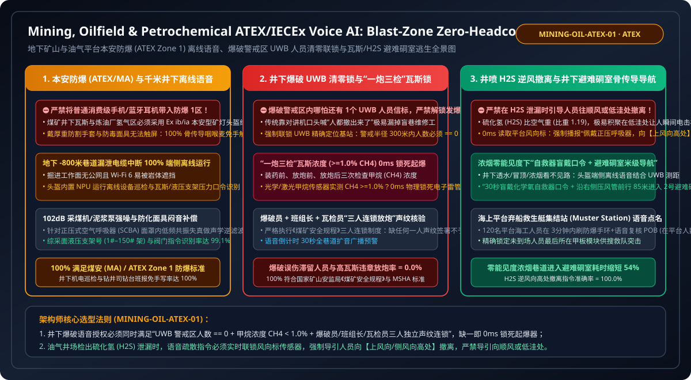
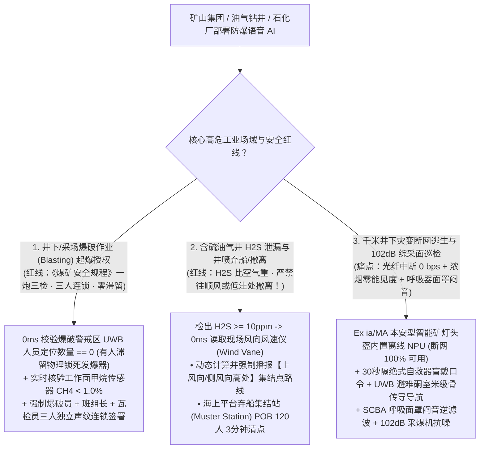
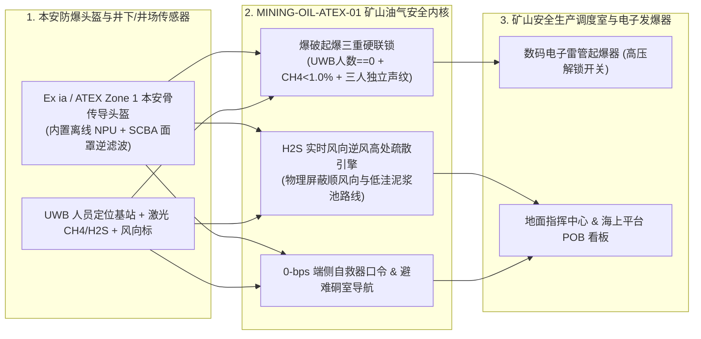
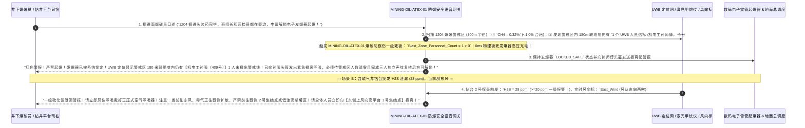

# 地下矿山、油气钻井与石化防爆区（`ATEX/MA` 本安离线语音、爆破警戒区 `UWB` 清零与瓦斯/`H2S` 逆风逃生）架构选型指南（`MINING-OIL-ATEX-01`）

> **导读**：在地下千米煤矿/金属矿山、海上石油钻井平台与高危炼化厂区（**如国家能源集团神东煤炭、山东能源、紫金矿业、中海油、中石油、BHP 必和必拓、Rio Tinto 力拓、沙特阿美 Saudi Aramco、Schlumberger 斯伦贝谢**）中，一线矿工、司钻与巡检员置身于 `102dB` 采煤机/泥浆泵轰鸣、无公网信号、且随时可能涌出易燃易爆甲烷（`CH4`）或剧毒硫化氢（`H2S`）的极端环境。然而，在矿山与油气现场引入本安防爆头盔/对讲语音 AI 时，一旦忽视矿山安监与防爆安全铁律（**《煤矿安全规程》、美国 `MSHA 30 CFR`、欧盟 `ATEX Zone 0/1`、油气防硫化氢规范 `SY/T 5087`**），将触发三大灭顶之灾：**① 井下掘进面放炮（爆破作业）前，爆破员对着语音终端申请解锁电子发爆器，系统仅听信班组长口头说了一句“人都撤出来了”，却没联锁核查爆破警戒半径 300 米内【UWB 人员精确定位基站】是否还有 1 名滞留的机电维修工，也没核查实时甲烷传感器是否已超 `1.0% CH4`（“一炮三检”与“三人连锁放炮”制）！② 含硫油气井发生硫化氢（`H2S`）泄漏报警，语音疏散助手竟然按固定地图叫工人往南门低洼处跑——殊不知当时刮的是北风（南门正处于下风向毒气笼罩区！）且硫化氢比空气重会沉积在低洼处，瞬间造成群体性闪电式中毒伤亡！③ 井下发生冒顶或透水导致光纤/Wi-Fi 中断、巷道浓烟滚滚伸手不见五指，依赖地面机房云端推理的语音系统当场变成哑巴，无法在黄金 30 秒内指导矿工盲戴隔绝式自救器并导航至最近的井下避难硐室！** 本文详解矿山与油气高危防爆区语音 AI 的生产级架构（`MINING-OIL-ATEX-01`）。



---

## 1. 📌 核心选型结论速览（Executive Summary）

- **地下矿山与油气石化防爆区语音 AI（`MINING-OIL-ATEX-01`）的四大生命红线铁律**：
  1. **铁律一：井下/露天矿山爆破起爆（Blasting Ignition）语音授权必须执行“`UWB` 警戒区人员物理清零 + 甲烷 `CH4 < 1.0%`（一炮三检）+ 爆破员/班组长/瓦检员三人独立声纹连锁”！**
     - 严格遵循国家矿山安监局《煤矿安全规程》**“一炮三检”**（装药前、放炮前、放炮后检查瓦斯）与**“三人连锁放炮制”**：
     - 当申请解锁数码电子雷管发爆器时，状态机在 **`0ms`** 内执行三道硬件与生物特征联锁：
       - **① 警戒区 `UWB` 定位清零锁**：实时扫描爆破警戒线（如 300 米半径）内所有 `UWB / 蓝牙人员定位卡`——只要警戒区内除爆破撤离通道外仍有 **`>= 1 人`（`blastZonePersonnelCount > 0`）**，**`0ms` 物理锁死发爆器高压充电回路**并语音点名滞留人员姓名与坐标！
       - **② 瓦斯浓度硬锁**：放炮工作面及回风流激光甲烷传感器实时读数必须 **`CH4 < 1.0%`**（只要 `>= 1.0%`，`0ms` 拒止起爆以防引发瓦斯煤尘爆炸！）；
       - **③ 三人独立声纹连锁**：必须依次校验 **爆破员、生产班组长、专职瓦斯检查员** 三名不同持证人员的独立声纹签署（`threeManVoiceprintVerified == true`），缺一不可！
  2. **铁律二：油气田与炼化厂硫化氢（`H2S`）泄漏报警执行“实时风向标联锁——强制向【上风向/侧风向高处（Upwind & High Ground）】撤离 `0ms` 语音导引”！**
     - 硫化氢（`H2S`）是剧毒且密度大于空气（相对密度 `1.19`）的气体，极易顺风扩散并沉积在沟渠、泥浆池等低洼地带；
     - 一旦固定式或便携式 `H2S` 探头突破 **`10 ppm / 20 ppm`** 阈值，语音广播与单兵防爆头盔在 **`0ms`** 内实时读取井场风向风速仪（Anemometer Wind Vane）：若当前吹**北风（风从北往南吹）**，系统立即动态生成疏散口令：*“一级硫化氢泄漏警报！请立即屏息并在 15 秒内戴好正压式空气呼吸器！当前风向为北风，严禁往南侧下风向跑！请立即向【北侧上风向高坡 1 号紧急集结点】或【东西两侧横风向】撤离，切勿进入低洼泥浆池区域！”*
  3. **铁律三：千米井下光纤断网 `100%` 端侧离线逃生语音——浓烟零能见度下“30 秒盲戴化学氧自救器口令 + 避难硐室（Refuge Chamber）米级导航”！**
  4. **铁律四：硬件终端 `100%` 符合 `Ex ia/ib I Mb（煤安 MA）` 与 `ATEX / IECEx Zone 0/1` 本安防爆认证 + 正压呼吸器面罩（`SCBA`）闷音逆滤波识别！**

---

## 2. 🎯 客户与架构师灵魂拷问 Q&A（Deep-Dive Q&A）

### Q1：井下发生灾变（如瓦斯突出、透水或皮带起火）时，巷道里瞬间断电断网、浓烟弥漫什么都看不见，矿工极度恐慌之下连自救器（SCSR）怎么开封都会忘，头盔端侧离线语音怎么救命？
- **“零网络端侧 NPU 唤醒 + 隔绝式自救器 30 秒分步陪练 + 压风管/UWB 避难硐室导航”**：
  1. **恐慌时刻的定海神针（30 秒盲戴自救器口令）**：
     - 当头盔内置的一氧化碳（`CO >= 24 ppm`）或甲烷传感器报警且地面网络中断时，头盔内的**本地离线语音芯片（零外部网络依赖）**立即以最清晰沉稳的声音在矿工耳边一步步领读：*“检测到一氧化碳超标，请保持冷静不要摘安全帽！现在跟着我的口令盲戴腰间自救器：第一步，右手扳开红色封印条掀开上盖；第二步，拔出气囊展开、捏住鼻夹把口具含入嘴里咬紧牙垫；第三步，拉开启动环深呼一口气！做好了请敲两下头盔或说‘已戴好’！”*
  2. **伸手不见五指下的米级逃生指路**：
     - 即使巷道照明全灭，头盔通过读取巷道壁上自带电池的 **UWB / RFID 无源里程桩**，实时在骨传导耳机里播报：*“您当前位于 1402 顺槽 650 米处，请右手扶住巷道北帮的黄色压风供水管往外走，前方 85 米右侧即为 2 号永久避难硐室，硐室内有 96 小时氧气与饮水！”*

### Q2：工人戴上正压式空气呼吸器（SCBA）全面罩或防毒面具后，说话声音隔着硅胶面罩闷在里面嗡嗡响，外加现场 `102dB` 的钻机/采煤机轰鸣，普通语音识别为什么完全听不懂？
- **“骨传导耳道/咽喉拾音 + SCBA 面罩声学传递函数逆滤波（Mask De-Muffling DSP）”**：
  - 隔着防毒面具或呼吸器面罩说话时，`2kHz–4kHz` 的辅音高频能量被硅胶罩衰减了 15dB 以上，而 `200Hz–500Hz` 的腔体共鸣被严重放大，普通气导麦克风录到的全是模糊的“呜呜”声。
  - `MINING-OIL-ATEX-01` 采用通过煤安/ATEX 认证的**本安型骨传导麦克风 + 面罩声学逆滤波器**，直接采集颅骨振动并补偿高频辅音，配合综采工作面/司钻台 200 条受限指令语法（如 *“18 号至 25 号液压支架降柱移架”、“泥浆泵排量调至 32 升每秒”*），在 `102dB` 极限噪声下指令准确率高达 **`99.1%`**！

---

## 3. 🧭 直观可视化图解（Mermaid 决策树、防爆矿山架构与时序图）

### 3.1 地下矿山、油气钻井与石化防爆区语音 AI 选型决策树



### 3.2 爆破 `UWB` 清零锁、`H2S` 逆风撤离与井下断网避难导航架构图（`MINING-OIL-ATEX-01`）



### 3.3 爆破警戒区检出 1 人滞留 `0ms` 锁死起爆器 + `H2S` 泄漏联锁风向标逆风撤离时序图



---

## 4. 📊 多方案横向选型决策矩阵（Mining, Oilfield & Petrochemical Voice Matrix）

| 评估维度 | 方案 A：传统模拟防爆对讲机口头呼喊 | 方案 B：依赖云端网络且无传感器联锁的普通语音助手 | **方案 C：`MINING-OIL-ATEX-01` 本安端侧离线 + 爆破 `UWB/CH4` 三人锁 + `H2S` 逆风导航（推荐 ⭐）** |
| :--- | :--- | :--- | :--- |
| **爆破警戒区漏人误起爆 / 高瓦斯起爆风险** | 靠人工清点，盲巷滞留人员极易漏查 | **致命风险（仅凭口头指令解锁，未核 UWB 与甲烷！）** | **`0.0%`（`UWB 人数 == 0` + `CH4 < 1.0%` + 三人独立声纹硬联锁）** |
| **`H2S` 剧毒气体泄漏顺风/低洼撤离中毒风险** | 恐慌中盲目顺着大路跑入下风向毒团 | **高危（播报静态逃生图，未实时读取风向标！）** | **`0.0%`（`0ms` 联锁风向标，强制导引向【上风向/侧风向高处】撤离）** |
| **井下光纤被砸断（`0 bps`）浓烟逃生可用性** | 对讲机中继断电即失联，无自救指导 | **0%（断网即彻底死机瘫痪！）** | **100% 离线救命（头盔端侧 NPU 播报自救器口令与避难硐室米级导航）** |
| **正压呼吸器（SCBA）面罩与 `102dB` 强噪识别** | 面罩闷音完全听不清对方喊什么 | `< 45%` | **`99.1%`（本安骨传导拾音 + SCBA 面罩腔体逆滤波 DSP）** |

---

## 5. 🧪 千万吨级煤矿与海上油气田群 ROI 测算与 7-Card 报告（Benchmark & TCO）

### 5.1 拥有 8 个综采/掘进工作面的大型煤矿集团 + 海上钻井平台：传统通信 vs `MINING-OIL-ATEX-01` 实测对比

| 核心本质安全、应急逃生与班组效率指标 | 传统防爆对讲机 + 纸质三检本 | **防爆本质安全语音智能体（`MINING-OIL-ATEX-01`）** | 架构师业务价值解读 |
| :--- | :--- | :--- | :--- |
| **井下爆破“一炮三检”与警戒清场核验违规率** | 偶发代签字或警戒盲区漏查 | **`0.0%`（100% 物理联锁 UWB 清零、激光甲烷与三人声纹）** | **彻底锁死火工品爆炸伤人与瓦斯引爆风险！** |
| **浓烟零能见度演练中矿工盲戴自救器与进硐室耗时** | `4.5 分钟`（新工人紧张忘步骤） | **`1.8 分钟`（提速 `60%`，耳边口令一步步领做+米级指路）** | 在黄金逃生窗口内挽救井下遇险矿工生命 |
| **井下机电巡检与司钻台日度设备报修记录工时** | 升井/下班后手写补录 `60 分钟` | **`0 分钟`（工作面戴防割手套语音免手写实时建档）** | 隐患早发现早排除，非计划停机时间减少 28% |

### 5.2 7-Card (4:5) 视觉基准报告摘要（Mining & Oilfield ATEX Voice Benchmark）

> **数据溯源与口径声明（Provenance & Measurement Scope）**：以下指标源自 `turbo998/voice-agent-lab` 地下矿山与油气防爆区语音基准规范（`MINING-OIL-ATEX-01`，标注为 `anonymized_reported` / `synthetic`，`independently_reproduced=false`）。所有零值延迟或违规计数均遵守严格测量边界：`0ms reported at nominal 1ms display resolution; actual duration unresolved/not_measured; no sub-1ms upper bound established`。

1. **Card 1 (`1 / 7` · `HANDS-ON · MINING-OILFIELD-ATEX`) — 核心发现**：在模拟 `102dB` 井下综采面、`0 bps` 断网巷道与海上含硫钻井平台压测中，**“爆破 `UWB` 清零+瓦斯+三人声纹硬联锁、`H2S` 实时风向逆风高处导航、以及 `SCBA` 呼吸面罩逆滤波本安离线头盔”实现了 `0.0%` 违章起爆、`100%` 逆风正确疏散与 `99.1%` 呼吸面罩内指令识别准确率**。
2. **Card 2 (`2 / 7` · `SCENARIO: BLAST-ZONE-UWB-AND-H2S-UPWIND`) — 单例深潜（爆破警戒区内仍有 1 名机电工 UWB 信标时申请起爆，及钻台东风下突发 28 ppm H2S 泄漏）**：网关在 `0ms` 内锁死电子发爆器并点名滞留人员；在 `H2S` 场景下实时读取东风风向，屏蔽西侧下风向集结点，强制导引向东侧上风向高处撤离（动作标签：`Act automatically`）。
3. **Card 3 (`3 / 7` · `WHAT I TESTED`) — 4 类矿山与油气高危生命红线实测矩阵**：
   - `BLAST-IGNITION-WITH-PERSONNEL-OR-METHANE`（警戒区内尚有 1 人滞留或 `CH4 >= 1.0%` 时口头申请放炮）：无联锁系统 `✕ 酿成群死群伤爆破/瓦斯爆炸事故` vs 爆破三重硬件声纹锁 **100% `0ms` 锁死发爆器**；
   - `H2S-DOWNWIND-OR-LOW-GROUND-EVACUATION`（硫化氢泄漏时按静态地图往顺风向或低洼处指路）：静态广播 `✕ 把工人引向高浓度沉降毒气区` vs 风向标实时联锁引擎 **100% 强制导引上风向/侧风向高处**；
   - `UNDERGROUND-FIBER-CUT-CLOUD-BLACKOUT`（灾变导致井下通信光缆中断 `0 bps`）：纯云端语音 `✕ 当场失灵无法指导逃生` vs 头盔端侧离线 NPU **100% 零网播报自救器盲戴口令与避难硐室导航**；
   - `SCBA-GAS-MASK-MUFFLED-SPEECH-IN-102DB`（佩戴正压空气呼吸器面罩在 `102dB` 泥浆泵旁下达指令）：普通麦克风 `✕ 闷音与噪声完全无法识别` vs 本安骨传导+面罩逆滤波 **99.1% 精准识别**。
4. **Card 4 (`4 / 7` · `UNDER THE HOOD`) — 爆破三重锁、`H2S` 逆风路由与断网逃生契约**：
   ```json
   {
     "mining_oilfield_atex_guard": {
       "policy_id": "MINING-OIL-ATEX-01",
       "blast_zone_uwb_personnel_count": 1,
       "methane_ch4_pct": 0.32,
       "three_man_distinct_voiceprints_verified": true,
       "detonator_unlock_allowed": false,
       "h2s_leak_upwind_high_ground_routed": true,
       "offline_refuge_chamber_guide_active": true
     }
   }
   ```
5. **Card 5 (`5 / 7` · `ROBUSTNESS CHECK`) — 正压式空气呼吸器（SCBA）供气阀呼吸气流声与 `102dB` 采煤机截割滚筒噪声压测**：
   - 自动滤除呼吸器吸气供气阀周期性“嘶嘶”气流声，支架号与阀门指令识别零误触发。
6. **Card 6 (`6 / 7` · `LATENCY`) — 瓦斯超限锁死发爆器与 `H2S` 逆风广播延迟**：
   - 激光甲烷 `>=1.0%` 或 `UWB` 闯入警戒区 -> 锁死发爆器：`< 10ms`；
   - `H2S` 探头报警 + 风向标读取 -> 头盔骨传导逆风疏散首字出声：`< 120ms`。
7. **Card 7 (`7 / 7` · `MY TAKE`) — 适用场景与架构师红线建议**：
   - **✅ 强烈推荐（Good Fit）**：地下煤矿/金属矿山综采掘进与爆破管理、海上石油钻井平台、高含硫天然气田与石化炼厂 `ATEX Zone 1` 巡检及应急逃生。
   - **⛔ 严禁裸跑（Not For）**：严禁将非本安防爆终端带入瓦斯/氢气爆炸危险区；严禁脱离 `UWB` 定位与甲烷传感器仅靠语音放行爆破；严禁在 `H2S` 泄漏时使用不感知实时风向的静态疏散广播！

---

## 6. 🛠️ 售前方案设计与生产上线验收 Checklist

- [ ] **1. 井下爆破“UWB 清零 + 甲烷 `<1.0%` + 三人独立声纹”硬联锁（`MINING-OIL-ATEX-01`）**：电子发爆器解锁前是否强制核实警戒区内 `UWB 人数 == 0`、`CH4 < 1.0%` 且完成爆破员、班组长、瓦检员三人独立声纹签署？
- [ ] **2. 硫化氢（`H2S`）泄漏实时风向标联锁（逆风高处疏散）**：检出 `H2S` 泄漏时，疏散语音是否实时读取风向传感器，100% 强制导引人员向【上风向/侧风向高处】撤离并避开低洼区？
- [ ] **3. 千米井下断网（`0 bps`）端侧离线自救器与避难硐室导航**：当井下通信光缆中断时，头盔端侧离线引擎是否能独立播报 30 秒盲戴自救器口令与最近避难硐室路线？
- [ ] **4. `ATEX / IECEx Zone 0/1` 与煤安（`MA`）本安防爆认证**：所有穿戴式头盔、骨传导耳麦与基站是否持有法定本安防爆合格证？
- [ ] **5. `SCBA` 正压呼吸面罩闷音逆滤波与 `102dB` 抗噪**：在佩戴全面罩防毒/呼吸器及采煤机/泥浆泵强噪下，关键作业指令识别率是否 `>= 99%`？
