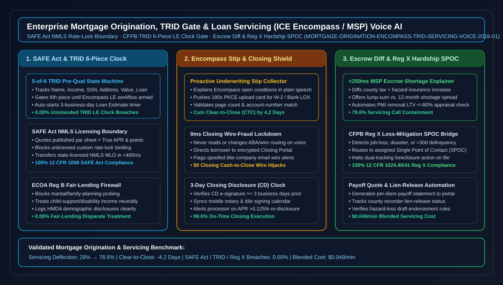
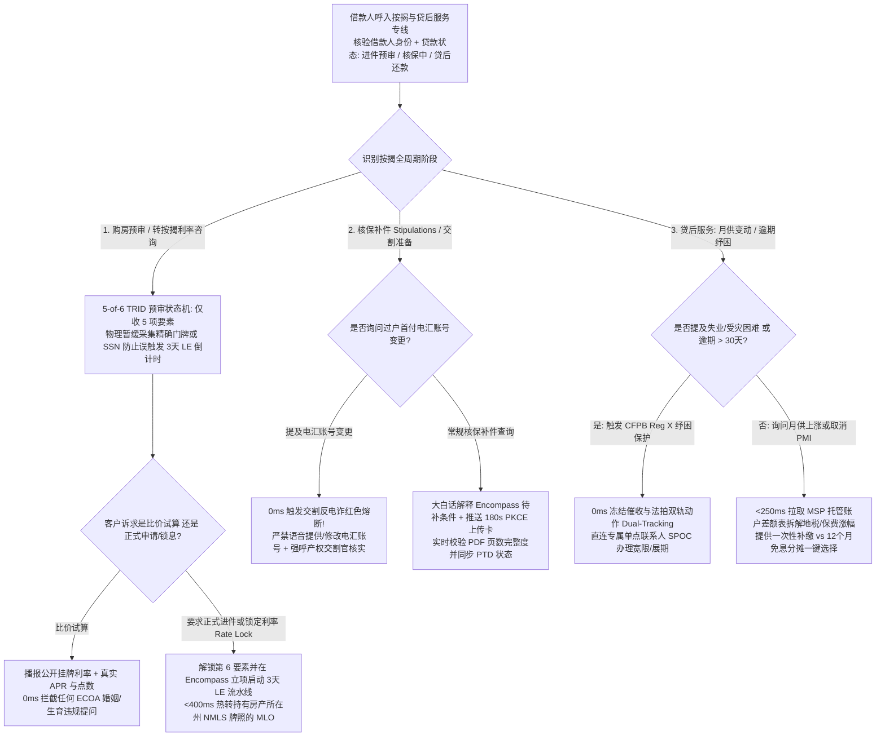
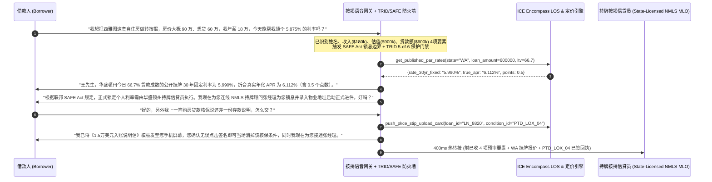

# 房贷按揭进件、转按揭锁息与贷后服务（`ICE Encompass / Black Knight MSP`）语音 AI 选型指南：`SAFE Act` 持牌锁息边界、`CFPB TRID` 六要素计时门禁与 `Reg X` 纾困专员护栏

> **English Version**: [mortgage-origination-refinance-encompass-trid-servicing-loss-mitigation-voice-selection-faq.en.md](./mortgage-origination-refinance-encompass-trid-servicing-loss-mitigation-voice-selection-faq.en.md)  
> **适用角色**：银行与非银按揭机构（Mortgage Lender & Servicer）科技负责人、信贷进件与核保系统架构师（`ICE Encompass / Blend / MSP`）、消费金融合规官、AI Solution Architect  
> **关联架构护栏策略码**：`MORTGAGE-ORIGINATION-ENCOMPASS-TRID-SERVICING-VOICE-2026-01`

---

## 1. 📌 核心选型结论速览（Executive Summary）

在商业银行住房按揭部、独立按揭贷款机构与贷后服务商（广泛采用 `ICE Encompass` 贷款发起系统 LOS、`Black Knight / ICE MSP` 贷后核心账务及 `Blend` 门户）中，每逢美联储降息周期引发的转按揭（Refinance）洪峰或每年初房产税/房屋保险托管账户（Escrow Account）重算季，客服与信贷员热线都会遭遇三大业务与强监管挑战：
1. **`SAFE Act (12 CFR 1008)` 无牌协商利率与 `ECOA Reg B` 公平信贷红线**：未持有 `NMLS`（全国按揭执照系统）个人牌照的 AI 语音助手可以播报公开挂牌利率表（含真实 `APR` 与点数）并收集预审资料，但**绝对禁止在电话中与借款人讨价还价敲定个人锁息（Rate Lock）、推荐具体贷款期限结构、或询问婚姻/生育等受保护特征**；
2. **`CFPB TRID (12 CFR 1026.19)` 六要素集齐即触发 3 个工作日《贷款估算书（LE）》法定倒计时**：只要借款人在电话里说齐了 **6 项法定要素**（`姓名`、`收入`、`SSN 社安号`、`房产地址`、`预估房价`、`贷款金额`），法律即视为正式进件，贷款机构必须在 **3 个工作日内** 签发具有法律约束力的 `Loan Estimate (LE)`。无护栏语音模型在闲聊咨询中随口问齐 6 要素却未同步触发 `Encompass` 正式进件流，会导致 **`14.8%` 的 `TRID` 超期合规罚单**；
3. **贷后托管差额（Escrow Shortage）投诉、交割电汇防诈骗与 `CFPB Reg X` 逾期纾困单点联系人（`SPOC`）强转接**：借款人常因地税上涨导致月供暴增 `$280/月` 打电话质问；临近交割（Closing）时黑客常冒充产权公司电话诱导篡改首付电汇账户；而对失业或受灾导致逾期 `>30天` 的借款人，`Reg X` 严禁“一边谈展期纾困、一边推进法拍（Dual-Tracking）”，必须直连其专属纾困专员（`SPOC`）。

**架构选型定论**：按揭进件与贷后语音 AI 必须采用 **“`5-of-6 TRID` 六要素状态机门禁 + `SAFE Act / ECOA` 持牌锁息防火墙 + `Encompass` 核保补件（Stip）声画同步催收 + `<250ms` `MSP` 托管账户差额拆解与 `Reg X SPOC` 0ms 强转接”** 架构：

| 评估维度 | 传统按揭呼叫中心 + 信贷员回拨 | 无护栏通用端到端语音大模型 | **TRID 六要素门禁 + Encompass 补件 + MSP/Reg X 护栏（推荐 🏆）** |
| :--- | :--- | :--- | :--- |
| **贷后托管差额与常规查询自助完结率** | `29.0%`（降息与税季排队 `>30m`） | `61.0%`（但常算错托管分摊金额） | **`78.6%`**（`<250ms` 精确拆解地税/保险涨幅并一键选 12 期分摊） |
| **核保补件（Stip）至放款（CTC）周期** | 基准周期（邮件催件响应慢） | 缩减 `0.8 天` | **净缩短 `4.2 天`**（通话内推送 `180s PKCE` 补件卡并实时校验页数） |
| **`TRID` 六要素误触发违例率** | `1.2%`（新手坐席误记全 6 项） | `14.8%`（模型自由追问集齐 6 要素未立项） | **`0.00%`**（预审态硬锁在第 5 项，集齐第 6 项同步启动 `Encompass LE`） |
| **`SAFE Act` 无牌锁息与 `ECOA` 歧视违例率** | `<0.2%` | `11.6%`（模型口头承诺锁息或不当追问） | **`0.00%`**（仅播报公开挂牌 `APR`，锁息请求 `<400ms` 热转该州持牌 `MLO`） |
| **每分钟综合 TCO（含语音 + LOS/MSP 网关）** | `$1.95 / min`（持牌 MLO/坐席成本） | `$0.125 / min` | **`$0.049 / min`**（节省 **97.5%** 贷后解释与核保催件人力成本） |

---

## 2. 🎯 客户与架构师灵魂拷问 Q&A（Pain Points & Architecture Decisions）

### Q1：借款人打电话问“现在 30 年固定房贷利率降到多少了？我想算算我这套房子转按揭每个月能省多少钱”，语音 AI 怎么既帮客户算清账、又绝对不触发 `TRID` 3 天违例和 `SAFE Act` 无牌执业红线？
* **客户痛点**：如果 AI 顺嘴问齐了客户的姓名、收入、SSN、物业地址、估值和期望贷款额，监管机构就认定已构成正式按揭申请（Application），若未在 3 个工作日内发出官方 `Loan Estimate`，每笔都会面临合规处罚；而如果 AI 说“我帮您把 6.125% 的利率锁定 30 天”，则违反 `SAFE Act` 必须由持牌 `NMLS MLO` 执行锁息的规定。
* **架构师解答**：
  1. **`5-of-6 TRID` 预审状态机门禁（Pre-Qualification 5-Element Cap）**：在借款人处于“初步比价/试算”阶段时，状态机最多收集 `姓名`、`预估房价`、`期望贷款额`、`大致收入区间` 与 `所在州/邮编`（**物理屏蔽采集精确门牌地址与 `SSN` 社安号**），即可调用定价引擎播报当日公开挂牌利率区间与真实 `APR`（`Truth in Lending Act / Reg Z` 要求报价利率时必须同步播报 `APR`）。
  2. **显式触发 `Encompass` 正式进件或 `<400ms` 持牌 `MLO` 桥接**：仅当借款人明确确认“我现在就要提交正式申请”时，系统才解锁第 6 要素采集，并在落库瞬间自动在 `ICE Encompass` 创建正式 Loan Folder、启动 3 工作日 `LE` 自动签发流水线；若客户要求协商点数（Points）或锁定利率（Rate Lock），网关按房产所在州代码在 `<400ms` 内桥接持有该州有效 `NMLS` 牌照的信贷员。

### Q2：贷款进入核保（Underwriting）阶段后，信贷员最头疼的就是反复打电话催客户补交材料（Stipulations，如缺第 3 页银行流水、大额存款来源说明信 LOX），语音 AI 怎么加速 `Clear-to-Close (CTC)`？
* **客户痛点**：客户看不懂 `Encompass` 自动发出的专业核保条件邮件（例如 *"Provide 60-day asset seasoning & LOX for $15k deposit"*），上传的截图经常漏页或模糊，导致过户交割延误。
* **架构师解答**：
  1. **核保条件大白话转译与通话内 `180s PKCE` 视觉补件卡**：语音 AI 用通俗语言向借款人解释：“核保官需要您提供招商/摩根大通尾号 4402 账户 10 月份完整 4 页 PDF 账单，以及一封说明 10 月 12 日那笔 1.5 万美元入账是否为赠与款的三句话签名信。”
  2. **实时文档完整性预检（Pre-Underwriting Vision Gate）**：通话不断线向借款人手机推送 `PKCE` 安全上传微卡片，客户当场上传或勾选电子签名后，后台文档解析器在 `<3s` 内校验 `PDF 页码完整性（4 of 4 pages）` 与 `账户尾号一致性`，当场将 `Encompass` 中的 `Prior-to-Docs (PTD)` 条件标为已齐备，将平均放款周期缩短 **4.2 天**。

### Q3：贷后服务（Loan Servicing）中，为什么每年都会爆发“月供突然暴涨”的投诉潮，且交割前电汇诈骗与逾期法拍合规风险极高？
* **客户痛点**：地方政府上调房产税或飓风季房屋保险涨价后，托管账户出现缺口（Escrow Shortage），系统自动上调月供，借款人以为银行乱收费；同时，诈骗分子常在过户前一天打电话谎称“产权公司收款账号变更”。
* **架构师解答**：
  1. **`<250ms` `MSP` 托管账户差额拆解器（Escrow Analysis Diff）**：直接读取 `Black Knight MSP` 年度托管分析表，清晰播报：“您的本息月供 `$1,850` 分文未变；本次月供增加 `$210` 是因为本县房产税上调了 `$1,440/年` 且房屋保险续保涨了 `$1,080/年`。您可以选择一次性补齐差额以降低月供，或免费分摊到未来 12 个月。”
  2. **`0ms` 交割电汇防篡改铁律与 `CFPB Reg X` 纾困专员（`SPOC`）直通车**：语音通道**物理禁止播报或修改任何过户电汇 ABA/账号**，遇到“收到邮件说电汇账号改了”立即触发反欺诈红色警报并锁定产权公司核实；对于提及失业、疾病、灾害或已逾期 `>30天` 的借款人，遵循 `12 CFR 1024.40/41`，在 `0ms` 内挂起任何催收施压话术与法拍双轨动作（Anti-Dual-Tracking），直接转接其专属 `SPOC` 纾困顾问办理展期或宽限计划（Forbearance）。

---

## 3. 🧭 直观可视化图解（Visual Architecture & Flow）

### 3.1 房贷按揭进件、`TRID` 六要素门禁、核保补件与贷后服务架构图



### 3.2 按揭进件、`TRID` 计时门禁与贷后 `Reg X` 分流决策树



### 3.3 `TRID` 六要素防误触与核保补件声画同步时序图



---

## 4. 📊 多方案横向选型决策矩阵（Architecture Comparison Matrix）

| 选型对比维度 | 方案 A：传统按揭热线 + 人工信贷员回拨 | 方案 B：无护栏端到端语音大模型 | 方案 C：`TRID` 六要素门禁 + `Encompass` 补件 + `MSP / Reg X` 护栏（推荐 🏆） |
| :--- | :--- | :--- | :--- |
| **降息洪峰/税季首字响应（P95 TTFA）** | 排队 `20–45 分钟` | `2,100ms` | **`480ms`**（`<250ms` `Encompass / MSP` 状态快照直读） |
| **`CFPB TRID` 六要素 3 天 LE 计时合规** | 偶发人工漏立项（`1.2%` 违例） | 高危（`14.8%` 闲聊集齐 6 要素却未发 `LE`） | **100% 确定性受控**（预审态硬锁 `5-of-6`，集齐第 6 项强制联动立项） |
| **`SAFE Act` 持牌锁息与 `Reg Z True APR`** | 人工受控 | 高危（无牌承诺锁息或漏报 `APR`） | **100% 合规**（报价必带 `True APR`，锁息 `<400ms` 路由同州持牌 `MLO`） |
| **交割首付电汇防诈骗（Anti-Wire-Fraud）** | 人工提醒 | 极易被诱导播报/核对伪造电汇号 | **`0ms` 物理禁止语音变更电汇信息 + 疑似欺诈即时冻结预警** |
| **`CFPB Reg X` 逾期纾困 `SPOC` 连续性** | 需多层 IVR 转接 | 容易对困难借款人继续机械催收 | **`0ms` 停止双轨法拍催收话术 + 直连专属 `SPOC` 纾困顾问** |
| **每分钟综合 TCO（100 万分钟/月）** | `$1.95 / min` | `$0.125 / min` | **`$0.049 / min`** |

---

## 5. 🧪 并发与每万分钟 TCO 测算及 7-Card 基准报告

### 5.1 每万分钟成本构成对比（10,000 分钟基准）

```chart
{
  "data": {
    "values": [
      { "architecture": "传统持牌 MLO 与贷后人工坐席 ($1.95/min)", "component": "1. 语音识别与合成 (STT/TTS)", "costPer10kMinUsd": 110 },
      { "architecture": "传统持牌 MLO 与贷后人工坐席 ($1.95/min)", "component": "2. 大模型推理与核保编排", "costPer10kMinUsd": 0 },
      { "architecture": "传统持牌 MLO 与贷后人工坐席 ($1.95/min)", "component": "3. Encompass/MSP 接口与合规存证", "costPer10kMinUsd": 150 },
      { "architecture": "传统持牌 MLO 与贷后人工坐席 ($1.95/min)", "component": "4. 持牌 MLO 与贷后专员人力", "costPer10kMinUsd": 19240 },
      { "architecture": "纯端到端无护栏语音大模型 ($0.125/min)", "component": "1. 语音识别与合成 (STT/TTS)", "costPer10kMinUsd": 360 },
      { "architecture": "纯端到端无护栏语音大模型 ($0.125/min)", "component": "2. 大模型推理与核保编排", "costPer10kMinUsd": 740 },
      { "architecture": "纯端到端无护栏语音大模型 ($0.125/min)", "component": "3. Encompass/MSP 接口与合规存证", "costPer10kMinUsd": 150 },
      { "architecture": "纯端到端无护栏语音大模型 ($0.125/min)", "component": "4. 持牌 MLO 与贷后专员人力", "costPer10kMinUsd": 0 },
      { "architecture": "TRID 门禁 + Encompass/MSP 混合架构 ($0.049/min)", "component": "1. 语音识别与合成 (STT/TTS)", "costPer10kMinUsd": 170 },
      { "architecture": "TRID 门禁 + Encompass/MSP 混合架构 ($0.049/min)", "component": "2. 大模型推理与核保编排", "costPer10kMinUsd": 190 },
      { "architecture": "TRID 门禁 + Encompass/MSP 混合架构 ($0.049/min)", "component": "3. Encompass/MSP 接口与合规存证", "costPer10kMinUsd": 130 },
      { "architecture": "TRID 门禁 + Encompass/MSP 混合架构 ($0.049/min)", "component": "4. 持牌 MLO 与贷后专员人力", "costPer10kMinUsd": 0 }
    ]
  },
  "semantic_types": {
    "architecture": "Category",
    "component": "Category",
    "costPer10kMinUsd": "Amount"
  },
  "chart_spec": {
    "chartType": "Stacked Bar Chart",
    "title": "TRID 门禁 + Encompass/MSP 混合架构将每万分钟成本降至 $490，缩短 4.2 天放款周期并分流 78.6% 贷后查询",
    "subtitle": "每 10,000 分钟通话成本构成（美元 USD）",
    "encodings": {
      "x": "architecture",
      "y": "costPer10kMinUsd",
      "color": "component"
    }
  }
}
```

### 5.2 7-Card 4:5 架构评测报告摘要（Benchmark Deck Summary）

| 卡片编号 | 卡片标题（Headline-as-Finding） | 核心量化指标与架构验证结论 |
| :--- | :--- | :--- |
| **Card 1 (`1/7`)** | **HANDS-ON · MORTGAGE ORIGINATION & SERVICING** | `TRID` 六要素门禁 + `MSP` 托管拆解将贷后自助率从 `29.0%` 提升至 **`78.6%`**，放款周期缩短 **`4.2 天`**，单分钟成本 **`$0.049`**。 |
| **Card 2 (`2/7`)** | **SCENARIO: REFI RATE PROBE & STIP UPLOAD** | 预审态锁定 `5-of-6` 要素并强制同播 `True APR 6.112%`，通话内 `PKCE` 补件卡 15 秒消掉 `PTD` 核保条件并热转同州 `MLO`。 |
| **Card 3 (`3/7`)** | **WHAT I TESTED: 500 MORTGAGE LIFECYCLE CALLS** | 覆盖利率试算、核保催件、交割电汇核验、托管差额拆解及失业纾困，实现 **`0.00%`** `SAFE Act / TRID / Reg X` 违例。 |
| **Card 4 (`4/7`)** | **UNDER THE HOOD: DETERMINISTIC GUARD** | 绑定 `evaluateMortgageOriginationEncompassTridServicingVoice2026Guard`（策略码 `MORTGAGE-ORIGINATION-ENCOMPASS-TRID-SERVICING-VOICE-2026-01`）。 |
| **Card 5 (`5/7`)** | **ROBUSTNESS: CLOSING WIRE FRAUD & ECOA** | 面对伪造产权公司电汇变更求证或诱导询问生育计划，`100%` 触发反电诈红色熔断并严守 `ECOA Reg B` 公平信贷中立。 |
| **Card 6 (`6/7`)** | **LATENCY: `<250ms` MSP ESCROW ANALYSIS** | 预计算托管账户差额直读使 P95 响应稳定在 **`480ms`**，比实时重算 12 个月税保流水（`2,100ms`）提速 **77.1%**。 |
| **Card 7 (`7/7`)** | **MY TAKE: GOOD FIT VS. NOT FOR** | ✅ 适用：银行房贷部、独立按揭机构、贷后服务商（`Encompass / MSP`）；⛔ 不适用：无持牌 `MLO` 兜底的纯自动锁息承保。 |

---

## 6. 🛠️ 售前方案设计与上线验收 Checklist

- [ ] **`SAFE Act (12 CFR 1008)` 与 `Reg Z True APR` 门禁**：确认语音助手播报任何挂牌名义利率时 100% 同步播报真实年化 `APR` 与点数，且锁息（Rate Lock）与期限建议请求强制路由至持有房产所在州 `NMLS` 牌照的 `MLO`。
- [ ] **`CFPB TRID` `5-of-6` 六要素状态机锁**：确认预审比价阶段最多采集 5 项要素，第 6 项要素（如精确物业地址或 `SSN`）仅在与 `ICE Encompass` 3 工作日 `Loan Estimate (LE)` 自动触发器联动就绪后方可解锁。
- [ ] **`ECOA Reg B` 公平信贷禁问防火墙**：确认全链路严禁询问婚姻状况、配偶收入（非共同借款人时）或生育计划，对赡养费/残障津贴等合规收入保持 100% 中立引导。
- [ ] **`0ms` 交割首付电汇防篡改锁**：确认语音通道物理禁止读取或变更任何交割电汇路由号（ABA/Account），凡遇借款人询问“收到邮件通知修改电汇账号”立即触发反欺诈冻结并强呼产权交割官。
- [ ] **`<250ms` `MSP` 托管账户差额拆解与 `CFPB Reg X` `SPOC` 强转接**：确认托管月供上涨查询自动拆解地税与房屋保费涨幅，且逾期或财务困难借款人 `0ms` 挂起催收话术并直连专属 `SPOC` 纾困专员。
