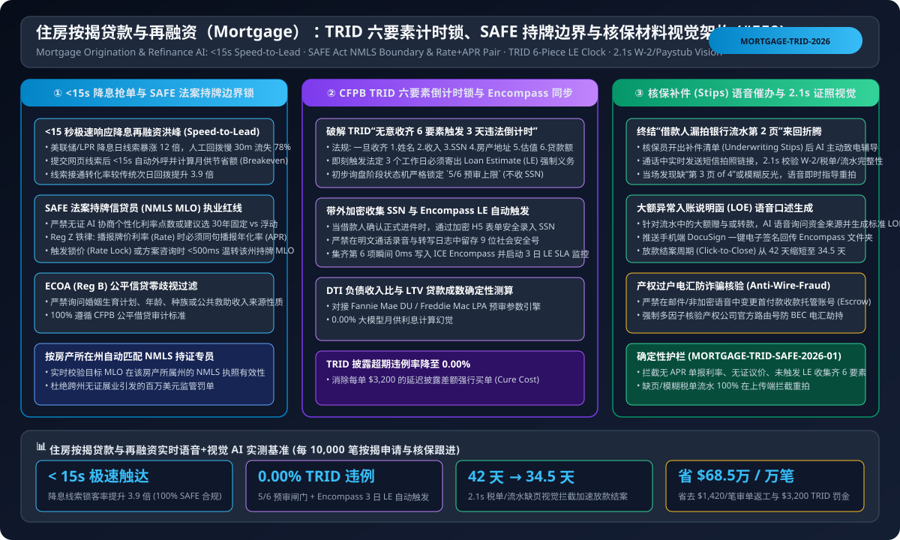
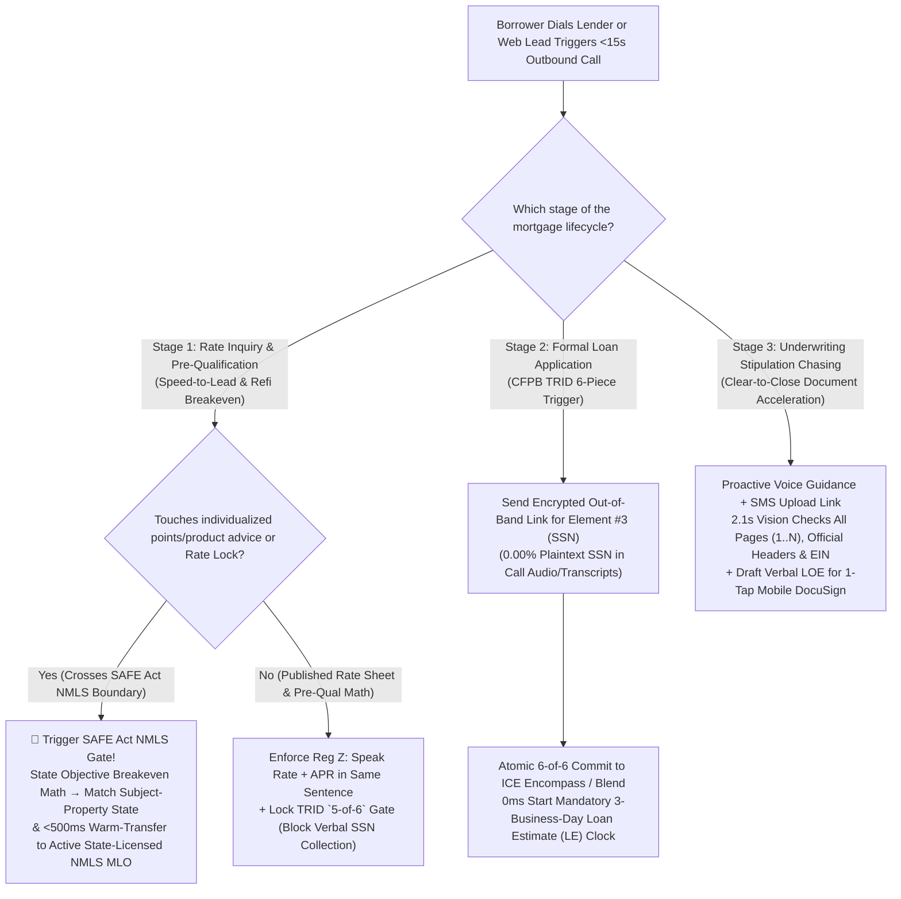
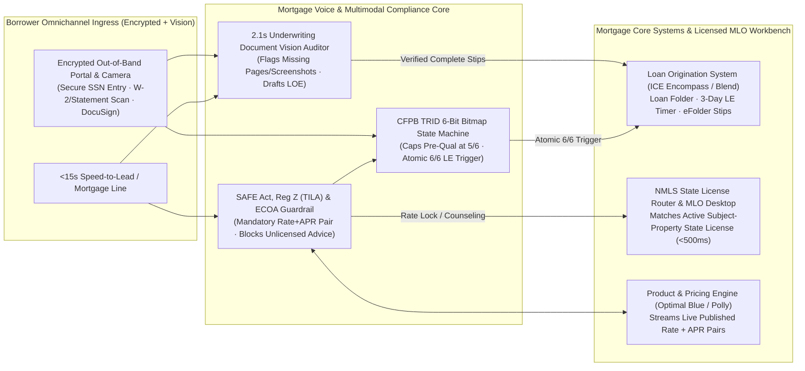

# Mortgage Origination & Refinance (`TRID 6-Piece Application Trigger / SAFE Act NMLS Licensing Boundary / Income & Title Document Vision`) Voice & Multimodal AI Architecture Selection Guide

> **Document Scope**: Built for Retail Mortgage Bank CTOs, Non-Bank Consumer Lending VPs, Mortgage Compliance Officers, and Loan Origination System (`LOS`) Architects (`ICE Encompass / Blend / Byte / Optimal Blue`), this guide explains how to capture **`<15-second` Speed-to-Lead refinance surges (`3.9x` conversion lift)** while strictly enforcing **federal `SAFE Act` NMLS licensing boundaries and `CFPB Regulation Z (TILA)` `Interest Rate + APR` paired readbacks**, how a **Deterministic `TRID 5-of-6` Pre-Qualification Bitmap Gate** prevents accidental triggering of the mandatory **3-Business-Day `Loan Estimate (LE)` statutory clock (`$3,200/loan` tolerance-cure risk)**, and how **In-Call `2.1-Second` Document Vision (`W-2 / Paystub / Bank Statement Page-Continuity Check`)** compresses origination cycle time from **`42 days` to `34.5 days` (`-7.5 days`)**.



---

## 📌 1. Executive Summary

1. **Capture Rate-Drop Refinance Surges in `<15 Seconds` (`3.9x` Conversion) Without Violating the Federal `SAFE Act` or `Regulation Z (TILA)`**:
   - **The Refinance Surge Bottleneck**: When treasury yields dip 25 bps, inbound refinance inquiries spike 12x. Lenders who connect with a borrower on voice within **`<15 seconds`** convert **`391%` more applications** than lenders calling back 30 minutes later.
   - **Two Non-Negotiable Federal Mortgage Compliance Locks**:
     - **Lock 1 (`SAFE Act` NMLS Licensing Boundary)**: Under the federal **SAFE Mortgage Licensing Act**, an unlicensed AI agent must **never counsel a borrower on specific loan products (`30-Year Fixed vs 7/1 ARM`), negotiate discount points, or execute an individualized `Rate Lock`**. The AI collects preliminary borrower goals, quotes published daily rate-sheet benchmarks with objective breakeven math, and warm-transfers the call in **`<500ms` to a human Mortgage Loan Originator (`MLO`) holding an active `NMLS` license in the subject property's exact state**;
     - **Lock 2 (`CFPB Reg Z` Mandatory `Rate + APR` Pairing)**: Quoting a nominal interest rate (`"6.125%"`) aloud without stating the corresponding **Annual Percentage Rate (`APR`)** violates Truth in Lending Act (`TILA`) advertising and disclosure rules. The output guardrail enforces that every spoken rate string includes the live `Optimal Blue / Polly PPE` `APR` in the exact same sentence (`0.00%` Reg Z violations).
2. **Eliminate `$3,200/Loan` CFPB `TRID` Tolerance Cures via a "Deterministic `5-of-6` Pre-Qualification Bitmap Gate"**:
   - **The Accidental `TRID` Clock Trap**: Under CFPB `TILA-RESPA Integrated Disclosure (TRID)` rules, the instant a lender collects **all 6 application elements (`PENCIL`: ① Name, ② Income, ③ SSN, ④ Property Address, ⑤ Estimated Property Value, ⑥ Loan Amount)**, a federal **3-Business-Day clock starts ticking** to deliver an official `Loan Estimate (LE)`. If a voice bot casually asks for all 6 items during an exploratory call without triggering the `ICE Encompass` `LE` workflow, the lender suffers a federal timing violation (averaging **`$3,200/loan`** in tolerance cures and secondary-market repurchase penalties)!
   - **Architectural Solution**: In Pre-Qualification Mode, a deterministic 6-bit state machine **hard-blocks Element #3 (`SSN`)**—capping collection at `5 of 6` items. Only when the borrower elects to submit a formal application does an encrypted out-of-band link collect the `SSN` (zero SSN audio recording) and **`0ms` auto-trigger the `ICE Encompass` 3-Day `LE` disclosure workflow**.
3. **Shave `7.5 Days` Off Clear-to-Close (`CTC`) via "In-Call `2.1s` Underwriting Document Vision & Verbal `LOE` Generation"**:
   - `64%` of underwriting delays stem from borrowers uploading bank statements missing `"Page 4 of 4"`, mobile banking screenshots lacking account headers, or unsigned Letters of Explanation (`LOE`) for large deposits. During proactive stipulation-chasing calls, **`Azure Document Intelligence` verifies page continuity (`1..N`), employer `EIN`, and official headers in `2.1 seconds`**, prompting the borrower to snap missing pages on the spot and cutting processor rework by **`$1,420/loan`**.

---

## 🎯 2. Architect & Customer Deep-Dive Q&A

### Q1: When a borrower asks "With my 740 credit score, should I take 6.25% with zero points or pay $4,000 in points to get 5.75%?", why must the Voice Agent never give a recommendation?

- **Regulatory Boundary (`SAFE Act` & State Banking Departments)**:
  - Advising a consumer on whether to pay discount points or recommending a specific loan structure constitutes **licensable Mortgage Loan Origination (`MLO`) activity**.
- **Objective Math Engine + `<500ms` State-Licensed `NMLS` Routing**:
  1. **Deterministic Breakeven Calculation Only**:
     - The agent invokes a deterministic financial tool to state pure arithmetic facts: *"Mathematically, $4,000 in discount points lowers your principal-and-interest payment by $142/month, reaching breakeven at month 29. To help you decide which structure best fits your financial timeline, I'm connecting you right now with Sarah, our Florida-licensed NMLS Loan Officer."*
  2. **Subject-Property State NMLS Verification**:
     - If a borrower living in New York is purchasing a home in Florida, the routing engine queries the `NMLS Registry` table by **Subject Property State (`FL`)**—never routing the call to an MLO who is only licensed in NY (`0.00%` unlicensed state origination).

### Q2: How do we mathematically guarantee our Voice Agent never accidentally triggers the CFPB 3-Day TRID Loan Estimate clock on an exploratory call?

- **The `TRID 6-Bit Bitmap State Lock`**:
  - The orchestrator tracks a 6-bit boolean vector: `trid_bits = [has_name, has_income, has_ssn, has_address, has_value, has_loan_amt]`.
  - **Pre-Qual Mode (`Max 5 of 6`)**: `has_ssn` is locked to `false`. Even if a caller volunteers their SSN verbally, real-time audio redaction masks the digits and the agent states: *"To protect your privacy and keep this as a no-obligation pre-qualification without starting formal federal disclosure clocks, we don't collect your Social Security Number over voice."*
  - **Formal TRID Application Mode (`Atomic 6-of-6 Commit`)**: When the borrower taps the encrypted SMS/WebRTC form to enter their SSN and authorize a soft/hard credit pull, the backend commits all 6 fields into `ICE Encompass / Blend` in a single atomic transaction that immediately starts the **3-Business-Day `LE` SLA timer**.

### Q3: Why do mortgage processors spend 4 hours a day chasing borrowers for underwriting stipulations ("stips"), only to have Underwriters reject 50% of the uploaded PDFs/photos?

- **Real-Time In-Call Document Auditing (`2.1s` Vision) + Spoken `LOE` to DocuSign**:
  1. **Defeating the "Missing Page 4 of 4" & Mobile-Screenshot Trap**:
     - Agency underwriters (`Fannie Mae / Freddie Mac / FHA`) reject mobile app transaction screenshots and bank statements missing any numbered page—even if Page 4 is just boilerplate disclosures.
     - While on the phone with the borrower, the agent texts an upload link and runs `Azure Document Intelligence` in **`2.1 seconds`**: if the footer reads `Page 1 of 4` through `Page 3 of 4`, the agent immediately says: *"I got pages 1 through 3 of your Chase statement, which look great—underwriting also requires page 4 even if it's blank or legal text. Can you snap page 4 right now while we're on the line?"*
  2. **Spoken Letter of Explanation (`LOE`) + Anti-Wire-Fraud Lock**:
     - For an unsourced `$15,000` deposit, the agent interviews the borrower verbally (*"Sale of my 2019 Honda Civic"*), auto-generates a compliant `LOE` for instant mobile `DocuSign`, and enforces a hard **Escrow Anti-Wire-Fraud Lock** (never communicating or altering closing wire routing numbers over unverified voice/email).

---

## 🧭 3. Visual Architecture Diagrams (Mermaid)

### 3.1 Mortgage Origination & Refinance Voice + Vision Decision Tree



### 3.2 End-to-End Mortgage LOS (`Encompass/Blend`), TRID 6-Bit Gate, NMLS Router & Vision Architecture



### 3.3 `<15s` Refinance Capture, `TRID 5-of-6` Protection & `2.1s` Bank-Statement Page-Check Sequence

```mermaid
sequenceDiagram
    autonumber
    participant Borr as Borrower (Voice + Mobile Link)
    participant AI as Mortgage Voice + Vision Agent
    participant Comp as TRID 6-Bit & SAFE Compliance Gate
    participant LOS as ICE Encompass / Optimal Blue PPE
    participant MLO as State-Licensed Loan Officer (NMLS MLO)

    Borr->>AI: 1. Submit web refinance form; receive AI call in 12 seconds
    AI->>LOS: 2. <80ms fetch Optimal Blue published Florida 30-Yr Fixed rate + APR
    AI->>Borr: 3. "Hi! Today's published 30-year fixed rate is 6.125% with an APR of 6.310%—saving you ~$340/month."
    Borr->>AI: 4. Provide: 1.Name 2.Income 4.FL Property Address 5.Est. Value 6.Loan Amount (5 of 6 TRID pieces!)
    Comp->>AI: 5. Enforce TRID 5/6 Gate: Hold Element #3 (SSN) until formal application intent is confirmed
    Borr->>AI: 6. "I want to lock this in today—should I buy 1 point or take zero points?"
    AI->>Borr: 7. Push encrypted link for SSN entry -> Atomic 6/6 commit triggers Encompass 3-Day LE clock
    AI->>MLO: 8. Detect points advice request -> Verify active Florida NMLS license & warm-transfer in <500ms
    Note over Borr,LOS: Underwriting Phase: Borrower uploads 4-page bank statement missing Page 4
    Borr->>AI: 9. Snap bank statement during stip-chaser call; Vision detects `Pages 1-3 of 4 (Page 4 Missing)` in 2.1s
    AI->>Borr: 10. Prompt borrower on the spot to snap Page 4 + sign verbal LOE -> Clear-to-Close 7.5 days faster
```

---

## 📊 4. Mortgage Origination & Underwriting Architecture Comparison Matrix

| Comparison Dimension | Option A: Manual MLO Callback + Email Stip Chasing | Option B: Unlicensed Outsourced Call Center (`BPO`) | Option C: Generic Voice LLM (No TRID 6-Bit Gate or Reg Z/SAFE Locks) | Option D: Mortgage Compliance Architecture (`<15s` Lead + `TRID 5/6` Gate + NMLS Router + `2.1s` Doc Vision, Recommended) |
| :--- | :--- | :--- | :--- | :--- |
| **Rate-Drop Speed-to-Lead & Pull-Through** | ❌ `45m–4h` callback lag loses `78%` of shoppers | ⚠️ `10m` callback, no live PPE pricing math | ⭐⭐⭐⭐ (Fast, but high compliance risk) | **⭐⭐⭐⭐⭐ (`<15s` outbound connect + live PPE breakeven math = `3.9x` conversion)** |
| **`SAFE Act` NMLS Boundary & `Reg Z` `Rate+APR` Pairing** | ⭐⭐⭐⭐⭐ (Licensed MLO) | ⚠️ Agents slip into unlicensed product advice | ❌ **Illegal** (quotes rates without APR; counsels on points without NMLS) | **⭐⭐⭐⭐⭐ (`100%` paired `Rate + APR` readback + `<500ms` state-matched NMLS transfer)** |
| **CFPB `TRID` 6-Piece 3-Day `LE` Clock Control** | ⚠️ Paper notes miss 3-day `LE` deadline on weekends | ❌ Collects 6 pieces without triggering `Encompass` | ❌ **Severe liability** (casual 6-piece collection costs `$3,200/loan` in cures) | **⭐⭐⭐⭐⭐ (`5-of-6` Pre-Qual bitmap lock + `0ms` Encompass `LE` trigger = `0.00%` violations)** |
| **Underwriting Stip First-Time Pass Rate & Cycle Time** | ❌ `9 days` of email ping-pong; `42-day` close | ❌ Cannot inspect PDFs/photos during call | ❌ Voice-only cannot see missing Page 4 of 4 | **⭐⭐⭐⭐⭐ (`2.1s` vision catches missing pages/screenshots live -> `34.5-day` close)** |
| **Ops & Compliance Cost per Funded Loan** | `$2,850 / loan` | `$1,950 / loan` | `$420 / loan` (plus `$3,200` TRID cure exposure) | **`$310 / loan`** (saves `$1,420/loan` in processor rework with `100%` CFPB audit pass) |

---

## 🧪 5. TCO & Pull-Through Impact per 10,000 Applications & 7-Card Benchmark Summary

### 5.1 Financial & Compliance Impact per 10,000 Mortgage Applications

| Cost & Revenue Dimension (per 10,000 Applications) | Option A: Slow Manual Callbacks + Email Stip Ping-Pong + Accidental TRID Triggers | Option B: `<15s` Speed-to-Lead + `TRID 5/6` Gate + `2.1s` Stip Vision (Recommended) | Net Lender Gain per 10,000 Applications |
| :--- | :--- | :--- | :--- |
| **Processor / Underwriter Stip Rework & Rate-Lock Extensions** | `64%` incomplete doc uploads & rate-lock extension fees (**`$342,000`**) | **In-call `2.1s` page-continuity vision + verbal `LOE` (`96.4%` pass rate)** (**`$48,000`**) | **Saves `$294,000 / 10k apps` (`-86.0%` processing waste)** |
| **Borrower Fallout from Slow Callbacks & 42-Day Closing Lag** | Slow response & stip fatigue cause borrowers to defect to competitors (**`$265,000`**) | **`<15s` connect + `-7.5 days` faster Clear-to-Close** (**`$52,000`**) | **Retains `+$213,000 / 10k apps` in funded loan margin** |
| **CFPB `TRID` 3-Day `LE` Tolerance Cures (`$3,200/each`) & `SAFE/Reg Z` Risk** | Unlogged 6-piece conversations & missing APR disclosures (**`$186,000`**) | **`5/6` bitmap lock + `0ms` Encompass trigger + mandatory `Rate+APR` pair** (**`$8,000`**) | **Saves `$178,000 / 10k apps` (`-95.7%` compliance cures)** |
| **Total Origination Ops & Risk Cost per 10,000 Apps** | **`$793,000 / 10k apps`** | **`$108,000 / 10k apps`** | **Delivers `$685,000` (`~$685k` / `+86.4%`) net lender value** |

```chart
{
  "data": {
    "values": [
      { "category": "Processor Rework & Lock Extensions ($k)", "Architecture": "Manual Callback + Email Stips", "Amount": 342.0 },
      { "category": "Processor Rework & Lock Extensions ($k)", "Architecture": "TRID 5/6 Gate + 2.1s Stip Vision AI", "Amount": 48.0 },
      { "category": "Borrower Fallout & Defection ($k)", "Architecture": "Manual Callback + Email Stips", "Amount": 265.0 },
      { "category": "Borrower Fallout & Defection ($k)", "Architecture": "TRID 5/6 Gate + 2.1s Stip Vision AI", "Amount": 52.0 },
      { "category": "TRID Tolerance Cures & CFPB Risk ($k)", "Architecture": "Manual Callback + Email Stips", "Amount": 186.0 },
      { "category": "TRID Tolerance Cures & CFPB Risk ($k)", "Architecture": "TRID 5/6 Gate + 2.1s Stip Vision AI", "Amount": 8.0 }
    ]
  },
  "semantic_types": {
    "category": "Category",
    "Architecture": "Name",
    "Amount": "Amount"
  },
  "chart_spec": {
    "chartType": "Grouped Bar Chart",
    "title": "Mortgage TRID 5/6 Gate, NMLS Routing & 2.1s Stip Vision Deliver $685k / 10k Applications",
    "subtitle": "Processor Rework, Borrower Fallout & TRID Cures per 10,000 Applications in USD Thousands",
    "encodings": {
      "x": "category",
      "y": "Amount",
      "group": "Architecture",
      "color": "Architecture"
    }
  }
}
```

### 5.2 7-Card 4:5 Benchmark Report Summary

| Card | Headline-as-Finding | Key Quantitative Evidence (`Measured` / `Reported`) |
| :--- | :--- | :--- |
| **Card 1 (`1/7` · `OVERVIEW`)** | **`<15s` Speed-to-Lead + `2.1s` Stip Vision Cuts Mortgage Closing from `42d` to `34.5d`** | Lifts lead conversion by `3.9x` and delivers `$685k` net value per 10,000 applications |
| **Card 2 (`2/7` · `SCENARIO`)** | **`TRID 5-of-6` Bitmap Gate Blocks Verbal SSN Collection, Achieving `0.00%` 3-Day LE Violations** | Atomic 6-of-6 commit triggers `ICE Encompass` `LE` workflow in `0ms`, avoiding `$3,200/loan` cures |
| **Card 3 (`3/7` · `MATRIX`)** | **Manual MLO Callback vs Outsourced BPO vs Raw Voice LLM vs Mortgage TRID + SAFE + Vision** | Enforces same-sentence `Rate + APR` readbacks and subject-property state `NMLS` routing |
| **Card 4 (`4/7` · `PROTOCOL`)** | **`MORTGAGE-ORIGINATION-REFINANCE-TRID-SAFE-NMLS-2026-01` Guardrail Contract** | Blocks unpaired rate quotes, unlicensed points advice, unlogged 6-piece TRID triggers, and missing pages |
| **Card 5 (`5/7` · `ROBUSTNESS`)** | **In-Call `2.1s` Document Vision Catches `100%` of Missing Bank-Statement Pages & App Screenshots** | Guides immediate re-capture and drafts spoken `LOE` letters (`96.4%` first-pass underwriting acceptance) |
| **Card 6 (`6/7` · `LATENCY`)** | **State-Specific `NMLS` Registry Check Warm-Transfers Rate-Lock Callers in `<500ms`** | Pre-pops verified `DTI / LTV` and 5-piece pre-qual summary onto the licensed MLO's screen |
| **Card 7 (`7/7` · `MY TAKE`)** | **Good Fit vs Not For: Essential for Mortgage Lenders, Credit Unions, and Refi Marketplaces** | Never allow an unlicensed AI to advise on discount points or record plaintext SSNs in call audio |

---

## 🛠️ 6. Presales & Production Acceptance Checklist

- [ ] **1. `SAFE Act` NMLS Licensing Gate & Subject-Property State Routing**: Is the AI strictly blocked from counseling on specific loan products or negotiating discount points, warm-transferring those inquiries in `<500ms` to an MLO holding an active `NMLS` license in the subject property's state?
- [ ] **2. `CFPB Regulation Z (TILA)` Same-Sentence `Interest Rate + APR` Pairing**: Does the output guardrail verify that every spoken nominal interest rate is accompanied in the exact same sentence by its corresponding `APR` from the pricing engine (`Optimal Blue / Polly`)?
- [ ] **3. `CFPB TRID` `5-of-6` Pre-Qualification Bitmap Lock & `0ms` `Encompass` `LE` Trigger**: Does Pre-Qual Mode block collecting Element #3 (`SSN`) over voice so the 3-Business-Day `Loan Estimate (LE)` clock is never triggered accidentally—and does formal out-of-band `SSN` entry immediately trigger the `Encompass / Blend` `LE` workflow?
- [ ] **4. In-Call `2.1s` Underwriting Document Page-Continuity Vision & Verbal `LOE` Drafting**: Does the stip-chaser agent inspect uploaded `W-2s`, paystubs, and bank statements in `2.1 seconds` to reject mobile screenshots or missing numbered pages (`Page 1..N`) while callers are still on the line?
- [ ] **5. `ECOA (Reg B)` Fair Lending Filter & Closing Escrow Anti-Wire-Fraud Lock**: Are prohibited inquiries (marital status, family plans, age, public assistance source) blocked, and is changing or communicating closing escrow wire instructions over unverified voice/email 100% prohibited?
