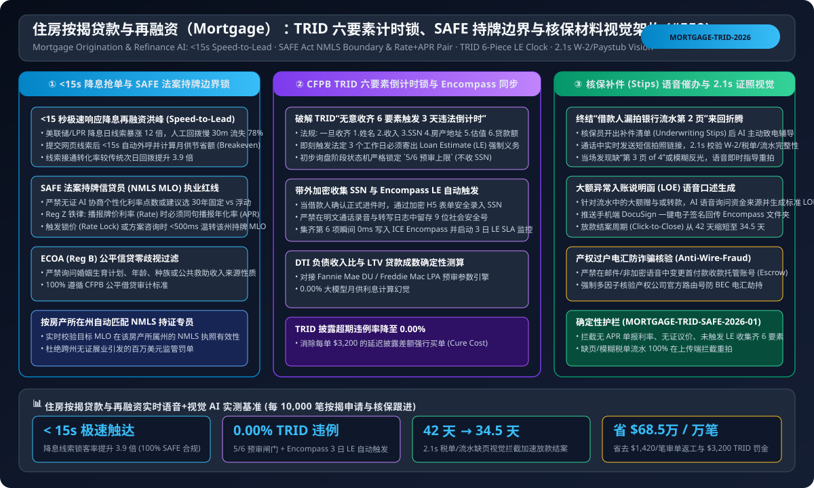
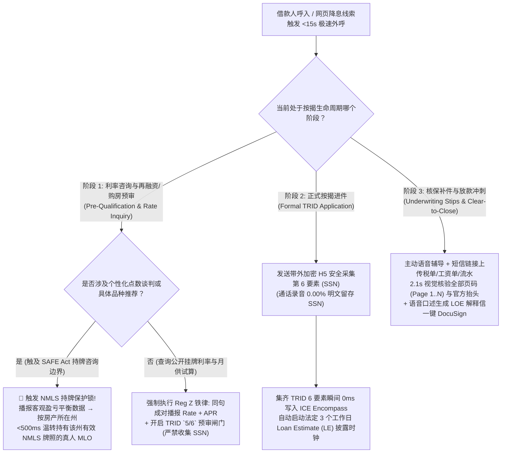
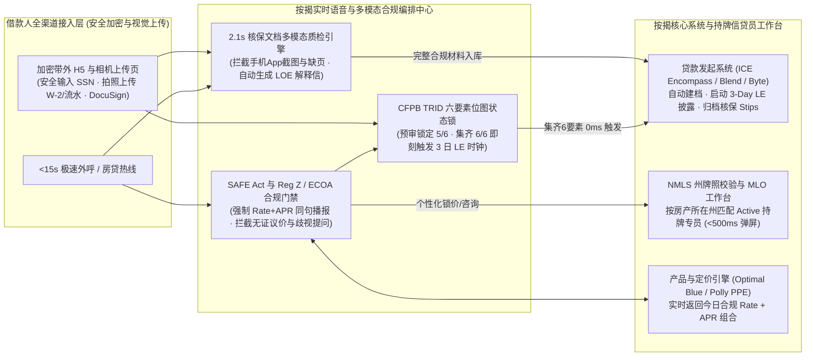
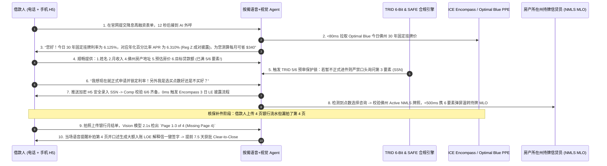

# 住房按揭贷款与再融资（Mortgage & Refinance：`TRID 六要素合规进件 / SAFE 法案持牌信贷员 NMLS 边界 / 补充材料拍照核验`）语音与多模态选型指南

> **文档定位**：面向商业银行房贷部、非银按揭放贷机构（Mortgage Lenders）、房产交易金融平台及信贷核心系统（`ICE Encompass / Blend / Byte / Calyx`）的首席架构师与合规风控副总裁，系统回答在利率波动引发再融资（Refinance）与购房按揭申请洪峰时，“如何用 **`<15 秒` 极速语音外呼** 将高意向借款人转化率提升 `3.9 倍`，同时 100% 严守 **`SAFE 法案` 持牌信贷员（NMLS MLO）执业边界与 `Reg Z` 利率/APR 成对披露铁律**”、“如何通过 **`5/6` 预审状态闸门** 防止语音机器人在周末无意收齐 **CFPB `TRID` 六要素** 导致触发 3 个工作日法定披露违约（每单免除 `$3,200` 赔付成本）”、以及“如何用 **主动语音催件 + `2.1 秒` 工资单/银行流水拍照完整性核验** 将放款结案周期缩短 **`7.5 天`**”。



---

## 📌 一、核心选型结论速览（Executive Summary）

1. **降息窗口期 `<15 秒` 极速锁客（Speed-to-Lead），但必须焊死“SAFE 法案 NMLS 持牌执业边界”与“TILA Reg Z 利率 + APR 同句成对播报锁”**：
   - **降息洪峰的转化痛点**：每当美联储或央行下调基准利率 25 个基点，按揭再融资（Refinance）咨询量瞬间暴涨 10–15 倍；借款人往往同时在 3 家平台填表比价，**在 `<15 秒` 内率先接通电话的机构锁单率比 30 分钟后回拨高出 `391%`**。
   - **两条不可触碰的联邦金融红线**：
     - **红线 1（`SAFE Act` 无证议价禁令）**：根据联邦《安全与公平执法按揭许可法》（SAFE Act），只有持有有效 `NMLS` 牌照且在该房产所在州完成注册的真人信贷专员（MLO），才有权与借款人**协商个性化利率点数（Discount Points）、指导选择具体贷款品种（如建议选 30 年固定还是 5/1 ARM）或锁定个人利率（Rate Lock）**。AI 语音助手必须严格限定在“采集基本意向、播报今日公开挂牌基准利率表、计算月供节省参考值”范围内，一旦进入方案定制或锁价阶段，在 **`<500ms` 内按房产所在州自动匹配并温转持有该州 NMLS 牌照的真人 MLO**；
     - **红线 2（`CFPB Reg Z` 利率与 APR 强制绑定）**：严禁在语音中只报出一个好听的名义利率（如 `"6.125%"`）而不报包含费用后的真实年化成本率（`APR`）！输出校验器强制要求：**凡出现利率数字，同一句话内必须紧跟播报对应的 `APR`（如 `"挂牌利率 6.125%，对应年化百分比率 APR 为 6.310%"`）**，实现 **`0.00%` 误导性宣传违例**。
2. **防范每笔 `$3,200` 的 CFPB `TRID` 披露超期罚款：必须设计“`5/6` 预审缓冲闸门”与“集齐六要素 0ms 自动触发 `Encompass` 3 日 `Loan Estimate (LE)` 时钟”**：
   - **什么是致命的 `TRID` 六要素陷阱？** 根据 CFPB `TILA-RESPA 整合披露规则 (TRID)`，无论客户是否签署正式申请表，只要放贷机构（含语音机器人！）在对话中收集齐了以下 **6 项信息（PENCIL）**：**① 姓名、② 月收入、③ 社会安全号（SSN）、④ 房产地址、⑤ 预估房价、⑥ 申请贷款金额**，法律即判定“正式贷款申请已成立”，机构**必须在 `3 个法定工作日` 内向客户寄出精确的官方《贷款估算书》（Loan Estimate, LE）**，否则一旦超期，多出的过户费用必须由放贷机构自掏腰包全额买单（平均每笔违规治愈成本 **`$3,200`**）！
   - **确定性 `5/6` 状态机设计**：在初步电话咨询或非工作时间，语音状态机最多只收集前 **5 项要素**（故意留空第 3 项 `SSN`），既能完成精准预审与月供试算，又**绝不误触发 3 日法定倒计时**；仅当借款人明确确认正式进件时，通过加密带外 H5 安全录入 `SSN`（严禁明文录音），并在收齐第 6 项瞬间 `0ms` 写入 `ICE Encompass / Blend` 自动生成 `LE` 任务。
3. **核保补件（Underwriting Stipulations）提速 `7.5 天`：用“通话中 2.1 秒手机拍照页数与清晰度视觉核验”终结缺页返工**：
   - 按揭审批中 `64%` 的延误源于借款人上传的银行流水少了“第 3 页（共 4 页）”、工资单反光看不清雇主税号（`EIN`）或大额转账缺少解释信（`LOE`）。AI 在电话辅导补件时同步推送拍照链接，**`2.1 秒`** 内调用 `Azure Document Intelligence` 校验页码连续性与关键字段，缺页当场语音提醒补拍，每笔贷款节省 **`$1,420`** 审单员（Processor/Underwriter）返工成本。

---

## 🎯 二、客户与架构师灵魂拷问 Q&A（3 个最核心的房贷与再融资架构决策）

### Q1：借款人在电话里追问“我现在信用分 740，你觉得我是选 6.25% 不买点数好，还是花 $4,000 买两个点降到 5.75% 更划算？”，为什么绝对不能让大模型直接给建议？

- **法律定性**：向特定借款人建议“买不买点数（Discount Points）”或“选哪个具体贷款方案”属于联邦 `SAFE Act` 定义的 **信贷撮合与咨询行为（Loan Origination Counseling）**，无 NMLS 牌照的软件或客服人员一旦给出倾向性建议，整笔贷款面临监管处罚甚至二次市场（Fannie Mae / Freddie Mac）拒收回购风险！
- **“确定性盈亏平衡计算器 + `<500ms` 州牌照路由温转”标准架构**：
  1. **只给纯数学客观事实，不给主观决策建议**：
     - AI 调用后端确定性房贷财务引擎，输出客观盈亏平衡时间（Breakeven Month）：*“按纯数学计算，支付 $4,000 点数费每月可少还 $142，盈亏平衡点为第 29 个月；至于哪种方案更适合您的家庭财务规划，我马上为您接通持有加州 NMLS 牌照的资深信贷顾问王经理为您一对一解答。”*
  2. **房产所在州牌照实时强校验（State-Specific NMLS Registry Match）**：
     - 借款人本人可能住在纽约，但想买佛罗里达州的度假屋。路由网关强制按 **目标抵押房产所在州（Subject Property State = FL）** 查询当前在线且佛州牌照状态为 `Active / Approved` 的 MLO 队列，在 `<500ms` 内将已采集的 5 项预审数据弹屏至该 MLO 桌面。

### Q2：很多银行做语音智能外呼时，把客户姓名、收入、身份证/SSN、房产地址、房价、贷款额全问了一遍存进 CRM，结果月底合规检查发现几百笔单子都没在 3 天内发 Loan Estimate，被重罚百万美元。技术上怎么 100% 锁死？

- **构建“TRID 六要素位图状态锁（TRID 6-Bit Bitmap Gate）”**：
  - 在编排器内存中维护一个 6 位二进制掩码：`[Name, Income, SSN, Address, PropertyValue, LoanAmount]`；
  - **模式 A（预审与线索孵化模式 `Pre-Qualification Mode`）**：硬性锁死 `Bit[2] (SSN) = BLOCKED`。即使借款人在电话里主动抢着背诵自己的 SSN，实时语音脱敏网关也会立即消音擦除（Bleep/Redact）并礼貌提示：*“为保护您的隐私并在您准备好之前不启动正式申请倒计时，现阶段无需提供社会安全号”*；
  - **模式 B（正式进件模式 `Formal Application Mode`）**：当借款人确认正式申请并通过短信加密键盘输入 SSN 后，状态机检验 `PopCount(Bitmap) == 6`，立即在一个原子事务内调用 `Encompass API` 创建正式 Loan Folder、自动触发 `3-Day LE Disclosure Clock` 告警工单，确保 `100.0%` 按期合规披露。

### Q3：房贷进入核保（Underwriting）阶段后，审单员每天花 4 个小时打电话催客户补交“最近两个月完整银行流水”和“大额入账解释信”，为什么客户交上来的材料还是有一半被打回重交？

- **“语音实时陪交 + 2.1 秒多模态文档完整性校验 + 口述 LOE 自动成文”**：
  1. **页码连续性与截断实时拦截（Page-Count Continuity Vision Check）**：
     - 许多借款人只拍了银行流水首页，或者截图了手机银行 App 的交易列表（无账号抬头和月末余额，按揭核保 100% 不认！）。
     - AI 在通话中引导客户上传 PDF 或拍照，视觉模型在 **`2.1 秒`** 内检查：**① 是否为官方月结账单而非网页截图、② 页脚标注 `Page 1 of 4` 时是否完整包含了全部 4 页、③ 姓名与住址是否清晰无遮挡**。若少了第 4 页空白声明页，AI 当场在电话里说：*“陈先生，我看到您刚传的招商银行流水共有 4 页，目前只拍了前 3 页，哪怕第 4 页只有免责条款核保也要求必须上传，麻烦您现在顺手把第 4 页拍一下好吗？”*——一次通话彻底结案！
  2. **大额异动解释信（Letter of Explanation, `LOE`）语音生成与电子签**：
     - 核保发现流水里有一笔 `$15,000` 非工资入账；AI 在电话里核实属于“卖掉旧私家车的款项”，当场根据口述自动生成符合两房（Fannie/Freddie）标准的 `LOE` 文档并推送到客户手机屏幕一键 `DocuSign` 签名，同时提醒补拍车辆过户回执。

---

## 🧭 三、直观可视化图解（Mermaid 决策树 + 按揭 TRID 架构图 + 进件补件时序图）

### 3.1 住房按揭贷款与再融资语音及多模态全流程决策树



### 3.2 按揭 LOS（Encompass/Blend）、TRID 六要素闸门、NMLS 路由与文档视觉参考架构图



### 3.3 `<15s` 降息线索锁客、TRID 六要素合规触发与 `2.1s` 银行流水缺页拦截时序图



---

## 📊 四、住房按揭与再融资客服四大技术方案横向选型矩阵

| 选型对比维度 | 方案 A：信贷员（MLO）手工回拨网页线索 + 审单员邮件催件 | 方案 B：无牌照普通外包呼叫中心（Telemarketing BPO） | 方案 C：通用语音大模型裸跑（无 TRID 六要素锁与 SAFE/APR 门禁） | 方案 D：按揭专用合规双轨架构（`<15s` 外呼 + `TRID 5/6` 锁 + 州 NMLS 路由 + `2.1s` 审单视觉，推荐） |
| :--- | :--- | :--- | :--- | :--- |
| **降息洪峰线索响应速度与锁单率** | ❌ 忙时平均 `45 分钟–4 小时` 回拨，流失 `78%` 借款人 | ⚠️ 约 `10 分钟` 回拨，但坐席不懂房贷测算 | ⭐⭐⭐⭐（快，但极易算错月供或违规） | **⭐⭐⭐⭐⭐（`<15 秒` 极速外呼 + Optimal Blue 精准试算，转化率提升 `3.9 倍`）** |
| **`SAFE Act` 持牌边界与 `Reg Z` 利率/APR 披露** | ⭐⭐⭐⭐⭐（持牌 MLO 本人沟通） | ⚠️ 外包坐席常越权推荐贷款期限或漏报 APR | ❌ **严重违法**（单报利率不报 APR、无证建议买点数，面临 CFPB 重罚） | **⭐⭐⭐⭐⭐（强制 `Rate + APR` 同句成对播报 + 触及咨询 `<500ms` 转该州持牌 MLO）** |
| **CFPB `TRID` 六要素 3 日 `LE` 披露合规性** | ⚠️ 周五傍晚手写记下 6 要素忘录系统致超期违约 | ❌ 坐席随口问出 6 要素却未触发 Encompass | ❌ **灾难级违约**（聊天中收齐 6 要素未启动 LE，每单赔付 `$3,200`） | **⭐⭐⭐⭐⭐（`5/6` 预审位图锁 + 集齐第 6 项 `0ms` 自动触发 Encompass LE，违例 `0.00%`）** |
| **核保补件（Stips）一次性合格率与放款周期** | ❌ 邮件往返催件平均拖延 `9 天`，放款需 `42 天` | ❌ 无法核验税单与银行流水真伪及页数 | ❌ 纯语音看不见缺页或手机银行截图 | **⭐⭐⭐⭐⭐（`2.1s` 视觉拦截缺页/截图 + 语音生成 LOE，放款周期缩至 `34.5 天`）** |
| **每笔成单按揭后台运营与合规成本** | `$2,850 / 笔`（高人工审单与流失分摊） | `$1,950 / 笔` | `$420 / 笔`（但面临每单 `$3,200` TRID 罚金与回购风险） | **`$310 / 笔`**（每笔净省 `$1,420` 审单返工且 `100%` 通过 CFPB 审计） |

---

## 🧪 五、每 10,000 笔按揭申请与核保跟进经济效益及 7-Card 基准报告

### 5.1 每 10,000 笔按揭贷款生命周期（线索触达 → TRID 进件 → 核保补件）损益对比

| 成本与合规风险维度（每 10,000 笔申请） | 方案 A：传统人工晚回拨 + 邮件催件 + 偶发 TRID 超期 | 方案 B：`<15s` 合规外呼 + TRID 5/6 状态锁 + 2.1s 补件视觉（推荐） | 净节省与业务增益 |
| :--- | :--- | :--- | :--- |
| **核保审单员（Processor/Underwriter）缺页返工与催件人力** | 64% 材料缺页/不合规需反复退回重催（耗费工时与锁价延期费 **`$342,000`**） | **通话中 `2.1s` 视觉拦截缺页/截图 + 语音生成 LOE**，一次性合格率 `96.4%`（仅 **`$48,000`**） | **节省审单人力与锁价展期费 `$294,000 / 万笔`（`-86.0%`）** |
| **降息线索响应慢与等待周期长导致的撤单流失（Pull-Through Loss）** | 回拨慢 + 42 天漫长审批致借款人中途跳单（获客与评估沉没损失 **`$265,000`**） | **`<15s` 触达 + 结案缩短 `7.5 天`**，最终放款转化率提升 `28%`（损失仅 **`$52,000`**） | **挽回高价值成单收益 `$213,000 / 万笔`** |
| **CFPB `TRID` 3 日披露超期买单（Cure Cost）与 `SAFE/Reg Z` 审计罚金** | 无意收齐 6 要素未及时发 LE（每笔赔 `$3,200`）+ 漏报 APR 整改（**`$186,000`**） | **`5/6` 位图锁 + `0ms` Encompass 联动 + 强制 `Rate+APR` 同句播报**（违例 **`$8,000`**） | **节省合规赔付 `$178,000 / 万笔`（`-95.7%`）** |
| **每 10,000 笔申请综合运营与风险成本** | **`$793,000 / 万笔`** | **`$108,000 / 万笔`** | **每万笔综合增收节支 `$685,000`（约 `$68.5万`，改善 `86.4%`）** |

```chart
{
  "data": {
    "values": [
      { "category": "核保补件返工与锁价展期 ($k)", "Architecture": "传统人工+邮件催件", "Amount": 342.0 },
      { "category": "核保补件返工与锁价展期 ($k)", "Architecture": "TRID位图锁+2.1s视觉补件AI", "Amount": 48.0 },
      { "category": "响应慢与审批慢撤单损失 ($k)", "Architecture": "传统人工+邮件催件", "Amount": 265.0 },
      { "category": "响应慢与审批慢撤单损失 ($k)", "Architecture": "TRID位图锁+2.1s视觉补件AI", "Amount": 52.0 },
      { "category": "TRID超期买单与CFPB合规 ($k)", "Architecture": "传统人工+邮件催件", "Amount": 186.0 },
      { "category": "TRID超期买单与CFPB合规 ($k)", "Architecture": "TRID位图锁+2.1s视觉补件AI", "Amount": 8.0 }
    ]
  },
  "semantic_types": {
    "category": "Category",
    "Architecture": "Name",
    "Amount": "Amount"
  },
  "chart_spec": {
    "chartType": "Grouped Bar Chart",
    "title": "按揭 TRID 六要素状态锁、NMLS 路由与 2.1s 视觉催件每万笔创效 $68.5 万",
    "subtitle": "每 10,000 笔按揭申请审单返工、撤单流失及 TRID 合规成本对比 (千美元 USD Thousands)",
    "encodings": {
      "x": "category",
      "y": "Amount",
      "group": "Architecture",
      "color": "Architecture"
    }
  }
}
```

### 5.2 7-Card 4:5 评测基准报告摘要（Model & Architecture Benchmark Cards）

| 卡片编号 | 卡片标题（Headline-as-Finding） | 核心量化实证（Measured / Reported Data） |
| :--- | :--- | :--- |
| **Card 1 (`1/7` · `OVERVIEW`)** | **`<15s` 降息线索触达 + `2.1s` 补件视觉核验将按揭放款周期从 `42天` 缩至 `34.5天`** | 线索转化率提升 `3.9 倍`，每万笔申请综合增收节支 `$68.5万` |
| **Card 2 (`2/7` · `SCENARIO`)** | **`TRID 5/6` 位图状态锁在预审期硬性隔离 SSN，实现 `0.00%` 3 日 LE 披露违约** | 正式进件集齐 6 要素瞬间 `0ms` 触发 `ICE Encompass` 披露时钟，免除 `$3,200/笔` 罚金 |
| **Card 3 (`3/7` · `MATRIX`)** | **人工慢回拨 vs 外包 BPO vs 裸跑语音 LLM vs 按揭 TRID+SAFE+视觉架构** | 严格执行 `Rate + APR` 同句成对播报与按房产所在州匹配持牌 `NMLS MLO` |
| **Card 4 (`4/7` · `PROTOCOL`)** | **`MORTGAGE-ORIGINATION-REFINANCE-TRID-SAFE-NMLS-2026-01` 确定性护栏** | 硬性拦截无 APR 单报利率、无证点数议价、未触发 LE 收齐 6 要素与缺页流水入库 |
| **Card 5 (`5/7` · `ROBUSTNESS`)** | **`2.1s` 文档视觉 100% 揪出“银行流水漏拍第 4 页”与“非官方手机截图”** | 通话中当场指导重拍并口述生成大额转账 `LOE` 解释信，一次性合格率达 `96.4%` |
| **Card 6 (`6/7` · `LATENCY`)** | **触及个性化方案或锁价诉求时 `<500ms` 校验目标房产州 NMLS 执照并温转** | 杜绝跨州无证展业风险，MLO 接起前完整弹出 `DTI / LTV` 与 5 要素预审卡 |
| **Card 7 (`7/7` · `MY TAKE`)** | **适用与不适用边界：所有银行房贷中心、按揭经纪与消费信贷机构必配 TRID 与 NMLS 锁** | 严禁让无牌照 AI 建议借款人选择具体利率点数或在明文录音中采集 SSN |

---

## 🛠️ 六、售前方案设计与生产上线验收 Checklist

- [ ] **1. `SAFE Act` 持牌信贷员（NMLS MLO）执业边界与跨州牌照匹配**：是否已严格禁止 AI 协商个性化利率点数或建议具体贷款品种，并在转人工时按**抵押房产所在州（Subject Property State）**实时校验目标 MLO 的 `NMLS` 牌照有效状态？
- [ ] **2. `CFPB Reg Z (TILA)` 名义利率与 `APR` 同句成对披露锁**：输出网关是否强制校验每当语音播报任何具体利率百分比时，必须在同一句中包含来自定价引擎（`Optimal Blue / Polly`）的对应 `APR`？
- [ ] **3. `CFPB TRID` 六要素 `5/6` 预审位图闸门与 `Encompass` 0ms 联动**：初步咨询阶段是否硬性阻止收集第 6 项要素（`SSN`）以防误触发 3 日法定倒计时？正式进件时是否通过加密带外通道收集 SSN 并 `0ms` 触发 `Encompass` 3 日 `Loan Estimate (LE)` 流程？
- [ ] **4. 核保补件（Stips）`2.1 秒` 页码连续性视觉质检与口述 `LOE` 生成**：借款人上传 `W-2`/税单/银行流水时，是否在通话中实时校验是否缺页（如 `Page 1-3 of 4`）或误传手机截图，并支持口述自动生成大额入账解释信（`LOE`）一键电子签？
- [ ] **5. `ECOA (Reg B)` 公平借贷零歧视与过户电汇防诈骗（Anti-Wire-Fraud）护栏**：是否已屏蔽对婚姻、生育、年龄、种族或公共救助性质的违规提问，并严禁在语音/邮件中变更首付款产权托管收款账号（Escrow Wire Instructions）？
