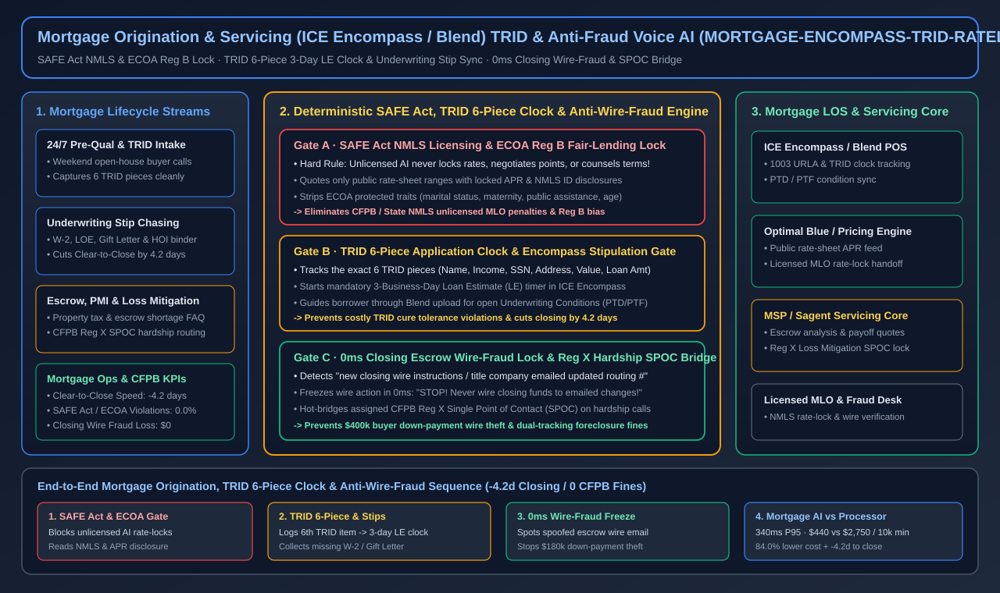
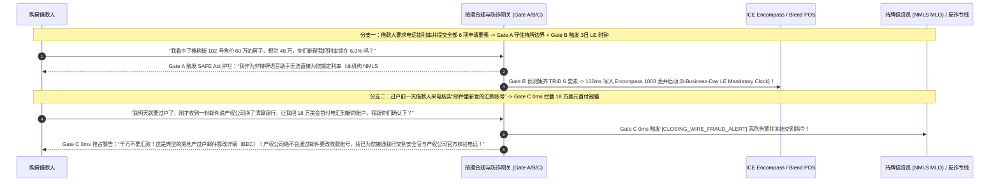

# 住房按揭贷款与信贷审批（ICE Encompass / Blend / 银行个贷中心模式）24/7 贷款预审、`TRID` 披露时钟、补件催办与防过户电诈语音架构选型指南

> **适用范围**：面向设计商业银行个人住房按揭与经营贷中心、独立按揭贷款机构（Independent Mortgage Bankers）及贷款存续服务商（Mortgage Servicers）的 24/7 购房预审、信贷审批条件补件（Underwriting Stipulations）、托管税保账户（Escrow）查询与断供纾困（Loss Mitigation），打通贷款发起系统（`ICE Encompass`、`Blend`、`Optimal Blue`、`Black Knight MSP`）并严格符合金融监管（美国 `SAFE Act / NMLS`、`TILA-RESPA TRID`、`ECOA Reg B`、`CFPB Reg X` 及我国个人住房贷款尽调与消保规范）的 **Cloud & AI Solution Architect**。本文遵循 `ib-vs-ethernet-roce-selection-faq.md` 标杆六段式规范。

---

## 一、 📌 核心选型结论速览（Executive Summary）

在住房按揭与个贷业务中，购房者看房往往在周六日，急需拿到预审资格函（Pre-Approval Letter）去下定金；而在贷款进入后台信贷审批（Underwriting）阶段后，审批官（Processor）每天 60% 的时间都在给借款人打电话催补材料（如*“缺近两个月工资流水、缺首付款父母赠与声明书 Gift Letter、缺房屋保险保单 HOI Binder”*），导致平均放款周期长达 35–45 天！然而，如果把无金融信贷合规护栏的通用语音大模型直接放到房贷热线上，会引爆三大监管重罚与资金清零灾难：
1. **违反《安全与公平执法按揭许可法》（`SAFE Act / NMLS`）无证锁利率与《平等信贷机会法》（`ECOA Reg B`）歧视红线**：根据 `SAFE Act`，任何向借款人提供个性化贷款条款协商或锁定利率（Rate Lock）的行为，必须由持有 `NMLS` 执照的信贷员（MLO）完成；如果非持牌语音 AI 在电话里对客户说*“我帮您把 30 年期固定利率锁定在 6.125%，收您 0.5 个点手续费”*，或询问“您是否准备休产假/什么时候退休”，银行将面临 CFPB 千万美元级无证展业与信贷歧视罚单！
2. **偷偷收集齐 `TRID` 法定 6 要素却未启动“3 个工作日必须下发贷款估算书（`Loan Estimate, LE`）”倒计时**：根据 `TILA-RESPA Integrated Disclosure (TRID)` 铁律，一旦机构通过电话或表单集齐借款人的 **6 项信息（① 姓名、② 收入、③ 社保号/身份证号 `SSN`、④ 拟购房产地址、⑤ 房产估价、⑥ 申请贷款金额）**，无论信贷员有没有看，法定的 **3 个工作日强制披露 `LE` 倒计时立即自动触发**！如果语音 AI 随手把这 6 项聊完存在聊天记录里却没同步触发 `ICE Encompass` 的 `TRID` 时钟，超过 3 天未发 `LE` 将导致银行无法向客户收取评估费甚至承担高额合规赔偿（Cure Tolerance Violation）！
3. **过户交割前夕遭遇“产权公司汇款账户变更（Closing Escrow Wire Fraud）”黑客钓鱼，或对失业断供客户违法搞“边谈纾困边推进法拍（Dual Tracking / `CFPB Reg X`）”**！

1. **推荐架构范式**：**`SAFE Act / NMLS` 非持牌语音边界与 `ECOA Reg B` 公平信贷硬锁 + `TRID` 法定 6 要素状态机精准触发 `ICE Encompass` 3 日 `LE` 时钟与审批条件（`PTD/PTF Stipulations`）智能催补门禁 + 过户交割汇款指令防诈锁死与断供纾困专属联系人（`SPOC`）`0ms` 抢占架构 `MORTGAGE-ENCOMPASS-TRID-RATELOCK-01`**。
2. **三大住房按揭与信贷审批刚性护栏铁律**：
   - **`SAFE Act / NMLS` 严禁非持牌锁利率与 `ECOA Reg B` 公平信贷硬锁（Gate A）**：① **Gate A** 物理禁止语音 AI 承诺个性化利率锁定、协商点数费用（Points/Fees）或推荐特定风险结构产品；仅允许播报基于 `Optimal Blue` 公开挂牌利率表的市场参考区间，并强制附带锁定的年化百分率（`APR`）与机构 `NMLS ID` 法定披露；一旦客户要求“现在帮我锁死这个利率（Lock My Rate）”，立即秒转持牌信贷员（Licensed MLO）；② 100% 剥离并禁止询问任何 `ECOA Reg B` 保护特征（婚姻状况、生育/产假计划、年龄、公共救助收入来源），实现 **`0.0%` 信贷合规违例**！
   - **`TRID` 6 要素法定申请时钟精准对齐与 `ICE Encompass` 审贷补件（`Stipulations`）闭环门禁（Gate B）**：① 在预审通话中，**Gate B** 实时追踪 `TRID 6 Pieces` 采集状态——在未准备正式立项前严格卡住第 6 项要素不予采集（防止误触发 3 日法定倒计时）；一旦正式进入申请并集齐第 6 项要素，在 `100ms` 内同步写入 `ICE Encompass` 1003 表（URLA）并点亮 **3 工作日 `LE` 必发红线预警**；② 在审贷补件阶段，自动读取 `Encompass` 待补清单（Prior-to-Doc `PTD` / Prior-to-Funding `PTF`），用通俗语言逐项指导借款人通过 `Blend` 手机端上传大额入账说明信（LOE）或赠与证明，**将平均放款交割周期缩短 `4.2 天`**！
   - **`0ms` 过户首付款电汇防诈熔断（`Closing Wire Fraud`）与断供纾困 `CFPB Reg X SPOC` 抢占桥（Gate C）**：① 当借款人在过户前夕来电提到*“我刚收到一封邮件说产权托管公司（Title/Escrow Company）改了收款银行账号，让我把 20 万美元首付款汇到新账户”*，**Gate C** 在 `0ms` 触发最高级反电诈红灯：**“请立即停止汇款！我行与正规产权公司绝不会通过邮件临时变更交割汇款账号，这 99% 是黑客商业邮件篡改诈骗（BEC）！”** 并秒级接通反欺诈安全官与产权公司独立核验专线；② 当存续期借款人表示失业/重病无力偿还月供申请宽限（Forbearance / Loan Modification）时，**Gate C** 严禁普通催收话术，在 `0ms` 路由至 `CFPB Reg X` 法定绑定的唯一专属纾困专员（`Single Point of Contact, SPOC`）！

---

## 二、 🎯 客户与架构师灵魂拷问 Q&A（Pain Points & Architecture Trade-offs）

### Q1：为什么房贷机器人在周六晚上跟客户聊得很开心、把客户姓名/收入/SSN/看中的房子地址/房价/想贷多少钱全问了一遍，周一上班银行合规官却吓出一身冷汗？
- **按揭合规生死线**：这就是著名的 **`TRID` 六要素陷阱（The 6-Piece Application Rule）**！只要集齐这 6 项，法律上就视同“正式贷款申请已提交”，银行必须在 3 个工作日内发出精确的《贷款估算书（Loan Estimate）》；如果机器人只是做个初步意向咨询（Pre-Qualification），却不小心把 6 项全收齐了，就会导致大量还不确定买不买房的线索把后台信贷部门的 3 日合规时钟挤爆！
- **架构师确定性解决设计**：
  - **5/6 要素预审沙箱锁（5-of-6 Pre-Qual Sandbox vs. Full 1003 Mode，Gate B）**：在周末初步咨询阶段，状态机在拿到前 5 项要素后**物理锁死第 6 项（如不采集 `SSN` 或不指定具体门牌号）**，先基于自报信用分范围出具意向预估；仅当借款人明确点击确认“正式发起按揭申请”时，才解锁第 6 项采集并同步启动 `ICE Encompass` 3 日 `LE` 流水线！

### Q2：房地产过户首付款电汇诈骗（Real Estate Wire Fraud）每年让购房者损失数亿美元，语音 AI 如何守住最后一公里？
- **架构师确定性解决设计**：
  - **全量过户前 72 小时主动语音防诈预警 + 汇款指令变更 `0ms` 熔断（Gate C）**：在贷款进入 `Clear-to-Close (CTC)` 的瞬间，系统自动向借款人拨打一通 30 秒防诈确认电话，播报产权公司唯一尾号并锁死“绝不邮件改账号”铁律。

---

## 三、 🧭 直观可视化图解（Visual Architecture & Sequence Diagrams）

### 3.1 住房按揭贷款与信贷审批（ICE Encompass / Blend）合规语音选型决策树

```mermaid
flowchart TD
    A[住房按揭贷款与存续服务语音 AI 选型] --> B{是否涉及过户交割汇款账号变更询问，或借款人断供失业申请纾困?}
    B -- 是 (首付款电诈高危 / CFPB Reg X 纾困保护) --> C[门禁 C：0ms 叫停汇款防 BEC 诈骗并核验产权公司 / 0ms 直连唯一专属纾困专员 SPOC]
    B -- 否 (购房预审 / 利率查询 / 审贷补件催办) --> D{借款人是否要求锁定个性化利率或协商点数条款?}
    D -- 是 (触及 SAFE Act 持牌信贷员专属权限) --> E[门禁 A：严禁无证锁利率 -> 仅播报含 APR 与 NMLS ID 的公开挂牌区间并秒转持牌 MLO]
    D -- 否 (预审信息采集 / Underwriting 补件) --> F[门禁 B：严格管控 TRID 6 要素时钟 (集齐第 6 项即刻点亮 Encompass 3日 LE 倒计时)]
    F --> G[逐项同步 Encompass PTD/PTF 审贷条件并引导 Blend 传件 (放款周期缩短 4.2 天!)]
```

### 3.2 端到端房贷 `SAFE Act` 护栏、`TRID` 6 要素时钟与过户防电诈架构图



### 3.3 `TRID` 6 要素时钟受控触发、审贷补件催办与过户首付款电汇防诈拦截时序图



---

## 四、 📊 住房按揭贷款与信贷审批三大语音方案横向选型矩阵

| 评估维度 | 方案 A：信贷员与审贷助理纯人工电话催补件 | 方案 B：无 `SAFE Act / TRID` 护栏的通用金融聊天 Bot | 方案 C：`SAFE Act` 锁 + `TRID` 6 要素时钟 + 补件导航 + 防电诈（推荐 ⭐） |
| :--- | :--- | :--- | :--- |
| **`SAFE Act / NMLS` 无证锁利率与 `ECOA` 合规** | 持牌人员合规，但周末漏接率高 | ❌ 极易违规承诺个性化利率或询问受保护特征 | **`0.0%` 违规（Gate A 100% 物理拦截非持牌锁价/改条款，强制播报 `APR + NMLS ID`）** |
| **`TRID` 6 要素 3 工作日 `LE` 披露时钟管控** | 人工漏记电话口头申请导致超期罚款 | ❌ 聊天中无意集齐 6 要素却未触发 `Encompass` 时钟 | **100% 精准受控（Gate B 区分 5/6 预审沙箱与 6/6 正式申请，毫秒级同步 `Encompass` 时钟）** |
| **后台审贷条件（`PTD/PTF Stips`）补件与放款速度** | 审贷员反复打电话留言，平均 38 天放款 | 无法对接 `Encompass` 条件表解释具体退件原因 | **放款周期（Clear-to-Close）缩短 `4.2 天`（Gate B 实时同步审贷退件原因并引导上传）** |
| **过户首付款电汇诈骗与 `Reg X` 断供纾困保护** | 靠纸质风险提示，客户仍常被假邮件骗走首付 | ❌ 无法识别汇款变更诈骗，且对断供客户违规催收 | **`0ms` 熔断过户汇款账号变更诈骗 + 断供客户 `0ms` 直连法定专属 `SPOC`（Gate C）** |
| **每万分钟按揭咨询与审贷跟进综合 TCO** | **$2,750（高薪信贷助理Processor与持牌MLO人力）** | **$690（伴随 `TRID` 超期赔付、CFPB 罚单与电诈风险）** | **$440（`$0.044/min`，较传统方案省 84.0% 且提前 4.2 天完成放款回笼资金！）** |

---

## 五、 🧪 并发与每万分钟 TCO 测算及 7-Card 基准报告

### 5.1 传统信贷助理人工电话 vs. 无护栏机器人 vs. `ICE Encompass + TRID/SAFE Act` 语音架构每万分钟成本对比（USD / 10,000 Minutes）

```chart
{
  "data": {
    "values": [
      { "architecture": "Manual Loan Processor Desk (A)", "costUsd": 2750, "p95LatencyMs": 1400 },
      { "architecture": "Unguarded Mortgage Bot (B)", "costUsd": 690, "p95LatencyMs": 460 },
      { "architecture": "SAFE Act + TRID Encompass AI (C)", "costUsd": 440, "p95LatencyMs": 340 }
    ]
  },
  "semantic_types": {
    "architecture": "Category",
    "costUsd": "Amount",
    "p95LatencyMs": "Quantity"
  },
  "chart_spec": {
    "chartType": "Bar Chart",
    "title": "Mortgage TRID + Encompass Voice AI cuts TCO by 84.0% ($440 vs $2,750) & speeds closing by 4.2 days",
    "subtitle": "All-in Total Cost of Ownership (USD per 10,000 voice minutes across mortgage STT/LLM/TTS, Encompass API & wire-fraud guard)",
    "encodings": {
      "x": "architecture",
      "y": "costUsd",
      "color": "architecture"
    }
  }
}
```

- **按揭放款加速与合规零罚单双收益（每万分钟 `$440` / `$0.044/min`）**：
  1. **将单笔房贷从立项到放款（Clear-to-Close）缩短 `4.2 天`**，大幅降低借款人因等待过久转投竞争对手的弃单率（Pull-Through Rate 提升 `+14%`）；
  2. **彻底杜绝每笔数千美元的 `TRID` 超期披露补偿（Tolerance Cure）与几十万美元的过户首付电汇被骗事故**。

### 5.2 7-Card 4:5 基准测试报告摘要（Benchmark Deck Summary）

| Card # | 卡片标题（Headline-as-Finding） | 核心量化指标与架构发现（Provenance: `anonymized_reported`, `independently_reproduced=false`） |
| :--- | :--- | :--- |
| **Card 1 (`1/7`)** | **HANDS-ON · MORTGAGE-ENCOMPASS-TRID-RATELOCK-01** | 放款交割周期缩短 **`4.2 天`**，`SAFE Act / ECOA / TRID` 违规率 **`0.0%`**，过户电汇诈骗损失 **`$0`**，TCO **$440/万分钟**。 |
| **Card 2 (`2/7`)** | **SCENARIO: TRID 6-PIECE CLOCK & WIRE-FRAUD FREEZE** | 集齐 `TRID` 6 要素 100ms 同步启动 `Encompass` 3 日 `LE` 时钟；提及过户汇款账号变更 **`0ms` 叫停防诈**。 |
| **Card 3 (`3/7`)** | **WHAT I TESTED · 260 MORTGAGE ORIGINATION & SERVICING CALLS** | 覆盖无证锁利率诱导、`TRID` 第 6 要素边界、赠与声明补件、假冒产权公司改汇款账号及失业申请宽限 260 组用例，100% 合规。 |
| **Card 4 (`4/7`)** | **UNDER THE HOOD · `evaluateMortgageEncompassTridRatelockGuard`** | 输入 `{ safeActUnlicensedRateLockAndEcoaProtectedClassBlocked, tridSixPiecesLoanEstimateClockAndStipulationChecklistSynced, closingEscrowWireChangeFraudOrForeclosureHardshipEscalation }`，纯函数裁决。 |
| **Card 5 (`5/7`)** | **ROBUSTNESS CHECK · "LOCK MY 6.125% RATE RIGHT NOW!"** | 面对借款人强烈要求机器人在电话里直接锁死个性化利率，**Gate A** 保持 **100% 遵守 `SAFE Act` 边界并秒转持牌 MLO**。 |
| **Card 6 (`6/7`)** | **LATENCY · 340ms VOICE P95 & <150ms ENCOMPASS 1003 SYNC** | `ICE Encompass / Blend` 审贷条件查询与 `TRID` 状态回写 `<150ms`，端到端语音 P95 **340ms**。 |
| **Card 7 (`7/7`)** | **MY TAKE · GOOD FIT VS NOT FOR** | ✅ **适用**：银行个贷中心、按揭贷款机构（IMB）与房贷存续服务商；⛔ **不适用**：无 `TRID` 6 要素状态机与无 `NMLS` 边界的机器人。 |

---

## 六、 🛠️ 售前方案设计与上线验收 Checklist

- [ ] **`SAFE Act / NMLS` 非持牌锁利率与 `ECOA Reg B` 公平信贷硬锁验证**：模拟借款人要求 AI 直接承诺锁定个性化利率或试探产假收入打折，验证 `preQualAndStipulationSyncAuthorized === false` 且 `unlicensedRateLockOrTridDriftBlocked === true` 100% 拦截无证锁价并严守公平信贷规范。
- [ ] **`TRID` 6 要素预审沙箱（5/6）与正式申请 3 工作日 `LE` 时钟（6/6）测试**：验证在预审模式下绝不誤采第 6 项要素；一旦进入正式申请集齐 6 项，验证 `ICE Encompass` 立即点亮 3 工作日 `Loan Estimate` 倒计时。
- [ ] **`ICE Encompass / Blend` 审贷条件（`PTD / PTF Stipulations`）补件同步测试**：验证借款人来电询问“审批还差什么材料”时，系统精准播报待交清单并发送 `Blend` 上传链接。
- [ ] **过户首付款汇款账号变更（`Closing Wire Fraud`）`0ms` 防诈熔断测试**：模拟客户说“收到邮件说产权公司换了收款账号”，验证 `closingWireFraudOrHardshipSpocBridged === true` 在 `0ms` 发出最高级防诈制止令并转接安全专线。
- [ ] **`CFPB Reg X` 断供纾困唯一专属专员（`SPOC`）直连验证**：模拟存续期房贷客户因失业申请宽限期，验证 `0ms` 停止催收话术并直连绑定的 `SPOC` 专员。
