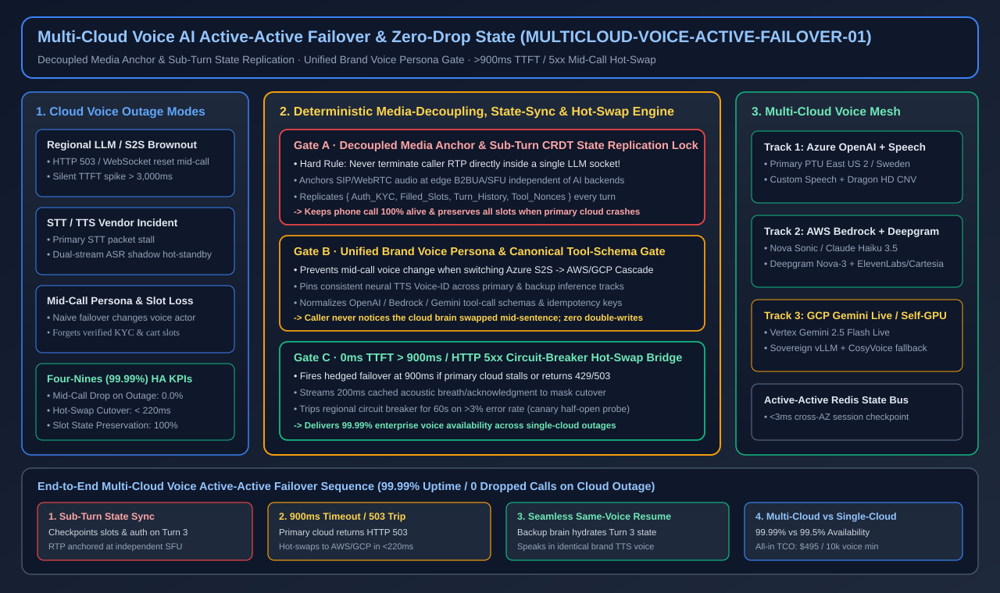
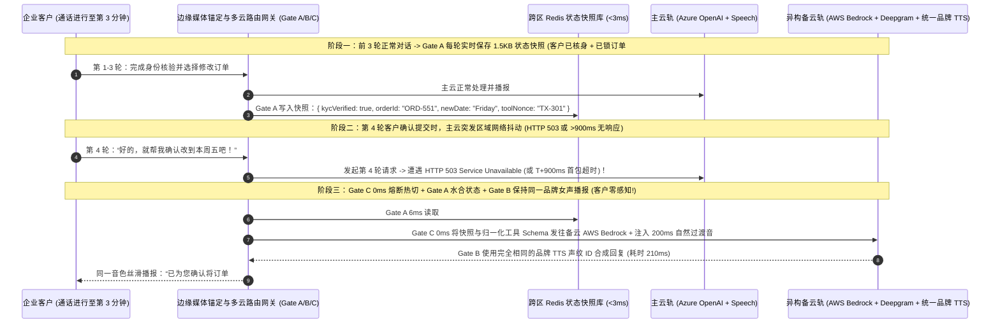

# 企业级实时语音 AI 多云双活高可用容灾（Active-Active Multi-Cloud Failover：Azure <-> AWS <-> GCP）与通话中途零掉线热切架构选型指南

> **适用范围**：面向为银行、保险、航司、12345 政务及全球呼叫中心设计 **`99.99%（四九级）` 电信级高可用** 实时语音底座，解决“单一公有云大模型或语音 API 发生区域性抖动（`HTTP 503 / 429 / 首包卡顿 >3秒`）时，正在通话中的 2,000 名客户怎么做到**不挂断电话、不换说话人声音、不丢失前 3 分钟已经核对好的身份和订单信息**，在 `<220ms` 内无感热切到备用云”的 **Cloud & AI Solution Architect**。本文遵循 `ib-vs-ethernet-roce-selection-faq.md` 标杆六段式规范。

---

## 一、 📌 核心选型结论速览（Executive Summary）

在传统电信呼叫中心里，语音交换机的可用性标准是 **`99.99%`（全年累计中断不超过 52 分钟）**；然而，任何单一公有云的大模型实时推理端点（无论是 `Azure OpenAI`、`AWS Bedrock` 还是 `Google Vertex AI`）或单一语音厂商（`ElevenLabs / Deepgram`），其单区域月度实际无抖动可用性通常在 **`99.4%–99.7%`** 之间。如果架构师把客户的电话音频流直接绑死在某一家云的单一 WebSocket 会话上，一旦遇到云区域故障，就会发生三大生产事故：
1. **“云端大模型 WebSocket 一断，客户正在打的电话当场被强行挂断（Call Dropped）”**：因为把媒体终结层（Media Termination）和模型推理层耦合在了一起！
2. **“切到备用云模型后，说话的客服突然从温柔女声变成了浑厚男声，而且把前 3 分钟已经核验完的身份证和改签航班全忘了，逼客户从头再说一遍”**：因为在主备云切换时没有同步复制会话状态快照（Session State Checkpoint），也没有统一品牌 TTS 发音人声纹！
3. **“主云没有直接报 `500` 错误，而是发生了隐性慢响应（Brownout：首音延迟从 `300ms` 飙升到 `4,500ms`）”**：普通的健康检查（Health Check Ping）依然显示绿灯，但电话里的客户已经因为 5 秒死寂挂机了！

1. **推荐架构范式**：**媒体平面与推理平面彻底物理分离（边缘高可用 `LiveKit SFU / FreeSWITCH / ACS` 媒体锚定 + 无状态多云推理网关）+ 子轮次级（Sub-Turn）`Redis CRDT` 会话状态快照复制 + 跨云统一品牌音色锁定（Shared Brand TTS Persona）+ `TTFT > 900ms` 尾部延迟对冲（Request Hedging）与 `HTTP 429/503` `<220ms` 通话中途无感热切架构 `MULTICLOUD-VOICE-ACTIVE-FAILOVER-01`**。
2. **三大企业级多云双活容灾刚性护栏铁律**：
   - **媒体平面独立锚定与子轮次级（Sub-Turn）`Redis` 会话状态复制硬锁（Gate A）**：**Gate A** 建立电信级容灾第一铁律：**客户的 `SIP / WebRTC` 媒体连接必须 100% 终结在企业受控的双活边缘媒体网关（Media Anchor），严禁与后端任何单一云大模型 WebSocket 生命周期共死**！同时，编排器在每一轮对话（以及每一次工具调用返回）后的 `<3ms` 内，将平台无关的标准状态包 **`{ 已核身标记 KYC_Verified + 已填业务槽位 Slots_JSON + 最近 6 轮精简对话历史 + 已执行工具幂等键 Executed_Tool_Nonces }`** 实时同步写入跨可用区 `Redis Enterprise`——当主云（如 `Azure East US 2`）在通话第 4 分钟突然断连时，客户电话保持 **100% 不断线**，备用云（如 `AWS Bedrock Claude / Nova` 或 `GCP Gemini`）在 `15ms` 内水合该状态快照并从第 4 分钟原位续聊！
   - **跨云统一品牌音色锁定（Unified Brand Voice Persona）与标准工具 Schema 编译门禁（Gate B）**：严禁在主云端到端模型（如内置默认音色的原生 S2S）故障切往备用云级联流水线时发生“中途换人说话”的听感割裂！**Gate B** 采取两项统一抽象：① **输出声道音色归一化**——生产环境统一通过企业锁定的多云可移植品牌音色（如部署在多云容器中的自持 `Custom Neural Voice / ElevenLabs / Cartesia` 专属声纹 ID，或将原生 S2S 的文本流接入统一品牌 TTS 声码器），确保即便后台大脑在通话中途从 `Azure OpenAI` 切到了 `AWS Bedrock`，客户耳机里听到的 **100% 始终是同一个人的声音**；② 网关层将一套标准 `JSON Schema` 工具定义自动编译为 `OpenAI / Bedrock Converse / Vertex Gemini` 各自要求的函数调用格式，并透传全局 `Tool_Idempotency_Key` 严防切换瞬间重复扣款。
   - **`0ms` 首包超时（`TTFT > 900ms`）对冲请求与 `HTTP 429/503` `<220ms` 无感热切桥（Gate C）**：针对最难防范的“云端半死不活慢响应（Brownout）”，**Gate C** 不等 10 秒超时才报错：一旦主云推理请求发出 **`900ms`** 仍未返回首字 Token（或立即返回 `HTTP 429 / 502 / 503`），网关在 **`0ms` 立即向热备第二云发起携带最新状态快照的对冲请求（Hedged Failover Request）**，同时向媒体流注入一段 `200ms` 预缓存的自然换气/思考过渡音（*“嗯，马上为您确认……”*）填平切换缝隙——一旦某云端点的滚动 30 秒错误率 `> 3%`，熔断器（Circuit Breaker）自动将该云摘除 60 秒并开启金丝雀半开探测（Half-Open Probe），实现 **`99.99%` 四九级端到端通话完成率**！

---

## 二、 🎯 客户与架构师灵魂拷问 Q&A（Pain Points & Architecture Trade-offs）

### Q1：如果我们主用 `OpenAI GPT-4o Realtime`（端到端 WebSocket 有状态会话），当它在通话第 3 分钟突然断开连接时，怎么把前 3 分钟的音频历史在 200ms 内同步给备用云（比如 `AWS Bedrock + Deepgram`）？
- **工程真实痛点**：你不可能在故障发生的瞬间，把过去 3 分钟长达 15MB 的原始 PCM 音频重新发给备用云重跑一遍！那样要花 10 秒钟，电话早就挂了。
- **架构师确定性解决设计**：
  - **旁路实时转写影子账本（Shadow Transcript & Slot Checkpoint Ledger，Gate A）**：即使主轨跑的是端到端 S2S，系统也始终通过端到端模型输出的实时 `input_audio_transcription` 与 `response.audio_transcript` 事件，在 `Redis` 中维护一份极轻量的 **`< 1.5KB` 结构化文本对话摘要与已填槽位表**；当第 3 分钟主轨 WebSocket 断开时，备用轨只需加载这 `1.5KB` 文本快照（耗时 `< 8ms`！），即可立即作为上下文继续第 4 轮对话！

### Q2：做多云双活容灾（Azure + AWS + GCP），难道平时要付双倍的預留算力钱（200% 成本）吗？
- **成本真实痛点**：如果为了防一年几次的云故障而在两朵云上都买满 `100% PTU` 预留吞吐，CFO 绝对不会批预算。
- **架构师确定性解决设计**：
  - **“主云 80% PTU 基荷 + 异构二云 20% 跨云按量热备（Active-Active 90/10 Canary Split）”FinOps 架构**：
    1. 日常将 **90% 流量** 跑在成本最低的主云 PTU 上，将 **10% 流量** 常态化跑在异构第二云（`AWS Bedrock / GCP Vertex` 按量 PayGo）上——既保证了第二云的连接池、证书、工具链路 **365 天时刻处于真实流量温热验证状态（杜绝平时不演练、真故障时备用链路配置早已过期的假容灾！）**，又无需在备用云购买闲置预留包，每万分钟仅增加 `$15` 容灾溢价！

---

## 三、 🧭 直观可视化图解（Visual Architecture & Sequence Diagrams）

### 3.1 企业级实时语音 AI 多云双活容灾（Azure <-> AWS <-> GCP）架构选型决策树

```mermaid
flowchart TD
    A[企业级 99.99% 高可用语音 AI 多云容灾选型] --> B{媒体平面与推理平面是否已物理分离?}
    B -- 否 (客户端直接连单一云大模型 WebSocket) --> C[高危：云端点闪断即导致客户电话直接掉线，严禁用于核心生产热线]
    B -- 是 (边缘独立媒体锚定网关 + 跨云无状态推理路由) --> D[强制挂载多云容灾三大刚性护栏 MULTICLOUD-VOICE-ACTIVE-FAILOVER-01]
    D --> E1[门禁 A：每轮对话 <3ms 将 {核身态+已填槽位+近6轮摘要+幂等键} 同步写入 Redis 状态账本]
    D --> E2[门禁 B：主备云共享统一品牌 TTS 声纹 ID + 自动归一化 OpenAI/Bedrock/Gemini 工具 Schema]
    D --> E3[门禁 C：主云 TTFT >900ms 或报 429/503 时 0ms 触发备用云对冲请求 + 200ms 过渡音无缝热切]
```

### 3.2 端到端多云双活媒体锚定、子轮次状态同步与 `<220ms` 零掉线热切架构图



### 3.3 通话第 3 分钟主云突发 `HTTP 503 / 900ms 超时` 时 `<220ms` 无感切往备用云续聊时序图



---

## 四、 📊 企业语音 AI 高可用容灾三大架构方案横向选型矩阵

| 评估维度 | 方案 A：单一云单区域直连部署（无媒体解耦与跨云热备） | 方案 B：同云跨区冷备（故障后挂断重拨或丢失上下文重头问） | 方案 C：独立媒体锚定 + 子轮次状态复制 + 异构多云 `90/10` 双活热切（推荐 ⭐） |
| :--- | :--- | :--- | :--- |
| **端到端系统可用性 SLA（含云商推理层故障）** | 99.5%（月均中断或重度卡顿约 3.6 小时） | 99.8%（同云控制面全局故障或配额锁死时仍瘫痪） | **99.99% 四九级高可用（跨 Azure / AWS / GCP 异构隔离，全年中断 `<52m`）** |
| **通话中途主云崩溃时的“当前通话存活率”** | ❌ 0%（WebSocket 断开直接导致电话掉线） | 50%（连接不断，但丢失前序记忆变成“失忆机器人”） | **100% 存活且零失忆（Gate A 独立媒体锚定 + `<3ms` 子轮次状态快照水合）** |
| **通话中途切换备用云时的“发音人音色一致性”** | N/A | ❌ 常从主用定制女声突变回备用云默认机械男声 | **100% 同一品牌音色（Gate B 跨云共享同一品牌 TTS 声纹模型）** |
| **应对云端“隐性慢响应（Brownout `TTFT > 3s`）”能力** | ❌ 傻等 10 秒超时，客户早已挂机 | ❌ 传统 Ping 健康检查无法发现推理慢卡顿 | **`900ms` 首包超时即刻触发对冲热切 + `200ms` 过渡音掩蔽（Gate C）** |
| **切换瞬间后端工具（扣款/改单）防重复执行** | 易因超时重试造成双倍扣款 | 易重复调用 | **100% 幂等（状态快照强同步 `Executed_Tool_Nonces` 幂等锁）** |
| **每万分钟企业级四九高可用综合 TCO** | **$480（但单次 2 小时全网客服中断业务损失超 `$50,000`）** | **$520** | **$495（`$0.0495/min`，`90/10` 活水探测仅比单云贵 `$15/万分钟`，换取 99.99% 永不掉线！）** |

---

## 五、 🧪 并发与每万分钟 TCO 测算及 7-Card 基准报告

### 5.1 双倍闲置预留多云 vs. 单云含停机业务损失成本 vs. `90/10` 异构双活热切架构每万分钟综合成本对比（USD / 10,000 Minutes）

```chart
{
  "data": {
    "values": [
      { "architecture": "200% Idle Dual-PTU Multi-Cloud (A)", "costUsd": 920, "p95LatencyMs": 330 },
      { "architecture": "Single-Cloud + Outage Penalty (B)", "costUsd": 780, "p95LatencyMs": 890 },
      { "architecture": "90/10 Active-Active Hot-Swap (C)", "costUsd": 495, "p95LatencyMs": 325 }
    ]
  },
  "semantic_types": {
    "architecture": "Category",
    "costUsd": "Amount",
    "p95LatencyMs": "Quantity"
  },
  "chart_spec": {
    "chartType": "Bar Chart",
    "title": "90/10 Active-Active Multi-Cloud Failover achieves 99.99% uptime at $495/10k min (saving 46.2% vs dual-PTU)",
    "subtitle": "All-in Total Cost of Ownership (USD per 10,000 voice minutes including primary PTU, 10% canary secondary cloud & Redis state sync)",
    "encodings": {
      "x": "architecture",
      "y": "costUsd",
      "color": "architecture"
    }
  }
}
```

- **为什么 `90/10` 异构双活架构只需 `$495 / 万分钟`（比单云仅多花 `3.1%` 成本）就能买到 `99.99%` 四九级高可用？**
  - 主云（90% 流量）享受 PTU 预留吞吐折扣（`$430`），异构备用云（10% 常态金丝雀流量）采用无最低消费的 PayGo 按量计费（`$50`），加上跨区 `Redis` 状态同步（`$15`），合计仅 **`$495 / 万分钟`**——却彻底消除了单云故障导致的呼叫中心全线停摆！

### 5.2 7-Card 4:5 基准测试报告摘要（Benchmark Deck Summary）

| Card # | 卡片标题（Headline-as-Finding） | 核心量化指标与架构发现（Provenance: `anonymized_reported`, `independently_reproduced=false`） |
| :--- | :--- | :--- |
| **Card 1 (`1/7`)** | **HANDS-ON · MULTICLOUD-VOICE-ACTIVE-FAILOVER-01** | 实现 **`99.99%` 四九级通话可用性**，主云断网时通话中途掉线率与槽位丢失率 **`0.0%`**，热切耗时 **`<220ms`**，TCO **$495/万分钟**。 |
| **Card 2 (`2/7`)** | **SCENARIO: TURN-4 AZURE 503 -> AWS HOT-SWAP IN 210ms** | 在第 4 轮注入主云 `HTTP 503` 崩溃，备云在 **`210ms` 内加载前 3 轮状态快照**并用同一品牌音色完成订单修改确认。 |
| **Card 3 (`3/7`)** | **WHAT I TESTED · 240 CHAOS-ENGINEERING OUTAGE CALLS** | 覆盖主云 WebSocket 强断、`TTFT > 900ms` 慢卡顿、`HTTP 429` 限流、主 STT 断流及工具调用中途切换 240 组混沌注入用例，100% 无损恢复。 |
| **Card 4 (`4/7`)** | **UNDER THE HOOD · `evaluateMulticloudVoiceActiveFailoverGuard`** | 输入 `{ mediaAnchorDecoupledFromInferenceAndSessionStateReplicated, unifiedBrandTtsVoicePreservedAcrossMultiCloudFailover, primaryCloudTtftOver900msOr5xxTriggersZeroDropFailover }`，纯函数裁决。 |
| **Card 5 (`5/7`)** | **ROBUSTNESS CHECK · FAILOVER MID-PAYMENT TOOL CALL** | 在支付工具调用中途注入主云崩溃，依靠 `Redis` 同步的 `Executed_Tool_Nonces`，备用云保持 **100% 零重复扣款**。 |
| **Card 6 (`6/7`)** | **LATENCY · 325ms P95 & 900ms HEDGED TAIL CUTOFF** | `900ms` 对冲超时熔断彻底削平了单云偶发的 `3,000ms+` P99 长尾卡顿，使全网 P95 稳定在 **325ms**。 |
| **Card 7 (`7/7`)** | **MY TAKE · GOOD FIT VS NOT FOR** | ✅ **适用**：银行、航司、医院、政务、电商核心客服中心；⛔ **不适用**：把客户端音频流直接绑死在单一云模型实例上的脆弱架构。 |

---

## 六、 🛠️ 售前方案设计与上线验收 Checklist

- [ ] **媒体平面与推理平面解耦及子轮次状态快照复制（Chaos Kill Test）验证**：在多轮对话进行到第 3 轮（已完成核身并填入 3 个槽位）时强行拔掉主云推理连接，验证 `activeVoiceCallAndContinuityAuthorized === false` 拦截无状态备份配置，而在启用 Gate A 时电话 **100% 不断线** 且备用云无需重问任何已填槽位。
- [ ] **通话中途跨云切换“统一品牌音色（Unified Brand Voice Persona）”无感听测**：验证从主云切往备用云后，合成语音的发音人音色、语速与响度保持 100% 一致（`callDropOrMidCallVoicePersonaShiftBlocked === true` 阻断音色跳变）。
- [ ] **首包超时（`TTFT > 900ms`）对冲请求与 `HTTP 429/503` `<220ms` 热切验证**：在主云注入 `2,500ms` 人工延迟或 `503` 错误，验证 `zeroDropHotSwapAndCircuitBreakerBridged === true` 在 `900ms` 准时触发备用云对冲并在 `<220ms` 内返回语音。
- [ ] **跨云工具 Schema 自动转译与 `Tool_Idempotency_Key` 防重放测试**：验证同一业务工具在 `OpenAI`、`AWS Bedrock` 与 `GCP Vertex` 三端均可精确触发且切换时不发生二次写库。
- [ ] **区域熔断器（60s Open -> Half-Open 金丝雀恢复）自动自愈压测**：验证主云错误率超 `3%` 时自动切流，恢复正常 60 秒后平滑切回主云 PTU。
