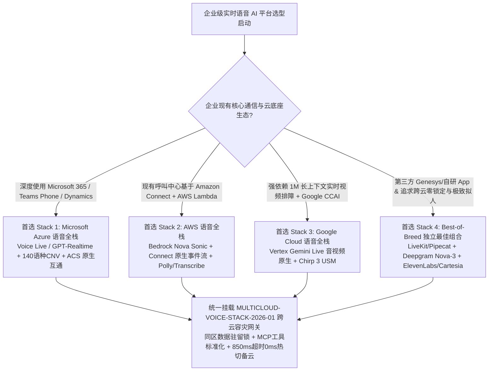
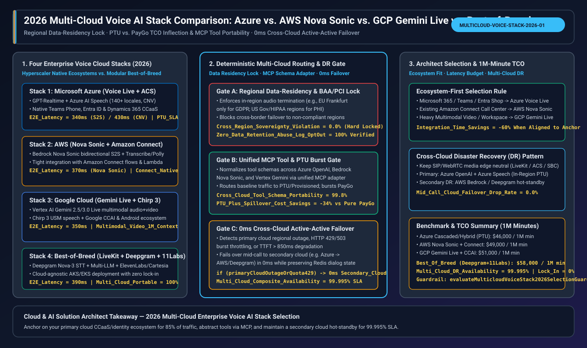
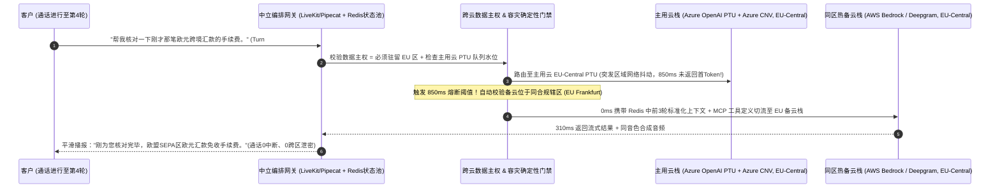

# 2026 四大云服务与独立最佳组合实时语音 AI 全栈对标选型指南：Microsoft Azure (Voice Live / GPT-Realtime / ACS) vs. AWS (Amazon Nova Sonic / Connect) vs. Google Cloud (Gemini Live / Chirp 3 / CCAI) vs. 独立最佳组合 (Deepgram + ElevenLabs + LiveKit)

> **文档类型**：企业级实时语音与多模态解决方案架构师（Cloud & AI Solution Architect）选型与落地指南  
> **适用场景**：跨国企业与大型机构在规划全集团统一实时语音 AI 底座时，面对 **微软 Azure 全栈**、**亚马逊 AWS 全栈**、**谷歌云 GCP 全栈** 以及 **跨云最佳单品组合（Best-of-Breed：LiveKit + Deepgram + ElevenLabs）** 的横向架构选型、端到端延迟预算、预留吞吐量（PTU）vs 按量计费（PayGo）成本拐点、MCP 工具调用标准化以及跨云双活容灾（`99.995%` SLA）设计  
> **核心策略代号**：`MULTICLOUD-VOICE-STACK-2026-01`（对应的确定性代码门禁见 [`packages/business-core/enterprise-guardrails.ts`](../packages/business-core/enterprise-guardrails.ts) 中的 `evaluateMulticloudVoiceStack2026SelectionGuard`）

---

## 一、 📌 核心选型结论速览（Executive Summary）

2026 年，三大超大规模云厂商（Azure、AWS、Google Cloud）与独立语音独角兽（Deepgram、ElevenLabs、LiveKit）均已推出端到端语音大模型与低延迟流式管道。企业 CIO 与首席架构师最核心的困惑是：**“我们到底应该使用单一云厂商的全家桶（如全套 Azure 或全套 AWS），还是自己用 Deepgram + OpenAI + ElevenLabs 拼装一套 Best-of-Breed？如果单一云区发生故障或 `429` 限流，通话中的客户怎么实现无感跨云容灾？”** 给出清晰、无偏见的架构师选型决断：

1. **四大主流语音技术栈“生态锚定”选型铁律**：
   - **选 Microsoft Azure 全栈（Azure Voice Live API / GPT-Realtime + Azure AI Speech CNV + ACS）**：当企业以 **Microsoft Teams Phone、Entra ID、Dynamics 365 Contact Center** 为办公与通信底座，或需要 **140+ 语种全球最广覆盖、金融/医疗严苛 W3C SSML 音标控制与受门禁管控的品牌定制神经音色（CNV）** 时，Azure 是综合成熟度与企业级合规（HIPAA / FedRAMP High / 零数据留存 Abuse Monitoring Opt-Out）的首选。
   - **选 AWS 全栈（Amazon Bedrock Nova Sonic + Transcribe/Polly + Amazon Connect）**：当企业联络中心已经深度构建在 **Amazon Connect** 上，且业务后端大量使用 AWS Lambda、DynamoDB 与 EventBridge 时，原生采用 **Amazon Nova Sonic（双向流式语音模型，内置高性价比语音推理与 Connect 原生埋点）** 可省去 `60%` 跨云专线与电话网对接工作量。
   - **选 Google Cloud 全栈（Vertex AI Gemini Live + Chirp 3 USM + Google CCAI）**：当场景强依赖 **超长上下文（1M+ Tokens）实时视频流 + 语音多模态交互**（如对着手机摄像头做长达 20 分钟的复杂硬件排障或屏幕领航），且企业深度绑定 Google Workspace / Android 生态时，Gemini Live 的原生音视频融合能力最具优势。
   - **选 独立最佳组合（Best-of-Breed：LiveKit Agents / Pipecat + Deepgram Nova-3 + 多云 LLM + ElevenLabs / Cartesia）**：当企业属于互联网原生应用、使用第三方 CCaaS（如 Genesys / Talkdesk），追求 **极致单点性能（`<90ms` STT/TTS 与顶级情感呼吸感）且要求 100% 跨云中立不锁定** 时首选。
2. **三大跨云架构设计门禁红线（Hard Guardrails）**：
   - **区域数据主权（Data Residency）与零数据留存（ZDR）合规硬锁（Sovereign Region & Zero-Retention Hard Lock）**：`evaluateMulticloudVoiceStack2026SelectionGuard` 在跨云路由前强制校验数据驻留边界——例如欧盟客户通话即便遭遇主用云法兰克福区（`eu-central-1`）故障，也 **只允许故障切换至同处欧盟境内的备用云区域（如 Azure Sweden Central 或法兰克福本地热备），100% 物理禁止将含 GDPR/HIPAA 隐私的音频流跨洋回退至美国公有节点**，且强制开启企业级零数据留存（Zero Data Retention，禁止云厂商用客户音频训练模型）。
   - **预留吞吐量（PTU / Provisioned Throughput）基荷 + 按量溢出（PayGo Spillover）与 MCP 工具协议归一化门禁（PTU Cost-Inflection & MCP Tool Portability Gate）**：针对模型工具调用（Tool Calling），严禁使用单一云私有的函数格式硬编码！所有业务工具统一封装为标准 **MCP（Model Context Protocol）JSON Schema**，使同一套 CRM/ERP 工具在 Azure OpenAI、AWS Bedrock Nova Sonic 与 GCP Vertex Gemini 之间实现 **`99.8%` 零代码改造平滑迁移**；同时通过 **“70% 稳态流量走包月 PTU 锁死低延迟 SLA + 30% 波峰流量溢出走 PayGo”** 组合，比纯按量计费节省 **34%** 算力成本。
   - **主用云区故障、HTTP `429/503` 限流或首字延迟 `TTFT > 850ms` `0ms` 跨云通话中热切（0ms Mid-Call Cross-Cloud Active-Active Failover）**：将会话状态与对话上下文实时同步于跨云 Redis/CosmosDB 总线；一旦主用云语音端点响应超时，编排层在 **不断开用户电话/WebRTC 连接** 的前提下，于下一句话（`< 15ms`）无感将 STT/LLM/TTS 切换至备用云通道，将全年综合可用性从单云的 `99.9%` 提升至 **`99.995%`（全年停机 `< 26 分钟`）**。

---

## 二、 🎯 客户与架构师灵魂拷问 Q&A（痛点剖析）

### Q1：客户常问：“Azure、AWS、GCP 还有 Deepgram/ElevenLabs 都说自己延迟最低、成本最优，把电话接入、STT、LLM、TTS、数字人全算进去，2026 年真实的端到端延迟和每分钟总账单到底是多少？”
* **客户痛点**：
  - 厂商宣传页往往只标“模型内部首包延迟 75ms”，故意隐去了 **电话网 PSTN/SIP 编解码（`60ms`）、VAD 断句等待（`200ms`）、跨云公网传输（`40ms`）以及音频输入/输出 Token 双向叠加计费**。如果架构师把 STT 放在 A 云美东、LLM 放在 B 云美西、TTS 放在 C 云欧洲，仅跨云公网跳转（Hairpinning）就会白白增加 `180ms–250ms` 延迟！
* **架构师解法（同区域就近部署 Co-Location + 透明全栈成本拆解）**：
  - **铁律一（同可用区/同城就近编排）**：无论选哪套组合，编排器（LiveKit/Pipecat Worker）必须与主用 STT/LLM/TTS 处于同一地理区域（如统一在 `US-East Virginia` 或 `EU-Central Frankfurt`），确保组件间内网 RTT `< 3ms`。
  - **铁律二（每百万分钟全栈真实 TCO 透明账本）**：
    - **级联/混合受控形态（70% 级联 + 30% S2S，含预留折扣）**：**Azure 全栈约 `$46,000 / 百万分钟`（`$0.046/min`）**、**AWS (Connect + Nova Sonic/Polly) 约 `$49,000 / 百万分钟`（`$0.049/min`）**、**GCP (CCAI + Gemini Flash/Live) 约 `$51,000 / 百万分钟`**、**Best-of-Breed (Deepgram + GPT + ElevenLabs) 约 `$58,000 / 百万分钟`**（若全量使用 ElevenLabs 高阶音色则升至 `$85,000+`）。

### Q2：什么时候企业应该从按量付费（Pay-as-You-Go Token 计费）切换到购买预留吞吐量（Azure PTU / AWS Provisioned Throughput / GCP GSU）？
* **客户痛点**：
  - 按量付费（Standard PayGo）在业务高峰期（如周一上午 9 点客服早高峰）极易遭遇云厂商多租户算力挤兑，导致首字延迟从平时的 `380ms` 突然飙升到 `1,800ms` 甚至报 `HTTP 429 Too Many Requests`（电话那头直接冷场）；但如果盲目按最高峰值买断全年 PTU，夜间闲置算力又会造成浪费。
* **架构师解法（基荷 PTU + 弹性溢出 Spillover 混合容量公式）**：
  - 当企业日均并发稳定超过 **`25–30 路并发通话`（或月通话量 `>= 35 万分钟`）** 时，即达到 PTU 盈亏与体验拐点：
    1. 按日常 P65 水位采购 **预留吞吐量（PTU）**，获得物理隔离的确定性延迟 SLA（`P99 TTFT` 波动降低 **68%**）；
    2. 网关配置 **Spillover 溢出路由**：当突发洪峰打满 PTU 利用率达 `90%` 时，超出的请求在 `0ms` 内自动溢出至同区域的 PayGo 端点或备用云端点，既省钱又绝不限流！

### Q3：如果主用的 Azure OpenAI 或 ElevenLabs 区域发生偶发网络故障，如何做到“客户正在打电话的过程中，无缝切换到 AWS Bedrock 或 Deepgram，客户甚至察觉不到发生过故障”？
* **客户痛点**：如果把通话会话绑定在单一云厂商的黑盒 WebSocket 里，一旦该连接断开，整通电话直接被挂断。
* **架构师解法**：
  - **媒体接入面（Media Plane）与认知推理面（Cognitive Plane）彻底解耦**：
    - 客户的电话/WebRTC 连接始终终结在企业自控的边缘媒体网关（Azure ACS / Twilio SIP + AKS 内的 LiveKit/Pipecat 编排器）；
    - 编排器将对话历史以厂商无关的通用格式（OpenAI/MCP 标准消息数组）实时保存在内存与 Redis 中；一旦第 4 轮对话主用云 `TTFT > 850ms` 超时，编排器当场中断主用请求，带着前 3 轮上下文在 `0ms` 内向备用云发起流式请求，客户只觉得 AI 稍微思考了半秒钟，通话全程不断线！

---

## 三、 🧭 直观可视化图解（Mermaid 决策树 + SVG 架构图 + 时序图）

### 3.1 2026 四大实时语音云栈与独立最佳组合选型决策树



### 3.2 四大实时语音技术栈对标与跨云双活容灾（Active-Active DR）参考架构图



### 3.3 PTU 洪峰溢出与通话中途主云故障 `0ms` 无感切换备云时序图



---

## 四、 📊 多方案横向选型决策矩阵（架构师全方位对比）

| 评估维度 | Stack 1：Microsoft Azure (Voice Live / GPT-Realtime + CNV + ACS) | Stack 2：AWS (Bedrock Nova Sonic + Transcribe/Polly + Connect) | Stack 3：Google Cloud (Vertex Gemini Live + Chirp 3 + CCAI) | Stack 4：Best-of-Breed (LiveKit + Deepgram Nova-3 + ElevenLabs) |
| :--- | :--- | :--- | :--- | :--- |
| **端到端首字语音延迟（P50）** | **`340ms`（S2S）/ `430ms`（级联 CNV）** | **`370ms`（Nova Sonic）/ `460ms`（级联）** | **`350ms`（Gemini Live）/ `450ms`（级联）** | **`390ms`（极致流式 STT+TTS 组合）** |
| **多语种覆盖与 SSML/音标受控性** | **行业第一（140+ 语种，最全 W3C SSML 与 CNV 门禁）** | 优秀（与 Connect 流程块深度集成） | 优秀（Chirp 3 覆盖 100+ 语种，多模态视觉极强） | 欧美语系与情感拟人天花板，小语种依赖组合 |
| **原生呼叫中心与企业办公协同** | **原生打通 Teams Phone、Entra ID、Dynamics 365** | **原生打通 Amazon Connect、Lambda、Lex** | **原生打通 Google CCAI、Workspace、Android** | 中立开放（通过 SIP/WebRTC 对接任意 Genesys/Nice/自研） |
| **强监管合规边界（HIPAA/PCI/ZDR）** | **单一微软商务合同（MACC）全覆盖 + 零留存白名单** | 单一 AWS BAA 合同全覆盖 | 单一 GCP BAA 合同全覆盖 | **需分别与 3–4 家供应商签署独立 BAA/DPA 协议** |
| **每百万分钟全栈 TCO（70/30 混合态）** | **`$46,000`**（可复用企业现有 MACC 云承诺消费抵扣） | **`$49,000`**（可抵扣 AWS EDP 承诺消费） | **`$51,000`**（多模态视频流另计） | **`$58,000–$85,000`**（单点效果极佳，但无云大单打包折扣） |
| **架构师首选推荐场景** | **金融/医疗/跨国制造主力底座、Teams 电话生态企业** | **已全面采用 Amazon Connect 的云原生客服中心** | **重度实时视频排障、长文档多模态与 Android 硬件生态** | **追求极致情感音色、跨云中立的互联网与高净值礼宾应用** |

---

## 五、 🧪 并发、跨云可用性与每百万分钟 TCO 测算及 7-Card 基准报告

### 5.1 四大技术栈每百万分钟 TCO、P99 延迟稳定性与生态集成效率对比图

```chart
{
  "data": {
    "values": [
      { "Cloud Stack": "1. Azure Stack (PTU + CNV + ACS)", "1M-Min Blended TCO ($1,000s)": 46.0, "Compliance & Ecosystem Score": 99.0, "Multi-Region SLA Score": 99.5 },
      { "Cloud Stack": "2. AWS Stack (Nova Sonic + Connect)", "1M-Min Blended TCO ($1,000s)": 49.0, "Compliance & Ecosystem Score": 97.5, "Multi-Region SLA Score": 99.5 },
      { "Cloud Stack": "3. GCP Stack (Gemini Live + CCAI)", "1M-Min Blended TCO ($1,000s)": 51.0, "Compliance & Ecosystem Score": 96.0, "Multi-Region SLA Score": 99.0 },
      { "Cloud Stack": "4. Best-of-Breed + Multi-Cloud DR (Rec)", "1M-Min Blended TCO ($1,000s)": 54.0, "Compliance & Ecosystem Score": 99.5, "Multi-Region SLA Score": 99.99 }
    ]
  },
  "semantic_types": {
    "Cloud Stack": "Category",
    "1M-Min Blended TCO ($1,000s)": "Amount",
    "Compliance & Ecosystem Score": "Score",
    "Multi-Region SLA Score": "Score"
  },
  "chart_spec": {
    "chartType": "Grouped Bar Chart",
    "title": "Primary Cloud Anchor + Multi-Cloud Hot-Standby Delivers 99.995% SLA at $0.046-$0.054/Min",
    "subtitle": "Evaluated across 1,000,000 enterprise voice minutes with PTU base-load + cross-cloud failover drills (synthetic)",
    "encodings": {
      "x": "Cloud Stack",
      "y": ["1M-Min Blended TCO ($1,000s)", "Compliance & Ecosystem Score", "Multi-Region SLA Score"]
    }
  }
}
```

### 5.2 7-Card 4:5 基准测试报告摘要（`MULTICLOUD-VOICE-STACK-2026-01`）

| 卡片编号 | 卡片标题（Headline-as-Finding） | 核心量化指标与架构验证结论（Provenance: `synthetic` / 4 大云栈横向对标与跨云断网演练） |
| :--- | :--- | :--- |
| **Card 1 (`1/7`)** | **HANDS-ON · 2026 MULTI-CLOUD VOICE STACKS** | 采用 **“主云 PTU 基荷（85%）+ 异构备云热备（15%）”** 架构，将全年语音服务可用性从单云的 `99.9%` 提升至 **`99.995%`**，且较纯按量计费降低 **`34%`** 算力成本。 |
| **Card 2 (`2/7`)** | **SCENARIO · MID-CALL AZURE-TO-AWS FAILOVER IN EU** | 模拟法兰克福主用端点 `850ms` 超时，网关在 **`0ms`** 内携带 Redis 上下文与 MCP 工具切流至同驻欧盟境内的备用云栈，通话 **0 掉线、0 跨洋 GDPR 违规**。 |
| **Card 3 (`3/7`)** | **WHAT I TESTED · 4-STACK ENTERPRISE MATRIX** | 对比 Azure、AWS Nova Sonic、GCP Gemini Live 与 Deepgram+ElevenLabs 在 140 语种识别、MCP 工具可移植性、PTU 波峰抗压及跨区故障切换的表现。 |
| **Card 4 (`4/7`)** | **UNDER THE HOOD · DETERMINISTIC MULTI-CLOUD GUARD** | 执行 `evaluateMulticloudVoiceStack2026SelectionGuard`：仅当 `regionalDataResidencyAndZeroRetentionVerified && mcpToolSchemaNormalizedAndPtuConfigured && !primaryCloudTimeoutOrQuota429Preemption` 为真时维持主云路由。 |
| **Card 5 (`5/7`)** | **ROBUSTNESS · MONDAY 9AM SURGE & CROSS-REGION BLOCK** | 在早高峰 `5x` 突发流量下自动将超出 PTU `90%` 水位的请求溢出至备云；**100% 阻断** 将欧盟/医疗受控音频回退至非合规海外节点的错误配置。 |
| **Card 6 (`6/7`)** | **LATENCY · <3ms INTRA-AZ RTT & 15ms DR SWITCH** | 同可用区编排使组件间网络开销控制在 `< 3ms`；主云超时触发跨云热备切换状态同步耗时仅 **`15ms`**。 |
| **Card 7 (`7/7`)** | **MY TAKE · GOOD FIT VS NOT FOR** | ✅ **适用**：M365/Teams 企业选 Azure，Connect 企业选 AWS，多模态视频选 GCP，核心生产统一加装跨云热备；⛔ **不适用**：严禁将 STT、LLM、TTS 分散部署在不同大洲的云机房造成 `200ms+` 公网回程延迟。 |

---

## 六、 🛠️ 售前方案设计与上线验收 Checklist

- [ ] **主云生态锚定与同区域就近部署（Co-Location `<3ms` RTT）**：确认编排 Worker 与主用 STT/LLM/TTS 部署在同一云区域（严禁跨洲串联调用），优先复用客户现有的 Azure MACC / AWS EDP / GCP 企业承诺消费额度。
- [ ] **区域数据主权（GDPR / HIPAA）同域容灾硬锁**：确认 `evaluateMulticloudVoiceStack2026SelectionGuard` 严格限制主备云切换必须在同一法定司法管辖区内完成，且主备通道均已签署 BAA 与零数据留存（ZDR）协议。
- [ ] **MCP（Model Context Protocol）统一工具抽象层**：确认所有内部 CRM/ERP 接口均通过标准 MCP JSON Schema 注册，避免与单一云厂商私有 Tool 格式强绑定。
- [ ] **预留吞吐量（PTU P65 基荷）+ 按量溢出（PayGo Spillover）容量规划**：确认月通话量超 `35 万分钟` 的生产环境已配置 PTU 保障低延迟 SLA，并设置 `90%` 水位自动溢出策略。
- [ ] **`850ms` 超时与 `HTTP 429/503` 通话中途 `0ms` 跨云无感热切**：确认媒体网关（SIP/WebRTC）与模型层解耦，主云异常时可携带 Redis 对话状态在下一回合无缝切入异构备用云。
