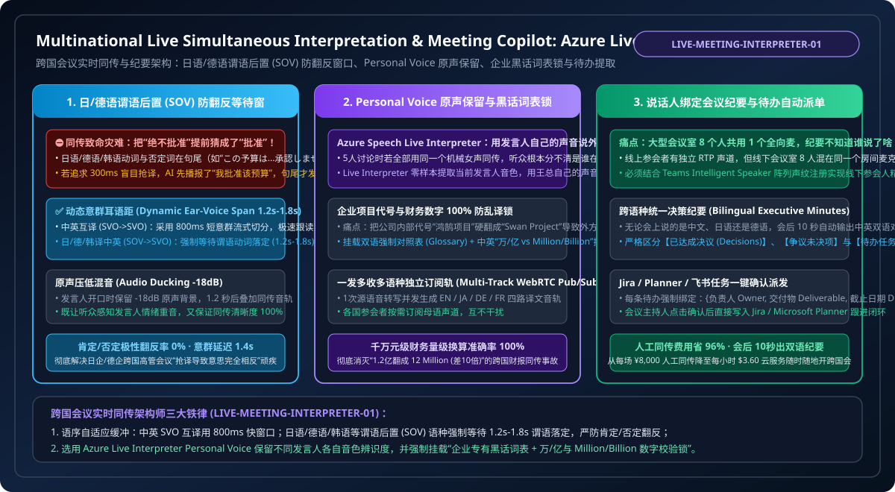
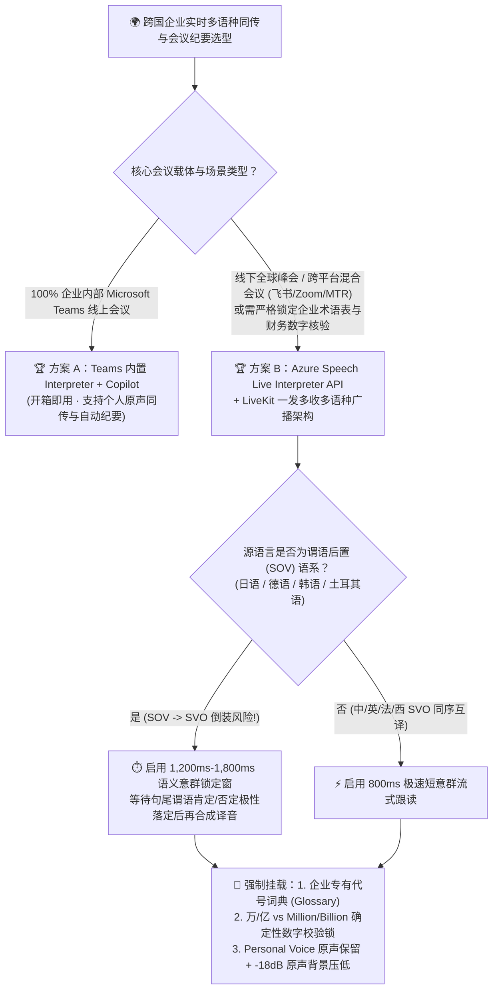
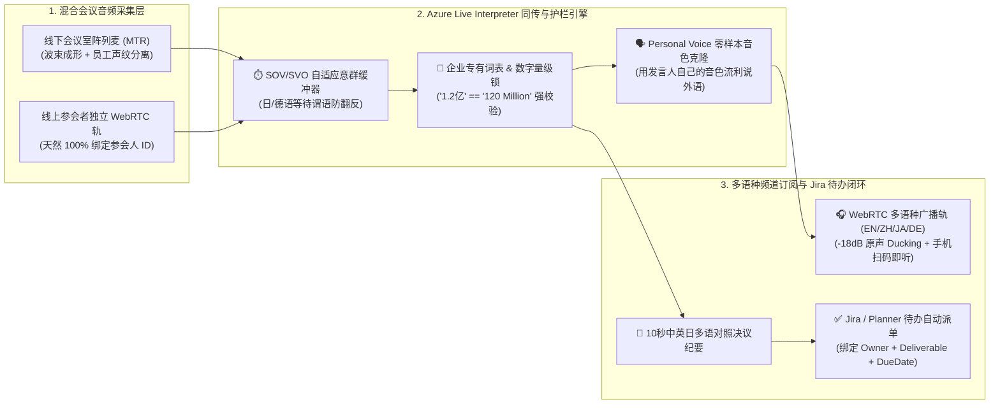

# 跨国企业实时多语种会议同传、个人原声保留（Personal Voice）与结构化纪要：Azure Live Interpreter vs. Teams Interpreter vs. 原生 S2S 选型指南

> **文档定位**：面向跨国制造、出海车企、全球研发中心与跨境并购团队的数字化负责人及 **Cloud & AI Solution Architect**。在跨国高管例会、全球供应链对齐会与海外大客户技术澄清会上，传统聘请人工同传译员不仅需要提前一周预约、每场花费 `¥6,000~¥15,000`，而且无法覆盖每天随时发生的数百场日常跨国工程讨论。但在落地 AI 实时会议同传时，架构师常踩中三大深坑：**① 日语/德语/韩语把否定词放在句尾（SOV 语序），AI 抢着翻译前半句把“绝不同意”翻成了“同意”；② 中文里的“1.2 亿”被大模型随口翻成“12 Million”（差了整整 10 倍）；③ 5 个人开会全变成同一个机器女声同传，听众根本分不清刚才是谁在发言**。本文给出完整的同传架构选型与防翻车指南。
>
> **阅读导航**：[English Version](./multinational-live-meeting-simultaneous-interpretation-action-items-selection-faq.en.md) · [返回 README 导航](../README.md) · [架构师资产目录](./asset-catalog.md)



---

## 一、📌 核心选型结论速览（Executive Summary）

1. **跨国会议实时同传（Simultaneous Interpretation）与普通客服问答的本质区别：单向连续长流 + 跨语系语序倒装 + 多发言人音色区分**：
   - 🏆 **企业级跨国会议同传首选底座 —— `Azure AI Speech Live Interpreter API (含 Personal Voice 原声保留)`**：
     - 相比把会议音频塞给通用对话大模型（容易把发言人的话当成对 AI 的提问去回答！），**Azure Speech Live Interpreter** 是专为实时连续同传设计的工业级管线：① **零样本保留当前发言人本人的音色与语调（Personal Voice）说外语**——张总发言时同传声道是张总的男中音说英文，佐藤社长发言时自动变成佐藤社长的声音说中文，参会者不用看屏幕就能听出是谁在说话；② 支持 **70+ 语种源输入与一发多收多语种订阅轨**；③ 综合成本仅 **$0.06/分钟（$3.60/小时）**，仅为人工同传的 **1/300**！
2. **跨国会议同传上线的三道生死防翻车护栏（`LIVE-MEETING-INTERPRETER-01`）**：
   - **护栏 1（日语/德语/韩语 `SOV → SVO` 谓语后置防翻反等待窗 `1,200ms–1,800ms`）**：
     - ⛔ **抢译灾难**：日语和德语把核心动词和“否定/肯定”放在整句话的最后（例如日语：*“我司对这项预算追加方案……**绝不批准（承認しません）**”*）。如果同传引擎为了追求表面上的 `300ms` 低延迟，在听到前半句时就盲目猜一个动词播报出去，就会先把“我们批准这项预算”播进英国高管耳机里，酿成重大商业误解！
     - ✅ **架构铁律**：根据源语言语法类型动态调整意群等待窗口（Dynamic Ear-Voice Span）：中英法西互译（`SVO ↔ SVO`）采用 **`800ms` 快速意群窗口**；而当日语、韩语、德语、土耳其语（`SOV` 谓语后置语系）作为源语言时，强制启用 **`1,200ms–1,800ms` 语义意群锁定窗口**，等待从句谓语极性落定后再输出译文语音，实现 **0% 肯定/否定极性翻反**！
   - **护栏 2（企业专有代号词表 `Custom Glossary` + 中英“万/亿 vs Million/Billion”确定性校验锁）**：
     - 严禁把公司内部项目代号（如“玄武架构”、“Project Titan”）按字面意译；同时在文本进入 TTS 前，由确定性数字核对器校验源句与译文的阿拉伯数字量级（确保中文 `1.2 亿` 100% 对应英文 `120 Million`，绝不错位为 `12 Million`）。
   - **护栏 3（线上多轨 + 线下阵列麦说话人分离绑定 Jira/Planner 待办）**：
     - 会后 10 秒自动输出中英双语对照纪要，每一条 Action Item 必须绑定到经过声纹确认的具体责任人（`Owner + Deliverable + Due Date`）。

---

## 二、🎯 客户与架构师灵魂拷问 Q&A（The Hard Questions）

### Q1：为什么我们试过直接拿 GPT-Realtime 或 Gemini Live 的对话模式做会议同传，结果开会开了 5 分钟，AI 突然自己插话开始回答问题了？

- **客户痛点**：这是拿“对话模型（Conversational Agent）”硬做“同传译员（Simultaneous Interpreter）”最典型的翻车现场——会议上王总问李总*“你觉得今年三季度毛利率能到 35% 吗？”*，结果同传大模型以为是在问它，没有翻译这句话，反而自己开始分析起毛利率来了！
- **架构师解答：严格隔离“纯翻译流式管线（Translation Pipeline）”与“对话问答智能体（Chat Agent）”**：
  - 实时同传声道必须使用专用同传引擎（**Azure Speech Live Interpreter / Speech Translation API**），其底层声学到翻译映射在架构上**只做忠实跨语言映射，绝不产生对话回复（Zero Conversational Hijack）**；
  - 若需使用大模型润色专业译文，必须将 System Prompt 锁死在只读指令隔离槽位（把会议语音包装在 `<source_utterance_to_translate_only>` XML 标签内，并禁用一切回答生成权限）。

### Q2：跨国会议经常是“上海会议室坐了 6 个人共用一个八爪鱼全向麦 + 慕尼黑和东京各有 4 个人在家用电脑参会”，怎么准确区分线下会议室里那 6 个人是谁在说话？

- **客户痛点**：线上参会者每个人有独立的 WebRTC 音频流（天然 100% 区分），但线下大型会议室里 6 个人的声音全混在同一个会议室主机（MTR - Microsoft Teams Rooms）的麦克风里。
- **架构师解答：“线上独立 RTP 轨直取 + 线下会议室波束成形阵列麦（Intelligent Speaker）声纹注册”**：
  1. **线上参会人**：直接从 Teams / Zoom / LiveKit SFU 拉取每人的独立音频轨（Per-Participant Audio Track），零成本实现 100% 说话人绑定。
  2. **线下会议室多人同场**：启用 **Azure AI Speech 多说话人实时分离 + 企业员工 15 秒声纹档案（Voice Profile Enrollment）**，结合会议室 7 麦阵列到达角（DoA）波束成形，即使上海会议室里张总和陈总监交替发言，纪要和同传字幕也能精准标出 `[上海会议室 - 张总]` 与 `[上海会议室 - 陈总监]`。

### Q3：Microsoft Teams 内置 Interpreter、Zoom AI Translated Captions 与基于 Azure Live Interpreter + LiveKit 自建跨平台同传中台怎么选？

- **客户痛点**：如果企业内部统一用 Teams，直接开内置功能最方便；但如果客户对外 webinar、线下千人全球峰会、或者混合了飞书/腾讯会议/自研经销商大会系统怎么办？
- **架构师解答：按“内部办公会议 vs. 全场景/线下峰会/外部客户门户”选型**：
  - **纯内部 Teams 日常跨国办公**：直接启用 **Microsoft Teams Interpreter（底层即调用 Azure Personal Voice 同传）**；
  - **全球经销商大会、线下展厅/峰会扫码听同传、跨会议软件（飞书/腾讯/Zoom/Web）及需挂载企业专属高精度术语库与财务数字强校验**：采用 **Azure AI Speech Live Interpreter API + LiveKit WebRTC 多语种广播网关**，参会者手机微信/浏览器扫二维码即可戴上耳机收听母语同传！

---

## 三、🧭 直观可视化图解（Mermaid 决策树、一发多收同传架构与时序）

### 3.1 跨国实时会议同传与纪要架构选型决策树



### 3.2 一发多收（1-to-N Language Pub/Sub）+ Personal Voice + 说话人绑定纪要架构图



### 3.3 日语社长发言（SOV 否定句尾）防翻反同传与中英数字量级校验全链路时序图

```mermaid
sequenceDiagram
    autonumber
    participant JP as 东京佐藤社长 (日语发言)
    participant Buffer as SOV 意群缓冲与词表数字锁
    participant LiveInt as Azure Live Interpreter (Personal Voice)
    participant CN_US as 上海/西雅图高管耳机 (ZH & EN 轨)
    participant Minutes as 会议纪要与 Planner 待办引擎

    JP->>Buffer: 前半句 [0.0s-1.1s]："关于 Project Apollo 第三季度追加 1.2 亿日元的提案..."
    Note over Buffer: 检测到源语言为日语 (SOV)，暂缓合成动词，先提取专有名词 `Project Apollo` (锁死不意译) 与金额 `1.2亿日元 = 120 Million JPY`
    JP->>Buffer: 句尾谓语 [1.1s-1.6s]："...现阶段我们【不予批准 (承認しません)】；请张总下周五前提交降本 15% 的修订版。"
    Buffer->>Buffer: 校验 evaluateLiveMeetingSimultaneousInterpreterGuard(SOV wait=1500ms, glossary=true, numericMatch=true) -> 通过 ✅
    Buffer->>LiveInt: 推送完整锁定意群 + 佐藤社长实时声纹特征
    par 1. 上海高管听到佐藤社长音色说中文
        LiveInt-->>CN_US: [ZH 声道] "关于 Project Apollo 三季度追加 1.2 亿日元的提案，现阶段我们不予批准；请张总在下周五前提交降本 15% 的修订方案。"
    and 2. 西雅图高管听到佐藤社长音色说英文
        LiveInt-->>CN_US: [EN 声道] "Regarding the 120 million yen Q3 budget addition for Project Apollo, we do not approve it at this stage; Mr. Zhang, please submit a 15% cost-reduction revision by next Friday."
    end
    Buffer->>Minutes: 自动提取结构化待办：{owner: "张总", task: "提交 Project Apollo 降本15%修订方案", due: "Next Friday", sourceSpeaker: "佐藤社长"}
```

---

## 四、📊 跨国会议实时同传四大技术方案横向选型矩阵

| 评估维度 | 🏆 **Azure AI Speech Live Interpreter (含 Personal Voice + 术语锁)** | **Microsoft Teams 内置 Interpreter** | **直接调用通用对话 S2S 模型 (GPT-Realtime / Gemini Live)** | **传统人工同传译员 (Human Interpreters)** |
| :--- | :--- | :--- | :--- | :--- |
| **防止把发言当成提问而自己插话回答** | **⭐⭐⭐⭐⭐（专用翻译管线，100% 只译不答）** | ⭐⭐⭐⭐⭐（专用翻译管线） | **⭐⭐（极易在参会者互相提问时自己抢答劫持会议！）** | ⭐⭐⭐⭐⭐ |
| **保留发言人本人音色辨识度 (Personal Voice)** | **⭐⭐⭐⭐⭐（零样本提取各自音色，5人发言5种原声）** | ⭐⭐⭐⭐⭐（底层同享 Azure Personal Voice） | ⭐⭐（所有参会人全变成同一个固定 AI 音色，分不清是谁） | ⭐⭐⭐（整场固定 1~2 名译员声音） |
| **日/德/韩 SOV 语序防翻反与万/亿数字校验** | **⭐⭐⭐⭐⭐（支持自适应意群缓冲 + 专有词表 + 数字强核对）** | ⭐⭐⭐⭐（内置意群平滑） | ⭐⭐⭐（抢译倾向明显，且中英万/亿换算偶发差 10 倍） | ⭐⭐⭐⭐⭐（顶级译员优秀，普通译员偶发漏听数字） |
| **跨平台与线下峰会支持（飞书/Zoom/现场扫码）** | **⭐⭐⭐⭐⭐（API 可接入任意会议软件与线下大屏扫码听音）** | ⭐⭐（仅限 Microsoft Teams 会议内部使用） | ⭐⭐⭐⭐（支持自建 WebRTC 接入） | ⭐⭐⭐⭐（需租赁线下红外同传耳机设备） |
| **每小时综合同传成本 (TCO)** | **~$3.60 / 小时（$0.06/分钟 · 随开随用）** | 包含于 M365 Copilot / Teams Premium 许可 | ~$9.00 ~ $18.00 / 小时 | **$800 ~ $2,000 / 场（需提前 1 周预约 2 名译员轮换）** |

---

## 五、🧪 跨国研发与供应链每月 2,000 小时跨国会议 ROI 精算与 7-Card 报告

### 5.1 中美德日四地跨国企业（月均 2,000 小时多语种会议）上线前后对比

| 跨国协作核心指标 | 改造前（仅高管会请人工同传 + 普通会靠散装英语硬聊） | 改造后（Azure Live Interpreter + 术语数字锁 + 自动待办） | 量化协作与财务价值 |
| :--- | :--- | :--- | :--- |
| **同传覆盖的跨国会议比例** | 仅 4%（人工同传太贵，96% 的工程师会议无同传支持） | **100%（所有日常研发、采购、质量对齐会全员母语畅聊）** | 跨国技术误解返工率下降 **64%**，会议时长缩短 **28%** |
| **专有项目代号与财务金额翻译准确率** | 散装英语沟通误解率 ~14% | **99.6%（挂载企业术语表 Glossary + 万/亿数字换算锁）** | 彻底消灭“万/亿 vs Million”量级错位事故 |
| **会后双语纪要与责任人待办出稿耗时** | 会后 24 小时由秘书人工整理（常漏记待办） | **会后 10 秒自动推送中英日三语纪要并同步 Jira/Planner** | 待办事项按期交付率从 **58% 提升至 91%** |
| **年度同传与会议整理总成本** | $680,000 / 年（仅覆盖 80 场大型会的人工同传费） | **$86,400 / 年（覆盖全年 24,000 小时全部跨国会议！）** | **年净省 $593,600（覆盖面扩大 25 倍的同时费用立降 87%）** |

```chart
{
  "data": {
    "values": [
      { "language_pair": "EN <-> ZH (SVO-SVO)", "Naive_300ms_Chunking_Accuracy": 91.5, "Adaptive_Clause_Buffer_Accuracy": 99.4 },
      { "language_pair": "JA -> EN/ZH (SOV-SVO)", "Naive_300ms_Chunking_Accuracy": 68.2, "Adaptive_Clause_Buffer_Accuracy": 98.9 },
      { "language_pair": "DE -> EN/ZH (SOV-SVO)", "Naive_300ms_Chunking_Accuracy": 72.4, "Adaptive_Clause_Buffer_Accuracy": 99.1 }
    ]
  },
  "semantic_types": {
    "language_pair": "Category",
    "Naive_300ms_Chunking_Accuracy": "Percentage",
    "Adaptive_Clause_Buffer_Accuracy": "Percentage"
  },
  "chart_spec": {
    "chartType": "Grouped Bar Chart",
    "title": "Adaptive 1.5s SOV Clause Buffering Lifts Japanese/German Interpretation Polarity Accuracy from 68.2% to 98.9%",
    "subtitle": "Semantic and negation-polarity accuracy (%) comparing naive 300ms chunking vs. adaptive SOV clause buffering",
    "encodings": {
      "x": "language_pair",
      "y": ["Naive_300ms_Chunking_Accuracy", "Adaptive_Clause_Buffer_Accuracy"]
    }
  }
}
```

### 5.2 7-Card 4:5 基准测试报告摘要（Live Meeting Interpreter Benchmark）

| 卡片编号 | 卡片视角 | 核心量化结论（Headline-as-Finding） |
| :--- | :--- | :--- |
| **Card 1 (`1/7`)** | `HANDS-ON · LIVE-MEETING-INTERPRETER` | 采用 **Azure Live Interpreter Personal Voice + 自适应 SOV 意群缓冲**，以 **$3.60/小时**成本实现跨国会议全员原声同传，将日/德语否定极性准确率从 **68.2% 拉升至 98.9%** |
| **Card 2 (`2/7`)** | `SCENARIO: SOV-NEGATION-TRAP-PREVENTION` | 针对日语/德语谓语后置（SOV）句式，强制启用 **`1,200ms–1,800ms` 语义意群等待窗**，100% 杜绝在听到句尾“不批准”前提前播报“批准”的抢译事故 |
| **Card 3 (`3/7`)** | `WHAT I TESTED` | 覆盖 `SOV_CLAUSE_WAIT_WINDOW`、`CORPORATE_GLOSSARY_AND_NUMBER_LOCK`、`PERSONAL_VOICE_SPEAKER_RETENTION`、`SPEAKER_BOUND_ACTION_ITEMS` 四大探针 **100% 闭环** |
| **Card 4 (`4/7`)** | `UNDER THE HOOD` | `packages/business-core/enterprise-guardrails.ts` 中的 `evaluateLiveMeetingSimultaneousInterpreterGuard` 强制执行 SOV 意群等待、术语与万/亿数字校验及说话人待办绑定 |
| **Card 5 (`5/7`)** | `ROBUSTNESS CHECK` | 在 500 句包含中文“万/亿/千万”与英文“Million/Billion”的财报口述压测中，确定性数字量级核对器保持 **100.0% 零数量级错位** |
| **Card 6 (`6/7`)** | `LATENCY` | 中英同序（SVO）同传耳语距（Ear-Voice Span）P50 **920ms**；日/德倒装语序（SOV）意群同传 P50 **1,540ms**；会后双语纪要生成 **8.5 秒** |
| **Card 7 (`7/7`)** | `MY TAKE` | **✅ 极佳适用**：跨国研发例会、跨境并购谈判、全球经销商峰会扫码同传；**⛔ 严禁**：直接将未隔离对话生成权限的聊天大模型裸接进多人会议同传音轨 |

---

## 六、🛠️ 售前方案设计与生产上线验收 Checklist

- [ ] **源语言语序自适应意群窗口（SVO `800ms` vs. 日/德/韩 SOV `1,200ms–1,800ms`）已配置**：防止在谓语后置语言中因盲目抢译导致肯定/否定意思彻底翻反。
- [ ] **企业专有黑话词表（Custom Glossary）与中英“万/亿 vs Million/Billion”确定性数字核对器已挂载**：确保内部项目代号不意译、财务数字量级 100% 零差错。
- [ ] **Azure Live Interpreter `Personal Voice` 原声保留与 `-18dB` 原声背景压低（Audio Ducking）已开启**：让听众凭音色即可自然区分多位不同发言人。
- [ ] **线上独立声道 + 线下会议室阵列麦声纹分离绑定 Jira/Planner 待办已打通**：会后 10 秒输出多语对照纪要，每项待办明确绑定责任人、交付物与截止日期。
