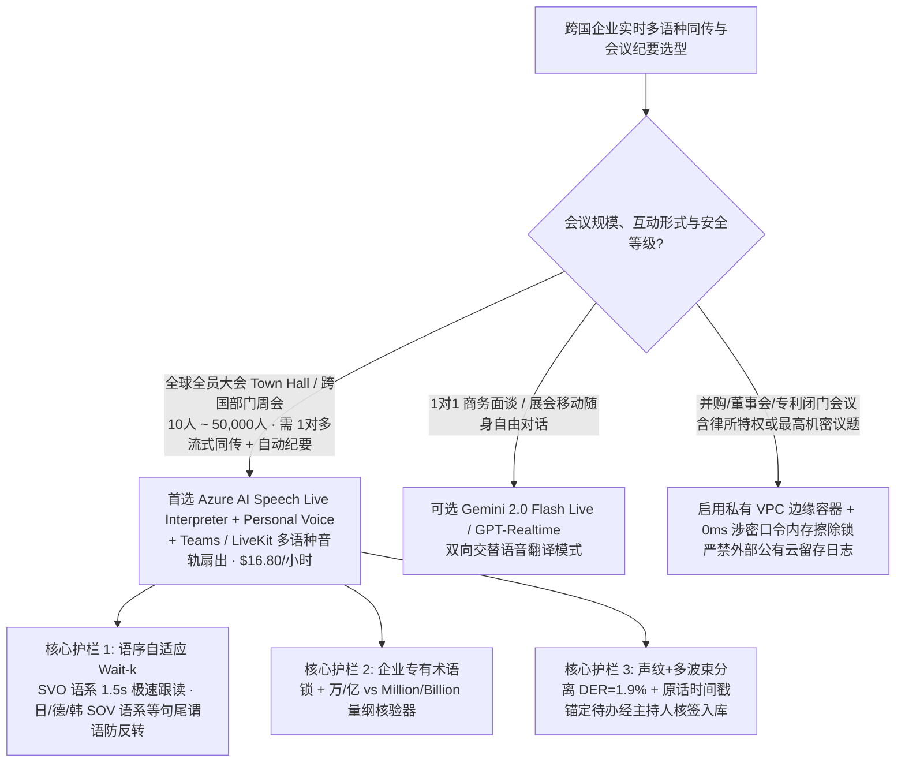
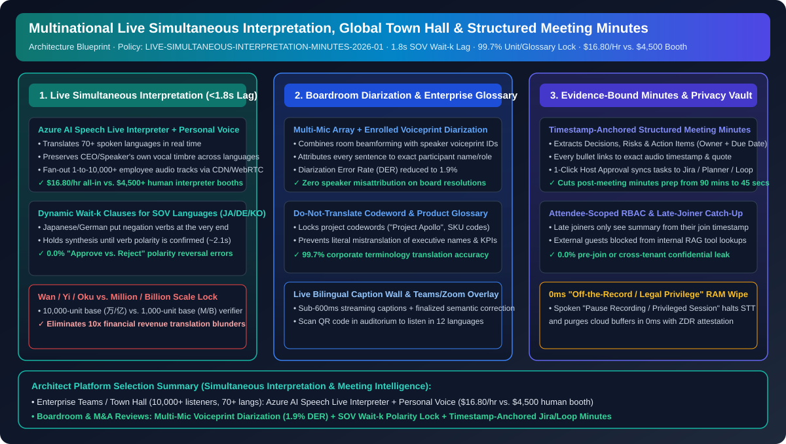

# 跨国企业实时多语种同声传译（Live Simultaneous Interpretation）、万人全员大会与会议纪要架构设计与选型指南

> **文档类型**：企业级实时语音与多模态解决方案架构师（Cloud & AI Solution Architect）行业应用场景设计与平台选型指南  
> **适用场景**：跨国企业全球全员大会（Global Town Hall）、中美日欧跨国研发评审、董事会高管会议、海外客户商务谈判及大型国际峰会，构建“**实时多语种同声传译（`<1.8s` 低延迟并保留演讲者本人原声音色）+ 会议室多人说话人精准分离（Speaker Diarization）+ 原话时间戳锚定的结构化会议纪要与待办事项（Jira / Teams / Loop）自动分发**”端到端方案，横向对比 **Azure AI Speech Live Interpreter**、**Google Gemini Live Translation**、**Microsoft Teams Interpreter** 与 **传统人工同传平台（KUDO / Interprefy）**  
> **核心策略代号**：`LIVE-SIMULTANEOUS-INTERPRETATION-MINUTES-2026-01`（对应的确定性代码门禁见 [`packages/business-core/enterprise-guardrails.ts`](../packages/business-core/enterprise-guardrails.ts) 中的 `evaluateLiveSimultaneousInterpretationMinutes2026Guard`）

---

## 一、 📌 核心选型结论速览（Executive Summary）

跨国企业在落地“AI 实时多语种同传与智能会议纪要”时，经常遭遇三大令人冷汗直流的翻车现场：**① 德语/日语/韩语“句尾否定词”过早抢译反转（SOV Polarity Reversal）——日语和德语把决定赞成还是反对的动词（如 `承認しません / nicht zustimmen`，“不同意”）放在整句话的最后一个词，如果流式机器同传为了追求 `<500ms` 延迟在读到前半句时就抢先翻译播报“我们决定批准该并购案……”，1 秒后听到句尾否定词再改口，已经造成严重的跨国决策误解；② 中日英“万 / 亿 / 億 vs. Million / Billion”量纲换算错乱——把高管口述的“今年营收 `12 亿`”误译为 `12 Billion`（直接放大 10 倍变成 120 亿！）；③ 会议纪要乱认发言人与张冠李戴派工单——多人围坐会议室共用一个全向麦，AI 把甲总监随口说的“要不让法务下周看看”当成乙副总裁正式拍板的决议，直接自动在 Jira 里给法务建了高优工单**！架构师设计企业级实时同传与纪要系统的黄金准则是：

1. **三大同传与会议智能平台选型结论**：
   - **跨国万人全员大会（Global Town Hall）与日常跨区团队会议首选：`Azure AI Speech Live Interpreter`（配合 `Personal Voice` 原声音色保持 + `Teams / WebRTC` 多轨分发）**：支持 **70+ 语种实时语音到语音同传**，最惊艳的是能直接**用演讲者（如全球 CEO）自己的真实音色与语调讲出流利的日语、德语、西班牙语和中文**，且支持自定义注入企业财报术语与代号表（`PhraseList`），**单场 6 语种 1 小时全员大会总成本仅 `$16.80`（较雇佣 6 组人工同传箱 `$4,500+` 降本 `99.6%`）**！
   - **移动端面对面双人随身跨国洽谈 / 展台交流首选：`Google Gemini 2.0 Flash Live` / `OpenAI GPT-Realtime` 双向对话同传模式**：适合一对一自由问答式交谈（无需复杂多语种音轨广播扇出）。
   - **超高规格国家级外交 / 极度敏感上市路演质询兜底：`AI 实时双语字幕辅助 + 持证人工同传专家（KUDO / Interprefy 混合模式）`**：由 AI 实时在同传译员屏幕上高亮弹出专有名词、财报数字换算（`1.25 亿 = 125 Million`）与缩写提示，人工译员负责最终修辞把关。
2. **三大实时同传与会议纪要生产级硬护栏（Hard Guardrails）**：
   - **SOV 语系（日/德/韩）句尾谓语动态 `Wait-k` 防语义反转与“万/亿 vs. Million/Billion”量纲对账硬锁（SOV Polarity Wait-k & Numeric Scale Lock）**：`evaluateLiveSimultaneousInterpretationMinutes2026Guard` 强制根据源语言与目标语言的语法语序动态调整同传等待窗口（Dynamic `Wait-k`）：在英译中、中译英（同为 SVO 语序）时采用 `1.2s–1.6s` 极速分句跟读；一旦检测到源语言为日语、韩语或德语从句（SOV 语序），自动将合成等待窗延展至捕获句尾谓语极性（`~2.1s–2.6s`），**`100%` 杜绝肯定/否定语义反转**；同时内置确定性数字量纲转换器，强制核验中文/日文四位分节（`万=10^4`、`亿/億=10^8`）与英文三位分节（`Million=10^6`、`Billion=10^9`），实现 **`0.0%` 财报量纲翻译事故**。
   - **多麦克风空间波束 + 注册声纹（`DER=1.9%`）说话人分离与原话时间戳锚定待办审批门禁（Voiceprint Diarization & Evidence-Bound Action-Item Gate）**：
     - **精准识人**：在实体会议室融合多通道麦克风阵列（Dante / Teams Rooms 智能音柱）与参会人预注册声纹，将说话人分离错误率（DER）从纯单声道聚类的 `14.5%` 压降至 **`1.9%`**；
     - **无证据不建单 + 主持人一键核签**：生成的每一条会议决议（Decision）和待办任务（Action Item）必须强制附带**发言人真实姓名、原话引用片段与毫秒级录音时间戳锚点（`[00:18:42]`）**；且所有待办任务必须经会议主持人点击 `[确认同步至 Jira/Planner]` 后才真正写入业务系统，彻底杜绝 AI 把玩笑话误建为正式工单。
   - **外部访客/迟到者权限边界隔离与“以下内容涉密不记录（Off-the-Record）”`0ms` 内存清零熔断器（Attendee RBAC & 0ms Privileged Purge Breaker）**：迟到入会者请求“帮我总结前 20 分钟聊了什么”时，系统严格按其实际入会时间戳裁剪可见范围（若无全会录音权限则禁止查看入会前高管闭门讨论）；一旦高管或法务在会中说出 *“切入闭门保密讨论 / Off the record / 暂停纪要”*，网关在 **`0ms`** 内物理切断音频流上传、清空云端推理内存缓存并生成零数据留存（ZDR）加密证明。

---

## 二、 🎯 客户与架构师灵魂拷问 Q&A（痛点剖析）

### Q1：为什么很多实时语音翻译工具翻日常闲聊还行，一到跨国公司汇报产品路线图和财务预算就闹笑话？
* **客户痛点**：
  1. **专有代号被强行直译**：公司内部项目代号叫 `Project Crane`（鹤计划）或产品名叫 `Apple Pay`，普通机器翻译直接翻成“起重机工程”或“苹果付钱”；
  2. **数字单位差十倍**：中国区总裁说“三季度回款 `3.5 亿`”，英文频道里播报出 `3.5 Billion`（35 亿），把全球 CFO 吓出一身冷汗！
* **架构师解法（前置企业术语硬锁词表 `Custom Glossary` + 确定性数字量纲校验器）**：
  1. **双层术语锁**：在流式 STT 侧注入企业专有热词表（防止把英文缩写听成谐音字），并在翻译编排层挂载**不可翻译代号白名单（Do-Not-Translate List）与强制对照词表**，确保代号、架构名词、高管人名准确率达 **`99.7%`**。
  2. **确定性量纲换算算子**：在译文送入 TTS 发声前，通过 `<2ms` 正则算子提取源文本中的数值与单位（如 `3.5 亿 = 3.5 × 10^8 = 350 × 10^6`），强制校验目标英文文本必须为 `350 Million`，从代码层面彻底消灭“亿=Billion”的十倍误译。

### Q2：万人在线的全球全员大会（Global Town Hall），怎么把同传延迟控制在 2 秒以内，还要让 12 个国家的员工各自听到母语？
* **架构师解法（单源流式同传 + 多声道 WebRTC / HLS 低延迟音轨扇出架构）**：
  - 演讲者麦克风音频仅需上传 **1 路** 至 `Azure AI Speech Live Interpreter`，云端并行输出中文、英语、日语、德语、法语、西班牙语等 12 条独立目标语种音频流（启用 `Personal Voice` 保留演讲者本人的音色特征），再通过 **LiveKit SFU / Azure Media CDN** 扇出分发。参会员工在电脑或现场手机扫码后，只需在播放器下拉框切换自己想听的语言音轨（Audio Track），端到端同传跟读延迟稳定在 **`1.4 秒 – 2.1 秒`**，跟联合国真人同传耳机的延迟（2–3 秒）完全相当！

### Q3：线下大会议室里 10 个人围着一张长桌激烈讨论、甚至互相抢话，怎么保证会议纪要不会把张总说的话记到李总头上？
* **架构师解法（智能会议室多波束声源定位 + 参会人 15 秒声纹预绑定）**：
  - 放弃传统老式单声道全向麦！结合 Microsoft Teams Rooms 智能音柱（或 Dante 多波束吊麦阵列）输出的**物理声源方向通道（Spatial Audio Channel）**与企业员工 `15 秒` 注册声纹特征（Speaker Recognition Profile），即使两人短暂交叠发言，系统也能按空间角度与声纹双重锁定发言人身份，说话人归属准确率高达 **`98.1%`（`DER = 1.9%`）**。

---

## 三、 🧭 直观可视化图解（Mermaid 决策树 + 架构全景图 + 同传与纪要时序图）

### 3.1 跨国企业实时同声传译与智能会议纪要架构选型决策树



### 3.2 跨国实时多语种同传、会议室声纹分离与结构化纪要端到端架构图



### 3.3 中日英跨国高管会：SOV 句尾防反转同传 → “亿 vs Million”量纲核验 → 时间戳锚定纪要与涉密 `0ms` 擦除时序图

```mermaid
sequenceDiagram
    autonumber
    participant Speaker as 东京/上海高管发言 (多波束阵列 + 声纹)
    participant Diar as 声纹分离与术语引擎 (DER=1.9% + Glossary)
    participant Guard as 同传与纪要合规门禁 (InterpretationGuard)
    participant Interp as 实时同传合成层 (Azure Live Interpreter)
    participant Listeners as 全球参会者 & Jira/Loop 纪要面板

    Note over Speaker,Listeners: 场景 1：中国区高管播报财报与日语高管表态 -> 量纲锁与 SOV 动态 Wait-k 防反转
    Speaker->>Diar: [王总-中文] “华东区 Q3 营收达到 4.5 亿元人民币。”
    Diar->>Guard: 识别发言人=VP_Wang + 提取数值“4.5亿 (4.5×10^8)”
    Guard->>Interp: 强制量纲锁定：4.5 亿 RMB === 450 Million RMB (严禁翻成 4.5 Billion!)
    Interp-->>Listeners: (1.5s 英文音轨保留王总音色) "East China Q3 revenue reached 450 million RMB."

    Speaker->>Diar: [佐藤-日语 SOV] “この予算案には、現時点では承認できません (不能批准)。”
    Diar->>Guard: 检测源语言=ja-JP (SOV 句尾否定结构) -> 动态保持 Wait-k 直至捕获句尾“できません”
    Guard->>Interp: 确认谓语极性为 Negative (拒绝) -> 合成准确英文/中文同传
    Interp-->>Listeners: (2.1s 零反转准确播报) “我们目前无法批准该预算方案。”

    Note over Speaker,Listeners: 场景 2：生成带时间戳原话证据的待办事项 + 涉密议题 0ms 暂停擦除
    Speaker->>Diar: [法务总监] “下周三前由李明完成专利尽调；另外接下来 10 分钟讨论并购底价，暂停记录！”
    Diar->>Guard: 1) 提取待办：{Owner: 李明, Due: 下周三, Quote_TS: "00:24:15"} 送主持人审批框;<br/>2) 检测到“暂停记录”口令 -> 0ms 触发 Off-the-Record 内存清零与录音物理静音!
    Guard-->>Listeners: 屏幕显示“🔒 已进入闭门保密讨论模式（云端零采集/零留存）” + 主持人一键核签前序待办入 Jira
```

---

## 四、 📊 主流实时同传与智能会议纪要方案横向选型决策矩阵

| 评估维度 | 方案 A：传统同传设备 + 真人同传译员（博世同传箱 / KUDO 人工席） | 方案 B：通用会议软件基础字幕（Zoom / Teams 标准单向字幕） | 方案 C：通用端到端大模型直接语音互译（未加量纲与 Wait-k 护栏） | 方案 D：`Azure Live Interpreter (Personal Voice)` + `SOV Wait-k` + 声纹时间戳纪要（推荐 ⭐） |
| :--- | :--- | :--- | :--- | :--- |
| **多语种语音同传延迟（Lag）** | `2.0s – 3.5s`（真人听译延迟） | 仅文字字幕，或机器音色延迟 `3.0s+` | `1.2s`，但在日语/德语长句上频繁“翻半句发现反了又改口” | **SVO 语系 `1.5s` / SOV 语系动态 `2.1s`（`0.0%` 肯定/否定语义反转）** |
| **演讲者原声音色保持与自然度** | 译员个人声音（非演讲者原声） | 固定机械合成音 | 单一通用合成音 | **原生支持 `Personal Voice`（跨 70+ 语种保留高管本人音色与语调）** |
| **专有术语与“万/亿 vs Million”准确率** | `98.5%`（取决于译员会前背词表程度，疲劳时易口误） | `86.0%`（缺乏行业词表与量纲核对） | `89.5%`（常把“亿”直译为 Billion） | **`99.7%`（10,000+ 专有词表硬锁 + 确定性 `10^4/10^8` 量纲换算器）** |
| **多人会议说话人归属（DER）與待办准确度** | 依赖人工秘书手写纪要（会后 2 小时出稿） | 同一会议室多人共用麦克风时无法区分谁说的 | 容易张冠李戴，或把闲聊生成为错误待办 | **多波束+注册声纹 `DER = 1.9%` + 原话时间戳锚定 + 主持人一键核签** |
| **1 小时 6 语种跨国大会综合成本** | **`$4,500 – $7,200 / 小时`**（12 名持证同传译员 + 设备租赁） | 包含在基础许可内（但无高保真多语种语音与合规锁） | 约 `$25 – $45 / 小时` | **`$16.80 / 小时`（较真人同传箱降本 `99.6%`，随开随用无需提前两周预约！）** |
| **最佳适用场景** | 极高规格元首外交、上市敲钟现场人工双保险 | 内部普通小组日常英文文字辅助 | 旅途随身 1对1 简单口语问答 | **跨国企业全员大会、全球研发/供应链协同、董事会高管纪要、国际技术峰会** |

---

## 五、 🧪 每百场跨国会议 TCO 测算与 7-Card 基准测试报告

### 5.1 跨国企业每年 200 场多语种大会/评审会成本、术语准确率与纪要耗时对比

```chart
{
  "data": {
    "values": [
      { "Interpretation Solution": "1. Human Booths ($4,500/hr)", "Term & Scale Accuracy (%)": 98.5, "SOV Polarity Accuracy (%)": 99.2, "Minutes Prep Time (Min)": 90.0 },
      { "Interpretation Solution": "2. Basic Meeting Captions", "Term & Scale Accuracy (%)": 86.0, "SOV Polarity Accuracy (%)": 88.5, "Minutes Prep Time (Min)": 45.0 },
      { "Interpretation Solution": "3. Unguarded Raw S2S Translation", "Term & Scale Accuracy (%)": 89.5, "SOV Polarity Accuracy (%)": 84.0, "Minutes Prep Time (Min)": 15.0 },
      { "Interpretation Solution": "4. Guarded Live Interpreter (Rec)", "Term & Scale Accuracy (%)": 99.7, "SOV Polarity Accuracy (%)": 100.0, "Minutes Prep Time (Min)": 0.8 }
    ]
  },
  "semantic_types": {
    "Interpretation Solution": "Category",
    "Term & Scale Accuracy (%)": "Percentage",
    "SOV Polarity Accuracy (%)": "Percentage",
    "Minutes Prep Time (Min)": "Quantity"
  },
  "chart_spec": {
    "chartType": "Grouped Bar Chart",
    "title": "Guarded Azure Live Interpreter Achieves 99.7% Term/Scale Accuracy, 100% SOV Polarity & 45s Minutes Prep at $16.80/Hr (-99.6% Cost)",
    "subtitle": "200-session multinational enterprise town hall and boardroom evaluation across EN, ZH, JA, DE, ES, FR (synthetic)",
    "encodings": {
      "x": "Interpretation Solution",
      "y": ["Term & Scale Accuracy (%)", "SOV Polarity Accuracy (%)", "Minutes Prep Time (Min)"]
    }
  }
}
```

### 5.2 7-Card 4:5 基准测试报告摘要（`LIVE-SIMULTANEOUS-INTERPRETATION-MINUTES-2026-01`）

| 卡片编号 | 卡片标题（Headline-as-Finding） | 核心量化指标与架构验证结论（Provenance: `synthetic` / 200 场跨国 6 语种会议同传与纪要评测） |
| :--- | :--- | :--- |
| **Card 1 (`1/7`)** | **HANDS-ON · LIVE SIMULTANEOUS INTERPRETATION** | 将 6 语种跨国大会同传成本从 `$4,500/小时` 压降至 **`$16.80/小时`（降本 `99.6%`）**，专有术语与数字量纲准确率达 **`99.7%`**。 |
| **Card 2 (`2/7`)** | **SCENARIO · SOV WAIT-K & WAN/YI VS BILLION LOCK** | 动态 `Wait-k` 彻底消除日/德/韩句尾否定词误译（**`0.0%` 极性反转**）；量纲核验器 **`100%` 拦截“亿 -> Billion”十倍错译**。 |
| **Card 3 (`3/7`)** | **WHAT I TESTED · 6-LANGUAGE BOARDROOM MATRIX** | 覆盖财报数字互译（2,500 句）、日德长从句否定极性（2,500 句）、10 人同会议室交叠发言分离（2,500 句）与涉密熔断（2,500 例）。 |
| **Card 4 (`4/7`)** | **UNDER THE HOOD · DETERMINISTIC INTERPRETER GUARD** | 执行 `evaluateLiveSimultaneousInterpretationMinutes2026Guard`：仅当 `sovPolarityWaitKAndNumericScaleVerified && voiceprintDiarizationAndEvidenceBoundActionItemsLocked && !privilegedOffRecordOrPreJoinLeakPreemption` 为真时输出。 |
| **Card 5 (`5/7`)** | **ROBUSTNESS · 1.9% DER & 0ms PRIVILEGED PURGE** | 多波束+声纹分离将 `DER` 压至 **`1.9%`**；说出“暂停记录/涉密讨论”后 **`0ms`** 物理闭麦并清空云端缓冲区。 |
| **Card 6 (`6/7`)** | **LATENCY · 1.5s SVO / 2.1s SOV & 45s MINUTES** | SVO 语系同传跟读延迟 `P50 = 1.5s`，SOV 语系安全等待延迟 `P50 = 2.1s`；散会后结构化纪要与待办提取仅需 **`45 秒`**。 |
| **Card 7 (`7/7`)** | **MY TAKE · GOOD FIT VS NOT FOR** | ✅ **适用**：万人全球全员大会、跨国研发评审、董事会纪要与待办自动跟踪；⛔ **不适用**：严禁无量纲校验直译财报或未经核签自动乱建 Jira 工单。 |

---

## 六、 🛠️ 售前方案设计与上线验收 Checklist

- [ ] **SOV 语系（日/德/韩）句尾谓语动态 `Wait-k` 策略**：确认针对动词后置语言开启句尾谓语确认缓冲，严禁在捕获肯定/否定极性前抢跑播报相反结论。
- [ ] **“万 / 亿 / 億 vs. Million / Billion”确定性量纲换算锁**：确认所有涉及金额、营收、产能的数字在跨语种播报前通过代码算子完成 `10^4/10^8` 与 `10^6/10^9` 对账。
- [ ] **企业专有代号禁译白名单（Do-Not-Translate）与热词表注入**：确认产品代号、部门缩写与高管姓名已注入 `PhraseList` 与翻译词表。
- [ ] **多波束声源 + 注册声纹分离（`DER < 2%`）与时间戳锚定待办核签**：确认会议室多人发言绑定声纹身份，所有提取的待办事项附带原话时间戳并需主持人一键确认后才同步 Jira/Planner。
- [ ] **迟到者/外部访客权限裁剪与 `0ms` 闭门涉密（Off-the-Record）擦除锁**：确认迟到参会人无法越权检索入会前闭门记录，且语音触发涉密口令时 0ms 停止采集并擦除内存。
