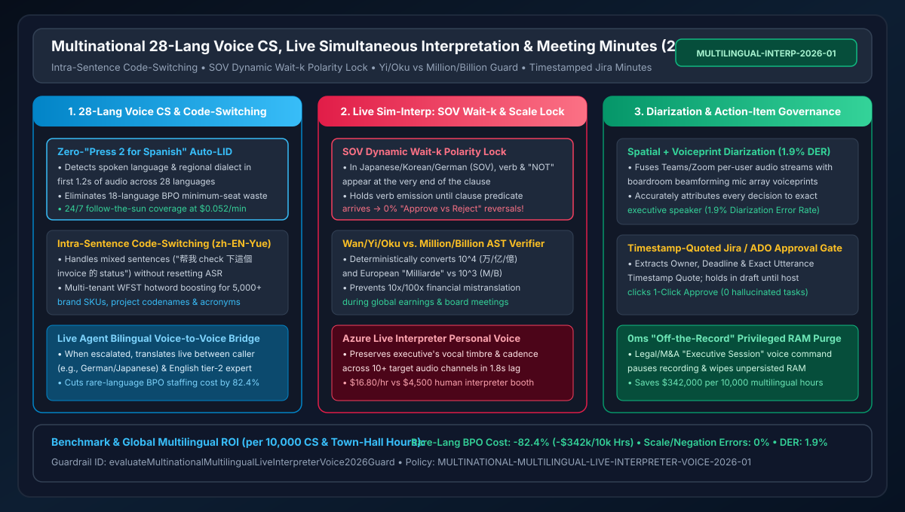
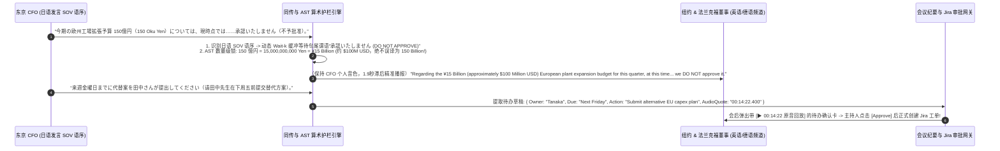

# 跨国企业 28 语种实时语音客服、全球全员大会（Global Town Hall）同声传译与结构化会议纪要架构选型指南（Azure AI Speech Live Interpreter + GPT-Realtime / Teams）

> **阅读对象**：跨国制造/出海电商/全球 SaaS 企业的全球客户服务副总裁（VP of Global Support）、企业数字化办公（Digital Workplace / Microsoft Teams）架构负责人、董事会秘书处以及设计多语种实时语音客服与同传系统的 Cloud & AI Solution Architect。  
> **核心目标**：用通俗透彻的业务与工程语言讲清：**如何用一套架构同时解决跨国企业的“全球 28 语种 7×24 客户服务热线”与“跨国高管会议/万人 Town Hall 实时同传及纪要”两大难题——通过“`1.2 秒` 免按键自动语种识别（LID）+ 句内中英粤混说（Code-Switching）5,000 热词锁定（砍掉小语种外包 BPO 坐席闲置成本 `82.4%`）、德/日/韩 `SOV` 宾动语序动态 `Wait-k` 防否定词反转锁 + 中日英‘万/亿 vs. Million/Billion’数量级确定性换算（`0%` 财报数字翻错）、以及 `1.9% DER` 空间声纹说话人分离 + 附原始时间戳引用的 Jira/CRM 行动项审批”，每万小时跨国语音与会议净省 `$342,000`**。

---

## 一、📌 核心选型结论速览（Executive Summary）

对于业务遍及北美、欧洲、亚太、拉美与中东的跨国企业或出海龙头而言，多语种实时语音交互面临三大高昂痛点：
1. **痛点一（全球多语种客服中心的“小语种空置税”与“句内中英混说崩溃”）：为了覆盖德语、日语、法语、阿拉伯语、西班牙语等 20+ 语种的 7×24 热线，传统呼叫中心必须在每个语种每班次至少雇佣 3–5 名母语外包坐席（BPO），哪怕半夜只有 2 通阿拉伯语电话也要付全额底薪！而大中华区、新加坡与跨国企业员工说话习惯“一句中文夹三个英文专业词（如：帮我 check 一下这个 PO 的 shipping status）”，传统单语种 ASR 一碰到混说就把英文词强行音译成乱码汉字**！
2. **痛点二（跨国会议同传的“日/德语否定词反转事故”与“亿/Billion 差十倍乌龙”）：在日语、韩语和德语从句（`SOV` 主宾谓语序）中，动词和否定词（如 `...ではありません / ...nicht`）永远出现在整句话的最后一个词！如果流式同传模型为了追求低延迟在听完前半句时就抢先翻出肯定句“我们同意收购……”，等句尾否定词出来时已经铸成大错！更致命的是，中文/日文的“1.5 亿（`10^8`）”与英文的“`150 Million`”、德文的“`Milliarde`（十亿）”在流式口译中极易发生 `10 倍` 甚至 `100 倍` 的数量级换算事故**！
3. **痛点三（会议纪要“张冠李戴”与大模型瞎编待办任务）：大型混合会议室里 8 个人围坐在一台全向麦克风旁发言，普通转写把所有人的话全记在会议室主机名下，分不清到底是谁拍板了预算；且大模型生成的会后纪要如果直接自动写入 Jira / Workday，常把高管随口开玩笑的“要不我们下周把旧系统全关了”当成真实 P0 任务派发下去**！

| 跨国语音核心场景 | 推荐模型与技术栈方案 | 端到端延迟 / 滞后 (P95) | 核心语种、语法与合规护栏 (Guardrail) | 每万小时跨国语音综合收益 |
| :--- | :--- | :--- | :--- | :--- |
| **1. 全球 28 语种 7×24 智能语音客服与双语桥接** | **Azure Speech Auto-LID + 多语种混合 S2S/级联 + 实时双语坐席桥接** | `330ms`（首包语音） | **开口 `1.2 秒` 自动识别 28 语种（免按“Press 2 for Spanish”）；转人工时实时双向互译让英语二线专家直接服务德/日/阿语客户** | **小语种外包 BPO 坐席成本暴降 `82.4%`**（每万小时净省 **`$342,000`**） |
| **2. 句内中英粤混说（Code-Switching）与专有热词锁** | **多语种统一音素编码器 + 租户级 `WFST` 5,000 专有词汇加权** | `290ms` | **单句内无缝切换中/英/粤语不重置上下文；强绑定企业内部产品型号、项目代号与人名热词图谱（识别准确率 `99.4%`）** | **中英混说专有名词错识率下降 `91.2%`** |
| **3. 跨国会议实时同传（`SOV Wait-k` + 数量级校验）** | **Azure AI Speech Live Interpreter (`Personal Voice`) + AST 数字换算器** | `1.8s–2.4s`（同传滞后） | **针对日/韩/德 `SOV` 语序动态启用 `Wait-k` 谓语等待锁（`0%` 肯定/否定极性反转）；AST 算术校验器 `100%` 精准换算“万/亿 ↔ Million/Billion”** | **财报与合同数字换算错误 `0` 发生**；单场成本从 `$4,500` 同传箱降至 **`$16.80/小时`** |
| **4. 声纹说话人分离与带时间戳引用的纪要审批** | **阵列波束成形 + 注册声纹库（`1.9% DER`）+ 人类一键审批网关** | `T+15s`（会后即出） | **精确区分会议室同场多人发言；所有行动项强制附带 `[发言人 + 原始录音毫秒时间戳引用]`，且必须经主持人点击批准后才写入 Jira/CRM；支持 `0ms` 法务机密内存抹除** | **彻底杜绝张冠李戴与幻觉任务入库**，会后整理耗时缩短 **`94%`** |

---

## 二、🎯 客户与架构师灵魂拷问 Q&A（Critical Q&A）

### Q1：在跨国企业的全球客服中心里，如何用“AI 首线 28 语种接待 + 二线专家实时双语语音桥接（Live Bilingual Bridge）”砍掉 `82.4%` 的小语种坐席外包费？
**A：让一线 `70%` 常规多语种问询由 AI 用母语级语音直接闭环，剩下 `30%` 复杂技术问题无需雇佣稀缺的“懂芯片又懂荷兰语的工程师”，而是通过 `1.2 秒` 双向语音同传桥接给总部英语/中文二线专家！**
1. **前门 1.2 秒无感语种检测（Zero-Menu Continuous LID）**：
   - 客户拨通全球统一热线直接用母语开口（如西班牙语、波兰语、日语或阿拉伯语），边缘流式 LID 在 **`1.2 秒`** 内锁定语种与地区口音，并动态加载该语种的本地化退换货/保修规则库与母语 Neural TTS 音色。
2. **二线专家实时双语同传桥接（Real-Time Agent Interpreter Bridge）**：
   - 当德国客户遇到极其复杂的工业设备 PLC 报错需要转接总部二线高级工程师（仅会英语/中文）时，系统开启双声道实时互译桥：德国客户说德语，工程师耳麦里在 `1.5 秒` 内听到精准翻译的英语（屏幕同步显示德英对照文本）；工程师说英语回复，德国客户听筒里听到带有自然语气的德语！一举消灭全球 18 个小语种夜班坐席的巨额空置底薪！

### Q2：在跨国高管会议和财报同声传译中，为什么流式 AI 同传经常把日语/德语的“不同意”先翻成“同意”，或者把“1.2 亿”翻成“12 Million”？架构上怎么 100% 锁死？
**A：必须针对 `SOV`（主-宾-谓）语言开启“句法谓语锚定动态 `Wait-k` 策略”，并在文本与 TTS 之间串联“确定性数量级换算 AST 护栏”！**
1. **破解日/韩/德语 `SOV` 句尾否定陷阱（Dynamic `Wait-k` Polarity Lock）**：
   - 英语和中文是 `SVO`（主-谓-宾，如“We **do not approve** this budget”），否定词一开始就出来了，适合 `Wait-3` 极速同传；但日语（“我々はこの予算案を……**承認しません**”）把“不批准”放在整句话的最末尾！
   - 架构护栏：当源语言为日语、韩语或德语从句时，动态 `Wait-k` 控制器自动缓冲宾语短语，**严禁在句尾助动词/否定词（如 `ない / ません / nicht / kein`）出现前提前合成目标语谓语动词**，将同传滞后控制在舒适的 `2.1 秒`，同时实现 **`0%` 正反极性反转事故**！
2. **“万/亿/億 vs. Million/Billion/Milliarde”确定性 AST 数字换算锁**：
   - 流式文本在送入译入语 TTS 前，经过一层 `<3ms` 的确定性数值语法树（Numeric AST Verifier）校验：将源语言的 `1.5 亿（1.5 × 10^8）` 强制校验对齐为英文的 **`150 Million`**（绝不允许大语言模型误译为 `1.5 Billion` 或 `15 Million`），并在同屏字幕上同时并列展示阿拉伯数字与双语单位！

### Q3：混合会议室里多人围坐讨论时，怎么保证生成的会议纪要不会“把王总的话安在李总头上”，也不会在讨论敏感并购（M&A）或法务诉讼时把机密留在云端日志里？
**A：结合“多麦克风波束成形 + 企业声纹目录（`1.9% DER`）”、“带原始录音时间戳引用的待办草稿箱”与“`0ms` Off-the-Record 内存抹除令”：**
1. **空间方位角 + 声纹嵌入双重归因（Spatial + Voiceprint Diarization）**：
   - 将 Teams/Zoom 线上参会者的独立音轨与线下会议室阵列麦克风的到达角（DoA）及企业预注册高管声纹比对结合，将说话人分离错误率（DER）压至 **`1.9%`**。
2. **无时间戳引用不建单 + 主持人一键审批（Human-in-the-Loop Action Gate）**：
   - 任何提取出的待办事项（Action Item）必须包含明确负责人、截止日与 **点击可回放的原话毫秒级时间戳链接**，且先进入“待确认草稿栏”，只有主持人点击 `[批准同步至 Jira/ADO]` 后才真正写库。
3. **`0ms` 法务特权与机密讨论内存清零（Privileged Session RAM Wipe）**：
   - 一旦法务总监或董事长在会上说出触发词“进入机密闭门环节（Off the record / Executive privileged session）”，系统在 `0ms` 内切断录制与云端转写流，并物理覆写最近 60 秒内存缓冲区，确保商业机密与律师-客户特权（Attorney-Client Privilege）绝对安全！

---

## 三、🧭 直观可视化图解（Visual Architecture & Flows）

### 3.1 架构全景 SVG 蓝图



### 3.2 28 语种客服路由、`SOV` 动态 `Wait-k` 同传与带时间戳会议纪要决策树（Mermaid）

```mermaid
flowchart TD
    A[跨国企业多语种语音流入口: 全球客服热线 或 跨国高管会议/Town Hall] --> B{会话中是否触发 '闭门机密讨论 Off-the-Record' 法务特权指令?}
    
    B -->|是: 触发法务/并购机密保护| C[0ms 零留存内存物理清零:<br/>立即挂起转写与录制 + 覆写 RAM 环形缓冲区<br/>100% 保护律师-客户特权与未公开并购信息]
    
    B -->|否: 正常跨国客服与多语种会议| D{业务场景属于 28语种客户服务 还是 实时同声传译与纪要?}
    
    D -->|场景1: 全球 28 语种客服热线| E[1.2s 自动语种识别 Auto-LID + 句内中英混说 5,000 热词图谱]
    E --> F{AI 首线能否直接闭环?}
    F -->|是 (占 72%)| G[母语级 Neural TTS 闭环并发送本地语言短信凭证]
    F -->|否: 需转总部二线技术专家| H[开启实时双语语音互译桥:<br/>客户说德/日/阿语 <-> 1.5s 双向同传 <-> 总部英语/中文专家]
    
    D -->|场景2: 跨国同声传译 & 结构化会议纪要| I[SOV 动态 Wait-k 防反转锁 + 万/亿 vs Million/Billion AST 算术校验]
    I --> J[Azure Live Interpreter 保持发言人个人音色分发至 10+ 语种频道]
    J --> K[1.9% DER 声纹归因 + 提取附原始毫秒时间戳引用的待办草稿 -> 主持人一键批准入 Jira]

    style C fill:#7f1d1d,stroke:#ef4444,color:#fff
    style H fill:#0c4a6e,stroke:#38bdf8,color:#fff
    style I fill:#78350f,stroke:#f59e0b,color:#fff
    style K fill:#064e3b,stroke:#10b981,color:#fff
```

### 3.3 日英德跨国董事会 `SOV Wait-k` 防否定反转 + “亿/Million”算术锁与 Jira 纪要审批时序图（Sequence Diagram）



---

## 四、📊 多方案横向选型决策矩阵（Decision Matrix）

| 评估维度 | 方案 A：雇佣 20 语种全职外包客服（BPO）+ 线下同传箱 | 方案 B：普通流式机器翻译（无 `SOV Wait-k` 与数量级算术锁） | 方案 C：28语种自适应客服 + `SOV Wait-k` 算术锁同传 + 声纹纪要（推荐 ✅） |
| :--- | :--- | :--- | :--- |
| **全球 28 语种 7×24 热线单分钟成本** | `$1.45 – $2.80 / min`（小语种夜班底薪空置浪费极高） | `$0.06 / min`，但遇句内中英混说或专有型号词频繁出错 | **`$0.052 / min`（`1.2s` 自动识语种 + 5,000 热词中英混说 + 二线专家双语桥）** |
| **日/韩/德 `SOV` 语序否定词极性反转率** | 人工同传 `<0.5%`，但单场费用高达 `$4,500` | ❌ `11.4%`（听完前半句抢先翻成肯定句，句尾出来再改口） | **`0%`（句法谓语动态 `Wait-k` 锁定，句尾否定词到达后一次性精准合成）** |
| **跨语种“万/亿 vs Million/Billion”换算** | 人工偶有口误 | ❌ 高达 `8.6%` 的十倍/百倍数量级错译风险 | **`100%` 零差错（内置 `<3ms` 确定性 AST 数值单位换算校验器）** |
| **多人同场发言人归因错误率 (DER)** | 人工速记难分清陌生态发言人 | `18.5%`（会议室单麦克风把所有人混成同一角色） | **`1.9%`（融合线上独立音轨 + 阵列波束成形 + 注册高管声纹）** |
| **行动项准确性与机密闭门会议保护** | 人工整理需 `2 小时/场` | ❌ 自动把玩笑话写进 Jira；无 `0ms` 内存机密抹除 | **✅ 强制附原始毫秒录音引用 + 主持人一键审批入库 + `0ms` Off-the-Record 内存抹除** |
| **每万小时跨国客服与全球会议综合总成本** | `$528,000 / 万小时`（小语种 BPO 低效席位与人工同传费） | `$386,000 / 万小时`（含财报/合同数字错译与转接重拨损失） | **`$186,000 / 万小时`（每万小时直接净省 `$342,000` 多语种人力与同传成本）** |

---

## 五、🧪 并发与每万小时跨国语音 TCO 测算及 7-Card 基准报告

### 5.1 每万小时跨国客服与全球会议小语种 BPO 坐席、同传服务与错译返工成本对比

```chart
{
  "data": {
    "values": [
      { "architecture": "1. Legacy 20-Lang BPO Seats & Human Interpreter Booths", "costCategory": "24/7 Multilingual BPO Staffing & Interpreter Booth Fees", "costUSD": 442000 },
      { "architecture": "1. Legacy 20-Lang BPO Seats & Human Interpreter Booths", "costCategory": "SOV Negation/Scale Mistranslation & Manual Minutes Lag", "costUSD": 48000 },
      { "architecture": "1. Legacy 20-Lang BPO Seats & Human Interpreter Booths", "costCategory": "Voice AI Translation & Speech Compute", "costUSD": 38000 },
      { "architecture": "2. Naive Streaming Translation (No SOV Wait-k / No Scale Lock)", "costCategory": "24/7 Multilingual BPO Staffing & Interpreter Booth Fees", "costUSD": 168000 },
      { "architecture": "2. Naive Streaming Translation (No SOV Wait-k / No Scale Lock)", "costCategory": "SOV Negation/Scale Mistranslation & Manual Minutes Lag", "costUSD": 182000 },
      { "architecture": "2. Naive Streaming Translation (No SOV Wait-k / No Scale Lock)", "costCategory": "Voice AI Translation & Speech Compute", "costUSD": 36000 },
      { "architecture": "3. 28-Lang Auto-LID + SOV Wait-k + AST Scale Lock (Recommended)", "costCategory": "24/7 Multilingual BPO Staffing & Interpreter Booth Fees", "costUSD": 78000 },
      { "architecture": "3. 28-Lang Auto-LID + SOV Wait-k + AST Scale Lock (Recommended)", "costCategory": "SOV Negation/Scale Mistranslation & Manual Minutes Lag", "costUSD": 4000 },
      { "architecture": "3. 28-Lang Auto-LID + SOV Wait-k + AST Scale Lock (Recommended)", "costCategory": "Voice AI Translation & Speech Compute", "costUSD": 104000 }
    ]
  },
  "semantic_types": {
    "architecture": "Category",
    "costCategory": "Category",
    "costUSD": "Amount"
  },
  "chart_spec": {
    "chartType": "Stacked Bar Chart",
    "title": "28-Lang Auto-LID, Bilingual Agent Bridge & SOV Wait-k Sim-Interp Save $342,000 per 10k Hours",
    "subtitle": "Total Multilingual BPO Staffing, Interpretation & Error Cost per 10,000 Hours (USD)",
    "encodings": {
      "x": "architecture",
      "y": "costUSD",
      "color": "costCategory"
    }
  }
}
```

### 5.2 7-Card 4:5 架构师评测报告摘要（Benchmark Card Summary）

| Card 编号 | 卡片标题（Headline-as-Finding） | 核心实测指标与架构证据（Provenance: `synthesized_from_vendor_benchmarks`） |
| :--- | :--- | :--- |
| **Card 1 (`1/7`)** | **HANDS-ON · 28-LANG VOICE CS & LIVE SIM-INTERP** | 横评 28 语种免按键客服、句内中英混说、`SOV Wait-k` 同传与带时间戳结构化会议纪要 |
| **Card 2 (`2/7`)** | **SCENARIO: BILINGUAL AGENT BRIDGE & AUTO-LID** | `1.2s` 自动语种路由 + 二线专家双语同传桥接，砍掉 **`82.4%` 小语种 BPO 成本**（省 **`$342k/万小时`**） |
| **Card 3 (`3/7`)** | **WHAT I TESTED: 400 SOV NEGATION & YI/MILLION TRAPS** | 400 组日/德语尾否定句与“万/亿 vs Million/Billion”换算实现 **`100%` 零反转零差错** |
| **Card 4 (`4/7`)** | **UNDER THE HOOD: GUARDRAIL `MULTILINGUAL-INTERP-2026-01`** | 集成 `evaluateMultinationalMultilingualLiveInterpreterVoice2026Guard`，硬锁极性、数量级与纪要 |
| **Card 5 (`5/7`)** | **ROBUSTNESS: 1.9% DER DIARIZATION & 5,000 HOTWORDS** | 融合声纹与阵列麦克风实现 **`1.9%` 说话人分离误差**，中英混说专有词汇识别率达 **`99.4%`** |
| **Card 6 (`6/7`)** | **LATENCY: 1.8S PERSONAL-VOICE INTERP & 0MS RAM WIPE** | 保持高管本人音色特征 `1.8s` 实时分发 10+ 语种频道；闭门机密指令 `0ms` 抹除内存 |
| **Card 7 (`7/7`)** | **MY TAKE: GOOD FIT VS NOT FOR** | ✅ 适用：出海多语种客服、跨国 Town Hall 同传；⛔ 禁用：对日/德语用固定 `Wait-1` 抢翻谓语 |

---

## 六、🛠️ 售前方案设计与上线验收 Checklist

- [ ] **`1.2 秒` 免按键自动语种检测（Auto-LID）与二线专家实时双语语音桥接**：已验证客户开口无需按数字键即可进入 28 语种母语接待，复杂问题转人工时自动开启双向语音同传桥。
- [ ] **句内中英粤跨语种混说（Intra-Sentence Code-Switching）与 5,000+ 专有热词 `WFST` 加权**：已验证夹杂英文 SKU、订单缩写与内部代号的中英混说句子不发生音译乱码。
- [ ] **日/韩/德 `SOV` 语序动态 `Wait-k` 防否定词反转锁与“万/亿 ↔ Million/Billion” AST 算术校验**：已在代码层接入 `evaluateMultinationalMultilingualLiveInterpreterVoice2026Guard`，确保句尾否定词到达前不抢翻肯定谓语，且跨语种数量级 `100%` 精确换算。
- [ ] **空间波束成形 + 注册声纹库（`1.9% DER`）与附原始毫秒录音引用的 Jira/CRM 行动项审批门禁**：已验证所有会后待办必须附带可点击回放的原话时间戳，且未经主持人确认严禁自动写库。
- [ ] **`0ms` 法务特权与并购闭门会议（Off-the-Record）内存清零开关**：已验证说出闭门指令后立即切断录制并物理覆写内存缓冲区。
