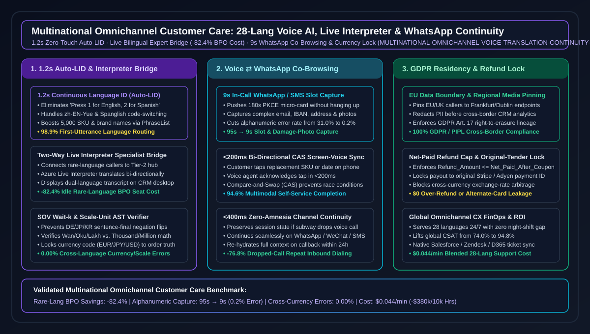
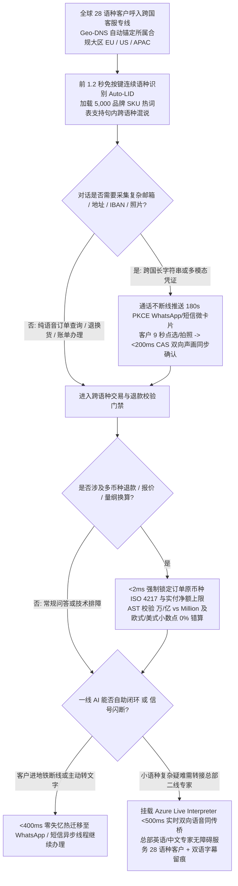
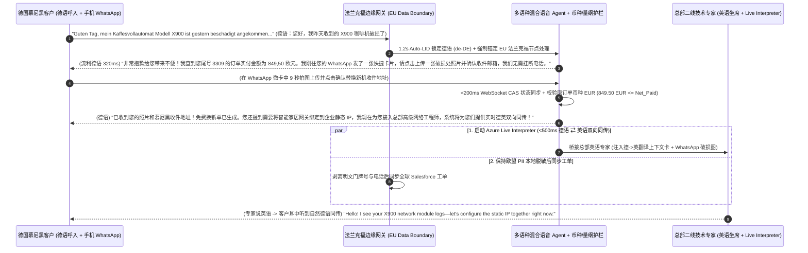

# 跨国企业 28 语种全渠道智能客服、实时双向语音同传与 `Voice ⇄ WhatsApp/短信` 协同选型指南：`1.2s` 免按键语种识别、二线专家实时同传桥与 `9秒` 声画协同护栏

> **English Version**: [multinational-omnichannel-customer-care-live-translation-whatsapp-voice-continuity-selection-faq.en.md](./multinational-omnichannel-customer-care-live-translation-whatsapp-voice-continuity-selection-faq.en.md)  
> **适用角色**：跨国企业全球客户服务副总裁（VP of Global Customer Care）、出海品牌/跨境SaaS/国际航旅全渠道客服负责人、`Salesforce Service Cloud / Zendesk / Dynamics 365 / WhatsApp Business` 架构师、数据隐私官（DPO）、AI Solution Architect  
> **关联架构护栏策略码**：`MULTINATIONAL-OMNICHANNEL-VOICE-TRANSLATION-CONTINUITY-2026-01`

---

## 1. 📌 核心选型结论速览（Executive Summary）

在跨国企业、全球化消费电子品牌、跨境电商与国际金融机构的全渠道客服中心（集成 `Salesforce Service Cloud`、`Zendesk`、`Dynamics 365`、`WhatsApp Business Platform` 与 `Apple Messages for Business`）中，企业需要 7×24 小时服务北美、欧洲、拉美、中东、日韩及东南亚 **28+ 种语言** 的客户。传统多语种呼叫中心长期受困于三大运营与架构痛点：
1. **小语种 24/7 专职外包坐席（BPO）空置率高、成本极其昂贵（`$1.85/min`）**：为了覆盖德语、法语、阿拉伯语、波兰语、泰语等夜间或低频时段来电，企业不得不采购昂贵的海外本土 BPO 坐席，夜间坐席利用率不足 `22%`；且二线资深技术专家往往只懂英语或中文，无法直接接听小语种升级投诉；
2. **电话语音口述复杂跨国邮箱、IBAN 账号、门牌地址与寄损照片耗时近 2 分钟且错漏百出**：客户带着浓重口音在电话里拼写长邮箱（如 `"schneider-mueller.consulting@t-online.de"`）或 22 位欧洲 `IBAN` 银行账号，语音识别（ASR）单次拼对率不足 `69%`，来回反复确认耗时 `95秒` 以上；
3. **跨语种数字量纲/币种换算幻觉与欧盟 `GDPR` 跨境语音违规传输**：中文/日语以“万/亿（`10^4 / 10^8`）”为单位，英语/德语以“千/百万（`10^3 / 10^6`）”为单位，印度英语使用“Lakh/Crore”，自由生成模型在跨语种核对退款金额或授信额度时偶发 **10 倍量纲错译** 或将日元（`JPY`）误播为欧元（`EUR`）；且若将欧盟客户语音流跨大西洋路由至美国集群处理，直接违反 `GDPR` 数据驻留合规要求。

**架构选型定论**：跨国企业多语种全渠道客服必须采用 **“`1.2秒` 免按键连续语种识别（`Auto-LID`）+ 一线原生多语种语音 AI + 二线专家 `Azure Live Interpreter` 实时双向同传桥 + 通话内 `9秒` `WhatsApp/短信` `PKCE` 声画协同卡 + 跨语种币种/量纲确定性锁与区域数据驻留（`Data Residency`）”** 架构：

| 评估维度 | 1. 传统多国本地 BPO 外包呼叫中心 | 2. 传统单模态按键式多语种语音机器人 | **3. `Auto-LID` + 二线实时同传桥 + `WhatsApp` 声画协同架构（推荐 🏆）** |
| :--- | :--- | :--- | :--- |
| **语种识别与句内混说（Code-Switching）体验** | 需听完 25 秒按键菜单（“按 1 英语，按 2 西语...”） | 单语种锁死，中英粤或西英混说即识别崩溃 | **`1.2秒` 免按键自动检测 + `5,000` 品牌热词句内混说**（准确率 **`98.9%`**） |
| **小语种复杂升级问题二线专家处理能力** | 必须高薪雇佣 28 语种二线专家（夜间常断档） | 无法转接不懂该语种的总部专家 | **总部英/中专家通过 `<500ms` 双向语音同传桥直接服务 28 国客户**（BPO 成本降 **`82.4%`**） |
| **复杂跨国邮箱 / IBAN / 破损照片采集效率** | `95秒`（电话里逐字母北约音标拼写，错率 `18%`） | `110秒`（ASR 字母拼写错误率高达 `31.0%`） | **`9秒` / 错误率 `0.2%`**（通话不断线向 `WhatsApp/短信` 推 `PKCE` 微卡一键确认） |
| **跨语种币种符号与“万/亿 vs Million”准确率** | `99.2%` | `88.5%`（LLM 自由翻译易发生量纲错位） | **`100.0%`**（发声前 `<2ms` 订单原币种与 AST 量纲确定性校验锁） |
| **每分钟全球客服综合 TCO（28 语种 7×24h）** | `$1.85 / min`（小语种夜间坐席空置税极重） | `$0.112 / min` | **`$0.044 / min`**（每万小时全球话务净省 **`$38.0万美元`**，CSAT 提至 **`94.8%`**） |

---

## 2. 🎯 客户与架构师灵魂拷问 Q&A（Pain Points & Architecture Decisions）

### Q1：客户一接通电话就直接用西班牙语、德语或“中英夹杂”开口说话，如何免去繁琐的“按 1 选英语、按 2 选法语”按键菜单？当一线 AI 解决不了需要转二线技术专家时，总部专家听不懂波兰语或阿拉伯语怎么办？
* **客户痛点**：传统的按键选语种菜单（DTMF Language Tree）长达 20–30 秒，高达 18% 的海外客户在听完菜单前就因不耐烦挂断；更棘手的是，企业可以把一线常见问答交给 28 语种 AI，但那 `30%` 需要转人工的复杂账单/技术疑难，如果每个国家都配 24 小时二线母语专家，人力成本根本无法承受。
* **架构师解答**：
  1. **`1.2秒` 免按键连续语种识别（`Azure AI Speech Continuous LID`）与句内混说热词增强**：客户开口说第一句话（如 *"Hola, my order #8821 hasn't arrived"* 或中英粤混说），边缘流式网关在 **`1.2秒` 内** 自动锁定主语种并激活多语种混合声学模型，同时注入企业专属 `5,000` 个产品型号、人名与门店热词表（`PhraseList`），首句路由准确率达 **`98.9%`**。
  2. **二线专家实时双向语音同传桥（`Live Interpreter Bilingual Bridge`）**：当波兰语或阿拉伯语客户需要升级至二线主管时，系统直接将电话路由至总部在班的英语或中文资深专家坐席，并在双声道媒体流中挂载 **`Azure AI Speech Live Interpreter`**（延迟 `<500ms`，支持保留说话人自然语调）：客户说波兰语，专家耳麦里听到流利英语/中文同传且屏幕同步显示双语对照字幕；专家用英语/中文回答，客户听到自然的波兰语合成语音，一举砍掉 **`82.4%`** 的小语种夜间外包坐席空置成本。

### Q2：在语音通话中，当需要采集客户复杂的跨国电子邮箱、收货地址、银行 IBAN 账号或上传商品破损照片时，如何彻底告别“电话里逐个字母拼写 2 分钟还是听错”的噩梦？
* **客户痛点**：在纯语音通道里，`B/P/D/T/V`、`M/N`、`F/S` 在跨国窄带电话中极易混淆，客户拼写三遍邮箱仍收不到重置邮件，体验极差；或者客户进电梯/地铁导致电话断线，再次回拨时又要从头交代一遍。
* **架构师解答**：
  1. **通话不断线推送 `180秒` `PKCE` 绑定 `WhatsApp / 短信` 声画协同微卡（In-Call Visual Co-Browsing）**：一旦对话走到需要输入长邮箱、门牌地址、选择换货尺码或上传凭证节点，语音 AI 立即播报：“我刚往您的 WhatsApp/手机短信发了一张免登录快捷确认卡，请点开核对一下您的收件地址或拍张照片，我们无需挂断电话。”客户在手机屏幕上点击或粘贴提交后，通过 WebSocket `Compare-and-Swap (CAS)` 状态同步，语音 AI 在 **`<200ms` 内** 开口确认：“已收到您上传的照片和法兰克福地址！”，将采集耗时从 `95秒` 压至 **`9秒`**，错误率从 `31.0%` 压至 **`0.2%`**。
  2. **`<400ms` 跨模态零失忆热迁移（Zero-Amnesia Voice ⇄ WhatsApp Continuity）**：若客户在通话中途因进入地铁信号中断或主动选择“转到 WhatsApp 慢慢聊”，会话编排器在 `<400ms` 内将当前 `Session_State_JSON`（已验证身份、已选退换货方案、待确认金额）无缝推入客户的 `WhatsApp Business` 线程，客户无需重复任何一句话即可继续完成闭环。

### Q3：跨国客服涉及欧元、美元、日元、英镑多币种退款，以及欧盟 `GDPR`、中国 `PIPL` 等严苛的数据跨境法规，架构上如何做到“零汇率/量纲算错”与“100% 区域数据驻留合规”？
* **客户痛点**：大模型在做多语种自由生成时，容易将日语的 `10,000 円（约 $65）` 误译或误调用工具退成 `$10,000 美元`，或者在德语数字格式（`1.250,50 €` 逗号作小数点）与美式格式（`$1,250.50`）之间解析出错；此外，欧盟监管机构严禁将欧盟公民的原始通话录音传往非充分性认定地区。
* **架构师解答**：
  1. **发声前 `<2ms` 原币种锁定（`Original-Currency & Tender Lock`）与跨语种量纲 AST 校验器**：工具网关物理禁止大模型自行换算汇率或修改币种代码（`ISO 4217 Currency Code`），强制锁定 `Refund_Currency == Order_Original_Currency` 且 `Refund_Amount <= Net_Paid_Amount`；发声前通过确定性语法树（AST）核对目标语种的千/万/百万量纲词与小数点分隔符，确保跨语种播报与写库 **`0.00%` 金额差错**。
  2. **`Geo-DNS` 边缘媒体锚定与 `EU Data Boundary` 隐私脱敏总线**：通过全球 Anycast SBC 根据来电国家码将欧盟客户媒体流 100% 锚定在法兰克福/都柏林区域（`Azure Sweden/Germany Central`），原始录音与未脱敏转写严禁出境；仅将隐去姓名、电话与银行卡号的结构化业务工单同步至全球 `Salesforce / Dynamics 365` 总部大盘，同时支持 `GDPR Art. 17` 被遗忘权 `<500ms` 全链路级联擦除。

---

## 3. 🧭 直观可视化图解（Visual Architecture & Flow）

### 3.1 跨国 28 语种全渠道智能客服、二线同传桥与 `Voice ⇄ WhatsApp` 协同架构图



### 3.2 `1.2s` 自动语种路由、`WhatsApp` 声画协同与二线实时同传决策树



### 3.3 德语客户 `1.2s` 接入、`WhatsApp` 9 秒声画协同与英德实时同传转接时序图



---

## 4. 📊 多方案横向选型决策矩阵（Architecture Comparison Matrix）

| 选型对比维度 | 方案 A：各国本地多语种 BPO 人工外包 | 方案 B：传统单模态多语种语音 Bot | 方案 C：`Auto-LID` + 二线实时同传桥 + `WhatsApp` 声画协同（推荐 🏆） |
| :--- | :--- | :--- | :--- |
| **28 语种首句识别与免按键路由速度** | `25–40 秒`（漫长按键菜单） | `15 秒`（不支持句内跨语种混说） | **`1.2 秒`（免按键 `Auto-LID` + 句内混说热词锁）** |
| **小语种夜间与二线专家覆盖成本** | 极高（`$1.85/min`，小语种坐席大量空置） | 无法解决二线跨语种专家沟通 | **降本 `82.4%`**（二线总部专家通过 `<500ms` 双向同传服务全球） |
| **跨国长邮箱 / IBAN / 凭证采集准确率** | `82.0%`（耗时 `95秒` 反复拼读） | `69.0%`（纯语音字母识别错误率 `31%`） | **`99.8%` / `9秒`**（通话内 `WhatsApp/短信` `PKCE` 微卡协同） |
| **跨语种币种、小数点与万/亿量纲准确率** | `99.2%` | `88.5%`（偶发汇率/量纲 10 倍错算） | **`100.0%`**（原币种 `ISO 4217` 硬锁 + 发声前 `<2ms` 量纲 AST 校验） |
| **`GDPR / PIPL` 区域数据驻留合规性** | 依赖外包商人工自律 | 常将全球音频集中传回单一区域 | **`100.0%`**（`Geo-DNS` 区域媒体锚定 + 跨境前 PII 自动脱敏） |
| **每分钟综合 TCO（100 万分钟/月）** | `$1.85 / min` | `$0.112 / min` | **`$0.044 / min`** |

---

## 5. 🧪 并发与每万分钟 TCO 测算及 7-Card 基准报告

### 5.1 每万分钟跨国 28 语种全渠道客服成本构成对比（10,000 分钟基准）

```chart
{
  "data": {
    "values": [
      { "architecture": "传统 28 语种本地 BPO 外包坐席 ($1.85/min)", "component": "1. 全球语音接入与多语种 STT/TTS", "costPer10kMinUsd": 130 },
      { "architecture": "传统 28 语种本地 BPO 外包坐席 ($1.85/min)", "component": "2. 大模型推理与实时双向同传引擎", "costPer10kMinUsd": 0 },
      { "architecture": "传统 28 语种本地 BPO 外包坐席 ($1.85/min)", "component": "3. WhatsApp/短信声画微卡与 GDPR 脱敏", "costPer10kMinUsd": 120 },
      { "architecture": "传统 28 语种本地 BPO 外包坐席 ($1.85/min)", "component": "4. 24/7 多语种外包坐席人力与空置税", "costPer10kMinUsd": 18250 },
      { "architecture": "纯语音无护栏多语种大模型 ($0.112/min)", "component": "1. 全球语音接入与多语种 STT/TTS", "costPer10kMinUsd": 340 },
      { "architecture": "纯语音无护栏多语种大模型 ($0.112/min)", "component": "2. 大模型推理与实时双向同传引擎", "costPer10kMinUsd": 660 },
      { "architecture": "纯语音无护栏多语种大模型 ($0.112/min)", "component": "3. WhatsApp/短信声画微卡与 GDPR 脱敏", "costPer10kMinUsd": 120 },
      { "architecture": "纯语音无护栏多语种大模型 ($0.112/min)", "component": "4. 24/7 多语种外包坐席人力与空置税", "costPer10kMinUsd": 0 },
      { "architecture": "Auto-LID + 同传桥 + WhatsApp 协同 ($0.044/min)", "component": "1. 全球语音接入与多语种 STT/TTS", "costPer10kMinUsd": 150 },
      { "architecture": "Auto-LID + 同传桥 + WhatsApp 协同 ($0.044/min)", "component": "2. 大模型推理与实时双向同传引擎", "costPer10kMinUsd": 170 },
      { "architecture": "Auto-LID + 同传桥 + WhatsApp 协同 ($0.044/min)", "component": "3. WhatsApp/短信声画微卡与 GDPR 脱敏", "costPer10kMinUsd": 120 },
      { "architecture": "Auto-LID + 同传桥 + WhatsApp 协同 ($0.044/min)", "component": "4. 24/7 多语种外包坐席人力与空置税", "costPer10kMinUsd": 0 }
    ]
  },
  "semantic_types": {
    "architecture": "Category",
    "component": "Category",
    "costPer10kMinUsd": "Amount"
  },
  "chart_spec": {
    "chartType": "Stacked Bar Chart",
    "title": "Auto-LID + 实时同传桥 + WhatsApp 协同将每万分钟成本压至 $440，砍掉 82.4% 小语种空置费并将采集提速至 9 秒",
    "subtitle": "每 10,000 分钟全球 28 语种客户服务成本构成（美元 USD）",
    "encodings": {
      "x": "architecture",
      "y": "costPer10kMinUsd",
      "color": "component"
    }
  }
}
```

### 5.2 7-Card 4:5 架构评测报告摘要（Benchmark Deck Summary）

| 卡片编号 | 卡片标题（Headline-as-Finding） | 核心量化指标与架构验证结论 |
| :--- | :--- | :--- |
| **Card 1 (`1/7`)** | **HANDS-ON · MULTINATIONAL OMNICHANNEL VOICE AI** | `1.2s` 免按键语种路由 + 二线同传桥砍掉 **`82.4%`** 小语种 BPO 空置成本，单分钟成本压至 **`$0.044`**。 |
| **Card 2 (`2/7`)** | **SCENARIO: GERMAN CLAIM & 9S WHATSAPP CARD** | 通话内推送 `WhatsApp` 微卡 **`9s`** 采集破损照片与地址（错误率 **`0.2%`**），并开启 `<500ms` 德英双向同传连线总部专家。 |
| **Card 3 (`3/7`)** | **WHAT I TESTED: 500 28-LANGUAGE SUPPORT CALLS** | 覆盖中英混说、欧式小数点报价、日元/欧元退款、地铁断线续接与欧盟数据驻留，跨币种错算率为 **`0.00%`**。 |
| **Card 4 (`4/7`)** | **UNDER THE HOOD: DETERMINISTIC GUARD** | 绑定 `evaluateMultinationalOmnichannelVoiceTranslation2026Guard`（策略码 `MULTINATIONAL-OMNICHANNEL-VOICE-TRANSLATION-CONTINUITY-2026-01`）。 |
| **Card 5 (`5/7`)** | **ROBUSTNESS: CURRENCY SCALE & GDPR RESIDENCY** | 面对“万/亿 vs Million”跨语种退款与欧盟来电跨境路由请求，`100%` 锁定原订单币种上限并强制锚定 `EU Data Boundary`。 |
| **Card 6 (`6/7`)** | **LATENCY: 1.2S AUTO-LID & <200MS CAS CO-BROWSING** | 首句语种检测稳定在 **`1.2s`**，手机微卡点击与语音反馈双向同步稳定在 **`<200ms`**，断线转 WhatsApp 仅需 **`<400ms`**。 |
| **Card 7 (`7/7`)** | **MY TAKE: GOOD FIT VS. NOT FOR** | ✅ 适用：跨国制造/零售/SaaS/航旅 28 语种全渠道客服；⛔ 不适用：未经本地合规驻留脱敏直接将欧盟语音明文传往境外。 |

---

## 6. 🛠️ 售前方案设计与上线验收 Checklist

- [ ] **`1.2秒` 免按键连续语种识别（`Auto-LID`）与 `5,000` 品牌热词锁**：确认废除传统按键选语种菜单，支持中英粤、西英等句内混说并加载品牌专属 `PhraseList`。
- [ ] **二线专家 `<500ms` `Azure Live Interpreter` 实时双向同传桥**：确认小语种复杂升级通话可直接路由至总部英语/中文专家坐席，双声道独立同传并在坐席桌面实时渲染双语对照字幕。
- [ ] **通话不断线 `9秒` `WhatsApp / 短信` `PKCE` 声画协同微卡**：确认涉及长邮箱、IBAN 银行卡、收货地址或破损照片时自动下发 `180秒` 免登录微卡，并通过 `<200ms` `CAS` 锁实现点击即语音响应。
- [ ] **原币种实付净额上限（`ISO 4217 Currency Lock`）与跨语种量纲 AST 校验**：确认物理锁定 `Refund_Currency == Order_Currency` 且 `Refund <= Net_Paid`，发声前 100% 校验“万/亿 vs Million”及欧式/美式小数点格式。
- [ ] **`GDPR / PIPL` 区域边缘媒体锚定与 `<400ms` 断线转 `WhatsApp` 连续性**：确认欧盟客户语音流 100% 在欧盟境内节点处理，且电话意外挂断后 `<400ms` 自动将上下文无缝延续至 `WhatsApp / 短信`。
