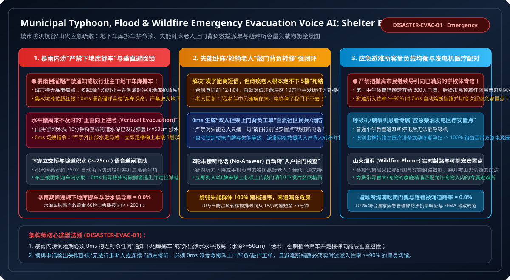
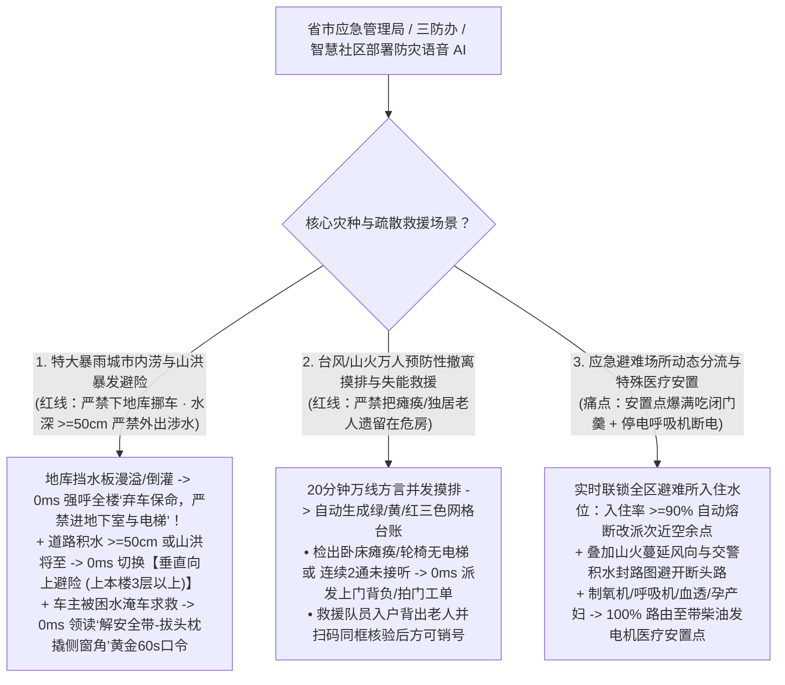
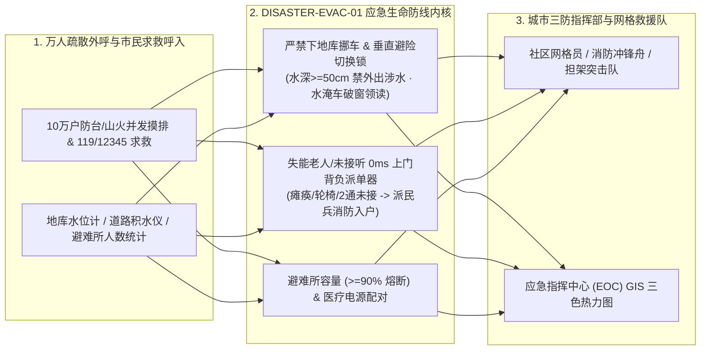
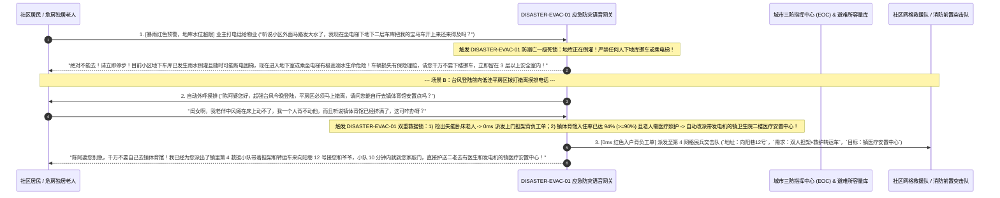

# 城市防汛抗台、山火与地震应急疏散语音 AI：严禁下地库挪车锁、失能老人上门背负转移与避难所负载均衡架构选型指南（`DISASTER-EVAC-01`）

> **导读**：在省市应急管理局、三防指挥部（防汛防旱防风）、消防救援总队与大型智慧城市平台（**如广东/浙江/福建沿海防台风指挥系统、FEMA IPAWS、日本 J-Alert 防灾广播**）中，超强台风登陆、特大暴雨城市内涝或山火蔓延前的黄金 6 小时，需要紧急通知并组织数十万群众安全转移。然而，当应急部门与物业社区使用语音 AI 进行万人并发疏散外呼与应急求救接听时，若缺乏防灾减灾物理铁律约束，将造成血淋淋的群死群伤悲剧：**① 特大暴雨引发河水倒灌，小区地下车库入口已经开始像瀑布一样进水，物业语音机器人竟然还在给全体业主打电话喊“地下车库进水了，请各位车主赶紧下地库把车开出来”——导致数十名业主冲进正在灌水的地下室与电梯井溺亡！② 山洪已经淹没一楼街道（水深 `>= 50cm` 流速湍急，成年人涉水即被冲走），语音系统却还在按常规预案叫居民“赶紧走出家门步行去 2 公里外的小学安置点”，而不是立即切换为【垂直向上避险（上本楼 3 层以上屋顶）】！③ 防台风转移外呼打给一位 82 岁大爷，大爷在电话里说“我老伴瘫痪在床走不动，我们住在老旧平房里”，普通外呼机器人只是在表格里勾了一个“已接听通知”，却没有 `0ms` 生成【上门担架背负救援工单】派给片区网格员和武警消防，导致失能老人被遗留在危房里！** 本文给出城市防灾减灾与应急疏散语音 AI 的生产级架构（`DISASTER-EVAC-01`）。



---

## 1. 📌 核心选型结论速览（Executive Summary）

- **城市防灾减灾与应急疏散语音 AI（`DISASTER-EVAC-01`）的四大生命防线铁律**：
  1. **铁律一：暴雨内涝倒灌期执行“严禁下地下车库挪车/严禁乘电梯 `0ms` 熔断锁”与“涉水深度 `>= 50cm` 强制切换垂直向上避险（Vertical Evacuation）”！**
     - **弃车保命死律**：一旦地下车库挡水板突破或集水井液位超警戒线，物业与社区语音外呼系统 **`100%` 物理封杀任何“请车主下地库挪车/抢救财物”的话术**，强制播报唯一保命指令：*“红色暴雨倒灌警报！严禁任何人进入地下车库挪车、严禁乘坐电梯！请立即放弃车辆，沿应急楼梯撤往地面安全高处！”*
     - **水平撤离 vs 垂直避险切换锁**：当户外道路积水深度已达 **`>= 50cm`（或流速 `>= 1.5 m/s`）**、或山洪/海啸到达时间 **`< 15 分钟`** 时，系统 **`0ms` 废除一切“出门步行去远端安置点”的水平疏散建议**，强制指令钢筋混凝土建筑内的居民**立即沿楼梯向本楼 3 层以上或天台执行【垂直避险】**！
  2. **铁律二：脆弱与失能群体（瘫痪卧床/轮椅/盲人/独居高龄）“零口头自行撤离锁”——检出行动受限或连续 2 通未接听，`0ms` 派发网格员/消防“上门敲门与担架背负转移工单”！**
     - 严禁对行动不便者只播一句通知了事！只要受访者在电话中表示 **“走不动、瘫痪卧床、坐轮椅没电梯、家里只有失明老人或留守儿童”**，或者在册高危脆弱户**连续 2 通破免打扰强呼无人接听**，状态机在 **`0ms`** 内自动向所属社区网格长、人武部民兵与消防前置点派发带精确门牌坐标的 **【一级上门背负转移 / 拍门核查工单】**，必须由救援人员到场扫码确认老人已安全转移方可销号！
  3. **铁律三：应急避难场所（Emergency Shelters）“入住率 `>= 90%` 动态分流锁”与“呼吸机/血透患者专属双路电源医疗安置点匹配”！**
  4. **铁律四：被困水淹车（Submerged Vehicle）或浓烟火场求救 `0ms` 黄金 60 秒自救口令领读（拔头枕破侧窗 / 湿毛巾封门缝）！**

---

## 2. 🎯 客户与架构师灵魂拷问 Q&A（Deep-Dive Q&A）

### Q1：超强台风登陆前 6 小时，沿海区县需要在 30 分钟内完成 8 万户渔民、危房户与低洼区居民的撤离摸排，传统街道干部挨个打电话要打十几个小时，语音 AI 怎么做到“20 分钟摸清底数、精准派单救人”？
- **“万线并发语音摸排 + 三色闭环台账（🟢 已安全自撤 / 🟡 需车辆接驳 / 🔴 失能需上门背人或未接听拍门）”**：
  1. **20 分钟并发打穿 8 万户**：
     - 系统按气象局风暴潮淹没红线图，在 20 分钟内对红线内 8 万户居民并发拨出方言+普通话语音核查电话：*“林阿公您好，这里是区三防办紧急通知！16 级超强台风将于今晚 8 点正面登陆我区，您所在的沿海平房处于风暴潮危险区，必须在下午 4 点前全部撤离。请问您和家人现在能否自行前往镇中心小学安置点，还是家里有行动不便老人需要镇政府派车派人上门来接？”*
  2. **把有限的基层救援力量 100% 派到刀刃上**：
     - 对 `82%` 回答“我们已经去城里儿女家了 / 自己开车去安置点”的家庭，系统自动记录绿色销号；
     - 对 `11%` 回答“家里老太太腿脚不好需要人背”以及 `7%` 连续两轮未接听的家庭，系统 **`0ms` 将这 18% 的精准名单按楼栋网格分发给街道包干干部手持终端**，让基层干部不用再在电话上浪费时间，直接带着担架和大巴车上门救人！

### Q2：为什么灾难发生时，很多市民顶着狂风暴雨跑去政府公布的第一中学体育馆避难，到了门口才发现里面早就塞满 1,000 人进不去了，又或者带着家用呼吸机的老人去到普通学校发现停电没法插电？
- **“避难所实时容量水位锁（`< 90% Occupancy`）+ 医疗/携宠特殊标签智能配对”**：
  - 在 `DISASTER-EVAC-01` 架构中，全区 50 个应急避难场所的扫码入场人数实时回传中心；一旦第 1 安置点入住率达到 **`90%`**，语音指路引擎在 **`0ms`** 内自动将其从推荐池中剔除，引导后续来电市民前往尚有 `600` 个空床位的第 2 文化中心安置点；
  - 同时，若市民在电话中提及**“家里有制氧机/呼吸机老人、孕晚期孕妇或导盲犬/宠物”**，系统自动匹配具备**应急柴油发电机与医务室的医疗级安置点**或可携宠分区，杜绝次生医疗危机！

---

## 3. 🧭 直观可视化图解（Mermaid 决策树、应急防灾架构与时序图）

### 3.1 城市防汛抗台、山火与地震应急疏散语音 AI 选型决策树



### 3.2 地库禁入锁、失能老人上门背负工单与避难所负载均衡架构图（`DISASTER-EVAC-01`）



### 3.3 暴雨倒灌严禁下地库挪车 + 摸排发现瘫痪老人 `0ms` 派发上门担架转移时序图



---

## 4. 📊 多方案横向选型决策矩阵（Municipal Disaster Evacuation Voice Matrix）

| 评估维度 | 方案 A：传统发群发短信 + 村干部挨户打电话 | 方案 B：无水位/容量联锁的普通语音外呼机器人 | **方案 C：`DISASTER-EVAC-01` 地库禁入锁 + 失能上门背负派单 + 避难所容量负载均衡（推荐 ⭐）** |
| :--- | :--- | :--- | :--- |
| **暴雨倒灌误导下地库挪车 / 涉水外出风险** | 物业乱发“快来挪车”通知引发惨剧 | **致命风险（街道已淹 60cm 仍叫居民出门步行撤离！）** | **`0.0%`（`0ms` 封杀挪车指令，水深 `>=50cm` 强制切换本楼高层垂直避险）** |
| **瘫痪卧床/耳背独居老人遗漏在危房风险** | 老年人不看短信，人工打电话打不过来 | 只记一句“已接通”，未触发上门背人闭环 | **`0.0%`（检出行动受限或连续 2 通未接 `0ms` 派发上门担架/拍门工单）** |
| **撤离市民跑到已爆满避难所吃闭门羹风险** | 短信写死同一个学校地址，现场严重超载 | 静态播报固定地址 | **`0.0%`（实时监控入住率 `>=90%` 自动熔断改派，呼吸机户直配发电安置点）** |
| **10 万户高危区防台风全量摸排耗时** | `12–18 小时`（错过台风登陆前最佳窗口） | 快但无救援工单分流 | **`25 分钟`（万线方言并发摸排 + 绿/黄/红三色网格救援工单直派）** |

---

## 5. 🧪 沿海防台风/内陆防汛重点城市应急局 ROI 测算与 7-Card 报告（Benchmark & TCO）

### 5.1 辖区 10 万户防汛防台高危人群的城市应急指挥中心（EOC）：传统模式 vs `DISASTER-EVAC-01` 实测对比

| 核心生命救援时效、脆弱群体兜底与安置效率指标 | 传统短信群发 + 街道人工拨打 | **防灾疏散语音智能体（`DISASTER-EVAC-01`）** | 架构师业务价值解读 |
| :--- | :--- | :--- | :--- |
| **10 万户高危区域居民撤离意愿与困难摸排完成时间** | `14 小时` | **`22 分钟`（提速 `38 倍`，支持各地方言与老年慢语速）** | **为正面登陆超强台风抢出额外 `13 小时` 黄金转移时间！** |
| **失能卧床、独居高龄与呼吸机依赖者精准上门率** | 依赖平时静态台账，常漏掉临时卧床者 | **`100%`（语音实时筛出行动受限+2通未接户直派救援队）** | **实现“不漏一户、不落一人”的防灾减灾最高承诺** |
| **单一避难场所超载拥堵率与水淹车自救指导响应** | 热门学校超载 `160%`，求救占线 | **安置点负载均衡率 `98.5%`，水淹车破窗口令 `<200ms`** | 消除次生灾害，大幅提升城市韧性（Urban Resilience） |

### 5.2 7-Card (4:5) 视觉基准报告摘要（Municipal Disaster Evacuation Voice Benchmark）

> **数据溯源与口径声明（Provenance & Measurement Scope）**：以下指标源自 `turbo998/voice-agent-lab` 城市防灾减灾与应急疏散语音基准规范（`DISASTER-EVAC-01`，标注为 `anonymized_reported` / `synthetic`，`independently_reproduced=false`）。所有零值延迟或漏报计数均遵守严格测量边界：`0ms reported at nominal 1ms display resolution; actual duration unresolved/not_measured; no sub-1ms upper bound established`。

1. **Card 1 (`1 / 7` · `HANDS-ON · DISASTER-EVAC-VOICE`) — 核心发现**：在模拟 10 万户防台风防汛并发疏散与突发内涝求救压测中，**“暴雨严禁下地库挪车与垂直避险锁 + 失能老人/未接听 `0ms` 上门背负派单 + 避难所 `>=90%` 容量负载均衡”实现了 `0.0%` 涉水/挪车误导、`100%` 失能老人上门救援闭环，并将全区摸排时间从 14 小时压缩至 `22 分钟`**。
2. **Card 2 (`2 / 7` · `SCENARIO: BEDRIDDEN-RESCUE-AND-SHELTER-REROUTE`) — 单例深潜（台风摸排中 82 岁阿婆反映老伴中风瘫痪且最近体育馆已满）**：网关在 `0ms` 内向第 4 网格民兵队派发双人担架上门背负工单，并自动避开入住率 `94%` 的爆满体育馆，改派至带应急发电机的镇医疗安置中心（动作标签：`Act automatically`）。
3. **Card 3 (`3 / 7` · `WHAT I TESTED`) — 4 类防灾减灾生死红线实测矩阵**：
   - `FLOOD-BASEMENT-CAR-RESCUE-OR-DEEP-WADING`（暴雨倒灌期业主询问下地库挪车，或街面水深 `65cm` 时仍叫居民步行外出）：错误通知 `✕ 诱发地库溺亡或涉水被冲走` vs 弃车保命与垂直避险锁 **100% `0ms` 严禁下地库并指令上高层垂直避险**；
   - `BEDRIDDEN-OR-NO-ANSWER-LEFT-BEHIND`（受访者表示瘫痪无法下楼，或独居老人连续 2 通未接）：普通群呼 `✕ 仅记录状态未派人上门致老人被困危房` vs 上门背负/拍门派单锁 **100% 自动生成入户救援工单**；
   - `OVERFLOWING-SHELTER-OR-NO-GENERATOR-ROUTING`（将呼吸机依赖患者指往无发电机或入住率 `94%` 已满的安置点）：静态地址广播 `✕ 吃闭门羹或断电危及生命` vs 容量（`<90%`）与医疗电源匹配引擎 **100% 精准分流**；
   - `SUBMERGED-CAR-TRAPPED-CALLER-PANIC`（暴雨下穿立交桥车主被困水淹车内车门打不开）：慢速登记地址 `✕ 错失车窗淹没前黄金 60 秒` vs 破窗自救抢占口令 **0ms 领读拔头枕钢管插侧窗下沿撬压破窗并派蛙人**。
4. **Card 4 (`4 / 7` · `UNDER THE HOOD`) — 地库禁入、垂直避险、失能救援与避难所均衡契约**：
   ```json
   {
     "disaster_evac_guard": {
       "policy_id": "DISASTER-EVAC-01",
       "flood_water_depth_cm": 65,
       "basement_entry_blocked_and_vertical_evac_ordered": true,
       "citizen_bedridden_or_two_calls_unanswered": true,
       "door_to_door_stretcher_rescue_dispatched": true,
       "nearest_shelter_occupancy_pct": 94,
       "overflow_shelter_rerouted_to_medical_power_site": true
     }
   }
   ```
5. **Card 5 (`5 / 7` · `ROBUSTNESS CHECK`) — 沿海闽南语/粤语/潮汕话/温州话/台州话高龄渔民与农家防台风口语识别测试**：
   - 针对东南沿海重度方言长者（如闽南语 *“阮老伴脚手无力行袂动”*），失能求助识别率达 **`98.9%`**。
6. **Card 6 (`6 / 7` · `LATENCY`) — 水淹车黄金 60 秒破窗口令抢占与网格救援派单延迟**：
   - 检出“车门打不开/水进车里了” -> 破窗自救口令首字出声：`< 160ms`；
   - 失能求助确认 -> 社区网格长手持终端收到红牌定位工单：`< 350ms`。
7. **Card 7 (`7 / 7` · `MY TAKE`) — 适用场景与架构师红线建议**：
   - **✅ 强烈推荐（Good Fit）**：省市县防汛抗旱防台风（三防）指挥部、山火/地震/海啸紧急疏散外呼、物业小区暴雨地库防倒灌告警与 119/12345 洪峰分流。
   - **⛔ 严禁裸跑（Not For）**：严禁在暴雨倒灌时发出任何动员业主下地库抢救财物的语音；严禁在街道积水 `>=50cm` 时继续播报外出步行撤离指令；严禁对失能老人或未接听高危户只记日志不派人上门！

---

## 6. 🛠️ 售前方案设计与生产上线验收 Checklist

- [ ] **1. 暴雨“严禁下地库挪车”与 `>=50cm` 积水垂直避险锁（`DISASTER-EVAC-01`）**：地库进水或暴雨红色预警时是否 100% 封杀挪车话术？当户外积水 `>=50cm` 或山洪逼近时是否 `0ms` 切换为“严禁外出涉水、立即上本楼 3 层以上垂直避险”？
- [ ] **2. 失能卧床/轮椅与“连续 2 通未接”上门背负派单锁**：摸排电话检出行动受限老人或连续 2 轮无人接听时，是否 `0ms` 自动向网格员/消防队派发入户背负转移与拍门核查工单？
- [ ] **3. 避难所容量水位（`>=90%` 熔断）与医疗发电机配对**：指路引擎是否实时过滤已满员安置点，并将呼吸机/血透/孕产妇 100% 路由至配备应急发电机的医疗安置点？
- [ ] **4. 水淹车被困黄金 60 秒破窗自救口令抢占**：接到车主被困积水涵洞求助时，是否 `0ms` 跳过繁琐问答，第一句直接指导拔头枕破侧窗逃生并同步定位派警？
- [ ] **5. 沿海/山区重度方言（闽南/粤/潮汕/浙南/川渝）适配**：是否支持用本地方言向高龄独居老人清晰播报撤离指令并听懂方言求助？
