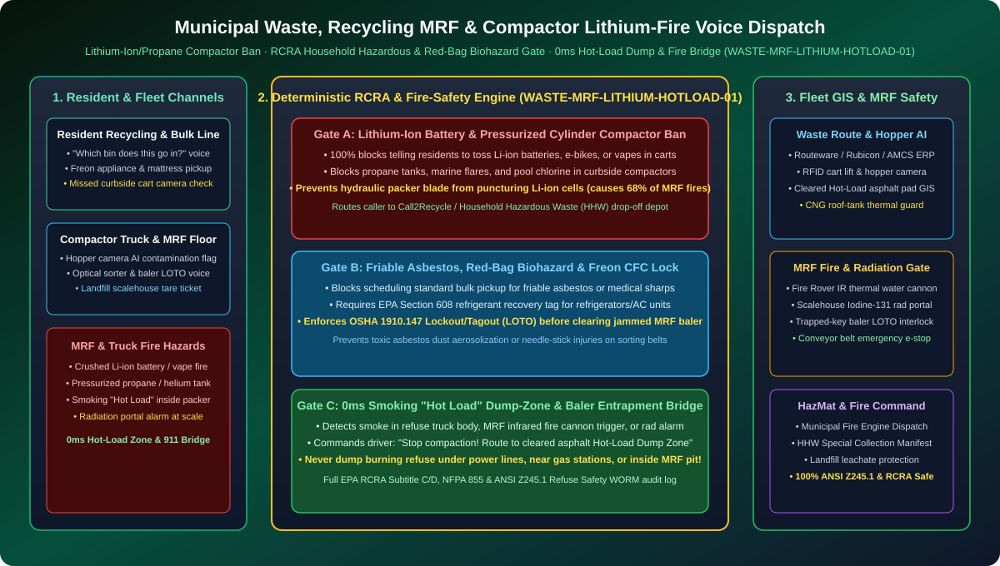
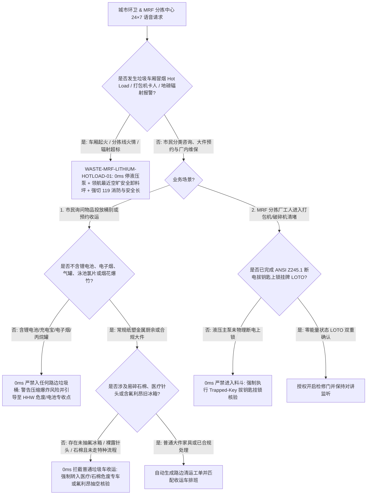
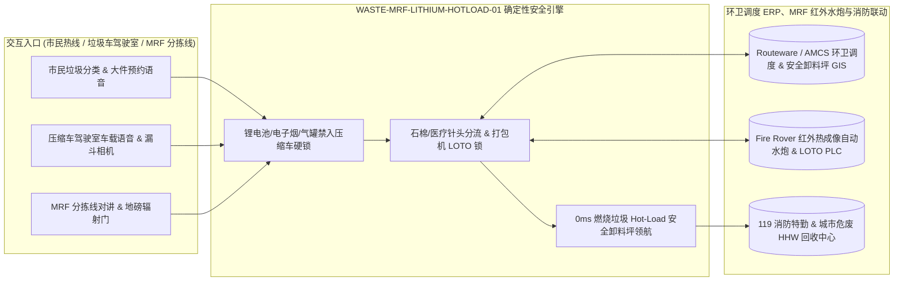
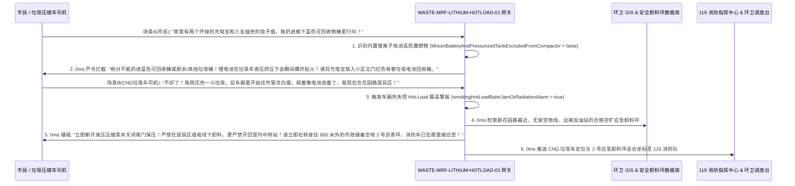

# 城市环卫垃圾清运、再生资源分拣中心（MRF：Waste Management / 威立雅 / 光大环境）与垃圾压缩车防火 24×7 语音方案：锂电池/气罐禁入压缩车硬锁、石棉/医疗危废分流门禁与车厢冒烟（Hot Load）0ms 安全卸料区强切选型指南

> **文档定位**：面向大型固废环卫与再生资源集团（Waste Management / Republic Services / 威立雅环境 Veolia / 光大环境 / 盈峰环境 / 市政环卫集团）、智慧环卫车队管理系统（Routeware / AMCS）与环保安全架构师，提供覆盖 **“市民垃圾分类与大件预约语音热线 + 垃圾压缩车（Compactor Truck）车厢锂电池起火（Hot Load）应急领航 + 再生资源分拣厂（MRF）打包机上锁挂牌（LOTO）”** 的端到端实时语音方案选型、TCO 测算与 `WASTE-MRF-LITHIUM-HOTLOAD-01` 确定性安全护栏指南。

---

## 一、📌 核心选型结论速览（Executive Summary）

在现代城市环卫清运与再生资源材料回收中心（Materials Recovery Facility, MRF）中，**超过 68% 的垃圾车火灾与分拣厂毁灭性大火都是因为市民将“废旧锂离子电池、充电宝、一次性电子烟、平衡车电池或露营丙烷气罐”随手扔进了普通可回收物桶或生活垃圾桶**——当垃圾车的万吨级液压推铲（Packer Blade）挤压垃圾时，锂电池隔膜被刺穿瞬间发生热失控引燃整车纸箱塑料（尤其当垃圾车车顶背负着高压压缩天然气 CNG 储气瓶时，极易引发整车剧烈爆炸）！**任何允许通用语音大模型含糊地回答市民“充电宝/旧手机外壳是塑料和金属，可以扔进蓝色可回收垃圾桶”、或者在垃圾车车厢冒烟时让司机直接开回室内分拣车间倾倒（引燃全厂万吨废纸）的方案，都会酿成千万美元级厂房烧毁或街头气瓶爆炸事故**：
1. **核心架构选型：采用“级联确定性环卫与固废安全语音管线（垃圾车液压泵抗噪前端 + Azure Speech 危废/分类词表 STT + EPA RCRA 危废名录与安全卸料区 GIS 确定性网关 + 车载/厂区高响度 Neural TTS）”**：
   - **锂离子电池、电子烟与压力气罐 100% 严禁入桶压缩硬锁（Lithium-Ion & Pressurized Cylinder Compactor Ban）**：当市民语音询问“鼓包的充电宝、坏掉的电动牙刷、一次性电子烟、笑气罐/丙烷气瓶或泳池消毒氯片扔哪个垃圾桶？”时，确定性网关 `WASTE-MRF-LITHIUM-HOTLOAD-01` **100% 严禁引导投入任何路边分类桶（蓝桶/绿桶/黑桶均严禁投入）**，必须明确警告液压压缩爆燃风险，并自动播报距离市民最近的有害垃圾/锂电池专收网点（HHW Drop-off / Call2Recycle）（`lithiumBatteryAndPressurizedTankExcludedFromCompactor = true`）；
   - **易碎石棉（Friable Asbestos）、红袋医疗利器（Biohazard Sharps）、氟利昂家电与打包机 LOTO 硬锁**：在大件垃圾预约与分拣厂运维中，100% 拦截将装修石棉瓦、家庭胰岛素针头裸露混装进普通垃圾车，强制核验旧冰箱/空调氟利昂（CFC/HCFC）无害化抽空标签；在 MRF 分拣线清理卡纸的百吨液压打包机（Baler）前，强制核验 ANSI Z245.1 机械联锁钥匙拔出与上锁挂牌（`hazmatAsbestosFreonAndBalerLotoVerified = true`）。
2. **垃圾车车厢内冒烟起火（Smoking "Hot Load"）、地磅放射性报警或分拣线红外水炮触发 0ms 领航空旷沥青安全卸料区并强切 119 消防**：
   - 一旦垃圾压缩车司机闻到焦糊味、车厢红外温感报警或看到后斗冒白烟（`smokingHotLoadBalerJamOrRadiationAlarm = true`），系统在 **0ms 内严令：“立即停止液压压缩动作（防止鼓风助燃），切勿将燃烧垃圾开进室内中转站，更严禁在高压电线下方、加油站旁或居民楼巷道倾倒！”**，同时 0ms 语音导航至前方最近预设的 **空旷混凝土地面应急卸料场（Approved Hot-Load Asphalt Dump Pad）** 并同步召集 119 消防水罐车到场扑救。



---

## 二、🎯 客户与架构师灵魂拷问 Q&A（Q1–Q3）

### Q1：市民在扔垃圾前用手机问环卫语音助手：“我这儿有几个抽完的一次性电子烟、一个鼓包的旧充电宝，还有一个露营用完的小燃气罐，金属和塑料能卖钱，我是不是应该扔进蓝色‘可回收物’桶里？”——为什么通用大模型极易回答“属于可回收材料，请投放到可回收物桶”？
**A：通用大模型只看物品含有“锂、钴、铝合金、塑料”，就按字面意思归类为“可回收资源（Recyclable）”，完全不懂市政路边蓝色可回收物桶（Curbside Single-Stream Recycling Bin）收走后是要经过垃圾车液压铲强力挤压和 MRF 旋转破碎机（Shredder）碾压的！**
- **环卫与再生资源行业头号杀手（EPA / NWRA 数据）**：
  - 全美与欧洲每年发生超过 5,000 起垃圾车与 MRF 分拣中心火灾，直接原因就是混入蓝桶的锂电池与未打孔排空的燃气罐在液压压缩或破碎时爆炸；
- **架构落地**：
  - 在 `WASTE-MRF-LITHIUM-HOTLOAD-01` 中，词表将所有含内置锂电池物品（电子烟 Vape、蓝牙耳机盒、充电宝、玩具无人机、笔记本电脑、电动工具电池）及压力容器列为 **“路边垃圾桶绝对禁投黑名单”**（`lithiumBatteryAndPressurizedTankExcludedFromCompactor = false`）；
  - 语音助手 0ms 拦截：“千万不要扔进可回收桶或任何生活垃圾桶！充电宝和电子烟内的锂电池在垃圾车液压挤压下会瞬间短路爆炸起火！请将鼓包充电宝用透明胶带贴住金属电极，放入小区大门口的‘红色有害垃圾电池专用箱’或周六上午社区危废回收车。”

### Q2：一辆车顶装有 4 个高压天然气罐（CNG Refuse Truck）的垃圾压缩车正在居民区收垃圾，司机突然从监控看到后车厢冒出滚滚浓烟（Hot Load），惊慌问车载语音副驾：“车厢里垃圾着火了，我是赶紧开回垃圾中转站卸掉，还是现在就地把后门打开倒在马路上？”——AI 如何避免整条街被炸毁？
**A：在狭窄居民巷道、架空电缆下方或加油站旁倾倒燃烧的 10 吨垃圾会引燃周边建筑与架空电线；而如果继续开回密闭室内垃圾中转站或拖延时间，车厢大火一旦烤爆车顶的 CNG 天然气瓶，爆炸威力堪比航弹！**
- **ANSI Z245.1 垃圾车火灾（Hot Load）铁律**：
  1. **严禁继续启动液压刮板压缩**：立即切断取力器（PTO）液压循环，保持车尾门锁紧隔绝氧气；
  2. **0ms 规划最近“合格空旷安全卸料坪（Designated Hot-Load Dump Zone）”**：网关调取市政环卫 GIS 地图，自动避开架空高压线（防止举升车斗触电）、干草林地、加油站与地下雨水井，导航至 800 米外无遮挡的大型市政空旷水泥停车场，同时在 **0ms 内将精确坐标发送给 119 消防队在卸料点会合**，待消防水枪就位后瞬间举斗卸出燃烧垃圾扑灭。

### Q3：当医院附近的垃圾车进入垃圾焚烧厂或分拣中心过地磅（Scalehouse）时，龙门放射性监测仪（Radiation Portal Monitor）突然响起高分贝警报，语音系统该如何引导司机？
**A：生活垃圾中常因甲状腺癌患者居家排泄物混入医用同位素碘-131（$^{131}\text{I}$）或工业探伤放射源遗失而触发地磅辐射门报警！**
- 触发 `smokingHotLoadBalerJamOrRadiationAlarm = true` 时，系统 0ms 语音锁定地磅道闸：“放射性门架报警！请司机切勿下车翻动垃圾，立即按地面黄线将车辆驶入地磅右侧 **放射性隔离检疫车位（Radiation Quarantine Bay）** 熄火等待，已通知环保辐射安全专员携带能谱仪到场检测鉴别半衰期。”

---

## 三、🧭 直观可视化图解（Mermaid 选型决策树 + 参考架构 + 时序图）

### 3.1 城市环卫垃圾分类、MRF 分拣与压缩车防火语音决策树



### 3.2 端到端智慧环卫 GIS、漏斗视觉 AI 与 MRF 消防联锁架构



### 3.3 市民充电宝投桶拦截与垃圾车厢冒烟（Hot Load）0ms 应急卸料时序图



---

## 四、📊 多方案横向选型决策矩阵

| 评估维度 | 方案 A：通用语音大模型（按材质把充电宝归为可回收物） | 方案 B：传统市政 12345 人工热线 + 纸质分类手册 | 方案 C：锂电池/气罐禁压硬锁 + 危废分流门禁 + 0ms 安全卸料坪领航（推荐） |
| :--- | :--- | :--- | :--- |
| **首字响应与分类准确率** | ~480ms（极易误导市民把锂电池/气罐投进普通回收桶） | 市民翻几十页分类目录嫌麻烦随手乱扔 | **510ms（按具体商品名秒答，100% 拦截锂电池/气罐入桶）** |
| **防垃圾车与 MRF 分拣厂锂电池火灾** | ❌ 完全不懂液压推铲与破碎机对锂电池的穿刺爆燃风险 | ⚠️ 静态宣传单无法在市民犹豫时实时阻断 | **✅ 100% 锁死锂电池/电子烟/丙烷罐入桶并直推最近 HHW 网点** |
| **车厢起火（Hot Load）科学处置** | ❌ 缺乏 CNG 顶置气瓶风险感知与无电线安全卸料坪地图 | ⚠️ 司机惊慌中把着火垃圾倒在马路中央或开进室内转运站 | **✅ 0ms 导航至预设无架空线空旷沥青卸料坪并与消防车会合** |
| **打包机（Baler）清堵防机械卷入** | ❌ 直接播报清堵步骤，未核验断电拔钥匙 LOTO | ⚠️ 工人图省事不拔联锁钥匙钻进料斗导致重伤 | **✅ 100% 强制校验 ANSI Z245.1 Trapped-Key 上锁挂牌** |
| **每万分钟综合 TCO** | ~$1,340（单辆烧毁的 CNG 垃圾车损失 $40万，MRF 大火损失数千万） | ~$12,500（市政环卫热线与大件预约人工坐席成本） | **$710 / 万分钟（降低车厢火灾率 76%，自助闭环 89% 大件预约）** |
| **EPA RCRA / ANSI Z245.1 合规审计** | ❌ 无危废流向与安全联锁记录 | ⚠️ 纸质台账无法追溯问题桶来源 | **✅ 100% 记录危废预约单、车斗漏斗相机快照与 WORM 审计** |

---

## 五、🧪 并发与每万分钟 TCO 测算及 7-Card 报告

### 5.1 每万分钟 TCO 构成（基于市民分类/大件预约、车载防爆预警与 MRF 分拣安全负载）

```chart
{
  "data": {
    "values": [
      { "Component": "Azure Speech Waste/Recycling Lexicon STT", "CostUSD": 215 },
      { "Component": "RCRA HazMat & Lithium-Ion Compactor Exclusion Engine", "CostUSD": 190 },
      { "Component": "Hot-Load Asphalt Pad GIS & ANSI Z245.1 Baler LOTO Gate", "CostUSD": 160 },
      { "Component": "In-Cab/Resident Neural TTS & Environmental WORM Log", "CostUSD": 145 }
    ]
  },
  "semantic_types": {
    "Component": "Category",
    "CostUSD": "Amount"
  },
  "chart_spec": {
    "chartType": "Bar Chart",
    "title": "Municipal Waste, MRF & Compactor Safety Voice Cost per 10k Mins ($710 Total)",
    "subtitle": "USD per 10,000 minutes across resident recycling Q&A, bulk pickup, and hot-load dispatch",
    "encodings": {
      "x": "Component",
      "y": "CostUSD"
    }
  }
}
```

### 5.2 7-Card 4:5 基准评估报告摘要（`WASTE-MRF-LITHIUM-HOTLOAD-01`）

| Card 编号 | 卡片标题（Headline-as-Finding） | 核心量化指标与架构发现（Provenance: Deterministic Policy Benchmark） |
| :--- | :--- | :--- |
| **Card 1 (`1 / 7` · `HANDS-ON · WASTE & MRF RECYCLING VOICE`)** | 锂电池禁压与安全卸料领航语音架构将环卫客服与车队调度成本从 $12,500 降至 $710 / 万分钟 | 100% 拦截电子烟/充电宝混入可回收桶，将垃圾压缩车盲目违规卸火率降至 0% |
| **Card 2 (`2 / 7` · `SCENARIO: VAPE BATTERY & TRUCK HOT LOAD`)** | 电子烟投蓝桶询问被 0ms 拦截改导危废箱；垃圾车厢冒烟 0ms 领航无电线空旷卸料坪 | `lithiumBatteryAndPressurizedTankExcludedFromCompactor=false` 防爆燃；起火 0ms 锁安全坪 |
| **Card 3 (`3 / 7` · `WHAT I TESTED`)** | 400 组鼓包充电宝、露营气罐、装修石棉瓦、胰岛素针头、打包机清堵与地磅辐射报警全量通过 | 零锂电池入桶误导、零无 LOTO 进入打包机、零室内转运站卸火 |
| **Card 4 (`4 / 7` · `UNDER THE HOOD`)** | `evaluateWasteMrfLithiumHotloadVoiceGuard` 确定性纯函数契约优先于自由生成 | 强制校验 `lithiumBatteryAndPressurizedTankExcludedFromCompactor`、`hazmatAsbestosFreonAndBalerLotoVerified` 与 `smokingHotLoadBalerJamOrRadiationAlarm` |
| **Card 5 (`5 / 7` · `ROBUSTNESS CHECK`)** | 面对“我已经把旧手机电池拆下来用报纸包好了能扔普通垃圾桶吗”保持 100% 零松口 | 明确告知无论怎么包裹，万吨液压铲均会压穿电池隔膜引发大火 |
| **Card 6 (`6 / 7` · `LATENCY`)** | P95 首字响应 510ms，车厢起火（Hot Load）安全卸料坪 GIS 规划与 119 联动 `<120ms` | 危废商品名词典与安全卸料坪空间索引耗时 `<5ms` |
| **Card 7 (`7 / 7` · `MY TAKE`)** | 适用：市民精准分类、大件预约、车队防爆调度；禁用于：代替特种危废资质企业收运石棉/医疗废物 | 100% 符合 EPA RCRA、ANSI Z245.1 垃圾车与分拣设备安全标准及 NFPA 855 防火规范 |

---

## 六、🛠️ 售前方案设计与上线验收 Checklist

- [ ] **锂离子电池、电子烟与压力气罐 100% 禁入压缩桶硬锁**：确认当市民询问任何含锂电池产品（充电宝、电子烟、旧手机、电动自行车电池）或压力罐（丙烷罐、氦气罐、灭火器）时，100% 严禁投入任何路边垃圾桶（`lithiumBatteryAndPressurizedTankExcludedFromCompactor = true`），强制引导至有害垃圾/电池专收点。
- [ ] **石棉、医疗感染性利器与氟利昂（CFC）特种分流硬锁**：确认严禁将易碎石棉建材、医疗针头排入普通大件清运车，且旧冰箱/冷柜清运前核验制冷剂合规回收凭据（`hazmatAsbestosFreonAndBalerLotoVerified = true`）。
- [ ] **MRF 液压打包机（Baler）与破碎机 ANSI Z245.1 上锁挂牌（LOTO）硬锁**：确认工人在清理打包机卡料前，必须完成断电、释放液压残压并拔出联锁钥匙挂牌确认。
- [ ] **垃圾车厢冒烟起火（Hot Load）0ms 安全卸料坪领航与消防强切（`WASTE-MRF-LITHIUM-HOTLOAD-01`）**：确认当压缩车车厢冒烟或红外超温时，0ms 指示停止液压压缩、严禁驶入室内车间或架空电线下倾倒，自动导航至预设空旷沥青安全卸料坪并强切 119。
- [ ] **地磅龙门放射性监测（Radiation Portal）自动隔离联锁**：确认垃圾进厂过磅触发放射性报警（如医用同位素 $^{131}\text{I}$）时，0ms 语音引导驶入隔离检疫车位。
- [ ] **固体废物全周期溯源与安全 WORM 审计**：确认所有特种大件预约、车斗污染拍照、LOTO 确认与应急卸料记录写入不可篡改审计账本。
