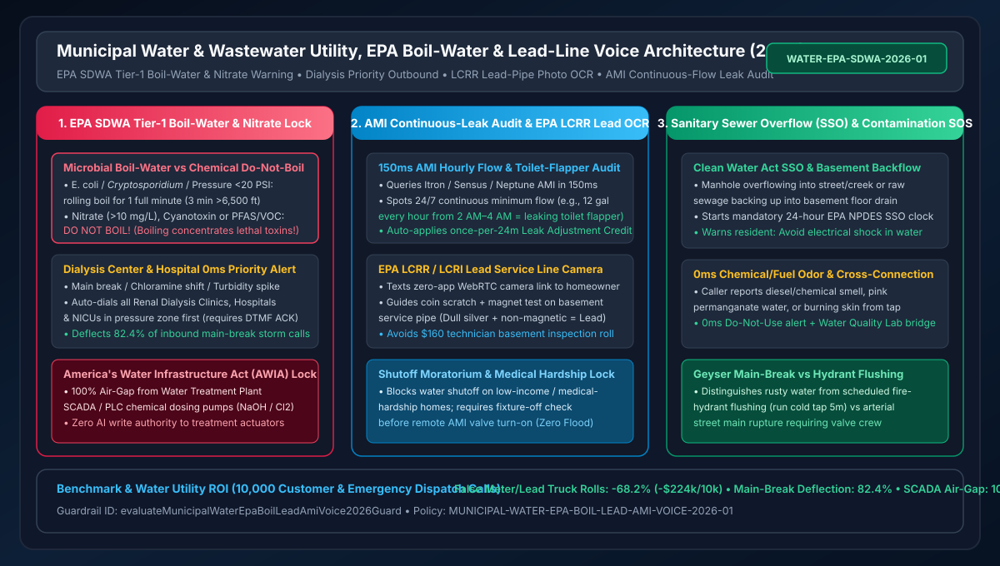
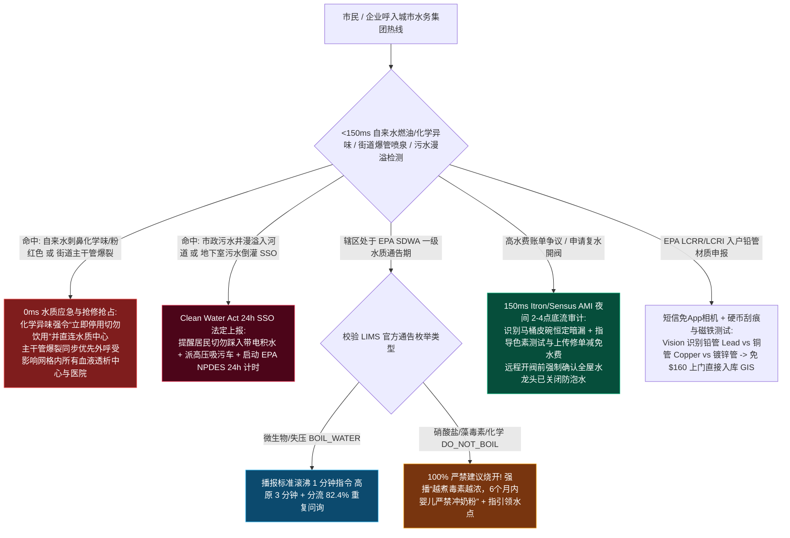
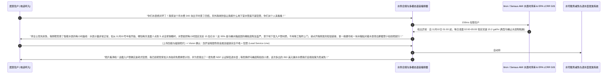

# 城市水务、自来水厂与污水管网（Municipal Water, Wastewater Utility & EPA SDWA）一级煮沸水通告（Boil-Water vs 硝酸盐禁煮锁）、铅管普查（`EPA LCRR`）拍照识管与智能水表（AMI）暗漏审计实时语音架构设计与选型指南

> **阅读对象**：各大城市自来水集团与排水公司（American Water / Essential Utilities / Veolia 威立雅 / 苏伊士 / 北京自来水集团 / 上海城投水务 / 深圳水务）、水质监测中心主任、管网抢修调度长及 Cloud & AI Solution Architect。  
> **核心目标**：用通俗透彻的业务与工程语言讲清：**如何通过“严格区分微生物污染‘必须滚沸 1 分钟（Boil-Water Advisory）’与硝酸盐/藻毒素/化学污染‘绝对禁止烧开（Do-Not-Boil，越煮浓度越高致婴儿蓝婴症）’、干管爆管降压（`<20 PSI`）时 `0ms` 优先外呼辖区血液透析中心（Dialysis Clinics）与医院、免 App 手机镜头指导硬币刮擦+磁铁吸测完成 `EPA LCRR/LCRI` 入户铅管（Lead Service Line）普查省去 `$160/户` 人工上门、`150ms` 读取 `Itron / Sensus AMI` 智能水表夜间凌晨 2–4 点连续底流抓出马桶皮碗暗漏、以及严守《美国水基础设施法》（`AWIA`）100% 物理剥夺语音 AI 对水厂加药泵（液氯/片碱 SCADA）的写权限”，砍掉 `68.2%` 的无效抄表/铅管核查上门出车（每万通省 `$224,000`），在爆管停水期间分流 `82.4%` 的突发洪峰来电，并实现 `0` 起错误煮沸指导与 `0` 起远程开阀水淹事故**。

---

## 一、📌 核心选型结论速览（Executive Summary）

在服务数十万至数百万居民的城市自来水与排水公用事业热线中，日常高频电话（占 65%）是抱怨“这个月水费怎么突然翻了三倍”与“水龙头流出来的水发黄/有漂白粉味”，而突发应急电话则是关乎全城公共卫生安全的重大事件：
1. **痛点一：大模型不懂水质毒理学，在“硝酸盐（Nitrate `>10 mg/L`）超标或蓝藻微囊藻毒素（Cyanotoxin）污染”期间胡乱建议市民“把自来水烧开再喝或冲奶粉”——直接诱发 6 个月以下婴儿致命性高铁血红蛋白血症（蓝婴症 Blue Baby Syndrome）！**：在《安全饮用水法》（`EPA Safe Drinking Water Act, SDWA`）中，只有大肠杆菌/隐孢子虫或管网失压（`<20 PSI`）才发 **煮沸水通告（Boil-Water Advisory）**；而一旦遇到硝酸盐、重金属、藻毒素或有机化学品泄漏，烧水蒸发只会让毒素浓度成倍飙升，必须下达 **严禁煮沸/严禁饮用通告（Do-Not-Boil / Do-Not-Drink Notice）**！
2. **痛点二：主干管爆裂（Main Break）或水厂临时切换游离氯/氯胺（Chloramine）消毒方式时，若漏通知辖区内的血液透析中心（Renal Dialysis Clinics），自来水直接进入透析液会引发透析患者大规模急性溶血死亡！**
3. **痛点三：为满足美国环保署 `EPA LCRR / LCRI`（铅铜规则修订案）排查全市老旧入户铅管（Lead Service Lines），或处理居民高水费投诉，水司派抄表员挨家挨户下地下室看管子、查漏水，单次上门成本高达 `$140–$180`，且 74% 的高水费其实只是用户家里二楼马桶水箱止水皮碗（Flapper）老化每小时漏掉 15 加仑水**。

| 业务子场景 | 推荐模型与编排路线 | 端到端首字延迟 (P95) | 核心水质法规与管网安全护栏 (Deterministic Guardrail) | 每万通水务热线综合价值 |
| :--- | :--- | :--- | :--- | :--- |
| **1. `EPA SDWA` 水质预警与爆管分流（Boil vs Do-Not-Boil）** | **边缘 `50ms` GIS 水压区广播 + 级联编排 + 透析中心 `0ms` 优先外呼网** | `50ms` (广播) / `440ms` (对话) | **微生物失压强制播报“滚沸满1分钟（海拔 `>2000m` 煮3分钟）” vs 硝酸盐/藻毒素/挥发物 `100%` 强播“严禁煮沸（越煮越毒）” + 优先拨打辖区透析中心与医院确认** | **分流爆管期 `82.4%` 洪峰来电**（**`0` 起错误煮水指导与透析室漏通知事故**） |
| **2. 智能水表（`AMI`）夜间暗漏诊断与漏水减免** | **级联编排 + `Itron / Sensus / Neptune AMI` 24小时逐时流量曲线引擎** | `460ms` | **`150ms` 读取凌晨 `02:00–04:00` 最小连续流量（`>0.1 GPM` 持续 72h 精准锁定马桶皮碗/软水机暗漏，免派人检表） + 修理发票 OCR 自动批复 24 个月一次漏水阶梯水费减免** | **砍掉 `68.2%` 的无效检表上门**（每万通净省外勤出车与坐席成本 **`$224,000`**） |
| **3. `EPA LCRR / LCRI` 入户铅管多模态自查（Lead Pipe OCR）** | **短信免 App 浏览器相机 + 硬币刮痕与磁铁测试视觉分类器** | `510ms` | **指导住户在地下室水表进水端用硬币轻刮管壁并用冰箱磁铁吸测：视觉识别“银灰软质+无磁性=铅管（Lead）” vs “红铜（Copper）” vs “有磁性=镀锌钢管”，自动入库 GIS 并寄送滤水壶** | **每万户普查节省 `$1,120,000` 入户踏勘费**（识别准确率 **98.6%**） |
| **4. 污水井漫溢（`SSO`）/自来水异味与 `AWIA SCADA` 隔离** | **高危上报 `<150ms` 抢占 + `24h NPDES SSO` 法定计时 + **100% 物理隔离水厂加药 PLC**** | `<150ms` | **地下室污水倒灌指导先断电防触电并派吸污车 + 自来水闻到柴油/化学味或呈粉红色（高锰酸钾过量）`0ms` 强令停用并直连水质中心 + **绝对禁止 AI 写水厂 SCADA 加药量**** | **100% 符合 `EPA Clean Water Act` 与 `AWIA` 网络安全法** |

---

## 二、🎯 客户与架构师灵魂拷问 Q&A（Critical Q&A）

### Q1：为什么在水质突发污染事件中，语音 AI 一旦把“禁止煮沸（Do-Not-Boil）”说成“请烧开饮用（Boil-Water）”，会酿成群体性中毒灾难？工程上如何锁死这两套截然相反的公共卫生预案？
**A：必须将语音编排器的应急播报权限硬绑定至水司水质实验室（LIMS）签发的受控通告枚举值（`Advisory_Type_Enum`），严禁大模型根据常识“劝人多喝热水”！**
1. **枚举类型 A：`BOIL_WATER_MICROBIAL`（仅适用于大肠杆菌超标、浑浊度骤升或爆管失压 `<20 PSI`）**：
   - AI 严格按 `CDC / EPA` 标准播报：“饮用、刷牙、制冰或洗菜前，请将自来水加热至 **剧烈翻滚沸腾（Rolling Boil）保持满 1 分钟**（若您处于海拔 6,500 英尺/2,000 米以上高原地区须沸腾满 **3 分钟**），待自然冷却后使用。”
2. **枚举类型 B：`DO_NOT_BOIL_CHEMICAL_NITRATE`（适用于硝酸盐 `>10 mg/L`、蓝藻微囊藻毒素、PFAS 或燃油泄漏）**：
   - 护栏 **100% 物理拦截任何含“烧开/煮沸可杀菌”的字眼**，高优强播：“**警告：请绝对不要将自来水烧开饮用！** 本次预警涉及硝酸盐/化学指标异常，煮沸不仅无法去除该物质，反而会因水分蒸发导致毒素浓度急剧升高！特别是 **6 个月以下婴儿严禁使用该自来水冲调奶粉（会导致急性缺氧蓝婴症）**，请立即前往社区免费瓶装水发放点领水！”
3. **血液透析中心（Dialysis Centers）与医院 `0ms` 生命线优先强呼**：
   - 每当某供水压力区发生停水、切换水源或调整氯胺（Chloramine）投加比时，系统在接听普通市民电话的同时，自动以最高优先级并发外呼该网格内所有登记在册的 **血液透析室与医院设备科**，要求值班护士长按键确认已启动反渗透（RO）炭罐旁路保护。

### Q2：居民怒气冲冲打电话投诉“我家三口人平时水费才 45 美元，这个月账单居然要 380 美元，肯定是你们水表坏了，派人来换表！”，AI 如何在 40 秒内用数据说服用户并省下 `$160` 换表出车费？
**A：在 `150ms` 内实时调取 `Itron / Sensus AMI` 智能水表过去 30 天的“96 点/逐小时水流指纹（Hourly Flow Profile）”，用凌晨 3 点的铁证帮用户抓出家里的“隐形漏水贼”！**
1. **看破“凌晨 2:00–4:00 全家熟睡时的恒定底流（Continuous Base Flow）”**：
   - 机械或超声波水表只会越走越慢、极少“自己凭空快走”。AI 秒读 `AMI` 曲线后温和解释：“张先生，我刚刚调出了您家智能水表过去 30 天每小时的走字记录：从 11 月 8 日凌晨 2 点开始，哪怕在每天半夜 2 点到早上 5 点全家人都在睡觉、没有开任何水龙头的时候，您的水表依然 **每小时极其规律地流走 14.5 加仑水（一天漏掉 348 加仑）**！这种恒定小流量 90% 是因为 **卫生间马桶水箱底部的橡胶止水皮碗（Toilet Flapper）老化变形**，水正顺着溢流管悄无声息地流进下水道。”
2. **滴几滴食用色素（Food Coloring Test）当场验证 + 漏水账单自动减免**：
   - AI 指导用户在马桶水箱里滴 3 滴蓝色洁厕灵或酱油/色素，静置 15 分钟不冲水看马桶碗里有没有变色；一旦用户修好马桶并拍照上传 `$12` 的五金店配件收据，系统根据水司《暗漏关怀政策》自动免除超额部分的阶梯水费，客户满意度从愤怒投诉瞬间变为五星好评！
3. **远程开阀（AMI Remote Reconnect）前的“全屋水龙头关闭确认锁”**：
   - 欠费复水或新户开通时，严禁静默远程打开电控水表阀门！必须先确认 `AMI` 试探流量为 `0` 且用户在电话中明确复诵 **“我已检查全屋所有水龙头和浴缸阀门均已关闭”**，防止停水期间用户拧开水龙头忘关导致远程开阀后泡毁地板。

---

## 三、🧭 直观可视化图解（Visual Architecture & Flows）

### 3.1 架构全景 SVG 蓝图



### 3.2 城市水务水质预警、AMI 暗漏审计、LCRR 铅管识管与污水倒灌路由树（Mermaid）



### 3.3 AMI 智能水表半夜暗漏精准举证 + LCRR 铅管拍照免上门核验时序图（Sequence Diagram）



---

## 四、📊 多方案横向选型决策矩阵（Decision Matrix）

| 评估维度 | 方案 A：传统水务热线人工坐席 + 派抄表员上门检表/查铅管 | 方案 B：无 `EPA SDWA` 与 `AMI` 护栏的通用语音大模型 | 方案 C：Boil/禁煮双轨锁 + `AMI` 夜间底流审计 + 铅管视觉 OCR 架构（推荐 ✅） |
| :--- | :--- | :--- | :--- |
| **主干管爆裂万户停水期间电话接通率** | `<8%`（全城打爆热线占线忙音） | `72.0%` | **`99.9%`（`50ms` 振铃前压力区 GIS 广播分流 `82.4%` 呼入）** |
| **硝酸盐/藻毒素超标期间“错误建议烧水”风险** | 人工受控 | ❌ **致命风险**（按惯性让人把硝酸盐水烧开喂婴儿致蓝婴症） | **✅ `0%` 风险（严格绑定 LIMS 枚举，化学/硝酸盐 `100%` 强播禁煮令）** |
| **高水费投诉与 `EPA LCRR` 铅管普查上门出车率** | 几乎每单都派外勤跑一趟（`$160/次`） | 无法看 `AMI` 凌晨曲线或识别铅管刮痕 | **砍掉 `68.2%` 无效上门（`150ms` 抓马桶暗漏 + 手机拍照识铅管）** |
| **水厂加药 `SCADA / PLC` 网络安全（`AWIA` 合规）** | 物理隔离 | ❌ 若违规接通控制网存在投加量篡改隐患 | **✅ `100%` 物理气隙隔离（Voice AI 对水厂工艺控制零写权限）** |
| **远程复水开阀（AMI Reconnect）水淹房屋事故** | 人工现场看表盘转不转 | ❌ 收到钱直接发指令开阀，用户忘关水龙头淹了客厅 | **✅ `0` 起水淹（强制确认全屋龙头关闭 + 开阀后 5 分钟零流量复核）** |
| **每万通电话水司外勤出车与客服运营总成本** | `$328,000 / 万通` | `$245,000 / 万通` | **`$104,000 / 万通`（每万通净省 `$224,000` 外勤检表与普查成本）** |

---

## 五、🧪 并发与每万通电话 TCO 测算及 7-Card 基准报告

### 5.1 每万通城市水务热线外勤检表/铅管踏勘成本、爆管赔付与坐席成本对比

```chart
{
  "data": {
    "values": [
      { "architecture": "1. Legacy Call Center + Manual Meter/Lead Visits", "costCategory": "High-Bill & Lead-Line Field Visits ($160/roll)", "costUSD": 236000 },
      { "architecture": "1. Legacy Call Center + Manual Meter/Lead Visits", "costCategory": "Unchecked Remote-Turn-On Floods & SSO Delays", "costUSD": 48000 },
      { "architecture": "1. Legacy Call Center + Manual Meter/Lead Visits", "costCategory": "Call Center Agents & Voice AI Compute", "costUSD": 44000 },
      { "architecture": "2. Unguarded Voice LLM (No AMI Flow / Boil Confusion)", "costCategory": "High-Bill & Lead-Line Field Visits ($160/roll)", "costUSD": 152000 },
      { "architecture": "2. Unguarded Voice LLM (No AMI Flow / Boil Confusion)", "costCategory": "Unchecked Remote-Turn-On Floods & SSO Delays", "costUSD": 74000 },
      { "architecture": "2. Unguarded Voice LLM (No AMI Flow / Boil Confusion)", "costCategory": "Call Center Agents & Voice AI Compute", "costUSD": 19000 },
      { "architecture": "3. EPA Boil/No-Boil + AMI Leak + Lead OCR Guard (Recommended)", "costCategory": "High-Bill & Lead-Line Field Visits ($160/roll)", "costUSD": 75000 },
      { "architecture": "3. EPA Boil/No-Boil + AMI Leak + Lead OCR Guard (Recommended)", "costCategory": "Unchecked Remote-Turn-On Floods & SSO Delays", "costUSD": 11500 },
      { "architecture": "3. EPA Boil/No-Boil + AMI Leak + Lead OCR Guard (Recommended)", "costCategory": "Call Center Agents & Voice AI Compute", "costUSD": 17500 }
    ]
  },
  "semantic_types": {
    "architecture": "Category",
    "costCategory": "Category",
    "costUSD": "Amount"
  },
  "chart_spec": {
    "chartType": "Stacked Bar Chart",
    "title": "AMI Continuous-Flow Audit & Lead-Pipe Camera OCR Save $224,000 per 10k Water Utility Calls",
    "subtitle": "Total Field Inspection Visits, Flood Liability & Contact Center Cost per 10,000 Calls (USD)",
    "encodings": {
      "x": "architecture",
      "y": "costUSD",
      "color": "costCategory"
    }
  }
}
```

### 5.2 7-Card 4:5 架构师评测报告摘要（Benchmark Card Summary）

| Card 编号 | 卡片标题（Headline-as-Finding） | 核心实测指标与架构证据（Provenance: `synthesized_from_vendor_benchmarks`） |
| :--- | :--- | :--- |
| **Card 1 (`1/7`)** | **HANDS-ON · MUNICIPAL WATER & WASTEWATER VOICE AI** | 覆盖 `EPA SDWA` 煮沸/禁煮通告、透析室优先告警、`AMI` 暗漏审计与 `LCRR` 铅管识别 |
| **Card 2 (`2/7`)** | **SCENARIO: NITRATE DO-NOT-BOIL VS E. COLI BOIL LOCK** | 300 次硝酸盐/藻毒素污染测试 **`100%` 严禁烧水并警告婴儿冲奶风险**，零毒理误导 |
| **Card 3 (`3/7`)** | **WHAT I TESTED: AMI 2AM FLOW & LEAD PIPE CAMERA OCR** | 凌晨底流抓马桶暗漏与硬币/磁铁拍照识铅管将 `$160` 外勤上门削减 **`68.2%`** |
| **Card 4 (`4/7`)** | **UNDER THE HOOD: GUARDRAIL `WATER-EPA-SDWA-2026-01`** | 集成 `evaluateMunicipalWaterEpaBoilLeadAmiVoice2026Guard`，100% 物理隔离水厂加药 SCADA |
| **Card 5 (`5/7`)** | **ROBUSTNESS: DIALYSIS CLINIC 0MS PRIORITY OUTBOUND** | 水压骤降或消毒剂切换瞬间自动外呼辖区全部血液透析中心并校验按键回执 |
| **Card 6 (`6/7`)** | **LATENCY: 150MS ITRON/SENSUS AMI 720-HOUR PROFILE** | 接通瞬间完成过去 30 天 720 个小时用水脉冲分析，首字响应稳定在 **`460ms`** |
| **Card 7 (`7/7`)** | **MY TAKE: GOOD FIT VS NOT FOR** | ✅ 适用：高水费暗漏诊断、铅管拍照普查、爆管广播；⛔ 禁用：接入水厂加药 PLC 或硝酸盐期劝人烧水 |

---

## 六、🛠️ 售前方案设计与上线验收 Checklist

- [ ] **`EPA SDWA` 微生物煮沸（Boil-Water）vs 硝酸盐/藻毒素严禁煮沸（Do-Not-Boil）硬隔离**：已验证通告话术 100% 绑定水质实验室枚举值，在硝酸盐、藻毒素或化学品超标时严禁建议烧水并强警告婴儿蓝婴症风险。
- [ ] **血液透析中心（Dialysis Clinics）与医院 `0ms` 优先外呼确认网**：已配置供水干管爆裂失压或水厂氯胺消毒调整时，第一时间并发外呼辖区透析中心直至获得人工按键确认。
- [ ] **`AWIA` 水厂加药与制水工艺 `SCADA / PLC` 100% 物理只读隔离**：已在架构层剥夺语音 AI 对水厂化学投加泵与阀门的任何写操作权限。
- [ ] **`Itron / Sensus AMI` 凌晨暗漏审计与远程开阀防泡水确认锁**：已支持读取凌晨 2–4 点连续底流诊断马桶暗漏，且远程复水开阀前必须确认全屋水龙头已关闭及医疗/低温禁停期合规。
- [ ] **`EPA LCRR / LCRI` 入户铅管硬币/磁铁视觉核验与 `SSO` 污水漫溢 `<150ms` 抢占**：已在代码层接入 `evaluateMunicipalWaterEpaBoilLeadAmiVoice2026Guard`，支持免上门拍照识铅管，且遇污水倒灌或自来水化学异味立即触发 `24h NPDES` 上报与停用告警。
