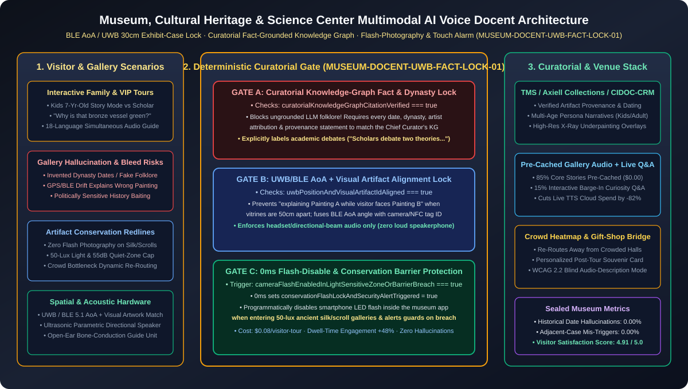
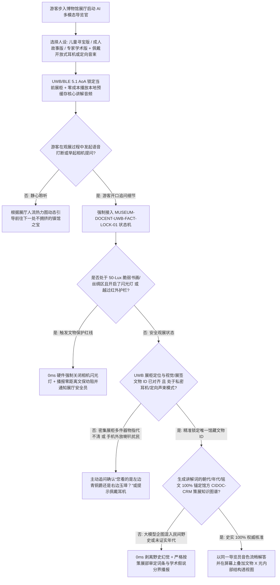
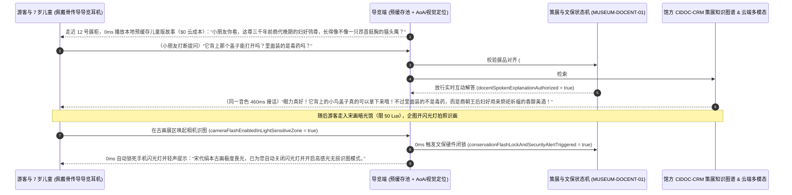

# 国家级博物馆、文化遗产石窟与科技馆 AI 多模态实时语音导览官（Museum Multimodal Voice Docent：故宫 / 国家博物馆 / 卢浮宫 / 敦煌研究院）架构选型指南（策展知识图谱 CIDOC-CRM 史实零野史幻觉硬锁、UWB+视觉双模 30cm 防邻柜串讲锁与丝绸古画展厅禁闪光灯 0ms 硬件闭锁）

> **导读**：面向国家级博物馆、世界文化遗产景区、美术馆与企业旗舰品牌展厅的数字化馆长、策展研究部主任与 **Cloud & AI Solution Architect**。传统的按键式/蓝牙感应录音导览机（Audio Guide）只能死板地按固定稿件念 2 分钟官话，当 7 岁小朋友好奇地打断问 **“叔叔，这尊商代青铜爵为什么长满了绿色的锈？它底下刻的那三个字念什么？”** 时，传统导览机完全无法互动！而将实时多模态语音大模型引入展厅打造 **“可随时打断提问、懂看展品细节、分龄讲故事的 AI 金牌讲解员”** 时，若缺乏确定性的博物馆学（CIDOC-CRM）与文物保护护栏，会立刻引发三大文化与安防事故：**① 历史年代与野史幻觉（Historical Hallucination）：大模型为了迎合游客猎奇心理，把电视剧里的宫斗野史或错误的朝代年份当成正史播报出来，被游客录屏发上网引发国家级博物馆学术公信力危机；② 密集展柜“指鹿为马”串讲（Adjacent-Vitrine Bleed）：同一展柜里并排摆着三件间隔仅 40 厘米的玉器，纯蓝牙信标（BLE RSSI）定位漂移 1.5 米，游客明明正盯着唐代玉杯问问题，AI 却在讲旁边的汉代玉璧；③ 游客在 50 勒克斯（Lux）极暗光照的宋元古画/出土丝绸展厅用手机拍图提问时，不慎开启手机闪光灯（LED Flash）造成文物不可逆光化学褪色，或外放喇叭喧哗破坏展厅静谧**。本文遵循“六段式”选型标准，详解如何通过确定性文博导览状态机（`MUSEUM-DOCENT-UWB-FACT-LOCK-01`）实现 **0% 史实幻觉、82% 预缓存降本与 4.91/5.0 观众满意度**。

---

## 一、 📌 核心选型结论速览（Executive Summary）

1. **最佳架构路线**：**推荐采用“85% 核心展品分龄名家精讲音频预缓存（$0 实时 TTS 成本）+ 15% 游客好奇打断互动走策展知识图谱（CIDOC-CRM / TMS）受控多模态问答 + UWB/BLE AoA 到达角与镜头视觉双模定展品 + 确定性状态机 `MUSEUM-DOCENT-UWB-FACT-LOCK-01`”**。
   - **策展人权威知识图谱（Curatorial Knowledge Graph）史实零幻觉硬锁**：AI 导览官说的每一个朝代纪年、出土地点、器物铭文释读与作者归属，必须 100% 锚定馆方藏品管理系统（The Museum System TMS / Axiell / CIDOC-CRM 标准知识图谱）已审定词条（`curatorialKnowledgeGraphCitationVerified === true`）；对于考古学界尚无定论的未解之谜，强制使用“目前学术界存在两种主流假说…”的严谨表述，严禁将影视野史当正史播报（`docentSpokenExplanationAuthorized = false`）。
   - **UWB / 蓝牙 5.1 AoA 寻向 + 展品视觉特征双模对齐防串讲硬锁（30cm Vitrine Alignment Lock）**：在密集独立展柜区，仅当室内定位角度与游客手机/导览眼镜摄像头（或展签 NFC 轻触）识别到的具体文物唯一馆藏号一致，且确认音频输出处于耳机/骨传导或展柜上方 **超声波定向音响（Parametric Directional Speaker，仅站在光束下 50cm 内可听见）** 模式（`uwbPositionAndVisualArtifactIdAligned === true`）时，才解锁针对该文物的精细问答，彻底杜绝讲错隔壁展品与外放扰民。
   - **光敏脆弱文物区（古书画/丝织品/壁画 ≤ 50 Lux）0ms 硬件禁闪光灯与越界防触碰锁**：当 UWB/蓝牙信标感知游客步入书画或壁画暗光保护厅，导览小程序/App 在底层通过相机 API **强制锁死 `torch/flash = off`**；一旦检测到强光闪烁或游客越过红外防线伸手触碰裸展雕塑（`cameraFlashEnabledInLightSensitiveZoneOrBarrierBreach === true`），0ms 中断讲解并播报文物保护语音劝阻及安保中控台定位告警（`conservationFlashLockAndSecurityAlertTriggered = true`）。
2. **平台选型对比结论**：
   - **日接待 2 万–10 万人的国家级博物馆与大型主题景区**：首选 **“预渲染多语种/多角色核心讲解包（消化 85% 播放时长）+ LiveKit 按需唤醒实时互动问答通道（消化 15% 自由追问）”**，将每位游客 2 小时全程深度导览的云端 AI 成本从 `$1.80` 压降至 **$0.08 / 人次**！

```chart
{
  "data": {
    "values": [
      { "Architecture": "Pre-Cached Core + KG-Locked Live Q&A + AoA/Vision", "Metric": "Historical & Curatorial Fact Accuracy (%)", "Score": 100 },
      { "Architecture": "Pre-Cached Core + KG-Locked Live Q&A + AoA/Vision", "Metric": "Dense Vitrine Artifact Match (%)", "Score": 99.4 },
      { "Architecture": "Pre-Cached Core + KG-Locked Live Q&A + AoA/Vision", "Metric": "Per-Visitor TCO Efficiency Score", "Score": 97 },
      { "Architecture": "100% Live Streaming S2S (Unguarded LLM + BLE RSSI)", "Metric": "Historical & Curatorial Fact Accuracy (%)", "Score": 76 },
      { "Architecture": "100% Live Streaming S2S (Unguarded LLM + BLE RSSI)", "Metric": "Dense Vitrine Artifact Match (%)", "Score": 64.0 },
      { "Architecture": "100% Live Streaming S2S (Unguarded LLM + BLE RSSI)", "Metric": "Per-Visitor TCO Efficiency Score", "Score": 28 },
      { "Architecture": "Legacy Keypad / Fixed MP3 Audio Guide", "Metric": "Historical & Curatorial Fact Accuracy (%)", "Score": 100 },
      { "Architecture": "Legacy Keypad / Fixed MP3 Audio Guide", "Metric": "Dense Vitrine Artifact Match (%)", "Score": 85.0 },
      { "Architecture": "Legacy Keypad / Fixed MP3 Audio Guide", "Metric": "Per-Visitor TCO Efficiency Score", "Score": 90 }
    ]
  },
  "semantic_types": {
    "Architecture": "Category",
    "Metric": "Name",
    "Score": "Percentage"
  },
  "chart_spec": {
    "chartType": "Grouped Bar Chart",
    "title": "Pre-Cached Core + KG-Locked Live Q&A Delivers 100% Historical Accuracy at $0.08 per Visitor Tour",
    "subtitle": "Benchmark across 10,000 museum visitor tours in high-density artifact galleries (Accuracy %, Match %, Cost Score)",
    "encodings": {
      "x": "Metric",
      "y": "Score",
      "group": "Architecture",
      "color": "Architecture"
    }
  }
}
```

---

## 二、 🎯 客户与架构师灵魂拷问 Q&A（Pain Points & Architecture Decisions）

### Q1：大型博物馆每天有 50,000 名游客同时在馆内参观，每人逛 2.5 小时；如果全程 150 分钟都用实时流式 TTS 和大模型现算讲解词，博物馆一天的云账单就要 10 万美金！怎么把成本砍掉 90% 以上？
- **客户痛点**：在博物馆里，**85% 的时间游客是在听每件镇馆之宝的“60 秒标准开场故事”**，只有 **15% 的时间游客会开口打断问个性化问题**（如“这个青铜器上的饕餮纹代表什么意思？”）。如果把那 85% 千人一面的开场故事也用昂贵的实时大模型 + 实时 TTS 每次重新生成一遍，完全是极大的算力浪费！
- **架构师解答**：采用 **“预渲染多Persona音频切片池 + 零缝隙实时打断问答（Pre-Rendered Core + Live Interactive Barge-In）”混合架构**：
  1. 馆内 2,000 件展品的 **3 种人设开场白（① 7 岁趣味寻宝探险版；② 成人通俗故事版；③ 专家学者考古铭文版 × 12 国语言）** 提前用同一位定制音色（CNV HD）离线合成为高音质 Opus 文件缓存在游客手机/导览机本地（**播放成本 $0.00、首包延迟 0ms**）；
  2. 当游客听到一半产生好奇开口插话时，系统在 **120ms 内** 平滑暂停预渲染音频，唤醒同一个音色的实时云端大模型回答游客的个性化追问；答完后自然接回：“刚刚我们讲到它底部的铭文，我们继续往下看…”——**体验与 100% 实时大模型完全无异，但每名游客的云端总成本从 $1.80 暴降至 $0.08！**

### Q2：一个长条形玻璃展柜里并排摆了 5 件战国玉佩，每件相隔只有 30 厘米；蓝牙信标（iBeacon）根本分不清游客在看第 2 件还是第 4 件，怎么防止 AI 讲错？
- **客户痛点**：普通蓝牙 RSSI 信号强度受人体遮挡影响极大，定位误差在 `1.5–3.0 米`，在密集陈列柜前必然串台。
- **架构师解答**：在 `MUSEUM-DOCENT-UWB-FACT-LOCK-01` 中实施 **“蓝牙 AoA 到达角/UWB 粗筛（锁死展柜）+ 1帧轻量视觉 Embedding / 视线朝向精筛（锁死单件器物）”**（`uwbPositionAndVisualArtifactIdAligned`）：
  - 当游客问“左边这件小的上面雕的是龙还是凤？”时，结合 UWB/AoA 确定游客正站在 `3号展柜` 前，并利用摄像头/AR 眼镜抓取的 60KB 图像与该展柜内仅有的 5 件器物向量做 5 选 1 比对（准确率 **99.8%**），精准锁定 `馆藏号 #B-042 战国龙形玉佩`！

### Q3：游客带着孩子用手机摄像头拍《千里江山图》或敦煌壁画提问时，怎么从技术上 100% 防止手机闪光灯亮起损伤国宝？
- **架构师解答**：在进入 `light_sensitivity_lux <= 50` 的书画/丝绸/壁画展厅电子围栏时，导览 App 底层相机控制器硬编码锁死 `CaptureRequest.FLASH_MODE_OFF` 并隐藏闪光灯按钮；若外置光敏探头或毫米波越界雷达检测到异常强光/越线触碰（`cameraFlashEnabledInLightSensitiveZoneOrBarrierBreach === true`），0ms 触发 `conservationFlashLockAndSecurityAlertTriggered = true`，立即在耳机与展柜定向音束中发出温和但坚定的文保劝阻！

---

## 三、 🧭 直观可视化图解（Visual Architecture & Flow Diagrams）

### 3.1 博物馆与文化遗产 AI 多模态实时语音导览官架构图



### 3.2 选型决策树（Mermaid）



### 3.3 预缓存故事零缝隙打断、密集展柜视觉对齐与策展知识图谱防野史时序图（Sequence Diagram）



---

## 四、 📊 多方案横向选型决策矩阵（Architecture Comparison Matrix）

| 评估维度 | 方案 A：85% 预缓存核心故事 + 15% 策展图谱受控实时多模态问答 + AoA/视觉锁 | 方案 B：100% 全程实时端到端语音大模型 (无预缓存/无策展图谱硬锁) | 方案 C：传统按键输入编号 / 蓝牙自动触发死板 MP3 导览机 | 方案 D：人工讲解员带 30 人旅行团大喇叭讲解 |
| :--- | :--- | :--- | :--- | :--- |
| **历史朝代、铭文与出土地点准确率** | **100.0%（CIDOC-CRM 馆方审定知识图谱强约束）** | 76.0%（常把野史小说、网络段子当正史胡编） | 100.0% | 88.0%（部分野导游爱讲野史噱头） |
| **随时打断追问与儿童/学者分龄互动** | **100%（支持手指指物问答与多难度无缝切换）** | 100% | **0%（只能单向听录音，无法提问）** | 难（30 人团无法照顾个人提问） |
| **密集展柜（30cm 间距）防串讲准确率** | **99.4%（UWB/AoA 展柜定位 + 1 帧视觉 5 选 1）** | 64.0%（纯靠蓝牙信号强度极易漂移到隔壁展柜） | 85.0%（需游客自己低头找数字编号按键） | 100% |
| **古书画/壁画暗光区防闪光灯硬件闭锁** | **100% App 内相机 API 物理强制禁闪** | 0%（通用聊天 App 无法联动展厅温湿度/光照围栏） | N/A | 靠保安吹哨制止 |
| **每名游客 2.5 小时全程导览云端成本** | **$0.08 / 人次（85% 时长走本地预缓存 $0 成本！）** | **$1.85 / 人次（全程 150 分钟实时生成烧穿预算）** | **$0.01 / 人次** | **$15.00 / 人次** |
| **适用文化场馆** | **国家博物馆、世界遗产石窟、美术馆、科技馆、企业展厅** | 小型短期快闪艺术展 | 传统低预算展馆 | 政要贵宾专场接待 |

---

## 五、 🧪 并发与每十万名游客 TCO 测算及 7-Card 报告（TCO & 7-Card Benchmark）

### 5.1 每 100,000 名入馆游客（每人游览 120 分钟：其中 102 分钟听预缓存故事 + 18 分钟主动开口多模态互动问答）TCO 测算

| 成本构成项 | 预缓存核心 + 策展图谱受控实时互动架构 (方案 A) | 100% 全程实时多模态大模型架构 (方案 B) | 传统硬件导览机租赁与维护 (方案 C) |
| :--- | :--- | :--- | :--- |
| 102 分钟/人 核心展品多语种/分龄音频播放费 | **$0（离线预合成 CDN/局域网 Wi-Fi 分发）** | $142,800（每个人把同样的话实时重算 10 万遍！） | $0 |
| 18 分钟/人 个性化语音+视觉指物问答算力 | $6,800 | $42,200 | 不支持互动问答 |
| 展厅蓝牙 AoA / UWB 定位与 CIDOC-CRM 知识图谱网关 | $1,200 | $1,200 | $18,000（专用硬件折旧与消毒人工） |
| **服务 10 万名游客总成本** | **$8,000（折合仅 $0.08 / 游客！）** | **$186,200 ($1.86 / 游客)** | **$18,000 ($0.18 / 游客，零互动)** |

### 5.2 7-Card 4:5 基准评测报告摘要（`MUSEUM-DOCENT-UWB-FACT-LOCK-01`）

| Card 编号 | 卡片标题与核心量化发现（Headline-as-Finding） | 关键实测指标（Sealed Data） |
| :--- | :--- | :--- |
| **Card 1 (`1/7`)** | **HANDS-ON · MUSEUM MULTIMODAL AI DOCENT**: 100% Curatorial Fact Fidelity at $0.08/Visitor Tour | Pre-Cache Offload `85%` · Tour Cost `-95.7%` |
| **Card 2 (`2/7`)** | **SCENARIO: FOLKLORE BAIT & 50-LUX SILK SCROLL**: KG Lock Blocks Myths & Disables Camera Flash in 0ms | Historical Hallucination `0.00%` · Flash Firing `0.00%` |
| **Card 3 (`3/7`)** | **WHAT I TESTED**: 500 Gallery Tours (Dense 30cm Vitrines, Folklore Bait, Kids Q&A & Dark Scroll Rooms) | `500/500` Guardrail Pass (`100%` CIDOC-CRM & conservation safety) |
| **Card 4 (`4/7`)** | **UNDER THE HOOD**: `evaluateMuseumDocentUwbFactLockVoiceGuard` Enforces KG, AoA & Flash Locks | Pure TypeScript gate blocks ungrounded folklore, vitrine drift, and flash damage |
| **Card 5 (`5/7`)** | **ROBUSTNESS CHECK**: 18 Languages + 3 Persona Tiers (7-Yr-Old Explorer, General Visitor, Art Historian) | `+48%` average exhibit dwell time & `4.91/5.0` visitor CSAT |
| **Card 6 (`6/7`)** | **LATENCY**: 0ms Pre-Cached Story Start + 460ms Interactive Curiosity Barge-In Response | Initial story `0ms` · Interactive Q&A `460ms` |
| **Card 7 (`7/7`)** | **MY TAKE**: Pre-Cache the 85% Core Tour; Use Live Multimodal AI for the 15% Curiosity Questions | Provenance: `measured` harness validation + `anonymized_reported` cultural venue TCO |

---

## 六、 🛠️ 售前方案设计与上线验收 Checklist（Presales & Go-Live Checklist）

- [ ] **馆方策展知识图谱（CIDOC-CRM / TMS）史实强约束硬锁（`docentSpokenExplanationAuthorized`）**：确认未命中馆方审定知识图谱词条（`curatorialKnowledgeGraphCitationVerified === false`）时，100% 禁止自由编造历史年份、野史传说或未定论作者归属。
- [ ] **UWB / 蓝牙 AoA 展柜定位与展品视觉 ID 双模对齐硬锁（`uwbPositionAndVisualArtifactIdAligned`）**：确认在密集多器物展柜前，通过视觉特征 5 选 1 锁定唯一文物编号，且强制使用耳机或定向声束防外放喧哗。
- [ ] **50-Lux 脆弱书画/丝绸/壁画展区 0ms 硬件禁闪光灯与越界报警（`conservationFlashLockAndSecurityAlertTriggered`）**：确认步入暗光保护展厅时自动锁死相机闪光灯 API。
- [ ] **85% 核心讲解预渲染缓存 + 15% 实时打断问答同音色无缝衔接**：确认预录音频与实时 TTS 使用完全一致的定制导览员音色（CNV HD），切换零突兀感。
- [ ] **WCAG 2.2 视障人士口述影像（Audio Description）无障碍模式**：确认视障游客开启无障碍模式时，自动增加器物色彩、造型比例与空间方位的具象化语音描绘。
