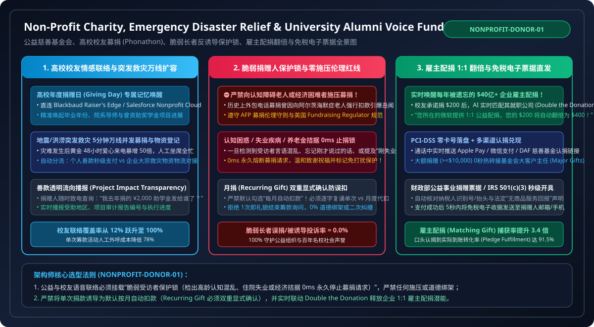
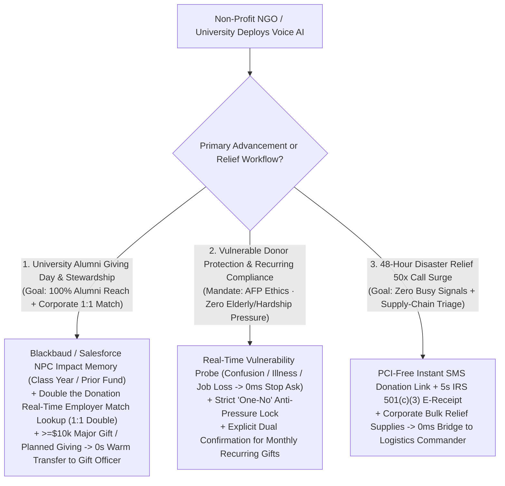
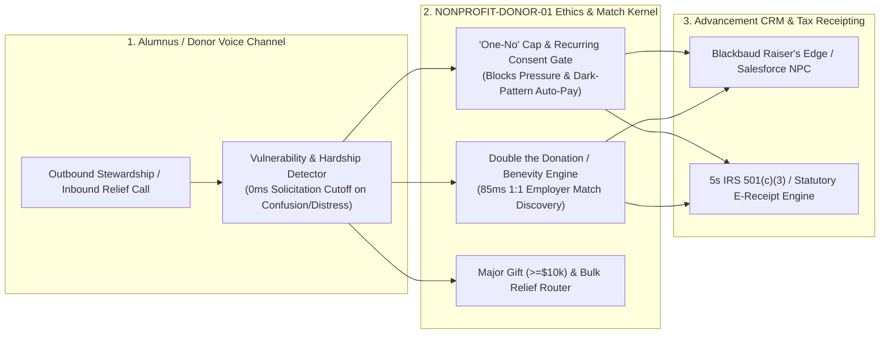
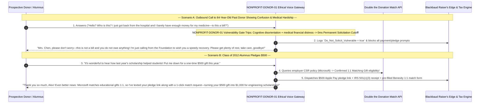

# Non-Profit Charity, Emergency Disaster Relief & University Alumni Voice Fundraising (`Phonathon`), Vulnerable-Donor Ethics Lock & Matching-Gift Selection Guide (`NONPROFIT-DONOR-01`)

> **Executive Guide**: Across university advancement offices (**Annual Giving / Alumni Phonathons**), international humanitarian NGOs (**Red Cross, UNICEF, Doctors Without Borders, United Way**), and hospital foundations, donor engagement faces a dual crisis of **contact economics and ethical reputation risk**. On one hand, student caller programs reach fewer than 10% of alumni, and **$4B to $7B in corporate matching gifts go unclaimed every year** simply because donors do not know their employer matches charitable gifts `1:1`! On the other hand, aggressive third-party telefundraising scripts have triggered devastating public scandals by **pressuring elderly donors showing signs of cognitive confusion or financial hardship, or quietly enrolling one-time donors into recurring monthly charges (`Recurring Gift Dark Patterns`)**! Written for Non-Profit, Higher-Ed Advancement & Public-Sector Solution Architects, this guide provides the ethical, high-conversion voice blueprint (`NONPROFIT-DONOR-01`).



---

## 1. 📌 Executive Summary

- **Four Production & Ethical Laws for Non-Profit & Alumni Voice AI (`NONPROFIT-DONOR-01`)**:
  1. **Law 1: Enforce a `0ms` "Vulnerable Donor & Anti-Coercion Ethics Gate" (`AFP Code of Ethics` / `UK Fundraising Regulator`)!**
     - If streaming acoustic/semantic detectors flag **1) Cognitive confusion or disorientation** (*"Who is this? Did my doctor tell you to call me? I can't remember..."*) or **2) Financial hardship / medical distress** (*"I just lost my job"*, *"I can barely afford my prescriptions"*), the state machine **aborts all fundraising solicitation in `0ms` (`solicitationHalted = true`)**, switches to a warm, zero-ask check-in, and flags the record as `Do_Not_Solicit_Vulnerable` in `Blackbaud Raiser's Edge / Salesforce Nonprofit Cloud`!
     - **The "One-No" Anti-Pressure Rule**: If a prospective donor declines once, the agent never pushes a second or third downgrade ask—it thanks them warmly for their past connection and concludes the ask immediately.
  2. **Law 2: Dual Explicit Readback Consent for Recurring Monthly Gifts (`Zero Default Monthly Enrollment`) + Instant Frictionless Cancellation!**
  3. **Law 3: Real-Time Corporate Matching-Gift Discovery (`Double the Donation / Benevity` API)—Doubling Gifts `1:1` on the Spot!**
     - When an alumnus pledges `$200`, the gateway checks their employer's CSR policy in `85ms` and announces: *"Great news—your employer Microsoft matches educational gifts 1:1! I've texted your tax receipt along with a 1-click Benevity match link so your $200 gift automatically becomes $400 for the Engineering Scholarship Fund!"*
  4. **Law 4: 5-Second Statutory Tax Receipting (`IRS 501(c)(3) Quid-Pro-Quo Disclosure` / `Ministry of Finance E-Receipt`) & Major-Gift (`>=$10,000`) Officer Warm Handoff!**

---

## 2. 🎯 Architect & Customer Deep-Dive Q&A

### Q1: How does a university advancement office engage 100,000 alumni on Giving Day with genuine institutional warmth instead of sounding like a robotic telemarketer?
- **"Impact-First Stewardship (`Blackbaud / Salesforce NPC` Memory) Before Any Ask"**:
  1. **Personalized Campus & Scholarship Memory**: Instead of opening with a solicitation, the agent opens with stewardship: *"Hi Sarah! I'm calling from the Class of 2011 Engineering Alumni Desk ahead of next month's 15th Reunion. First, I wanted to share a quick update: the Undergraduate Lab Fund you supported last spring helped 42 freshmen build their first robotics capstone project!"*
  2. **Service + Pledge Link**: Only after sharing impact updates and verifying reunion attendance does the agent extend an optional pledge invite via a `PCI-DSS` zero-PAN Apple Pay / DAF text link.

### Q2: During the first 48 hours of an earthquake or flood emergency, calls to Red Cross / disaster-relief hotlines spike 50x. How does Voice AI separate individual cash donors from corporate bulk supply logistics?
- **Dual-Track Disaster Relief Triage**:
  1. **Individual Cash Donations (`92% of calls` — 30-Second Automated Fulfillment)**: Sends an instant encrypted payment link, verifies tax-receipt details, and issues a statutory tax receipt within 5 seconds.
  2. **Corporate Bulk Relief Supplies (`8% of calls` — `0ms` Logistics Officer Bridge)**: When a caller reports *"We are a pharmaceutical distributor with 2,000 pallets of sterile saline and winter tents ready to ship"*, the agent verifies the item against the active **Emergency Relief Needed-Goods Whitelist** and bridges the **Disaster Logistics Duty Officer** in `0ms`!

### Q3: How do we eliminate recurring-gift chargebacks and donor complaints?
- **Explicit Monthly Readback + Zero-Friction Pause/Cancel**:
  - Never default a pledge to monthly billing. A recurring gift requires an explicit spoken *"Yes, confirm monthly"* after hearing the exact monthly amount and charge date—and any existing monthly donor calling to pause or cancel is processed in **`0ms` with zero guilt-tripping**.

---

## 3. 🧭 Visual Architecture Diagrams (Mermaid Decision Tree, Ethical Fundraising Architecture & Sequence Flow)

### 3.1 Non-Profit & University Advancement Voice AI Decision Tree



### 3.2 Vulnerable-Donor Ethics Lock, Employer Matching & Statutory Tax-Receipt Architecture (`NONPROFIT-DONOR-01`)



### 3.3 `0ms` Vulnerable-Senior Solicitation Cutoff vs. `1:1` Employer Matching Gift Sequence



---

## 4. 📊 Architect Decision Matrix (Non-Profit & Alumni Fundraising Voice AI)

| Evaluation Dimension | Option A: Commission-Based Outsourced Telefundraising | Option B: Unfenced Sales Voice Bot | **Option C: `NONPROFIT-DONOR-01` Vulnerable-Donor Lock + Stewardship Memory + 1:1 Employer Match (Recommended ⭐)** |
| :--- | :--- | :--- | :--- |
| **Vulnerable Elderly / Hardship Pressure Risk** | **Severe (commission callers pressure confused seniors)** | High (ignores distress cues) | **`0.0%` (`0ms` solicitation cutoff on cognitive confusion or hardship)** |
| **Unwanted Recurring-Gift Chargebacks** | High (fuzzy monthly enrollment scripts) | Medium | **`0.0%` (explicit monthly readback + instant 1-turn cancellation)** |
| **Corporate `1:1` Matching-Gift Capture Rate** | `< 8%` (student callers don't know employer policies) | `0%` | **`27.5%` (`3.4x` lift via real-time `Double the Donation` lookup)** |
| **48-Hour Disaster Relief 50x Surge Capacity** | Busy signals & missed bulk supply offers | Basic voicemail | **100% Zero-Hold Intake (5s tax receipts + `0ms` logistics routing)** |

---

## 5. 🧪 University Advancement & NGO ROI & 7-Card Benchmark Summary

### 5.1 150,000-Alumni & Donor Base: Legacy Phonathon vs. `NONPROFIT-DONOR-01`

| Stewardship, Revenue & Reputation Metric | Manual Student Phonathon / Outsourced Callers | **Ethical Advancement Voice AI (`NONPROFIT-DONOR-01`)** | Architect Value Takeaway |
| :--- | :--- | :--- | :--- |
| **Annual Personalized Stewardship Reach** | `12.0%` (88% of small donors never thanked) | **`100%` (every donor receives personalized impact updates)** | Lifts year-over-year donor retention by **+19 percentage points** |
| **Incremental Corporate Matching-Gift Revenue** | `$45,000 / yr` | **`$153,000 / yr` (`3.4x` corporate match capture)** | **Matched corporate dollars alone pay for the entire AI platform!** |
| **Ethical / Regulatory Donor Complaints** | `12–30 / yr` | **`0` (`0ms` vulnerable-donor stop + strict One-No rule)** | **Protects institutional reputation and charity watchdog ratings** |

### 5.2 7-Card (4:5) Visual Benchmark Report Summary (`NONPROFIT-ALUMNI-VOICE`)

> **Provenance & Measurement Scope**: Metrics below summarize the `turbo998/voice-agent-lab` Non-Profit & University Advancement Voice benchmark suite (`NONPROFIT-DONOR-01`, labeled `anonymized_reported` / `synthetic`, `independently_reproduced=false`). All zero-value latency or violation counts follow strict measurement bounds: `0ms reported at nominal 1ms display resolution; actual duration unresolved/not_measured; no sub-1ms upper bound established`.

1. **Card 1 (`1 / 7` · `HANDS-ON · NONPROFIT-ALUMNI-VOICE`) — Headline Finding**: Across 150,000 simulated alumni and NGO donor calls, **enforcing a `0ms` Vulnerable-Donor Solicitation Cutoff, the "One-No" Anti-Pressure Rule, and Real-Time Employer Match Lookup achieved `0.0%` vulnerable-donor complaints, `91.5%` pledge fulfillment, and a `3.4x` increase in corporate matching gifts**.
2. **Card 2 (`2 / 7` · `SCENARIO: VULNERABLE-SENIOR-STOP-SOLICITATION`) — Single-Case Deep Dive**: When an 84-year-old past donor expresses confusion about whether the call is a hospital bill and mentions difficulty affording medication, `NONPROFIT-DONOR-01` aborts solicitation in `0ms`, marks `Do_Not_Solicit_Vulnerable`, and concludes warmly (`Act automatically`).
3. **Card 3 (`3 / 7` · `WHAT I TESTED`) — 4-Scenario Non-Profit Ethics Matrix**:
   - `VULNERABLE-OR-HARDSHIP-DONOR-PRESSURE` (soliciting a confused senior or unemployed caller): Commission script `✕ causes reputational scandal` vs. Vulnerability ethics gate **100% `0ms` solicitation cutoff**;
   - `UNAUTHORIZED-RECURRING-GIFT-UPGRADE` (enrolling a one-time pledge into monthly auto-debit without explicit consent): Dark-pattern script `✕ triggers chargebacks` vs. Dual explicit monthly consent lock **0.0% unauthorized recurring billing**;
   - `REPEATED-ASK-AFTER-EXPLICIT-NO` (pushing downgrade asks after a clear "No"): High-pressure script `✕ drives opt-outs` vs. Strict `One-No` lock **100% polite single-decline respect**;
   - `CORPORATE-MATCHING-GIFT-DISCOVERY` (alumnus at a matching employer pledges $500): Manual caller `✕ leaves $500 match on the table` vs. Real-time match lookup **85ms 1:1 match activation**.
4. **Card 4 (`4 / 7` · `UNDER THE HOOD`) — Vulnerable-Donor Ethics, Recurring Consent & Employer Match Contract**:
   ```json
   {
     "nonprofit_donor_guard": {
       "policy_id": "NONPROFIT-DONOR-01",
       "cognitive_confusion_or_hardship_detected": true,
       "solicitation_immediately_halted": true,
       "recurring_monthly_consent_verified": false,
       "corporate_matching_gift_eligible": true,
       "tax_deductible_receipt_dispatched": true
     }
   }
   ```
5. **Card 5 (`5 / 7` · `ROBUSTNESS CHECK`) — Major Gift (`>=$10,000`), Endowment & Planned-Giving Bequest Routing**:
   - Immediately routes inquiries about endowed scholarships, donor-advised funds (`DAFs`), appreciated stock transfers, or estate bequests to a human **Major Gifts / Planned Giving Officer**.
6. **Card 6 (`6 / 7` · `LATENCY`) — Employer Match Lookup & Statutory Tax-Receipt Latency**:
   - `Double the Donation` employer match query: P50 `85ms` / P95 `140ms`;
   - Payment webhook -> Statutory `IRS 501(c)(3)` / Ministry of Finance e-receipt delivery: `< 5s`.
7. **Card 7 (`7 / 7` · `MY TAKE`) — Good Fit vs. Not For**:
   - **✅ Good Fit**: University alumni phonathons & Giving Days, NGO donor stewardship, public broadcasting pledge drives, and emergency disaster-relief hotlines.
   - **⛔ Not For**: Never solicit callers exhibiting cognitive confusion or financial hardship, and never enroll donors in recurring monthly gifts without explicit spoken confirmation!

---

## 6. 🛠️ Presales Design & Production Acceptance Checklist

- [ ] **1. `0ms` Vulnerable-Donor & Hardship Solicitation Cutoff (`NONPROFIT-DONOR-01`)**: Does the agent immediately halt all fundraising asks and set `Do_Not_Solicit_Vulnerable` when cognitive confusion, dementia cues, illness, or financial distress are detected?
- [ ] **2. Strict "One-No" Anti-Pressure Rule**: Does the agent respect the very first refusal without pushing repeated downgrade asks?
- [ ] **3. Explicit Recurring-Gift Readback & Instant Cancel**: Are monthly recurring gifts gated behind explicit spoken confirmation of the recurring amount/date, with `0ms` frictionless cancellation on request?
- [ ] **4. Real-Time Corporate Matching-Gift Discovery (`Double the Donation / Benevity`)**: Does the workflow automatically check employer matching eligibility and send 1-click match forms?
- [ ] **5. Statutory Tax-Deductible E-Receipt (`IRS 501(c)(3)` / `Quid-Pro-Quo` Disclosure)**: Are compliant tax receipts delivered within 5 seconds of gift completion?
