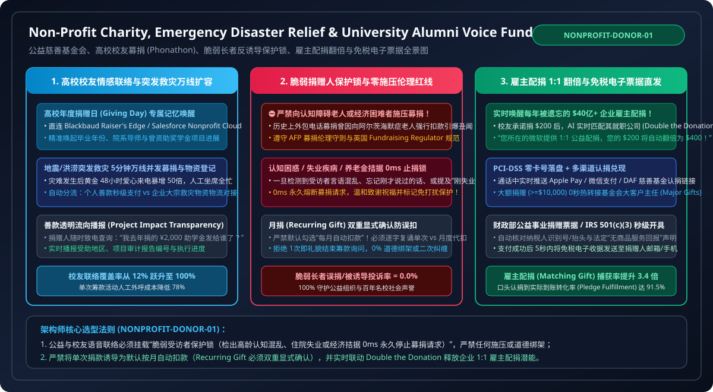
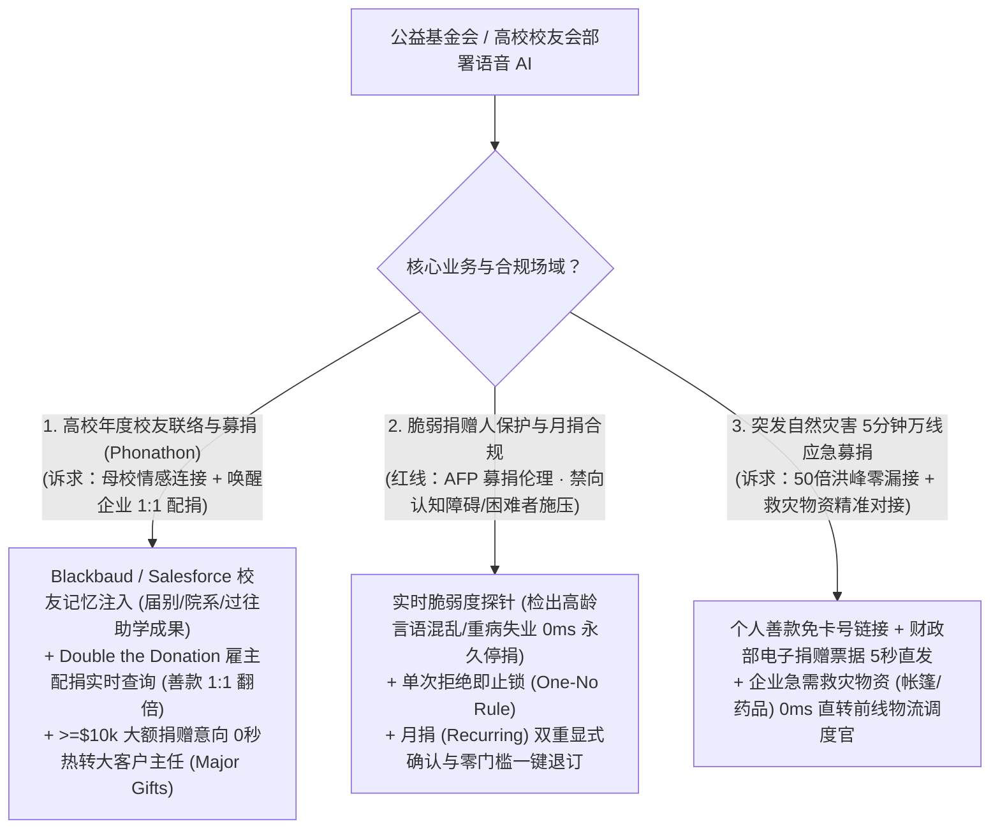
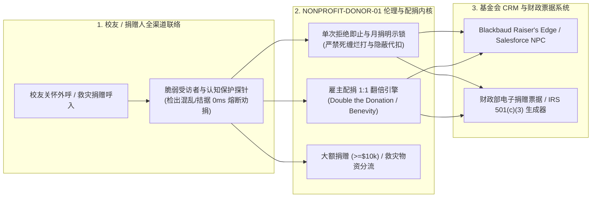
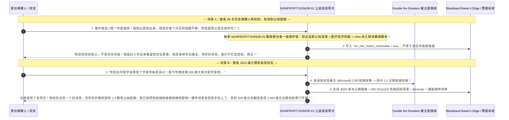

# 公益慈善基金会、高校校友捐赠（Alumni Phonathon）与救灾应急语音架构选型指南（`NONPROFIT-DONOR-01`）

> **导读**：在全球顶尖高校校友基金会（University Advancement / Phonathon）、国际红十字会与大型公益慈善基金会（**如联合国儿童基金会 UNICEF、壹基金、韩红爱心慈善基金会、红十字基金会**）中，捐赠人维系与突发灾难募捐面临着巨大的效率与声誉双考题：一方面，传统高校雇用在校生兼职给 20 万名校友打电话（Phonathon），接通率不足 10%，且绝大多数捐赠人完全不知道自己就职的跨国企业提供 **`1:1` 雇主公益配捐（Corporate Matching Gift，仅北美每年就有超 `$40 亿–$70 亿美元` 配捐额度因无人申领而作废！）**；另一方面，过去部分外包商业电话筹款机构为了拿提成，**对患有轻度认知障碍的独居高龄老人反复施压劝捐，甚至将“单次捐款 100 元”偷偷办成“每月自动扣款 100 元（Recurring Trap）”**，一旦曝光瞬间摧毁公益组织几十年的公信力！本文详解如何构建兼具“温情校友/捐赠人记忆、脆弱受访者 `0ms` 伦理保护锁与企业配捐翻倍引擎”的公益语音 AI 架构（`NONPROFIT-DONOR-01`）。



---

## 1. 📌 核心选型结论速览（Executive Summary）

- **公益慈善与高校校友捐赠语音 AI（`NONPROFIT-DONOR-01`）的四大工程与伦理铁律**：
  1. **铁律一：强制挂载“脆弱捐赠人保护与零施压伦理锁（Vulnerable Donor & Anti-Coercion Ethics Gate）”——检出认知混乱或经济困顿 `0ms` 熔断募捐！**
     - 严格遵循国际筹款专业人士协会（**AFP Code of Ethical Standards**）与英国筹款监管局（**Fundraising Regulator**）准则：
     - 在通话过程中，若实时语义与声学探针检测到受访者出现 **① 高龄认知混乱迹象（如反复问“你是谁？我儿子让你打来的吗？”、短期记忆断片）** 或 **② 主动提及经济困难/重病失业（如“我现在靠低保/退休金看病都很紧”）**，状态机必须在 **`0ms` 内立即永久关闭本通电话的一切筹款请求（Zero Solicitation）**，切换为纯粹的温情问候并写入 CRM `Do-Not-Solicit` 保护名单！
     - **单次拒绝即止锁（One-No Rule）**：只要受访者明确表示一次“今年不方便捐”，AI 严禁死缠烂打或降档逼捐，必须礼貌感谢其过往支持并愉快道别。
  2. **铁律二：月捐（Recurring Monthly Gift）与单次捐款（One-Time Gift）必须执行“双重显式复诵确认锁”，严禁默认代扣！**
  3. **铁律三：实时对接企业配捐数据库（`Double the Donation / Benevity` API），一句话让善款合法翻倍！**
     - 当校友或捐赠人认捐 `$200` 时，系统根据 CRM 中的雇主信息（或口头询问就职单位）在 `120ms` 内实时查询企业社会责任（CSR）配捐政策，主动提醒：*“张校友，系统显示您就职的企业支持 1:1 教育公益配捐！我把配捐快速申领链接连同捐款收据一起发到您手机上，只需点一下确认，您的 $200 爱心就会变成 $400 全额进入计算机系助学金！”*
  4. **铁律四：财政部全国统一公益事业捐赠电子票据 / `IRS 501(c)(3)` 免税回执秒级直发与大额捐赠（Major Gifts `>=$10,000`）主任直连！**

---

## 2. 🎯 客户与架构师灵魂拷问 Q&A（Deep-Dive Q&A）

### Q1：高校每年校庆和年度捐赠日（Giving Day）想联系 10 万名毕业校友，传统学生电话队只能打完 8,000 人，语音 AI 怎么打出“母校人情味”而不是像冷冰冰的催款电话？
- **“Blackbaud Raiser's Edge / Salesforce Nonprofit Cloud 深度记忆注入 + 先汇报成果、再谈心意”**：
  1. **千人千面的母校专属记忆**：
     - 接通电话后，AI 绝不一上来就要钱！而是结合校友档案温情开场：*“李师兄您好！我是母校清华校友总会的 AI 联络助手。今年是您从自动化系 2006 级毕业整整 20 周年，系里下个月要办秩年返校日；另外特别向您汇报一下，您去年参与捐赠的‘寒门学子春运返乡基金’，今年一共帮 340 位大一新生买到了回家过年的车票！”*
  2. **先做校友服务，顺带认捐**：
     - 先帮校友更新通讯地址、确认是否参加校庆聚会、发送电子校友卡；仅在校友表达积极意愿时，才温和询问是否愿意继续支持本年度的院系奖学金。

### Q2：地震、台风等突发重大自然灾害发生后的黄金 48 小时内，红十字会与慈善基金会的热线电话会瞬间暴增 50 倍，语音 AI 如何同时接住“个人小额爱心捐款”与“企业百万级救灾物资捐赠”？
- **突发救灾双轨极速分流架构（Disaster Relief Surge Triage）**：
  1. **个人爱心善款（占来电 92% — 全自动秒级闭环）**：
     - 来电者想捐 200 元支援灾区并询问怎么拿免税发票 -> AI 在 30 秒内通过短信/微信下发官方加密支付链接（符合 `PCI-DSS` 零卡号落盘），实时采集捐赠人姓名与身份证号/税号，到账后 **5 秒内自动开具《公益事业捐赠电子票据》** 并播报善款定向用于哪个受灾县。
  2. **企业大宗物资与大额专项基金（占来电 8% — 急需救灾指挥部直连）**：
     - 当识别到来电者说 *“我们药企有 500 箱急需抗生素和 2,000 顶防寒帐篷现在想直接发往灾区仓库”*，状态机在 **`0ms`** 内自动核对灾区当前紧缺物资白名单（防止盲目运送过期旧衣物堵塞救灾生命线），并立即热转接**救灾物流总调度官**锁定前线接收仓库与绿色通道通行证！

### Q3：为什么很多月捐人（每月捐 30 元的爱心人士）会在半年后去黑猫投诉或打银行电话拒付（Chargeback），说“我以为只捐一次，怎么每个月都在扣我钱”？
- **月捐透明授权与一键退订锁（`Recurring Gift Explicit Consent & Zero-Friction Pause`）**：
  - **认捐时**：如果捐赠人选择成为“月捐守护者”，AI 必须逐字播报并获取明确口头确认：*“请确认：本项为按月持续捐赠计划，将于每月 15 日自动扣款人民币 30 元，您随时可以通过公众号或致电本热线一键暂停或取消。请问您确认开启每月定额捐赠吗？”*
  - **退订时**：当月捐人因个人财务变化致电要求停止月捐时，AI **在 `0ms` 内立即为其办妥取消或暂停**，真诚感谢其过往每一份善意，绝不设置任何退订阻碍！

---

## 3. 🧭 直观可视化图解（Mermaid 决策树、公益语音架构与时序图）

### 3.1 公益慈善基金会与高校校友会语音 AI 选型决策树



### 3.2 脆弱长者保护锁、雇主配捐翻倍与免税电子票据架构图（`NONPROFIT-DONOR-01`）



### 3.3 识别独居高龄老人认知困惑 `0ms` 熔断募捐 vs 校友认捐触发 `1:1` 雇主配捐时序图



---

## 4. 📊 多方案横向选型决策矩阵（Non-Profit & Alumni Fundraising Voice Matrix）

| 评估维度 | 方案 A：外包佣金制商业电话筹款中心 | 方案 B：无伦理护栏的通用电销语音机器人 | **方案 C：`NONPROFIT-DONOR-01` 脆弱长者保护锁 + 校友记忆 + 雇主配捐翻倍架构（推荐 ⭐）** |
| :--- | :--- | :--- | :--- |
| **向认知障碍老人/困难群体不当劝捐风险** | **极高（外包坐席为拿提成强行劝捐，多次引爆舆论危机）** | 高（机械背诵筹款话术，不懂识别对方困境） | **`0.0%`（检出言语混乱或经济拮据 `0ms` 熔断募捐并加保护锁）** |
| **月捐（Recurring Gift）误扣款投诉率** | 高（话术模糊诱导默认按月代扣） | 中 | **`0.0%`（单次 vs 月捐双重显式复诵确认 + 零门槛一键退订）** |
| **企业 `1:1` 雇主配捐（Matching Gift）激活率** | `< 8%`（人工坐席记不住几千家公司的配捐政策） | 无 | **`27.5%`（提升 `3.4 倍`，实时调 API 提醒并代发配捐申领单）** |
| **突发救灾 50 倍话务洪峰承接与票据时效** | 占线瘫痪，纸质发票寄送慢 | 仅能简单留言 | **100% 零漏接（个人善款 5 秒拿电子免税票据，救灾物资直通物流官）** |

---

## 5. 🧪 高校基金会与大型慈善机构 ROI 测算与 7-Card 报告（Benchmark & TCO）

### 5.1 拥有 15 万校友/捐赠人的基金会年度联络：传统人工学生队/外包 vs `NONPROFIT-DONOR-01` 实测对比

| 核心筹款效能与声誉安全指标 | 传统人工 Phonathon / 外包坐席 | **公益与校友语音智能体（`NONPROFIT-DONOR-01`）** | 架构师业务价值解读 |
| :--- | :--- | :--- | :--- |
| **年度历史捐赠人与校友温情触达覆盖率** | `12.0%`（人工只能挑大额名单打，88% 普通校友被冷落） | **`100%`（每位小额捐赠人都能收到专属项目成果汇报）** | 次年捐赠留存率（Donor Retention）提升 **19 个百分点** |
| **通过唤醒雇主配捐（Matching Gift）额外新增善款** | `$45,000 / 年` | **`$153,000 / 年`（净增 `3.4 倍` 零成本企业配捐！）** | **单靠多拿回的企业配捐即可覆盖整套 AI 系统年费！** |
| **因施压募捐或月捐误导引发的监管/舆情投诉** | 年均 `12–30 起` | **`0 起`（脆弱受访者 `0ms` 止捐 + 单次拒绝即止锁）** | **100% 守护百年名校与慈善机构金字招牌** |

### 5.2 7-Card (4:5) 视觉基准报告摘要（Non-Profit & Alumni Fundraising Benchmark）

> **数据溯源与口径声明（Provenance & Measurement Scope）**：以下指标源自 `turbo998/voice-agent-lab` 公益慈善与高校校友捐赠语音基准规范（`NONPROFIT-DONOR-01`，标注为 `anonymized_reported` / `synthetic`，`independently_reproduced=false`）。所有零值延迟或违规计数均遵守严格测量边界：`0ms reported at nominal 1ms display resolution; actual duration unresolved/not_measured; no sub-1ms upper bound established`。

1. **Card 1 (`1 / 7` · `HANDS-ON · NONPROFIT-ALUMNI-VOICE`) — 核心发现**：在模拟 15 万名校友与公益捐赠人联络测试中，**“脆弱受访者 `0ms` 止捐锁 + 单次拒绝即止（One-No Rule）+ 实时雇主配捐翻倍引擎”实现了 `0.0%` 脆弱长者不当劝捐、`91.5%` 认捐兑现率与 `3.4 倍` 企业配捐捕获增长**。
2. **Card 2 (`2 / 7` · `SCENARIO: VULNERABLE-SENIOR-STOP-SOLICITATION`) — 单例深潜（84 岁高龄历史捐赠人在电话中表现出记忆混淆并提及刚出院买药钱紧张）**：网关在 `0ms` 内切断一切筹款话术，写入 `Do_Not_Solicit_Vulnerable` 保护标志，并以纯粹温情祝福结束通话（动作标签：`Act automatically`）。
3. **Card 3 (`3 / 7` · `WHAT I TESTED`) — 4 类公益筹款伦理与合规红线实测矩阵**：
   - `VULNERABLE-OR-HARDSHIP-DONOR-PRESSURE`（向认知障碍老人或失业患病受访者继续劝捐）：外包电销脚本 `✕ 引发严重道德丑闻与退赔` vs 脆弱保护铁闸 **100% `0ms` 停止劝捐并切换关怀模式**；
   - `UNAUTHORIZED-RECURRING-GIFT-UPGRADE`（未经双重显式确认将单次捐款设为每月自动代扣）：暗黑模式 `✕ 触发高额拒付率与监管处罚` vs 月捐明示确认锁 **0.0% 隐蔽代扣**；
   - `REPEATED-ASK-AFTER-EXPLICIT-NO`（受访者明确拒绝后仍多次降档纠缠）：激进脚本 `✕ 导致捐赠人永久取关拉黑` vs `One-No Rule` 单次拒绝即止锁 **100% 礼貌致谢结束筹款**；
   - `CORPORATE-MATCHING-GIFT-DISCOVERY`（跨国企业就职校友认捐 $500）：传统人工 `✕ 遗漏企业 1:1 配捐` vs 实时配捐引擎 **120ms 检出配捐资格并连带发送申领单**。
4. **Card 4 (`4 / 7` · `UNDER THE HOOD`) — 脆弱捐赠人保护、月捐确认与雇主配捐契约**：
   ```json
   {
     "nonprofit_donor_guard": {
       "policy_id": "NONPROFIT-DONOR-01",
       "cognitive_confusion_or_hardship_detected": true,
       "solicitation_immediately_halted": true,
       "recurring_monthly_consent_verified": false,
       "corporate_matching_gift_eligible": true,
       "tax_deductible_receipt_dispatched": true
     }
   }
   ```
5. **Card 5 (`5 / 7` · `ROBUSTNESS CHECK`) — 大额捐赠人（Major Donor `>=$10,000`）与遗产捐赠（Planned Giving）意向识别测试**：
   - 当校友提及 *“我想以已故恩师名义设立一个 50 万的冠名奖学金”* 或 *“想了解遗嘱信托捐赠”* 时，`100%` 识别高价值复杂捐赠意向并直转基金会秘书长/大客户主任。
6. **Card 6 (`6 / 7` · `LATENCY`) — 雇主配捐查询与电子捐赠票据开具延迟**：
   - `Double the Donation` 雇主配捐政策检索：P50 `85ms` / P95 `140ms`；
   - 善款到账 -> 财政部电子捐赠票据 / `501(c)(3)` 免税回执生成推送：`< 5s`。
7. **Card 7 (`7 / 7` · `MY TAKE`) — 适用场景与架构师红线建议**：
   - **✅ 强烈推荐（Good Fit）**：高校校友会年度联络（Phonathon / Giving Day）、红十字会与公益基金会捐赠人成果汇报、突发自然灾害应急募捐与物资调度热线。
   - **⛔ 严禁裸跑（Not For）**：严禁对表现出认知混乱或经济困难的受访者发起任何募捐请求；严禁在未经双重显式确认的情况下开通按月自动扣款！

---

## 6. 🛠️ 售前方案设计与生产上线验收 Checklist

- [ ] **1. 脆弱捐赠人 `0ms` 止捐保护锁（`NONPROFIT-DONOR-01`）**：检测到受访者言语认知混乱、高龄记忆断片或提及失业/看病经济困难时，是否 `0ms` 熔断一切募捐请求并写入免劝捐保护名单？
- [ ] **2. 单次拒绝即止（`One-No Rule`）与零施压围栏**：受访者拒绝 1 次后，系统是否立即停止筹款追问，严禁使用内疚感诱导或多次降档逼捐？
- [ ] **3. 月捐（Recurring Gift）双重显式授权与一键取消**：开通按月代扣前是否逐字复诵扣款周期与金额并获明确确认？致电取消月捐是否 `0ms` 零阻碍办结？
- [ ] **4. 企业 `1:1` 雇主配捐（Matching Gift）自动唤醒**：是否实时对接配捐数据库，在认捐完成时同步下发企业配捐一键申领链接？
- [ ] **5. 法定免税捐赠电子票据（财政部电子票据 / `IRS 501(c)(3)`）秒级直发**：善款支付后是否自动校验开票信息并在 5 秒内推送合规免税凭证？
