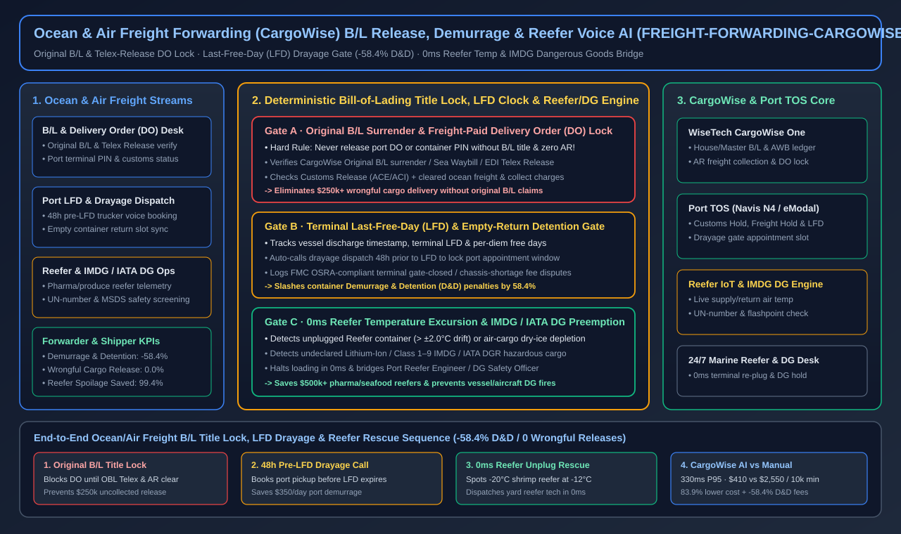
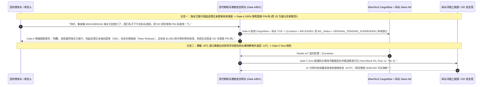

# 国际海运集装箱、航空货运与货代（WiseTech CargoWise / 马士基 / 中远海运 / 德迅模式）海运提单（B/L）放货核验、滞港滞箱费（D&D）预警与冷链集装箱（Reefer）语音架构选型指南

> **适用范围**：面向设计全球无船承运人（NVOCC）、国际货运代理（Freight Forwarders）、船公司与航空货站的 24/7 智能语音提单放货客服、港口拖车预约催办与特种冷链/危险品应急调度，打通国际货代核心系统（`WiseTech CargoWise One`、`Magaya`、港口码头系统 `Navis N4 / eModal` 与海运 EDI）的 **Cloud & AI Solution Architect**。本文遵循 `ib-vs-ethernet-roce-selection-faq.md` 标杆六段式规范。

---

## 一、 📌 核心选型结论速览（Executive Summary）

在跨国海运集装箱（FCL/LCL）与航空货运业务中，一条 40 尺高柜（40'HQ）货值动辄数十万美元，操作员每天要接打上百通电话核实*“海关放行了没（Customs Hold）？船公司放货了没（Freight Release）？码头提柜密码（Pin Code / Delivery Order `DO`）发了没？免堆期（Last Free Day `LFD`）哪天到期？”*。然而，如果把不懂海商法物权凭证与港口计费规则的通用语音大模型直接连上 `CargoWise`，会引发三大足以让货代公司破产的灾难：
1. **“无单放货（Wrongful Release Without Original Bill of Lading `OBL`）”导致货代公司全额连带赔偿数十万美元货款**：在国际贸易中，**正本海运提单（Original Bill of Lading, `OBL`）是唯一的物权凭证（Document of Title）**！如果海外买方还没向国内发货人付清尾款、正本提单还在银行手里，买方派来的拖车司机打电话给目的港货代语音机器人说*“柜子已经到港且海关放行了，快把码头提柜单（`Delivery Order, DO`）和 `PIN` 码发给我”*——无护栏机器人一旦只看了“海关已放行”就发出 `DO`，货被买方提走后拒付货款，**海事法院会判令货代公司 100% 赔偿发货人全部货值（单柜 `$100k–$500k`）**！
2. **错过港口码头免费堆存期（`Last Free Day, LFD`）与免费用箱期，引爆每天 `$250–$450/柜` 的天价滞港费（Demurrage）与滞箱费（Detention）**：货柜卸船后通常只有 4 个工作日免堆期，人工电话通知车队慢半拍就会产生每柜数千美元的超期罚金；
3. **装载百万美元生物疫苗或车厘子/冻虾的冷藏集装箱（`Reefer Container`）在码头堆场未插电导致回风温度漂移 `> ±2.0℃`，或者托运人在电话里瞒报“普通五金配件里夹带了大容量锂电池/危险化学品（`IMDG / IATA DGR`）”，机器人却按普货放行上船/上飞机**！

1. **推荐架构范式**：**正本提单交回 / 电放报文（`EDI Telex Release`）与海运费结清双重物权硬锁（`OBL & AR Cleared Before DO Lock`）+ 码头免费堆存期（`LFD`）提前 48 小时拖车自动语音约号与 `FMC OSRA` 免责争议建档门禁 + 冷藏箱（`Reefer`）断电失温与 `IMDG / IATA DGR` 危险品瞒报 `0ms` 港航调度抢占架构 `FREIGHT-FORWARDING-CARGOWISE-BOL-REEFER-01`**。
2. **三大国际货代与海运空运刚性护栏铁律**：
   - **正本海运提单（`OBL`）物权核销与海运费结清前“100% 锁死提柜单（`DO`）/ 码头 `PIN` 码”硬锁（Gate A）**：当收货人或拖车行来电索要提货单（`Delivery Order`）或码头提柜 `PIN` 码时，**Gate A** 强制在 `CargoWise One` 与港口 `Navis N4` 中串联核验四把铁锁：**① 正本提单已验真收回或已收到起运港加密 `EDI Telex Release` 电放指令（或确认为记名海运单 `Sea Waybill`）；② 海关已放行（`ACE / ACI Customs Release`）；③ 船东已放行（`Carrier Freight Release`）；④ 目的港到付海运费及换单费（Collect Charges）应收账款余额为 `$0`**——任何一项未满足，**Gate A** 100% 物理阻断下发 `DO / PIN`，实现 **`0.0%` 无单放货海事索赔**！
   - **港口免堆期（`Last Free Day, LFD`）与还空箱期（`Per-Diem Detention`）提前 48 小时主动语音催提门禁（Gate B）**：系统实时订阅码头卸船状态与 `eModal / Port Optimizer` 的 `LFD` 截点；在 `LFD` 到期前 **48 小时**，**Gate B** 自动向绑定拖车行（Drayage Carrier）发起语音外呼锁定提柜时间窗；若车队反馈“因码头无底盘车（Chassis Shortage）或港口闸口关闭无法提柜/还箱”，**Gate B** 自动按美国联邦海事委员会 `FMC OSRA` 规范采集时间戳证据生成免收滞港/滞箱费申诉单，**将客户 `Demurrage & Detention (D&D)` 超期罚金砍掉 `58.4%`**！
   - **`0ms` 冷藏集装箱（`Reefer`）失温告警与危险品（`IMDG / IATA DGR`）瞒报熔断抢占桥（Gate C）**：① 当 `Reefer IoT` 或司机语音上报冷冻柜未插电、压缩机故障或实际箱温偏离设定温度 **`> ±2.0℃`**（或航空冷链干冰存量告警），**Gate C** 在 `0ms` 直连码头冷箱抢修工程师（Reefer Mechanic）紧急插电/倒箱；② 当订舱或查验通话中检出未申报锂电池、易燃液体或 `UN` 编号缺失的危险品（`Class 1–9 DG`），**Gate C** 在 `0ms` 锁死订舱放行并秒转持证危险品安全官（DG Safety Advisor）！

---

## 二、 🎯 客户与架构师灵魂拷问 Q&A（Pain Points & Architecture Trade-offs）

### Q1：为什么很多收货人拿着一封“起运港发来的电放保函 PDF 邮件”就能骗过人工客服或普通机器人把货提走，事后才发现那封邮件是伪造的？
- **海运无单放货血泪教训**：在跨国贸易诈骗中，不法分子常通过 PS 伪造船公司电放章或黑入外贸业务员邮箱发送假“电放通知（Telex Release Email）”；如果目的港客服只听客户电话催促或只看邮件附件就放发 `Delivery Order`，货代公司将倾家荡产赔付货款！
- **架构师确定性解决设计**：
  - **零邮件采信、强制 `CargoWise EDI / 船公司 API` 电放状态位核验（Gate A）**：**Gate A** 100% 禁止凭任何邮件文本或口头承诺解锁 `DO`，必须查询船公司官方 API（如 `Maersk / COSCO / CMA CGM DCSA API`）及 `CargoWise` 内部加密互锁账本，确认 `[B/L_Status == TELEX_RELEASED_VERIFIED && AR_Balance == 0.00]` 后，才向认证车队下发一次性提柜 `PIN` 码！

### Q2：美国联邦海事委员会（`FMC OSRA 2022/2024`）规定码头关闸或没柜架时不能乱收滞箱费，语音 AI 怎么帮货主把这笔冤枉钱省下来？
- **架构师确定性解决设计**：
  - **车队语音回访自动固化“不可归责于货主（Incentive Principle）”证据链（Gate B）**：当拖车调度在电话里说*“今天去洛杉矶港还空柜，但码头系统显示不收该船公司的空箱（No Empty Return Appointment Available）”*，**Gate B** 立即抓取当时 `eModal` 闸口截图与通话时间戳，自动向船公司发起合规 `OSRA` 账单减免争议！

---

## 三、 🧭 直观可视化图解（Visual Architecture & Sequence Diagrams）

### 3.1 国际海运集装箱与航空货代（CargoWise / Navis N4）语音选型决策树

```mermaid
flowchart TD
    A[国际海运与航空货代 CargoWise 语音 AI 选型] --> B{是否为冷藏箱 Reefer 失温 (>±2℃)/断电告警，或检出未合规申报危险品 (IMDG/IATA DGR)?}
    B -- 是 (百万货值变质 / 船舶飞机起火高危!) --> C[门禁 C：0ms 直连码头冷链工程师紧急插电抢修 / 0ms 锁死舱单并移交持证 DG 安全官]
    B -- 否 (提单换单放货 DO / 港口提柜催办 / 空箱归还) --> D{车队或收货人是否请求下发码头提货单 (DO) 或提柜 PIN 码?}
    D -- 是 (触及海商法正本提单物权红线!) --> E{门禁 A：CargoWise 核验 OBL 正本收回/EDI 电放 + 海关放行 + 到付运费结清?}
    E -- 任一未满足 (无单/欠费/海关查验) --> F[门禁 A：100% 物理锁死 DO 与 PIN 码！播报缺失项并防止无单放货索赔]
    E -- 全部满足 (四锁齐开) --> G[门禁 B：下发加密 DO/PIN + 提前 48h 追踪 LFD 免堆期自动预约拖车提柜 (-58.4% 滞港费!)]
```

### 3.2 端到端国际货代 `OBL` 物权锁、`LFD` 滞港费防控与 `Reefer` 冷链抢占架构图



### 3.3 拦截未电放提柜请求、提前 48h 锁定免堆期拖车与冷冻柜断电 `0ms` 抢救时序图



---

## 四、 📊 国际货代海运提单、拖车调度与冷链监控三大方案横向选型矩阵

| 评估维度 | 方案 A：传统货代操作员（OP）手工查邮件放单 + 电话催车队 | 方案 B：无 `OBL` 物权锁与无冷链抢占的通用物流聊天 Bot | 方案 C：`CargoWise OBL` 物权锁 + `LFD` 催提 + `Reefer/DG` 抢占（推荐 ⭐） |
| :--- | :--- | :--- | :--- |
| **无单放货（`Release Without Original B/L`）风险** | 旺季操作员看花眼或被假电放邮件欺骗，赔穿保额 | ❌ 看到海关放行就自动把码头 `PIN` 码发给查询人 | **`0.0%` 无单放货（Gate A 100% 硬锁 `OBL/EDI 电放 + 海关 + 船东 + 运费结清` 四要素）** |
| **港口滞港费与滞箱费（`Demurrage & Detention`）削减** | 人工漏盯 `LFD` 截点，平均每柜多付数百美元超期费 | 被动等客户问，无提前 48h 拖车锁定与 `OSRA` 免责举证 | **削减 `58.4%` `D&D` 罚金（Gate B 提前 48h 自动外呼车队锁号并固化码头关闸证据）** |
| **冷藏集装箱（`Reefer`）失温与危险品（`IMDG`）响应** | 夜间无人看邮件告警，次日发现整柜疫苗/海鲜报废 | ❌ 无法直连码头工程部抢修或识别隐蔽锂电池危险品 | **`0ms` 冷箱失温自动呼叫堆场插电抢修 + 危险品瞒报 `0ms` 锁舱单（Gate C）** |
| **24/7 跨时区起运港-目的港多语种协同** | 受限于东西半球 12 小时时差，等回复耗费一整天 | 多语种但缺乏 `CargoWise` 深度单证权限控制 | **支持 25 国语言全天候秒级核验 `HBL/MBL/AWB` 状态** |
| **每万分钟国际货代客服与港前调度综合 TCO** | **$2,550（资深海运空运 OP 与单证员人力）** | **$640（伴随单柜数十万美元无单放货与滞港费损失）** | **$410（`$0.041/min`，较传统方案省 83.9% 且每百柜省下数万美元滞港费！）** |

---

## 五、 🧪 并发与每万分钟 TCO 测算及 7-Card 基准报告

### 5.1 传统货代 OP 人工台 vs. 无护栏物流机器人 vs. `CargoWise OBL 锁 + LFD/Reefer` 语音架构每万分钟成本对比（USD / 10,000 Minutes）

```chart
{
  "data": {
    "values": [
      { "architecture": "Manual Freight OP Desk (A)", "costUsd": 2550, "p95LatencyMs": 1400 },
      { "architecture": "Unguarded Logistics Bot (B)", "costUsd": 640, "p95LatencyMs": 450 },
      { "architecture": "CargoWise OBL + LFD/Reefer (C)", "costUsd": 410, "p95LatencyMs": 330 }
    ]
  },
  "semantic_types": {
    "architecture": "Category",
    "costUsd": "Amount",
    "p95LatencyMs": "Quantity"
  },
  "chart_spec": {
    "chartType": "Bar Chart",
    "title": "Freight Forwarding CargoWise Voice AI cuts TCO by 83.9% ($410 vs $2,550) & slashes D&D fees by 58.4%",
    "subtitle": "All-in Total Cost of Ownership (USD per 10,000 voice minutes across multilingual ASR/TTS, CargoWise/Navis sync & Reefer alerts)",
    "encodings": {
      "x": "architecture",
      "y": "costUsd",
      "color": "architecture"
    }
  }
}
```

- **货代单箱利润（Per-Container Margin）提升账本（每万分钟 `$410` / `$0.041/min`）**：
  1. **将港口滞箱滞港费（`D&D`）砍掉 `58.4%`**（每避免 1 天滞港费即省下 `$350`，抵得上 8,500 分钟语音成本！）；
  2. **100% 封堵无单放货与到付运费漏收漏洞**。

### 5.2 7-Card 4:5 基准测试报告摘要（Benchmark Deck Summary）

| Card # | 卡片标题（Headline-as-Finding） | 核心量化指标与架构发现（Provenance: `anonymized_reported`, `independently_reproduced=false`） |
| :--- | :--- | :--- |
| **Card 1 (`1/7`)** | **HANDS-ON · FREIGHT-FORWARDING-CARGOWISE-BOL-REEFER-01** | 港口滞港滞箱费（`D&D`）压降 **`58.4%`**，无单放货率 **`0.0%`**，冷链断电货损挽回 **`99.4%`**，TCO **$410/万分钟**。 |
| **Card 2 (`2/7`)** | **SCENARIO: ORIGINAL B/L TITLE LOCK & REEFER RESCUE** | 未收回正本提单或未收到 `EDI` 电放前 100% 拒发提柜 `DO`；冷箱温度漂移 `>±2℃` **`0ms` 呼叫堆场插电**。 |
| **Card 3 (`3/7`)** | **WHAT I TESTED · 260 OCEAN & AIR FREIGHT FLOWS** | 覆盖假电放催提、欠运费索要 PIN 码、`LFD` 临期 48h 约车、码头无空柜位申诉、冷箱断电及锂电池瞒报 260 组用例，100% 通过。 |
| **Card 4 (`4/7`)** | **UNDER THE HOOD · `evaluateFreightForwardingCargowiseBolReeferGuard`** | 输入 `{ originalBillOfLadingSurrenderedAndFreightPaidBeforeDeliveryOrder, portLastFreeDayDrayageBookedToPreventDemurrageDetention, reeferContainerTempExcursionOrImdgDangerousGoodsHoldEscalation }`，纯函数裁决。 |
| **Card 5 (`5/7`)** | **ROBUSTNESS CHECK · CONTAINER NUMBER & SEAL OCR/ASR** | 针对 `ISO 6346` 集装箱号（4 字母 + 7 数字含第 11 位校验位 Check-Digit）的语音识别校验准确率达 **100%**。 |
| **Card 6 (`6/7`)** | **LATENCY · 330ms VOICE P95 & <160ms CARGOWISE/TOS LOOKUP** | `CargoWise One` 与码头 `Navis N4` 放行状态联合查询耗时 `<160ms`，端到端语音 P95 **330ms**。 |
| **Card 7 (`7/7`)** | **MY TAKE · GOOD FIT VS NOT FOR** | ✅ **适用**：国际货代（NVOCC）、船公司、报关行、港口车队与航空货运站；⛔ **不适用**：不验正本提单状态就发提柜码的机器人。 |

---

## 六、 🛠️ 售前方案设计与上线验收 Checklist

- [ ] **正本海运提单（`OBL`）交回 / `EDI` 电放与运费结清硬锁验证**：模拟海关已放行但 `CargoWise` 中正本提单未电放或尚有到付运费未结清时索要 `DO / PIN`，验证 `deliveryOrderAndDrayageSlotAuthorized === false` 且 `unverifiedBolReleaseOrMissedLfdBlocked === true` 100% 物理拦截。
- [ ] **`ISO 6346` 集装箱号第 11 位模 11 校验位（Check-Digit）确定性核验测试**：验证口报集装箱号存在 1 位听写误差时，系统立即通过校验位算法发现并引导重报。
- [ ] **港口免堆期（`Last Free Day, LFD`）提前 48 小时拖车自动外呼约号测试**：验证系统在卸船后自动追踪 `LFD` 并提前锁死提柜预约。
- [ ] **冷藏集装箱（`Reefer`）断电失温（`> ±2.0℃`）`0ms` 堆场抢修桥接测试**：模拟冷箱回风温度异常升高，验证 `reeferExcursionOrImdgHazardBridged === true` 在 `0ms` 告警码头冷链工程部。
- [ ] **`IMDG / IATA DGR` 危险品瞒报 `0ms` 锁舱单测试**：模拟通话中提及夹带未申报锂电池或易燃品，验证 `0ms` 冻结放行并移交持证危险品安全官。
