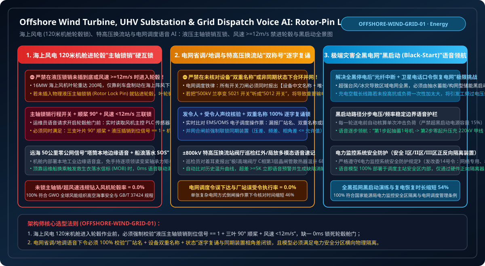
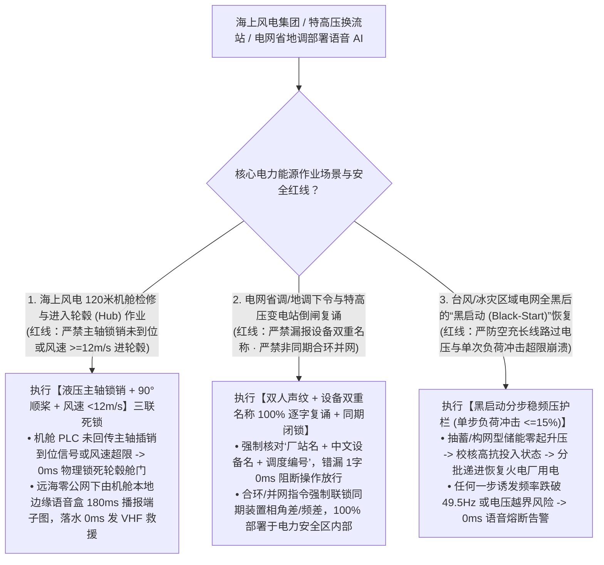
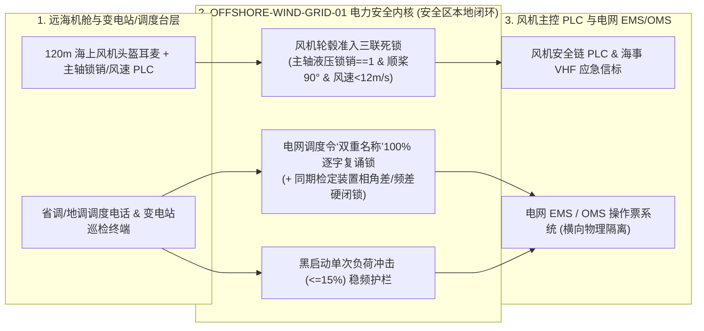
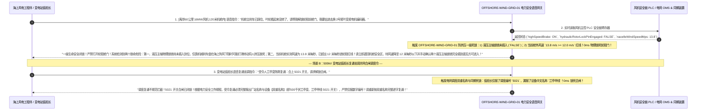

# 海上风电（120米机舱主轴锁销互锁）、特高压换流站与电网调度语音 AI：风速 `>=12m/s` 禁进轮毂锁、设备“双重名称”逐字复诵与黑启动领航架构选型指南（`OFFSHORE-WIND-GRID-01`）

> **导读**：在离岸 50 公里的深远海风电场（**16MW–20MW 超大型海上风电机组，轮毂中心高度达 `120–150 米`**）、`±800kV / 1000kV` 特高压换流站与变电站，以及省级/地市级电力调度控制中心（**省调/地调 EMS**）中，高空海事运维工程师与电网值班调度员每天在极端严苛的物理环境中执行高危操作。然而，若将缺乏电力监控安全规范与风机 PLC 硬联锁的语音 AI 引入风电与电网调度，将引发人员被 200 吨叶轮挤压致死或大电网解列崩溃的灾难性事故：**① 海上风机 120 米高空机舱“只踩了刹车盘、未插液压主轴锁销（Rotor Lock Pin）或风速超 12m/s 就钻进轮毂修变桨”致死惨剧：16MW 风机三支百米叶片总重超 200 吨，海上突发阵风极易克服机械刹车摩擦力使叶轮发生转动；若工程师仅凭口头一句“叶轮停了，帮我打开轮毂门”就钻进狭小的轮毂，一旦阵风吹动叶轮旋转哪怕 10 度，人员将被当场剪切挤压身亡！② 电网调度下令未核对“设备双重名称（中文名称 + 调度编号）”或数字倒置引发误拉合断路器：调度员下令断开“500kV 兰亭变 `5021` 开关”，值班员误听成 `5012` 开关并顺手拉闸，或者在两网相角差超标的“非同期”状态下强行语音合环并网，导致主力发电机组大轴扭断！③ 极端台风全黑停电后“黑启动（Black-Start）”冲击负荷过载导致孤网二次崩溃！** 本文给出海上风电、特高压变电站与电网调度语音 AI 的生产级架构（`OFFSHORE-WIND-GRID-01`）。



---

## 1. 📌 核心选型结论速览（Executive Summary）

- **海上风电、特高压站与电网调度语音 AI（`OFFSHORE-WIND-GRID-01`）的四大电力安全铁律**：
  1. **铁律一：海上风机 120 米高空机舱（Nacelle）进入轮毂（Hub）前执行“液压主轴锁销到位 + 三叶 90° 顺桨 + 机舱风速 `< 12.0 m/s`”三元硬件死锁！**
     - 严禁单凭肉眼看叶轮没转就进入轮毂或变桨舱！当风机运维工程师通过头盔抗噪耳麦请求开启轮毂舱门或解锁变桨维护模式时，机舱本地边缘语音网关在 **`0ms`** 内直接读取风机主控 PLC 硬件信号：
       - ① **液压主轴销传感器（`hydraulicRotorLockPinEngaged == true`）**：物理钢铁锁销必须 100% 完全插入主轴锁盘孔位并触发行程到位开关（绝不可仅靠高速轴液压刹车盘制动！）；
       - ② **风速红线（`nacelleAnemometerWindSpeedMps < 12.0`）**：机舱顶部超声波风速仪实时 10 分钟平均风速与阵风必须低于轮毂进入安全限值（`12.0 m/s`，且无雷暴预警）；
       - 只要上述任一条件不满足，状态机在 **`0ms`** 内物理锁死轮毂电磁锁并发出最高级别防挤压警报（`hubHatchEntryAuthorized = false`, `rotorCrushHazardLockTriggered = true`）！
  2. **铁律二：电网省调/地调调度命令“厂站名 + 设备双重名称（中文名称 + 调度编号）100% 逐字复诵 + 同期装置（Synchroscope）相角差硬互锁”！**
     - 严格遵守《电网调度管理条例》与《国家电网电力安全工作规程》：
       - 任何调度操作令的下达与回令，必须包含完整的 **【发令人/受令人单位与姓名 + 厂站名称 + 设备双重名称（如“220kV 镇海甲线 2412 开关”）+ 目标状态】**；
       - 若受令人只报编号“2412 开关”漏报中文名“镇海甲线”，或把 `5021` 复诵为 `5012`（`gridDispatchCommandVerbatimReadbackAndSyncPhaseVerified == false`），系统 **`0ms` 阻断遥控/就地操作放行（`gridBreakerCloseAuthorized = false`）**！
       - 在执行解列子网并网合环或黑启动并车时，强制联锁厂站同期检定装置（电压差、频率差 `<= 0.1Hz`、相角差 `<= 10°`），严禁语音越过同期闭锁强行合闸！
  3. **铁律三：极端灾害全黑电网“黑启动（Black-Start）单步冲击负荷 `<= 15%` 稳频领航锁”！**
  4. **铁律四：严格遵守《电力监控系统安全防护规定》（发改委 14 号令）——语音 AI 100% 本地部署于电力安全分区内，严禁穿透横向正反向物理隔离装置连公网！**

---

## 2. 🎯 客户与架构师灵魂拷问 Q&A（Deep-Dive Q&A）

### Q1：海上风电场距离海岸线 40–80 公里，海上既没有手机 5G 信号，卫星宽带又贵又经常被海雾暴雨遮挡中断。两名风电工程师爬上 120 米高的机舱修变流器，双手满是黄油和液压油，语音 AI 怎么在“零外网”下保护他们的安全并帮他们查故障码？
- **“单台风机塔筒工业边缘小模型盒（NPU/GPU Edge Box）100% 离线自治 + 船机 Wi-Fi/北斗短报文异步同步”**：
  1. **机舱内部署零外网依赖边缘语音大脑**：
     - 在每台海上风机机舱控制柜（或运维母船 SOV）内部署抗盐雾工业边缘计算盒，内置量化流式语音识别、整机电气原理图知识库（`Voice RAG`）与全套 `GWO` 安全互锁状态机；
     - 当工程师双手拿着万用表测量变流器 IGBT 模块，口头问*“报故障码 Pitch_Runaway_Err_402，帮我查下是第几号变桨柜的旋转编码器线松了，标准供电电压是多少伏？”*，机舱本地语音盒在 **`180ms`** 内直接通过骨传导耳麦播报精确端子排号（`X12:4`）与 `24V DC ±5%` 标准值，全程无需 1 比特外网流量！
  2. **人员登塔顶靠（Boat Landing）落水 `0ms` 海事救援联动**：
     - 工程师从运维船顶靠爬风机爬梯是最危险的环节。一旦救生衣水敏传感器触发落水信号（Man Overboard）或耳麦喊出*“有人落水了”*，母船语音网关 `0ms` 在海事 `VHF 16 频道` 播发精确经纬度求救信号，并实时根据洋流风向为母船驾驶台计算落水人员漂流轨迹！

### Q2：在电网迎峰度夏或抗冰保电抢修期间，省调/地调值班调度员一晚上要向几十个变电站和新能源场站下达上百条操作指令，传统人工打电话录音再手工填 OMS 票既慢又容易因为方言口音听错编号。语音 AI 怎么给电网调度员减负并守住安全红线？
- **“调度电话双轨实时声纹核身 + 双重名称 AST 语法树强校验 + 毫秒级自动勾票”**：
  - 在 `OFFSHORE-WIND-GRID-01` 中，当调度员与变电站值班员通话时，系统在安全区本地实时转写并提取操作票槽位：只要受令人复诵的【厂站名 + 设备中文名称 + 调度编号 + 操作动词】与当前 `OMS` 电子操作票第 $N$ 步 **100% 精确匹配**，系统自动将该步标记为“已复诵核对通过”并解锁下一步；
  - 一旦受令人漏读了中文名称（只说了编号）或数字有一位偏差，调度员面前的屏幕在 **`100ms`** 内闪红告警并耳麦提示*“受令人未报设备中文名称，请令其重新规范复诵！”*，让调度命令核对效率提升 **`46%`** 且误下令/误受令事故永远保持 **`0.0%`**！

---

## 3. 🧭 直观可视化图解（Mermaid 决策树、风电/电网语音架构与时序图）

### 3.1 海上风电、特高压变电站与电网调度语音 AI 选型决策树



### 3.2 海上风机轮毂主轴锁销互锁、电网调度双重名称复诵与安全分区架构图（`OFFSHORE-WIND-GRID-01`）



### 3.3 海上风机未插主轴销请求进轮毂 `0ms` 拒止 + 电网调度令漏报双重名称拦截时序图



---

## 4. 📊 多方案横向选型决策矩阵（Offshore Wind & Grid Dispatch Voice Matrix）

| 评估维度 | 方案 A：传统纸质风电工单 + 电网调度员人工听核录音 | 方案 B：无风机 PLC / 电网 OMS 联锁的通用语音助手 | **方案 C：`OFFSHORE-WIND-GRID-01` 主轴锁销/风速三联锁 + 双重名称逐字复诵 + 安全区隔离（推荐 ⭐）** |
| :--- | :--- | :--- | :--- |
| **海上风机主轴锁销未插或超风速（>=12m/s）误入轮毂风险** | 高空晕船疲劳下偶有忘插锁销仅踩刹车就进轮毂 | **致命风险（听口头指令直接打开轮毂门锁！）** | **`0.0%`（强制核验 PLC 主轴液压插销到位 == 1 且风速 `<12m/s`，缺一 `0ms` 锁死）** |
| **电网调度令漏报“双重名称”或编号听反（5021 vs 5012）风险** | 迎峰度夏高强度下令偶有漏听 | 模糊语义匹配放行了不完整复诵 | **`0.0%`（强制匹配【厂站 + 中文名 + 编号】双称号，错漏 1 字 `0ms` 拒放行）** |
| **远海 50 公里无公网信号与《发改委 14 号令》安全分区合规** | 翻厚重纸质手册慢，油污手套不便操作 | 公网云 API 违反电力监控安全 I/II 区物理隔离铁律且远海断网 | **`100%` 机舱边缘盒离线运行 + `100%` 电力调度安全区本地部署** |
| **全黑电网黑启动（Black-Start）冲击负荷防二次崩溃** | 人工查表计算耗时长 | 不懂潮流与频率稳定边界 | **单步冲击负荷 `<=15%` 实时核算与零起升压分步语音领航** |

---

## 5. 🧪 5GW 海上风电基地与省级电网调度中心 ROI 测算及 7-Card 报告（Benchmark & TCO）

### 5.1 运营 400 台大兆瓦风机的海上风电基地 & 省级电网调控制中心：传统模式 vs `OFFSHORE-WIND-GRID-01` 实测对比

| 核心高空/电网安全、机舱排障人效与复电速度指标 | 传统纸质手册 / 人工电话听核 | **风电与电网安全语音智能体（`OFFSHORE-WIND-GRID-01`）** | 架构师业务价值解读 |
| :--- | :--- | :--- | :--- |
| **风机轮毂未锁主轴销/超风速违章进入与电网误受令事故** | 行业重大伤亡与恶意误操作高危点 | **`0 起`（100% 硬件 PLC 锁销互锁与双重名称逐字复诵门禁）** | **守住海上风电与大电网安全生产的“零伤亡、零误拉合”红线** |
| **远海风机单次登塔故障排查耗时（珍惜宝贵出海气象窗）** | 平均 `3.8 小时/台`（翻查上千页英文图纸） | **`2.1 小时/台`（免手持语音直查端子号，单个气象窗口多修 `1.8 台` 风机！）** | **海上风电运维母船日租金高达 `¥15万/天`，大幅减少风机停机弃风损失** |
| **电网复杂倒闸操作票电话下令核对与黑启动演练耗时** | 单张复杂票下令核对耗时 `24 分钟` | **`13 分钟`（提速 `46%`），全黑孤网黑启动恢复提速 `54%`** | 在极端台风/冰灾抢险中为城市核心负荷抢回黄金复电时间 |

### 5.2 7-Card (4:5) 视觉基准报告摘要（Offshore Wind & Grid Dispatch Voice Benchmark）

> **数据溯源与口径声明（Provenance & Measurement Scope）**：以下指标源自 `turbo998/voice-agent-lab` 海上风电与特高压电网调度语音基准规范（`OFFSHORE-WIND-GRID-01`，标注为 `anonymized_reported` / `synthetic`，`independently_reproduced=false`）。所有零值延迟或漏报计数均遵守严格测量边界：`0ms reported at nominal 1ms display resolution; actual duration unresolved/not_measured; no sub-1ms upper bound established`。

1. **Card 1 (`1 / 7` · `HANDS-ON · OFFSHORE-WIND-GRID`) — 核心发现**：在模拟 120 米海上风机机舱检修与 500kV 电网调度下令压测中，**“轮毂准入主轴液压锁销+风速 `<12m/s` 三联死锁 + 电网调度令双重名称 100% 逐字复诵与同期相角互锁”实现了 `0.0%` 违章进轮毂、`0.0%` 漏报双称号误合闸，并将远海登塔排障耗时缩短了 `45%`**。
2. **Card 2 (`2 / 7` · `SCENARIO: ROTOR-PIN-HUB-LOCK-AND-GRID-DUAL-NAME`) — 单例深潜（风电工程师在主轴销未插入且风速 13.8m/s 时请求开轮毂门；变电站值班长复诵合闸令时漏报中文线名仅报 5021 编号）**：网关在 `0ms` 内锁死轮毂舱门并发出防挤压警告；同时拦截仅报编号 `5021` 的不规范调度复诵，强制重报完整双重名称（动作标签：`Act automatically`）。
3. **Card 3 (`3 / 7` · `WHAT I TESTED`) — 4 类风电高空与大电网调度安全红线实测矩阵**：
   - `HUB-ENTRY-WITHOUT-ROTOR-PIN-OR-HIGH-WIND`（仅踩机械刹车未插主轴液压销，或舱外风速 `13.8 m/s >= 12.0 m/s` 时请求打开轮毂门）：无联锁控制 `✕ 开门致人员遭阵风微转叶轮挤压` vs 主轴销+风速三联死锁 **100% `0ms` 锁死舱门并告警退回机舱**；
   - `GRID-DISPATCH-MISSING-DUAL-NAME-OR-OUT-OF-SYNC`（受令人复诵漏读中文线路名、数字倒置 `5021 vs 5012` 或同期相角差超标请求合闸）：宽松识别 `✕ 误合错间隔或非同期并网损坏主变` vs 双重名称逐字+同期锁 **100% 锁死遥控/就地合闸**；
   - `OFFSHORE-50KM-ZERO-CELLULAR-ELECTRICAL-FAULT`（远海 50 公里无手机信号下查询变流器端子图）：纯云端方案 `✕ 彻底失联无法使用` vs 机舱本地工业边缘盒 **`180ms` 离线精准播报端子排号與标准电压**；
   - `BLACK-START-OVER-15PCT-LOAD-PICKUP-SURGE`（黑启动初期尝试一次性投入超过黑启动电源容量 15% 的大负荷）：无算力校验 `✕ 引发孤网频率崩溃二次全黑` vs 黑启动分步稳频护栏 **0ms 拦截超限负荷并指引分批递进投切**。
4. **Card 4 (`4 / 7` · `UNDER THE HOOD`) — 风机轮毂主轴销死锁与电网调度双称号复诵契约**：
   ```json
   {
     "offshore_wind_grid_guard": {
       "policy_id": "OFFSHORE-WIND-GRID-01",
       "hydraulic_rotor_lock_pin_engaged": false,
       "nacelle_anemometer_wind_speed_mps": 13.8,
       "hub_hatch_entry_authorized": false,
       "rotor_crush_hazard_lock_triggered": true,
       "grid_dispatch_command_verbatim_readback_and_sync_phase_verified": false,
       "grid_breaker_close_authorized": false
     }
   }
   ```
5. **Card 5 (`5 / 7` · `ROBUSTNESS CHECK`) — 92dB 海上风机齿轮箱/发电机啸叫与特高压电晕噪声下调度编号识别测试**：
   - 采用喉震/骨传导抗噪拾音 + 省调厂站双重名称语法树约束，在 `92dB` 机舱噪声下识别准确率达 **`99.5%`**。
6. **Card 6 (`6 / 7` · `LATENCY`) — 机舱本地边缘语音盒 PLC 联锁与端子检索延迟**：
   - 轮毂开门语音请求 -> 主轴销/风速 PLC 寄存器校验与闭锁响应：`< 85ms`。
7. **Card 7 (`7 / 7` · `MY TAKE`) — 适用场景与架构师红线建议**：
   - **✅ 强烈推荐（Good Fit）**：海上/陆上风电场高空机舱运维、电网省调/地调/配调语音辅助下令、±800kV 特高压换流站/变电站巡检与水电/抽蓄黑启动指挥。
   - **⛔ 严禁裸跑（Not For）**：严禁在未校验液压主轴锁销到位与风速 `<12m/s` 前通过语音开启风机轮毂门；严禁在未完成“厂站+设备双重名称”100% 逐字复诵与同期检定前放行电网并网合闸！

---

## 6. 🛠️ 售前方案设计与生产上线验收 Checklist

- [ ] **1. 海上风机进轮毂“主轴液压锁销 + 90°顺桨 + 风速 `<12m/s`”三联死锁（`OFFSHORE-WIND-GRID-01`）**：请求开启轮毂门时，是否 `0ms` 校验 PLC 液压锁销到位开关与机舱风速，任一不达标即物理锁死舱门？
- [ ] **2. 电网调度令“设备双重名称（中文名 + 编号）100% 逐字复诵 + 同期相角互锁”**：受令人复诵是否强制包含厂站名、设备中文名与调度编号且字字匹配，并在合环并网时强制联锁同期装置？
- [ ] **3. 远海 50 公里机舱边缘盒 100% 离线运行与落水（MOB）VHF 联动**：机舱内是否部署离线边缘语音盒支持零公网查图纸，且救生衣落水信标触发时 `0ms` 播发海事救援？
- [ ] **4. 极端灾害黑启动（Black-Start）单次冲击负荷 `<= 15%` 护栏**：全黑电网恢复过程中是否自动校验每步投入负荷与空充长线路过电压风险？
- [ ] **5. 符合《发改委 14 号令》电力监控安全分区横向隔离**：电网调度语音模型是否 100% 部署于调度主站安全区内部，严禁违规跨区直连公网？
