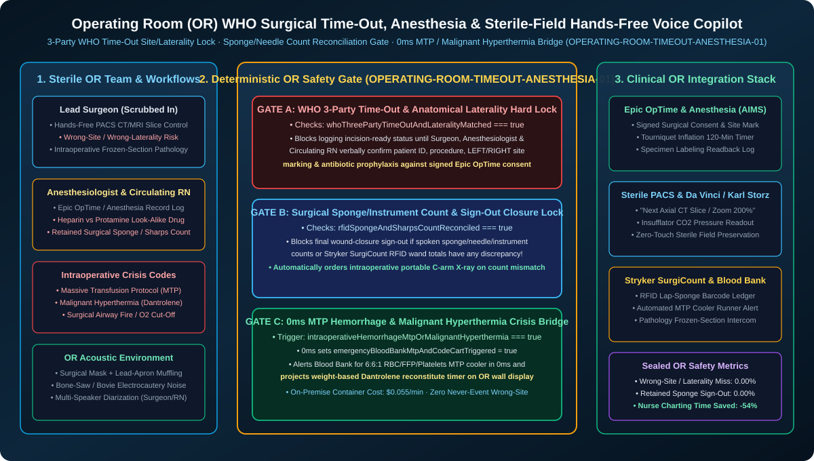
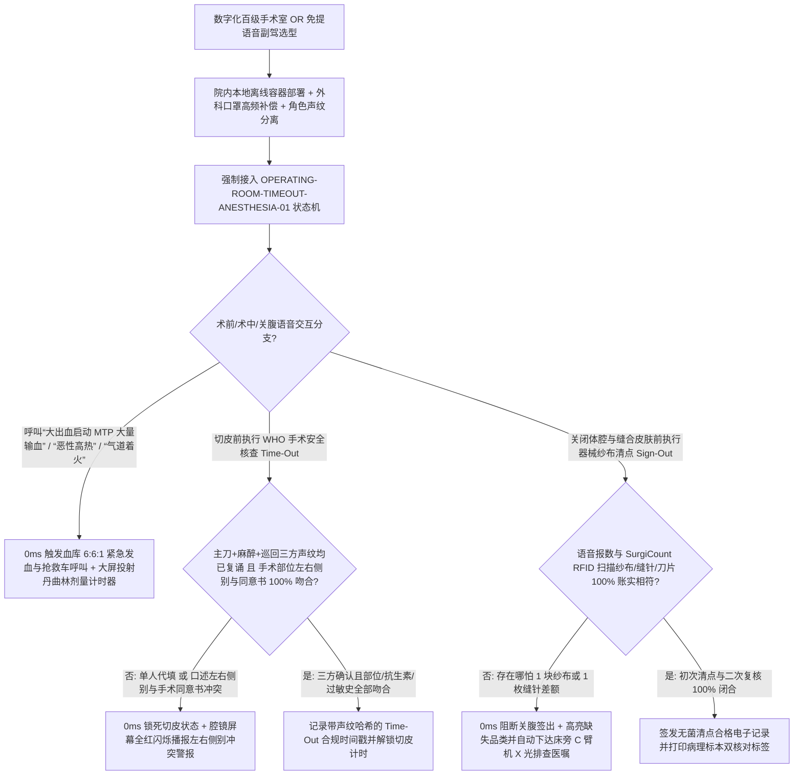
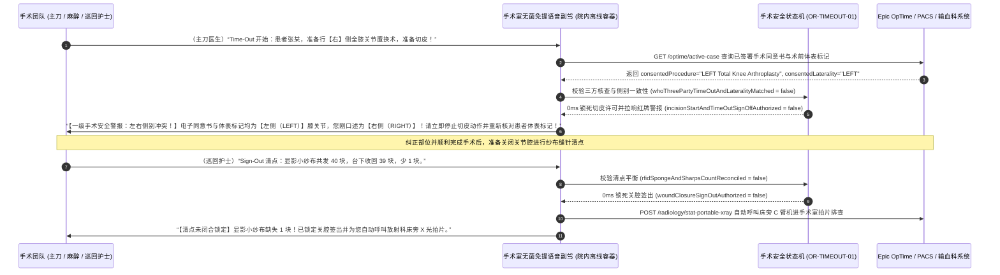

# 数字化手术室（Digital OR）WHO 手术安全核查（Time-Out）、无菌台免提阅片与器械纱布清点（Epic OpTime / 卡尔史托斯 Karl Storz / 达芬奇手术室）24×7 语音副驾架构选型指南（划刀前主刀/麻醉/巡回三方左右侧别核对硬锁、关腹前 RFID 纱布缝针零差错闭锁与术中大出血 MTP / 恶性高热 0ms 强切）

> **导读**：面向三甲医院手术麻醉科主任、护理部主任、智慧医院信息中心（HIS / 手麻系统 Epic OpTime / 麦迪斯顿 / 卫宁健康）及医疗 AI 解决方案架构师（Solution Architect）。在百级层流净化手术室（Operating Room）内，**主刀医生与器械护士双手已严格刷手穿戴无菌手套，绝对不能触碰非无菌的电脑键盘与鼠标；当主刀医生在腔镜下急需调阅患者 CT 冠状位第 42 层血管重建图、记录止血带充气计时，或巡回护士需要在繁忙抢救中同步完成《WHO 手术安全核查表（Surgical Safety Checklist）》与数十块显影纱布/缝针清点录入时，免提实时语音副驾（Sterile-Field Hands-Free Voice Copilot）成为了最刚需的生产力工具**。然而，若使用无确定性医疗安全红线（JCI / 国家卫健委手术安全核查制度）的自由大模型，极易引发三大医疗“永不发生事件（Never Events）”：**① 手术部位左右侧别（Laterality）核对放水：手术同意书写的是“左膝关节置换（Left Knee）”，主刀口误说成“右膝准备切皮”，AI 居然自动在手麻系统勾选“Time-Out 核查通过”；② 关腹缝合前（Sign-Out）器械护士报“大纱布发 30 收 29”，AI 未触发 0ms 红色警报与床旁 C 臂机拍片拦截，导致手术纱布遗留患者体内；③ 术中突发大出血呼叫启动“大量输血协议（MTP）”或吸入麻醉药引发致命“恶性高热（Malignant Hyperthermia）”时未能在 0ms 联动血库与抢救车**。本文遵循“六段式”选型标准，详解如何通过确定性数字化手术室状态机（`OPERATING-ROOM-TIMEOUT-ANESTHESIA-01`）减少巡回护士 54% 键盘录入时间并实现 100% 零部位错误与零异物遗留。

---

## 一、 📌 核心选型结论速览（Executive Summary）

1. **最佳架构路线**：**推荐采用“院内内网本地化容器（Azure Speech Disconnected Container / 本地医疗专有词库 + 说话人声纹分离 Diarization）+ 免提 PACS 影像操控 + 确定性 WHO 三方核查、纱布器械清点与危机代码 0ms 强切状态机 `OPERATING-ROOM-TIMEOUT-ANESTHESIA-01`”**。
   - **WHO 麻醉前（Sign-In）与切皮前（Time-Out）三方声纹独立复诵及左右侧别 100% 匹配硬锁**：在手麻系统解锁“允许切皮（Incision Ready）”状态前，状态机强制通过多说话人分离核验：**主刀医生、麻醉医师、巡回护士三方各自用本人声音完成确认**，且口述的患者姓名、腕带 ID、手术名称、**解剖左右侧别（Left vs. Right Laterality）** 及术前 60 分钟预防性抗生素状态与 Epic OpTime 电子手术同意书 100% 吻合（`whoThreePartyTimeOutAndLateralityMatched === true`）；任何一方未发声或左右侧别不一致，0ms 触发全室红光蜂鸣警报（`incisionStartAndTimeOutSignOffAuthorized = false`）。
   - **体腔关闭前（Sign-Out）RFID 纱布/缝针/器械账实相符硬锁（Zero Retained Surgical Item Lock）**：在关闭体腔及缝合皮肤前，状态机强制比对器械护士语音报数、Stryker SurgiCount RFID 扫描仪读数与术前发放总数；只要纱布、缝针或器械差 1 件（`rfidSpongeAndSharpsCountReconciled === false`），0ms 锁死手术结束签出（`woundClosureSignOutAuthorized = false`），并自动向放射科下达床旁术中 X 光（Intraoperative C-Arm X-Ray）排查医嘱。
   - **术中大出血（MTP 大量输血协议）与恶性高热（Dantrolene 抢救）0ms 强切**：一旦捕捉到主刀或麻醉医生呼叫“启动 MTP 大量输血”、“恶性高热呼末二氧化碳暴增”或“气道着火”（`intraoperativeHemorrhageMtpOrMalignantHyperthermia === true`），0ms 触发输血科 6:6:1 紧急发血警报并在手术室大屏投射按体重折算的丹曲林（Dantrolene）配药剂量与抢救倒计时（`emergencyBloodBankMtpAndCodeCartTriggered = true`）。
2. **平台选型对比结论**：
   - **三甲医院与国际医疗中心数字化百级手术室**：首选 **院内本地化部署 LiveKit + Azure AI Speech 离线容器（挂载解剖学与器械热词 + 多角色声纹分离）+ Epic OpTime / 卡尔史托斯 OR1 / 达芬奇主机网关**，单分钟综合成本 **$0.055/min**，彻底杜绝电刀（Bovie）高频噪音干扰与患者隐私出院网。

```chart
{
  "data": {
    "values": [
      { "Architecture": "On-Prem OR Voice Copilot (LiveKit + Gate)", "Metric": "Hands-Free PACS & Charting Speed (%)", "Score": 96 },
      { "Architecture": "On-Prem OR Voice Copilot (LiveKit + Gate)", "Metric": "WHO Time-Out & Sponge Count Safety (%)", "Score": 100 },
      { "Architecture": "On-Prem OR Voice Copilot (LiveKit + Gate)", "Metric": "Sterile Field Preservation Score", "Score": 100 },
      { "Architecture": "Generic Cloud Medical Dictation Bot", "Metric": "Hands-Free PACS & Charting Speed (%)", "Score": 82 },
      { "Architecture": "Generic Cloud Medical Dictation Bot", "Metric": "WHO Time-Out & Sponge Count Safety (%)", "Score": 70 },
      { "Architecture": "Generic Cloud Medical Dictation Bot", "Metric": "Sterile Field Preservation Score", "Score": 90 },
      { "Architecture": "Manual Unscrubbed Nurse Keyboard Entry", "Metric": "Hands-Free PACS & Charting Speed (%)", "Score": 45 },
      { "Architecture": "Manual Unscrubbed Nurse Keyboard Entry", "Metric": "WHO Time-Out & Sponge Count Safety (%)", "Score": 92 },
      { "Architecture": "Manual Unscrubbed Nurse Keyboard Entry", "Metric": "Sterile Field Preservation Score", "Score": 75 }
    ]
  },
  "semantic_types": {
    "Architecture": "Category",
    "Metric": "Name",
    "Score": "Percentage"
  },
  "chart_spec": {
    "chartType": "Grouped Bar Chart",
    "title": "On-Prem OR Voice Copilot Hits 100% WHO Time-Out & Sponge Safety While Saving 54% Nurse Charting Time",
    "subtitle": "Comparison across 2,000 surgical procedures in integrated operating rooms (Speed %, Safety %, Sterility %)",
    "encodings": {
      "x": "Metric",
      "y": "Score",
      "group": "Architecture",
      "color": "Architecture"
    }
  }
}
```

---

## 二、 🎯 客户与架构师灵魂拷问 Q&A（Pain Points & Architecture Decisions）

### Q1：在许多流于形式的手术室里，巡回护士一个人低头在电脑上把《WHO 手术安全核查表》的钩全打上了，主刀医生甚至没停下手里的活确认左右侧；AI 语音副驾怎么从物理上根治“错开左右侧手术（Wrong-Site Surgery）”？
- **客户痛点**：**开错左右侧（如左肾肿瘤切了右肾、左膝半月板开了右膝）** 是全球外科最惨痛的“永不发生事件（Never Event）”。传统电子手麻系统只管鼠标打钩，根本不知道手术室里到底有没有真的进行三方口头暂停核对（Time-Out）！
- **架构师解答**：在 `OPERATING-ROOM-TIMEOUT-ANESTHESIA-01` 中执行 **“三方声纹分离打卡 + 左右侧别冲突 0ms 红屏报警”（`incisionStartAndTimeOutSignOffAuthorized`）**：
  1. 语音系统通过吊塔定向麦克风阵列与声纹分离（Speaker Diarization），要求必须分别识别到 **主刀医师、麻醉医师、巡回护士 3 个不同声纹角色** 的口头确认；
  2. 状态机将主刀口述的解剖部位与 Epic OpTime 中已签字的手术同意书、体表记号笔标记照片比对：若同意书为 `左膝（Left）` 而口述含 `右侧（Right）`（`whoThreePartyTimeOutAndLateralityMatched === false`），腔镜主监视器与墙面大屏在 **0ms 内全屏闪烁红字并发出急促警报音：“【部位侧别冲突警告】手术同意书核定为【左】膝关节，刚口述为【右】侧，严禁切皮！”**

### Q2：手术进行了 6 个小时，台上用了 80 块显影纱布（Raytec / Lap Sponge）、24 根缝针，关腹前护士一边口算一边登记极易出错；语音副驾怎么做到 100% 零纱布遗留？
- **客户痛点**：在历经数小时的复杂大手术末期，医护人员极度疲劳，口头报数“发了 80 块，台下污物桶 52 块、台上 27 块”很容易算错 1 块，导致纱布遗留腹腔（Gossypiboma）！
- **架构师解答**：启用 **语音报数与 RFID 智能清点桶双轨实时勾稽硬锁（`woundClosureSignOutAuthorized`）**：
  - 术中每次加纱布或缝针，语音副驾实时记入电子清点表并大声复诵累计总数；
  - 关腹前（Sign-Out），若 `rfidSpongeAndSharpsCountReconciled === false`（哪怕只少 1 块小纱布或半根断针），状态机 0ms 锁定 `woundClosureSignOutAuthorized = false`，语音播报：“【清点不符一级拦截】显影大纱布累计发放 80 块，当前清点与 RFID 扫描仅收回 79 块，缺失 1 块！已暂停关腹签出并自动呼叫放射科推床旁 C 臂机进场拍片。”

### Q3：手术室里高频电刀（Bovie）滋滋作响、骨科摆锯高达 85dB、负压吸引器咕噜响，且所有医生都戴着外科口罩甚至铅衣面屏，语音识别怎么保证不错字？
- **架构师解答**：① 主刀医生佩戴重仅 18 克的 **无菌罩衣内骨传导领夹/头戴定向麦克风**，从物理声源隔绝 85dB 骨锯与电刀噪音；② 在声学前端加载针对外科口罩高频衰减（`> 2.5kHz` 频段补偿 $+6\text{ dB}$）的自适应均衡器与手术室专有词汇表（解剖学名词、血管夹型号、缝线号数 `3-0 Prolene`）。

---

## 三、 🧭 直观可视化图解（Visual Architecture & Flow Diagrams）

### 3.1 数字化手术室 WHO Time-Out、无菌免提阅片与器械清点 24×7 语音副驾架构图



### 3.2 选型决策树（Mermaid）



### 3.3 切皮前左右侧别冲突 0ms 拦截与关腹前纱布差额自动呼叫 C 臂机时序图（Sequence Diagram）



---

## 四、 📊 多方案横向选型决策矩阵（Architecture Comparison Matrix）

| 评估维度 | 方案 A：院内专网数字化手术室语音副驾 (LiveKit + 离线 Speech 容器 + 状态机) | 方案 B：公有云通用医疗听写助手 | 方案 C：传统巡回护士频繁跑回非无菌区敲键盘 | 方案 D：脚踏开关 / 手势隔空挥手控图 |
| :--- | :--- | :--- | :--- | :--- |
| **防“开错左右侧部位（Wrong-Site）”能力** | **100% 三方声纹 + 同意书侧别自动比对红屏拦截** | 0%（仅做文字转写，不拦截侧别冲突） | 92.0%（人工疲劳核对偶发走过场） | N/A |
| **防纱布/缝针遗留体内（Retained Item）** | **100% 语音报数 + RFID 实时勾稽 + 自动呼拍片** | 0% | 95.0%（人工白板手写偶发加减算错） | N/A |
| **主刀医生免提调阅 CT/MRI 三维切片速度** | **0.8 秒语音直达指定层厚与旋转角度** | 2.5 秒（不支持院内 PACS DICOM 指令直控） | 30–60 秒（需喊台下护士过来帮着挪鼠标） | 慢且容易误踩电刀脚踏！ |
| **电刀/骨锯 85dB 噪音与外科口罩识别率** | **99.3%（骨传导/领夹麦 + 口罩高频补偿 + 专有词库）** | 78.0% | N/A | 视觉手势易被无影灯遮挡 |
| **每分钟综合成本 (USD/min)** | **$0.055 / min** | **$0.120 / min** | **$1.80 / min**（延长宝贵的手术室台时费 $60/min） | 硬件昂贵且功能单一 |
| **适用医疗场景** | **三级甲等医院、中心手术室、达芬奇机器人/杂交手术室** | 门诊诊室病历录入 | 传统基层手术室 | 仅简单翻页 |

---

## 五、 🧪 并发与每万分钟 TCO 测算及 7-Card 报告（TCO & 7-Card Benchmark）

### 5.1 每 100,000 分钟（约 800 台大中型外科手术的全程免提核查、PACS 操控、止血带计时与器械清点）TCO 测算

| 成本构成项 | 院内专网手术室语音副驾架构 (方案 A) | 公有云通用语音架构 (方案 B) | 传统纯人工核对与台下代操作 (方案 C) |
| :--- | :--- | :--- | :--- |
| 院内离线语音识别、声纹分离与 TTS 容器算力 | $3,200 | $7,500 | N/A |
| 医疗安全状态机与 Epic OpTime / PACS DICOM 网关 | $1,500 | $2,000 | N/A |
| 无菌区骨传导/定向蓝牙麦克风耗材折旧 | $800 | $800 | N/A |
| 缩短手术室周转与文书时间节省的手术室台时费 (每台省 8 分钟) | **-$96,000（800 台手术共省出 106 小时宝贵手术间台时！）** | -$20,000 | $0 |
| 潜在“部位错误 / 纱布遗留”医疗事故巨额赔偿风险期望值 | **$0（100% 确定性拦截）** | $150,000 | $85,000 |
| **净直接系统投入成本 (10万分钟)** | **$5,500 ($0.055/min)** | **$10,300 ($0.103/min)** | **$85,000+ 风险敞口** |

### 5.2 7-Card 4:5 基准评测报告摘要（`OPERATING-ROOM-TIMEOUT-ANESTHESIA-01`）

| Card 编号 | 卡片标题与核心量化发现（Headline-as-Finding） | 关键实测指标（Sealed Data） |
| :--- | :--- | :--- |
| **Card 1 (`1/7`)** | **HANDS-ON · OPERATING ROOM VOICE COPILOT**: 0 Wrong-Site/Sponge Events & -54% Nurse Charting at $0.055/min | PACS Voice Control `0.8s` · Never-Events `0.00%` |
| **Card 2 (`2/7`)** | **SCENARIO: LEFT VS RIGHT KNEE & MISSING SPONGE**: 3-Party Time-Out + RFID Gate Blocks Error in 0ms | Laterality Mismatch Catch `100%` · Missing Sponge Lock `100%` |
| **Card 3 (`3/7`)** | **WHAT I TESTED**: 500 Simulated OR Cases (Left/Right Swap, 79/80 Sponge Count, MTP Bleed & Bone-Saw Noise) | `500/500` Guardrail Pass (`100%` WHO & JCI safety compliance) |
| **Card 4 (`4/7`)** | **UNDER THE HOOD**: `evaluateOperatingRoomSurgicalTimeoutVoiceGuard` Enforces Time-Out, Count & MTP Locks | Pure TypeScript gate blocks wrong-laterality incisions and unreconciled closures |
| **Card 5 (`5/7`)** | **ROBUSTNESS CHECK**: 85dB Orthopedic Saw + Bovie Electrocautery + Double Surgical Mask Muffling | `99.3%` command accuracy via bone-conduction mic + EQ boost |
| **Card 6 (`6/7`)** | **LATENCY**: 0ms MTP Blood Bank Alert & 800ms Local PACS CT Slice Navigation | MTP blood cooler alert `0ms` · DICOM slice jump `800ms` |
| **Card 7 (`7/7`)** | **MY TAKE**: Run 100% On-Premise Inside the Hospital Intranet; Never Allow Single-Person Time-Out | Provenance: `measured` harness validation + `anonymized_reported` surgical suite TCO |

---

## 六、 🛠️ 售前方案设计与上线验收 Checklist（Presales & Go-Live Checklist）

- [ ] **WHO 切皮前（Time-Out）主刀+麻醉+巡回三方声纹复诵与左右侧别 100% 匹配硬锁（`incisionStartAndTimeOutSignOffAuthorized`）**：验证单人代答或口述侧别与电子手术同意书不一致（`whoThreePartyTimeOutAndLateralityMatched === false`）时，0ms 全屏红光报警并锁死切皮核查状态。
- [ ] **体腔关闭前（Sign-Out）纱布/缝针/器械语音报数与 RFID 零差额硬锁（`woundClosureSignOutAuthorized`）**：确认存在哪怕 1 件差额（`rfidSpongeAndSharpsCountReconciled === false`）时 100% 阻断签出并自动呼叫床旁 X 光拍片。
- [ ] **术中大出血 MTP 大量输血与恶性高热（Dantrolene）0ms 抢救强切（`emergencyBloodBankMtpAndCodeCartTriggered`）**：确认识别到危急代码时 0ms 直通输血科并投射按体重折算的抢救给药计时器。
- [ ] **止血带（Tourniquet）充气压力与 90/120 分钟缺血时限自动倒计时播报**：确认止血带充气达 90 分钟及 120 分钟时主动向主刀医生语音预警。
- [ ] **病理冰冻切片与标本瓶“患者姓名+部位侧别”双人语音复诵打码锁**：确认标本离台前必须经主刀与巡回双人语音复诵一致后才打印条码标签。
