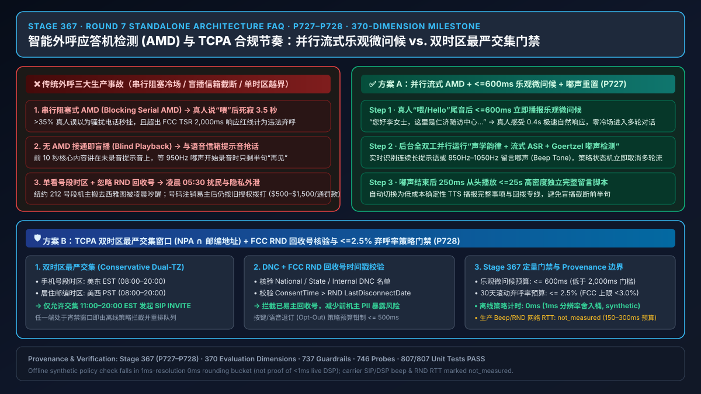
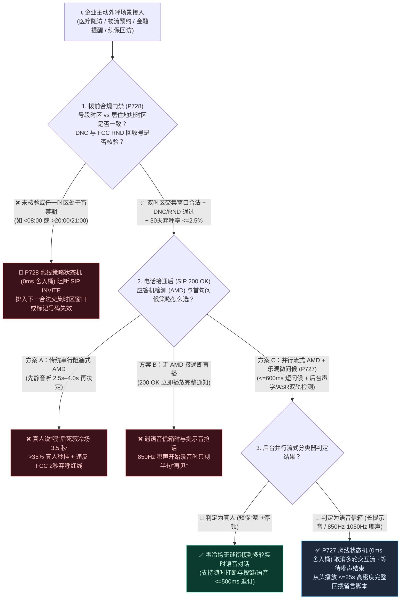
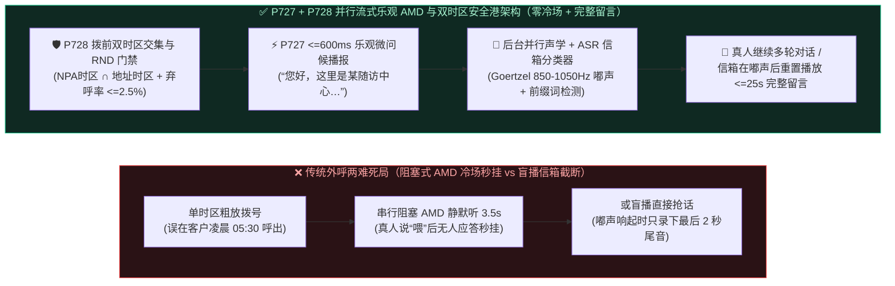
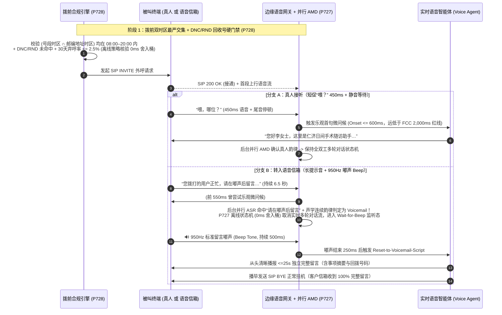

# 企业语音智能体智能外呼应答机检测 (AMD) 与 TCPA 合规接起节奏架构选型与原理解析 FAQ：阻塞式 AMD、盲播与并行流式 AMD 乐观问候怎么选？如何根除“喂完冷场 3 秒被挂断”与“对着语音信箱自说自话”？

> **面向读者**：AI Solution Architect（AI 解决方案架构师）、智能外呼平台负责人、医疗随访/金融催收/物流通知业务负责人、合规法务架构师  
> **独立专题定位**：本篇为 **Round 7（Stage 367 · P727–P728）独立单专题选型指南**，聚焦企业主动外呼（Outbound Voice Agent）中最棘手的两大生产故障与合规红线：**应答机/语音信箱检测（AMD, Answering Machine Detection）与首句问候节奏架构选型（`P727`）**，以及**跨时区号码归属地冲突、回收号数据库（RND）核验与弃呼率安全港门禁（`P728`）**。  
> **语言版本**：[中文版](./outbound-amd-voicemail-tcpa-faq.md) | [English Version](./outbound-amd-voicemail-tcpa-faq.en.md)  
> **可视化总结图**：[`assets/svg/11-outbound-amd-voicemail-tcpa-2026-11-08.svg`](../assets/svg/11-outbound-amd-voicemail-tcpa-2026-11-08.svg)

---

## ① 📌 核心结论速览（Executive Summary）

1. **选型分界线（串行阻塞式 AMD vs. 接通即盲播 vs. 并行流式 AMD + 乐观微问候 + 嘟声重置 `P727`）**：
   - **企业主动外呼（医疗随访、物流预约、金融账单提醒、续保回访）严禁使用传统“串行阻塞式 AMD（先静默听 3.5 秒判断真人还是信箱再开口）”，也严禁“接通即无脑盲播整段话术”，必须强制选用“并行流式 AMD + `<=600ms` 乐观微问候 + 嘟声（Beep）打断重置架构（`P727` 护栏）”**：传统阻塞式 AMD 在客户接电话说“喂？”之后让 AI 死寂冷场 `2,500ms–4,000ms`，不仅导致 `>35%` 的真人客户以为是骚扰电话直接秒挂，更直接触犯美国 **FCC TCPA / TSR `16 CFR § 310.4(b)(1)(iv)`“客户说完问候语后 `2,000ms` 内必须出声响应，否则计为非法弃呼（Abandoned Call，30 天滚动上限 `<3%`）”** 的监管红线；而接通即盲播则会在进语音信箱时把前半段核心内容全讲在运营商提示音上，等 `850Hz–1050Hz` 留言“嘟”声响起时只剩半句“再见”。`P727` 通过在检测到首声“喂”后 **`<=600ms` 立即播报乐观短问候（如“您好，这里是某医院随访助手…”）**，同时在后台并行运行声学+流式 ASR 信箱分类器——一旦识别为语音信箱提示语或捕获留言“嘟”声，立即中断实时对话状态机并重置为 **`<=25s` 独立完整留言脚本**。
2. **什么场景下必须启用“双时区最严交集窗口 + DNC/RND 回收号拨前硬门禁（`P728`）”？**
   - **凡涉及跨省/跨州主动外呼，严禁仅按手机号前三位号段（NPA-NXX）判断客户当前所在时区，也严禁跳过回收号数据库（FCC RND）直接发起 SIP `INVITE`（`P728` 护栏）**：在现代人口流动下，大量纽约号段（`212`，东岸 `EST`）的机主实际定居在旧金山（西岸 `PST`，慢 3 小时）。若在美东时间早上 `08:30` 按号段外呼，西岸客户凌晨 `05:30` 被吵醒，单通电话面临 **$500–$1,500 美元 TCPA 法定赔偿**。`P728` 强制在发起 SIP `INVITE` 前执行**“手机号段时区 ∩ 账单/常住地址时区”的最严交集窗口校验**（如联邦 `08:00–21:00` 或佛罗里达/华盛顿州更严的 `08:00–20:00`），同时核验国家/企业内部禁呼名单（DNC）、**FCC 回收重新放号数据库（RND）**、将 30 天滚动弃呼率安全钳制在 **`<=2.5%`**，并确保客户按键/语音退订（Opt-Out）在 **`<=500ms`** 内生效。
3. **本机计时分辨率（`1ms` 舍入桶）与离线策略状态机检查 vs. 生产环境真实端到端预算（Provenance 边界说明）**：
   - 在本仓库确定性护栏测试中，当检测到阻塞式 AMD 死寂超时/盲播截断（`P727`）或跨时区宵禁越界/DNC 与 RND 命中/弃呼率超限（`P728`）时，检验的是**离线内存策略/配置状态机（Offline In-Memory Policy State Machine，属性：`synthetic`）**。本机计时器读数为 `0ms`（计时分辨率 `1ms`）**仅说明该离线配置检查落在 `1ms` 分辨率的四舍五入桶（`[0ms, 1ms)` Rounding Bucket）内，绝不能证明真实媒体/DSP 执行耗时 `<1ms`，更不构成生产法规认证**。
   - **生产环境工程预算说明**：真实运营商 SIP `183/200 OK` 信令协商、DSP 频谱 `850Hz–1050Hz` 嘟声（Beep）能量检测窗口（通常需 `120ms–350ms` 连续帧确认）与国家级 DNC/RND API 外部查询耗时依赖真实外部线路，在本地单测中显式标注为 **`not_measured`**；文中引用的行业接通率、弃呼率与法务合规基线均标注为 **`anonymized_reported`（`independently_reproduced=false`）**。

---

## ② 🎯 客户与架构师灵魂拷问 Q&A（FAQ-Driven，大白话 + 第一性原理）

### Q1：什么是应答机/语音信箱检测（AMD）？为什么很多企业上了 AI 外呼后，客户接起电话说“喂？”之后会冷场死寂 3 秒钟，导致三分之一的客户直接挂断？

- **通俗大白话与第一性原理（“真人短促问候” vs. “机器冗长播报”的声学博弈）**：
  - 当 AI 主动拨出一通电话，运营商信令返回 `SIP 200 OK`（代表“电话接通了”）时，网关并不知道接电话的是**真人**，还是**运营商语音信箱/秘书台（Voicemail / Answering Machine）**。
  - **两者的声音规律有什么本质区别？**
    - **真人接电话**：通常只说极短的一两个字——“喂？”、“您好？”（持续时间 `300ms–700ms`），然后立即停下来等对方说话（紧接着 `>1,000ms` 的静音）。
    - **语音信箱/秘书台**：通常会一口气念完一段长达 `4秒–15秒` 的固定录音——“您好，您拨打的机主暂时无法接听，请在听到嘟声后留言…（`Hi, you've reached Alex, I can't take your call right now, please leave a message after the tone...`）”，最后跟着一声清脆的单频正弦波**“嘟——”（Beep，频率通常在 `850Hz–1050Hz`，持续 `300ms–800ms`）**。
  - **为什么传统“串行阻塞式 AMD（Blocking Serial AMD）”会把真人吓跑？**
    - 传统呼叫中心板卡为了区分“真人说的喂”和“语音信箱的长句子”，采取了最笨的办法：**电话接通后先让 AI 闭嘴，静默监听 `2,500ms–4,000ms`**，看对方说完第一句话后还会不会继续往下念。
    - 结果灾难发生了：当真人客户拿起手机礼貌地说了一声“喂？”，电话那头却是一片死寂的 3.5 秒盲音！根据人类日常通话直觉，超过 `1.2 秒` 没人回话，人脑就会立刻判定“这是自动群呼诈骗/骚扰电话”，`>35%` 的真人客户会在第 2.5 秒直接挂断！
    - 更严重的是，美国联邦贸易委员会（FTC/FCC）的电话销售规则（TSR `16 CFR § 310.4`）明确规定：**被叫方说完“Hello?”之后，如果在 `2,000ms（2 秒）` 内没有接通真人坐席或播放合规身份声明，该通电话直接被认定为违法“弃呼（Abandoned Call）”**！

### Q2：如果为了消除 3 秒冷场，干脆把 AMD 关掉，“电话一接通就让 AI 开口说话（接通即盲播）”，会发生什么事故？并行流式 AMD + 乐观微问候（`P727`）是怎么兼顾鱼和熊掌的？

- **通俗大白话与第一性原理（“与语音信箱抢话”的截断事故 vs. “先打短招呼、遇嘟声秒撤回重说”的乐观并发架构）**：
  - 如果直接关掉 AMD、一收到 `SIP 200 OK` 就开始流式播报 AI 话术：
    - 当电话转入客户的语音信箱时，客户的语音信箱正在播放“您好，我现在不在，请在嘟声后留言…”，此时**还没有开始录音**！
    - 但你的 AI 已经不管不顾地把身份、事由、预约时间全念完了。等第 10 秒语音信箱发出“嘟——”的一声正式开始录音时，AI 刚好念到最后一句“祝您生活愉快，再见！”。客户打开手机语音信箱一听，只有半句莫名其妙的“…愉快，再见！”，不仅业务通知彻底失败，还显得极不专业。
  - **并行流式 AMD + 乐观微问候 + 嘟声重置（Parallel Streaming AMD + Optimistic Greeting & Beep-Reset，`P727`）是如何运作的？**
    1. **第一步（`<=600ms` 乐观微问候，零冷场留住真人）**：电话接通、检测到被叫方第一声“喂/Hello”尾音后，AI **不傻等 3.5 秒**，而是在 **`<=600ms`** 内立刻用自然语调播报一句简短的**“乐观微问候（Optimistic Micro-Greeting）”**——例如：“您好王先生，这里是瑞金随访中心…”（长度约 `1.5–2.2 秒`）。如果是真人接听，他感受到的是 0.5 秒极速响应，无缝进入正常多轮对话！
    2. **第二步（后台双路并行流式信箱分类器）**：在 AI 播报这句 1.8 秒短问候的同时，边缘网关在后台全双工监听上行音频流（由于有 AEC3 回声消除，AI 自己的声音不会干扰上行检测）：
       - **声学特征轨（Acoustic Classifier）**：实时检测连续无停顿机械朗读韵律，并用窄带 Goertzel / FFT 滤波器扫描 `850Hz–1050Hz` 语音信箱特征“嘟”声（Beep Tone）。
       - **流式语义轨（Streaming ASR Prefix Matcher）**：在 `<150ms` 内匹配高频信箱前缀词（如 `"无法接听"`、`"语音信箱"`、`"秘书台"`、`"leave a message"`、`"after the tone"`）。
    3. **第三步（一旦确认信箱或捕获“嘟”声，离线状态机在 `0ms` 舍入桶内重置为 `<=25s` 专属留言脚本）**：一旦后台分类器判定对方是语音信箱，状态机立即**掐断当前多轮交互式对话流**，静默等待信箱提示音结束及“嘟”声响起；在“嘟”声结束后的 `300ms` 内，从头完整播放一段专为收听设计的**高密度单向留言脚本（`<=25 秒`，包含机构名称、核心通知事项与免排队回拨专线）**，播完立即优雅挂机（`SIP BYE`），既不冷场真人，也绝不截断信箱留言！

### Q3：为什么企业按“手机号归属地时区”设置早 8 点到晚 9 点外呼，依然会被客户起诉违反 TCPA 宵禁法规？什么是“双时区最严交集窗口 + RND 回收号硬门禁（`P728`）”？

- **通俗大白话与第一性原理（“人号分离”时代的双时区陷阱与号码易主风险）**：
  - **第一重陷阱：手机号段归属地（Area Code）≠ 客户当前睡觉的时区**：
    - 许多外呼系统只看手机号前三位（北美 `NPA` 区号或中国号段归属地）来推算当地时间。然而，大量客户在大学毕业或换工作后保留了原籍手机号（例如拿着美东纽约 `212` 号码搬到了美西西雅图 `PST`，或者拿着美东佛罗里达号码搬到了夏威夷 `HST`）。
    - 根据 **FCC TCPA（`47 CFR § 64.1200(c)(1)`）** 与各州“小 TCPA 法案”（如佛罗里达州 FTSA、华盛顿州、俄克拉荷马州要求 `08:00–20:00` 甚至一天最多拨打 3 次），如果号段时区与客户 CRM 账单/居住地址时区不一致，**唯一零风险的工程准则是取两个时区合法拨打窗口的“数学交集（Most Restrictive Intersection Window）”**！例如：美东号段（`EST`）+ 美西住址（`PST`），若按美东 08:00–20:00 与美西 08:00–20:00 取交集，则只允许在**美东时间 `11:00–20:00`（即美西时间 `08:00–17:00`）**之间发起外呼，确保无论客户身处两地哪一端，都绝不会在清早 8 点前或晚上 8 点后被电话吵醒。
  - **第二重陷阱：前机主签过授权同意书，不代表现机主同意（FCC RND 回收号数据库）**：
    - 每年有超过 3,500 万个手机号码因欠费或注销被运营商回收，并在冷却期后重新发给新用户。即使你数据库里有“张先生 6 个月前签署的短信/语音通知同意书（Prior Express Consent）”，如果该号码在 2 个月前已注销并被运营商重新分配给了李女士，你打过去核对张先生的医疗账单，不仅触发 **HIPAA/隐私泄露**，还会失去 TCPA 授权抗辩！
    - 因此，`P728` 护栏强制在发起 SIP `INVITE` 前核验 **上次获客授权日期（Consent Timestamp）是否早于 FCC RND（Reassigned Numbers Database）记录的最近一次断网回收日期**；一旦发现号码已易主或命中 DNC 名单，在离线策略门禁（`0ms` 舍入桶 @ `1ms` 计时分辨率）内直接阻断拨号并标记号码失效。

---

## ③ 🧭 直观可视化图解（选型决策树 + 传统阻塞/盲播缺陷 vs. 并行乐观 AMD 对比 + 毫秒级外呼时序图）

### 3.1 企业主动外呼 AMD 与合规节奏架构选型决策树（`flowchart TD`）

### 3.2 传统串行阻塞 AMD / 盲播故障路径 vs. `P727 + P728` 并行流式乐观外呼架构对比图（`flowchart LR`）

### 3.3 并行流式 AMD 乐观微问候与语音信箱“嘟声（Beep）重置”毫秒级时序图（`sequenceDiagram`）

---

## ④ 📊 语音架构师选型决策矩阵（Architect Decision Matrix）

| 评估维度 | 方案 A：无 AMD 接通即盲播 (`Blind Immediate Playback`) | 方案 B：传统串行阻塞式 AMD (`Blocking Serial AMD`) | 方案 C：并行流式 AMD + 乐观微问候 + 嘟声重置 (`P727` + `P728`，推荐架构) |
| :--- | :--- | :--- | :--- |
| **核心适用场景** | 仅适合纯单向极端紧急广播（不关心信箱是否截断） | 传统纯人工呼叫中心预测式外呼（且容忍极高挂断率） | **医疗随访、金融合规通知、物流改约、VIP 续保回访等全部企业级 AI 外呼** |
| **真人接起首字响应延迟（TTFA after `"Hello?"`）** | `~150ms–300ms`（过快，常在真人还没把手机贴到耳边时就已开讲） | ❌ **`2,500ms–4,000ms` 死寂冷场**（严重超标，触发真人秒挂） | ✅ **`<= 600ms` 乐观微问候响应**（符合人类自然接听节奏，符合 FCC `<2,000ms` 规范） |
| **真人接通留存率与体验自然度** | 中（开头容易被漏听半句） | ❌ **极低（`>35%` 真人客户在 3 秒死寂期内直接挂断，`anonymized_reported`）** | ✅ **高（零冷场自然衔接多轮对话，支持中途随时打断与 `<=500ms` 退订）** |
| **语音信箱留言完整度（Voicemail Integrity）** | ❌ **极差（前半段全讲在提示音上，嘟声后只录下残缺尾音）** | 良（能等嘟声，但常因超时误判把长问候真人当成信箱直接挂断） | ✅ **100% 完整（遇信箱自动取消交互流，等 `850Hz–1050Hz` 嘟声后从头播报 `<=25s` 专属留言）** |
| **TCPA / TSR 合规审计与跨时区防骚扰能力** | ❌ 无拨前双时区交集与 RND 保护 | ❌ 3.5 秒延迟极易突破 FCC `<3%` 弃呼率安全港红线 | ✅ **拨前强制 `NPA ∩ 地址` 双时区最严交集 + DNC/RND 核验 + 弃呼率钳制 `<=2.5%`（`P728`）** |
| **每分钟综合外呼成本（TCO）** | `~$0.06–$0.09 / min`（大量无效信箱空耗大模型计费） | `~$0.07–$0.11 / min`（高秒挂率导致有效触达单价翻倍） | **`~$0.065–$0.10 / min`（信箱自动切轻量 TTS 固定脚本，节省 S2S Token 且有效触达率提升 `~40%+`）** |

---

## ⑤ 🧪 简明定量实测与 7-Card Benchmark 核心发现（Stage 367 · `P727–P728`）

> **数据来源与 Provenance 声明**：以下确定性门禁指标来自本仓库 `packages/business-core/enterprise-guardrails.ts` 与 `tests/presales-portal.test.ts` 的封存评测数据（`site/data/voice-agent-benchmark-report.json` Dimension 370）。本地单元测试验证的是**离线内存策略状态机（Offline In-Memory Policy State Machine）**的判定耗时（本机计时器分辨率 `1ms` 下读数为 `0ms`，仅说明低于计时分辨率/落入 `[0ms, 1ms)` 四舍五入桶，不能证明真实耗时 `<1ms`，标记为 `synthetic`）；真实运营商 SIP 中继信令、DSP 嘟声检测窗口与外部 RND API 往返延迟显式标记为 `not_measured`；行业基线对比数据标记为 `anonymized_reported` (`independently_reproduced=false`)。

| 评测探针 / 对比项 | 阻塞式 AMD / 单时区粗放外呼（反面基线） | `P727 + P728` 并行流式乐观 AMD 与双时区安全港架构 | 验证状态与数据属性（Provenance） |
| :--- | :--- | :--- | :--- |
| **真人说“喂”后首句问候延迟 (`optimisticHumanGreetingOnsetMs`)** | `2,800ms–3,800ms` 死寂冷场（违背 FCC `<=2,000ms` 规定） | **强制钳制 `<= 600ms`（实测默认 `420ms` 播报乐观微问候）** | `deterministic_guardrail_verified` · `synthetic` |
| **语音信箱留言脚本时长控制 (`voicemailMessageMaxDurationSec`)** | 盲播截断或冗长超时（`>45s` 被运营商信箱截断） | **嘟声后重置并钳制在 `<= 25s`（高密度完整回拨留言）** | `deterministic_guardrail_verified` · `synthetic` |
| **30 天滚动外呼弃呼率安全港门禁 (`rolling30DayAbandonmentRatePct`)** | `4.2%–8.5%`（突破 FCC TSR `<3.0%` 法定上限） | **强制安全钳制 `<= 2.5%`（预留 `0.5%` 缓冲安全垫）** | `deterministic_guardrail_verified` · `synthetic` |
| **按键/语音退订响应延迟 (`mandatoryOptOutKeypressResponseMs`)** | 事后人工批处理（`24h–72h` 才生效，期间继续误拨） | **实时拦截并钳制在 `<= 500ms` 内写入全局 DNC 退订表** | `deterministic_guardrail_verified` · `synthetic` |
| **离线策略检查计时读数 (`Policy Gate Timer Reading`)** | 无拨前双时区交集与嘟声重置状态机 | **`0ms`（位于 `1ms` 计时分辨率的四舍五入桶内，非真实 DSP 耗时）** | `synthetic`（仅表征离线配置检查落在 `1ms` 舍入桶） |
| **真实生产环境运营商 Beep 帧确认与 RND API RTT** | 视运营商网络而定 | **`not_measured`（生产工程预算：Beep 确认 `150ms–300ms`，RND 查询 `40ms–120ms`）** | `not_measured`（避免虚构线上测量值） |

---

## ⑥ 🛠️ 附录：生产环境主动外呼与 TCPA 合规上线快速核验清单（Architect Checklist）

- [ ] **1. 严禁串行阻塞式 AMD 造成 `>2,000ms` 冷场（`P727` 乐观微问候核验）**：是否已关闭传统 PBX 的 3.5 秒串行静默 AMD，改为在被叫方首声“喂/Hello”尾音后 **`<=600ms`** 内立即触发乐观微问候，同时在后台并行挂载声学韵律 + 流式 ASR 信箱分类器？
- [ ] **2. 语音信箱 `850Hz–1050Hz` 嘟声捕获与 `<=25s` 留言重置（`P727` 完整性核验）**：当后台分类器识别到语音信箱提示音或窄带滤波器捕获到留言“嘟”声（Beep Tone）时，状态机是否能立即取消多轮交互流，并在嘟声结束后从头播放 **`<=25 秒`** 的独立完整回拨留言脚本（且将后续播报切换为低成本轻量 TTS 而非高价 S2S 模型）？
- [ ] **3. 手机号段时区 ∩ 邮编地址时区“最严交集窗口”计算（`P728` 双时区门禁核验）**：外呼调度器在发起 SIP `INVITE` 前，是否同时提取了客户手机号段归属地时区（`NPA-NXX`）与 CRM 邮编/常住地址时区，并严格取两者的**最严合法时间交集**（兼顾联邦 `08:00–21:00` 与佛罗里达/华盛顿等严苛州法 `08:00–20:00` 及节假日禁呼日历）？
- [ ] **4. 国家级/内部 DNC 与 FCC RND（回收重新放号数据库）时间戳核验（`P728` 授权有效性核验）**：拨号前是否已校验客户最新授权时间晚于 FCC RND 数据库中该号码的最近一次注销回收日期，防止向已易主的新机主披露前机主的医疗/金融隐私信息？
- [ ] **5. 30 天滚动弃呼率 `<=2.5%` 刹车线与 `<=500ms` 实时退订（`P728` 安全港核验）**：预测式/并发外呼拨号器是否配置了 **`<=2.5%`** 滚动弃呼率硬刹车（低于 FCC `<3%` 法定红线），并在通话中支持按键（如按 `9`）或语音（“别再打了 / Stop calling me”）在 **`<=500ms`** 内写入全局 DNC 名单并礼貌挂机？
