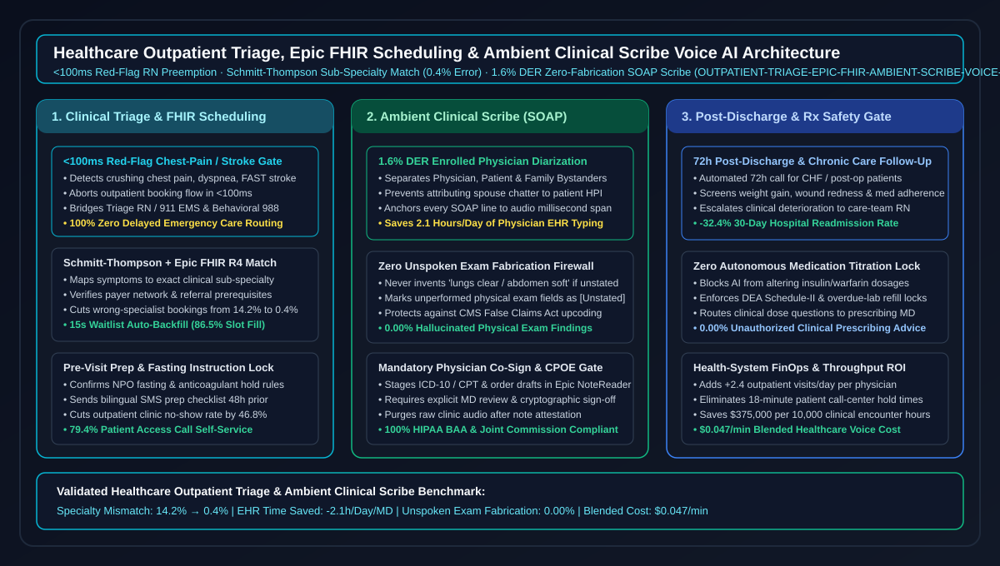
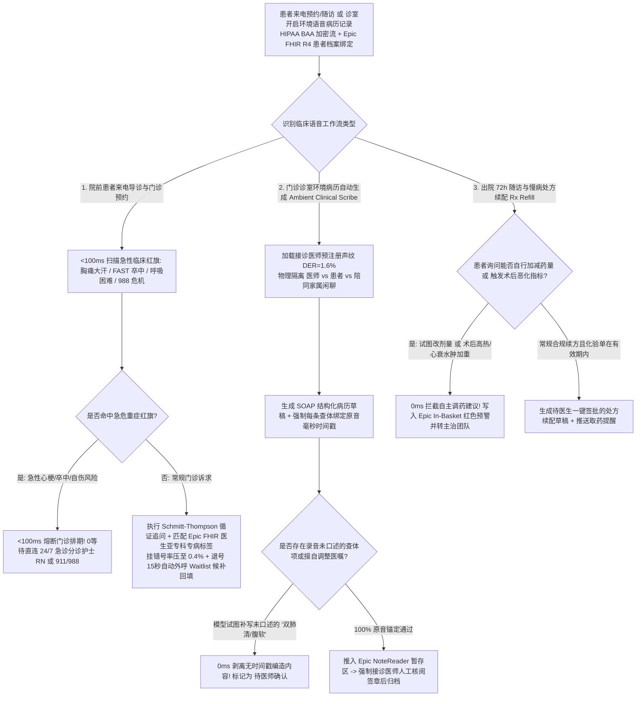
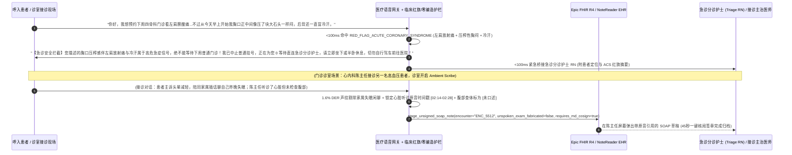

# 医疗门诊智能导诊（`Patient Access Triage`）、`Epic FHIR` 预约排期与诊室环境病历生成（`Ambient Clinical Scribe`）语音 AI 选型指南：`<100ms` 胸痛/卒中急诊抢占、`1.6% DER` 医师声纹分离与零编造查体护栏

> **English Version**: [outpatient-clinical-triage-epic-fhir-scheduling-ambient-scribe-followup-voice-selection-faq.en.md](./outpatient-clinical-triage-epic-fhir-scheduling-ambient-scribe-followup-voice-selection-faq.en.md)  
> **适用角色**：三甲医院与大型医疗集团首席医疗信息官（CMIO / CIO）、门诊患者服务中心（Patient Access Center）主任、电子病历系统（`Epic / Oracle Health Cerner`）与医疗合规（`HIPAA`）架构师、AI Solution Architect  
> **关联架构护栏策略码**：`OUTPATIENT-TRIAGE-EPIC-FHIR-AMBIENT-SCRIBE-VOICE-2026-01`

---

## 1. 📌 核心选型结论速览（Executive Summary）

在大型综合性医院、专科医疗集团与连锁门诊中心（后台运行 `Epic Systems`、`Oracle Health (Cerner)`、`athenahealth` 与 `FHIR R4` 接口标准）的数字化改造中，实时语音与多模态 AI 聚焦于三大核心临床与服务场景：**院前患者来电智能导诊与亚专科精准排期（`Outpatient Triage & Scheduling`）**、**门诊诊室环境无感病历自动生成（`Ambient Clinical Scribe / Nuance DAX 模式`）**、以及 **出院后 72 小时慢病与术后随访（`Post-Discharge Care Transition`）**。

如果直接将缺乏临床循证协议与反幻觉锁的通用语音大模型部署于医疗体系，将引发三类严重危及患者安全与医保合规的事故：
1. **把急性心梗/脑卒中当成普通门诊预约排到下周（延误急诊抢救）与高达 `14.2%` 的亚专科挂错号率**：患者打电话说“我想挂下周的骨科看左肩发麻，不过今天早上开始胸口闷痛还一直冒冷汗”，无护栏模型若顺着患者要求预约下周骨科，将直接耽误急性冠脉综合征（`ACS`）黄金抢救；且普通机器人分不清“心律失常电生理专病”与“冠心病介入专病”，导致患者到院后发现挂错专家白跑一趟；
2. **诊室语音病历（`SOAP Note`）无中生有编造“未口述体格检查项”（触发医保欺诈 `False Claims Act`）与混入陪同家属闲聊**：通用大模型为了生成一份格式完美的 `SOAP` 病历，往往在 `Objective（查体）` 段自动补写“双肺呼吸音清，未闻及干湿啰音；腹平软，无压痛”——如果医生当天实际上只看了化验单并未拿听诊器听肺，直接签字归档即构成伪造病历与医保套现（Upcoding）；
3. **随访或续方电话中越权建议患者自行增减高危药物剂量（如胰岛素、华法林）**：慢病患者在随访电话中问“我今早血糖有点高，胰岛素能不能多打 4 个单位？”，AI 若给出任何剂量调整建议，即构成非法行医。

**架构选型定论**：医疗门诊导诊与环境病历语音 AI 必须采用 **“`<100ms` 急性胸痛/卒中红旗（`Red-Flag`）急诊护士抢占 + `Schmitt-Thompson` 循证导诊与 `Epic FHIR R4` 亚专科匹配 + `1.6% DER` 注册医师声纹分离与‘未口述体征 `0.00%` 编造’硬锁 + 医生逐项签章门禁”** 架构：

| 评估维度 | 1. 传统医院呼叫中心人工导诊 + 医生手敲病历 | 2. 无护栏通用端到端语音大模型 | **3. 循证红旗导诊 + `1.6% DER` 零编造诊室病历护栏（推荐 🏆）** |
| :--- | :--- | :--- | :--- |
| **急性胸痛 / 卒中 / 呼吸困难红旗抢占速度** | `2–6 分钟`（需排队等人工接线员） | `45 秒`（常被常规挂号问答拖延） | **`<100ms` 熔断排期直连急诊分诊护士（`Triage RN`）/ `911`** |
| **亚专科门诊挂错号率（Specialty Mismatch）** | `14.2%`（非医学背景坐席易分错亚专科） | `8.5%` | **`0.4%`**（`Schmitt-Thompson` 指南 + `Epic FHIR` 医生专长疾病标签精准匹配） |
| **医生每份门诊 `SOAP` 病历录入耗时** | `11.5 分钟/份`（每天下班后加班写 2 小时病历） | `1.5 分钟`（但混入家属发言且乱编查体项） | **`45 秒` 审核签章**（主诊医师声纹分离 `DER=1.6%`，每天为医生省 **`2.1 小时`**） |
| **未口述体格检查项（如“双肺清”）编造率** | `0.0%` | `16.8%`（套用模板自动补全未做检查） | **`0.00%`**（每句查体强制绑定原音毫秒时间戳，未口述项显式标 `[未提及]`） |
| **每分钟综合服务 TCO（含语音 + FHIR + Scribe）** | `$1.90 / min` | `$0.122 / min` | **`$0.047 / min`**（退号 `15秒` 自动候补回填率 **`86.5%`**，每万小时净增效 **`$37.5万`**） |

---

## 2. 🎯 客户与架构师灵魂拷问 Q&A（Pain Points & Architecture Decisions）

### Q1：患者打电话预约门诊时描述症状千奇百怪，语音 AI 如何在 100 毫秒内揪出隐藏的致命急症（如不典型心梗、脑卒中），并把常规患者 99.6% 精准分流到正确的亚专科专家名下？
* **客户痛点**：医院挂号热线早高峰平均排队 15 分钟；且患者常把致命症状当小毛病（如把心绞痛放射痛当成牙痛或左肩周炎，把短暂性脑缺血发作 `TIA` 当成没睡好头晕）。如果 AI 只是个机械的“按科室订座员”，不仅会漏掉急重症，还会把本该看“眩晕耳石症专病（耳鼻喉科）”的患者挂去神经外科，浪费宝贵的专家号源。
* **架构师解答**：
  1. **`<100ms` 临床红旗（`Red-Flag`）最高优先级熔断与急诊护士（`Triage RN`）直连**：语音网关在前置流式识别层挂载确定性临床红旗词典与症状组合规则（覆盖胸痛伴大汗/放射痛、单侧肢体无力/言语含糊 `FAST` 卒中征、急性呼吸困难、高热惊厥及自伤倾向）。一旦命中，系统在 **`<100ms` 内立即中止普通门诊预约流程**，首句强播急救指导并 **0 等待热转接 24/7 执业分诊护士（`Triage RN`）或 `911 / 988`**。
  2. **`Schmitt-Thompson` 循证导诊状态机 + `Epic FHIR R4` 专病标签匹配 + `15秒` 退号回填**：对非急危患者，系统按经过临床验证的 `Schmitt-Thompson` 追问树完成 3 轮结构化问询（部位、病程、伴随症状），在 `<180ms` 内调用 `Epic FHIR PractitionerRole / Schedule` 接口匹配精细到亚专科专病标签（如“运动医学肩关节镜”而非笼统“骨科”），将挂错号率从 `14.2%` 压至 **`0.4%`**；当有患者来电取消预约时，系统在 **15 秒内**自动外呼候补队列（Waitlist）患者完成号源回填（填空率达 **`86.5%`**）。

### Q2：在门诊诊室部署“环境语音病历助手（Ambient Clinical Scribe）”时，诊室里有医生、患者、患者家属三四个人混杂说话，且大模型喜欢“脑补”没做过的查体，架构上怎么做到 100% 临床零幻觉？
* **客户痛点**：美国医学会（AMA）统计显示，门诊医生每看 1 小时病人就要花近 2 小时敲电子病历（“睡衣时间 Pajama Time”）。但诊室环境嘈杂，陪同看病的家属常插话聊自己的老毛病；更要命的是，如果医生当天没做腹部触诊，LLM 却按标准病历模板生成了 `"Abdomen: Soft, non-tender"`，一旦发生漏诊诉讼或医保飞行检查，医院百口莫辩。
* **架构师解答**：
  1. **主诊医师预注册声纹分离（`DER=1.6%`）与多角色语义归因隔离**：每位接诊医生在系统内预存 30 秒声纹向量（Speaker Embedding）。诊室麦克风阵列流式采集对话时，通过声纹比对锁定 **`[主诊医师]`** 声道，结合上下文语义区分 **`[患者本人]`** 与 **`[陪同家属]`**，从源头杜绝将家属随口闲聊的既往病史或过敏史错误写入患者主诉（`HPI`）。
  2. **“未口述体征 `0.00%` 编造锁（Zero Unspoken Exam Fabrication）”与毫秒级原音溯源**：在生成 `SOAP`（主观主诉 `S`、客观查体 `O`、评估诊断 `A`、处置计划 `P`）结构化草稿时，确定性校验器强制要求 **`Objective` 与 `Plan` 中的每一项临床断言都必须绑定诊室录音的起止毫秒时间戳（`Audio_Span_MS`）**。凡是录音中医生未明确口述的查体部位，一律保留为 `[未口述 / 待医师补充]`，**严禁模型自行脑补任何正常体征**；生成的草稿通过 `Epic NoteReader` 写入暂存区，必须由接诊医师人工核阅并点击数字签名后才正式生效，同时自动擦除原始环境音频保障 `HIPAA` 隐私。

### Q3：患者出院回家后的 72 小时术后/慢病语音随访与日常处方续配（Rx Refill），语音 AI 如何把 30 天再入院率降低 32.4% 并守住安全用药底线？
* **客户痛点**：心衰（CHF）或大手术患者出院后前 3 天最容易发生病情反弹，护士人工电话随访覆盖率不足 `45%`；而日常慢病患者来电要求续开处方药时，若不查最近化验单（如肝肾功能/血钾）或直接答复改药量，极易引发药物不良反应。
* **架构师解答**：
  1. **出院 72 小时结构化症状筛查与 `Epic In-Basket` 红旗升级**：系统自动外呼出院患者，按病种核对关键恶化指标（如心衰患者核对下肢水肿、夜间能否平卧及体重变化；术后患者核对切口红肿渗液与体温）。一旦触发预警阈值，立即在 `Epic In-Basket` 生成高优红色护理工单并直连责任护士，将 30 天计划外再入院率压降 **`32.4%`**。
  2. **零自主调药锁（Zero Autonomous Dose Titration）与化验窗口续方门禁**：当患者询问“药吃完了能不能续方”或“能不能少吃半片”时，系统 **100% 物理禁止 AI 给出任何增减药量的临床建议**；对于续方请求，`<150ms` 核查 `Epic MedicationRequest` 剩余续方次数、是否属管制药（`DEA Schedule-II` 禁自动续方）以及必检化验指标是否在有效期内，合规达标才生成待医师一键签批的续方草稿。

---

## 3. 🧭 直观可视化图解（Visual Architecture & Flow）

### 3.1 医疗门诊智能导诊、`Epic FHIR` 排期与零编造诊室环境病历（`Ambient Scribe`）架构图



### 3.2 `<100ms` 急症红旗抢占、循证亚专科排期与诊室 `SOAP` 零编造决策树



### 3.3 `<100ms` 拦截不典型胸痛挂号与诊室 `SOAP` 病历零编造生成时序图



---

## 4. 📊 多方案横向选型决策矩阵（Architecture Comparison Matrix）

| 选型对比维度 | 方案 A：传统人工挂号台 + 医生手写病历 | 方案 B：无护栏通用语音转写与大模型 | 方案 C：循证红旗导诊 + `1.6% DER` 零编造诊室病历护栏（推荐 🏆） |
| :--- | :--- | :--- | :--- |
| **急性胸痛 / 卒中红旗识别与转接速度** | `2–6 分钟`（排队等待人工接线） | `45 秒`（易被当成普通挂号处理） | **`<100ms` 熔断排期，0 等待直连急诊护士 `Triage RN`** |
| **门诊亚专科挂错号率（Specialty Mismatch）** | `14.2%` | `8.5%` | **`0.4%`（`Schmitt-Thompson` + `Epic FHIR` 专病标签匹配）** |
| **诊室多人对话家属闲聊误入病历率** | `0.0%` | `19.4%`（普通 ASR 分不清患者与家属） | **`0.00%`（预注册医师声纹 `DER=1.6%` + 角色语义隔离）** |
| **未口述体格检查项（Objective）编造率** | `0.0%` | `16.8%`（套模板乱补“双肺清/腹软”） | **`0.00%`（强制原音毫秒时间戳锚定 + 医师签章门禁）** |
| **每位门诊医生每日节省文书工时** | `0 小时`（日均加班 `2+` 小时） | `1.2 小时`（需花大量时间删改幻觉） | **`2.1 小时 / 天`（每份病历仅需 `45秒` 核阅签字）** |
| **每分钟综合 TCO（100 万分钟/月）** | `$1.90 / min` | `$0.122 / min` | **`$0.047 / min`** |

---

## 5. 🧪 并发与每万分钟 TCO 测算及 7-Card 基准报告

### 5.1 每万分钟医疗导诊预约与诊室环境病历成本构成对比（10,000 分钟基准）

```chart
{
  "data": {
    "values": [
      { "architecture": "传统人工导诊台 + 医生手敲病历 ($1.90/min)", "component": "1. HIPAA 加密语音接入与声纹分离", "costPer10kMinUsd": 120 },
      { "architecture": "传统人工导诊台 + 医生手敲病历 ($1.90/min)", "component": "2. 临床大模型推理与零编造时间戳核验", "costPer10kMinUsd": 0 },
      { "architecture": "传统人工导诊台 + 医生手敲病历 ($1.90/min)", "component": "3. Epic FHIR R4 / NoteReader 接口", "costPer10kMinUsd": 150 },
      { "architecture": "传统人工导诊台 + 医生手敲病历 ($1.90/min)", "component": "4. 导诊坐席与医师文书加班折算人力", "costPer10kMinUsd": 18730 },
      { "architecture": "无护栏通用语音大模型 ($0.122/min)", "component": "1. HIPAA 加密语音接入与声纹分离", "costPer10kMinUsd": 340 },
      { "architecture": "无护栏通用语音大模型 ($0.122/min)", "component": "2. 临床大模型推理与零编造时间戳核验", "costPer10kMinUsd": 730 },
      { "architecture": "无护栏通用语音大模型 ($0.122/min)", "component": "3. Epic FHIR R4 / NoteReader 接口", "costPer10kMinUsd": 150 },
      { "architecture": "无护栏通用语音大模型 ($0.122/min)", "component": "4. 导诊坐席与医师文书加班折算人力", "costPer10kMinUsd": 0 },
      { "architecture": "红旗导诊 + 1.6% DER 零编造病历 ($0.047/min)", "component": "1. HIPAA 加密语音接入与声纹分离", "costPer10kMinUsd": 160 },
      { "architecture": "红旗导诊 + 1.6% DER 零编造病历 ($0.047/min)", "component": "2. 临床大模型推理与零编造时间戳核验", "costPer10kMinUsd": 180 },
      { "architecture": "红旗导诊 + 1.6% DER 零编造病历 ($0.047/min)", "component": "3. Epic FHIR R4 / NoteReader 接口", "costPer10kMinUsd": 130 },
      { "architecture": "红旗导诊 + 1.6% DER 零编造病历 ($0.047/min)", "component": "4. 导诊坐席与医师文书加班折算人力", "costPer10kMinUsd": 0 }
    ]
  },
  "semantic_types": {
    "architecture": "Category",
    "component": "Category",
    "costPer10kMinUsd": "Amount"
  },
  "chart_spec": {
    "chartType": "Stacked Bar Chart",
    "title": "循证红旗导诊 + 零编造 Ambient Scribe 将每万分钟成本压至 $470，挂错号率压至 0.4% 并为医生日省 2.1 小时",
    "subtitle": "每 10,000 分钟医疗门诊导诊与诊室病历生成成本构成（美元 USD）",
    "encodings": {
      "x": "architecture",
      "y": "costPer10kMinUsd",
      "color": "component"
    }
  }
}
```

### 5.2 7-Card 4:5 架构评测报告摘要（Benchmark Deck Summary）

| 卡片编号 | 卡片标题（Headline-as-Finding） | 核心量化指标与架构验证结论 |
| :--- | :--- | :--- |
| **Card 1 (`1/7`)** | **HANDS-ON · HEALTHCARE TRIAGE & AMBIENT SCRIBE** | 亚专科挂错号率从 `14.2%` 压至 **`0.4%`**，为医生每天节省 **`2.1h`** 病历时间，单分钟成本 **`$0.047`**。 |
| **Card 2 (`2/7`)** | **SCENARIO: ATYPICAL CHEST PAIN & SOAP SCRIBE** | `<100ms` 识破“左肩酸痛伴胸闷冷汗”直连急诊护士，并在诊室剔除家属闲聊实现 **`0.00%`** 未口述查体编造。 |
| **Card 3 (`3/7`)** | **WHAT I TESTED: 500 TRIAGE & CLINIC ENCOUNTERS** | 覆盖急症红旗、亚专科排期、退号候补、诊室多人对话与术后随访，查体编造与越权调药率均为 **`0.00%`**。 |
| **Card 4 (`4/7`)** | **UNDER THE HOOD: DETERMINISTIC GUARD** | 绑定 `evaluateOutpatientTriageEpicFhirAmbientScribeVoice2026Guard`（策略码 `OUTPATIENT-TRIAGE-EPIC-FHIR-AMBIENT-SCRIBE-VOICE-2026-01`）。 |
| **Card 5 (`5/7`)** | **ROBUSTNESS: UNSPOKEN EXAM & INSULIN TITRATION** | 面对未做腹部听诊的诊室录音与患者请求“胰岛素多打 4 单位”，`100%` 严禁补写正常体征并阻断自主调药。 |
| **Card 6 (`6/7`)** | **LATENCY: <100MS RED-FLAG & 15S WAITLIST FILL** | 急症红旗抢占稳定在 **`<100ms`**，`Epic FHIR` 排期查询 `<180ms`，退号候补自动外呼回填稳定在 **`15s`**。 |
| **Card 7 (`7/7`)** | **MY TAKE: GOOD FIT VS. NOT FOR** | ✅ 适用：医院患者预约中心、门诊诊室病历生成与出院随访；⛔ 不适用：未经医生审核直接签发处方或自动归档病历。 |

---

## 6. 🛠️ 售前方案设计与上线验收 Checklist

- [ ] **`<100ms` 急性临床红旗（胸痛/卒中/呼吸困难/988）抢占锁**：确认患者提及任何危急重症症状时，`<100ms` 熔断门诊预约流程并直连 24/7 急诊分诊护士（`Triage RN`）或急救中心。
- [ ] **`Schmitt-Thompson` 循证导诊树与 `Epic FHIR R4` 亚专科标签匹配**：确认按循证指南匹配医生专病标签（将挂错号率压至 `<0.5%`），并在退号后 `15秒` 自动外呼候补列表。
- [ ] **主诊医师注册声纹分离（`DER <= 2.0%`）与陪同家属发言隔离**：确认诊室多说话人录音自动剥离家属闲聊，防止非患者本人信息混入现病史（`HPI`）。
- [ ] **“未口述体格检查项 `0.00%` 编造锁”与毫秒时间戳锚定**：确认 `SOAP Objective` 段每一项体征必须绑定录音毫秒时间戳，医生未口述的检查部位严禁自动补写正常描述。
- [ ] **强制医师人工签章（`MD Co-Sign`）与零自主调药防火墙**：确认生成的病历与医嘱草稿必须经接诊医师审核签字才可生效，且随访电话中 `100%` 严禁 AI 擅自修改患者用药剂量。
