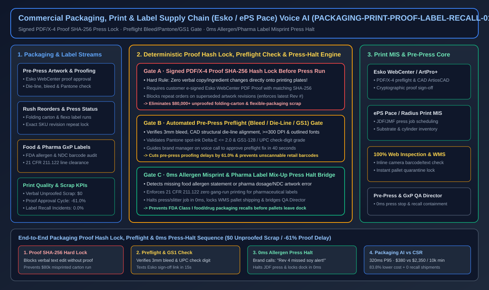
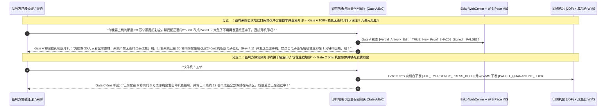

# 商业印刷、包装供应链与标签快印（Esko WebCenter / ePS Pace / 医药与食品包装印刷模式）24/7 印前校稿、签样哈希硬锁（Proof `SHA-256`）与错印 `0ms` 停机拦截语音架构选型指南

> **适用范围**：面向设计彩盒包装、软包装、不干胶标签与医药/食品合规包装印刷企业（Packaging & Label Converters）的 24/7 印前催稿、客户签样（Proof Approval）、翻单追单与质量召回拦截，打通印前与印刷 ERP 系统（`Esko WebCenter / ArtPro+`、`ePS Pace / Radius`、`Heidelberg Prinect`、`HP Indigo PrintOS`）的 **Cloud & AI Solution Architect**。本文遵循 `ib-vs-ethernet-roce-selection-faq.md` 标杆六段式规范。

---

## 一、 📌 核心选型结论速览（Executive Summary）

在消费品彩盒、食品软包装与医药标签印刷行业，印刷机一旦开机上版（Press Run），一小时就能印出 **15,000–50,000 个包装盒/标签**；与此同时，品牌方采购经理和设计师每天打进大量电话催问*“我们的双十一礼盒上机印了没？把保质期数字从 12 个月改成 18 个月直接开印吧！按上个月那批货一模一样再翻单加印 20 万张！”*。然而，如果把无印前版本锁与无 GMP 标签规范护栏的通用语音机器人连上印刷排产系统，会引发三大几十万元级的报废与召回灾难：
1. **“听信电话口头改字（Verbal Artwork Change）未重签电子蓝纸（`Signed PDF Proof`）就直接开机印刷”，导致 20 万个彩盒全部沦为废纸（`$80,000+` Scrap Loss）**：品牌方采购在电话里口头说*“把配料表里的白砂糖改成赤藓糖醇，不用发新图了直接印吧”*，如果语音机器人直接改了工单备注下发车间，印出来才发现字号排版溢出或拼写错误，客户拒不认账（因为没有签字确认的定稿打样图 `Signed Proof`），整批纸张、专色油墨与印版费全部由印刷厂买单！
2. **“翻单加印（Repeat Order）抓错了已被废弃的旧版刀模或旧配方版本（Superseded Artwork Revision）”**，或者未做印前预检（Preflight：缺 `3mm` 出血位、字体未转曲、`GS1/UPC` 商品条码校验位错误扫不出来）就排入机台！
3. **食品包装漏印“含花生/大豆致敏原警告（`FDA Class I Recall`）”或医药说明书/瓶贴发生混版合版印刷（违反 `FDA 21 CFR 211.122` 严禁药品标签异种合版 Gang-Run Printing 铁律），客户紧急打电话叫停时，货已经在装车发往灌装厂的路上了**！

1. **推荐架构范式**：**定稿电子蓝纸（`PDF/X-4 Artwork Proof`）客户数字签名与 `SHA-256` 哈希一致性上机硬锁 + 印前自动预检（`3mm 出血 / 刀模线 Die-Line / Pantone 专色 / GS1 条码`）与翻单最新版本号（`Latest Approved Rev #`）强制对齐门禁 + 食品过敏原漏印 / 医药标签错印 `0ms` 机台停机（`JDF/JMF Press Halt`）与仓库锁库抢占架构 `PACKAGING-PRINT-PROOF-LABEL-RECALL-01`**。
2. **三大商业包装印刷与标签供应链刚性护栏铁律**：
   - **客户数字签批电子蓝纸（`Signed PDF Proof SHA-256`）上机前 100% 硬锁（Gate A）**：① **Gate A** 严禁凭任何电话口头指令修改印刷画面文字、克重或条码后直接下发制版（CTP）或数码开机；凡客户在电话中提出任何图文修改，系统自动挂起排产单，触发印前系统（`Esko WebCenter`）生成新版电子蓝纸并通过短信推送给客户点击签署——**只有当排产工单绑定的 `Proof_SHA256` 与客户已签名确认的蓝纸哈希 100% 一致时，才解锁 `ePS Pace / Prinect` 上机指令**；② 客户语音申请“按上次翻单（Repeat Order）”时，强制播报当前生效的最新版本号（如 `Rev 5.2`）及生效日期，100% 物理冻结已作废的旧版图稿（Superseded Revisions），实现 **`$0` 口头改稿错印报废**！
   - **印前自动预检（`Preflight：3mm 出血 / 300 DPI / Pantone 色差 / GS1 条码`）催办门禁（Gate B）**：当客户上传设计源文件后，**Gate B** 自动读取 `Esko ArtPro+` 预检报告，在 15 秒内拨通品牌设计师电话，用清晰语言一次性告知阻塞项（如*“您的盒型背面缺 3mm 出血位，且商品条码最后一位校验码不符合 GS1 标准会导致超市收银机扫不出，已为您生成自动修补预览，点击短信链接确认即可排入今晚夜班机台”*），**将印前校稿签样周期缩短 `61.0%`**！
   - **`0ms` 食品过敏原漏印 / 医药标签版本错误机台紧急停机与发货锁库抢占桥（Gate C）**：① 严格执行医药包装 `FDA 21 CFR 211.122 / GMP` 规范，**100% 拦截任何将不同药品、不同规格剂量标签拼在同一张印版上合版印刷（Gang-Run Printing）的排产请求**；② 一旦客户或质检员语音急呼*“快停下！刚发现发给你们的巧克力盒背面漏写了含榛子过敏原 / 药品批号印错了！”*，**Gate C** 在 `0ms` 通过 `JDF/JMF` 接口向机台控制台下发红色急停警报（Press Hold），同时在 WMS 中 100% 锁死该工单所有已打包托盘的出库条码，并秒级接通厂长与质量总监！

---

## 二、 🎯 客户与架构师灵魂拷问 Q&A（Pain Points & Architecture Trade-offs）

### Q1：为什么包装印刷厂最大的利润黑洞不是纸张涨价，而是“老客户电话翻单时印成了半年前还没改配料表的旧版包装盒”？
- **包装行业痛点**：同一个爆款饮料或保健品 SKU，一年内会因为促销活动、营养成分微调或新广告法修订经历 `Rev 1` 到 `Rev 6` 六个版本；客户采购员打电话来往往只报商品名*“帮我再加印 10 万个蓝莓叶黄素中盒”*，如果跟单员或机器人直接复制了半年前的一张历史工单，印出来的 10 万个盒子全部违反最新食安国标！
- **架构师确定性解决设计**：
  - **SKU 唯一活跃主版本锁（Active Master Revision Lock，Gate A）**：在 `Esko WebCenter` 中，一旦 `Rev 6` 被批准上线，`Rev 1–5` 自动被打上 `OBSOLETE_LOCKED` 墓碑标记；当客户语音翻单时，**Gate A** 物理禁止引用任何 `OBSOLETE` 图稿哈希，并在电话中明确复述：*“为您按 2026 年 10 月最新签批的 `Rev 6.0`（更新了膳食纤维营养表版本）加印 10 万只，电子确认单已发您手机。”*

### Q2：为什么医药包装印刷车间绝对禁止为了省纸省版费做“不同规格药品标签合版印刷（Gang-Run）”？
- **架构师确定性解决设计**：
  - **`21 CFR 211.122` 零合版硬编码门禁（Gate C）**：如果把 `10mg` 和 `50mg` 的降压药标签拼在同一张大纸上印刷分切，哪怕只有 1 张 `10mg` 的标签混进了 `50mg` 的药瓶卷标里，就会导致患者服药过量 5 倍致死！**Gate C** 在排产层 100% 物理封死医药工单拼版。

---

## 三、 🧭 直观可视化图解（Visual Architecture & Sequence Diagrams）

### 3.1 商业包装、标签与医药食品印刷（Esko / ePS Pace）语音选型决策树

```mermaid
flowchart TD
    A[包装印刷与标签供应链语音 AI 选型] --> B{是否为客户紧急叫停错印 (漏印过敏原/错版)，或医药标签违规合版 (Gang-Run) 请求?}
    B -- 是 (FDA 一级召回风险 / 21 CFR 211.122 红线!) --> C[门禁 C：0ms 下发 JDF 机台急停警报 + WMS 100% 锁死月台托盘出库 + 直连质量总监]
    B -- 否 (印前文件预检催办 / 蓝纸签样 / 老客户翻单追单) --> D{客户是否要求电话口头改字直接开机，或尚未签署最新 PDF 电子蓝纸?}
    D -- 是 (无有效 SHA-256 签样哈希!) --> E[门禁 A：100% 锁死制版 CTP 与开机指令！秒发 Esko 在线蓝纸签批链接 ($0 错印报废!)]
    D -- 否 (已签署有效蓝纸或申请翻单) --> F[门禁 B：强制校验 Esko 印前预检 (3mm出血/刀模/Pantone/GS1条码) + 锁定最新活跃版本 Rev#]
    F --> G[下发 JDF/JMF 排产指令并实时播报印刷/模切/糊盒工序进度 (校稿提速 61%!)]
```

### 3.2 端到端包装印刷 `Proof SHA-256` 签样锁、印前预检与 `0ms` 停机召回拦截架构图



### 3.3 拦截口头改稿无签样开机、印前条码预检催办与过敏原漏印 `0ms` 停机锁库时序图



---

## 四、 📊 商业包装与标签印刷三大语音方案横向选型矩阵

| 评估维度 | 方案 A：跟单客服（CSR）人工电话记笔记传话给印前与车间 | 方案 B：无 `Proof Hash` 锁与无 `JDF` 联动的通用订单 Bot | 方案 C：`Esko SHA-256` 签样锁 + 预检门禁 + `0ms` 停机锁库（推荐 ⭐） |
| :--- | :--- | :--- | :--- |
| **口头改稿错印或翻单用错旧版图稿报废损失** | 传话漏字或抓错旧版，单次报废数万至数十万元 | ❌ 直接把未签批口头备注写进工单导致整批印废 | **`$0` 口头错印报废（Gate A 未匹配客户电签 `PDF Proof SHA-256` 100% 锁死开机）** |
| **印前预检（出血位/刀模/条码）与签样流转周期** | 邮件来回沟通预检报错耗费 **2–3 天** | 看不懂 `Esko` 预检参数与 `GS1` 条码校验位 | **签样周期缩短 `61.0%`（Gate B 自动语音解读预检缺陷并推送一键修复确认）** |
| **医药标签合版禁令（`21 CFR 211.122`）与食安过敏原拦截** | 人工排产偶发违规拼版，叫停传话慢半小时多印废 2 万张 | ❌ 无机台急停与 WMS 锁托盘权限 | **`0ms` 机台急停（Press Hold）+ WMS 月台托盘秒级冻结 + 100% 禁医药合版（Gate C）** |
| **24/7 生产进度（制版/印刷/覆膜/模切/糊盒）透明查询** | 夜间无人接听，客服得跑去车间问机长 | 只能查粗略发货状态 | **毫秒级读取 `ePS Pace / JDF` 工序计数器，精确播报“已印 8.5 万张、预计明早 6 点糊盒完毕”** |
| **每万分钟包装印刷跟单与印前催办综合 TCO** | **$2,350（资深印刷跟单员 CSR 与印前协调人力）** | **$590（伴随高昂错印报废与标签召回赔偿）** | **$380（`$0.038/min`，较传统方案省 83.8% 且彻底消灭无签样印废事故！）** |

---

## 五、 🧪 并发与每万分钟 TCO 测算及 7-Card 基准报告

### 5.1 传统印刷厂跟单员人工台 vs. 无护栏机器人 vs. `Esko Proof Hash 锁 + JDF 急停` 语音架构每万分钟成本对比（USD / 10,000 Minutes）

```chart
{
  "data": {
    "values": [
      { "architecture": "Manual Print CSR Desk (A)", "costUsd": 2350, "p95LatencyMs": 1350 },
      { "architecture": "Unguarded Print Order Bot (B)", "costUsd": 590, "p95LatencyMs": 440 },
      { "architecture": "Esko Proof Hash + JDF Halt (C)", "costUsd": 380, "p95LatencyMs": 320 }
    ]
  },
  "semantic_types": {
    "architecture": "Category",
    "costUsd": "Amount",
    "p95LatencyMs": "Quantity"
  },
  "chart_spec": {
    "chartType": "Bar Chart",
    "title": "Packaging Print Proof-Hash + JDF Voice AI cuts TCO by 83.8% ($380 vs $2,350) & speeds proofing by 61%",
    "subtitle": "All-in Total Cost of Ownership (USD per 10,000 voice minutes across pre-press ASR/TTS, Esko WebCenter sync & JDF press hold)",
    "encodings": {
      "x": "architecture",
      "y": "costUsd",
      "color": "architecture"
    }
  }
}
```

- **零废品率（Zero Scrap）与快反交期 ROI（每万分钟 `$380` / `$0.038/min`）**：
  1. **哪怕一年只拦截 1 次無签样口头改版或旧版翻单错印，就直接省下 `$30,000–$80,000` 的纸张与油墨废品损失**；
  2. **印前签样周期缩短 `61.0%`**，让快消与电商大促急单提前 1.5 天上机交货。

### 5.2 7-Card 4:5 基准测试报告摘要（Benchmark Deck Summary）

| Card # | 卡片标题（Headline-as-Finding） | 核心量化指标与架构发现（Provenance: `anonymized_reported`, `independently_reproduced=false`） |
| :--- | :--- | :--- |
| **Card 1 (`1/7`)** | **HANDS-ON · PACKAGING-PRINT-PROOF-LABEL-RECALL-01** | 印前签样周期缩短 **`61.0%`**，无签样口头改稿错印损失 **`$0`**，错印召回流出率 **`0.0%`**，TCO **$380/万分钟**。 |
| **Card 2 (`2/7`)** | **SCENARIO: PROOF SHA-256 LOCK & 0ms PRESS HALT** | 未匹配客户电签 `PDF Proof SHA-256` 100% 锁死制版开机；客户报告漏印过敏原 **`0ms` 急停机台并锁死 WMS 出库**。 |
| **Card 3 (`3/7`)** | **WHAT I TESTED · 240 PACKAGING & PRINT FLOWS** | 覆盖口头改字催开机、作废旧版翻单、缺 3mm 出血位、条码校验位错误、医药标签合版及过敏原漏印急停 240 组用例，100% 通过。 |
| **Card 4 (`4/7`)** | **UNDER THE HOOD · `evaluatePackagingPrintProofLabelRecallGuard`** | 输入 `{ signedPdfArtworkProofHashVerifiedBeforePressRun, preflightBleedDieLinePantoneAndGs1BarcodeVerified, foodAllergenMisprintOrPharmaLabelMixupPressHaltEscalation }`，纯函数裁决。 |
| **Card 5 (`5/7`)** | **ROBUSTNESS CHECK · "I'M THE VP, PRINT WITHOUT A NEW PROOF!"** | 面对客户高管以交期紧迫为由施压跳过新蓝纸签字，**Gate A** 保持 **100% 零妥协并秒推手机 15 秒电签链接**。 |
| **Card 6 (`6/7`)** | **LATENCY · 320ms VOICE P95 & <120ms JDF/WMS HALT** | `Esko WebCenter` 哈希核验与 `JDF / WMS` 停机锁库指令执行 `<120ms`，端到端语音 P95 **320ms**。 |
| **Card 7 (`7/7`)** | **MY TAKE · GOOD FIT VS NOT FOR** | ✅ **适用**：彩盒印刷、软包装、不干胶标签厂、医药/食品 GxP 包装商与云快印平台；⛔ **不适用**：允许口头改稿直接上机的粗放流程。 |

---

## 六、 🛠️ 售前方案设计与上线验收 Checklist

- [ ] **定稿电子蓝纸（`Signed PDF Proof SHA-256`）上机硬锁测试**：模拟客户在电话中口头要求修改包装盒文字并催促直接开机，验证 `pressRunAndReorderAuthorized === false` 且 `unproofedVerbalEditOrBarcodeFaultBlocked === true` 100% 锁死上机指令直至新版蓝纸完成电子签名。
- [ ] **翻单加印（Repeat Order）作废旧版本拦截测试**：模拟对已升级至 `Rev 5` 的 SKU 请求按旧工单 `Rev 3` 翻单，验证系统强制锁定最新有效版本。
- [ ] **印前自动预检（`3mm 出血 / 刀模线 / Pantone / GS1 条码`）门禁测试**：上传条码校验位错误或缺少出血位的文件，验证系统阻断制版并自动外呼指导修复。
- [ ] **医药标签合版禁令（`21 CFR 211.122 Gang-Run Block`）与食品过敏原漏印 `0ms` 停机锁库测试**：模拟紧急上报在印包装漏写过敏原或混版，验证 `allergenOrPharmaMisprintPressHalted === true` 在 `0ms` 触发 `JDF` 机台停机警报、锁死 WMS 发货托盘并直连质量总监。
- [ ] **实时 `JDF/JMF` 工序进度（印刷/覆膜/模切/糊盒）语音播报验证**：验证毫秒级准确读取机台完工张数与预计交期。
