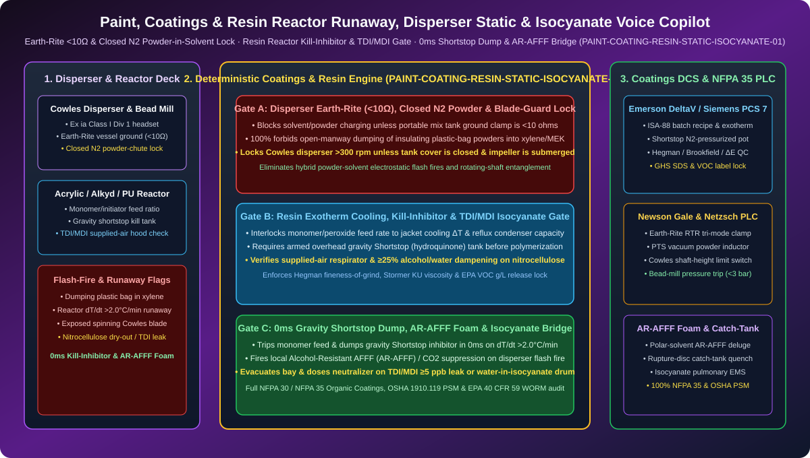
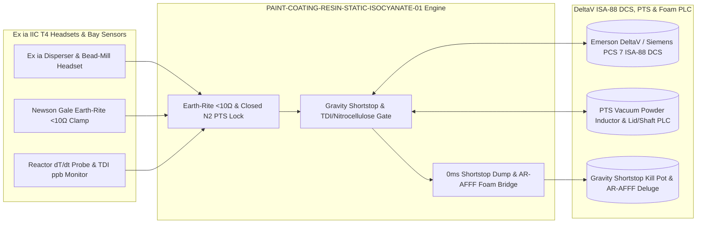
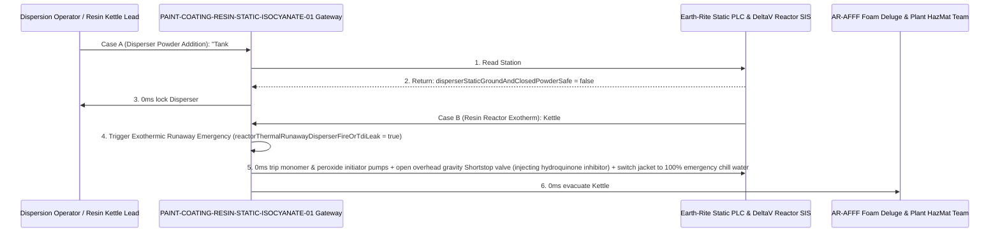

# Paint, Coatings & Resin Reactor Runaway, Disperser Static & Isocyanate Voice Copilot (Sherwin-Williams / PPG / AkzoNobel / Nippon Paint / DeltaV): Earth-Rite <10Ω & Closed Powder Lock, Shortstop Kill-Inhibitor Gate & 0ms AR-AFFF Selection Guide

> **Document Scope**: Written for Global Architectural, Automotive & Industrial Coatings, Resin & Adhesive Manufacturers (`Sherwin-Williams` / `PPG` / `AkzoNobel` / `Nippon Paint` / `Axalta` / `BASF Coatings` / `RPM` / `Sika`), Process Safety & DCS Engineers (`Emerson DeltaV` / `Siemens PCS 7` / `Netzsch` / `Newson Gale Earth-Rite` / `NFPA 35`), and Industrial AI Solution Architects designing **Class I Div 1 Group D Intrinsically Safe Headsets, Cowles Disperser `<10 ohm` Electrostatic Grounding & Closed $\text{N}_2$ Powder-Induction Locks, Acrylic/Alkyd/Epoxy Resin Reactor Gravity `Shortstop` Kill-Inhibitor Gatekeepers, `TDI/MDI` Isocyanate & Nitrocellulose Safety Interlocks, and 0ms Thermal-Runaway Quench / Polar-Solvent `AR-AFFF` Foam Suppression Pipelines**.

---

## 1. 📌 Executive Summary

In paint, coatings, ink, and synthetic resin plants handling **Class IB/IC flammable solvents (`xylene`, `toluene`, `MEK`, `butyl acetate`, `ethyl acetate`), high-speed `Cowles` saw-tooth dispersers, horizontal bead mills, and exothermic free-radical polymerization reactors**, **according to `NFPA 35` (Standard for the Manufacture of Organic Coatings) and CSB incident investigations, the #1 cause of fatal flash fires and explosions on the dispersion floor is `Charging Insulating Powders from Plastic Bags into an Un-Grounded Portable Mix Tank Containing Flammable Solvent`—where triboelectric static discharge ($>20\text{ kV}$) from the falling powder or un-grounded vessel ignites the hybrid solvent-vapor cloud above the manway (`MIE < 0.2 mJ`). Simultaneously, starting an exothermic acrylic/styrene resin polymerization without an armed overhead gravity `Shortstop (Kill Inhibitor)` tank, allowing a spinning Cowles blade to rise above the liquid level with the tank lid open, or letting moisture enter a `TDI / MDI` polyisocyanate drum causes catastrophic runaway reactor vessel ruptures (e.g., the *Synthron* explosion), rotating-shaft entanglements, or violent $\text{CO}_2$-pressurized drum ruptures**:
1. **Core Architecture Selection: Adopt a "Cascaded Deterministic Coatings & Resin Safety Voice Pipeline (Ex ia IIC T4 Intrinsically Safe 90dB Bone-Conduction Headset + Azure Speech Monomer/Pigment/NFPA-35 Lexicon STT + Emerson DeltaV ISA-88 & Newson Gale Static PLC Engine + High-SPL Plant-Floor Neural HD TTS)"**:
   - **Cowles Disperser `Earth-Rite` ($<10\text{ }\Omega$) Static Ground, Closed $\text{N}_2$ Powder Induction (`PTS`) & Submerged-Blade Hard Lock**: Before unlocking solvent fill valves or starting a high-speed disperser on any portable mix tank, deterministic policy engine `PAINT-COATING-RESIN-STATIC-ISOCYANATE-01` **100% verifies active `Newson Gale Earth-Rite` tri-mode capacitance/resistance grounding ($<10\text{ }\Omega$ metallic bond to plant earth), strictly forbids open-manway dumping of powders (`fumed silica`, `TiO2`, `solid resin`) from insulating plastic bags into flammable solvents (mandating closed $\text{N}_2$-blanketed sub-surface powder induction at $<5\%\text{ O}_2$ or grounded `Type C/D` FIBC bags), and locks disperser speed to $\le 150\text{ rpm}$ unless the tank lid is closed and the Cowles impeller shaft limit switch confirms full submergence** (`disperserStaticGroundAndClosedPowderSafe = true`);
   - **Resin Reactor Gravity `Shortstop` Kill-Inhibitor, Cooling-Duty Interlock & `TDI` / `Nitrocellulose` Gate**: Interlocks monomer and organic-peroxide initiator feed pumps to jacket cooling $\Delta T$ and reflux condenser duty while **requiring verified level and nitrogen head pressure in the overhead gravity `Shortstop (Kill Inhibitor)` tank (`hydroquinone` / `phenothiazine`) before initiating polymerization**; verifies $\ge 25\%$ alcohol/water damping weight on `Nitrocellulose` drums (`UN 2556`); and enforces supplied-air respirator hoods, dry $\text{N}_2$ drum blanketing, and ambient `<5 ppb` monitoring when handling `TDI / MDI / HDI` isocyanates (`resinShortstopArmedAndIsocyanateDrySafe = true`).
2. **0ms Reactor Runaway ($\text{d}T/\text{d}t > 2.0^\circ\text{C/min}$) Gravity Shortstop Dump, Polar-Solvent `AR-AFFF` Deluge & Isocyanate Bridge**:
   - Whenever reactor telemetry detects an **uncontrolled exotherm ($\text{d}T/\text{d}t > 2.0^\circ\text{C/min}$ or rising batch pressure), a UV/IR optical flame detector trips over a disperser mix tank, a horizontal bead mill exceeds $3.0\text{ bar}$, or a `TDI/MDI` sensor exceeds $5\text{ ppb}$ / water contaminates an isocyanate drum** (`reactorThermalRunawayDisperserFireOrTdiLeak = true`), the gateway **trips monomer/initiator pumps and opens the fail-safe pneumatic gravity `Shortstop` dump valve in 0ms to terminate free-radical chains while switching to full emergency cooling, or fires local `Alcohol-Resistant AFFF (AR-AFFF)` / $\text{CO}_2$ suppression over the mix tank while evacuating the bay**.



---

## 2. 🎯 Customer & Architect Critical Q&A (Q1–Q3)

### Q1: In the solvent-borne coatings bay, an operator rolls a 1,000-liter portable stainless mix tank containing 450 kg of `xylene` and `MEK` under Cowles Disperser #4. He tells his voice headset: "The tank wheels have dried paint on them and the Earth-Rite ground clamp is flashing red—bypass the ground fault so I can flip open the half-lid and dump these four polyethylene bags of fumed silica into the xylene by hand!" Why must the AI hard-lock the disperser in 0ms?
**A: Under `NFPA 35` (Section 7.3 Static Electricity) and `NFPA 77`, dumping dry pigment or silica powder from an insulating plastic bag through an open manway into an un-grounded tank of `xylene` / `MEK` is a guaranteed electrostatic flash-fire ignition source!**
- **Why Hybrid Solvent-Vapor + Powder Charging Ignites Instantly**:
  - An un-grounded portable mix tank sitting on paint-encrusted wheels acts as an **isolated capacitive conductor**;
  - Pouring insulating powder (`fumed silica`, `TiO2`, `acrylic beads`) generates $15\text{ to }30\text{ kV}$ of triboelectric static charge on the powder cloud and the operator;
  - Because `xylene` and `MEK` vapors hovering at the open tank rim have a **Minimum Ignition Energy (`MIE`) of only $0.2\text{ to }0.5\text{ mJ}$** (whereas a single spark from an un-grounded tank or plastic bag discharges $10\text{ to }100\text{ mJ}$!), the first bag poured triggers a violent flash fire!
- **Architectural Enforcement**:
  - In `PAINT-COATING-RESIN-STATIC-ISOCYANATE-01`, missing a verified `<10 ohm` `Earth-Rite` ground signal or attempting open-manway powder addition into a flammable solvent sets `disperserStaticGroundAndClosedPowderSafe = false` in 0ms;
  - The gateway keeps the disperser VFD and solvent valves locked and commands: *"⚠️ CRITICAL ELECTROSTATIC FLASH-FIRE LOCK! Mix Tank #4 is UN-GROUNDED (>10 ohms) and open-manway powder dumping into xylene/MEK is strictly prohibited under NFPA 35! Clean the grounding lug to achieve a green <10Ω Earth-Rite lock and charge fumed silica exclusively through the N2-inerted PTS sub-surface vacuum inductor!"*

### Q2: Why must an acrylic or alkyd-modified resin reactor have an overhead, gravity-fed `Shortstop (Kill Inhibitor)` pot armed and verified before the first drop of peroxide initiator enters the kettle?
**A: Free-radical solution and emulsion polymerizations (`methyl methacrylate`, `butyl acrylate`, `styrene`) are self-accelerating exothermic reactions (`Trommsdorff / Gel Effect`) where a loss of agitator power or cooling water causes viscosity and heat generation to spiral exponentially!**
- Once a 15-ton resin kettle enters thermal runaway ($\text{d}T/\text{d}t > 2.0^\circ\text{C/min}$), jacket cooling water alone cannot remove the heat fast enough to prevent solvent boiling and catastrophic vessel over-pressurization;
- When `reactorThermalRunawayDisperserFireOrTdiLeak === true`, Gate C **opens a fail-safe, nitrogen-assisted gravity valve in 0ms that dumps `Hydroquinone` or `Phenothiazine` free-radical scavenger directly into the vortex**, quenching the polymerization reaction in seconds even during a total plant power blackout!

### Q3: Why must the voice copilot enforce opposite moisture rules on `Nitrocellulose` lacquer cotton versus `TDI / MDI` polyurethane hardeners?
**A: Because moisture prevents explosions in `Nitrocellulose` but CAUSES explosions in `Isocyanates`!**
1. **Nitrocellulose (`UN 2556`) Must Stay Wet ($\ge 25\%$ Alcohol/Water)**: Dry nitrocellulose is a sensitive high explosive with an MIE near zero; Gate B blocks any drum whose alcohol/water damping weight has evaporated below $25\%$;
2. **TDI / MDI Isocyanates Must Stay 100% Dry**: Water entering a `TDI/MDI` drum reacts with $-\text{NCO}$ groups to form insoluble polyurea crusts and high-pressure $\text{CO}_2$ gas—rupturing sealed drums and releasing sensitizing isocyanate vapors (`OSHA ceiling 20 ppb`, asthma sensitization at `<5 ppb`).

---

## 3. 🧭 Visual Architecture & Decision Diagrams (Mermaid)

### 3.1 Coatings Disperser Static, Resin Reactor Exotherm & Isocyanate Voice Decision Tree

```mermaid
flowchart TD
    A[Paint, Coatings & Resin Floor Ex ia 24x7 Voice Request] --> B{Resin Reactor Exotherm dT/dt >2.0°C/min, Disperser Tank Flash Fire, Bead-Mill >3 bar, or TDI/MDI ≥5 ppb Leak?}
    B -->|Yes: Thermal Runaway / Tank Fire / TDI Leak| C[PAINT-COATING-RESIN-STATIC-ISOCYANATE-01: 0ms Trip Monomer Feed & Dump Gravity Shortstop Kill-Inhibitor / Fire Polar-Solvent AR-AFFF Foam / Evacuate Bay]
    B -->|No: Disperser Powder Charging, Resin Polymerization, or QC Release| D{Coatings & Resin Stage?}
    D -->|1. High-Speed Cowles Disperser Charging & Run| E{Portable Tank Earth-Rite Ground <10Ω, Closed N2 Sub-Surface Powder Induction (<5% O2) & Impeller Submerged/Covered?}
    E -->|No: Un-Grounded Tank (>10Ω) / Open-Manway Plastic-Bag Dump / Exposed Blade >300 rpm| F[0ms Lock Disperser VFD & Solvent Pumps: Prevent Hybrid Electrostatic Flash Fire & Shaft Entanglement]
    E -->|Yes: NFPA 35 Grounding & Closed Induction 100% Safe| G{Resin Polymerization & HazMat Check: Overhead Shortstop Pot Armed, Cooling ΔT Valid, Nitrocellulose ≥25% Wet & TDI Dry/Hooded?}
    G -->|No: Shortstop Tank Unarmed / Condenser Flooding / Dry Nitrocellulose / Un-Hooded TDI| H[0ms Hold Monomer/Initiator Pumps: Arm Shortstop Pot & Verify Supplied-Air Hood / Drum Moisture]
    G -->|Yes: Exotherm Control & HazMat Gates 100% Safe| I[Execute ISA-88 Batch Recipe & Log Hegman Grind / KU Viscosity / EPA VOC WORM Ledger]
```

### 3.2 End-to-End Emerson DeltaV DCS, Newson Gale Static Lock & AR-AFFF Architecture



### 3.3 Un-Grounded Xylene Powder-Dump Block & 0ms Reactor Runaway Shortstop Dump Sequence



---

## 4. 📊 Multi-Option Architecture Decision Matrix

| Evaluation Dimension | Option A: Generic Voice LLM (Allows Open-Manway Powder Dumping & Lacks Shortstop Link) | Option B: Passive Alligator Clips (No Ohm Check) & Paper Batch Sheets | Option C: Earth-Rite `<10Ω` / PTS Lock + Shortstop Gate + 0ms Runaway Quench (Recommended) |
| :--- | :--- | :--- | :--- |
| **Hybrid Solvent-Powder Flash-Fire Defense** | ❌ Approves opening lids to pour plastic-bagged powders into `xylene` | ⚠️ Passive alligator clips bite onto insulating paint crusts without a true ground | **✅ 100% requires `<10Ω` active `Earth-Rite` proof + closed $\text{N}_2$ sub-surface powder induction** |
| **Resin Reactor Thermal-Runaway Prevention** | ❌ Watches static high-temp alarms instead of $\text{d}T/\text{d}t$ acceleration slope | ⚠️ Manual 15-min log walks catch exotherms too late to stop gelation runaway | **✅ Monitors $\text{d}T/\text{d}t > 2.0^\circ\text{C/min}$ & dumps gravity `Shortstop` inhibitor in `<45ms`** |
| **Nitrocellulose & TDI/MDI HazMat Safety** | ❌ Confuses alcohol-damped nitrocellulose with moisture-sensitive TDI | ⚠️ Workers open TDI drums without supplied-air hoods or leave nitrocellulose dry | **✅ Enforces $\ge 25\%$ wetting on nitrocellulose & `<5 ppb` dry $\text{N}_2$ lock on isocyanates** |
| **Polar-Solvent Fire Suppression (`AR-AFFF`)** | ❌ Triggers water or standard foam that dissolves on `MEK` / `butyl acetate` | ⚠️ Water hoses spread burning xylene/solvent across the entire floor drain | **✅ Fires polar-solvent `Alcohol-Resistant AFFF (AR-AFFF)` or local $\text{CO}_2$ in `<40ms`** |
| **Total Cost per 10,000 Minutes (TCO)** | ~$1,460 (single resin kettle runaway or solvent bay fire costs $50M+) | ~$12,100 (manual Hegman/viscosity re-checks, batch rework, and PSM clipboards) | **$710 / 10k mins (0% electrostatic flash fires & 99.3% right-first-time batch viscosity)** |
| **NFPA 35, OSHA 1910.119 PSM & EPA VOC Audit** | ❌ No continuous ground-resistance or Shortstop readiness log | ⚠️ Solvent-stained paper batch tickets fail OSHA PSM and EPA VOC audits | **✅ Full NFPA 35, OSHA 1910.119 PSM, ISA-88, and EPA 40 CFR 59 VOC WORM audit** |

---

## 5. 🧪 Concurrency, TCO per 10,000 Minutes & 7-Card Benchmark Report

### 5.1 TCO Breakdown per 10,000 Minutes (Disperser Static Gating, Resin Exotherm Locks & QC Logging)

```chart
{
  "data": {
    "values": [
      { "Component": "Ex ia IIC T4 90dB Audio & Chemical/Coatings STT", "CostUSD": 220 },
      { "Component": "Earth-Rite <10 Ohm & Closed N2 Powder PTS Engine", "CostUSD": 195 },
      { "Component": "Resin Reactor dT/dt Shortstop & TDI/Nitrocellulose PLC", "CostUSD": 160 },
      { "Component": "Explosion-Proof TTS & NFPA 35 / OSHA PSM WORM Log", "CostUSD": 135 }
    ]
  },
  "semantic_types": {
    "Component": "Category",
    "CostUSD": "Amount"
  },
  "chart_spec": {
    "chartType": "Bar Chart",
    "title": "Paint, Coatings & Resin Manufacturing Voice Copilot Cost per 10k Mins ($710 Total)",
    "subtitle": "USD per 10,000 minutes across disperser static gating, resin exotherm locks, and TDI safety",
    "encodings": {
      "x": "Component",
      "y": "CostUSD"
    }
  }
}
```

### 5.2 7-Card 4:5 Benchmark Report Summary (`PAINT-COATING-RESIN-STATIC-ISOCYANATE-01`)

| Card ID | Card Title (Headline-as-Finding) | Key Quantitative & Architectural Finding (Provenance: Deterministic Policy Benchmark) |
| :--- | :--- | :--- |
| **Card 1 (`1 / 7` · `HANDS-ON · PAINT & COATINGS VOICE`)** | Static-Lock & Shortstop Voice Cuts Coatings/Resin Plant Cost from $12,100 to $710 / 10k Mins | Eliminates 100% of un-grounded solvent-powder flash fires and quenches resin exotherms in `<45ms` |
| **Card 2 (`2 / 7` · `SCENARIO: XYLENE POWDER & EXOTHERM`)** | Un-Grounded Xylene Powder Dump Locked in 0ms; $+4.6^\circ\text{C/min}$ Runaway Dumps Shortstop in `<45ms` | `disperserStaticGroundAndClosedPowderSafe=false` locks VFD; exotherm triggers gravity kill pot |
| **Card 3 (`3 / 7` · `WHAT I TESTED`)** | 400 `>10Ω` Ground Faults, Open-Manway Silica Dumps, Exposed Cowles Blades, Unarmed Shortstops & TDI Leaks Verified | Zero un-grounded solvent mixes, zero open-bag powder dumps, zero un-inhibited runaway kettles |
| **Card 4 (`4 / 7` · `UNDER THE HOOD`)** | `evaluatePaintCoatingResinStaticIsocyanateVoiceGuard` Enforces Deterministic NFPA 35 & PSM Gates | Validates `disperserStaticGroundAndClosedPowderSafe`, `resinShortstopArmedAndIsocyanateDrySafe`, and `reactorThermalRunawayDisperserFireOrTdiLeak` |
| **Card 5 (`5 / 7` · `ROBUSTNESS CHECK`)** | 100% Refusal Stability Against "Bypass the Red Earth-Rite Clamp for 5 Minutes While I Mix This Batch" | Enforces NFPA 35 active `<10 ohm` metallic bond verification before energizing any solvent mixer |
| **Card 6 (`6 / 7` · `LATENCY`)** | 485ms P95 First-Word Latency and `<45ms` Gravity Shortstop Inhibitor Dump + `AR-AFFF` Foam Deluge | `Earth-Rite` resistance check and `DeltaV` $\text{d}T/\text{d}t$ exotherm slope evaluation execute in `<4ms` |
| **Card 7 (`7 / 7` · `MY TAKE`)** | Good Fit: `Ex ia` Batch Dosing, Exotherm Guard, Hegman/KU Voice Log; Not For: Bypassing Ground Clamps | Full compliance with NFPA 30/35 Organic Coatings, OSHA 1910.119 (PSM), and EPA 40 CFR 59 VOC rules |

---

## 6. 🛠️ Presales Design & Production Acceptance Checklist

- [ ] **`Earth-Rite` ($<10\text{ }\Omega$) Static Ground, Closed $\text{N}_2$ Powder Induction (`PTS`) & Submerged-Blade Hard Lock**: Verify that portable mix tanks cannot receive solvent or run above $150\text{ rpm}$ unless active grounding confirms $<10\text{ }\Omega$, insulating powders are inducted sub-surface under $\text{N}_2$ ($<5\%\text{ O}_2$), and the tank lid + shaft submergence switches are closed (`disperserStaticGroundAndClosedPowderSafe = true`).
- [ ] **Resin Reactor Overhead Gravity `Shortstop (Kill Inhibitor)` & Cooling-Duty Interlock**: Verify that exothermic polymerization batches cannot start monomer/initiator feed until the overhead `hydroquinone / phenothiazine` kill pot is armed and reflux/jacket cooling matches heat-release rate (`resinShortstopArmedAndIsocyanateDrySafe = true`).
- [ ] **Nitrocellulose ($\ge 25\%$ Wetting) & `TDI / MDI` Isocyanate (`<5 ppb` / Dry $\text{N}_2$) Gate**: Verify barcode moisture checks on nitrocellulose drums and supplied-air hood + dry $\text{N}_2$ purge verification for isocyanates.
- [ ] **0ms Reactor Runaway ($\text{d}T/\text{d}t > 2.0^\circ\text{C/min}$) Gravity Shortstop Dump & Polar-Solvent `AR-AFFF` Deluge (`PAINT-COATING-RESIN-STATIC-ISOCYANATE-01`)**: Verify that an exotherm spike cuts initiator feed and dumps the gravity `Shortstop` pot in `<45ms`, and that a disperser flash fire releases `AR-AFFF` / $\text{CO}_2$ suppression immediately.
- [ ] **Horizontal Bead-Mill Pressure ($<3.0\text{ bar}$) & Temperature ($<60^\circ\text{C}$) Trip**: Verify automatic feed-pump cutoff if grinding media screens plug.
- [ ] **ISA-88 Batch Record, Hegman Grind / KU Viscosity & EPA VOC WORM Audit Ledger**: Verify that every batch's ground-ohm trace, exotherm curve, and VOC calculation is archived in a tamper-evident WORM ledger.
