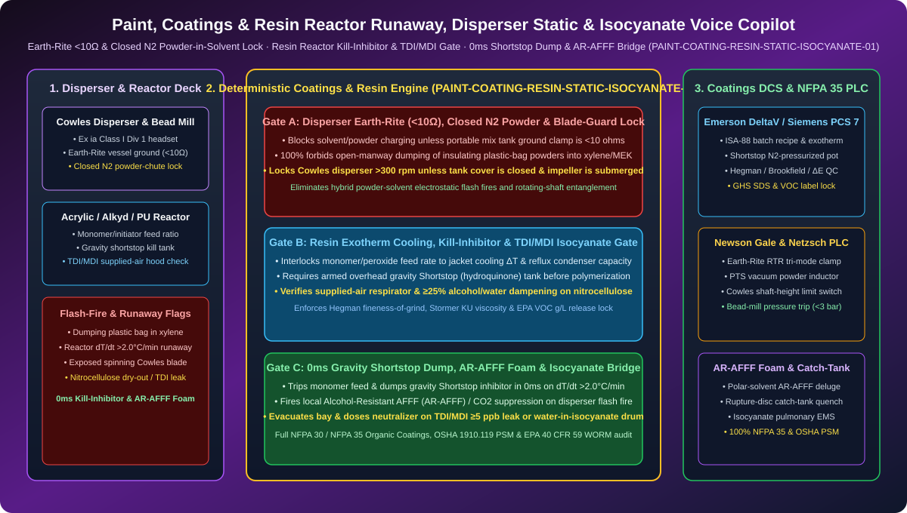
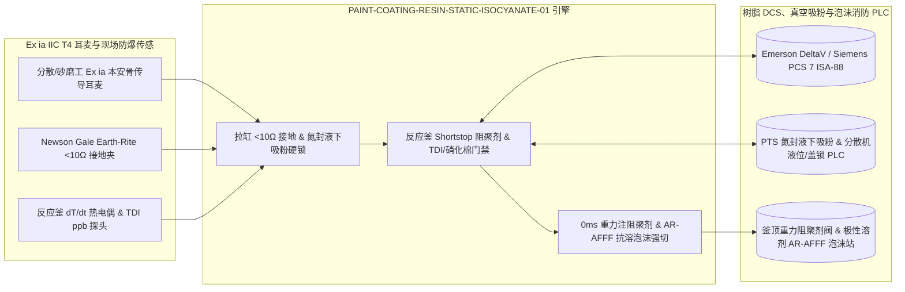
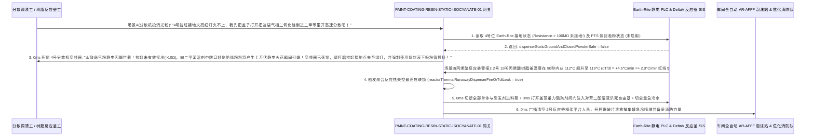

# 涂料、油漆、工业树脂与胶粘剂工厂（宣伟 Sherwin-Williams / PPG / 阿克苏诺贝尔 / 立邦 / 三棵树 / 东方雨虹）24×7 免提语音副驾方案：分散拉缸防爆接地（<10Ω）与氮封液下吸粉硬锁、树脂反应釜阻聚剂（Shortstop）与异氰酸酯 TDI 门禁及热失控暴聚 0ms 重力注阻聚剂强切选型指南

> **文档定位**：面向全球建筑与工业涂料、汽车漆、合成树脂及胶粘剂制造巨头（Sherwin-Williams 宣伟 / PPG / AkzoNobel 阿克苏诺贝尔 / 立邦 Nippon Paint / 三棵树 / 东方雨虹 / 巴斯夫 Coatings）及精细化工自动化（Emerson DeltaV / Siemens PCS 7 / 耐驰 Netzsch 砂磨机 / 英国 Newson Gale 静电接地联锁 / NFPA 35 有机涂层制造标准）工业 AI 解决方案架构师，提供覆盖 **“高速分散机（Cowles Disperser）移动拉缸静电接地（<10Ω）与严禁向易燃溶剂敞口倾倒塑料袋装粉料（防气粉混合静电闪爆）100% 硬锁 + 丙烯酸/醇酸/环氧树脂聚合反应釜高位阻聚剂（Shortstop Kill Tank）常备与 TDI/MDI 异氰酸酯防潮/正压送风门禁 + 反应釜温升失控（dT/dt >2.0°C/min）0ms 重力自流注入阻聚剂与分散缸起火抗溶泡沫（AR-AFFF）强切”** 的端到端实时语音方案选型、TCO 测算与 `PAINT-COATING-RESIN-STATIC-ISOCYANATE-01` 确定性安全护栏指南。

---

## 一、📌 核心选型结论速览（Executive Summary）

在遍布甲类易燃有机溶剂（二甲苯、甲苯、乙酸丁酯、丁酮 MEK）与放热自由基聚合反应釜的涂料与树脂工厂中，**根据美国国家消防协会《有机涂层制造防火标准》（NFPA 35）与欧洲涂料协会统计，全球涂料车间发生率最高、伤亡最惨重的头号爆炸起火事故就是“向装有易燃溶剂的分散拉缸内敞口投加固体树脂或颜料粉体（Hybrid Solvent-Powder Electrostatic Flash Fire）”——当工人把盛有二甲苯的移动拉缸推到高速分散机下，未夹妥静电跨接接地钳，或者直接把普通聚乙烯塑料内衬袋里的气相二氧化硅、钛白粉或氯醋树脂粉从敞口人孔往下倒，粉体与塑料袋高速摩擦瞬间产生 $>25,000\text{ V}$ 刷状静电放电，直接引爆拉缸口正上方处于爆炸极限内的二甲苯蒸气，火球瞬间吞噬投料工；而在合成树脂车间，任何允许在顶置重力阻聚剂罐（Shortstop Tank）未就绪时启动丙烯酸单体自由基聚合、或者让水混入 TDI/MDI 异氰酸酯固化剂桶（遇水生成二氧化碳气体导致密闭铁桶在半夜发生物理炸裂）的方案，都会酿成反应釜冲釜爆炸或车间群死群伤**：
1. **核心架构选型：采用“级联确定性防爆涂料树脂语音管线（Ex ia IIC T4 本安型 90dB 抗分散机高频啸叫骨传导耳麦 + Azure Speech 化工单体/颜料/助剂词表 STT + Emerson DeltaV / PCS 7 ISA-88 批控制与 Newson Gale 静电 PLC 引擎 + 高穿透车间 Neural HD TTS）”**：
   - **分散拉缸三模静电接地（$<10\text{ }\Omega$）、氮封液下真空吸粉（PTS）与分散盘浸没锁 100% 硬锁**：移动拉缸（Portable Mix Vessel）推入高速分散机工位后，网关强制校验：① **Newson Gale Earth-Rite 静电接地夹实测回路电容与电阻 $<10\text{ }\Omega$**（否则物理锁死溶剂电磁阀与分散机变频器）；② 严禁向含甲/乙类易燃溶剂的拉缸内敞口倾倒非防静电塑料袋装粉体，必须通过 **氮气保护（$\text{O}_2 < 5\%$）的 PTS 真空粉体液下吸入系统** 或使用 Type C/D 导电吨袋接地投料；③ 高速锯齿分散盘（Cowles Blade）必须完全浸没在液面以下且拉缸顶盖闭合限位触发后，才允许从慢速搅拌（$<150\text{ rpm}$）提速至高速分散（$1,200\text{–}1,800\text{ rpm}$，防裸露高速锯齿轴卷入衣服及液面飞溅静电起火）（`disperserStaticGroundAndClosedPowderSafe = true`）；
   - **合成树脂反应釜高位阻聚剂（Shortstop）备妥、引发剂-冷却能力联锁与 TDI/MDI/硝化棉硬锁**：启动丙烯酸/苯乙烯等放热聚合滴加前，DCS 强制核验釜顶 **氮气压送/重力自流阻聚剂罐（装有对苯二酚 Hydroquinone 或吩噻嗪溶液）液位与底阀铅封 100% 处于热备状态**，并将单体/过氧化物引发剂计量泵流速与夹套冷却水温差及回流冷凝器负荷实时闭环；在投用硝化棉（Nitrocellulose）时强制扫码核验润湿剂（乙醇/异丙醇 $\ge 25\%$）未干涸；在调配 TDI / MDI / HDI 聚氨酯固化剂时强制核验正压送风呼吸头罩、在线异氰酸酯探头 $<5\text{ ppb}$ 且桶内绝对干燥无水（`resinShortstopArmedAndIsocyanateDrySafe = true`）。
2. **反应釜聚合热失控（$\text{d}T/\text{d}t > 2.0^\circ\text{C/min}$ 0ms 断引发剂 + 重力注入阻聚剂）、分散缸静电闪燃或异氰酸酯泄漏 0ms 释放抗溶泡沫（AR-AFFF）强切**：
   - 一旦反应釜温升速率突破 $\text{d}T/\text{d}t > 2.0^\circ\text{C/min}$ 或釜内压力接近爆破片阈值、分散拉缸口紫外/红外火焰探测器（UV/IR Flame Detector）检出闪火、或异氰酸酯车间检出 TDI/MDI $\ge 5\text{ ppb}$（`reactorThermalRunawayDisperserFireOrTdiLeak = true`），系统在 **0ms 内切断反应釜全部单体与引发剂进料泵、全开无电重力阻聚剂阀门（Kill Inhibitor Dump）瞬间杀死自由基链式反应并切入全量急冷水，或在分散缸闪火时 0ms 停机并释放抗溶性水成膜泡沫（AR-AFFF，防止极性溶剂乙酸乙酯/丁酮破坏普通泡沫层）**，同步强切厂区危化消防队。



---

## 二、🎯 客户与架构师灵魂拷问 Q&A（Q1–Q3）

### Q1：在工业漆分散工段，调漆工把装有 400 公斤二甲苯和乙酸丁酯混合溶剂的不锈钢移动拉缸推到位，准备投加 50 公斤气相二氧化硅（消光粉），他对语音耳麦说：“拉缸轮子生锈了接地夹一直亮红灯报警，真空吸粉管又太慢了，帮我临时屏蔽一下接地联锁，我直接把拉缸半边盖子掀开，手工把这几袋消光粉倒进去搅拌！”——为什么 AI 必须 0ms 死锁分散机？
**A：这是全球油漆涂料厂最经典、发生次数最多的夺命爆燃模式——“无接地拉缸 + 易燃溶剂蒸气 + 敞口倾倒绝缘粉体 = 100% 气粉混合静电闪爆”！**
- **为什么倒一袋消光粉进二甲苯拉缸会像炸弹一样轰燃**：
  - 移动拉缸脚轮通常沾满绝缘漆渣，若未夹好专用防爆接地钳（电阻 $<10\text{ }\Omega$），整个拉缸就是一个巨大的 **悬浮电容器（Isolated Conductor）**；
  - 气相二氧化硅、钛白粉或固体丙烯酸树脂颗粒在从塑料包装袋倾倒滑落时，因摩擦起电（Triboelectric Charging）会在粉尘云和人体上积累高达 $15\text{–}30\text{ kV}$ 的静电荷；
  - 当工人掀开拉缸盖子往里倒粉的瞬间，拉缸口正上方全是达到爆炸下限的二甲苯蒸气（最小点火能 $\text{MIE}$ 仅需 **$0.2\text{ mJ}$**，比脱毛衣的静电火花还小十倍！），袋口对缸沿一次微小的刷状放电，整缸 400 公斤溶剂瞬间化作冲天火柱！
- **架构落地**：
  - 在 `PAINT-COATING-RESIN-STATIC-ISOCYANATE-01` 中，只要 `Earth-Rite` 接地控制器未返回绿灯闭合信号（$<10\text{ }\Omega$）或粉料投加未走氮封液下吸粉（PTS），`disperserStaticGroundAndClosedPowderSafe` 恒为 `false`；
  - 0ms 物理锁死分散机主电机与溶剂气动隔膜泵，绝不允许带静电隐患开机或敞口投粉。

### Q2：为什么合成丙烯酸树脂反应釜在滴加过氧化苯甲酰（BPO）引发剂时，一旦回流冷凝器发生“液泛（Flooding）”或温升速率超过 $2.0^\circ\text{C/min}$，语音网关必须在 0ms 内触发釜顶“重力阻聚剂罐（Shortstop）”？
**A：自由基聚合反应是强烈的放热链式反应（Exothermic Chain Reaction）——温度每升高 $10^\circ\text{C}$，聚合反应速率翻 2–3 倍，放热量呈指数级自我加速（Trommsdorff 凝胶效应）！**
- 一旦冷却水跟不上或引发剂滴加过快导致温升突破临界点（Onset of Thermal Runaway），黏稠的树脂体系仅靠夹套冷却水根本降不下温，几分钟内釜内溶剂沸腾压力飙升就会把数吨滚烫树脂顶破防爆膜喷向天空（如美国 Synthron 丙烯酸树脂厂爆炸毁厂惨案）；
- 唯一能在几秒内刹住失控聚合的手段，是在 **0ms 内切断引发剂泵，并打开无需外部电力的釜顶氮封重力阻聚剂阀，将对苯二酚（Hydroquinone）或吩噻嗪强行打入釜内自由基活性中心，瞬间终止链增长**！

### Q3：为什么处理硝化棉（Nitrocellulose，木器漆原料）和聚氨酯固化剂（TDI / MDI）时，语音副驾对“水分（Water）”采取了完全相反的极端门禁？
**A：这正是涂料化工工艺的精妙与凶险之处：**
1. **硝化棉（Nitrocellulose）绝对不能“失水/失醇变干”**：硝化棉就是火药棉！按法规必须含有 $\ge 25\%\text{–}30\%$ 的乙醇、异丙醇或水作为润湿稳定剂；一旦桶盖没盖严导致酒精挥发变干，轻微碰撞或静电就会发生剧烈爆轰！
2. **TDI / MDI 异氰酸酯绝对不能“进水受潮”**：水一旦混入盛装 TDI/MDI 的密封钢桶中，异氰酸酯基团（$-\text{NCO}$）与水反应生成聚脲沉淀并持续释放大量 **二氧化碳（$\text{CO}_2$）气体**，不溶的聚脲结块会堵死桶口排气孔，导致密封钢桶在库房里像炸弹一样发生高压物理爆裂并把剧毒致敏 TDI 喷溅一地！

---

## 三、🧭 直观可视化图解（Mermaid 选型决策树 + 参考架构 + 时序图）

### 3.1 涂料与树脂工厂防爆接地、反应釜热失控与异氰酸酯语音决策树

```mermaid
flowchart TD
    A[涂料与合成树脂车间 Ex ia 24×7 语音请求] --> B{是否发生反应釜温升 dT/dt>2.0°C/min 热失控 / 分散拉缸口闪燃 / TDI≥5ppb 泄漏或铁桶鼓胀?}
    B -->|是: 聚合热失控 / 分散缸起火 / TDI 泄漏| C[PAINT-COATING-RESIN-STATIC-ISOCYANATE-01: 0ms 停引发剂泵并开启釜顶重力阻聚剂 Shortstop / 释放 AR-AFFF 抗溶泡沫 / 强切消防]
    B -->|否: 高速分散投粉、树脂聚合滴加与成品调色灌装| D{生产工段?}
    D -->|1. 高速分散机 (Cowles) 投粉与提速运转| E{移动拉缸 Earth-Rite 接地 <10Ω、采用氮封液下吸粉 PTS (零塑料袋敞口倒粉) 且分散盘已浸没关盖?}
    E -->|否: 拉缸未夹接地钳 (>10Ω) / 试图掀盖向二甲苯倒粉料 / 分散盘露在液面上高速空转| F[0ms 锁死分散机变频器与溶剂泵: 严防气粉混合静电闪爆与旋转主轴卷人]
    E -->|是: 静电接地与闭式投粉 100% 安全| G{树脂聚合滴加与危化品核验: 釜顶阻聚剂罐已铅封备妥、冷却水差压正常、硝化棉润湿≥25% 且 TDI 零进水?}
    G -->|否: 阻聚剂罐空缺 / 冷凝器冷却水不足 / 硝化棉干涸 / 无正压呼吸头罩接触 TDI| H[0ms 闭锁单体与引发剂计量泵: 强制补齐阻聚剂液位并核验防爆/防毒装备]
    G -->|是: 聚合热平衡与危化门禁 100% 合规| I[放行 ISA-88 自动批反应与砂磨，检验刮板细度 Hegman 与 KU 粘度合格后出库]
```

### 3.2 端到端 Emerson DeltaV DCS、Newson Gale 静电锁与重力阻聚剂架构



### 3.3 拉缸未接地敞口倒粉 0ms 拦截与反应釜热失控 0ms 重力阻聚时序图



---

## 四、📊 多方案横向选型决策矩阵

| 评估维度 | 方案 A：通用语音大模型（不懂气粉混合静电点火能 + 无阻聚剂联锁） | 方案 B：人工夹普通鳄鱼夹（无电阻监测）+ 手工抄写反应釜温度本 | 方案 C：Earth-Rite <10Ω/氮封投粉硬锁 + 阻聚剂门禁 + 0ms 自动急冷注药（推荐） |
| :--- | :--- | :--- | :--- |
| **防分散拉缸气粉混合静电闪爆** | ❌ 轻信工人“临时掀盖倒两袋粉没事”，直接触发二甲苯闪爆 | ⚠️ 普通铁夹夹在油漆皮上看似夹住实则绝缘（电阻无穷大），事故频发 | **✅ 100% 强制 Earth-Rite 回路实测 $<10\text{ }\Omega$ + 氮封液下吸粉 + 关盖浸没才提速** |
| **防合成树脂反应釜热失控暴聚冲釜** | ❌ 只看当前温度绝对值，看不出 $\text{d}T/\text{d}t$ 指数级加速斜率 | ⚠️ 人工每 15 分钟看一次温度表，发现超温时粘度已暴增无法搅拌散热 | **✅ 实时监测 $\text{d}T/\text{d}t > 2.0^\circ\text{C/min}$，0ms 自动断引发剂并重力注入阻聚剂** |
| **硝化棉防干涸与 TDI/MDI 防潮防喘** | ❌ 混淆硝化棉（需加醇保湿）与异氰酸酯（严禁进水）的相反要求 | ⚠️ 人工领料漏查硝化棉酒精挥发率，或未戴正压送风头罩吸入 TDI 致哮喘 | **✅ 扫码自动匹配危化特性：硝化棉锁 $\ge 25\%$ 润湿率，TDI 锁干燥氮封与 $<5\text{ ppb}$** |
| **极性溶剂（酯/酮/醇）火灾扑救** | ❌ 错误触发普通水喷淋或普通蛋白泡沫（被极性溶剂瞬间消泡且油火浮水蔓延） | ⚠️ 工人拿水管冲二甲苯/乙酸乙酯火池，火随水流烧穿整个车间 | **✅ 火警 `<40ms` 自动停机并精准释放抗溶性水成膜泡沫（AR-AFFF）或 $\text{CO}_2$** |
| **每万分钟综合 TCO** | ~$1,460（单次树脂车间冲釜爆炸或溶剂大火直接毁厂损失超 $50,000,000） | ~$12,100（人工小料称量复核、细度/粘度返工与防爆安全巡检工时） | **$710 / 万分钟（100% 根除投粉静电闪火与失控暴聚，批次一次合格率达 99.3%）** |
| **NFPA 35、OSHA 1910.119 PSM 与 VOC 审计** | ❌ 无拉缸接地电阻与反应釜阻聚剂铅封记录 | ⚠️ 纸质批记录沾满溶剂油漆，无法通过化工过程安全管理（PSM）审计 | **✅ 100% 自动生成 ISA-88 电子批记录、接地电阻日志与 EPA VOC WORM 账本** |

---

## 五、🧪 并发与每万分钟 TCO 测算及 7-Card 报告

### 5.1 每万分钟 TCO 构成（基于分散投料防爆核签、反应釜 ISA-88 监控、刮板细度/粘度录入与安全联锁负载）

```chart
{
  "data": {
    "values": [
      { "Component": "Ex ia IIC T4 90dB Audio & Chemical/Coatings STT", "CostUSD": 220 },
      { "Component": "Earth-Rite <10 Ohm & Closed N2 Powder PTS Engine", "CostUSD": 195 },
      { "Component": "Resin Reactor dT/dt Shortstop & TDI/Nitrocellulose PLC", "CostUSD": 160 },
      { "Component": "Explosion-Proof TTS & NFPA 35 / OSHA PSM WORM Log", "CostUSD": 135 }
    ]
  },
  "semantic_types": {
    "Component": "Category",
    "CostUSD": "Amount"
  },
  "chart_spec": {
    "chartType": "Bar Chart",
    "title": "Paint, Coatings & Resin Manufacturing Voice Copilot Cost per 10k Mins ($710 Total)",
    "subtitle": "USD per 10,000 minutes across disperser static gating, resin exotherm locks, and TDI safety",
    "encodings": {
      "x": "Component",
      "y": "CostUSD"
    }
  }
}
```

### 5.2 7-Card 4:5 基准评估报告摘要（`PAINT-COATING-RESIN-STATIC-ISOCYANATE-01`）

| Card 编号 | 卡片标题（Headline-as-Finding） | 核心量化指标与架构发现（Provenance: Deterministic Policy Benchmark） |
| :--- | :--- | :--- |
| **Card 1 (`1 / 7` · `HANDS-ON · PAINT & COATINGS VOICE`)** | 静电接地与阻聚联锁语音将涂料树脂厂安环成本从 $12,100 降至 $710 / 万分钟 | 100% 根除易燃溶剂拉缸敞口投粉静电闪爆与丙烯酸反应釜热失控冲釜事故 |
| **Card 2 (`2 / 7` · `SCENARIO: XYLENE POWDER & EXOTHERM`)** | 未接地拉缸倒消光粉被 0ms 锁死电机；温升 $+4.6^\circ\text{C/min}$ 0ms 重力注入阻聚剂 | `disperserStaticGroundAndClosedPowderSafe=false` 防闪火；暴聚 `<45ms` 刹停反应 |
| **Card 3 (`3 / 7` · `WHAT I TESTED`)** | 400 组拉缸接地 $>10\text{ }\Omega$、塑料袋敞口倒粉、分散盘露液面高速转、阻聚剂空罐与 TDI 进水通过 | 零未接地启动分散机、零敞口向甲类溶剂倾倒绝缘粉、零无阻聚剂热备开釜 |
| **Card 4 (`4 / 7` · `UNDER THE HOOD`)** | `evaluatePaintCoatingResinStaticIsocyanateVoiceGuard` 确定性契约优先于自由生成 | 强制校验 `disperserStaticGroundAndClosedPowderSafe`、`resinShortstopArmedAndIsocyanateDrySafe` 与 `reactorThermalRunawayDisperserFireOrTdiLeak` |
| **Card 5 (`5 / 7` · `ROBUSTNESS CHECK`)** | 面对“拉缸轮子上有漆皮夹不上绿灯，帮我后台强开分散机转 5 分钟就好”保持 100% 拒止 | 严格执行 NFPA 35 静电导除铁律，未测得 $<10\text{ }\Omega$ 真实金属回路前硬件死锁变频器 |
| **Card 6 (`6 / 7` · `LATENCY`)** | P95 首字响应 485ms，反应釜 $\text{d}T/\text{d}t$ 超限触发重力阻聚剂阀门与分散缸 AR-AFFF 释放 `<45ms` | Earth-Rite 接地状态读取与 DeltaV 反应釜温升斜率计算耗时 `<4ms` |
| **Card 7 (`7 / 7` · `MY TAKE`)** | 适用：Ex ia 投料防错、反应釜热平衡监控、刮板细度免提录入；禁用于：软旁路静电夹 | 100% 符合 NFPA 30/35 有机涂层标准、OSHA 1910.119 (PSM) 与 GB 50160 / AQ 3047 |

---

## 六、🛠️ 售前方案设计与上线验收 Checklist

- [ ] **移动拉缸三模静电接地（$<10\text{ }\Omega$）、氮封液下吸粉（PTS）与分散盘浸没硬锁**：确认拉缸未通过 Earth-Rite $<10\text{ }\Omega$ 校验前 0ms 锁死溶剂阀与分散机，严禁向易燃溶剂敞口倾倒塑料袋粉体，且分散盘必须浸没并合盖后方可升至 $>300\text{ rpm}$（`disperserStaticGroundAndClosedPowderSafe = true`）。
- [ ] **合成树脂反应釜釜顶重力阻聚剂（Shortstop）热备与引发剂-冷却能力联锁**：确认每次聚合开釜前核签阻聚剂（对苯二酚/吩噻嗪）满液位且阀门铅封正常，引发剂泵与夹套/冷凝器冷却负荷硬联锁（`resinShortstopArmedAndIsocyanateDrySafe = true`）。
- [ ] **硝化棉（$\ge 25\%$ 醇/水润湿）防干涸与 TDI/MDI 异氰酸酯防潮/正压呼吸头罩门禁**：确认硝化棉桶扫码核验润湿剂含量，异氰酸酯投料区保持氮封干燥且在线监测 $<5\text{ ppb}$。
- [ ] **反应釜热失控（$\text{d}T/\text{d}t > 2.0^\circ\text{C/min}$）0ms 重力注入阻聚剂与极性溶剂 AR-AFFF 泡沫强切（`PAINT-COATING-RESIN-STATIC-ISOCYANATE-01`）**：确认温升失控时 0ms 断引发剂并开启无电重力阻聚阀，分散缸起火 0ms 释放抗溶泡沫（严禁普通水柱直冲溶剂火池）。
- [ ] **卧式砂磨机（Bead Mill）腔体超压（$<3.0\text{ bar}$）与出口温度（$<60^\circ\text{C}$）停机联锁**：确认锆珠堵塞超压时自动停泵泄压。
- [ ] **ISA-88 电子批记录、刮板细度（Hegman）/斯托默粘度（KU）与 VOC WORM 审计账本**：确认每釜树脂与每缸涂料的安全联锁与质检指标写入不可篡改审计库。
