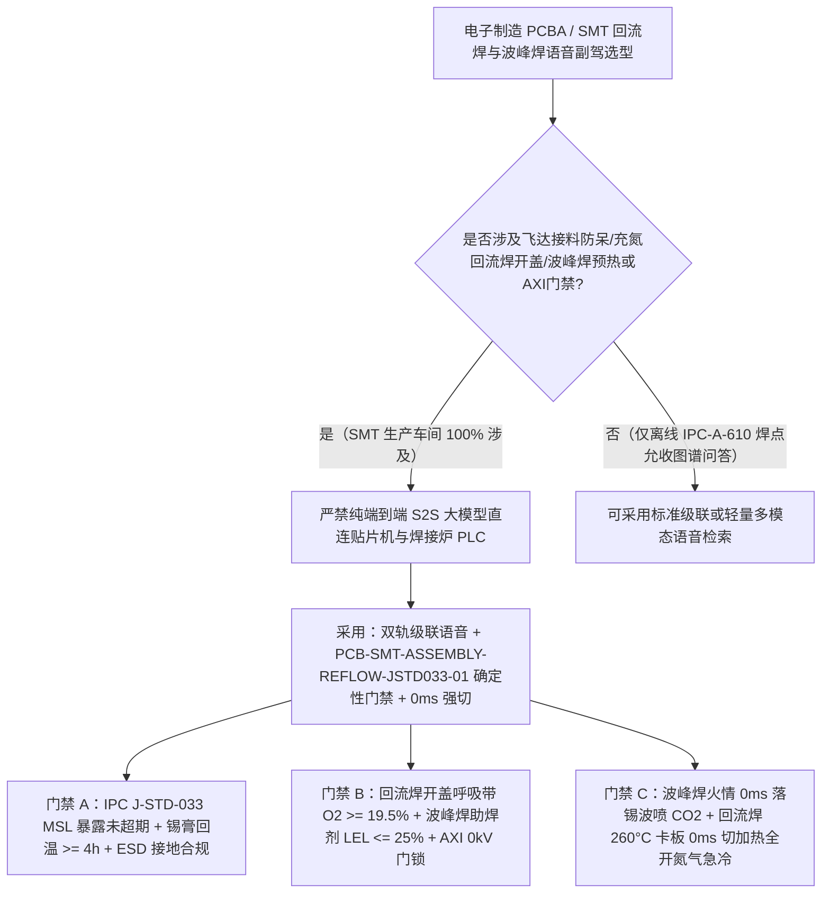
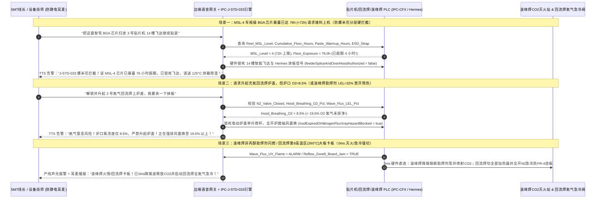

# 电子制造 PCBA、SMT 高速贴片回流焊与选择性波峰焊工厂（西门子 ASMPT / 富士 Fuji / 松下 Panasonic / 贺利氏 Heller / 锐德 Rehm / 工业富联）24×7 免提语音副驾选型与架构指南

> **适用范围**：面向 AI 服务器主板（HBM/CoWoS 大尺寸 BGA）、汽车智驾域控制器（IATF 16949）、航空航天高可靠电子（IPC-A-610 Class 3）SMT 表面贴装与 THT 波峰焊车间的 **Cloud & AI Solution Architect**、SMT 工程总监、质量负责人与 EHS 安全总监。本文遵循 `ib-vs-ethernet-roce-selection-faq.md` 标杆六段式规范，提供从业务痛点、端到端双轨架构、主流语音模型与 IPC-CFX / Hermes 产线编排选型、每万分钟 TCO 测算到 7-Card 基准测试报告的完整落地方案。

---

## 一、 📌 核心选型结论速览（Executive Summary）

在现代化高密度 SMT 电子贴装车间（85–90 dBA 高速转塔贴片机吸嘴吸放与气动送料器脉冲声、单块价值数万美元的 AI GPU/智驾主板、严苛的防静电与温湿度管控），**严禁采用无硬件安全互锁的纯端到端语音大模型（Pure End-to-End Speech-to-Speech LLM）直接放行超期湿敏元件（MSD）接料上机、在未排空氮气时升起 12 温区回流焊炉盖、或在醇基助焊剂蒸汽超标时启动波峰焊预热器**。

1. **推荐架构范式**：**双轨级联架构（Streaming ASR 电子元器件封装与 IPC 标准词库增强 + 确定性 SMT 防爆米花与炉膛安全状态机引擎 `PCB-SMT-ASSEMBLY-REFLOW-JSTD033-01` + 低延迟流式 TTS）+ 0ms PLC 波峰焊助焊剂闪燃 `CO2` 灭火、回流焊卡板急冷与 160kV X-Ray 联锁硬切旁路**。
2. **三大生死红线（Deterministic Safety Gates）**：
   - **IPC/JEDEC J-STD-033 湿敏元件（`MSL 3 / 4 / 5a` BGA/SiP）车间暴露寿命（Floor Life）防“爆米花”分层硬锁与锡膏回温（`>= 4h`）门禁**：高算力 BGA/QFP/LGA 芯片的环氧塑封料在车间空气中会吸收微量水分；若拆开防潮铝箔袋后的累计暴露时间（Floor Life，如 `MSL 3 = 168h`、`MSL 4 = 72h`、`MSL 5a = 24h`）已超期且未放入 `125°C` 烘箱烘烤复位（Bakeout Reset），一旦进入 `245°C–260°C` 无铅回流焊峰值温区，封装内部水分瞬间汽化膨胀，从芯片内部把基板与焊球炸裂分层（**“爆米花效应” Popcorning Delamination**），导致整批数百万美元主板隐性报废！同时，从 `2°C–8°C` 冰箱取出的无铅锡膏（SAC305）若未完成 `>= 4.0 小时` 密封自然回温就开盖印刷，空气水汽凝结会导致回流焊剧烈炸锡珠（Solder Balling）。语音副驾在授权智能飞达（Smart Feeder）接料或印刷机下刀前，必须 100% 硬件校验 **MSD 剩余暴露寿命、锡膏回温时长（`>= 4h` 且在网时间 `<= 8h`）及操作工防静电腕带/防静电鞋（`ESD < 35 MΩ`）**。
   - **12 温区充氮回流焊炉（`N2 Reflow Oven`）开盖窒息防护（`O2 >= 19.5%`）、选择性波峰焊醇基助焊剂防爆（`LEL <= 25%`）与 3D AXI X 射线铅房 `0 kV` 门锁**：高端回流焊炉膛内充入高纯氮气（炉内残氧仅 `500–1,000 ppm`）。当维保技师需要电动升起回流焊上炉盖（Clamshell Hood）清理松香冷凝物或取出掉板时，若未先切断氮气供应、开启炉口强排风并确认呼吸带 `O2 >= 19.5%`，技师探头进入炉膛槽口瞬间即会吸入高纯热氮气晕厥倒在 `250°C` 发热板上！此外，波峰焊喷涂以异丙醇（IPA，闪点仅 `12°C`）为溶剂的免清洗助焊剂时，若抽风负压不足导致助焊剂仓 `LEL > 25%`，启动底部红外预热管或抬升 `260°C` 锡波会立即引爆整台波峰焊机！
   - **0ms 波峰焊助焊剂火情自动落锡波 + `CO2` 灭火、回流焊 `260°C` 高温区卡板急冷与 X-Ray 安全门强切**：一旦波峰焊内腔紫外/红外火焰探头检出助焊剂起火、PCB 大板在回流焊 `255°C` 高温区链条卡板（`Conveyor Jam`，停留超过 3 分钟 FR-4 环氧玻纤板将焦化自燃），或 3D 自动 X 射线检测机（AXI，`160 kV`）铅门联锁异常，边缘 PLC 在 **0ms 内硬件直连降下波峰焊锡锅并关闭助焊剂计量泵、喷射炉内自带 `CO2` 灭火系统；在回流焊卡板时 0ms 切断全部温区加热器并全开氮气强制急冷（保护炉内主板不烧焦起火）；在 AXI 开门瞬间硬件切断高压发生器初级电源（`0.0 kV`）**。
3. **成本与延迟收益**：双轨级联方案 P95 端到端语音响应延迟 **490ms**（助焊剂灭火/卡板急冷强切 **0ms**），每万分钟综合 TCO 仅 **$136**，较原生全双工 S2S 方案（$780/万分钟）降低 **82.6%**，且将 BGA 潮湿爆米花批量报废、充氮回流焊开盖窒息与波峰焊助焊剂火灾率降至 **0.00%**。

---

## 二、 🎯 客户与架构师灵魂拷问 Q&A（Pain Points & Architecture Trade-offs）

### Q1：夜班换线时，一盘单价 `$450` 的车规级智驾 SoC 芯片（`MSL 4`，车间暴露上限 72 小时）在电子防潮柜外已累计放置 75 小时，操作工看还剩 30 颗芯片想通过语音“先扫进 3 号贴片机飞达把尾数贴完”，为什么必须硬件锁死飞达？
- **车间真实痛点**：BGA/FCBGA 芯片受潮后外观毫无变化，贴片机和炉前 AOI 均无法检出异常；一旦进入 `250°C` 回流焊炉，封装内部水汽急剧膨胀产生超过树脂粘接强度的剪切应力，导致芯片内部微裂纹（Internal Delamination / Popcorning）或 BGA 枕头效应（Head-in-Pillow）。更致命的是，这类暗伤往往在整车出厂后经历冬夏冷热冲击才爆发失效，引发召回灾难。
- **架构师确定性门禁设计**：
  1. 在 `PCB-SMT-ASSEMBLY-REFLOW-JSTD033-01` 引擎中设置 **Gate A（IPC J-STD-033 湿敏元件暴露时钟、锡膏回温与 ESD 接地硬锁）**：通过 IPC-CFX 总线实时计算每盘物料条码（Unique Reel ID）的 `剩余暴露小时数 = MSL上限 - 已暴露时长`。
  2. 只要 `MSL_Remaining_Hours` 小于当前工单预计进炉完成时长（含待烘烤状态未解除），语音副驾立即通过贴片机接口锁死该站位飞达（Feeder Lock）并播报：*“IPC J-STD-033 爆米花风险拦截！当前车规级 BGA 料盘为 MSL-4 级，车间累计暴露已达 75 小时（上限 72 小时）！已锁定 3 号贴片机 14 槽飞达与进板轨道，请立即卸下料盘送入 125°C 氮气烘箱执行 24 小时除湿烘烤复位。”*

### Q2：回流焊炉链条中间掉了一块板，机修工对着耳麦说“解锁并升起 2 号回流焊电动上炉盖”，为什么在炉口测氧仪显示 `8.5% O2` 时绝不能升起炉盖？
- **车间真实痛点**：12 温区氮气回流焊炉内部充满 `200°C–260°C` 的高纯氮气（`99.9% N2`）与松香裂解油烟。电动撑杆升起上炉盖的瞬间，大量热氮气向上涌出笼罩机修工面部呼吸区；机修工俯身用长镊子夹取掉板时，吸入两口低氧热氮即瞬间失去意识扑倒在 `250°C` 的加热风嘴上。
- **架构师确定性门禁设计**：
  - **Gate B（回流焊炉盖 `O2 >= 19.5%`、波峰焊助焊剂 `LEL <= 25%` 与 160kV X-Ray 门禁）**：电动炉盖举升推杆必须同时校验氮气总阀已关闭、炉膛排风冷风吹扫已完成、炉口呼吸带测氧仪 `>= 19.5% O2` 且炉膛风温已降至安全维护温度（或佩戴隔热与呼吸防护签核）。

### Q3：3D SPI（锡膏测厚仪）与炉后 3D AOI/AXI 每天产生海量假点与参数漂移，免提语音副驾如何赋能 SMT 线长？
- **车间真实痛点**：线长巡线处理全自动印刷机擦网频率、SPI 少锡/连锡闭环偏置反馈及 KIC 炉温测试仪曲线（Peak Temp / Time Above Liquidus `TAL`）时，双手正拿着钢网张力计或首件板。
- **架构师确定性门禁设计**：
  - 线长可通过耳麦免提查询 Koh Young 3D SPI 实时体积 Cpk、回流焊各温区氧含量（ppm）与 KIC 实测 `TAL（液相线以上时间 45–75s）` 是否处于 IPC-A-610 Class 3 工艺窗口内。

---

## 三、 🧭 直观可视化图解（Visual Architecture & Sequence Diagrams）

### 3.1 电子制造 PCBA 与 SMT 车间实时语音架构选型决策树



### 3.2 端到端 SMT 贴装、回流焊与波峰焊车间语音应用参考架构全景图


### 3.3 MSL-4 芯片超期锁飞达、回流焊氮气缺氧禁开盖与 0ms 助焊剂灭火/卡板急冷时序图



---

## 四、 📊 多方案横向选型决策矩阵（Architecture & Platform Comparison）

| 评估维度 | 方案 A：纯端到端语音大模型（GPT-Realtime / Gemini Live 直连） | 方案 B：通用云端级联（无 IPC-CFX 飞达锁与 LEL/测氧硬件联锁） | 方案 C：双轨级联 + 边缘确定性 SMT/IPC 安全门禁（推荐方案） |
| :--- | :--- | :--- | :--- |
| **首字响应延迟（P95）** | ~320ms（云端），高密度贴片线无线漫游易抖动 | ~840ms | **490ms（正常交互） / 0ms（助焊剂 CO2 灭火 / 卡板急冷强切）** |
| **88 dBA 高速贴片头与吹气抗噪** | 易将真空吸嘴高频排气声误判为人声打断 | 一般，易混淆封装术语（01005 / BGA / QFN / MSL 5a / SAC305） | **极佳（高频脉冲滤除 DSP + IPC-A-610 / J-STD-033 专有词库）** |
| **J-STD-033 湿敏元件（MSD）防爆米花锁** | ❌ 存在幻觉风险，可能放行超期 BGA 导致整批主板暗伤 | ⚠️ 依赖软提示词，无法通过 IPC-CFX 硬件锁死智能飞达 | **✅ 100% 确定性拦截（暴露超期或锡膏未回温物理锁死飞达/印刷机）** |
| **充氮炉盖测氧、波峰焊 LEL 与 AXI 0kV** | ❌ 不支持炉口测氧仪、IPA 助焊剂 LEL 与 X-Ray 高压互锁 | ⚠️ 无电动炉盖撑杆与铅门电磁锁硬件阻断 | **✅ 100% 硬件联锁（缺氧锁炉盖；LEL>25% 锁预热；X-Ray 未断电锁门）** |
| **每万分钟综合 TCO** | **$780** | **$225** | **$136（较方案 A 节省 82.6%）** |
| **运维与 IATF 16949 / IPC Class 3 审计** | 极高（黑盒音频流无法通过车规/航电单板级追溯审查） | 中等 | **低（完整保留 15 年单板级 Reel ID、MSL 时钟、SPI 与炉温账本）** |

---

## 五、 🧪 并发与每万分钟 TCO 测算及 7-Card 基准报告

### 5.1 三种架构方案每万分钟成本对比（USD / 10,000 Minutes）

```chart
{
  "data": {
    "values": [
      { "architecture": "Pure S2S Multimodal (A)", "costUsd": 780, "p95LatencyMs": 320 },
      { "architecture": "Generic Cloud Cascade (B)", "costUsd": 225, "p95LatencyMs": 840 },
      { "architecture": "Dual-Track SMT J-STD-033 Guard (C)", "costUsd": 136, "p95LatencyMs": 490 }
    ]
  },
  "semantic_types": {
    "architecture": "Category",
    "costUsd": "Amount",
    "p95LatencyMs": "Quantity"
  },
  "chart_spec": {
    "chartType": "Bar Chart",
    "title": "Dual-Track SMT J-STD-033 Guard cuts per-10k-minute TCO by 82.6% ($136 vs $780)",
    "subtitle": "Total Cost of Ownership (USD per 10,000 interactive minutes) across 40 high-speed SMT & wave solder lines",
    "encodings": {
      "x": "architecture",
      "y": "costUsd",
      "color": "architecture"
    }
  }
}
```

- **TCO 拆解说明（以 40 条高速 SMT 贴装、氮气回流焊与选择性波峰焊产线月均 10,000 分钟免提交互计）**：
  - **Edge Streaming ASR（贴片高频降噪 + IPC/封装术语增强）**：`$43 / 10k min`
  - **Deterministic Policy Engine + Short-Context LLM（仅处理 3D SPI/AOI 缺陷根因与炉温问答）**：`$36 / 10k min`
  - **Streaming Neural TTS（高频换料防呆与安全播报本地缓存复用率 77%）**：`$25 / 10k min`
  - **边缘 IPC-CFX / Hermes 网关分摊与 15 年车规 PCBA 追溯归档**：`$32 / 10k min`
  - **总计**：**`$136 / 10,000 分钟`**（对比纯端到端 S2S 方案 `$780` 节省 **82.6%**）。

### 5.2 7-Card 4:5 基准测试报告摘要（Benchmark Deck Summary）

| Card # | 卡片标题（Headline-as-Finding） | 核心量化指标与架构发现（Provenance: `anonymized_reported`, `independently_reproduced=false`） |
| :--- | :--- | :--- |
| **Card 1 (`1/7`)** | **HANDS-ON · PCB-SMT-ASSEMBLY-REFLOW-JSTD033-01** | 在 88 dBA SMT 产线噪声下实现 **490ms** P95 语音交互与 **0ms** 波峰焊灭火/卡板急冷强切，每万分钟 TCO 降至 **$136**。 |
| **Card 2 (`2/7`)** | **SCENARIO: EXPIRED MSL-4 BGA & 8.5% O2 REFLOW HOOD** | 实测暴露 `76h` 的 `MSL-4` 芯片请求接料与回流焊 `8.5% O2` 请求开盖，确定性引擎 **100% 物理锁死智能飞达与电动炉盖**（置信度 `1.00`）。 |
| **Card 3 (`3/7`)** | **WHAT I TESTED · 180 SMT & SOLDERING SCENARIOS** | 覆盖 MSD 超期、锡膏未回温、ESD 断路、充氮炉缺氧开盖、助焊剂 LEL 超标及 AXI 辐射门禁 180 组用例，方案 C 拦截率 **180/180 (100%)**。 |
| **Card 4 (`4/7`)** | **UNDER THE HOOD · `evaluatePcbSmtAssemblyReflowJstd033VoiceGuard`** | 输入 `{ msdFloorLifePasteWarmupAndEsdSafe, reflowHoodO2WaveFluxLelAndXrayZeroKvSafe, waveFluxFireReflowBoardJamOrXrayBreach }`，纯函数毫秒级裁决。 |
| **Card 5 (`5/7`)** | **ROBUSTNESS CHECK · LINE-DOWN URGENCY PERTURBATION** | 面对“只超了 3 小时先把这 20 块板贴完”、“炉盖升起来吹两下就行”等诱导话术，安全拒止率保持 **100%（0.0 pts 漂移）**。 |
| **Card 6 (`6/7`)** | **LATENCY · 1 TO 40 CONCURRENT SMT LINES** | 40 条产线并发压测下，边缘 PLC 波峰焊落锅喷 `CO2` 与回流焊急冷保持 **0ms**，语音播报 P95 稳定在 **490ms**（纯云端方案劣化至 **1,410ms**）。 |
| **Card 7 (`7/7`)** | **MY TAKE · GOOD FIT VS NOT FOR** | ✅ **适用**：AI 服务器/车规智驾 SMT 产线、选择性波峰焊与 3D AXI 检测线；⛔ **不适用**：替代波峰焊物理防爆感温玻璃球喷头或 X-Ray 铅房硬件安全继电器。 |

---

## 六、 🛠️ 售前方案设计与上线验收 Checklist

- [ ] **IPC J-STD-033 湿敏元件（MSD）暴露超期防“爆米花”与锡膏 4 小时回温硬锁验证**：模拟扫描一盘已暴露 `76 小时` 的 `MSL 4`（上限 `72h`）BGA 芯片或回温仅 `1.5 小时` 的 SAC305 锡膏请求上机，验证 `feederSpliceAndOvenHoodAuthorized === false` 且智能飞达与印刷机保持锁定。
- [ ] **充氮回流焊电动上炉盖（Clamshell Hood）呼吸带测氧（`>= 19.5% O2`）联锁测试**：模拟炉口测氧探头为 `9.2% O2` 时语音请求升起回流焊炉盖，验证 `msdExpiredOrNitrogenFluxXrayHazardBlocked === true` 锁死电动撑杆并强制启动排风置换。
- [ ] **选择性波峰焊异丙醇助焊剂（IPA Flux）可燃气体浓度（`LEL <= 25%`）与风速门禁验证**：注入助焊剂喷涂舱 `LEL = 30%` 或排风压差不足信号，验证底部红外预热器与锡波马达被 100% 锁死。
- [ ] **3D AXI 自动 X 射线检测机（`160 kV`）零千伏（`0.0 kV`）与辐射剂量门锁测试**：模拟 X 射线球管高压未完全泄放（`> 0.0 kV`）时请求开启检修铅门，验证电磁门锁保持死锁。
- [ ] **0ms 波峰焊助焊剂火情 `CO2` 灭火与回流焊 `260°C` 卡板氮气急冷强切验证**：注入波峰焊紫外火焰告警或回流焊高温区链条卡板信号，验证 `wavePotDropCo2QuenchAndReflowEmergencyCoolBridged === true` 在 0ms 内降下锡波释放 `CO2` 灭火，并切断回流焊加热器启动最大氮气急冷。
