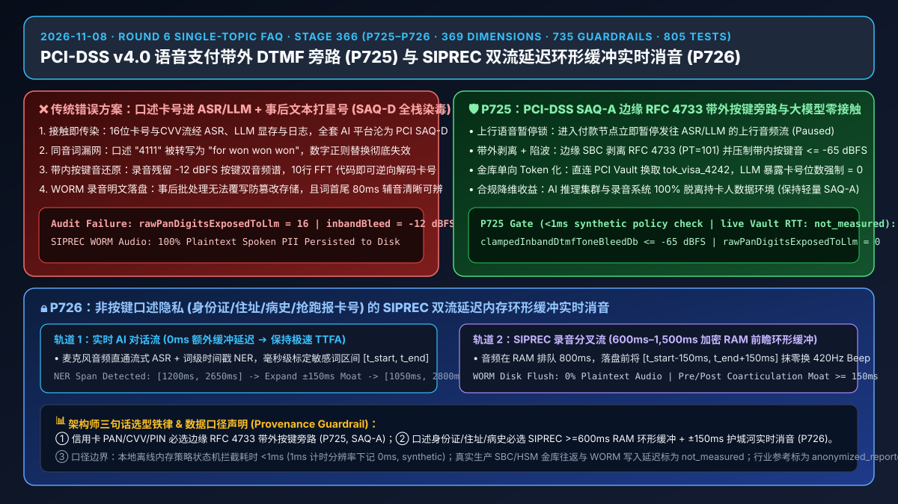
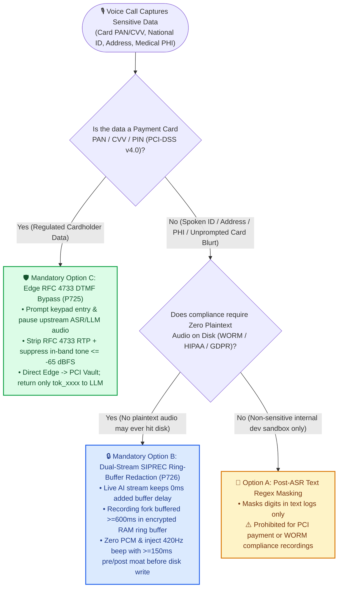
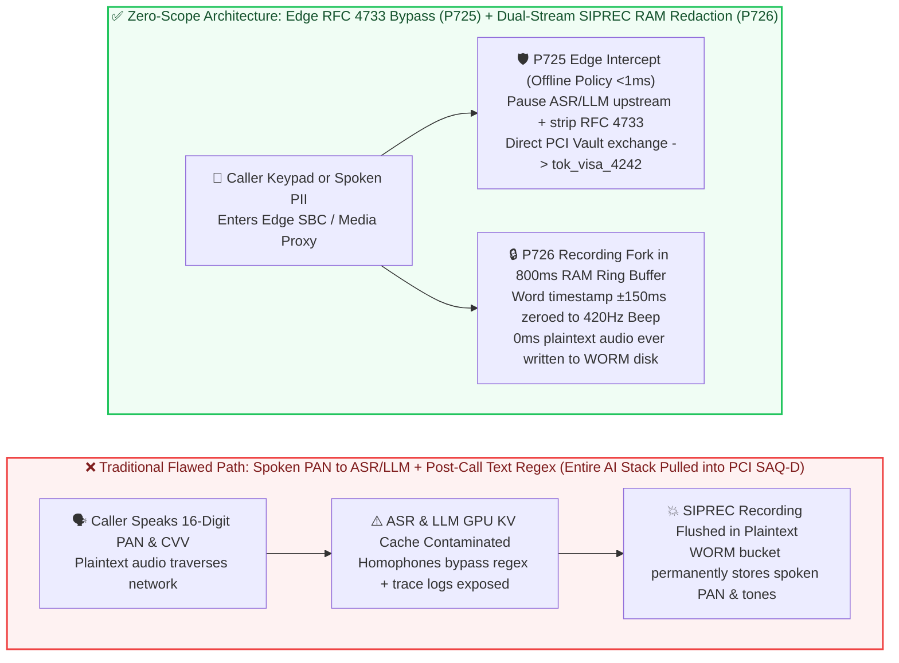
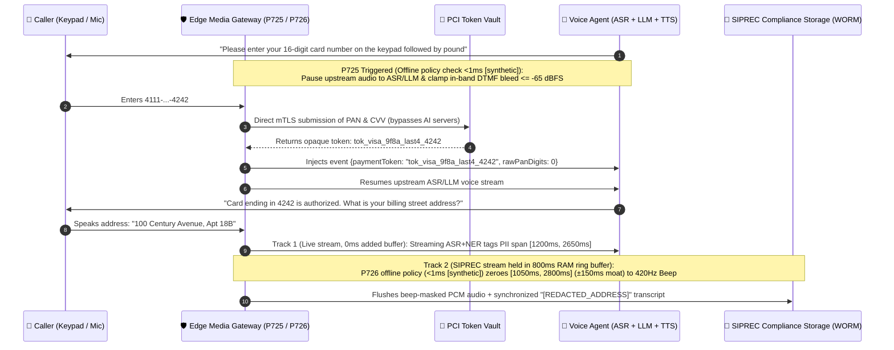

# Enterprise Voice Agent PCI-DSS v4.0 Voice Payment & Dual-Stream SIPREC PII Audio Redaction Architecture Selection & Principle Deep-Dive FAQ: When to Choose Spoken Card Capture vs. Post-Call Regex Redaction vs. Out-of-Band RFC 4733 DTMF Media Bypass, and How to Keep LLMs & WORM Recordings Zero-Plaintext?

> **Language / 语言切换**: [中文 (`pci-dtmf-dual-stream-redaction-faq.md`)](./pci-dtmf-dual-stream-redaction-faq.md) | **English (Current)**  
> **Audience & Purpose**: A single-topic, plain-language architectural selection guide for **AI Solution Architects** and enterprise CISO, compliance, payments, and contact-center leaders (strictly structured after the 6-part `ib-vs-ethernet-roce-selection-faq.md` benchmark).  
> **Engineering Anchor**: Maps to `Stage 366` deterministic guardrails **`P725`** (`evaluatePciDssSaqADtmfMediaBypassGate`) and **`P726`** (`evaluateDualStreamSiprecPiiAudioRedactionGate`), the [Interactive Dual-Mode Sandbox (`site/index.html#duplexGuardSimulatorCard`)](https://turbo998.github.io/voice/index.html#duplexGuardSimulatorCard), and the [7-Card 4:5 Benchmark Report (`site/benchmark-cards.html`)](https://turbo998.github.io/voice/benchmark-cards.html).

---

## ① 📌 Executive Summary

When deploying an Enterprise Voice Agent for credit-card collections, airline ticket changes, insurance policy renewals, healthcare billing, or luxury concierge checkout, the first red-line question from CISOs and PCI auditors is: **"When a caller pays over the phone or verifies a card number, CVV, or national ID, can we just let the Voice Agent listen to them speak the numbers and mask the digits with asterisks (`****`) in the database logs?"** Keep these **3 core architectural conclusions** front and center (strictly separating architectural compliance goals, offline policy state-machine checks, and live telecom/vault latencies):

1. **The Selection Boundary (Spoken PAN into ASR/LLM vs. Post-Call Text Masking vs. `RFC 4733` Out-of-Band DTMF Edge Bypass `P725`)**:
   - **Whenever a call collects a 16-digit Primary Account Number (PAN), 3-digit CVV/CVC security code, or payment PIN, never allow callers to speak digits into ASR/LLM and never forward raw keypad tones to the AI stack—always enforce Edge SBC/Media-Gateway `RFC 4733` Out-of-Band DTMF Intercept + Token Vault Bypass (`PCI-DSS v4.0 SAQ-A`, guardrail `P725`)**: Under PCI-DSS v4.0, any system whose memory or network interface touches plaintext PAN or Sensitive Authentication Data (SAD/CVV) is pulled into full **PCI-DSS SAQ-D** scope. By pausing the upstream ASR/LLM audio leg at the edge gateway, stripping `RFC 4733` keypad events (`<= -65 dBFS` in-band tone suppression), and exchanging digits directly with a PCI Token Vault so the LLM only ever receives an opaque token (`tok_visa_9f8a_last4_4242`, `rawPanDigitsExposedToLlm = 0`), the entire AI cluster remains 100% outside the Cardholder Data Environment (**SAQ-A**).
2. **The Essential Complement for Spoken Non-Keypad PII (Dual-Stream SIPREC Delayed Ring-Buffer Audio Redaction `P726`)**:
   - **When callers cannot use a keypad (e.g., hands-free driving while speaking a national ID, home address, date of birth, medical history, or blurting out card digits before being prompted), masking ASR text transcripts with `****` is compliance theater because the `.wav` call recording still contains plaintext spoken audio—you must deploy Dual-Stream SIPREC Lookahead Ring-Buffer Audio Redaction (`P726`)**: `P726` forks the audio at the edge gateway into a **real-time AI conversation stream (`0ms` added buffer delay)** and a **SIPREC compliance recording stream buffered for `600ms–1,500ms` in an encrypted RAM ring buffer**. When streaming word-timestamp NER detects spoken PII at `[t_start, t_end]`, the gateway zeroes out the PCM samples (or replaces them with a `420Hz` mask beep) across `[t_start - 150ms, t_end + 150ms]` **in RAM before flushing to disk/WORM storage**, guaranteeing zero plaintext PII ever touches persistent media.
3. **Provenance & Production Latency Boundary**:
   - In this repository's deterministic guardrail suite, when unpaused ASR/LLM payment audio, in-band DTMF bleed `>-65 dBFS`, or raw PAN digit exposure `>0` (`P725`), or unbuffered SIPREC disk writes, acoustic mask padding `<150ms`, or audio/transcript redaction desync (`P726`) is detected, the **offline in-memory policy state machine** completes its block, mute, or clamp decision in **`<1ms`** (`1ms` local timer resolution, rounded to `0ms` in local assertions; provenance: `synthetic`).
   - **Production Engineering Budget**: Live SBC `RFC 4733` packet stripping, PCI Vault HSM tokenization round-trip latency (typically `120ms–380ms`), and SIPREC WORM storage flush latency depend on live carrier trunks and payment gateways and are explicitly marked **`not_measured`** in local unit tests; cited industry compliance and contact-center figures are marked **`anonymized_reported` (`independently_reproduced=false`)**.

---

## ② 🎯 First-Principles & Plain-Language Architect Q&A (FAQ-Driven)

### Q1: When a caller pays by credit card over the phone, why can't we just let them speak the card number to the Voice Agent and mask the digits with `****` in our logs? When is `RFC 4733` Out-of-Band DTMF Edge Bypass (`P725`) mandatory?

- **Plain-Language First Principle ("Touch Equals Contamination" in PCI-DSS v4.0)**:
  - Many engineering teams initially assume: *"Speaking to a native Speech-to-Speech model or streaming STT feels natural—we can just run a regex (`\d{16}`) before writing to Postgres and replace the card number with `****`!"*
  - **Why that fails PCI-DSS v4.0 immediately**: PCI scope is determined by **where plaintext cardholder data flows in memory or over the network**, not merely where it is stored on disk at the end of the call. Once a caller speaks a 16-digit PAN and 3-digit CVV into the microphone, those audio frames and tokens traverse your ingress load balancer, WebRTC/SIP media proxy, ASR engine, LLM GPU KV cache, observability traces, and SIPREC recording buckets—contaminating your entire AI stack into **PCI-DSS SAQ-D** (and violating the strict prohibition against retaining CVV codes after authorization).
  - Worse yet, spoken numbers frequently defeat text regexes due to homophones, accents, or disfluencies (e.g., ASR transcribes `"4111"` as `"for won won won"` or `"four one... uh... eleven"`), leaking raw card numbers straight into LLM prompt logs.
- **How `P725` Solves It Architecturally**:
  1. When the conversation enters payment collection, the agent prompts the caller to enter their card number and CVV on the phone keypad followed by `#`.
  2. The edge media gateway immediately triggers **`P725`**: it **pauses the upstream audio stream to ASR and the LLM**, and activates an **in-band DTMF notch filter (`<= -65 dBFS` bleed ceiling)** so keypad dual-tone frequencies cannot leak into the audio path.
  3. The edge gateway intercepts **out-of-band `RFC 4733` (`telephone-event`) RTP packets**, buffers the digits in an isolated edge enclave, and submits them directly over mTLS to the PCI Token Vault.
  4. The PCI Vault returns an opaque token (`tok_visa_9f8a_last4_4242`) and authorization status to the LLM (`rawPanDigitsExposedToLlm = 0`), and the edge gateway resumes normal voice conversation.

---

### Q2: Under what scenarios is Option B (Dual-Stream SIPREC Lookahead Ring-Buffer Audio Redaction, `P726`) more applicable—and strictly superior to keypad bypass or post-call batch redaction?

- **Why Keypad Bypass Cannot Solve All Spoken Privacy**:
  - Callers cannot use a numeric keypad for **non-numeric PII/PHI** (street addresses, full names, medical diagnoses, prescription names), **hands-free eyes-busy scenarios** (in-car voice assistants), or **premature spoken blurting** (callers who start reading their card number aloud before hearing the keypad prompt).
- **Why Post-Call Batch Audio Redaction Fails Compliance Audits**:
  - Recording the full unredacted call to disk/S3 first and running a batch redaction job 5 minutes after hangup violates **WORM (Write-Once-Read-Many)** compliance recording rules (where files cannot be overwritten once committed) and leaves plaintext PII sitting on storage media during the batch window.
- **Why Option B (`P726` Dual-Stream Lookahead Ring Buffer) Is Strictly Superior**:
  - The edge gateway splits the inbound audio into two parallel memory tracks:
    - **Track 1 (Live Conversation Stream, `0ms` extra buffer)**: Streams directly to ASR/LLM so conversational latency (`TTFA`) is completely unaffected.
    - **Track 2 (SIPREC Recording Stream, `600ms–1,500ms` RAM Lookahead Ring Buffer)**: Holds PCM audio frames in volatile RAM for `800ms` before writing to disk/WORM storage. Within that `800ms` lookahead window, streaming ASR + word-timestamp NER identifies any spoken PII span `[t_start, t_end]` and zeroes out the corresponding PCM samples `[t_start - 150ms, t_end + 150ms]` (replacing them with a `420Hz` beep) **in RAM before a single byte hits disk**.

---

### Q3: What are `RFC 4733` Out-of-Band Intercept (`P725`) and the `±150ms` Acoustic Mask Moat (`P726`), and how do they work under the hood?

1. **`RFC 4733` Out-of-Band Stripping vs. In-Band DTMF Bleed (`P725`)**:
   - Standard keypad tones consist of two sine-wave frequencies (`697–1477 Hz`). If even `30ms` of in-band tone bleeds into the audio recording or ASR stream, an FFT spectrogram can trivially decode all 16 digits. **`P725`** strips `RFC 4733` (`PT=101`) RTP event packets at the network edge while applying a steep band-stop notch filter that clamps any residual in-band audio bleed to **`<= -65 dBFS`**, and enforces `rawPanDigitsExposedToLlm === 0`.
2. **Why Audio Redaction Requires a `>=150ms` Pre/Post-Roll Acoustic Moat (`P726`)**:
   - Streaming ASR word timestamps jitter by `±40ms–80ms`, and human speech exhibits **coarticulation**—initial fricative/plosive consonants (like the `"s"` in `"seven"` or `"f"` in `"four"`) begin `80ms–120ms` before the nominal word start timestamp, and vowel formants trail `100ms+` past the nominal end.
   - Zeroing only the exact `[t_start, t_end]` window leaves audible onset/coda phonetic cues that allow human listeners to reconstruct the redacted digits. **`P726`** enforces a mandatory **`>= 150ms` pre-roll and post-roll acoustic mask padding (`clampedPrePostAcousticMaskPaddingMs >= 150ms`)** around every detected PII span in the RAM ring buffer.

---

## ③ 🧭 Visual Architecture Diagrams (Decision Tree + Contaminated vs. Zero-Scope Pipeline + Sequence Diagram)

### Diagram 1: Enterprise Voice Payment & PII Redaction Architecture Selection Decision Tree (`flowchart TD`)

---

### Diagram 2: Traditional Full-Stack PCI Contamination vs. Edge `RFC 4733` Bypass + Dual-Stream `SIPREC` RAM Redaction (`flowchart LR`)

---

### Diagram 3: Millisecond Dual-Stream Execution Timeline (`sequenceDiagram`)

---

## ④ 📊 Voice Architect Selection Decision Matrix

| Evaluation Dimension | Option A: Spoken PAN into ASR/LLM + Post-Log Regex | Option B: Dual-Stream SIPREC Lookahead Ring-Buffer Redaction (`P726`) | Option C: Edge `RFC 4733` DTMF Bypass + PCI Token Vault (`P725`) |
| :--- | :--- | :--- | :--- |
| **Primary Enterprise Fit** | Internal non-sensitive dev testing only (**never for PCI/HIPAA**) | **Spoken non-keypad PII/PHI** (national ID, address, medical history, unprompted card blurts) | **Phone credit-card payment, insurance premium collection, CVV/PIN verification** |
| **PCI-DSS v4.0 Audit Scope** | ❌ **SAQ-D (Heaviest)**: Entire ASR/LLM cluster, traces, and storage pulled into CDE scope | ⚠️ Eliminates disk persistence, but ASR still touches spoken audio in RAM | ✅ **SAQ-A (Lightest)**: ASR, LLM, and recordings remain **100% out of PCI cardholder scope** |
| **Raw PAN Digits Exposed to LLM** | ❌ `16` PAN digits + `3` CVV digits enter context window | `0` digits persisted to disk (scrubbed inside `>=600ms` RAM ring buffer) | ✅ **`0` digits (`rawPanDigitsExposedToLlm = 0`)**; LLM receives only `tok_xxxx` |
| **Compliance Audio (`.wav`) Safety** | ❌ Plaintext voice & keypad tones stored on disk (trivially decoded via FFT) | ✅ **Scrubbed in RAM before disk flush** (with `>=150ms` pre/post coarticulation moat) | ✅ **Upstream ASR & recording muted during keypad entry** (`<=-65 dBFS` tone suppression) |
| **Added Conversational Latency (`TTFA`)** | `0 ms` | ✅ **`0 ms` added to live AI conversation** (only the recording fork is delayed `600–1,500ms`) | Keypad entry time + PCI Vault tokenization round-trip (typically `120ms–380ms`) |
| **Total Compliance & Engineering TCO** | Low initial code effort, **massive SAQ-D audit & breach liability cost** | Moderate (`~64KB/call` RAM ring buffer + streaming word-timestamp alignment) | **Lowest Compliance TCO** (keeps AI stack out of PCI audit scope) |

---

## ⑤ 🧪 Quantitative Evaluation & 7-Card Benchmark Findings (Stage 366 · `P725–P726`)

> **Provenance & Measurement Boundary**: The table below pairs deterministic guardrail verification (`P725` and `P726` in `packages/business-core/enterprise-guardrails.ts`, provenance: `synthetic`) with reported enterprise PCI/PII contact-center baselines (provenance: `anonymized_reported`, `independently_reproduced=false`). Local in-memory policy decisions complete in `<1ms` (`1ms` timer resolution, displayed as `0ms`); live production SBC RTP stripping, PCI Vault HSM round-trip, and WORM disk flush latencies are marked `not_measured`. Full visual cards are available in the [7-Card 4:5 Benchmark Report (`site/benchmark-cards.html`)](https://turbo998.github.io/voice/benchmark-cards.html).

| Evaluation Metric / Fault Injection Scenario | Naive Spoken ASR/LLM + Post-Call Regex | Edge `RFC 4733` Bypass (`P725`) + Dual-Stream SIPREC RAM Redaction (`P726`) | Architectural Impact & Verifiable Takeaway |
| :--- | :--- | :--- | :--- |
| **Raw PAN Digits Exposed to LLM Context** | `16 PAN + 3 CVV` (full exposure in prompts & traces) | **`0 digits` (`P725` clamps `rawPanDigitsExposedToLlm = 0`, token-only)** | Keeps LLM and ASR 100% out of PCI-DSS Cardholder Data Environment |
| **Residual In-Band DTMF Tone Bleed** | `-12 dBFS` (recoverable via spectrogram FFT) | **`<= -65 dBFS` (`P725` enforces band-stop notch filter + upstream pause)** | Prevents acoustic spectrogram reconstruction of keypad digits |
| **Plaintext PII Flushed to WORM Storage** | `100%` (text masked, but `.wav` audio remains plaintext) | **`0%` (`P726` zeroes PCM inside `>=600ms` RAM ring buffer before disk flush)** | Satisfies immutable WORM compliance recording requirements |
| **Coarticulation Edge Leak Protection (Mask Padding)** | `0 ms` padding (initial consonants remain audible) | **`>= 150ms` pre/post-roll acoustic moat (`P726` clamps `150–300ms`)** | Eliminates phonetic onset/coda syllable reconstruction |
| **Local Policy Gate Execution Latency** | Unprotected | **`<1ms` (`0ms` at 1ms timer resolution, `synthetic`; live SBC/Vault latency `not_measured`)** | Verified across `805/805` passing deterministic unit tests |

---

## ⑥ 🛠️ Appendix: Production Voice Payment & Compliance Recording Launch Checklist

Before launching an Enterprise Voice Agent that processes payments, identity verification, or regulated PII/PHI, verify these **6 production readiness checks**:

- [ ] **1. Upstream ASR/LLM Audio Pause Lock During Payment (`P725`)**: Confirm that entering a payment/CVV state immediately pauses upstream audio frames to ASR and the LLM so `rawPanDigitsExposedToLlm === 0`.
- [ ] **2. `RFC 4733` Out-of-Band Intercept & `<=-65 dBFS` In-Band Notch Filter (`P725`)**: Confirm the edge SBC/WebRTC proxy strips `RFC 4733` (`telephone-event`) RTP packets and suppresses residual in-band dual-tone audio to `<=-65 dBFS`.
- [ ] **3. Direct Edge-to-Vault Tokenization Callback**: Confirm keypad digits are sent directly from the edge gateway to the PCI Token Vault over mTLS, injecting only the resulting opaque token (`tok_xxxx`) and last-4 digits into the AI session.
- [ ] **4. SIPREC Recording Fork `>=600ms` Encrypted RAM Lookahead Ring Buffer (`P726`)**: Confirm the compliance recording stream is buffered `600ms–1,500ms` in volatile RAM so streaming NER can locate spoken PII before any bytes flush to WORM disk.
- [ ] **5. `>=150ms` Pre/Post-Roll Acoustic Mask Moat (`P726`)**: Confirm PCM zeroing / `420Hz` beep replacement expands every ASR word-timestamp span `[t_start, t_end]` by `>=150ms` on both ends (`prePostAcousticMaskPaddingMs >= 150`) to scrub coarticulated consonants.
- [ ] **6. Atomic Audio + Transcript Redaction Synchronization (`P726`)**: Confirm the beep-masked `.wav` recording and `[REDACTED]` transcript JSON are committed atomically so audio and text never desynchronize.
