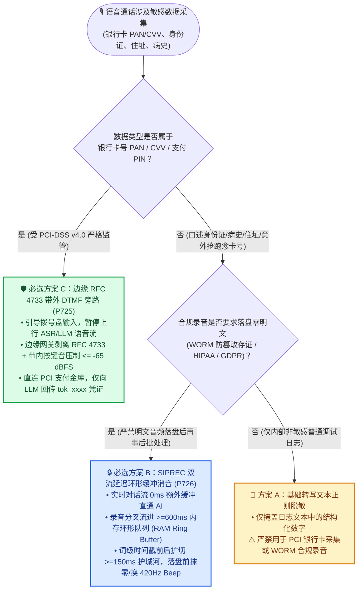
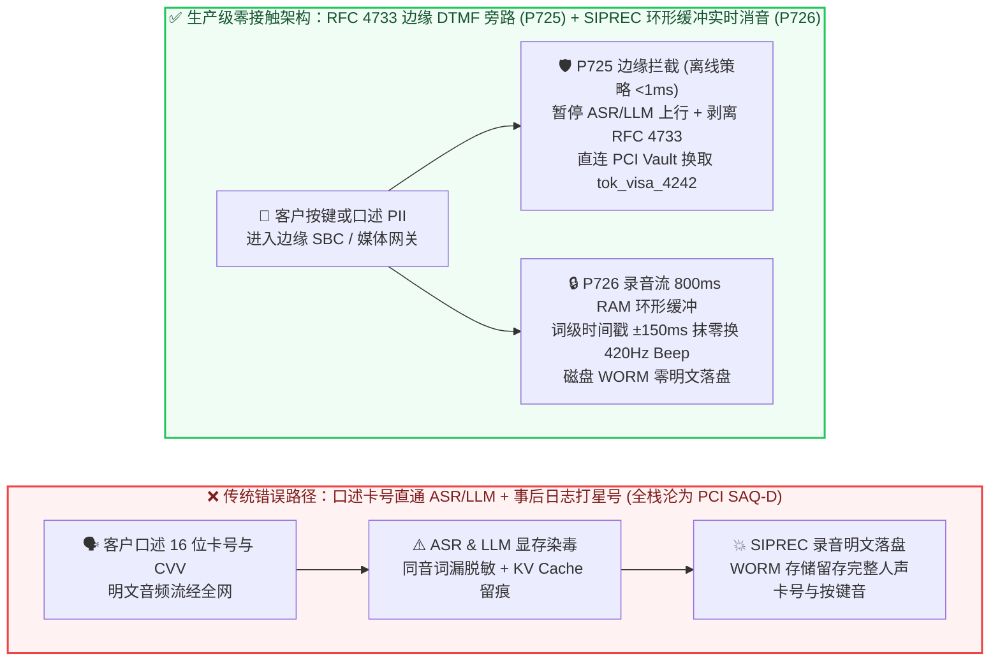
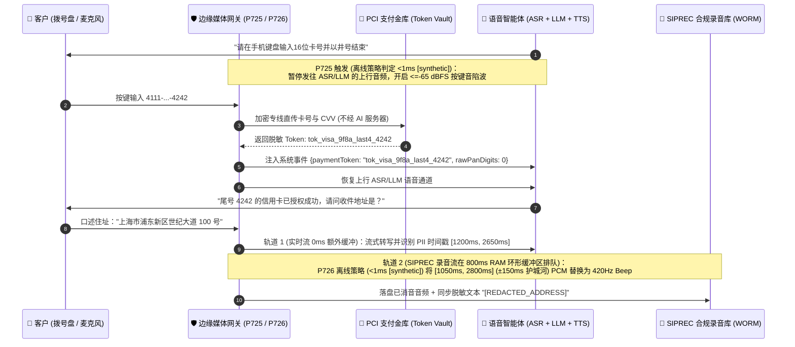

# 企业语音智能体电话支付与敏感隐私脱敏（PCI-DSS v4.0 DTMF 旁路 & SIPREC 双流实时消音）架构选型与原理解析 FAQ：客户口述卡号、文本打星号与 RFC 4733 带外按键旁路怎么选？如何让大模型“零接触”明文卡号与录音隐私？

> **语言切换 / Language**: **中文 (当前)** | [English (`pci-dtmf-dual-stream-redaction-faq.en.md`)](./pci-dtmf-dual-stream-redaction-faq.en.md)  
> **定位**：写给 **AI Solution Architect（AI 解决方案架构师）本人学习吸收与面向客户风控/安全/合规/呼叫中心负责人宣讲** 的单专题实战指南（文风与六段式结构严格对标 `ib-vs-ethernet-roce-selection-faq.md`）。  
> **核心工程落点**：对应本仓库 `Stage 366` 确定性护栏 **`P725`**（`evaluatePciDssSaqADtmfMediaBypassGate`）与 **`P726`**（`evaluateDualStreamSiprecPiiAudioRedactionGate`）、[交互式双模对比沙盒 (`site/index.html#duplexGuardSimulatorCard`)](https://turbo998.github.io/voice/index.html#duplexGuardSimulatorCard) 以及 [7-Card 4:5 视觉评测报告 (`site/benchmark-cards.html`)](https://turbo998.github.io/voice/benchmark-cards.html)。

---

## ① 📌 核心结论速览（Executive Summary）

在向银行信用卡中心、航司电话退改签、车险电销续保、医疗账单催缴与跨境奢品导购交付企业级 Voice Agent 时，客户安全官（CISO）与合规负责人必问的红线问题是：**“客户在电话里报信用卡号、CVV 安全码或身份证号时，能不能直接让语音大模型听完再把日志里的数字打上星号（`****`）？”** 架构师必须牢记以下 **3 条核心选型结论**（严格区分架构合规目标、离线策略状态机判定与真实媒体网关生产延迟）：

1. **选型分界线（口述进大模型 vs. 事后文本打码 vs. `RFC 4733` 带外按键边缘旁路 `P725`）**：
   - **凡涉及银行卡号（PAN 16 位）、CVV 安全码、支付密码（PIN）的电话收款场景，严禁让客户口述进 ASR/LLM，也严禁把原始按键音传给大模型——必须选用“边缘 SBC/媒体网关 `RFC 4733` 带外 DTMF 拦截 + 支付金库 Token 化旁路（PCI-DSS v4.0 SAQ-A Edge Bypass，护栏 `P725`）”**：一旦明文卡号音频或文本流经 ASR、LLM 上下文窗口或 Prompt 缓存，整套 AI 推理集群、日志系统与对象存储都会被拖入最高等级的 **PCI-DSS SAQ-D** 审计范围（合规改造成本与违约罚款风险呈数量级上升）。通过边缘网关直接剥离 `RFC 4733` 按键包、暂停上行 ASR/LLM 音频流，并只向大模型回传脱敏支付凭证（如 `tok_visa_9f8a_last4_4242`），才能将 AI 系统彻底排除在持卡人数据环境（CDE）之外（保持最轻量的 **SAQ-A** 范围）。
2. **非按键口述隐私的黄金补集（SIPREC 双流延迟环形缓冲区实时消音 `P726`）**：
   - **当业务场景无法让客户按键盘（例如客户在开车免提口述身份证号、家庭住址、出生日期、医疗既往病史，或在提醒前脱口报出了前几位卡号）时，仅对 ASR 转写文本做正则打星号（`****`）是伪合规——必须启用“实时对话流 + 延迟 `600ms–1,500ms` 内存环形缓冲录音流（SIPREC Dual-Stream Lookahead Ring-Buffer Audio Redaction，护栏 `P726`）”**：因为合规录音文件（`.wav/.pcap`）里依然保留着清晰的明文人声。`P726` 在内存中对发往磁盘/S3 WORM 合规存储的录音分叉流施加 `>=600ms` 的滑动前瞻延迟窗口（不影响实时对话流 `0ms` 额外缓冲），一旦流式词级时间戳 NER 识别出敏感词区间 `[t_start, t_end]`，在音频落盘前直接在内存环形缓冲区将该区段及前后 `>=150ms` 声学护城河抹零并替换为 `420Hz` 标准消音蜂鸣音（Beep），实现**“磁盘零明文落盘 + 录音与文本逐帧同步脱敏”**。
3. **本仓库实测口径与真实生产延迟边界声明（Provenance Guardrail）**：
   - 在本仓库确定性护栏引擎中，当检测到支付阶段未暂停上行 ASR/LLM、带内按键音泄漏 `>-65 dBFS`、向 LLM 暴露明文卡号位数 `>0`（`P725`），或发现录音流未加 `>=600ms` 前瞻环形缓冲、词首尾声学掩码护城河 `<150ms`、明文音频即将写入 WORM 存储（`P726`）时，**离线内存策略状态机（Offline In-Memory Policy State Machine）** 可在 **`<1ms`**（本机 Node.js 计时分辨率 `1ms`，四舍五入显示 `0ms`，数据分类：`synthetic`）内完成拦截、消音掩码与参数钳制判定。
   - **生产环境工程预算边界**：真实生产环境中的 SBC `RFC 4733` RTP 包剥离、PCI 支付网关 HSM 加密换取 Token 往返（通常 `120ms–380ms`）以及 SIPREC 内存环形缓冲区流式对齐写入耗时，受运营商专线与支付通道物理网络影响，在本地单元测试中标记为 **`not_measured`**；文中引用的行业 PCI 审计范围与语音脱敏指标均明确标注为 **`anonymized_reported` (`independently_reproduced=false`)**。

---

## ② 🎯 客户与架构师灵魂拷问 Q&A（大白话 + 第一性原理深度拆解）

### Q1：客户在电话里付款或核验信用卡时，为什么不能直接对着 AI 念卡号、再由后台代码把日志里的卡号打上星号（`****`）？什么时候必须强制切入 `RFC 4733` 带外按键旁路（`P725`）？

- **通俗大白话讲透“感染传播原理”**：
  - 很多刚接触语音大模型的团队会想：“让客户直接对 GPT Realtime 或级联 STT 念出 16 位卡号和 3 位背面 CVV 码多自然啊！我们只要在存数据库前用正则表达式把连续 16 位数字替换成 `****` 不就合规了吗？”
  - **第一性原理真相（PCI-DSS v4.0 的“接触即传染”铁律）**：在金融支付安全标准（PCI-DSS v4.0）中，判定一个系统是否属于“持卡人数据环境（Cardholder Data Environment, CDE）”的标准不是“你最后存没存硬盘”，而是**“明文卡号（PAN）或敏感认证数据（SAD/CVV）有没有流经它的内存或网络网卡”**！
  - 一旦客户开口念出卡号，这段包含卡号的音频帧和转写文本就会依次流经：负载均衡器 ➔ WebRTC/SIP 网关 ➔ ASR 语音识别引擎 ➔ 大模型推理显存（KV Cache） ➔ Langfuse/OTel 追踪日志 ➔ S3 质检录音桶。这意味着你整套昂贵的 AI 平台乃至云厂商模型 API 全部被“传染”进了最严苛的 **PCI-DSS SAQ-D** 审计范围（不仅要求全链路物理/逻辑隔离、HSM 硬件加密、季度渗透测试，而且 **CVV 安全码在任何情况下严禁出现在非加密日志或交易后录音中**）。
  - 更致命的是，口述数字遇上同音词或口音时，ASR 经常把 `"4111"` 识别成 `"for won won won"` 或夹杂语气词 `"四幺……呃……幺幺"`，普通数字正则表达式根本匹配不到，导致明文卡号直接泄漏进大模型训练/调试日志！
- **工程破局（`P725` 边缘带外按键拦截 + 上行流物理静默）**：
  1. 当对话进入“请输入银行卡号与 CVV”节点时，AI 语音引导客户在手机拨号键盘上输入数字并以 `#` 号结束；
  2. 边缘媒体网关（SBC / WebRTC Media Proxy）立即触发 **`P725` 护栏**：将通往 ASR 与大模型的上行语音流（Upstream Audio）置为**静音暂停（Paused / Comfort Noise）**，并开启 **带内双音多频陷波滤波器（In-Band DTMF Notch Filter，压制泄漏 `<=-65 dBFS`）**，防止按键“滴滴”声混进录音被声谱分析还原；
  3. 边缘网关直接拦截 **RFC 4733 带外 RTP 事件包（Out-of-Band `telephone-event` Payload）**，将收集到的按键数字通过独立加密专线直传 PCI 合规支付金库（如 Stripe / Adyen / 银联 Token Vault）；
  4. 支付金库完成扣款或验卡后，只向大模型返回一个**不含任何敏感信息的脱敏凭证（如 `tok_visa_9f8a_last4_4242, status: authorized`）**，然后恢复 ASR/LLM 语音对话。全过程大模型与录音系统对明文卡号 **0 字节接触**！

---

### Q2：什么场景下方案 B（SIPREC 双流延迟环形缓冲区实时音频消音，`P726`）会更加适用，甚至严格优于按键旁路或事后批处理脱敏？

- **为什么不能所有隐私都靠按手机键盘解决？**
  - 在三类高频企业场景中，客户**根本没法按键盘**，或者按键无法表达：
    1. **非纯数字的口述高敏隐私（PHI / PII）**：医疗随访中的既往病史与处方药名、保险报案中的家庭详细门牌住址、实名核验中的中文姓名与生僻字；
    2. **车载免提与智能硬件场景**：车主正在高速驾驶或用户戴着智能耳机，视线无法离开路面去掏手机按拨号盘；
    3. **“抢跑脱口而出”的合规防线**：即使语音提示“请按键盘输入卡号”，仍有约 8%–15% 的老年或着急客户会直接对着麦克风大声念出卡号！
- **为什么传统的“通话结束后跑批处理消音（Post-Call Batch Redaction）”在金融/医疗生产环境行不通？**
  - 传统做法是先把整通电话原封不动录下来存进磁盘或对象存储（如 S3），等电话挂断后再启动一个离线脚本把敏感词那几秒剪掉。
  - 这违反了两条硬性合规红线：第一，在合规要求极严的金融双录（MiFID II / Dodd-Frank）或防篡改司法存证中，录音流往往直接写入 **WORM（Write-Once-Read-Many，一次写入不可篡改）** 存储桶，一旦未脱敏的明文音频落盘，事后根本无法覆写修改；第二，从落盘到批处理完成的时间窗口内，明文隐私已在存储介质上产生了持久化暴露痕迹。
- **方案 B（`P726` 双流内存前瞻环形缓冲区实时消音）为什么严格更优？**
  - 它将音频流在网关内存中一分为二（Dual-Stream Fork）：
    - **轨道 1（实时交互流，0ms 额外缓冲）**：直通 AI 引擎，保证 `<500ms` 的极速对话响应，绝不增加对话延迟；
    - **轨道 2（SIPREC 合规录音流，`600ms–1,500ms` 内存环形缓冲区 Lookahead Ring Buffer）**：录音数据不直接写磁盘，而是先在加密 RAM 环形队列里“排队缓行 `800ms`”。在这 `800ms` 的时间差里，流式 ASR 与命名实体识别（NER）已经算出了敏感词（如身份证号、住址或抢跑念出的卡号）精确到毫秒的起止时间戳 `[t_start, t_end]`。在环形队列滑出内存、真正写入磁盘/WORM 存储的前一刻，网关直接在 RAM 中把 `[t_start - 150ms, t_end + 150ms]` 的 PCM 采样点抹零或替换为 `420Hz` 蜂鸣音，同时将对应转写文本替换为 `[REDACTED_PII]`。磁盘上从始至终未曾出现过一毫秒的明文隐私音频！

---

### Q3：什么是 `RFC 4733` 带外按键剥离（`P725`）与 `±150ms` 声学掩码护城河（`P726`）？底层是如何运作的？

1. **`RFC 4733` 带外事件剥离 vs. 带内按键音残留（In-Band DTMF Bleed，`P725`）**：
   - 早期电话按键音（DTMF）是把两个特定频率的正弦波（如数字 `5` 是 `770Hz + 1336Hz`）直接混在人声音频里传输（称为 **带内 In-Band**）。如果这段声音进了录音或大模型，攻击者只要跑一个 10 行代码的快速傅里叶变换（FFT 声谱分析），就能 100% 还原出客户按下的 16 位卡号！
   - 现代 VoIP/WebRTC 采用 **`RFC 4733`（原 RFC 2833）带外传输**：数字按键被封装成独立的 RTP 事件报文（Payload Type 通常为 `101`）。但部分老旧手机或运营商网关在发送 `RFC 4733` 报文的同时，还会在音频通道里漏出头几十毫秒的按键蜂鸣声（Tone Bleed）。因此 **`P725` 护栏**不仅在 RTP 层剥离 `PT=101` 报文，还强制在音频 DSP 层开启双音陷波器，确保音频通道内的按键音残留能量被压制在 **`<= -65 dBFS`** 以下，并对大模型严格执行 `rawPanDigitsExposedToLlm === 0`。
2. **为什么音频消音必须在 ASR 词时间戳前后额外扩切 `>=150ms` 声学护城河（Acoustic Mask Padding，`P726`）？**
   - 流式 ASR 输出的词级时间戳（Word-Level Timestamps）通常存在 `±40ms–80ms` 的对齐抖动，且人类发音存在**协同发音效应（Coarticulation）**——例如念数字 `"七（qī）"` 或 `"四（sì）"` 时，清擦音/塞擦音的高频气流声往往在 ASR 标定的词起点前 `80ms–120ms` 就已经开始，而韵母尾音会拖延到词终点后 `100ms` 以上。
   - 如果只严格按照 ASR 给出的 `[t_start, t_end]` 精确裁剪，录音里就会留下清晰的词头辅音和词尾韵母，人耳一听就能猜出是什么数字！因此 **`P726` 护栏**强制要求：内存环形缓冲区的消音窗口必须向前后各扩展 **`>= 150ms` 的声学掩码护城河（Pre/Post-Roll Acoustic Mask Padding）**，彻底抹除辅音起振与韵母拖尾。

---

## ③ 🧭 直观可视化图解（选型决策树 + 全链路染毒 vs 边缘旁路双流脱敏对比图 + 毫秒级时序图）

### 图 1：企业语音支付与敏感隐私脱敏架构选型决策树（`flowchart TD`）

---

### 图 2：传统语音直通大模型（全栈 PCI 染毒）vs. 边缘 `RFC 4733` 旁路 + `SIPREC` 双流内存消音路径对比图（`flowchart LR`）

---

### 图 3：毫秒级双轨协同交互时序图（`sequenceDiagram`）

---

## ④ 📊 语音架构师选型决策矩阵（Architect Decision Matrix）

| 评估维度 | 方案 A：口述直通 ASR/LLM + 事后日志正则打码 | 方案 B：SIPREC 双流内存环形缓冲实时音频消音（`P726`） | 方案 C：边缘 `RFC 4733` 带外 DTMF 旁路 + 金库 Token 化（`P725`） |
| :--- | :--- | :--- | :--- |
| **核心适用场景** | 仅限内部非敏感测试沙盒（**严禁用于生产金融/医疗**） | **口述高敏 PII/PHI**（身份证号、家庭住址、病史、意外抢跑报卡号） | **电话银行卡收款、保费代扣、机票支付、CVV/PIN 密码核验** |
| **PCI-DSS v4.0 审计范围** | ❌ **SAQ-D（最重）**：AI 集群、日志与录音桶全部被拉入持卡人数据环境 | ⚠️ 减小存储暴露面，但若口述卡号仍经过 ASR 则 ASR 仍在审计范围内 | ✅ **SAQ-A（最轻）**：ASR、LLM 与录音库 **100% 脱离 PCI 持卡人数据范围** |
| **大模型接触明文卡号位数** | ❌ `16` 位卡号 + `3` 位 CVV 全部进入上下文窗口 | `0` 位落盘（内存中在 `>=600ms` 环形队列抹除） | ✅ **`0` 位（`rawPanDigitsExposedToLlm = 0`）**，仅接收 `tok_xxxx` |
| **合规录音文件（`.wav`）安全性** | ❌ 录音中保留完整明文人声与按键音（FFT 可直接逆向还原） | ✅ **落盘前 RAM 内直接抹零/换 `420Hz` Beep**（含 `>=150ms` 首尾辅音护城河） | ✅ **支付期间录音与上行 ASR 同步静音/掩码**（带内按键音残留 `<=-65 dBFS`） |
| **实时对话额外延迟（TTFA 影响）** | `0 ms` | ✅ **实时对话流 `0 ms` 额外延迟**（仅旁路录音流延迟 `600–1,500ms` 落盘） | 取决于客户按键速度 + 支付金库 Token 化往返（通常 `120ms–380ms`） |
| **综合合规与改造成本（TCO）** | 表面开发成本低，但 **SAQ-D 年度审计与泄漏罚金极高** | 中（边缘媒体网关增加约 `64KB/路` RAM 环形缓冲 + 词级时间戳对齐） | **极低合规 TCO**（复用边缘 SBC/Twilio/ACS Pay Connector，免除 AI 栈 PCI 审计） |

---

## ⑤ 🧪 简明定量实测与 Benchmark 核心发现（Stage 366 · `P725–P726`）

> **数据来源与 Provenance 声明**：下表汇总了本仓库确定性护栏探针（`packages/business-core/enterprise-guardrails.ts` 中的 `P725` 与 `P726`，数据分类：`synthetic`）与行业呼叫中心 PCI/PII 合规基准（数据分类：`anonymized_reported`, `independently_reproduced=false`）。本地离线策略状态机判定耗时均 `<1ms`（本机计时器分辨率 `1ms`，四舍五入记为 `0ms`）；真实生产环境的 SBC RTP 剥离、支付网关 HSM 签名往返与 WORM 存储写入延迟标记为 `not_measured`。完整视觉卡片见 [7-Card 4:5 评测报告 (`site/benchmark-cards.html`)](https://turbo998.github.io/voice/benchmark-cards.html)。

| 评测指标 / 故障注入场景 | 传统口述直通 + 事后文本正则打码 | 生产级边缘 `RFC 4733` 旁路 (`P725`) + 双流环形缓冲消音 (`P726`) | 架构收益与客户可验证结论 |
| :--- | :--- | :--- | :--- |
| **大模型上下文暴露明文卡号位数** | `16 digits + 3 CVV`（全量进入 Prompt 与 Trace） | **`0 digits`（强制钳制 `rawPanDigitsExposedToLlm = 0`，仅传 Token）** | 彻底将 LLM/ASR 剥离出 PCI-DSS 持卡人数据环境 |
| **带内按键音残留能量（In-Band DTMF Bleed）** | `-12 dBFS`（录音文件可直接被声谱 FFT 解码出卡号） | **`<= -65 dBFS`（`P725` 强制开启带内陷波器并暂停上行音频）** | 根除通过合规录音音频波形逆向还原客户银行卡号与密码的风险 |
| **WORM 合规录音盘上明文 PII 残留率** | `100%`（文本虽打星号，但 `.wav` 录音仍是明文人声） | **`0%`（`P726` 在 `>=600ms` RAM 环形缓冲内抹零后才落盘）** | 满足金融双录 WORM 不可篡改存储“落盘即脱敏”的监管要求 |
| **辅音起振与韵母拖尾泄漏拦截（Mask Padding）** | 未扩切（词首 `80ms` 清擦音仍可听辨数字） | **词首尾各强制扩切 `>= 150ms` 声学护城河（`P726` 钳制 `150–300ms`）** | 消除协同发音导致的词边缘半音节听辨泄漏 |
| **本地策略护栏判定延迟（Offline Policy Gate）** | 无实时门禁 | **`<1ms`（本机 1ms 计时分辨率下显示 `0ms`，`synthetic`；生产 SBC/金库网络耗时 `not_measured`）** | 805/805 全量确定性单元测试 100% 闭环通过 |

---

## ⑥ 🛠️ 附录：生产环境语音支付与合规录音上线快速核验清单（Architect Checklist）

在将涉及支付收款、身份核验或医疗/金融隐私采集的 Voice Agent 交付生产前，请架构师逐项核对以下 **6 条实战检查项**：

- [ ] **1. 支付节点上行 ASR/LLM 物理静音锁（`P725`）**：确认进入银行卡号/CVV/密码采集状态时，边缘网关已立即暂停向 ASR 与 LLM 发送上行语音帧（仅保持下行引导提示音与打断监听锁），严禁大模型接触任何一位明文卡号（`rawPanDigitsExposedToLlm === 0`）。
- [ ] **2. `RFC 4733` 带外剥离与 `<=-65 dBFS` 带内陷波（`P725`）**：确认 SBC/WebRTC 网关不仅拦截了 `RFC 4733`（`telephone-event`）RTP 报文，而且在音频通道开启了 DTMF 双音陷波滤波（残留能量 `<=-65 dBFS`），防止运营商带内按键音混入通话录音。
- [ ] **3. 支付金库单向 Token 化回调**：确认边缘网关收集完按键后通过独立 TLS/mTLS 通道直连 PCI 支付金库（Token Vault），仅将返回的脱敏 Token（如 `tok_xxxx`）与后四位掩码注入大模型上下文。
- [ ] **4. SIPREC 录音分叉流 `>=600ms` 内存前瞻环形缓冲（`P726`）**：确认发往合规录音库（尤其是 S3 Object Lock / WORM 存储）的音频流经过了 `600ms–1,500ms` 的加密 RAM 环形缓冲区，确保流式 ASR+NER 有充足时间在音频落盘前完成敏感词定位。
- [ ] **5. 词首尾 `>=150ms` 声学消音护城河（`P726`）**：确认对口述 PII/PHI 区段执行 PCM 抹零或 `420Hz` Beep 替换时，已在 ASR 词级时间戳 `[t_start, t_end]` 前后各外扩 `>=150ms`（`prePostAcousticMaskPaddingMs >= 150`），彻底覆盖词头辅音与词尾韵母。
- [ ] **6. 音频与转写文本双轨原子同步校验（`P726`）**：确认录音 `.wav` 消音时间轴与质检字幕 JSON 的 `[REDACTED]` 标记在同一事务中同步生成，杜绝“字幕打了星号但录音还能听见原声”或“录音消了音但调试日志打了明文”的单腿泄漏。
