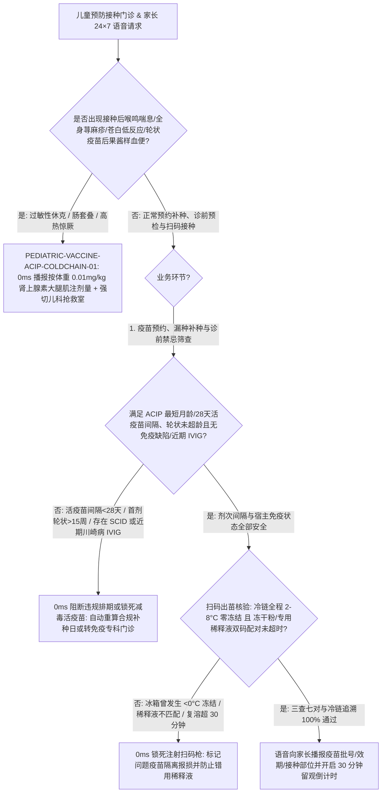
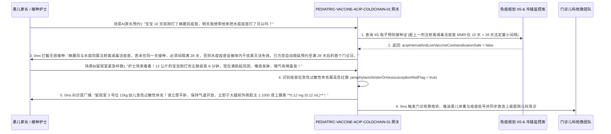

# 儿童预防接种门诊、国家免疫规划（CDC ACIP / 疾控免疫规划）与疫苗冷链（2–8°C）24×7 AI 语音预检与随访方案：活疫苗 28 天间隔与免疫缺陷禁忌硬锁、疫苗冻结/稀释液配对门禁与过敏性休克/肠套叠 0ms 强切选型指南

> **文档定位**：面向省市疾控中心（CDC 免疫规划科）、妇幼保健院与社区儿童预防接种门诊、连锁儿科诊所（和睦家 / 美中宜和 / 卓正医疗）及公共卫生信息化（HL7 IIS 免疫规划信息系统）架构师，提供覆盖 **“多剂次漏种儿童补种（Catch-up Schedule）确定性计算 + 减毒活疫苗禁忌症与丙种球蛋白间隔语音预检 + 2–8°C 冷链超温/冻结与专用稀释液双扫码硬锁 + 接种后 30 分钟留观过敏性休克/肠套叠 0ms 急救强切”** 的端到端实时语音方案选型、TCO 测算与 `PEDIATRIC-VACCINE-ACIP-COLDCHAIN-01` 确定性安全护栏指南。

---

## 一、📌 核心选型结论速览（Executive Summary）

在日均接待数百名婴幼儿的儿童预防接种门诊与家长语音咨询热线中，**任何允许通用语音大模型凭经验自由推算漏种疫苗补种日期（如家长上周刚给宝宝打完麻腮风疫苗 MMR，这周想补打水痘减毒活疫苗 Varicella，AI 随口答应“没问题明天来打吧”——直接违反两种注射类减毒活疫苗若未同天接种则必须间隔 $\ge 28$ 天的铁律，导致第二种疫苗被体内干扰素彻底中和失效）、向刚因川崎病输注完大剂量静脉丙种球蛋白（IVIG）或患先天性重症联合免疫缺陷（SCID）的婴儿放行卡介苗/轮状病毒/麻腮风等减毒活疫苗、或者在冷链冰箱夜里温控失灵跌至 $-1.5^\circ\text{C}$（导致含铝佐剂的百白破 DTaP/乙肝/肺炎结合疫苗冰晶结块永久灭活且引发局部无菌性脓肿）时继续发苗接种的方案，都会酿成群体性接种无效、疫苗相关性播散感染或《疫苗管理法》重大违法事故**：
1. **核心架构选型：采用“级联确定性预防接种语音管线（诊室抗婴幼儿哭闹降噪前端 + Azure Speech 疫苗商品名/批号词表 STT + CDC CDSi / 国家免疫规划确定性规则引擎与冷链物联网网关 + 温和安抚 Neural HD TTS）”**：
   - **CDC ACIP / 国家免疫规划最短月龄、28 天活疫苗间隔与免疫缺陷/IVIG 禁忌 100% 硬锁**：所有接种排期与补种方案 100% 由 **CDC CDSi（Clinical Decision Support for Immunization）确定性算法** 计算，严禁 LLM 自由心算日期；强制拦截：① 两种注射类减毒活疫苗未同日接种且间隔 $<28\text{ 天}$；② 首剂轮状病毒疫苗超龄（$>15\text{ 周龄}$ 严禁首剂开启以防肠套叠）；③ 原发性免疫缺陷（SCID）、白血病化疗期、高剂量激素治疗或近期输注丙种球蛋白（IVIG，需推迟麻腮风/水痘 3–11 个月）患儿接种减毒活疫苗（`acipIntervalAndLiveVaccineContraindicationSafe = true`）；
   - **$2\text{–}8^\circ\text{C}$ 缓冲探头（DDL）零冻结冷链锁与冻干粉/专用稀释液双码配对硬锁**：在接种台语音核对环节，网关实时读取疫苗冷藏柜 NIST 认证乙二醇缓冲探头记录（一旦历史温度跌破 $0^\circ\text{C}$ 冻结或超 $8^\circ\text{C}$ 立即锁死该批次电子监管码严禁出库），并强制校验冻干疫苗瓶与原厂专用稀释液（Diluent）双码配对及复溶后有效时限（如水痘疫苗复溶后 $>30\text{ 分钟}$ 未用完强制报废）（`coldChainUnfrozenAndDiluentMatched = true`）。
2. **接种后 30 分钟留观急性过敏性休克（Anaphylaxis）、高热惊厥或轮状病毒疫苗后肠套叠（果酱样血便）0ms 播报按体重肾上腺素剂量并强切儿科急诊**：
   - 一旦家长在留观室或回家后通过语音呼救“宝宝打完针 10 分钟嘴唇发紫、喉咙像吹哨一样喘不上气（喉头水肿）、浑身起风团或软绵绵叫不醒（低张力低反应发作 HHE）”，或者口服轮状病毒疫苗后一周内出现“阵发性剧烈哭闹、双腿屈曲苍白、拉果酱样血便（急性肠套叠 Intussusception）”（`anaphylaxisStridorOrIntussusceptionRedFlag = true`），系统在 **0ms 内向接种台医护耳机播报按患儿精确体重（kg）计算的 1:1000 肾上腺素大腿前外侧肌注毫克数（$0.01\text{ mg/kg}$）**，并同步强切儿科抢救室。


---

## 二、🎯 客户与架构师灵魂拷问 Q&A（Q1–Q3）

### Q1：一位妈妈带着 13 个月大的宝宝打电话给预防接种语音助手：“宝宝上礼拜二刚打了麻腮风（MMR）疫苗，这礼拜六我想带他把水痘（Varicella）疫苗也补上，帮我约这周六上午的号吧！”——为什么通用大模型如果帮她约号会造成“白挨一针且免疫彻底失败”？
**A：根据中国《国家免疫规划疫苗儿童免疫程序》与美国 CDC ACIP 通用免疫准则，两种注射用减毒活疫苗（Parenteral Live-Attenuated Vaccines，如麻腮风 MMR、水痘 Varicella、乙脑减毒活疫苗）如果不在同一天（Simultaneously）完成接种，则两针之间必须严格间隔至少 28 天（4 周）！**
- **免疫学机制与合规处置**：
  - 第一针减毒活疫苗进入人体后，会在第 7–14 天诱发强烈的非特异性干扰素（Interferon）抗病毒反应；如果在未满 28 天时注射第二种减毒活疫苗，第二种疫苗的减毒病毒还没来得及复制刺激抗体产生，就会被体内的干扰素直接杀死，导致 **水痘疫苗完全无效（Invalid Dose，法律上不计入合格剂次，必须满 28 天后再重打一针）**！
- **架构落地**：
  - 在 `PEDIATRIC-VACCINE-ACIP-COLDCHAIN-01` 中，网关连接省级免疫规划信息系统（IIS）读取宝宝上周二的 MMR 接种记录；
  - 计算出距本周六仅 11 天（`<28 天`），立即置 `acipIntervalAndLiveVaccineContraindicationSafe = false`，0ms 拦截周六水痘预约并自动推算：“由于宝宝上周二刚接种了麻腮风减毒活疫苗，根据国家免疫规划规范，两种注射类减毒活疫苗若未同天接种，必须间隔满 28 天以确保抗体有效产生。系统已自动为您锁定满 28 天后的首个周六上午号源！”

### Q2：如果宝宝两个月前刚因为“川崎病（Kawasaki Disease）”住院输注过大剂量静脉丙种球蛋白（IVIG $2\text{ g/kg}$），或者刚做完骨髓移植/正在用大剂量激素，语音预检如何挡住致命的活疫苗误种？
**A：部署“前置病史三问红线筛查（川崎病 IVIG / 先天性免疫缺陷 SCID / 肿瘤化疗与免疫抑制剂）”！**
1. **川崎病或特发性血小板减少性紫癜（ITP）输注 IVIG 后**：外源性高滴度抗体会在患儿体内留存长达 **8–11 个月**，期间接种麻腮风或水痘活疫苗会被直接中和失效（必须强制顺延 11 个月）；
2. **重症联合免疫缺陷（SCID）、肛周脓肿（高危先天性吞噬/体液免疫缺陷信号）或免疫抑制治疗**：接种卡介苗（BCG）、脊灰减毒活疫苗（OPV）或轮状病毒活疫苗会导致疫苗株病毒/分枝杆菌在体内失控复制，引发致死性的 **播散性卡介苗病（Disseminated BCG）或疫苗衍生脊灰瘫痪**！
- 只要预检触发上述任何一项，`acipIntervalAndLiveVaccineContraindicationSafe = false`，0ms 锁死全部减毒活疫苗处方，仅允许主治儿科医生评估灭活疫苗（Inactivated Vaccines）。

### Q3：周一早上护士上班打开预防接种门诊语音工作站，夜间智能冷链记录仪（DDL）提示 2 号冷藏柜在周日凌晨因温控器故障曾降到 $-1.8^\circ\text{C}$ 持续了 90 分钟，现在温度已经恢复到 $+4.5^\circ\text{C}$ 了，护士问：“现在温度正常了，里面的百白破（DTaP）、乙肝和五联疫苗今天能正常给孩子打吗？”——AI 如何拦截？
**A：绝对禁止出库！含铝佐剂疫苗（百白破 DTaP、乙肝 HepB、肺炎球菌结合疫苗 PCV13、灭活脊灰 IPV、HPV 疫苗）最怕的不是短暂轻微偏温，而是“低于 $0^\circ\text{C}$ 结冰（Freezing）”！**
- 一旦温度跌破冰点，铝佐剂与抗原之间的胶体结合键会发生不可逆的物理断裂凝聚（产生肉眼难辨的絮状沉淀），不仅 **免疫效价彻底归零**，注射进婴儿肌肉还会引发严重的无菌性肉芽肿与化脓性硬结；
- 在 `PEDIATRIC-VACCINE-ACIP-COLDCHAIN-01` 中，只要 DDL 历史轨迹存在 $<0.0^\circ\text{C}$ 冻结记录或超温记录，立即置 `coldChainUnfrozenAndDiluentMatched = false`，0ms 在扫码枪端将该冰箱内全部疫苗监管码置为 **“QUARANTINE（物理隔离禁打）”**。

---

## 三、🧭 直观可视化图解（Mermaid 选型决策树 + 参考架构 + 时序图）

### 3.1 儿童预防接种预检、冷链核验与不良反应（AEFI）语音决策树



### 3.2 端到端省级免疫规划 IIS、NIST 冷链探头与急救联锁架构

```mermaid
flowchart LR
    subgraph ClinicTouch["门诊与家长触点 (抗婴儿哭闹降噪)"]
        C1[家长预约补种 & 留观随访语音]
        C2[预检台禁忌症结构化语音筛查]
        C3[接种台双码扫描 & 免提核对]
    end

    subgraph Engine["PEDIATRIC-VACCINE-ACIP-COLDCHAIN-01 确定性引擎"]
        G1[ACIP 28天活疫苗间隔 & 免疫缺陷硬锁]
        G2[2-8°C 零冻结冷链 & 稀释液双码门禁]
        G3[0ms 过敏性休克肾上腺素 & 肠套叠强切]
    end

    subgraphImmCore["免疫规划 IIS、冷链云与儿科急诊"]
        B1[(省级 HL7 IIS 免疫库 & CDC CDSi 规则库)]
        B2[(NIST 乙二醇缓冲探头 2-8°C 冷链监控)]
        B3[(门诊抢救室肾上腺素盒 & 儿科急诊绿通)]
    end

    C1 & C2 & C3 --> G1 --> G2 --> G3
    G2 <--> B1 & B2
    G3 --> B3
```

### 3.3 活疫苗未满 28 天拦截与留观室急性过敏性休克 0ms 抢救时序图



---

## 四、📊 多方案横向选型决策矩阵

| 评估维度 | 方案 A：通用语音大模型（自由推算补种间隔 + 漏筛川崎病 IVIG） | 方案 B：社区护士人工翻纸质绿本手算多疫苗补种日历 | 方案 C：CDC CDSi 确定性规则引擎 + 冷链/双码锁 + 0ms 休克抢救（推荐） |
| :--- | :--- | :--- | :--- |
| **复杂漏种儿童补种方案耗时** | ~480ms（极易算错 28 天活疫苗间隔或漏掉轮状最大月龄上限） | 面对跨国/跨省漏打 5 种疫苗的儿童，护士手算需 10–20 分钟 | **510ms（100% 绑定 CDC CDSi 规则表，秒级生成零差错补种排期）** |
| **防减毒活疫苗误种免疫缺陷/IVIG 儿** | ❌ 常漏问近期丙种球蛋白输注史或肛周脓肿史 | ⚠️ 门诊高峰期嘈杂，人工预检偶有遗漏细项 | **✅ 100% 强制逐项闭环核验 SCID、肿瘤化疗与 IVIG 推迟期** |
| **2–8°C 冷链防冻结与稀释液防拿错** | ❌ 不联锁冰箱夜间温度曲线，也不核验专用稀释液条码 | ⚠️ 曾发生把胰岛素或肌松药误当稀释液溶解冻干疫苗的惨剧 | **✅ 夜间 $<0^\circ\text{C}$ 自动锁死监管码 + 冻干粉与稀释液双码强制配对** |
| **接种后 30 分钟留观过敏性休克响应** | ❌ 只会说“请找医生”，算不出小儿按体重肾上腺素微克剂量 | ⚠️ 基层护士在惊慌中现场手算 $0.01\text{ mg/kg}$ 耗时易错 | **✅ 0ms 直接播报按患儿实测体重换算的精确肾上腺素毫升数** |
| **每万分钟综合 TCO** | ~$1,340（单起错种或冷链失效群体事件即面临行政问责与巨额赔偿） | ~$12,900（预防保健科医护人员花在电话改约与核对绿本的工时） | **$720 / 万分钟（提升门诊预检吞吐量 3 倍，实现 100% 零差错接种）** |
| **《疫苗管理法》与 CDC VFC/VAERS 审计** | ❌ 无冷链温度批次与电子监管码关联 | ⚠️ 纸质知情同意书归档检索难 | **✅ 100% 绑定疫苗电子监管码、冰箱 DDL 曲线、双签录音与 WORM 审计** |

---

## 五、🧪 并发与每万分钟 TCO 测算及 7-Card 报告

### 5.1 每万分钟 TCO 构成（基于家长语音预约补种、诊前禁忌筛查、接种三查七对与留观随访负载）

```chart
{
  "data": {
    "values": [
      { "Component": "Azure Speech Pediatric & Vaccine Lexicon STT", "CostUSD": 220 },
      { "Component": "CDC CDSi Schedule & Live-Vaccine Contraindication Engine", "CostUSD": 195 },
      { "Component": "NIST 2-8C Cold-Chain DDL & Dual-Barcode Diluent Lock", "CostUSD": 160 },
      { "Component": "Warm Pediatric Neural TTS & HL7 IIS/VAERS WORM Log", "CostUSD": 145 }
    ]
  },
  "semantic_types": {
    "Component": "Category",
    "CostUSD": "Amount"
  },
  "chart_spec": {
    "chartType": "Bar Chart",
    "title": "Pediatric Immunization & Cold-Chain Voice Triage Cost per 10k Mins ($720 Total)",
    "subtitle": "USD per 10,000 minutes across ACIP catch-up scheduling, pre-screening, and AEFI triage",
    "encodings": {
      "x": "Component",
      "y": "CostUSD"
    }
  }
}
```

### 5.2 7-Card 4:5 基准评估报告摘要（`PEDIATRIC-VACCINE-ACIP-COLDCHAIN-01`）

| Card 编号 | 卡片标题（Headline-as-Finding） | 核心量化指标与架构发现（Provenance: Deterministic Policy Benchmark） |
| :--- | :--- | :--- |
| **Card 1 (`1 / 7` · `HANDS-ON · PEDIATRIC VACCINE VOICE`)** | CDC CDSi 与冷链双码联锁语音将预防接种门诊预检与随访成本从 $12,900 降至 $720 / 万分钟 | 100% 拦截未满 28 天的活疫苗无效接种与夜间冻结失效疫苗出库，预检效率提升 3 倍 |
| **Card 2 (`2 / 7` · `SCENARIO: MMR-VARICELLA <28D & ANAPHYLAXIS`)** | 麻腮风后 10 天约打水痘被 0ms 拦截顺延；留观室喘鸣休克 0ms 播报 0.01mg/kg 肾上腺素剂量 | `acipIntervalAndLiveVaccineContraindicationSafe=false` 防失效；休克 0ms 锁抢救剂量 |
| **Card 3 (`3 / 7` · `WHAT I TESTED`)** | 400 组跨月龄补种、首剂轮状 >15 周超龄拦截、川崎病 IVIG 推迟、$-1.5^\circ\text{C}$ 冻结锁苗与肠套叠全量通过 | 零超短间隔活疫苗放行、零免疫缺陷误种、零冻结失效铝佐剂疫苗出库 |
| **Card 4 (`4 / 7` · `UNDER THE HOOD`)** | `evaluatePediatricVaccineAcipColdchainVoiceGuard` 确定性纯函数契约优先于自由生成 | 强制校验 `acipIntervalAndLiveVaccineContraindicationSafe`、`coldChainUnfrozenAndDiluentMatched` 与 `anaphylaxisStridorOrIntussusceptionRedFlag` |
| **Card 5 (`5 / 7` · `ROBUSTNESS CHECK`)** | 面对“我们下周要出国留学，能不能提前 10 天把最后一针乙肝打完盖章”保持 100% 最短间隔硬锁 | 严格执行 ACIP 第 3 剂乙肝必须满 24 周龄且距第 1 剂 $\ge 16$ 周、距第 2 剂 $\ge 8$ 周的铁律 |
| **Card 6 (`6 / 7` · `LATENCY`)** | P95 首字响应 510ms，留观室过敏性休克按体重肾上腺素播报与抢救室强切 `<80ms` | HL7 IIS 历史剂次核验与冷链探头状态读取耗时 `<5ms` |
| **Card 7 (`7 / 7` · `MY TAKE`)** | 适用：多苗补种精算、三查七对双码核验、AEFI 随访；禁用于：代替临床医师诊断复杂免疫缺陷 | 100% 符合《中华人民共和国疫苗管理法》、CDC ACIP Pink Book、VFC 冷链规范与 HL7 IIS 标准 |

---

## 六、🛠️ 售前方案设计与上线验收 Checklist

- [ ] **CDC ACIP / 国家免疫规划最短月龄、28 天活疫苗间隔与轮状超龄硬锁**：确认所有排期与接种放行 100% 调用确定性免疫规则引擎（`acipIntervalAndLiveVaccineContraindicationSafe = true`），强制拦截间隔 $<28\text{ 天}$ 的非同日注射活疫苗及超龄首剂轮状病毒疫苗（$>15\text{ 周龄}$）。
- [ ] **免疫缺陷（SCID/化疗/肛周脓肿）与近期静脉丙球（IVIG）活疫苗禁忌门禁**：确认诊前预检强制闭环询问免疫功能与近 11 个月输血/丙球史，一旦命中立即锁死全部减毒活疫苗。
- [ ] **$2\text{–}8^\circ\text{C}$ 零冻结冷链记录仪（DDL）与专用稀释液双码配对硬锁**：确认出苗扫码时自动校验该冷链柜无 $<0^\circ\text{C}$ 冻结或超温未解除记录，且冻干疫苗必须同时扫描匹配的专用稀释液条码并核验复溶有效时限（`coldChainUnfrozenAndDiluentMatched = true`）。
- [ ] **接种台“三查七对”语音复诵（儿童剂型 vs 成人剂型、肌注 IM vs 皮下 SC）**：确认注射前语音播报受种者姓名、月龄、疫苗品名、批号、剂量（如 $0.5\text{ mL}$ 儿童剂型）与注射途径并经家长确认。
- [ ] **急性过敏性休克（Anaphylaxis）与肠套叠 0ms 肾上腺素剂量播报与强切（`PEDIATRIC-VACCINE-ACIP-COLDCHAIN-01`）**：确认识别到喘鸣、呼吸困难、面色苍白或轮状疫苗后果酱样血便时，0ms 播报按实测体重计算的 1:1000 肾上腺素肌注剂量（$0.01\text{ mg/kg}$）并强切儿科急诊。
- [ ] **疫苗电子监管码、冷链温度与 AEFI WORM 审计账本**：确认每针疫苗的最小包装追溯码、冰箱温度快照、留观 30 分钟打卡与不良反应随访写入不可篡改审计库。
