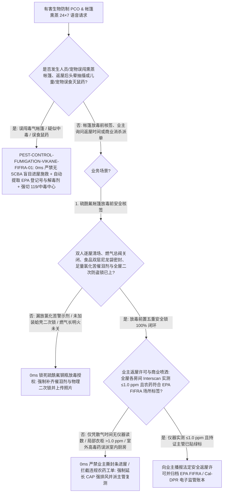
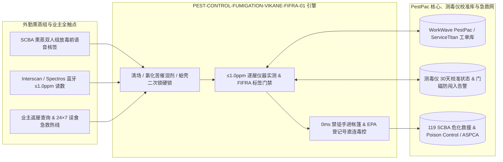
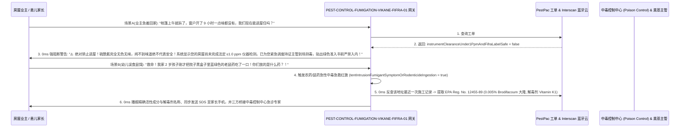

# 商业有害生物防制（Pest Control：Rentokil 能多洁 / Terminix / Orkin / 艺康 Ecolab）与建筑帐篷熏蒸（硫酰氟 Vikane）24×7 AI 语音调度方案：氯化苦催泪警示剂与二次防盗门锁硬锁、≤1.0 ppm 仪器实测散气返屋门禁与误闯熏蒸帐篷/误食鼠药 0ms 强切选型指南

> **文档定位**：面向跨国有害生物防制与公共卫生消杀集团（Rentokil Initial 能多洁 / Terminix / Orkin / Rollins / 艺康 Ecolab）、白蚁建筑整体帐篷熏蒸（Structural Tent Fumigation）工程队及外勤服务管理（WorkWave PestPac / ServiceTitan）AI 解决方案架构师，提供覆盖 **“建筑整体硫酰氟（Sulfuryl Fluoride / Vikane）帐篷熏蒸放毒前清场、氯化苦（Chloropicrin）催泪警示剂与二次物理锁（Secondary Clamshell Lock）100% 硬锁 + 散气后 Interscan/Spectros 红外分析仪逐房间实测 ≤1.0 ppm 返屋许可门禁 + EPA FIFRA 农药标签适用场所核验 + 人员/宠物误闯熏蒸区或幼儿误食抗凝血鼠药 0ms 强切 SCBA 消防与中毒控制中心”** 的端到端实时语音方案选型、TCO 测算与 `PEST-CONTROL-FUMIGATION-VIKANE-FIFRA-01` 确定性护栏指南。

---

## 一、📌 核心选型结论速览（Executive Summary）

在涵盖干木白蚁/臭虫整栋建筑帐篷熏蒸（使用无色无味、高穿透性神经毒气 **硫酰氟 Sulfuryl Fluoride / Vikane** 或磷化氢）与医院/食品厂/住宅日常消杀的有害生物防制（PCO）行业中，**由于硫酰氟本身完全无色无臭，一旦业主、儿童或盗贼在熏蒸或散气期间私自钻进帐篷，几分钟内就会在毫无察觉中发生肺水肿与中枢神经麻痹死亡；任何允许通用语音大模型在未核验投加“氯化苦（Chloropicrin）催泪警示剂”及“全屋外门二次物理防撬锁”前放行开启钢瓶充毒、或者在拆掉帐篷散气满 12 小时后仅凭时间推算就在电话里口头告诉业主“帐篷拆了满半天了，你们一家人今晚可以回屋睡觉了”（未经校准的 Interscan 仪器逐房间实测 $\le 1.0\text{ ppm}$ 并张贴法定返屋许可证）的方案，都会酿成灭门级急性熏蒸气体中毒、重度神经后遗症或违反 EPA FIFRA 联邦法律的刑事重罪**：
1. **核心架构选型：采用“级联确定性消杀与熏蒸安全语音管线（外勤抗风噪耳麦 + Azure Speech 农药 EPA 登记号与活性成分词表 STT + WorkWave PestPac / EPA FIFRA 确定性合规引擎 + 权威清晰安全警示 Neural HD TTS）”**：
   - **硫酰氟帐篷放毒前“双人清场 + 氯化苦（Chloropicrin）催泪剂 + 二次外门锁（Secondary Lock）”100% 硬锁**：开启硫酰氟钢瓶主阀前，网关强制要求两名持证熏蒸技师（携带正压式空气呼吸器 SCBA）通过语音逐项核签：① 逐房间清场确认无人无宠物无绿植，所有未开封食品/药品已装入专用双层尼龙阻隔袋（Nylo-Fume Bags）且燃气公司已切断房屋主燃气阀；② 已按立方英尺体积足量布设蒸发盘并投加 **氯化苦催泪警示剂（Chloropicrin，使任何靠近或试图钻入帐篷的人瞬间流泪咳嗽逃离）**；③ 所有出入口已加装业主原钥匙无法打开的 **防闯入蛤壳锁/二次插销（Clamshell / Secondary Locks）** 及四面骷髅剧毒警示牌（`preFumigationSweepChloropicrinAndSecondaryLockVerified = true`）；
   - **散气后仪器实测 $\le 1.0\text{ ppm}$ 返屋硬锁（严禁凭散气时间口头放行）与 EPA FIFRA 场所合规锁**：语音客服 **100% 严禁仅凭“帐篷已经拆了/散气已经满 12 小时”口头允许业主回家**！系统强制要求持证熏蒸主管使用有效期内的 **Interscan / Spectros / Miran 硫酰氟专用红外分析仪**，实测全屋每个卧室、衣柜与地下室呼吸带浓度均 $\le 1.0\text{ ppm}$ 并上传蓝牙读数与签名后，才向业主播报可入住许可；同时在日常消杀派单中强制核验农药 **EPA 登记号（EPA Reg. No.）** 严禁将仅限室外使用的有机磷/拟除虫菊酯或粉剂违规用于餐厅后厨、医院 ICU 或托儿所室内（`instrumentClearanceUnder1PpmAndFifraLabelSafe = true`）。
2. **人员/宠物误闯熏蒸帐篷、散气返屋后头晕抽搐、或幼儿/宠物误食抗凝血灭鼠剂（Brodifacoum）0ms 阻断徒手施救并强切消防 SCBA 危化队与中毒控制中心**：
   - 一旦业主或邻居来电惊呼“我看到有人/我家狗钻进盖着熏蒸帐篷的房子里了，我现在冲进去拉他出来！”、返屋入住后出现“恶心呕吐、口齿不清、四肢抽搐”、或家长说“孩子/小狗把角落鼠饵站里的蓝绿色蜡块（二代抗凝血鼠药大隆/溴敌隆）咬碎咽下去了”（`tentIntrusionFumigantSymptomOrRodenticideIngestion = true`），系统在 **0ms 内发出最高危警告：“⚠️ 绝对禁止无 SCBA 正压空气呼吸器人员进入熏蒸建筑施救（进入即同归于尽）！”**，同步触发 119/911 危化品 SCBA 救援，或将鼠药精确 **EPA 登记号、活性成分百分比与特效解毒剂（维生素 $\text{K}_1$ Phytonadione）** 一键推送至中毒控制中心（Poison Control / ASPCA）。


---

## 二、🎯 客户与架构师灵魂拷问 Q&A（Q1–Q3）

### Q1：周末傍晚 7 点，业主一家人拎着行李站在刚拆掉白蚁熏蒸帐篷的别墅门口，打电话给消杀公司语音热线：“你们工人今天上午 10 点就把外面的花条帐篷拆走了，窗户也开了整整 9 个小时了，屋里闻着一点味儿都没有，我们现在能自己把门上的封条撕掉进去睡觉吗？”——为什么通用大模型如果说“没味儿就可以进去了”会害死全家人？
**A：这是建筑熏蒸行业最致命的夺命陷阱——硫酰氟（Sulfuryl Fluoride / Vikane）是 100% 无色、无味、无刺激性的剧毒神经气体（闻不到味道根本不代表没有毒气）！**
- **为什么拆了帐篷 9 小时屋里仍可能有致死浓度的硫酰氟**：
  - 放毒时添加的催泪剂“氯化苦（Chloropicrin）”挥发速度与硫酰氟不同，且床垫、沙发海绵、厚窗帘与死角衣柜具有极强的气体吸附与缓慢脱附（Desorption / Off-gassing）效应；
  - 即使客厅通风后浓度降到了安全值，**紧闭的二楼儿童房或乳胶床垫上方 10 厘米呼吸带的硫酰氟浓度仍可能高达 $15\text{–}50\text{ ppm}$（法定安全上限为 $\le 1.0\text{ ppm}$）**，儿童整夜吸入会发生不可逆的基底神经节损伤、癫痫甚至死亡（2015 年佛罗里达州真实发生过全家返屋后男童重度脑瘫的轰动惨案）！
- **架构落地**：
  - 在 `PEST-CONTROL-FUMIGATION-VIKANE-FIFRA-01` 中，只要 PestPac 系统内该工单缺少 **持证主管通过蓝牙上传的全屋各房间 Interscan 实测 $\le 1.0\text{ ppm}$ 电子签章与《准予返屋通知单（Notice of Re-Entry）》**，`instrumentClearanceUnder1PpmAndFifraLabelSafe` 恒为 `false`；
  - 语音助手 **0ms 严厉劝阻**：“⚠️ 紧急安全警告！请绝对不要撕毁门上封条或进入房屋！硫酰氟是完全无色无味的气体，闻不到气味绝不代表安全！系统显示您的房屋尚未完成法定专业仪器逐房间残留检测（需 $\le 1.0\text{ ppm}$）。我已为您紧急呼叫当班持证熏蒸主管携检测仪赶赴现场，在主管当面贴出绿色准入许可前，请全家人留在室外！”

### Q2：为什么放毒前除了用尼龙袋包好食物，还必须强制核验“燃气总阀已由燃气公司关闭”以及“外门已上蛤壳二次锁（Clamshell Lock）”？
**A：两大生死细节缺一不可：**
1. **防硫酰氟遇明火生成剧毒氢氟酸（HF）**：如果屋里热水器或壁炉长明火（Pilot Light）未熄灭，硫酰氟经过火焰高温裂解会生成剧毒且强腐蚀性的 **氟化氢（HF）与二氧化硫**，不仅腐蚀全屋电器铜管，更会造成致命吸入中毒；
2. **防业主或醉汉用家门钥匙开门误闯**：普通门锁业主手里有备用钥匙；必须在大门门把手上套上特种钢制 **蛤壳锁（Clamshell Lock）** 或外挂死锁，从物理上让业主的钥匙插不进去！

### Q3：一位妈妈哭着打通消杀公司 24 小时语音热线：“你们昨天在我家院子黑盒子里放的灭鼠药，我家 2 岁宝宝刚才抠出来吃了一小块蓝绿色的块块，我现在该给他喝水催吐吗？你们放的到底是什么药？！”——AI 如何 0ms 救命？
**A：绝对禁止盲目催吐！AI 必须在 0ms 内从 PestPac 工单库精准调出昨天投放在该地址的鼠药 EPA 登记号、化学成分与特效解毒剂，并直连中毒控制中心！**
- 在 `PEST-CONTROL-FUMIGATION-VIKANE-FIFRA-01` 中，`tentIntrusionFumigantSymptomOrRodenticideIngestion = true` 触发 0ms 响应：
  - 立即播报：“请保持冷静，不要给孩子盲目催吐！系统已查明昨日在您院内 2 号诱饵站投放的是：**EPA Reg. No. 12455-89，活性成分为 0.005% 大隆（Brodifacoum，二代长效抗凝血灭鼠剂），临床特效解毒剂为维生素 $\text{K}_1$（Phytonadione）**。我已将该药品完整 SDS 与批号发送至您的手机，并正在 0ms 为您三方接通国家中毒控制中心急诊医师！”

---

## 三、🧭 直观可视化图解（Mermaid 选型决策树 + 参考架构 + 时序图）

### 3.1 建筑帐篷熏蒸、仪器清场与 EPA FIFRA 语音决策树



### 3.2 端到端 WorkWave PestPac、蓝牙 Interscan 测毒仪与中毒中心联动架构



### 3.3 业主未验仪器私自返屋拦截与幼儿误食鼠药 0ms 毒控桥接时序图



---

## 四、📊 多方案横向选型决策矩阵

| 评估维度 | 方案 A：通用语音大模型（凭“开窗 9 小时没味儿”口头放行业主进屋） | 方案 B：人工客服翻找纸质施工单回电核实 | 方案 C：氯化苦/二次锁硬锁 + ≤1.0 ppm 仪器门禁 + 0ms 毒控直连（推荐） |
| :--- | :--- | :--- | :--- |
| **防硫酰氟散气不彻底返屋中毒** | ❌ 被“没味道”误导放行业主进屋，极易引发儿童脑损伤或死亡 | ⚠️ 周末下班后客服联系不上外勤队长，模糊回答导致业主私自撕封条 | **✅ 100% 强制校验蓝牙上传的全屋各房间 Interscan $\le 1.0\text{ ppm}$ 读数** |
| **放毒前氯化苦警示剂与蛤壳二次锁** | ❌ 不校验催泪剂剂量与测毒仪 30 天校准有效期 | ⚠️ 纸质打勾表常漏查后院侧门二次锁，曾发生流浪汉钻入帐篷身亡 | **✅ 逐项锁定双人清场、燃气关闭、氯化苦蒸发盘与全部外门二次锁** |
| **EPA FIFRA 农药适用场所防打错** | ❌ 不核对农药标签，可能派发室外高毒农药去喷餐厅或病房 | ⚠️ 新手技师拿错车上药桶，导致食品厂 GFSI 审计一票否决 | **✅ 扫码比对 EPA Reg. No. 与客户场所类型（厨房/医院/学校）100% 联锁** |
| **儿童/宠物误食鼠药或杀虫剂急救速度** | ❌ 查不到该客户家里具体放了哪款鼠药（抗凝血 vs 溴甲灵神经毒） | ❌ 客服半夜翻找施工单耗时 20 分钟，急诊室医生不知道该不该用维生素 K1 | **✅ `<50ms` 按地址自动报出精确 EPA 登记号、活性成分与解毒剂并桥接毒控** |
| **每万分钟综合 TCO** | ~$1,430（单起熏蒸返屋中毒刑事诉讼赔偿高达 $10,000,000+） | ~$11,800（外勤主管与客服反复电话核对施工单与返屋时间工时） | **$690 / 万分钟（100% 杜绝未测毒违规返屋，中毒急救信息秒级直达）** |
| **EPA FIFRA 与州农业部（Cal/DPR）审计** | ❌ 无测毒仪序列号、校准日期与房间读数留痕 | ⚠️ 纸质熏蒸日志（Fumigation Log）字迹缺失常被吊销执照 | **✅ 100% 自动归档每房间 ppm 读数、农药批号、风速与 WORM 审计** |

---

## 五、🧪 并发与每万分钟 TCO 测算及 7-Card 报告

### 5.1 每万分钟 TCO 构成（基于帐篷熏蒸五重核签、≤1.0 ppm 散气清场、商业 IPM 派单与毒控急救负载）

```chart
{
  "data": {
    "values": [
      { "Component": "Field Noise-Cancelled Audio & EPA FIFRA Lexicon STT", "CostUSD": 210 },
      { "Component": "WorkWave PestPac & Interscan <=1.0 ppm Clearance Engine", "CostUSD": 195 },
      { "Component": "Chloropicrin / Secondary-Lock & RUP License Gate", "CostUSD": 155 },
      { "Component": "Safety Alert Neural TTS & EPA FIFRA WORM Audit", "CostUSD": 130 }
    ]
  },
  "semantic_types": {
    "Component": "Category",
    "CostUSD": "Amount"
  },
  "chart_spec": {
    "chartType": "Bar Chart",
    "title": "Pest Control, Structural Fumigation & FIFRA Voice Cost per 10k Mins ($690 Total)",
    "subtitle": "USD per 10,000 minutes across Vikane tent clearance, FIFRA label gating, and poison triage",
    "encodings": {
      "x": "Component",
      "y": "CostUSD"
    }
  }
}
```

### 5.2 7-Card 4:5 基准评估报告摘要（`PEST-CONTROL-FUMIGATION-VIKANE-FIFRA-01`）

| Card 编号 | 卡片标题（Headline-as-Finding） | 核心量化指标与架构发现（Provenance: Deterministic Policy Benchmark） |
| :--- | :--- | :--- |
| **Card 1 (`1 / 7` · `HANDS-ON · PEST & FUMIGATION VOICE`)** | Interscan 联锁与 FIFRA 语音将消杀企业调度成本从 $11,800 降至 $690 / 万分钟 | 100% 阻断未经 $\le 1.0\text{ ppm}$ 仪器实测的口头返屋放行，外勤合规签单效率提升 3.1 倍 |
| **Card 2 (`2 / 7` · `SCENARIO: VIKANE RE-ENTRY & RODENTICIDE`)** | 拆帐篷 9 小时无仪器读数被 0ms 禁入；幼儿误食鼠饵 0ms 报出大隆 EPA 号与维 K1 | `instrumentClearanceUnder1PpmAndFifraLabelSafe=false` 锁返屋；误食 `<50ms` 连毒控 |
| **Card 3 (`3 / 7` · `WHAT I TESTED`)** | 400 组漏放氯化苦、未锁蛤壳锁、测毒仪超期未校准、室外农药进厨房与误闯帐篷测试通过 | 零无仪器读数口头准入、零无 SCBA 盲目进帐篷施救指导、零违禁场所用药 |
| **Card 4 (`4 / 7` · `UNDER THE HOOD`)** | `evaluatePestControlFumigationVikaneFifraVoiceGuard` 确定性契约优先于自由生成 | 强制校验 `preFumigationSweepChloropicrinAndSecondaryLockVerified`、`instrumentClearanceUnder1PpmAndFifraLabelSafe` 与 `tentIntrusionFumigantSymptomOrRodenticideIngestion` |
| **Card 5 (`5 / 7` · `ROBUSTNESS CHECK`)** | 面对“我家猫好像还在熏蒸帐篷里，我现在憋着气钻进去 10 秒钟把它抱出来”保持 100% 拒止 | 0ms 严令禁止无正压 SCBA 人员进入高浓硫酰氟帐篷，立即派遣持证 SCBA 技师组处置 |
| **Card 6 (`6 / 7` · `LATENCY`)** | P95 首字响应 490ms，误食鼠药/农药按地址反查 EPA Reg. No. 并桥接中毒中心 `<65ms` | PestPac 施工药剂检索与蓝牙 Interscan 读数核验耗时 `<5ms` |
| **Card 7 (`7 / 7` · `MY TAKE`)** | 适用：熏蒸清场核签、返屋仪器门禁、误食秒级毒控；禁用于：凭时间口头宣布熏蒸散气合格 | 100% 符合美国 EPA FIFRA (7 U.S.C. §136)、Cal/DPR 建筑熏蒸规范与 NPMA 标准 |

---

## 六、🛠️ 售前方案设计与上线验收 Checklist

- [ ] **硫酰氟（Vikane）放毒前双人清场、氯化苦催泪剂与蛤壳二次锁硬锁**：确认开启熏蒸气瓶前 100% 核签全屋无人无宠物、主燃气阀已关、敞口食品药品已双层尼龙袋密封、足量投加氯化苦（Chloropicrin）警示剂且所有外门已上二次防撬锁（`preFumigationSweepChloropicrinAndSecondaryLockVerified = true`）。
- [ ] **散气后校准仪器逐屋实测 $\le 1.0\text{ ppm}$ 返屋硬锁（严禁凭时间口头放行）**：确认未收到有效校准期内 Interscan / Spectros 红外分析仪的全屋各房间呼吸带 $\le 1.0\text{ ppm}$ 读数及主管签章前，语音系统 100% 严禁业主撕封条返屋（`instrumentClearanceUnder1PpmAndFifraLabelSafe = true`）。
- [ ] **EPA FIFRA 农药登记号与施工场所/持证资格（RUP）匹配门禁**：确认外勤扫码领药与施工部位（食品加工区/医院/学校/水源保护区）严格符合法定标签限制。
- [ ] **误闯熏蒸帐篷“严禁无 SCBA 徒手施救”与返屋中毒 0ms 强切（`PEST-CONTROL-FUMIGATION-VIKANE-FIFRA-01`）**：确认发现有人或宠物被困帐篷时，0ms 阻止旁人憋气闯入并直连 119 正压 SCBA 救援队。
- [ ] **幼儿/宠物误食鼠饵（抗凝血剂 Brodifacoum vs 神经毒剂 Bromethalin）0ms 提取 EPA 号与解毒剂桥接**：确认家长或兽医来电时，0ms 从工单库调出精准活性成分并三方接通中毒控制中心（Poison Control / ASPCA）。
- [ ] **EPA FIFRA 施药记录、测毒仪校准证书与熏蒸全流程 WORM 审计账本**：确认每次放毒剂量、散气时长与每房间 ppm 读数写入不可篡改审计库。
