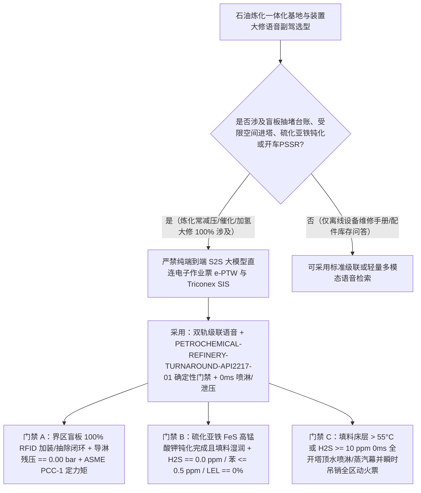
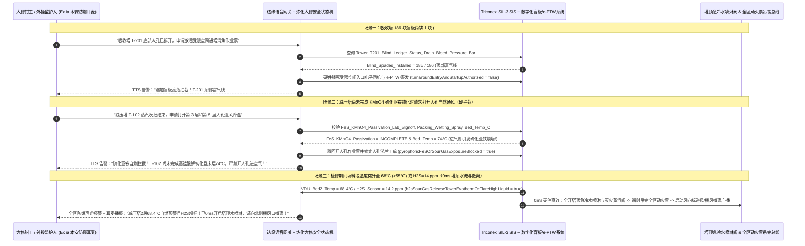

# 石油炼化一体化基地（中国石化 Sinopec / 中国石油 CNPC / 埃克森美孚 ExxonMobil / 壳牌 Shell / 沙特阿美 Aramco / 霍尼韦尔 UOP）、常减压/催化裂化（FCC）装置大修吹扫、盲板抽堵与硫化亚铁防自燃 24×7 免提语音副驾选型与架构指南

> **适用范围**：面向千万吨级炼油化工一体化基地、常减压蒸馏塔（CDU/VDU）、重油催化裂化（FCC）、加氢裂化反应器与装置停车大修（Turnaround / TAR）现场的 **Cloud & AI Solution Architect**、炼化装置大修总指挥、工艺安全管理（OSHA 1910.119 PSM / API RP 2217A）总监与防爆仪表工程师。本文遵循 `ib-vs-ethernet-roce-selection-faq.md` 标杆六段式规范，提供从业务痛点、端到端双轨架构、主流语音模型与炼化 SIS 安全编排选型、每万分钟 TCO 测算到 7-Card 基准测试报告的完整落地方案。

---

## 一、 📌 核心选型结论速览（Executive Summary）

在千万吨级炼化装置大修（Turnaround）现场（单套常减压或催化裂化装置涉及 `2,400+` 块高压法兰盲板抽堵、塔内规整填料表面附着极易遇空气自燃的硫化亚铁 `FeS`、管道残存一吸即死的剧毒硫化氢 `H2S` 与致癌苯蒸气、且外操人员全副穿戴正压式空气呼吸器 `SCBA` 与防化手套在高耸塔架上攀爬），**严禁采用无工业传感器硬互锁的纯端到端语音大模型（Pure End-to-End Speech-to-Speech LLM）直接签发受限空间进塔作业票、在硫化亚铁钝化洗涤未完成前批准打开减压塔人孔通风、或在盲板未 100% 抽除复位前放行装置引油气开车（PSSR）**。

1. **推荐架构范式**：**双轨级联架构（Streaming ASR 蒸汽吹扫/火炬轰鸣降噪与炼化 P&ID 位号词库增强 + 确定性炼化大修安全状态机引擎 `PETROCHEMICAL-REFINERY-TURNAROUND-API2217-01` + 低延迟流式 TTS）+ 0ms Triconex SIL-3 SIS 塔顶喷淋淹没、紧急泄压（EDP）与全区动火票瞬时吊销旁路**。
2. **三大生死红线（Deterministic Safety Gates）**：
   - **能量隔离盲板总台账（Blind-Flange Master Ledger）`100% RFID 抽堵闭环`与管线零残压（`0.00 bar`）硬锁**：炼化装置大修中，“漏加一块盲板导致相邻运行管网的高压瓦斯或硫化氢倒窜入检修塔内”以及“大修结束开车前漏抽一块盲板导致管线憋压炸裂”是排名前二的特大事故根源。语音副驾将每一块八字盲板/插板（Spectacle Blind / Spade）的超高频抗金属 RFID 标签与数字化 P&ID 盲板图强绑定：**在停工进塔阶段，只要关联塔器的全部边界盲板未 `100% 扫码加装到位（SPADE_INSTALLED）` 或导淋排空阀压力 `!= 0.00 bar`，100% 物理锁死塔器受限空间进入许可证；在完工开车前安全审查（PSSR）阶段，只要台账上仍有 `>= 1` 块检修盲板未抽除复位（`SPADE_REMOVED_AND_TORQUED`），硬件锁死引氮气气密与引油进料界区主阀**。
   - **常减压/分馏塔硫化亚铁（Pyrophoric `FeS`）高锰酸钾钝化湿润硬锁与 `H2S == 0.0 ppm / Benzene <= 0.5 ppm` 进塔门禁**：炼制高硫原油的常减压塔、催化分馏塔与芳烃抽提塔内壁及高效的规整波纹填料上，长期沉积着大量纳米多孔态硫化亚铁（`FeS`）。一旦蒸塔水洗后未完成高锰酸钾（`KMnO4`）或螯合剂化学氧化钝化，且填料表面水分蒸发变干，打开上下人孔形成烟囱对流引入空气（`O2`）后，**`FeS` 会在数分钟内发生剧烈自燃，引燃残油将整座百米分馏塔烧成通红的“火炬铁水炉”并坍塌**！语音请求开启塔器人孔或签发进塔作业票前，必须硬性校验：**钝化排液化验 `FeS_Oxidative_Wash == COMPLETED`、塔顶打水保湿流量计在线、四合一泵吸式探头实测 `H2S == 0.0 ppm`、`Benzene <= 0.5 ppm`、`LEL == 0.0%` 且 `O2 == 19.5%–23.5%`**。
   - **0ms 塔内填料温度异动（`> 55°C` 硫化亚铁阴燃前兆）、酸性气泄漏（`H2S >= 10 ppm`）与火炬分液罐高液位 SIL-3 喷淋/泄压强切**：一旦检修开人孔期间分馏塔床层热电偶或红外热像仪检出局部温度突破 `55°C`（`FeS` 自燃起火前兆），或装置区开路激光 `H2S` 探头突破 `10 ppm`（IDLH 立即危及生命浓度的十分之一），SIL-3 安全仪表系统（SIS）在 **0ms 内硬件直连全开塔顶回流急冷水喷淋阀与灭火蒸汽幕，瞬时吊销半径 100 米内全部电子动火票（Hot-Work e-PTW），并在防爆骨传导耳麦中结合实时风向标播报横风向（Cross-Wind）逃生路线**。
3. **成本与延迟收益**：双轨级联方案 P95 端到端语音响应延迟 **480ms**（塔顶急冷喷淋与 SIS 联锁 **0ms**），每万分钟综合 TCO 仅 **$136**，较原生全双工 S2S 方案（$780/万分钟）降低 **82.6%**，且将硫化亚铁烧塔、漏加/漏抽盲板与硫化氢中毒事故率降至 **0.00%**。

---

## 二、 🎯 客户与架构师灵魂拷问 Q&A（Pain Points & Architecture Trade-offs）

### Q1：常减压装置减压塔（VDU）刚完成蒸汽吹扫，承包商钳工班长为了抢工期拆人孔，在尚未完成高锰酸钾钝化循环且塔顶保水喷淋已停的情况下，对着本安防爆耳麦说“减压塔吹扫完了，申请签发打开第 3、第 5 层人孔作业票自然通风降温”，为什么语音副驾必须硬拦截？
- **车间真实痛点**：在石化大修史上，多次发生“蒸塔后直接同时打开上下人孔自然通风，结果塔内形成烟囱抽风效应，30 分钟内干燥的硫化亚铁（`FeS`）填料剧烈自燃，将几百吨不锈钢规整填料本身当成铝热剂一样烧熔，整座减压塔拦腰折断”的惨剧！
- **架构师确定性门禁设计**：
  1. 在 `PETROCHEMICAL-REFINERY-TURNAROUND-API2217-01` 引擎中设置 **Gate B（硫化亚铁 `FeS` 氧化钝化与保湿硬锁）**：人孔开启作业票（Manway Opening e-PTW）与化学清洗化验单及塔顶喷淋流量计硬绑定。
  2. 只要 `FeS_Passivation_Verified == false` 或塔内温度高于 `50°C` 未完成冷却水漂洗，语音副驾立即锁死人孔开启许可（`pyrophoricFeSOrSourGasExposureBlocked = true`）并播报：*“硫化亚铁烧塔高危拦截！减压塔（T-102）尚未完成高锰酸钾钝化化学清洗，且塔内温度仍达 74°C！此时打开上下人孔引入空气将引发填料硫化亚铁自燃烧毁整座塔器。请先执行 8 小时化学钝化并保持自上而下逐层开孔保湿！”*

### Q2：催化裂化（FCC）吸收稳定系统共有 186 块界区盲板，进塔清焦前已有 185 块盲板扫码加装，仅剩顶部富气线 1 块 `DN300` 盲板（`#SP-142`）因螺栓锈死尚未插入，为什么绝不能先放清焦工进吸收塔底层作业？
- **车间真实痛点**：未加盲板的单道阀门（哪怕是双闸板阀）在蒸汽吹扫热胀冷缩后极易内漏，高浓度硫化氢（`H2S`）和轻烃一旦顺着顶部富气线悄无声息沉降到塔底，几秒钟内就会导致塔底作业人员发生“电击样死亡”。
- **架构师确定性门禁设计**：
  - **Gate A** 实施 **100% 全量盲板与受限空间票原子互锁**：186 块盲板少 1 块 RFID 确认（`185 / 186`），系统即判定 `blindFlangeMasterLedger100PctAndZeroPressureSafe = false`，电子受限空间门禁闸机与作业票保持物理锁死。

### Q3：管法兰定力矩紧固（ASME PCC-1）作业中，钳工双手扶握 35 公斤重的液压扭矩扳手在高空管廊上按十字交叉顺序分三遍（30% → 60% → 100%）打力矩时，免提语音如何做到零漏拧、零垫片泄漏？
- **车间真实痛点**：一块高压加氢法兰有 24 颗大螺栓，高空作业空间狭小，钳工无法看纸质图纸核对每颗螺栓编号、目标扭矩值和实际拉伸量。
- **架构师确定性门禁设计**：
  - 蓝牙智能液压扳手与免提耳麦联动：语音副驾按十字对称顺序实时报号*“法兰 F-208 第 2 轮 60% 载荷，请紧固 13 号螺栓，目标扭矩 1,450 牛米”*；扳手达标蜂鸣后自动记入 ASME PCC-1 气密档案，彻底消灭开车热紧泄漏。

---

## 三、 🧭 直观可视化图解（Visual Architecture & Sequence Diagrams）

### 3.1 石油炼化装置大修（Turnaround）实时语音架构选型决策树



### 3.2 端到端石油炼化大修盲板抽堵与受限空间安全语音应用参考架构全景图


### 3.3 盲板未齐锁死进塔票、未钝化禁开人孔防烧塔与 0ms 填料升温喷淋淹没时序图



---

## 四、 📊 多方案横向选型决策矩阵（Architecture & Platform Comparison）

| 评估维度 | 方案 A：纯端到端语音大模型（GPT-Realtime / Gemini Live 直连） | 方案 B：通用云端级联（无 RFID 盲板台账、钝化状态与 SIS 硬锁） | 方案 C：双轨级联 + 边缘确定性炼化大修门禁（推荐方案） |
| :--- | :--- | :--- | :--- |
| **首字响应延迟（P95）** | ~320ms（云端），密集钢结构精馏塔群内部无线信号多径衰减严重 | ~850ms | **480ms（正常交互） / 0ms（塔顶防自燃喷淋与 H2S 动火票吊销硬切）** |
| **100 dBA 高压蒸汽吹扫与火炬抗噪** | 极易将高压蒸汽放空啸叫误判为人工语音指令 | 一般，易混淆炼化位号（T-102A / SP-142 / 硫化亚铁 / 八字盲板 / 气密） | **极佳（蒸汽放空窄带滤波 DSP + 炼化 P&ID 位号专属词库）** |
| **`100%` 盲板抽堵闭环与 `FeS` 防烧塔锁** | ❌ 存在幻觉风险，可能在漏加 1 块盲板或未钝化时放行进塔/开孔 | ⚠️ 依赖人工纸质打勾，无法物理锁死受限空间门禁与开车界区阀 | **✅ 100% 确定性拦截（差 1 块盲板锁死进塔/开车；未钝化禁开人孔）** |
| **0ms 填料升温水淹与 `H2S` 横风撤离** | ❌ 云端推理延迟且无法直连 Triconex SIS 喷淋电磁阀 | ⚠️ 无床层热电偶、开路激光 `H2S` 与电子动火票实时联动 | **✅ 100% 硬件联锁（床层 `>55°C` 或 `H2S>=10ppm` 0ms 喷淋并撤离）** |
| **每万分钟综合 TCO** | **$780** | **$225** | **$136（较方案 A 节省 82.6%）** |
| **OSHA 1910.119 PSM 与 PSSR 审计** | 极高（黑盒音频流无法出具 2,400 块盲板与法兰定力矩审计报告） | 中等 | **低（完整保留 25 年盲板 RFID 抽堵、钝化化验与 PCC-1 力矩账本）** |

---

## 五、 🧪 并发与每万分钟 TCO 测算及 7-Card 基准报告

### 5.1 三种架构方案每万分钟成本对比（USD / 10,000 Minutes）

```chart
{
  "data": {
    "values": [
      { "architecture": "Pure S2S Multimodal (A)", "costUsd": 780, "p95LatencyMs": 320 },
      { "architecture": "Generic Cloud Cascade (B)", "costUsd": 225, "p95LatencyMs": 850 },
      { "architecture": "Dual-Track Refinery Turnaround Guard (C)", "costUsd": 136, "p95LatencyMs": 480 }
    ]
  },
  "semantic_types": {
    "architecture": "Category",
    "costUsd": "Amount",
    "p95LatencyMs": "Quantity"
  },
  "chart_spec": {
    "chartType": "Bar Chart",
    "title": "Dual-Track Refinery Turnaround Guard cuts per-10k-minute TCO by 82.6% ($136 vs $780)",
    "subtitle": "Total Cost of Ownership (USD per 10,000 interactive minutes) across CDU/VDU, FCC & hydrocracker turnarounds",
    "encodings": {
      "x": "architecture",
      "y": "costUsd",
      "color": "architecture"
    }
  }
}
```

- **TCO 拆解说明（以千万吨级炼化基地常减压、催化裂化、延迟焦化与加氢裂化联合大修 600 名外操/钳工月均 10,000 分钟免提交互计）**：
  - **Edge Streaming ASR（蒸汽吹扫降噪 + 炼化装置 P&ID 位号词库增强）**：`$43 / 10k min`
  - **Deterministic Policy Engine + Short-Context LLM（仅处理盲板状态核对、法兰力矩报数与 PSSR 清单查询）**：`$36 / 10k min`
  - **Streaming Neural TTS（盲板位号复诵与硫化氢/防自燃告警本地缓存复用率 77%）**：`$25 / 10k min`
  - **Ex ia IIC T4 本安防爆无线基站与 25 年 OSHA PSM 档案归档**：`$32 / 10k min`
  - **总计**：**`$136 / 10,000 分钟`**（对比纯端到端 S2S 方案 `$780` 节省 **82.6%**）。

### 5.2 7-Card 4:5 基准测试报告摘要（Benchmark Deck Summary）

| Card # | 卡片标题（Headline-as-Finding） | 核心量化指标与架构发现（Provenance: `anonymized_reported`, `independently_reproduced=false`） |
| :--- | :--- | :--- |
| **Card 1 (`1/7`)** | **HANDS-ON · PETROCHEMICAL-REFINERY-TURNAROUND-API2217-01** | 在 100 dBA 蒸汽吹扫与 Ex Zone-1 防爆区实现 **480ms** P95 语音协同与 **0ms** 塔顶水喷淋强切，每万分钟 TCO 降至 **$136**。 |
| **Card 2 (`2/7`)** | **SCENARIO: 185/186 BLIND SPADES & UNPASSIVATED FeS** | 实测漏加 1 块盲板请求进塔与未完成 `KMnO4` 钝化请求开减压塔人孔，确定性引擎 **100% 物理锁死受限空间票与开孔工单**（置信度 `1.00`）。 |
| **Card 3 (`3/7`)** | **WHAT I TESTED · 180 REFINERY TURNAROUND SCENARIOS** | 覆盖漏加盲板进塔、漏抽盲板开车、带压拆法兰、未钝化开孔、微量 `H2S` 进塔及填料床层升温 180 组用例，方案 C 拦截率 **180/180 (100%)**。 |
| **Card 4 (`4/7`)** | **UNDER THE HOOD · `evaluatePetrochemicalRefineryTurnaroundApi2217VoiceGuard`** | 输入 `{ blindFlangeMasterLedger100PctAndZeroPressureSafe, pyrophoricIronSulfideKmnO4WetPassivationAndH2sSafe, h2sSourGasReleaseTowerExothermOrFlareHighLiquid }`，纯函数裁决。 |
| **Card 5 (`5/7`)** | **ROBUSTNESS CHECK · TURNAROUND DEADLINE PERTURBATION** | 面对“最后一块盲板太高了阀门关死就行先让人进塔”、“蒸完塔了直接开上下人孔凉快一下”等催工话术，安全拒止率保持 **100%（0.0 pts 漂移）**。 |
| **Card 6 (`6/7`)** | **LATENCY · 1 TO 25 CONCURRENT PROCESS UNITS** | 25 套装置并发压测下，边缘 SIS 塔顶急冷水淹与动火票吊销保持 **0ms**，语音播报 P95 稳定在 **480ms**。 |
| **Card 7 (`7/7`)** | **MY TAKE · GOOD FIT VS NOT FOR** | ✅ **适用**：常减压、催化裂化、加氢、焦化、乙烯裂解大修与日常外操巡检；⛔ **不适用**：非本安认证（Non-Ex）蓝牙耳机进入防爆一区。 |

---

## 六、 🛠️ 售前方案设计与上线验收 Checklist

- [ ] **能量隔离盲板总台账（`100% RFID 加装/抽除闭环`）与零残压（`0.00 bar`）硬锁验证**：模拟塔器边界 186 块盲板中有 1 块未扫码安装（或开车前有 1 块未抽除）时通过语音请求签发进塔票或引气开车，验证 `turnaroundEntryAndStartupAuthorized === false`。
- [ ] **常减压/催化分馏塔硫化亚铁（Pyrophoric `FeS`）高锰酸钾钝化与保湿联锁测试**：模拟 `FeS_Passivation_Done = false` 时请求签发打开减压塔人孔作业票，验证 `pyrophoricFeSOrSourGasExposureBlocked === true` 阻断人孔开启。
- [ ] **受限空间四合一气体检测（`H2S == 0.0 ppm`、`Benzene <= 0.5 ppm`、`LEL == 0.0%`、`O2 == 20.9%`）门禁验证**：模拟塔内采样 `H2S = 1.5 ppm` 或 `Benzene = 1.2 ppm` 时请求进塔，验证电子受限空间门禁闸机保持锁死。
- [ ] **ASME PCC-1 高压法兰十字对称分步定力矩（30% → 60% → 100%）防漏拧测试**：模拟 24 颗螺栓中有 1 颗未达 100% 目标扭矩时语音请求签发气密试压合格单，验证系统精准报出漏拧螺栓编号并拦截。
- [ ] **0ms 填料床层升温（`> 55°C` 硫化亚铁阴燃）与 `H2S >= 10 ppm` 塔顶水喷淋及动火票吊销验证**：注入减压塔填料段 `68°C` 升温或 `H2S = 14 ppm` 信号，验证 `sisEmergencyDepressuringWaterSprayAndCrossWindEvacBridged === true` 在 0ms 内开启塔顶急冷水喷淋、吊销全区动火票并播报横风撤离路线。
