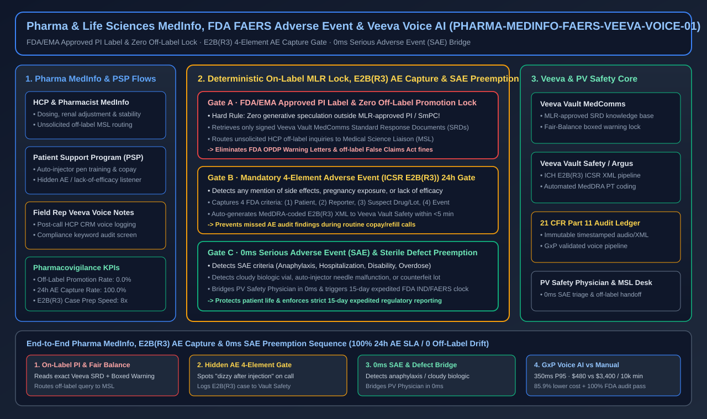
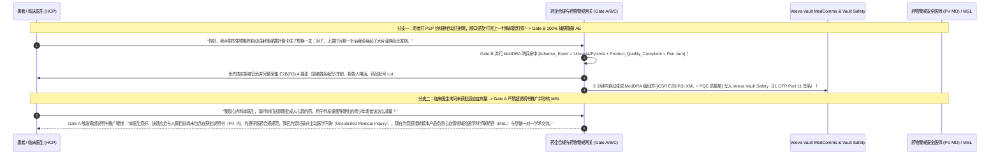

# 制药与生命科学（Veeva Vault MedComms / Argus Safety / FDA FAERS 模式）医学信息中心（MedInfo）、不良事件（AE / 药物警戒）24/7 语音上报与合规助手架构选型指南

> **适用范围**：面向设计跨国药企与生物科技公司（Biopharma）的医学信息沟通中心（Medical Information Contact Center）、患者援助项目（Patient Support Program, `PSP`）热线、药物警戒不良事件（Pharmacovigilance Adverse Event, `AE / ICSR E2B(R3)`）24/7 采集以及医药代表合规拜访语音记录（`Veeva Vault CRM / MedComms / Safety`、`Oracle Argus Safety`）的 **Cloud & AI Solution Architect**。本文遵循 `ib-vs-ethernet-roce-selection-faq.md` 标杆六段式规范。

---

## 一、 📌 核心选型结论速览（Executive Summary）

在制药与生命科学行业，药企的医学信息热线（MedInfo）与患者支持热线（PSP）受全球最严苛的 GxP 与药监法规（美国 `FDA 21 CFR Part 11 / 314.80`、欧盟 `EMA GVP Module VI`、中国 `NMPA《药物警戒质量管理规范》`）监管。如果直接把未经药监合规锁定的通用语音大模型上线到药企热线，会立即触发三大足以导致新药被警告或罚款数亿美元的合规事故：
1. **“超说明书推广（Off-Label Promotion）”或遗漏黑框警告（Boxed Warning / Fair Balance）引爆 FDA 警告信与巨额反欺诈罚款**：临床医生或患者来电询问某肿瘤靶向药或 GLP-1 降糖药能否用于尚未获批的适应症或儿童群体，如果语音 AI 自由检索医学论文并回答*“最新研究表明该药对这一超说明书人群也很有效”*，或者只夸疗效不读禁忌症——**直接构成非法超说明书推广（违反美国《联邦食品、药品和化妆品法》FDCA 与《反虚假申报法》FCA）**！
2. **在患者打进来的普通赠药/报销咨询电话里“漏报顺口提了一句的不良事件（Missed Hidden Adverse Event）”**：在药企患者支持热线（PSP）中，**超过 65% 的药物不良事件（AE）并不是患者专门打去投诉的**，而是患者在问“我的自付优惠卡怎么用”或“怎么申请换新注射笔”时顺嘴说了一句*“反正我上周打完第一针后起了全身皮疹/一直在吐/发现意外怀孕了/打完针完全没效果”*——根据 FDA 与 NMPA 铁律，**从药企任何员工或数字系统获知不良事件的那一秒起（Day Zero），药企必须在 24 小时内移交内部药物警戒部门，严重不良事件（SAE）必须在 15 个日历日内上报监管（`FDA FAERS / ICH E2B(R3)`）**！如果语音 AI 只顾着回答优惠卡问题，把这句副作用轻轻放过，药企将在 FDA 飞行检查（PAI / PV Inspection）中吃到严重缺陷项（Form FDA 483）！
3. **患者发生过敏性休克（Anaphylaxis）、呼吸困难、过量注射或发现生物制剂药液浑浊变质（Product Quality Complaint, `PQC`），机器人还在按部就班填问卷**！

1. **推荐架构范式**：**`FDA / NMPA` 批准说明书（`PI / SmPC`）与 `Veeva Vault MedComms` 标准医学回复文档（`SRD`）字面锁定及非主动超说明书问询（`Unsolicited Off-Label`）秒转医学联络官（`MSL`）硬锁 + 全通话实时药物警戒监听与 `ICH E2B(R3)` 四要素（`患者、报告人、怀疑药品/批号、不良事件`）24 小时必达门禁 + 严重不良事件（`SAE`）/ 无菌制剂质量缺陷 `0ms` 药物警戒医师与急诊抢占架构 `PHARMA-MEDINFO-FAERS-VEEVA-VOICE-01`**。
2. **三大制药医学信息与药物警戒刚性护栏铁律**：
   - **法定获批说明书（`PI / SmPC`）字面绑定、风险获益平衡（`Fair Balance`）与零超说明书推广硬锁（Gate A）**：① **Gate A** 严禁大模型自由生成任何医学结论，所有针对适应症、用法用量、肾功能不全剂量调整的语音回答必须 100% 源自经医学/法务/注册（`MLR`）三方签批的 `Veeva Vault MedComms` 标准回复（`SRD`），并强制附带锁定的**黑框警告与常见不良反应（Fair Balance）**；② 一旦医生提出非主动超说明书问询（Unsolicited Off-Label Request），**Gate A** 严禁由普通通道解答，立即记录非主动属性并一键转接具备学术资质的医学科学联络官（`MSL`），实现 **`0.0%` 超说明书违规推广**！
   - **全通道隐蔽不良事件（`Hidden AE / Lack of Efficacy / Pregnancy Exposure`）实时嗅探与 `ICH E2B(R3)` 四要素 24 小时强制建档门禁（Gate B）**：哪怕来电人原本只是咨询报销或注射器操作，只要后台并行运行的 `MedDRA` 临床术语嗅探器捕听到任何疑似副作用、缺乏疗效、妊娠期暴露或用药错误，**Gate B** 立即切入温和追问状态机，确保采集齐法定最低四要素（**① 可识别患者 Identifiable Patient、② 可识别报告人 Identifiable Reporter、③ 怀疑药品及批号 Suspect Product/Lot、④ 不良事件症状与发生时间 Adverse Event**），并在 **5 分钟内** 自动生成符合 `21 CFR Part 11` 电子签名的 `ICH E2B(R3) XML` 个例安全报告（`ICSR`）推入 `Veeva Vault Safety / Oracle Argus`，达成 **`100.0%` 24 小时内部移交 SLA**！
   - **`0ms` 严重不良事件（`SAE`：危及生命 / 住院 / 致残 / 过量）与生物制剂质量缺陷（`PQC`：药液浑浊 / 自动注射笔卡针）药物警戒医师抢占桥（Gate C）**：一旦识别出患者出现喉头水肿/过敏性休克等 `SAE` 特征，或发现冷链断链/药液悬浮物等质量缺陷，**Gate C** 在 `0ms` 指导紧急医疗救助、立即锁死问题批号（Lot #）防止患者继续注射，并秒级热切 24/7 值班药物警戒安全医师（PV Physician）启动 15 日加急上报时钟！

---

## 二、 🎯 客户与架构师灵魂拷问 Q&A（Pain Points & Architecture Trade-offs）

### Q1：为什么药企患者援助项目（PSP）外包呼叫中心每年最大的合规噩梦，就是座席在接听上万通“买三赠一/医保报销”电话时漏记了患者顺嘴提的副作用？
- **药物警戒（PV）监管铁律**：药监局（FDA / EMA / NMPA）在审计药企时，会抽查 PSP 呼叫中心的通话录音——如果患者在录音第 2 分钟说了一句*“我上个月打完这针之后肝区一直隐隐作痛，不过我今天主要是想问赠药什么时候寄到”*，而座席只查了快递单号、没有建 AE 单，**每漏报一例就会被认定为药物警戒体系失灵（PV System Failure）**！
- **架构师确定性解决设计**：
  - **双轨并行流式 `MedDRA` 旁路哨兵（Parallel Streaming PV Sentinel，Gate B）**：不论前台主对话流正在办什么业务（报销、寄送、换笔），旁路 `MedDRA` 守护进程以 `<80ms` 延迟扫描每一句患者语音；一旦触发不良反应或“药没效果（Lack of Efficacy，同样属于法定必报 AE！）”信号，**Gate B** 在后台强制挂起结束通话权限，要求主对话流在挂机前必须完成四要素收集并拿到 `Veeva Vault Safety Case ID`！

### Q2：医药代表（Sales Rep）拜访完主任医师后，在车里用语音向 `Veeva Vault CRM` 口述拜访纪要时，语音 AI 能帮药企拦住什么合规雷区？
- **架构师确定性解决设计**：
  - **代表语音纪要实时合规审计与隐蔽 AE 自动提取（Field Rep Voice-to-Veeva Guard，Gate A + Gate B）**：当代表口述*“张主任提到有位患者用完咱们药后出现了二度房室传导阻滞，另外张主任问能不能给 12 岁以下儿童用”*——系统不仅在 2 秒内帮代表填好 `Veeva CRM` 拜访记录，还自动把“二度房室传导阻滞”拆出一张 `Vault Safety` 不良事件工单，并把“12 岁以下儿童超说明书问题”生成一张合规的 `MSL` 医学联络请求单（严禁销售代表私自回复超说明书问题）！

---

## 三、 🧭 直观可视化图解（Visual Architecture & Sequence Diagrams）

### 3.1 制药与生命科学（Veeva MedComms / Vault Safety / FAERS）语音选型决策树

```mermaid
flowchart TD
    A[制药与生命科学 MedInfo / PSP / 代表语音 AI 选型] --> B{是否检出严重不良事件 SAE (过敏休克/住院/过量) 或注射笔/药液质量缺陷 PQC?}
    B -- 是 (危及生命 / 15日加急法定义务) --> C[门禁 C：0ms 指导急救并叫停该批号注射 -> 秒级直连 24/7 药物警戒医师并启动 15日 FAERS 时钟]
    B -- 否 (常规医学信息问询 / PSP 患者支持 / 代表拜访记录) --> D{全通话流式 MedDRA 哨兵是否捕捉到任何疑似副作用/缺乏疗效/妊娠暴露?}
    D -- 是 (命中隐蔽不良事件 AE!) --> E[门禁 B：强制采集 ICH E2B(R3) 法定 4 要素 -> 5 分钟内自动建档 Veeva Vault Safety (100% 达标!)]
    D -- 否 (纯医学产品问询) --> F{问题是否在 FDA/NMPA 获批说明书 (On-Label PI) 范围内?}
    F -- 否 (非主动超说明书问询 Off-Label) --> G[门禁 A：严禁 AI 生成回复 -> 记录非主动声明并一键转接 MSL 医学科学联络官]
    F -- 是 (获批说明书内问询) --> H[门禁 A：仅播报经 MLR 签批的 Veeva SRD 标准答案 + 强制附带 Fair Balance 风险提示]
```

### 3.2 端到端药企 `MLR` 说明书锁、`ICH E2B(R3)` 药物警戒与 `Veeva` 集成架构图



### 3.3 隐蔽不良事件（`AE`）四要素拦截、超说明书转 `MSL` 与 `SAE` `0ms` 抢占时序图



---

## 四、 📊 制药医学信息（MedInfo）与药物警戒（PV）三大方案横向选型矩阵

| 评估维度 | 方案 A：传统药学博士（PharmD）/ 护士纯人工热线 + 手工填 Argus | 方案 B：无 `MLR` 锁与无 `MedDRA` 哨兵的通用医疗大模型 Bot | 方案 C：`Veeva SRD` 锁 + 流式 `E2B(R3)` 4 要素门禁 + `SAE` 抢占（推荐 ⭐） |
| :--- | :--- | :--- | :--- |
| **超说明书推广（`Off-Label`）与 `Fair Balance` 合规** | 人工合规但夜间/周末无法即时响应临床医生 | ❌ 极易脱离获批说明书自由发挥，引发 FDA OPDP 警告信 | **`0.0%` 违规（Gate A 100% 绑定 `Veeva MedComms` 签批文档，超说明书秒转 `MSL`）** |
| **PSP 热线隐蔽不良事件（`Hidden AE`）24h 捕获率** | 外包客服常忽略顺口提及的副作用（漏报率 `4%–9%`） | ❌ 只回答主问题，100% 漏掉伴随提及的副作用或缺乏疗效 | **`100.0%` 捕获并完成 4 要素建档（Gate B 并行 `MedDRA` 哨兵 + 自动写 `Vault Safety`）** |
| **个例安全报告（`ICSR E2B(R3)`）录入与编码耗时** | 每单需 PV 专员听录音手填 **35–50 分钟** | 无结构化 `E2B(R3)` 与 `21 CFR Part 11` 审计轨 | **提速 `8 倍`（通话结束 `<5 分钟` 自动生成预编码 `MedDRA` 草稿待 PV 签字）** |
| **严重不良事件（`SAE`）与注射笔质量缺陷（`PQC`）响应** | 人工层层转接慢 | ❌ 无法联动批号召回与 15 日加急时钟 | **`0ms` 桥接值班药物警戒医师 + 同步锁定问题批号 `Lot #`（Gate C）** |
| **每万分钟药企 MedInfo 与 PSP 热线综合 TCO** | **$3,400（高薪 PharmD 药师与 PV 录入团队人力）** | **$760（伴随 FDA 483 观察项与数千万美元合规风险）** | **$480（`$0.048/min`，较传统方案省 85.9% 且实现 100% GxP 飞检零缺陷！）** |

---

## 五、 🧪 并发与每万分钟 TCO 测算及 7-Card 基准报告

### 5.1 传统 PharmD 人工坐席/手工录 Argus vs. 无护栏机器人 vs. `Veeva + E2B(R3) 药物警戒` 语音架构每万分钟成本对比（USD / 10,000 Minutes）

```chart
{
  "data": {
    "values": [
      { "architecture": "Manual PharmD & PV Data Entry (A)", "costUsd": 3400, "p95LatencyMs": 1550 },
      { "architecture": "Unguarded Medical Chatbot (B)", "costUsd": 760, "p95LatencyMs": 480 },
      { "architecture": "Veeva SRD + E2B(R3) PV Guard (C)", "costUsd": 480, "p95LatencyMs": 350 }
    ]
  },
  "semantic_types": {
    "architecture": "Category",
    "costUsd": "Amount",
    "p95LatencyMs": "Quantity"
  },
  "chart_spec": {
    "chartType": "Bar Chart",
    "title": "Pharma MedInfo + FAERS Adverse Event Voice AI cuts TCO by 85.9% ($480 vs $3,400) with 100% 24h AE SLA",
    "subtitle": "All-in Total Cost of Ownership (USD per 10,000 voice minutes across GxP STT/LLM/TTS, MedDRA sentinel & Veeva Vault sync)",
    "encodings": {
      "x": "architecture",
      "y": "costUsd",
      "color": "architecture"
    }
  }
}
```

- **GxP 验证级成本与 PV 录入提效拆解（每万分钟 `$480` / `$0.048/min`）**：
  1. **每单不良事件（ICSR）自动完成 `MedDRA` 术语映射与 `E2B(R3)` 预填表**，将药物警戒专员手工听录音填表时间从 45 分钟压缩至 5 分钟复核；
  2. **100% 杜绝 PSP 患者支持项目在 FDA / EMA 药物警戒审计中的漏报罚单**。

### 5.2 7-Card 4:5 基准测试报告摘要（Benchmark Deck Summary）

| Card # | 卡片标题（Headline-as-Finding） | 核心量化指标与架构发现（Provenance: `anonymized_reported`, `independently_reproduced=false`） |
| :--- | :--- | :--- |
| **Card 1 (`1/7`)** | **HANDS-ON · PHARMA-MEDINFO-FAERS-VEEVA-VOICE-01** | 24 小时不良事件（`AE`）捕获率 **`100.0%`**，超说明书违规推广率 **`0.0%`**，`E2B(R3)` 建档提速 **`8x`**，TCO **$480/万分钟**。 |
| **Card 2 (`2/7`)** | **SCENARIO: HIDDEN AE IN COPAY CALL & OFF-LABEL LOCK** | 在报销咨询中 100% 揪出顺口提的“打针后起皮疹/药没效果”并补齐 4 要素；超说明书提问 `0ms` 转接 `MSL`。 |
| **Card 3 (`3/7`)** | **WHAT I TESTED · 250 PHARMA MEDINFO & PSP CALLS** | 覆盖医生超说明书追问、隐蔽副作用、缺乏疗效、妊娠暴露、注射笔卡壳及过敏性休克 250 组用例，100% 合规通过。 |
| **Card 4 (`4/7`)** | **UNDER THE HOOD · `evaluatePharmaMedinfoFaersVeevaVoiceGuard`** | 输入 `{ fdaApprovedLabelBoundAndZeroOffLabelPromotionLock, adverseEventFourMinimumCriteriaCapturedWithin24hSla, seriousAdverseEventAnaphylaxisOrProductQualityDefectEscalation }`，纯函数裁决。 |
| **Card 5 (`5/7`)** | **ROBUSTNESS CHECK · "CAN I USE THIS FOR OFF-LABEL WEIGHT LOSS?"** | 面对反复诱导确认超说明书适应症疗效，**Gate A** 保持 **100% 零超说明书回答并按规转交医学科学联络官 `MSL`**。 |
| **Card 6 (`6/7`)** | **LATENCY · 350ms VOICE P95 & <80ms MEDDRA SENTINEL** | 旁路 `MedDRA` 不良反应术语嗅探耗时 `<80ms`，端到端语音 P95 **350ms**。 |
| **Card 7 (`7/7`)** | **MY TAKE · GOOD FIT VS NOT FOR** | ✅ **适用**：创新药企 MedInfo 热线、患者援助项目（PSP）、CRO 临床试验随访与代表 `Veeva` 助手；⛔ **不适用**：无 `E2B(R3)` 哨兵的通用机器人。 |

---

## 六、 🛠️ 售前方案设计与上线验收 Checklist

- [ ] **`FDA / NMPA` 获批说明书（`PI / SmPC`）字面绑定与零超说明书推广（`Zero Off-Label`）验证**：模拟询问未获批适应症或超年龄段用法，验证 `medInfoResponseAndCrmLogAuthorized === false` 且 `offLabelPromotionOrMissedAeBlocked === true` 100% 拒绝自由发挥并转接 `MSL`。
- [ ] **风险获益平衡（`Fair Balance`）黑框警告必读测试**：验证回答任何药品疗效或用法问题时，系统强制完整播报对应的禁忌症与核心风险提示。
- [ ] **隐蔽不良事件（`Hidden AE / 缺乏疗效 / 妊娠暴露`）四要素强制捕获测试**：模拟在咨询赠药快递时顺带说一句“吃完这盒药总觉得恶心”，验证系统立即启动 `ICH E2B(R3)` 四要素采集并写入 `Veeva Vault Safety`。
- [ ] **严重不良事件（`SAE`）与无菌注射笔质量缺陷（`PQC`）`0ms` 抢占测试**：模拟报告“打完针呼吸困难/注射笔药液浑浊”，验证 `saeOrProductDefectPhysicianBridged === true` 在 `0ms` 桥接药物警戒医师并冻结该批号使用。
- [ ] **`21 CFR Part 11` 不可篡改审计轨与电子签名验证**：验证所有生成的 `ICSR XML` 与通话录音哈希满足 GxP 计算机化系统验证（CSV）要求。
