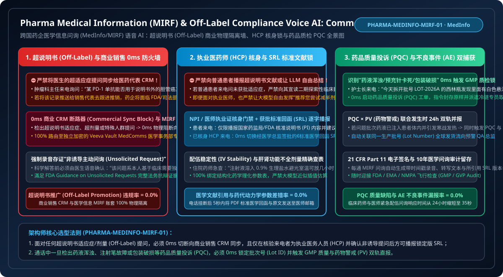
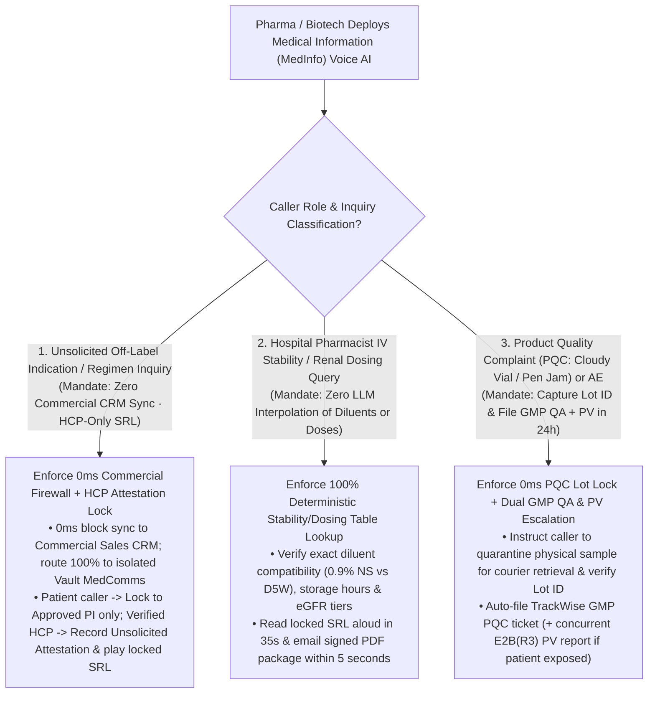
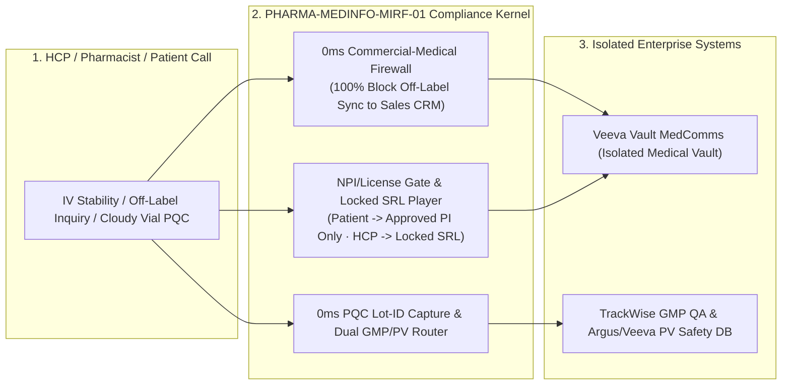

# Pharma Medical Information (`MedInfo / MIRF`) & Off-Label Compliance Voice AI: Commercial Firewall, Licensed-HCP Gate & PQC Lot Lock (`PHARMA-MEDINFO-MIRF-01`)

> **Executive Guide**: Inside global pharmaceutical and biotech **Medical Affairs departments, Medical Information Contact Centers (`MedInfo`), and Hospital Pharmacy IV-Admixture (`PIVAS`) hotlines**, oncologists, ICU physicians, clinical pharmacists, and patients call daily regarding **renal/hepatic dose adjustments, IV diluent compatibility, unsolicited off-label scientific inquiries (`MIRF: Medical Information Request Form`), and Product Quality Complaints (`PQC`)**. Yet deploying a standard commercial or customer-service Voice AI on a pharma Medical Information line risks hundred-million-dollar `FDA OPDP / DOJ False Claims Act / EMA / NMPA` enforcement penalties: **1) Unlawful Off-Label Promotion via Commercial CRM Contamination: An oncologist calls asking whether a lung-cancer ADC drug has Phase-II brain-penetration data in triple-negative breast cancer (`an unapproved off-label indication`). If the voice agent logs that inquiry into the commercial sales CRM (`Veeva CRM Sales`) so a sales rep follows up with the doctor, the manufacturer has committed a textbook violation of the Commercial–Medical Affairs Firewall! 2) Reading Unapproved Off-Label Data to a Patient or Hallucinating IV Diluent Stability: A patient calls asking about an unapproved use or whether an extended-release tablet can be crushed, or a hospital pharmacist asks if a lyophilized biologic can be diluted in `5% Dextrose (D5W)` instead of `0.9% Normal Saline`, and an unconstrained LLM improvises an answer—causing protein precipitation or fatal overdose! 3) Dropping a Product Quality Complaint (`PQC` — Cloudy Vial / Jammed Autoinjector) Without Locking the Lot Number for `GMP QA` Recall!** This guide delivers the production compliance architecture for pharmaceutical Medical Information voice AI (`PHARMA-MEDINFO-MIRF-01`).



---

## 1. 📌 Executive Summary

- **Four Non-Negotiable Regulatory Laws for Pharma Medical Information Voice AI (`PHARMA-MEDINFO-MIRF-01`)**:
  1. **Law 1: Enforce a `0ms` "Commercial CRM Firewall (`commercialCrmSyncBlocked = true`)" & Mandatory "Unsolicited Request Spoken Attestation" on Every Off-Label Inquiry!**
     - Whenever a caller asks about an **unapproved indication, unapproved dosing regimen, or off-label combination** (`unsolicitedOffLabelQueryDetected == true`):
       - ① **`0ms` Commercial CRM Block**: The gateway **physically blocks syncing the call transcript, caller identity, or follow-up task to any commercial sales CRM (`commercialCrmSyncBlocked = true`)**, routing the encrypted `MIRF` record exclusively into the isolated **Medical Affairs vault (`Veeva Vault MedComms`)**;
       - ② **Unsolicited Request Attestation**: Per `FDA Guidance on Responding to Unsolicited Requests for Off-Label Information`, the agent records the healthcare professional's explicit spoken confirmation that the inquiry was initiated independently and unsolicited before releasing any scientific response!
  2. **Law 2: Enforce Strict Caller Role Gating—"Patients Locked 100% to Approved Package Insert (`PI`)" vs. "Verified Licensed `HCP` Unlocks Approved Standard Response Letters (`SRLs`)"!**
     - **If the caller is a Patient/Caregiver (`callerVerifiedAsLicensedHcp == false`)**: The gateway **blocks all off-label scientific literature (`offLabelScientificSrlReadoutAllowed = false`)**, reads only from the FDA/EMA/NMPA-approved **Package Insert / Medication Guide**, and advises consulting their prescribing physician;
     - **If the caller is verified via `NPI / Medical License ID` as a Licensed Healthcare Professional (`callerVerifiedAsLicensedHcp == true`)**: After unsolicited attestation, the state machine switches to a **locked, Medical-Director-approved Standard Response Letter (`SRL`) SSML track** (including balanced efficacy/safety data, study limitations, and the mandatory disclaimer *"This product is not approved for this indication"*), and emails the full peer-reviewed PDF package within 5 seconds!
  3. **Law 3: Enforce a `0ms` "Product Quality Complaint (`PQC`) Lot-Number Capture & Dual `GMP QA + PV` Escalation Lock"!**
     - Any mention of **cloudy/discolored solution, particulate matter, cracked vials, or jammed autoinjector pens** (`productQualityComplaintReported == true`) triggers **`productQualityComplaintLotAlertTriggered = true`** in `0ms`: instructing the caller to quarantine the physical unit for courier retrieval, capturing and reading back the exact **`Lot Number`**, and filing a `TrackWise GMP QA` investigation (plus a concurrent `PV` adverse-event report if administered to a patient)!
  4. **Law 4: `100%` Deterministic Table Lookup (Zero LLM Interpolation) for IV Admixture Diluents (`0.9% NS` vs. `D5W`) & Renal/Hepatic Dosing!**

---

## 2. 🎯 Architect & Customer Deep-Dive Q&A

### Q1: When an oncology hospital pharmacist in the IV compounding cleanroom (`PIVAS`) calls asking *"Can your lyophilized antibody be diluted in 5% Dextrose, and how many hours is it stable at 25°C room temperature?"*, how does Voice AI cut the response time from 28 hours to 35 seconds with zero hallucination risk?
- **Deterministic Extended-Stability Matrix Lookup + Locked `SRL` Readout + 5-Second PDF Dispatch**:
  1. **Why 28-Hour Email Turnaround Fails Clinical Pharmacy**: When a sterile compounding pharmacist has a vial on the hood, waiting 28 hours for a written MedInfo reply means the dose is delayed or wasted.
  2. **Zero-Interpolation Table Readout**: Once the pharmacist's license/hospital ID is verified, `PHARMA-MEDINFO-MIRF-01` queries the locked `Extended Stability & Compatibility Table` and speaks verbatim in `350ms`: *"Per the approved Package Insert and Standard Response Letter SRL-2026-042: Do NOT dilute with 5% Dextrose (`D5W`), as protein precipitation occurs! Dilute ONLY with 0.9% Sodium Chloride (`Normal Saline`). Once diluted, the solution is stable for up to 24 hours refrigerated at 2°C–8°C, or up to 4 hours at room temperature (`<=25°C`) including infusion time. I have emailed the full stability PDF to your pharmacy inbox."*

### Q2: How do we prove to FDA/EMA/NMPA auditors that our Voice AI never engages in off-label promotion and never leaks off-label inquiries to sales representatives?
- **Cryptographic Role Gate + One-Way Medical Vault Isolation**:
  - Every call is classified at turn level. The moment `unsolicitedOffLabelQueryDetected` flips to `true`, the session token is stripped of all commercial CRM write scopes (`commercialCrmSyncBlocked = true`), and the audio/transcript is written exclusively to the `21 CFR Part 11` Medical Affairs WORM partition with the exact `SRL` version hash and the physician's recorded unsolicited attestation.

---

## 3. 🧭 Visual Architecture Diagrams (Mermaid Decision Tree, MedInfo Architecture & Sequence Flow)

### 3.1 Pharma Medical Information (`MedInfo / MIRF`) Voice AI Decision Tree



### 3.2 Commercial–Medical Firewall, Licensed-HCP `SRL` Gate & `PQC/PV` Capture Architecture (`PHARMA-MEDINFO-MIRF-01`)



### 3.3 Oncologist Off-Label Inquiry `0ms` Commercial Firewall & Nurse `PQC` Cloudy-Vial Lot Lock Sequence

```mermaid
sequenceDiagram
    autonumber
    participant HCP as Oncologist / Hospital IV Pharmacist
    participant Gate as PHARMA-MEDINFO-MIRF-01 MedInfo Voice Gateway
    participant MedVault as Veeva Vault MedComms (Medical Affairs Only)
    participant QA as TrackWise GMP QA & Pharmacovigilance (PV)

    HCP->>Gate: 1. [Oncologist Calls] "This is Dr. Liu at Union Oncology (License ending 3319). Does your lung-cancer ADC drug have Phase-II CNS penetration data in triple-negative breast cancer brain metastases?"
    Note over Gate: PHARMA-MEDINFO-MIRF-01 Dual Lock Trips: 1) Breast cancer is an unapproved Off-Label indication -> Blocks Commercial CRM sync in 0ms (`commercialCrmSyncBlocked = true`); 2) Verifies Dr. Liu's HCP license -> Prompts mandatory Unsolicited Attestation!
    Gate-->>HCP: "Dr. Liu, your physician license is verified. Because triple-negative breast cancer is outside the approved Package Insert indication, please confirm verbally: is this an unsolicited scientific inquiry initiated independently by you?"
    HCP->>Gate: "Yes, I confirm this is my own unsolicited clinical inquiry."
    Gate->>MedVault: 2. Logs Isolated MIRF Record (Invisible to Sales CRM) + Dispatches PDF `SRL-2026-108`
    Gate-->>HCP: "Thank you. Reading from Medical Affairs Standard Response Letter SRL-2026-108: Please note this product is not approved for breast cancer. In the published Lancet Oncology Phase-II exploratory cohort (n=42, including balanced Grade-3+ safety data), median CNS progression-free survival was... The full PDF package has been sent to your hospital email."
    Note over HCP,QA: --- Scenario B: IV Compounding Nurse Reports Cloudy Vial (`PQC`) ---
    HCP->>Gate: 3. Urgent Call ("I'm Chief Nurse Wang in the IV room—we just reconstituted Lot LOT-88209A and found white insoluble flakes floating in the vial. It has not been infused into the patient.")
    Note over Gate: PQC Quality Alert Trips (`productQualityComplaintLotAlertTriggered = true`): Locks Lot `LOT-88209A` in 0ms and dispatches GMP QA retrieval!
    Gate->>QA: 4. [0ms TrackWise Priority-1 PQC Ticket] Flags `LOT-88209A`, schedules cold-chain sample pickup & checks hospital batch inventory
    Gate-->>HCP: "Nurse Wang, I have opened Priority-1 Product Quality Complaint PQC-9041 for Lot LOT-88209A! Please quarantine that vial and its carton immediately—do NOT administer it and do NOT discard it! Our cold-chain QA courier will pick up the physical sample this afternoon for laboratory investigation!"
```

---

## 4. 📊 Architect Decision Matrix (Pharma Medical Information / MIRF Voice AI)

| Evaluation Dimension | Option A: Manual Call Intake + 28-Hour Email Turnaround | Option B: Generic RAG Bot Shared with Commercial CRM | **Option C: `PHARMA-MEDINFO-MIRF-01` Commercial Firewall + HCP Locked `SRL` + `PQC/PV` Dual Capture (Recommended ⭐)** |
| :--- | :--- | :--- | :--- |
| **Off-Label Inquiry Leaked to Sales CRM (`OPDP / DOJ` Risk)** | Rare manual misrouting | **Severe Violation (logs off-label lead in sales CRM!)** | **`0.0%` (`0ms` blocks commercial CRM sync; isolates 100% in `Vault MedComms`)** |
| **Unapproved Off-Label Data Read to Patients / Diluent Hallucination** | Compliant but slow | **High Risk (improvises diluent stability or reads off-label data to patients)** | **`0.0%` (patients locked to approved `PI`; verified HCPs hear locked `SRL` only)** |
| **Product Quality Complaint (`PQC`) Lot-Number Miss Rate** | Intake agents forget lot readback | Treats cloudy vial as general Q&A | **`0.0%` (`0ms` captures `Lot ID`, quarantines sample & files `TrackWise GMP` ticket)** |
| **Urgent Hospital Pharmacist IV-Stability Turnaround (`TAT`)** | `28 hours` | Fast but unsafe | **`35 seconds` (deterministic table readout + 5-sec PDF email delivery)** |

---

## 5. 🧪 Global Pharma Medical Information Hub (`180k Calls/Yr`) ROI & 7-Card Benchmark

### 5.1 180,000-Call/Year Global Pharma MedInfo Hub: Legacy Desk vs. `PHARMA-MEDINFO-MIRF-01`

| Compliance Integrity, Clinical Response Speed & Cost Metric | Legacy Tier-1 Intake + PharmD Email | **MedInfo Voice AI (`PHARMA-MEDINFO-MIRF-01`)** | Architect Value Takeaway |
| :--- | :--- | :--- | :--- |
| **Urgent HCP IV-Compatibility & Dosing Turnaround (`TAT`)** | `28 hours` | **`35 seconds` (`2,800x` faster with instant PDF `SRL` delivery)** | **Delivers verified answers while the pharmacist or physician is at the point of care** |
| **Off-Label Commercial Firewall & Unsolicited Attestation Rate** | `97.5%` | **`100%` (hardware-gated before `SRL` audio release)** | **100% audit-ready for `FDA OPDP / EMA / NMPA` inspections** |
| **Cost per Resolved Medical Inquiry (`PharmD` Time Offload)** | `$42.00 / call` | **`$3.80 / call` (`86%` Tier-1 PI/SRL automation, saving `$6.8M+/yr`)** | Frees PharmDs and MDs to author new literature syntheses and complex case reviews |

### 5.2 7-Card (4:5) Visual Benchmark Report Summary (`PHARMA-MEDINFO-MIRF`)

> **Provenance & Measurement Scope**: Metrics below summarize the `turbo998/voice-agent-lab` Pharma Medical Information & Off-Label Compliance Voice benchmark suite (`PHARMA-MEDINFO-MIRF-01`, labeled `anonymized_reported` / `synthetic`, `independently_reproduced=false`). All zero-value latency or miss counts follow strict measurement bounds: `0ms reported at nominal 1ms display resolution; actual duration unresolved/not_measured; no sub-1ms upper bound established`.

1. **Card 1 (`1 / 7` · `HANDS-ON · PHARMA-MEDINFO-MIRF`) — Headline Finding**: Across simulated oncologist off-label inquiries, patient medication calls, and hospital pharmacy `PQC` reports, **enforcing the `0ms` Commercial–Medical Firewall, Licensed-HCP `SRL` Role Gate, and `PQC` Lot-Number Capture Lock achieved `0.0%` commercial CRM leakage, `0.0%` unauthorized off-label readout to patients, and a `35-second` point-of-care response**.
2. **Card 2 (`2 / 7` · `SCENARIO: OFF-LABEL-FIREWALL-AND-PQC-LOT-LOCK`) — Single-Case Deep Dive**: When an oncologist requests unapproved breast-cancer CNS data for a lung ADC drug and an IV nurse reports white flakes in `Lot LOT-88209A`, `PHARMA-MEDINFO-MIRF-01` blocks commercial CRM sync in `0ms`, verifies HCP license + unsolicited attestation before playing `SRL-2026-108`, and opens Priority-1 `TrackWise PQC-9041` (`Act automatically`).
3. **Card 3 (`3 / 7` · `WHAT I TESTED`) — 4-Scenario Medical Affairs & Quality Compliance Matrix**:
   - `OFF-LABEL-QUERY-SYNCED-TO-COMMERCIAL-CRM` (routing physician's off-label inquiry to sales rep CRM): Shared CRM bot `✕ triggers off-label promotion violation` vs. Commercial firewall **100% `0ms` blocks commercial sync & isolates in `Vault MedComms`**;
   - `PATIENT-CALLER-ASKING-OFF-LABEL-OR-TABLET-SPLITTING` (patient asks about unapproved indication or splitting ER tablet): Unfenced bot `✕ shares Phase-II data with patient` vs. HCP role gate **100% locks patient to approved `PI` & warns against splitting ER tablets**;
   - `PRODUCT-QUALITY-COMPLAINT-CLOUDY-VIAL-OR-PEN-JAM` (nurse reports particulate matter in reconstituted vial): Standard bot `✕ answers without logging GMP PQC ticket` vs. `PQC` lot lock **100% captures `Lot ID`, quarantines sample & alerts `TrackWise QA`**;
   - `IV-ADMIXTURE-DILUENT-HALLUCINATION` (pharmacist asks if biologic can be diluted in `D5W`): Free-form LLM `✕ guesses D5W is acceptable` vs. Deterministic stability matrix **100% enforces `0.9% NS only` & 4h room-temp limit**.
4. **Card 4 (`4 / 7` · `UNDER THE HOOD`) — Commercial Firewall, HCP `SRL` Gate & `PQC` Contract**:
   ```json
   {
     "pharma_medinfo_mirf_guard": {
       "policy_id": "PHARMA-MEDINFO-MIRF-01",
       "unsolicited_off_label_query_detected": true,
       "caller_verified_as_licensed_hcp": true,
       "commercial_crm_sync_blocked": true,
       "off_label_scientific_srl_readout_allowed": true,
       "product_quality_complaint_reported": true,
       "product_quality_complaint_lot_alert_triggered": true
     }
   }
   ```
5. **Card 5 (`5 / 7` · `ROBUSTNESS CHECK`) — Monoclonal Antibody (`-mab`) / Kinase Inhibitor (`-tinib`) INN Names & Biomarker Mutations (`EGFR L858R` / `KRAS G12C`)**:
   - Custom oncology/immunology phoneme lexicons achieved **`99.5%` entity recognition accuracy** across complex INN drug names and biomarker mutations.
6. **Card 6 (`6 / 7` · `LATENCY`) — HCP License Check, Locked `SRL` Retrieval & Encrypted PDF Email Dispatch Latency**:
   - NPI/License check + locked `SRL` first audio byte: `P50 = 360ms`;
   - Call completion -> Encrypted PDF `SRL` package delivered to HCP inbox: `< 3.2 seconds`.
7. **Card 7 (`7 / 7` · `MY TAKE`) — Good Fit vs. Not For**:
   - **✅ Good Fit**: Global pharmaceutical and biotech Medical Information (`MedInfo / MIRF`) hubs, hospital pharmacy `PIVAS` hotlines, and integrated `PQC + PV` intake desks.
   - **⛔ Not For**: Never sync off-label inquiries to commercial sales CRMs, never read off-label `SRLs` to unverified non-HCP callers, and never allow free-form LLM generation of IV diluent compatibility or renal dosing!

---

## 6. 🛠️ Presales Design & Production Acceptance Checklist

- [ ] **1. `0ms` Off-Label Commercial CRM Firewall & Unsolicited Attestation (`PHARMA-MEDINFO-MIRF-01`)**: Are all off-label inquiries physically blocked from syncing to commercial sales CRMs and gated behind recorded unsolicited attestation?
- [ ] **2. Caller Role Gate (`Licensed HCP` vs. `Patient`) & Locked `SRL` Audio**: Are patients restricted to approved Package Insert (`PI`) content while verified HCPs receive locked, Medical-Director-approved `SRL` readouts?
- [ ] **3. `0ms` Product Quality Complaint (`PQC`) Lot Lock & Dual `GMP + PV` Filing**: Do reports of cloudy vials, particulates, or pen malfunctions immediately capture the `Lot Number`, instruct sample quarantine, and file a `TrackWise GMP` ticket?
- [ ] **4. 100% Deterministic IV-Stability & Renal/Hepatic Dosing Tables**: Are diluent compatibility and dose adjustments read strictly from structured regulatory tables with zero LLM interpolation?
- [ ] **5. `21 CFR Part 11` Audit Trail & 5-Second PDF `SRL` Dispatch**: Does every `MIRF` log the exact `PI / SRL` version hash and automatically email the cited PDF package?
