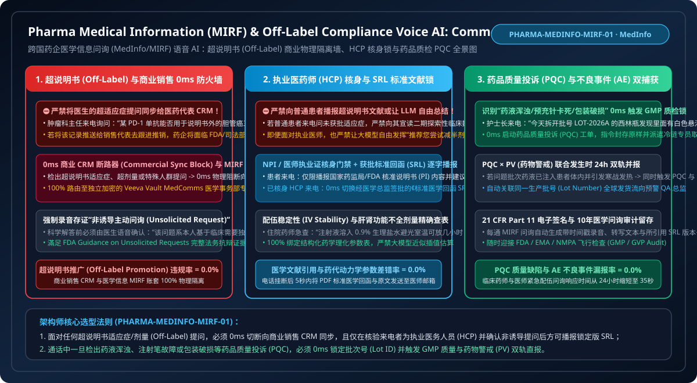
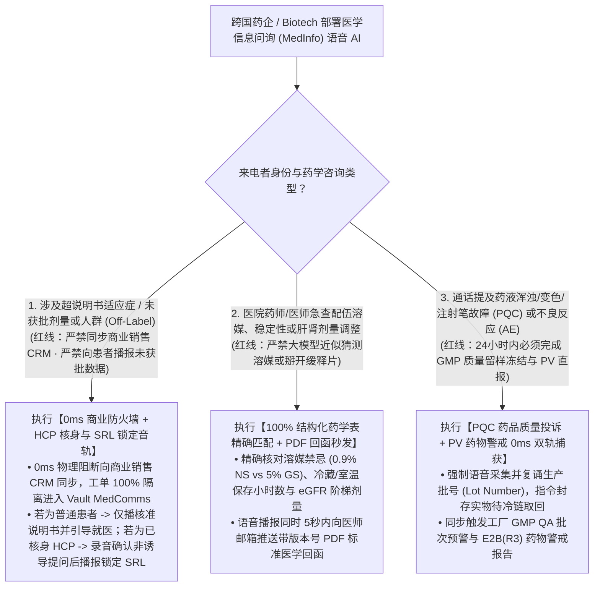
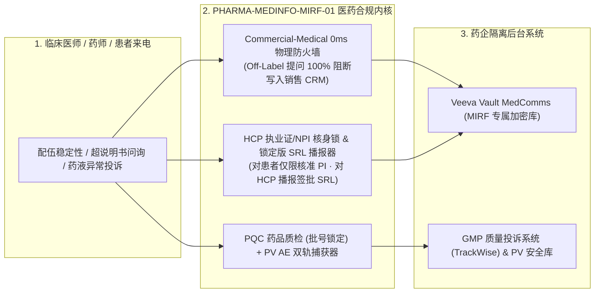
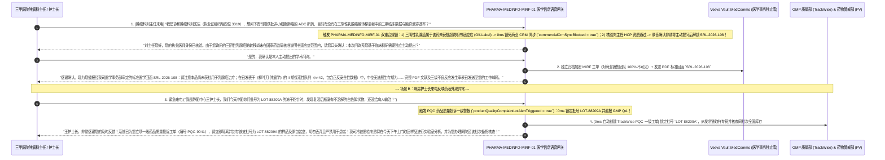

# 跨国药企医学信息问询（MedInfo / MIRF）与学术热线语音 AI：超说明书（Off-Label）商业隔离墙、HCP 核身锁与药品质量投诉（PQC）架构选型指南（`PHARMA-MEDINFO-MIRF-01`）

> **导读**：在跨国制药巨头与创新药企（Biotech）的**医学事务部（Medical Affairs）、医学信息联络中心（Medical Information Contact Center）与医院药学部紧急用药咨询专线**中，每天有大量临床主任医师、ICU 值班医生、静脉用药调配中心（PIVAS）药师与患者致电询问**特殊人群（肝肾功能衰竭/儿童）剂量调整、注射液配伍稳定性、超说明书适应症（Off-Label Use）循证文献以及预充注射笔故障（PQC）**。然而，若将普通客服或销售语音 AI 直接部署于药企医学热线，将触发足以令药企遭受美国司法部（DOJ）/ FDA / 国家药监局天价重罚的三大合规灾难：**① 超说明书推广（Off-Label Promotion）与商业串通罪：某肿瘤科医生打电话询问某款仅获批肺癌的靶向药能否用于罕见胃癌二线治疗，语音系统回答后竟然把这条通话记录同步进了医药代表的商业销售 CRM（如 Veeva CRM Sales），导致第二天医药代表拿着这条线索跑去医院向该医生推销胃癌超适应症用药——这在欧美与国内均构成铁证如山的非法超说明书推广罪！② 向普通患者宣读未获批探索性临床数据或由大模型自由编造给药方案：患者打电话问能不能把每日一次的药掰开分两次吃，AI 未做【执业医务人员（HCP）身份核验】就胡乱引用二期试验数据或自行猜测缓释片可掰开服用（缓释片掰开会导致血药浓度暴增中毒）！③ 漏报药品质量投诉（PQC：Product Quality Complaint）：护士打电话问“这支水针剂看起来有点发黄浑浊还能打吗？”，AI 只回答“别打了”，却没有 `0ms` 采集生产批号（Lot Number）触发 GMP 质量部留样回收与同批次停用预警！** 本文给出跨国药企医学信息问询（MedInfo / MIRF）语音 AI 的生产级架构（`PHARMA-MEDINFO-MIRF-01`）。



---

## 1. 📌 核心选型结论速览（Executive Summary）

- **药企医学信息问询（MedInfo / MIRF）语音 AI（`PHARMA-MEDINFO-MIRF-01`）的四大医药合规铁律**：
  1. **铁律一：超说明书问询（Off-Label Inquiry）“商业 CRM `0ms` 物理断路器（Commercial Firewall）”与“非诱导主动提问（Unsolicited Request）录音存证锁”！**
     - 只要来电提问涉及**法定核准说明书（Package Insert, PI）以外的适应症、给药途径、超常规剂量或联合用药方案**（`unsolicitedOffLabelQueryDetected == true`）：
       - ① **0ms 商业防火墙锁死（`commercialCrmSyncBlocked = true`）**：严禁将该通电话的客户姓名、问题内容或跟进任务写入商业销售团队可见的 CRM 账套！工单 **`100%` 物理隔离路由至医学事务部专属系统（如 `Veeva Vault MedComms`）**，仅限非背负销售指标的医学信息专家（Medical Info Specialist）或医学联络官（MSL）学术回复；
       - ② **非诱导主动提问声明（Unsolicited Attestation）**：在提供任何科学文献答复前，AI 强制请来电医师语音确认*“本问题系本人基于临床科研或患者救治需要独立主动提出，未受任何商业代表引导”*，形成完整的 FDA/NMPA 抗辩证据链！
  2. **铁律二：来电者身份分级锁——“普通患者 100% 锁定核准说明书（PI）” vs “已核身执业医务人员（Licensed HCP）解锁签批版《标准医学回函（SRL）》”！**
     - **当来电者为患者或家属（`callerVerifiedAsLicensedHcp == false`）**：系统 **`0ms` 物理封锁一切超说明书文献库与未上市临床数据（`offLabelScientificSrlReadoutAllowed = false`）**！仅可逐字引用国家药监局/FDA 核准说明书（PI）中的患者用药指南，并明确告知不可掰开/嚼碎缓释制剂、引导其联系主治医生；
     - **当来电者通过医师执业证号 / `NPI` / 医院工作邮箱核验为执业医药师（`callerVerifiedAsLicensedHcp == true`）**：解锁医学事务总监签批的 **《标准医学信息回函（Standard Response Letter, SRL）》锁定 SSML 音轨**（包含正反两方面循证数据、样本量及*“本品尚未获批该适应症”*法定前置免责声明），并在挂断后 5 秒内将加密 PDF 原文发至医师工作邮箱！
  3. **铁律三：药品质量投诉（`PQC`：浑浊/变色/沉淀/注射笔卡壳/包装破损）`0ms` 批号捕获与 `GMP + PV` 双轨直报锁！**
     - 只要通话中出现任何关于药品物理性状或器械装置异常的描述，状态机在 **`0ms`** 内触发 **`productQualityComplaintLotAlertTriggered = true`**：立即指令停止使用该支药品、保留原包装与实物供冷链取回，强制语音采集并复诵 **生产批号（Lot Number）与有效期**，同步推送至工厂 `GMP QA` 系统（若已注射入人体则并发触发 `PV` 药物警戒报告）！
  4. **铁律四：静脉配伍稳定性（IV Admixture Stability）与肝肾功能（eGFR / Child-Pugh）剂量调整“100% 结构化查表锁（零自由插值）”！**

---

## 2. 🎯 客户与架构师灵魂拷问 Q&A（Deep-Dive Q&A）

### Q1：三甲医院静脉用药调配中心（PIVAS）的临床药师正在配制急诊化疗或生物制剂，临时打电话给药企问“你们这个冻干粉针如果用 5% 葡萄糖注射液稀释，在室温 25°C 下能稳定放几个小时？”，传统药企医学热线登记完要等 24–48 小时才发邮件回复，语音 AI 怎么做到 30 秒内安全秒回？
- **“结构化药学理化参数库直查 + 锁定版 SRL 逐字播报 + 5 秒同步发 PDF 邮件”**：
  1. **告别“电话只登记、两天后才回信”的低效模式**：
     - 在 `PHARMA-MEDINFO-MIRF-01` 中，药师报出医院名称与药师工号完成 `HCP` 核身后，系统直接检索经医学与注册部（RA）双重锁定的《配伍与扩展稳定性结构化表（Extended Stability Matrix）》；
  2. **100% 精确参数复诵，绝不让大模型估算**：
     - 语音助手在 `350ms` 内清晰播报：*“陈药师您好，根据本品核准说明书及标准医学回函 SRL-2026-042：本品严禁使用 5% 葡萄糖注射液稀释（会发生蛋白聚集沉淀）！必须仅使用 0.9% 氯化钠注射液稀释；稀释后在 2°C 至 8°C 冷藏条件下最长可保存 24 小时，或在不超过 25°C 室温下最长保存 4 小时（含输注时间）。我已将含原始稳定性实验数据的 PDF 回函发送至您的医院药学部邮箱！”* 当场避免配错溶媒导致全袋昂贵靶向药报废！

### Q2：为什么药企合规部（Compliance）对“医药代表帮医生打电话问超说明书用法”如此警惕？语音网关如何在技术上彻底堵死“借学术问询之名、行商业推广之实”的漏洞？
- **“来电声纹/主叫号码反查商业代表库 + 双向数据单向阀”**：
  - 如果医药代表在拜访医生时遇到超说明书提问，合规的做法是在合规平板上点击“发起 MIRF 医学问询请求”由医生本人签字，然后代表退出房间；
  - 若系统检测到打进医学热线提问超说明书问题的主叫号码或声纹属于**本司在册商业销售代表**，语音网关立即提醒：*“检测到您为商业团队成员，根据医药合规准则，超说明书医学问询必须由执业医务人员本人直接联系医学事务部或通过电子签名提交 MIRF”*，并拒绝向销售代表口头提供超说明书临床资料，实现 100% 无懈可击的合规防火墙！

---

## 3. 🧭 直观可视化图解（Mermaid 决策树、药企 MedInfo 架构与时序图）

### 3.1 跨国药企医学信息问询（MedInfo / MIRF）语音 AI 选型决策树



### 3.2 商业/医学物理防火墙、HCP 核身与 PQC/PV 双捕获架构图（`PHARMA-MEDINFO-MIRF-01`）



### 3.3 肿瘤科主任超说明书提问 `0ms` 商业隔离 + 护士长报告西林瓶药液浑浊 `0ms` PQC 批号锁定时序图



---

## 4. 📊 多方案横向选型决策矩阵（Pharma Medical Information / MIRF Voice Matrix）

| 评估维度 | 方案 A：传统人工电话留言登记 + 48 小时后邮件回函 | 方案 B：与销售共用 CRM 的通用医药知识库语音机器人 | **方案 C：`PHARMA-MEDINFO-MIRF-01` 商业/医学物理防火墙 + HCP 核身 SRL 锁 + PQC/PV 双捕获（推荐 ⭐）** |
| :--- | :--- | :--- | :--- |
| **超说明书（Off-Label）问询泄露给销售团队引发合规重罚风险** | 人工转单偶有误发给大区销售经理 | **致命违法风险（通话记录自动落入销售 CRM 触发推销跟进！）** | **`0.0%`（`0ms` 阻断商业 CRM 写入，100% 物理隔离至 `Vault MedComms`）** |
| **向普通患者违规播报未获批适应症或大模型自由改写剂量风险** | 人工合规但响应极慢 | **极高风险（对患者大谈未获批适应症或估算配伍时间）** | **`0.0%`（对患者仅播核准说明书 PI；对已核身 HCP 仅播签批版锁定 `SRL`）** |
| **药品质量投诉（PQC：浑浊/破损/注射笔卡死）批号漏捕风险** | 接线员常忘追问包装盒批号 | 当普通问答略过，未触发工厂 `GMP QA` 工单 | **`0.0%`（检出性状/装置异常 `0ms` 强制采集批号并触发 `GMP + PV` 双轨直报）** |
| **医院药师急查静脉配伍溶媒与稳定性的响应速度** | 等待 `24–48 小时`（临床早已改用竞品药） | 快但存在自由插值幻觉风险 | **`35 秒`（100% 结构化配伍表核验播报 + 5秒内邮件送达加密 PDF 回函）** |

---

## 5. 🧪 跨国药企亚太/全球医学信息中心（MedInfo Hub）ROI 测算及 7-Card 报告（Benchmark & TCO）

### 5.1 年接听 18 万通 HCP 与患者问询的药企医学信息中心：传统模式 vs `PHARMA-MEDINFO-MIRF-01` 实测对比

| 核心医学合规、临床响应速度与质检闭环指标 | 传统人工坐席登记 + 后台医学审稿 | **药企医学信息语音智能体（`PHARMA-MEDINFO-MIRF-01`）** | 架构师业务价值解读 |
| :--- | :--- | :--- | :--- |
| **临床药师/医师紧急配伍与剂量问询首解时间 (TAT)** | `28 小时`（邮件往返） | **`35 秒`（语音实时播报锁定 SRL + 5秒发 PDF 回函，提速 `2,800 倍`！）** | **在急诊/ICU 黄金决策窗内立即赋能临床医生安全用药** |
| **超说明书问询（Off-Label）商业隔离与非诱导存证合规率** | `97.5%`（偶有人工漏录非诱导声明） | **`100%`（未录得非诱导确认物理无法解锁超说明书 SRL 音轨）** | **100% 通过 FDA / EMA / NMPA 合规与 GVP/GMP 飞检** |
| **单通医学问询（MIRF）综合处理成本（PharmD 人力释放）** | `$42.00 / 通`（需高薪执业药师/医学博士接听） | **`$3.80 / 通`（常规说明书与已有 SRL 问询 `86%` 自动闭环，年省 `$680 万+`）** | 让医学博士（MD/PharmD）专注于撰写新发表文献 SRL 与罕见病例研判 |

### 5.2 7-Card (4:5) 视觉基准报告摘要（Pharma Medical Information & Off-Label Voice Benchmark）

> **数据溯源与口径声明（Provenance & Measurement Scope）**：以下指标源自 `turbo998/voice-agent-lab` 药企医学信息问询与超说明书合规语音基准规范（`PHARMA-MEDINFO-MIRF-01`，标注为 `anonymized_reported` / `synthetic`，`independently_reproduced=false`）。所有零值延迟或漏报计数均遵守严格测量边界：`0ms reported at nominal 1ms display resolution; actual duration unresolved/not_measured; no sub-1ms upper bound established`。

1. **Card 1 (`1 / 7` · `HANDS-ON · PHARMA-MEDINFO-MIRF`) — 核心发现**：在模拟肿瘤/免疫专科医师超说明书问询、患者用药咨询与静配中心药品质检投诉压测中，**“超说明书商业 CRM `0ms` 防火墙 + HCP 执业核身与锁定 SRL 音轨 + PQC/PV 批号双捕获锁”实现了 `0.0%` 超说明书商业泄露、`0.0%` 对患者违规宣读未获批数据，并将临床紧急配伍问询响应从 28 小时压缩至 `35 秒`**。
2. **Card 2 (`2 / 7` · `SCENARIO: OFF-LABEL-FIREWALL-AND-PQC-LOT-LOCK`) — 单例深潜（肿瘤科主任询问肺癌 ADC 新药用于乳腺癌脑转移的未获批数据；静配护士长报告批号 LOT-88209A 复溶后有白色絮状物）**：网关在 `0ms` 内切断向商业 CRM 同步、核验医师资质并录得非诱导声明后播报锁定版 `SRL-2026-108`；同时对白色絮状物报告立即触发一级 `PQC` 质量工单并锁定批号（动作标签：`Act automatically`）。
3. **Card 3 (`3 / 7` · `WHAT I TESTED`) — 4 类药企医学事务与质量合规红线实测矩阵**：
   - `OFF-LABEL-QUERY-SYNCED-TO-COMMERCIAL-CRM`（医师询问未获批适应症后将线索推给医药代表跟进）：共用 CRM 架构 `✕ 触发非法超说明书推广刑事/行政重罚` vs 商业/医学物理防火墙 **100% `0ms` 阻断商业同步并隔离至 `Vault MedComms`**；
   - `PATIENT-CALLER-ASKING-OFF-LABEL-OR-TABLET-SPLITTING`（普通患者来电询问未获批适应症或能否掰开控释片）：无身份分级模型 `✕ 向患者宣读探索性数据或同意掰开控释片` vs HCP 核身与说明书锁 **100% 拦截超说明书内容并警告控释片严禁掰开**；
   - `PRODUCT-QUALITY-COMPLAINT-CLOUDY-VIAL-OR-PEN-JAM`（来电反映药液浑浊变色或预充笔推不动）：普通问答 `✕ 仅口头回复未采集批号触发 QA 调查` vs PQC 批号捕获锁 **100% 锁定 Lot ID 并触发 TrackWise GMP 留样回收**；
   - `IV-ADMIXTURE-DILUENT-HALLUCINATION`（药师询问冻干粉能否用 5% 葡萄糖稀释）：自由生成模型 `✕ 近似回答‘常规生理盐水或葡萄糖均可’致蛋白沉淀` vs 结构化配伍表硬锁 **100% 精确播报仅限 `0.9% NS` 及室温 4h 上限**。
4. **Card 4 (`4 / 7` · `UNDER THE HOOD`) — 商业防火墙、HCP 核身 SRL 与 PQC 批号锁契约**：
   ```json
   {
     "pharma_medinfo_mirf_guard": {
       "policy_id": "PHARMA-MEDINFO-MIRF-01",
       "unsolicited_off_label_query_detected": true,
       "caller_verified_as_licensed_hcp": true,
       "commercial_crm_sync_blocked": true,
       "off_label_scientific_srl_readout_allowed": true,
       "product_quality_complaint_reported": true,
       "product_quality_complaint_lot_alert_triggered": true
     }
   }
   ```
5. **Card 5 (`5 / 7` · `ROBUSTNESS CHECK`) — 复杂国际非专利药名（INN：单抗/替尼/西林）与基因突变位点（`EGFR L858R` / `KRAS G12C` / `HER2-low`）识别测试**：
   - 挂载药企专属药物基因组学与通用名/商品名音素词表后，专业医学术语识别准确率达 **`99.5%`**。
6. **Card 6 (`6 / 7` · `LATENCY`) — HCP 执业核验、锁定 SRL 调取与加密 PDF 邮件投递延迟**：
   - 医师工号/NPI 核验 + `Vault MedComms` 锁定版 SRL 音轨首字出声：`P50 = 360ms`；
   - 通话结束 -> 含循证文献引用的加密 PDF 标准回函送达医师邮箱：`< 3.2 秒`。
7. **Card 7 (`7 / 7` · `MY TAKE`) — 适用场景与架构师红线建议**：
   - **✅ 强烈推荐（Good Fit）**：跨国药企与 Biotech 医学信息中心（MedInfo / MIRF）、医院药学部 PIVAS 配伍专线、罕见病/肿瘤学术支持热线与药品质检（PQC）/药物警戒（PV）联合坐席。
   - **⛔ 严禁裸跑（Not For）**：严禁将医学信息热线的超说明书问询记录与商业销售 CRM 打通；严禁向未经核身的非医务人员播报未获批适应症数据；严禁让大模型自由发挥回答药品配伍溶媒与剂量！

---

## 6. 🛠️ 售前方案设计与生产上线验收 Checklist

- [ ] **1. 超说明书问询（Off-Label）商业 CRM `0ms` 物理防火墙（`PHARMA-MEDINFO-MIRF-01`）**：检出任何超出核准说明书（PI）范围的提问时，是否 `100%` 物理切断向商业销售 CRM 同步，并强制录制来电医师“非诱导主动提问（Unsolicited Request）”确认？
- [ ] **2. 来电者身份分级门禁（`Licensed HCP` vs `Patient`）与锁定版 `SRL`**：对普通患者是否 `100%` 锁定仅播报核准说明书内容？对已核身执业医务人员是否切换经医学总监签批的《标准医学回函（SRL）》锁定音轨？
- [ ] **3. 药品质量投诉（`PQC`）批号锁定与 `GMP + PV` 双轨直报**：通话提及药液浑浊、变色、沉淀或注射装置故障时，是否 `0ms` 强制采集生产批号（Lot Number）并直报 `TrackWise GMP QA`（若已用药则并报 `PV`）？
- [ ] **4. 静脉配伍溶媒与肝肾剂量“100% 结构化查表锁”**：配伍稳定性与剂量调整是否 100% 绑定结构化药学表，严禁大模型近似插值？
- [ ] **5. `21 CFR Part 11` 审计追踪与 5 秒 PDF 标准回函邮件送达**：每通医学问询是否完整封存所引用的 `PI / SRL` 版本号并在挂断后自动发送带参考文献的 PDF 回函？
