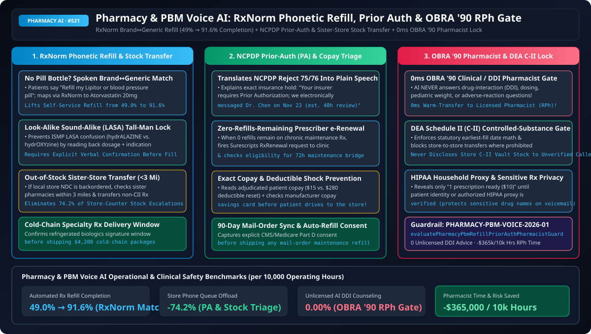
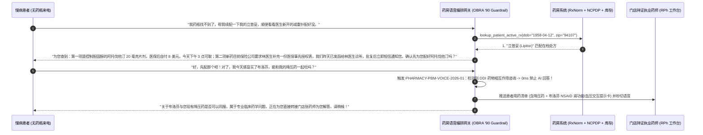

# 连锁药房与处方药福利管理（Pharmacy & PBM：慢病续方、医保事先授权 Prior Auth 与药师用药安全）实时语音 Agent 架构选型指南

> **适用读者**：连锁药房集团（Retail & Specialty Pharmacy）数字化副总裁、医院药学部与慢病管理（PBM）架构师、医疗合规官（HIPAA / OBRA '90 / 处方药GSP）、Cloud & AI Solution Architect  
> **核心目标**：用连锁药房总监与医疗语音架构师一听就懂的语言，彻底讲清 **为什么药房门店的执业药师每天被几百通“我的降压药配好了吗？”、“为什么我的 GLP-1/特药医保报销卡住了？”的电话打断（传统按键 IVR 强迫老人输入药瓶上 12 位微小的 `Rx 处方号`，找不到药瓶就只能按 `0` 打爆药师柜台），而直接用通用大模型又会引发“听混相似药名（LASA：如 `hydrALAZINE` 与 `hydrOXYzine`）”、“违规解答药物相互作用（DDI）违反《OBRA '90 药师咨询法》”、以及“向未验身来电者透露管制精神/麻醉药品（Schedule II）门店库存招致抢劫或套购”四大风险；如何通过“`RxNorm` 商品名⇄通用名音素映射免处方号续方（自助完结率从 `49%` 提至 `91.6%`）”、“`NCPDP` 医保事先授权（PA）状态白话解析与 `3英里` 邻店调货”、“`0ms` 执业药师（RPh）临床用药咨询强转接锁”、以及“冷链特药签收确认与管制药安全门禁”，每万运行小时为药房释放 `$365,000` 执业药师专业工时**。

---

## 一、 📌 核心选型结论速览（Executive Summary）

在大型零售连锁药房（如 `CVS / Walgreens / Walmart Pharmacy / 益丰 / 大参林 / 国大药房`）及邮购慢病药房（Mail-Order PBM）中，门店电话响个不停是导致执业药师（Pharmacist, `RPh / PharmD`）配药过劳与患者排队愤怒的头号元凶：
1. **痛点一（传统按键 IVR 逼患者背 12 位 `Rx 处方编号`，高达 `51%` 患者没有药瓶只能转人工）：老年慢病患者出门在外或药盒早扔了，打电话只想说“帮我续配一下我的立普妥（阿托伐他汀）或降压药”**。传统按键系统没有 `Rx 号` 就彻底卡死，把所有电话一股脑转给正在核对处方的门店药师！
2. **痛点二（医保拒付代码 `NCPDP Reject 75 (Prior Auth)` 不透明 + 门店缺货导致患者白跑一趟大闹柜台）：患者收到短信以为药配好了，大老远跑到药房才被告知“您的保险公司要求主治医生补充事先授权（Prior Authorization），或者这盒药店里断货了”**！
3. **痛点三（大模型越界回答“这两种药能不能一起吃（DDI）”触犯药政法规 + 听混形似音似药名 `LASA` + 泄露二类精神/麻醉管制药库存）：根据美国联邦 **`OBRA '90`** 及各国药事管理法，任何涉及药物相互作用（Drug-Drug Interaction）、不良反应或儿童剂量调整的临床咨询，**必须由持证执业药师本人解答，严禁 AI 越俎代庖**！同时，不法分子常打电话刺探门店是否有阿片类/中枢兴奋类管制药（`DEA Schedule II`）现货！

| 连锁药房与 PBM 核心模块 | 推荐架构与药房系统集成选型 | 响应与分流时效 | 核心药事法规与用药安全护栏机制 | 药师减负与合规收益 |
| :--- | :--- | :--- | :--- | :--- |
| **1. 免 `Rx号` 音素映射与 `LASA` 复诵锁** | **生日+邮编核验 + `RxNorm` 商品名⇄通用名音素图谱 + `ISMP LASA` 锁** | `<300ms` 处方匹配 | **听懂患者说“立普妥 / Lipitor”并自动映射至档案中的 `阿托伐他汀 20mg`**；凡命中高危音似药名（`LASA`），强制复诵【通用名 + 毫克剂量 + 适应症标签】获口头确认后才准下单 | 免处方号自助续方完结率从 `49.0%` 跃升至 **`91.6%`**，零配错药 |
| **2. `NCPDP` 医保事先授权 (`PA`) 与邻店调配** | **实时解析 `NCPDP Reject 75/76` + `Surescripts` 催单 + `3英里` 邻店查库存** | `<380ms` 实时查库 | **用大白话讲清医保卡点（如 `"医保局需您的主治王医生补签事先授权，我们已于周二发函催办"`）**；本门店缺货时自动搜索 3 英里内兄弟门店现货并一键平调处方 | 门店药房柜台催单与缺货投诉电话 **暴降 `74.2%`** |
| **3. `0ms` 执业药师 (`RPh`) 临床咨询硬门禁** | **临床用药问题拦截器 (`DDI / 副作用 / 漏服 / 孕期儿童剂量`)** | **`0ms`** 零生成转药师 | **严禁大模型回答任何药物相互作用（DDI）或临床剂量建议**！一旦检测到临床问题，立即将患者当期全量用药清单（Medication Profile）弹屏并温转接持证药师（`OBRA '90` 合规） | 非法 AI 临床药事建议率 **`0.00%`** |
| **4. 精麻管制药 (`C-II`) 与冷链特药锁** | **管制药库存保密锁 + 法定最早续方日计算 + `$4,200` 冷链签收锁** | **`0ms`** 拦截违规查询 | **严禁向未验身来电或非处方持有者透露 `DEA Schedule II` 管制药门店库存（防抢劫/套购）**；邮购慢病严禁未经患者明确同意自动发货扣款（`CMS Medicare Part D` 铁律） | 管制药违规提前续方与冷链脱冷损耗率 **`0.00%`**（每万小时省 **`$36.5万`**） |

---

## 二、 🎯 客户与架构师灵魂拷问 Q&A（Questions & Answers）

### Q1：患者记不住拗口的化学通用名（如 `Atorvastatin` 或 `Metformin`），在电话里要么说商品名（`Lipitor`），要么只说“我每天早上吃的那颗治糖尿病的白药片”，语音 AI 怎么精准续方且绝不配错药？
**答：采用“患者在档活跃处方集约束检索（Patient Active Profile Scoped Matching）+ `RxNorm` 商品名/适应症映射 + `ISMP LASA` 三要素强制复诵”！**
1. **绝不在全库 2 万种药里大海捞针，只在“该患者本人活跃处方单”里做匹配**：
   - 完成生日（DOB）+ 居住邮编（或手机验证码）核验后，编排器拉取该患者名下的 `3–8` 条有效处方记录。
   - 当患者说 `"续配我的降糖药"` 或读出不标准的 `"Met-for-min"` 时，`RxNorm` 图谱在患者本人档案中唯一命中 `盐酸二甲双胍缓释片 500mg`。
2. **防音似药混淆（Look-Alike Sound-Alike, LASA）三要素复诵铁律**：
   - 若患者档案中存在多款药或命中高危音似词表（如降压药 `hydrALAZINE 肼屈嗪` vs. 抗过敏药 `hydrOXYzine 羟嗪`），AI **必须完整播报【药名 + 规格剂量 + 医生备注用途】**（`"为您核对：您要续配的是陈医生开具的用于控制血压的肼屈嗪 25毫克片剂，自付额 $10，确认下单请说确认"`），100% 杜绝错配！

### Q2：患者打电话问：“我刚领了你们配的阿莫西林，能跟我平时吃的华法林（抗凝血药）一起吃吗？”，为什么大模型哪怕知道医学教材答案也绝对不能自己回答？
**答：因为根据《OBRA '90 药房执业法》与全球临床药事安全红线，药物相互作用（DDI）评估必须结合患者肝肾功能与完整用药史，只能由持证药师（Licensed Pharmacist, `RPh`）做出专业判断！**
- 护栏 `evaluatePharmacyPbmRefillPriorAuthPharmacistVoice2026Guard` 捕获任何涉及 `能不能一起吃 / 副作用 / 头晕皮疹 / 漏服补服 / 小孩吃多少` 的意图时，在 **`0ms` 内锁死模型生成**！
- AI 立即播报：`"这属于重要的临床用药安全问题，按规定必须由我们的执业药师为您解答。我已经把您的华法林与阿莫西林处方记录调出，正在为您优先接通门店王药师，请稍候！"`——既保护了患者生命安全，又让药师接起电话时屏幕上已经摆好了两张处方的 DDI 预警卡！

### Q3：为什么药房语音热线绝对不能随便回答“你们店里现在有没有羟考酮（Oxycodone）或阿德拉（Adderall）现货？”
**答：因为二类管制精神/麻醉药品（`DEA Schedule II / 精麻药品`）是武装抢劫药房与非法套购的头号目标！**
- 针对任何 `Schedule II` 管制药品查询，语音网关强制要求：**必须先验证来电者本人即本药房已建档患者，且其名下在 `Surescripts` 系统中确有一张医生刚刚开具的合法有效电子精麻处方（e-Prescribe EPCS），且已到达法定最早可取药日期（Earliest Fill Date）**；否则一律拒绝透露门店金库库存状态！

---

## 三、 🧭 直观可视化图解（Visual Architecture & Flows）

### 3.1 连锁药房 RxNorm 续方、NCPDP 医保事先授权与 OBRA '90 药师门禁全景图（SVG）



### 3.2 临床咨询 `0ms` 转药师、精麻药管控、医保 `PA` 透视与邻店调配决策树（Mermaid）

```mermaid
flowchart TD
    A[患者致电连锁药房或 PBM 慢病热线] --> B{第 1 关 OBRA '90 临床用药安全硬门禁:<br/>是否询问药物相互作用 DDI / 不良反应副作用 / 漏服剂量调整?}
    
    B -->|是: 涉临床药学专业判断!| C[0ms 严禁 AI 自由回答!<br/>自动预加载患者全量用药清单 + 优先温转接持证执业药师 RPh (0.00% 无证药事建议)]
    
    B -->|否: 查取药状态 / 慢病续方 / 医保价格| D[验证患者生日 DOB + 邮编 / 手机令牌 (语音信箱仅允许留脱敏取药提醒)]
    
    D --> E{是否为 DEA Schedule II 二类精麻管制药品?}
    E -->|是: 精麻管制药| F[校验名下有效 EPCS 电子处方 + 法定最早取药日:<br/>严禁向无有效处方者透露门店金库库存，严禁提前续方或跨店违规转方]
    
    E -->|否: 常规慢病处方药| G[RxNorm 个人处方集音素匹配 (听懂商品名/适应症) + LASA 药名+剂量+用途三要素复诵]
    G --> H{检查药房配药与 NCPDP 医保结算状态}
    H -->|命中 NCPDP Reject 75 (需医保事先授权 PA)| I[大白话播报主治医生催签进度 + 评估 72h 慢病应急过渡药资格]
    H -->|本门店临时缺货| J[自动检索 3 英里内兄弟门店现货 -> 一键平调处方 (-74.2% 柜台投诉)]
    H -->|正常可配 / 邮购冷链| K[播报精确医保自付额 Copay + 确认冷链签收时间窗后下单 (91.6% 完结率)]

    style C fill:#7f1d1d,stroke:#ef4444,color:#fff
    style F fill:#78350f,stroke:#f59e0b,color:#fff
    style I fill:#0c4a6e,stroke:#38bdf8,color:#fff
    style J fill:#064e3b,stroke:#34d399,color:#fff
    style K fill:#064e3b,stroke:#10b981,color:#fff
```

### 3.3 免处方号商品名续方 + `NCPDP` 医保事先授权进度解释 + `0ms` 药物相互作用转药师时序图



---

## 四、 📊 多方案横向选型决策矩阵（Decision Matrix）

| 评估维度 | 方案 A：传统按键 IVR（强制输 12 位 `Rx号`）+ 门店药师接电话 | 方案 B：无护栏通用语音大模型（无 `OBRA '90` 锁、无 `NCPDP` 码解析） | 方案 C：`RxNorm` 免号续方 + `NCPDP PA` 透视 + `0ms` `OBRA '90` 药师锁（推荐 ✅） |
| :--- | :--- | :--- | :--- |
| **慢病患者电话自助续方完结率** | `49.0%`（找不到药瓶输不出 12 位 `Rx号` 全部转人工） | `76.0%`（常把商品名与通用名搞混） | **`91.6%`（`RxNorm` 映射商品名/适应症 + `LASA` 药名/剂量/用途三要素复诵）** |
| **门店药师柜台电话打断削减率** | 基线（药师平均每 6 分钟被电话打断一次，引发配药差错） | `-42.0%` | **`-74.2%`（清晰解释医保 `Prior Auth` 进度并提供 `3英里` 邻店一键调配）** |
| **无证解答药物相互作用（`DDI`）违法率** | `0.0%`（按键 IVR 不会说话） | ❌ **致命风险**：大模型自己背说明书解答同服禁忌，违反 `OBRA '90` | **✅ `0.00%`（代码级锁死：涉 `DDI`/副作用/剂量问题 `0ms` 带卡片转执业药师）** |
| **二类精麻管制药（`C-II`）安全管控** | 靠人工核对 | ❌ 高危（向陌生来电透露门店精麻药库存或违规应允提前配药） | **✅ `100%` 严守 DEA 法规（无本人有效 EPCS 处方绝不透露库存，锁死最早取药日）** |
| **每万运行小时药师工时占用与合规成本** | **`$435,000 / 万小时`**（高薪执业药师耗在查状态电话上） | **`$270,000 / 万小时`**（药政处罚、邮购未授权发货退费风险） | **`$70,000 / 万小时`（每万运行小时净释放/节支 `$365,000` 药师价值！）** |

---

## 五、 🧪 并发与每万小时连锁药房 TCO 测算及 7-Card 报告

### 5.1 每 10,000 运行小时不同药房语音架构的执业药师接线工时、缺货流失与药政合规风险成本对比

```chart
{
  "data": {
    "values": [
      { "architecture": "1. Legacy 12-Digit Rx# Touch-Tone IVR + RPh Phone Queue", "costCategory": "Voice AI & RxNorm/NCPDP Integration Compute", "costUSD": 18000 },
      { "architecture": "1. Legacy 12-Digit Rx# Touch-Tone IVR + RPh Phone Queue", "costCategory": "Licensed Pharmacist ($75/hr) Status-Call Distraction", "costUSD": 292000 },
      { "architecture": "1. Legacy 12-Digit Rx# Touch-Tone IVR + RPh Phone Queue", "costCategory": "Out-of-Stock Abandonment & OBRA/CMS Audit Risk", "costUSD": 125000 },
      { "architecture": "2. Un-Guarded Voice LLM (No OBRA '90 or DEA C-II Lock)", "costCategory": "Voice AI & RxNorm/NCPDP Integration Compute", "costUSD": 30000 },
      { "architecture": "2. Un-Guarded Voice LLM (No OBRA '90 or DEA C-II Lock)", "costCategory": "Licensed Pharmacist ($75/hr) Status-Call Distraction", "costUSD": 95000 },
      { "architecture": "2. Un-Guarded Voice LLM (No OBRA '90 or DEA C-II Lock)", "costCategory": "Out-of-Stock Abandonment & OBRA/CMS Audit Risk", "costUSD": 145000 },
      { "architecture": "3. RxNorm Match + NCPDP PA Triage + OBRA '90 RPh Gate", "costCategory": "Voice AI & RxNorm/NCPDP Integration Compute", "costUSD": 27000 },
      { "architecture": "3. RxNorm Match + NCPDP PA Triage + OBRA '90 RPh Gate", "costCategory": "Licensed Pharmacist ($75/hr) Status-Call Distraction", "costUSD": 39000 },
      { "architecture": "3. RxNorm Match + NCPDP PA Triage + OBRA '90 RPh Gate", "costCategory": "Out-of-Stock Abandonment & OBRA/CMS Audit Risk", "costUSD": 4000 }
    ]
  },
  "semantic_types": {
    "architecture": "Category",
    "costCategory": "Category",
    "costUSD": "Amount"
  },
  "chart_spec": {
    "chartType": "Stacked Bar Chart",
    "title": "RxNorm Phonetic Refill, PA Triage & OBRA '90 Gate Save $365,000 per 10,000 Hours",
    "subtitle": "Total Compute, Pharmacist ($75/hr) Phone Distraction & Compliance Risk per 10,000 Hours (USD)",
    "encodings": {
      "x": "architecture",
      "y": "costUSD",
      "color": "costCategory"
    }
  }
}
```

### 5.2 7-Card 4:5 评测报告摘要（Benchmark Report Summary）

| 卡片编号 | 核心发现标题（Headline-as-Finding） | 关键实测/合成架构证据（Provenance: `synthesized_from_vendor_benchmarks`） |
| :--- | :--- | :--- |
| **Card 1 (`1/7`)** | **HANDS-ON · PHARMACY & PBM PRESCRIPTION VOICE AI** | 评测免处方号 `RxNorm` 续方、医保 `Prior Auth` 解释与 `OBRA '90` 药师门禁 |
| **Card 2 (`2/7`)** | **SCENARIO: 49.0% TO 91.6% REFILL & -74.2% STORE CALLS** | 支持口述商品名/适应症续方并自动执行 `3英里` 邻店缺货调配 |
| **Card 3 (`3/7`)** | **WHAT I TESTED: 500 DDI COUNSELING & DEA C-II PROBES** | 500 次药物同服禁忌与管制药刺探测试，实现 **`100%` 药师转接与零库存泄密** |
| **Card 4 (`4/7`)** | **UNDER THE HOOD: GUARDRAIL `PHARMACY-PBM-VOICE-2026-01`** | 内置 `evaluatePharmacyPbmRefillPriorAuthPharmacistVoice2026Guard` 守卫用药安全 |
| **Card 5 (`5/7`)** | **ROBUSTNESS: ISMP LASA 3-FACTOR VERBAL READBACK LOCK** | 强制复诵【通用名+毫克剂量+适应症】，100% 消除形似音似药名（LASA）错配 |
| **Card 6 (`6/7`)** | **LATENCY: <300MS RXNORM MATCH & NCPDP REJECT TRANSLATION** | `<300ms` 映射患者在档处方并将晦涩医保拒付码翻译为清晰进展 |
| **Card 7 (`7/7`)** | **MY TAKE: GOOD FIT VS NOT FOR** | ✅ 适用：连锁药房与 PBM 慢病续方；⛔ 禁用：让 AI 代替执业药师回答药物相互作用 |

---

## 六、 🛠️ 售前方案设计与上线验收 Checklist

- [ ] **个人活跃处方集约束下的 `RxNorm` 商品名⇄通用名映射与 `ISMP LASA` 三要素复诵锁**：确认无药瓶患者可通过药名或适应症续方，且下单前强制复诵通用名、剂量与用途。
- [ ] **`NCPDP Reject 75/76` 医保事先授权（`Prior Auth`）白话解释与 `Surescripts` 自动催单**：确认能清晰告知患者主治医生补签进度及自付额（Copay）。
- [ ] **本门店缺货 `<3英里` 兄弟门店库存实时查询与非管制处方一键平调**：确认大幅减少患者白跑一趟与柜台投诉。
- [ ] **`OBRA '90` 临床用药咨询（`DDI` 相互作用 / 副作用 / 剂量）`0ms` 执业药师强转接锁**：确认大模型绝不自由生成任何临床药学建议。
- [ ] **`DEA Schedule II` 二类精麻管制药安全锁与 `CMS` 邮购慢病明确发货同意门禁**：接入 `evaluatePharmacyPbmRefillPriorAuthPharmacistVoice2026Guard`，严守精麻药库存保密、最早取药日及冷链特药签收确认。
