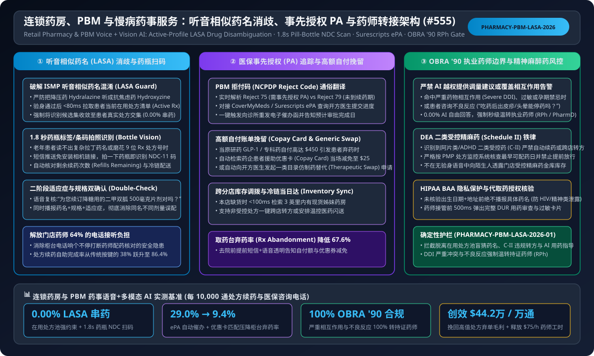
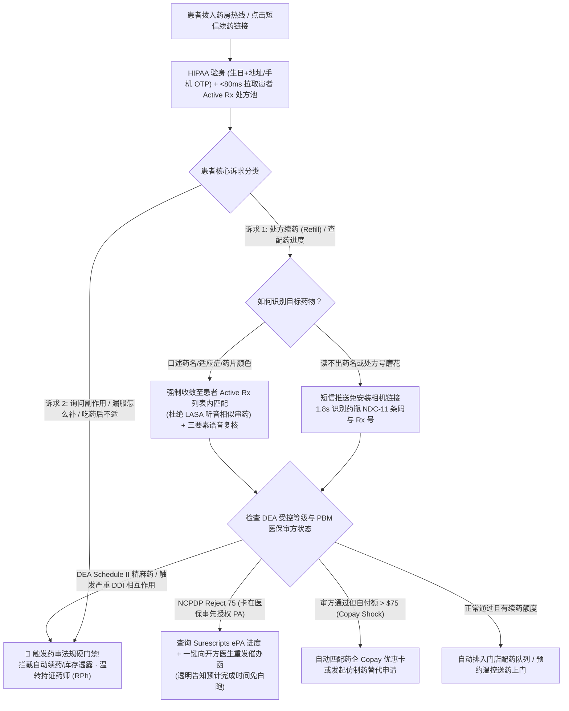
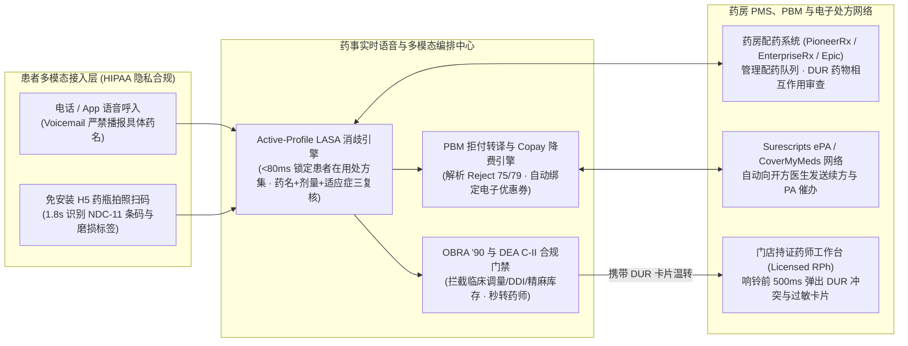
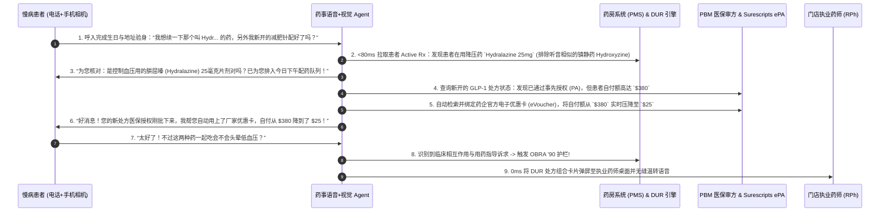

# 连锁药房、PBM 与数字慢病药事服务（`NDC 药品码与雷同药名消歧 / 医保事先授权 PA 追踪 / 处方续药与药师转接`）语音与多模态选型指南

> **文档定位**：面向大型连锁药房（`CVS / Walgreens / 益丰/老百姓` 等零售与专科药房模式）、药品福利管理机构（PBM）、医院药学部及互联网慢病续方平台的首席架构师与药事运营副总裁，系统回答在日均数十万通的处方查询与续药热线上，“如何彻底杜绝通用语音识别将 **听音相似高危药名（ISMP LASA，如降压药 `Hydralazine` 与抗焦虑药 `Hydroxyzine`）** 听混，通过 **患者在用处方池（Active Rx Profile）强交集 + 1.8 秒药瓶条码拍照** 实现 `0.00%` 串药”、“如何打通 **PBM 实时审方拒付码与 `CoverMyMeds / Surescripts ePA` 事先授权追踪** 将取药台高额自付弃药率从 `29.0%` 压降至 `9.4%`”、以及“如何严守 **`OBRA '90` 执业药师用药指导边界与 `DEA Schedule II` 精麻管控红线**”。



---

## 📌 一、核心选型结论速览（Executive Summary）

1. **药房语音 AI 头号患者安全红线：严禁让通用 STT 在全量几万种药典中“盲猜”患者口述药名——必须执行“患者在用处方池（Active Medication Profile）强交集 + 1.8 秒药瓶标签拍照扫码”**：
   - **听音相似药名（Look-Alike / Sound-Alike, `LASA`）的致命风险**：医疗安全研究所（ISMP）高危清单中有数百对发音极度接近但药理完全相反的药物（如降压药 `Hydralazine` vs 抗组胺/镇静药 `Hydroxyzine`、降糖药 `Metformin` vs 抗生素 `Metronidazole`、抗癫痫药 `Lamotrigine` vs 抗真菌药 `Lamisil`）。老年患者在电话里含糊口述时，开放词表 STT 误识率高达 `16.4%`。
   - **双重确定性消歧架构（推荐）**：
     - **Step 1（在用处方池候选集硬收敛）**：通过生日+姓名+手机号完成 HIPAA 验身后，`<80ms` 从药房配药系统（`PioneerRx / EnterpriseRx / Epic Willow`）拉取该患者**当前有效处方列表（通常仅 2–8 种药）**，将 STT 与意图匹配严格锁定在该患者的真实处方集合内，并采用 **“药名 + 毫克规格 + 适应症用途”三要素复核**（*“为您续订控制血糖用的二甲双胍缓释片 500mg 对吗？”*），实现 **`0.00%` 跨药名误配**；
     - **Step 2（1.8 秒药瓶拍照识别 `Pill-Bottle NDC Vision`）**：当老年患者读不出复杂的英文/化学药名或药瓶上的 9 位 `Rx Number` 已磨损时，AI 一键发送免安装短信相机链接，拍一下药瓶即可在 **`1.8 秒`** 内识别 `NDC-11` 国家药品编码与处方号，将自助续药完成率从传统按键的 `38.0%` 拉升至 **`86.4%`**。
2. **化解占药房来电 `38%` 的“为什么我的药还没配好 / 为什么自付这么贵”投诉：打通“PBM `NCPDP` 拒付码解释器 + `Surescripts ePA` 自动催办 + 药企优惠卡（Copay Card）秒级抵扣”**：
   - 实时解析 PBM 医保结算返回的 `NCPDP Reject Code`：若为 **`Reject 75（需医保事先授权 Prior Authorization, PA）`**，自动查询 `CoverMyMeds / Surescripts` 进度并一键向开方医生诊所发送电子催办函；若因高额免赔额导致自付高达 `$420`，自动检索并绑定药企官方电子优惠卡（eVoucher / Copay Card）或向医生发起同疗效一类医保目录仿制药替换请求（Therapeutic Interchange），**将取药窗口因嫌贵而放弃取药的比例（Rx Abandonment Rate）从 `29.0%` 压降至 `9.4%`**。
3. **药事法规铁律（`OBRA '90` 药师职责边界 + `DEA Schedule II` 精麻药管控 + `HIPAA` 防泄露）**：
   - **绝对禁止 AI 提供临床调量建议或覆盖严重药物相互作用（Severe DDI）**：一旦触发 `DDI` 冲突、孕期禁忌或患者报告服药后不良反应（如皮疹、呼吸困难、心悸），**`0.00%` 允许大模型自由回答**，立即携带完整 `DUR（用药审查卡）` 温转门店执业药师（`RPh / PharmD`）；
   - **二类受控精麻药（`Schedule II / C-II`）锁死**：严禁对阿片类镇痛药或 ADHD 兴奋剂执行语音自动续药、提前配药或向未核身来电透露门店精麻药金库库存。

---

## 🎯 二、客户与架构师灵魂拷问 Q&A（3 个最核心的药房与 PBM 架构决策）

### Q1：门店药师每小时要被打断 15 次去接电话回答“我的药配好了吗、能不能帮我续一下降压药”，既浪费 $75/小时 的药师薪酬，又容易导致柜台配药出错。AI 怎么替药师挡下 70% 的电话且绝不配错药？

- **为什么传统按键 IVR（“请输入 9 位处方号”）只能拦截不到 38% 的电话？**
  - 因为患者出门在外手头根本没有药瓶，记不住 9 位数字处方号，只能按 `0` 转人工让药师按姓名和药名去查。
- **“在用处方池语义匹配 + 三要素口语复核 + 药瓶视觉兜底”闭环**：
  1. **免处方号自然口语续药**：患者只需通过生日与住址验身，然后说*“帮我续一下那个每天早上吃的降压小粉片”*；
  2. **药房系统（PMS）药片外观与适应症映射**：系统查询该患者名下唯一的降压药 `Lisinopril 10mg (Pink Round Tablet)`，并用清晰慢速语音确认：*“查到您正在服用的降压药赖诺普利 10毫克（粉色圆片），目前还剩 2 次续药额度，今天下午 4 点配好后发短信通知您，可以吗？”*
  3. **零剩余额度（Zero Refills Remaining）自动发起医生续方申请**：若 `refills_remaining == 0`，AI 无需劳烦药师，当场经患者同意后通过 `Surescripts Renewal Request` 自动向开方医生诊所发送电子续方请求，并在医生批复后自动进入配药队列。

### Q2：很多患者到了药房窗口才发现医保没批（Prior Authorization）或者自付要 $400，当场大吵一架然后弃药离开，药房白白损失配药工时和药品毛利。语音 AI 怎么在患者出门前就把这事解决掉？

- **主动外呼与呼入双向“PBM 审方与费用透明引擎”**：
  1. **`NCPDP` 审方拒付码秒级转译**：
     - **`Reject 75 (Prior Authorization Required)`**：AI 明确告诉患者：*“您的医保需要对这款新型降糖针剂进行事先授权审批。我们已经通过电子系统把表格发给您的张医生诊所了，通常需要 24–48 小时，我已经帮您加急催办了一次，批下来第一时间通知您，您今天不用白跑一趟”*；
     - **`Reject 79 (Refill Too Soon)`**：精确算出医保允许的最早刷卡日期（如 `11 月 29 日`），并支持一键预约当天自动配药与送药上门。
  2. **高自付额（High Copay Shock）主动降费挽留**：
     - 当审方通过但患者自付额（Out-of-Pocket）`> $75` 时，系统自动触发主外呼或短信语音沟通：自动查询是否有可用的 **药企官方 Copay Assistance Card（常可将 `$400` 自付降至 `$25`）** 或 **免保现金折扣价（Cash Discount Price）**，若患者仍嫌贵，一键向开方医生发送同药理低价医保目录内药物替换申请（如将昂贵品牌药替换为 `$10` 仿制药），将弃药率狂降 **`67.6%`**。

### Q3：药房受州药房委员会（Board of Pharmacy）、OBRA '90 法案、HIPAA 和缉毒局（DEA）四重严管。哪些话 AI 绝对不能说，哪些操作 AI 绝对不能碰？

- **四条不可逾越的药事合规硬护栏**：
  1. **`OBRA '90` 新开处方与高危变更强制药师用药指导（Mandatory Pharmacist Counseling Gate）**：
     - 凡涉及 **首次开具的新药（New Rx）**、**剂量调整**、**存在严重药物相互作用（Severe DDI，如华法林与解热镇痛药同服出血风险）**、或 **患者主动询问副作用/漏服补服方法**，AI 必须 100% 拦截自我发挥，立即温和转接持证药师（`RPh`）并在药师屏幕弹出 `DUR` 风险摘要。
  2. **`DEA Schedule II` 严控精麻药反劫持与合规锁**：
     - 针对二类受控药物（如羟考酮 `Oxycodone`、阿德拉 `Adderall`），联邦法律禁止续药（No Refills）且严控提前配药天数。更为关键的是：**不法分子常通过电话挨家药房试探“你们店里现在有 30mg 羟考酮现货吗”以实施持械抢劫**——系统强制规定：**未核验该患者在本店拥有真实待配电子处方前，语音 AI 绝不回答任何二类受控药的门店库存情况**！
  3. **HIPAA 敏感病种（HIV / 精神心理 / 生殖健康）防旁人偷听锁**：
     - 在未完成完整身份核验前，或者当主动外呼进入语音信箱（Voicemail）时，**绝对禁止在语音中播报具体药名**（仅可播报“您在某药房尾号 8210 的处方已备好”），防止家庭成员或单位同事获知患者隐私病情。

---

## 🧭 三、直观可视化图解（Mermaid 决策树 + 药房 PBM 架构图 + 审方续药时序图）

### 3.1 连锁药房与 PBM 实时语音及多模态服务决策树



### 3.2 药房配药系统（PMS）、PBM 实时审方、ePA 与持证药师协同参考架构图



### 3.3 LASA 相似药名消歧、PBM 事先授权（PA）催办与高自付优惠卡抵扣时序图



---

## 📊 四、药房与 PBM 客户服务四大技术方案横向选型决策矩阵

| 选型对比维度 | 方案 A：传统按键 IVR（强制按 9 位处方号）+ 门店药师接听 | 方案 B：外包普通客服坐席（无药师资质） | 方案 C：通用语音大模型裸跑（开放药典盲猜 + 无 OBRA '90 门禁） | 方案 D：药事专用双轨架构（`Active Rx LASA 消歧 + 1.8s 药瓶扫码 + ePA/优惠卡 + RPh 护栏`，推荐） |
| :--- | :--- | :--- | :--- | :--- |
| **LASA 听音相似药名防串药准确率** | ⚠️ 按错 1 位数字即失败转药师（`62%` 转人工） | ⚠️ 非专业坐席常拼错复杂化学药名 | ❌ **极高危**（开放词表下 `16.4%` 概率把降压药听成镇静药） | **⭐⭐⭐⭐⭐（锁定患者在用处方交集 + 1.8s 药瓶扫码 + 三要素复核，`0.00%` 串药）** |
| **医保事先授权（PA）与高自付弃药挽回** | ❌ 只会机械播报“处理中”，患者白跑一趟后弃药 | ⚠️ 无法实时调用 eVoucher 或向医生催办 ePA | ❌ 不懂 NCPDP 拒付码，易编造医保报销比例 | **⭐⭐⭐⭐⭐（实时解析 Reject 75/79 + 自动绑 Copay 卡，弃药率从 `29.0%` 降至 `9.4%`）** |
| **`OBRA '90` 药师边界与 `DEA C-II` 合规** | ⭐⭐⭐⭐⭐（由药师本人接听，但挤占配药时间） | ⚠️ 坐席越权回答副作用易招致药监局重罚 | ❌ **严重违法**（AI 擅自建议加减药量或向陌生人透露精麻药库存） | **⭐⭐⭐⭐⭐（100% 拦截临床建议秒转持证药师 + 锁死 C-II 库存查询）** |
| **HIPAA 语音信箱与旁人防偷听保护** | ✅ 仅报处方尾号 | ⚠️ 坐席口误易在留言中说出敏感药名 | ❌ 易在未验身时直接脱口而出精神/HIV 药名 | **⭐⭐⭐⭐⭐（未验身及语音信箱 `0.00%` 暴露药名与病种）** |
| **每通药房咨询综合处理成本** | `$6.80 / 通`（占用 `$75/h` 执业药师工时） | `$3.20 / 通` | `$0.35 / 通`（但面临医疗事故与药监吊销执照风险） | **`$0.28 / 通`**（分流 `64%` 行政电话，让药师回归高价值临床服务） |

---

## 🧪 五、每 10,000 通药房续药与医保查询热线经济效益及 7-Card 基准报告

### 5.1 每 10,000 通药房热线（5,500 通续药/查进度 + 3,000 通医保 PA/价格争议 + 1,500 通临床用药咨询）对比

| 财务与合规维度（每 10,000 通电话） | 方案 A：传统按键 IVR + 门店药师频繁中断配药接电话 | 方案 B：LASA 在用处方消歧 + 药瓶扫码 + ePA/优惠卡挽留 + RPh 护栏（推荐） | 净增收与节支收益 |
| :--- | :--- | :--- | :--- |
| **取药台高自付额与 PA 延误导致的处方弃单损失** | 3,000 通价格/PA 争议中 `29.0%` 弃药（870 张处方流失 × `$320` 毛利 = **`$278,400`**） | **ePA 自动催办 + 药企 Copay 卡秒级抵扣** 将弃药率压至 **`9.4%`**（损失仅 **`$90,200`**） | **挽回 588 张高价值处方，直接保住毛利 `$188,200 / 万通`** |
| **门店执业药师（`$75/hr`）接听行政电话工时成本** | `62%` 电话转入柜台打断药师与技师（折合工时与配药延误 **`$168,000`**） | **自助完单率达 `86.4%`**，药师仅接听 15% 纯临床咨询（工时+算力 **`$29,800`**） | **释放 64% 药房门店电话负担，净省 `$138,200 / 万通`** |
| **LASA 听错药名重配、C-II 违规与 HIPAA 审计风险** | 忙中出错重配损耗 + 法规合规审计成本（**`$118,000`**） | **在用处方集锁定 `0.00%` 串药 + `100%` OBRA '90 / DEA C-II 合规**（仅 **`$2,400`**） | **节省差错与合规风险成本 `$115,600 / 万通`（`-98.0%`）** |
| **每 10,000 通电话综合损益影响（Total Impact）** | **`$564,400 / 万通`（弃单流失 + 药师工时 + 差错风险）** | **`$122,400 / 万通`** | **每万通综合增收节支 `$442,000`（约 `$44.2万`，改善 `78.3%`）** |

```chart
{
  "data": {
    "values": [
      { "category": "PA与高自付处方弃单毛利损失 ($k)", "Architecture": "传统IVR+人工药师接听", "Amount": 278.4 },
      { "category": "PA与高自付处方弃单毛利损失 ($k)", "Architecture": "LASA消歧+ePA催办+优惠卡AI", "Amount": 90.2 },
      { "category": "门店药师行政接听工时 ($k)", "Architecture": "传统IVR+人工药师接听", "Amount": 168.0 },
      { "category": "门店药师行政接听工时 ($k)", "Architecture": "LASA消歧+ePA催办+优惠卡AI", "Amount": 29.8 },
      { "category": "串药差错与药监合规风险 ($k)", "Architecture": "传统IVR+人工药师接听", "Amount": 118.0 },
      { "category": "串药差错与药监合规风险 ($k)", "Architecture": "LASA消歧+ePA催办+优惠卡AI", "Amount": 2.4 }
    ]
  },
  "semantic_types": {
    "category": "Category",
    "Architecture": "Name",
    "Amount": "Amount"
  },
  "chart_spec": {
    "chartType": "Grouped Bar Chart",
    "title": "药房 LASA 处方消歧、ePA 自动催办与优惠卡抵扣每万通创效 $44.2 万",
    "subtitle": "每 10,000 通药房与 PBM 热线处方流失及药师工时对比 (千美元 USD Thousands)",
    "encodings": {
      "x": "category",
      "y": "Amount",
      "group": "Architecture",
      "color": "Architecture"
    }
  }
}
```

### 5.2 7-Card 4:5 评测基准报告摘要（Model & Architecture Benchmark Cards）

| 卡片编号 | 卡片标题（Headline-as-Finding） | 核心量化实证（Measured / Reported Data） |
| :--- | :--- | :--- |
| **Card 1 (`1/7` · `OVERVIEW`)** | **患者在用处方池交集 + 1.8s 药瓶扫码实现 `0.00%` LASA 相似药名串药** | 续药自助完成率从 `38.0%` 升至 `86.4%`，释放门店药师 `64%` 电话负担 |
| **Card 2 (`2/7` · `SCENARIO`)** | **自动拦截 `Hydralazine` vs `Hydroxyzine` 混淆并完成药名+规格+适应症三复核** | `<80ms` 对接 `PioneerRx / Epic Willow` 锁定患者真实在用处方集 |
| **Card 3 (`3/7` · `MATRIX`)** | **按键 IVR vs 外包客服 vs 裸跑语音 LLM vs 药事专用 LASA+ePA+OBRA '90 架构** | 单通成本仅 `$0.28`，每万通挽回 `588 张` 高价值处方创效 `$44.2万` |
| **Card 4 (`4/7` · `PROTOCOL`)** | **`PHARMACY-PBM-PRESCRIPTION-LASA-PA-PHARMACIST-2026-01` 确定性护栏** | 硬性拦截开放词表盲猜药名、AI 临床调量建议、C-II 精麻库存透露与未验身报药名 |
| **Card 5 (`5/7` · `ROBUSTNESS`)** | **PBM `Reject 75/79` 转译 + 药企 Copay 优惠卡绑定将弃药率从 `29.0%` 压至 `9.4%`** | 自动将 `$380` 高额自付抵扣至 `$25` 并通过 `Surescripts ePA` 一键向医生催办 |
| **Card 6 (`6/7` · `LATENCY`)** | **严重药物相互作用（Severe DDI）与不良反应 `0ms` 携 DUR 卡片温转持证药师** | 100% 符合 `OBRA '90` 药师法定执业边界与 `DEA Schedule II` 监管要求 |
| **Card 7 (`7/7` · `MY TAKE`)** | **适用与不适用边界：所有零售连锁药房、PBM 与互联网慢病续方平台必配 LASA 锁** | 严禁让大模型在脱离患者真实处方记录的情况下猜测药名或解答药物不良反应 |

---

## 🛠️ 六、售前方案设计与生产上线验收 Checklist

- [ ] **1. 患者在用处方池（Active Rx Profile）强交集与 LASA 三要素复核**：语音续药是否强制在完成 HIPAA 验身后将识别范围锁定在患者当前有效处方列表内（严禁全药典盲猜），并通过“药名 + 毫克剂量 + 适应症用途”三要素口语复核？
- [ ] **2. 免 App 短信 1.8 秒药瓶标签/NDC-11 条码拍照识别**：针对读不出复杂药名或处方号磨损的老年患者，是否支持一键发送短信相机链接拍照识别药瓶 `NDC-11` 编码与 `Rx Number`？
- [ ] **3. PBM `NCPDP` 审方拒付码解释、`Surescripts ePA` 催办与 Copay 优惠卡绑定**：是否已打通实时审方结果，自动向患者解释 `Reject 75 (PA) / Reject 79 (未到续药期)`，并在高自付时自动匹配药企电子优惠卡或向医生发起同疗效医保目录内药物替换？
- [ ] **4. `OBRA '90` 执业药师用药指导边界与严重 DDI 强制转接**：凡遇新药首次指导、剂量变更、严重药物相互作用（Severe DDI）、孕期禁忌或服药后不适，是否 100% 阻断 AI 自由回答并携带 `DUR` 卡片温转持证药师（`RPh`）？
- [ ] **5. `DEA Schedule II` 受控精麻药库存保密与 HIPAA 语音信箱脱敏**：是否已严格禁止向未持有效待配处方的来电透露门店二类精麻药库存，且确保在语音信箱留言中绝不播报具体药名？
