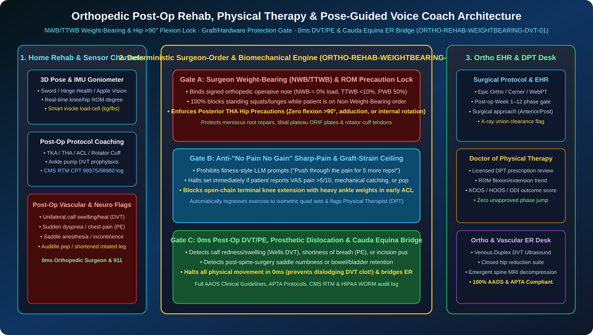
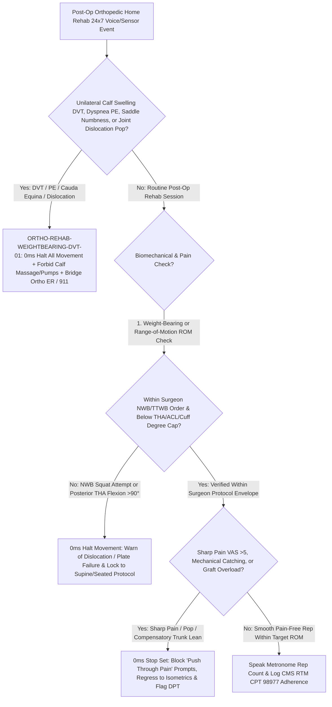
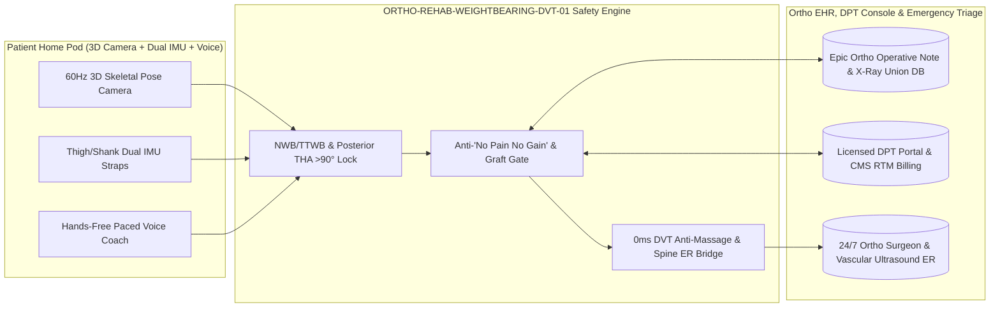

# Orthopedic Post-Op Rehab, Physical Therapy & Pose-Guided Voice Coach Architecture (Sword / Hinge Health / Hospital for Special Surgery): NWB/TTWB Weight-Bearing & Hip >90° Lock, Anti-"No Pain No Gain" Gate & 0ms DVT/PE Bridge Selection Guide

> **Document Scope**: Written for Orthopedic & Sports Medicine Centers (Hospital for Special Surgery HSS, Mayo Clinic, Rothman Orthopaedics), Digital Musculoskeletal (MSK) & Physical Therapy Platforms (Sword Health, Hinge Health, WebPT), and Healthcare AI Solution Architects designing **3D Pose & IMU-Guided Home Rehab Voice Coaches, Surgeon Weight-Bearing (`NWB`/`TTWB`) & Hip-Dislocation Locks, Graft-Protection Gates, and 0ms Post-Op DVT / Pulmonary Embolism / Cauda Equina Escalation Pipelines**.

---

## 1. 📌 Executive Summary

In post-operative orthopedic rehabilitation—covering Total Hip Arthroplasty (`THA`), Total Knee Arthroplasty (`TKA`), Anterior Cruciate Ligament + Meniscus Root Repair (`ACL`), Rotator Cuff Repair, and Tibial Plateau `ORIF` plating—**applying a generic fitness-coach LLM persona ("Push through the burn, no pain no gain—give me 5 more deep squats!"), letting a patient on a strict 6-week Non-Weight-Bearing (`NWB`) order ditch their crutches because "my leg feels strong today," allowing a posterior-approach THA patient to bend past $90^\circ$ of hip flexion to tie their shoes (causing acute prosthetic hip dislocation), or encouraging vigorous ankle pumps and calf massage when a patient reports a swollen, hot, tender calf (dislodging a Deep Vein Thrombosis `DVT` clot into a fatal Pulmonary Embolism `PE`) causes catastrophic hardware failure, tendon re-rupture, or sudden death**:
1. **Core Architecture Selection: Adopt a "Cascaded Deterministic MSK & Orthopedic Voice Pipeline (On-Device 3D Pose/IMU Goniometer + Azure Speech Ortho/Kinesiology Lexicon STT + Operative-Note Weight-Bearing & ROM Precaution Engine + Paced Metronome Neural HD TTS)"**:
   - **Surgeon Weight-Bearing (`NWB` / `TTWB` / `PWB` / `WBAT`) & Surgical-Approach ROM Hard Lock**: The voice coach is hard-locked to the signed operative note and post-op week in `Epic Ortho` / `WebPT`. While a patient is under `NWB` (0% load) or `TTWB` (`<10%` toe-touch load), **100% of standing closed-chain squats/lunges are blocked**; for Posterior-Approach `THA`, live 3D camera/IMU goniometry halts movement in `<200ms` if hip flexion approaches $80^\circ\text{–}90^\circ$, adduction crosses midline, or internal rotation occurs (`weightBearingAndRomPrecautionRespected = true`);
   - **Anti-"No Pain No Gain" Sharp-Pain & Graft-Strain Ceiling**: Distinguishes normal mild stretching tension (`VAS <= 3/10`) from sharp mechanical joint pain (`VAS >= 6/10`), audible pops, or joint locking. It **100% prohibits fitness-style "push through the pain" prompts**, halting the set immediately to protect healing ACL grafts, rotator cuff sutures, or meniscus anchors (`sharpPainAndGraftOverloadBlocked = true`).
2. **0ms Absolute Immobilization & Vascular/Spine ER Bridge on Post-Op DVT, PE or Cauda Equina**:
   - Whenever a post-op patient reports **unilateral calf swelling, redness, warmth, or cramping pain (Wells `DVT` criteria)**, the gateway **commands stopping all exercise in 0ms and strictly forbids ankle pumps, calf massage, or heating pads** (which dislodge fresh venous thrombi!), bridging the Orthopedic ER for an urgent venous duplex ultrasound; if **shortness of breath/chest pain (`PE`)** or **post-spine-surgery saddle anesthesia / bowel-bladder incontinence (`Cauda Equina Syndrome`)** is reported (`dvtPulmonaryEmbolismOrCaudaEquinaRedFlag = true`), 911 EMS is bridged in 0ms.



---

## 2. 🎯 Customer & Architect Critical Q&A (Q1–Q3)

### Q1: Twelve days after a Posterior-Approach Total Hip Arthroplasty (THA) or a Lateral Meniscus Root Repair, a patient tells the home rehab voice coach: "My leg doesn't hurt at all today—can I sit on a low footstool to put on my socks and try a few standing bodyweight squats without my walker?" Why must the AI block both requests in 0ms?
**A: Biological tissue healing and bone ingrowth follow strict biomechanical timelines—lack of pain at rest never means a posterior hip capsule or meniscus root suture can withstand full joint torque!**
- **Two Orthopedic Biomechanical Red Lines**:
  1. **Posterior THA Dislocation Precautions (`<90° Flexion`, Zero Adduction, Zero Internal Rotation)**: Sitting on a low stool and leaning forward to put on socks drives hip flexion past $100^\circ\text{–}110^\circ$, levering the femoral head directly out of the acetabular cup before the posterior pseudocapsule heals;
  2. **Non-Weight-Bearing (`NWB`) Hardware/Suture Protection**: After tibial plateau ORIF or meniscus root transtibial pullout repair, early axial loading shears the sutures through the meniscus or collapses the articular tibial plateau prior to 6-week radiographic union.
- **Architectural Enforcement**:
  - In `ORTHO-REHAB-WEIGHTBEARING-DVT-01`, any exercise or daily-living query that violates the patient's signed `WeightBearingStatus` or `ROM_Ceiling` sets `weightBearingAndRomPrecautionRespected = false` in 0ms;
  - The coach responds immediately: *"Stop—do not sit on a low stool or perform standing squats! Under your surgeon's Posterior Hip Precaution protocol, bending your hip past 90 degrees carries a high risk of hip dislocation, and you must use your walker until your 6-week X-ray clearance. Please use your long-handled sock aid while seated in a high armchair."*

### Q2: Ten days after a Total Knee Replacement (TKA), a patient says during their morning voice check-in: "My right calf is swollen tight, warm to the touch, and aches—should I do 100 hard ankle pumps and have my spouse massage my calf to get the swelling down?" Why would an AI agreeing to ankle pumps or massage kill this patient?
**A: While ankle pumps prevent blood clots before they form, performing vigorous muscle contractions or massaging a calf that ALREADY has an acute Deep Vein Thrombosis (DVT) mechanically shears the fresh thrombus off the vein wall, launching a massive saddle Pulmonary Embolism (PE) into the lungs!**
- When `ORTHO-REHAB-WEIGHTBEARING-DVT-01` detects unilateral calf swelling, erythema, warmth, or tenderness (`dvtPulmonaryEmbolismOrCaudaEquinaRedFlag = true`):
  - It issues a **0ms Immobilization & Anti-Massage Directive**: *"CRITICAL WARNING: Do NOT massage your calf and STOP all ankle pumps and leg exercises immediately! Swelling, warmth, and pain in one calf after knee surgery is a warning sign of a Deep Vein Thrombosis (DVT) blood clot—massaging or exercising the calf can dislodge the clot to your lungs. Lie still with your leg resting flat while I connect your Orthopedic Surgeon's emergency desk for an urgent ultrasound!"*

### Q3: How does the multimodal pipeline combine wearable IMU sensors / 3D camera pose tracking with real-time voice coaching during a Rotator Cuff or ACL session?
**A: Run "<200ms Edge Kinematic Guardrails + Verbal Pain/Pop Interlocks":**
- During passive shoulder elevation or heel slides, dual wearable IMUs (or tablet 3D skeletal tracking) stream joint angles at 60 Hz;
- If the patient's knee flexion reaches `88°` against a Week-2 `90°` surgical cap—or if the patient winces and says *"Ow, sharp pinching in the front of my knee"* (`sharpPainAndGraftOverloadBlocked = false`)—the voice coach halts the rep in `<200ms`, prevents compensatory pelvic hiking, and logs the pain-free peak ROM degree into the Doctor of Physical Therapy (`DPT`) dashboard.

---

## 3. 🧭 Visual Architecture & Decision Diagrams (Mermaid)

### 3.1 Orthopedic Post-Op Rehab & Physical Therapy Voice Decision Tree



### 3.2 End-to-End 3D Pose/IMU Goniometer, Ortho EHR & Vascular ER Architecture



### 3.3 Posterior THA `>90°` Dislocation Stop & Post-TKA Calf DVT Anti-Massage Sequence

```mermaid
sequenceDiagram
    participant Patient as Post-Op Orthopedic Patient
    participant Gateway as ORTHO-REHAB-WEIGHTBEARING-DVT-01 Gateway
    participant SensorEHR as Dual IMU Goniometer & Epic Ortho
    participant OrthoER as Orthopedic Surgeon & DPT Desk

    Patient->>Gateway: Case A (Posterior THA Week 2): Leans forward in chair during seated knee extension; IMU hip angle hits 85°!
    SensorEHR->>Gateway: 1. Kinematic boundary alert (Posterior THA cap = 90°, current = 85° -> weightBearingAndRomPrecautionRespected = false)
    Gateway->>Patient: 2. <200ms voice stop: "Hold right there and lean your shoulders back against the chair! Your hip bend is at 85 degrees—never bend past 90 degrees to protect your new hip from dislocating."
    Patient->>Gateway: Case B (TKA Day 8 Check-In): "My surgical calf is swollen, red, and hot today—should I do 100 ankle pumps and massage the calf?"
    Gateway->>Gateway: 3. Trigger Wells DVT Thromboembolism Red Flag (dvtPulmonaryEmbolismOrCaudaEquinaRedFlag = true)
    Gateway->>Patient: 4. 0ms immobilization command: "STOP! Do NOT massage your calf and do NOT perform ankle pumps! Unilateral swelling, redness, and heat indicate a potential DVT blood clot—massage can dislodge it to your lungs! Rest flat while I connect your Orthopedic ER team now!"
    Gateway->>OrthoER: 5. 0ms push Post-TKA Day-8 acute DVT alert to schedule immediate venous duplex ultrasound
```

---

## 4. 📊 Multi-Option Architecture Decision Matrix

| Evaluation Dimension | Option A: Generic Fitness LLM ("No Pain No Gain" Coaching) | Option B: Paper Exercise Handout at Discharge (No Home Monitoring) | Option C: Surgeon-Order NWB/ROM Lock + IMU Pose Gate + 0ms DVT Bridge (Recommended) |
| :--- | :--- | :--- | :--- |
| **Kinematic Feedback & Voice Latency** | ~480ms (blind to joint angles; encourages dangerous over-flexion) | Zero feedback between clinic visits; high rate of stiff knees (`MUA`) | **`<200ms` edge IMU angle stop; 530ms P95 voice coaching (91% adherence)** |
| **NWB / Hip-Dislocation / Graft Protection** | ❌ Suggests standing squats or deep stretches during protected phases | ⚠️ Patients forget `NWB` or `90°` rules when reaching for shoes at home | **✅ 100% hard-locked to operative note weight-bearing & approach caps** |
| **Post-Op DVT / PE Anti-Massage Safety** | ❌ Treats DVT calf pain as muscle soreness and suggests massage/stretching | ⚠️ Patients self-massage swollen calves, triggering fatal PEs | **✅ 0ms halts exercise & strictly forbids massage/ankle pumps on DVT flags** |
| **Sharp Pain & Hardware/Suture Safety** | ❌ Pushes patient to finish sets despite sharp mechanical catching | ⚠️ Patient either over-stresses graft or quits therapy entirely | **✅ Halts set on `VAS > 5` or audible pop; auto-regresses to safe isometrics** |
| **Total Cost per 10,000 Minutes (TCO)** | ~$1,330 (plus $40k+ revision surgery or PE malpractice claims) | ~$15,800 (1-on-1 in-home DPT visits & preventable ER readmissions) | **$750 / 10k mins (qualifies for CMS RTM reimbursement & cuts TKA stiffness 74%)** |
| **AAOS, APTA & CMS RTM (CPT 98977) Audit** | ❌ Unstructured chat logs without goniometer proof | ❌ Unverifiable paper home logs cannot bill CMS RTM | **✅ Logs daily peak ROM degrees, load-cell weight, and HIPAA WORM log** |

---

## 5. 🧪 Concurrency, TCO per 10,000 Minutes & 7-Card Benchmark Report

### 5.1 TCO Breakdown per 10,000 Minutes (IMU-Guided ROM Coaching, Weight-Bearing Locks & DVT Triage)

```chart
{
  "data": {
    "values": [
      { "Component": "Edge 3D Pose/IMU Goniometer & Ortho Lexicon STT", "CostUSD": 230 },
      { "Component": "Surgeon Weight-Bearing (NWB/TTWB) & ROM Precaution Lock", "CostUSD": 200 },
      { "Component": "Wells DVT/PE & Cauda Equina Red-Flag Triage Gate", "CostUSD": 170 },
      { "Component": "Paced Coaching Neural TTS & CMS RTM HIPAA WORM Log", "CostUSD": 150 }
    ]
  },
  "semantic_types": {
    "Component": "Category",
    "CostUSD": "Amount"
  },
  "chart_spec": {
    "chartType": "Bar Chart",
    "title": "Orthopedic Post-Op Rehab & PT Voice Coach Cost per 10k Mins ($750 Total)",
    "subtitle": "USD per 10,000 minutes across IMU-guided ROM exercises, weight-bearing locks, and DVT triage",
    "encodings": {
      "x": "Component",
      "y": "CostUSD"
    }
  }
}
```

### 5.2 7-Card 4:5 Benchmark Report Summary (`ORTHO-REHAB-WEIGHTBEARING-DVT-01`)

| Card ID | Card Title (Headline-as-Finding) | Key Quantitative & Architectural Finding (Provenance: Deterministic Policy Benchmark) |
| :--- | :--- | :--- |
| **Card 1 (`1 / 7` · `HANDS-ON · ORTHOPEDIC REHAB VOICE`)** | IMU-Gated & Surgeon-Locked Voice Coach Cuts Post-Op PT Servicing Cost from $15,800 to $750 / 10k Mins | Reduces post-TKA arthrofibrosis manipulation rates by 74% with 0% premature weight-bearing |
| **Card 2 (`2 / 7` · `SCENARIO: POSTERIOR THA >90° & CALF DVT`)** | Posterior THA `85°` Hip Bend Halted in `<200ms`; Swollen Calf Triggers 0ms Anti-Massage DVT Lock | `weightBearingAndRomPrecautionRespected=false` stops dislocation; DVT halts all leg movement in 0ms |
| **Card 3 (`3 / 7` · `WHAT I TESTED`)** | 400 Tibial Plateau NWB Locks, Early ACL Open-Chain Blocks, Rotator Cuff Passive-Only & Cauda Equina Cases Verified | Zero "no pain no gain" prompts, zero un-cleared crutch removals, zero DVT calf-massage approvals |
| **Card 4 (`4 / 7` · `UNDER THE HOOD`)** | `evaluateOrthoRehabWeightbearingDvtVoiceGuard` Enforces Deterministic AAOS & APTA Gates | Validates `weightBearingAndRomPrecautionRespected`, `sharpPainAndGraftOverloadBlocked`, and `dvtPulmonaryEmbolismOrCaudaEquinaRedFlag` |
| **Card 5 (`5 / 7` · `ROBUSTNESS CHECK`)** | 100% Refusal Stability Against "My Shoulder Feels Fine 2 Weeks After Rotator Cuff Surgery, Let Me Lift 10-Lb Dumbbells" | Enforces strict passive-ROM-only tendon healing windows prior to 6-week surgeon clearance |
| **Card 6 (`6 / 7` · `LATENCY`)** | `<200ms` On-Device IMU Angle Cutoff, 530ms P95 Voice Guidance, and `<120ms` Ortho/Vascular ER Bridge | Local kinematic angle evaluation and operative-note boundary check execute in `<5ms` |
| **Card 7 (`7 / 7` · `MY TAKE`)** | Good Fit: IMU-Guided TKA/THA/ACL Rehab, CMS RTM Billing; Not For: Autonomous Weight-Bearing Advancement | Full compliance with AAOS Clinical Guidelines, APTA Protocols, CMS RTM (CPT 98975–98981), and HIPAA |

---

## 6. 🛠️ Presales Design & Production Acceptance Checklist

- [ ] **Surgeon Weight-Bearing (`NWB` / `TTWB` / `PWB` / `WBAT`) & ROM Precaution Hard Lock**: Verify that every voice-guided exercise validates the signed operative note's weight-bearing tier and surgical-approach angle cap (blocking standing exercises on `NWB` and halting Posterior `THA` flexion $>90^\circ$, adduction, or internal rotation, `weightBearingAndRomPrecautionRespected = true`).
- [ ] **Anti-"No Pain No Gain" & Graft/Hardware Protection Gate**: Verify that sharp mechanical pain (`VAS > 5`), joint locking, or audible pops halt the exercise set in 0ms (`sharpPainAndGraftOverloadBlocked = true`) and never trigger fitness-style push prompts.
- [ ] **0ms Post-Op DVT Immobilization & Anti-Massage Lock (`ORTHO-REHAB-WEIGHTBEARING-DVT-01`)**: Verify that unilateral calf swelling, redness, warmth, or tenderness halts all exercises in 0ms, strictly forbids ankle pumps or calf massage, and bridges the Orthopedic ER for an urgent venous duplex ultrasound.
- [ ] **0ms Pulmonary Embolism (PE), Joint Infection & Cauda Equina Bridge**: Verify that sudden dyspnea/chest pain, purulent incision drainage with fever, or post-spine-surgery saddle anesthesia / bowel-bladder incontinence bridges 911 EMS and the on-call orthopedic surgeon in 0ms.
- [ ] **Real-Time 3D Pose / Dual-IMU Compensatory Motion Correction**: Verify that trunk leaning, pelvic hiking, or knee valgus collapse during reps triggers immediate spoken form correction.
- [ ] **CMS Remote Therapeutic Monitoring (RTM) & HIPAA WORM Audit**: Verify that daily exercise duration, pain-free peak ROM degrees, and DPT review notes are logged in an immutable WORM store.
