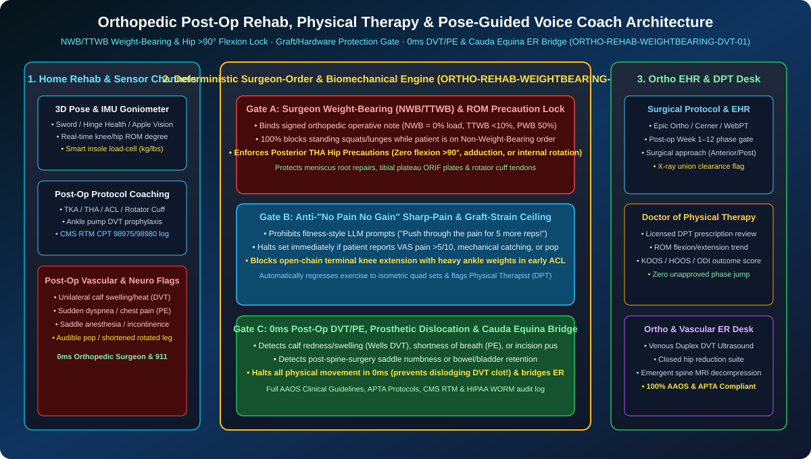
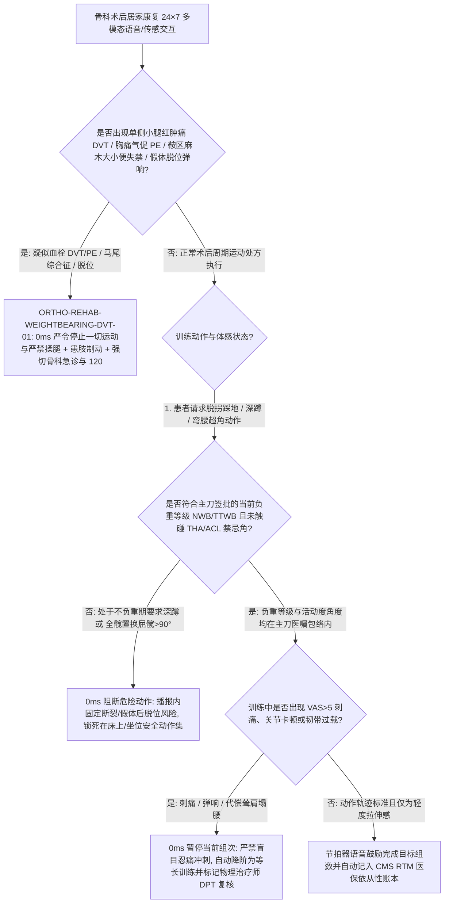
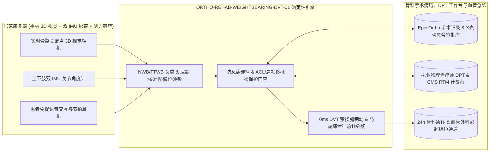
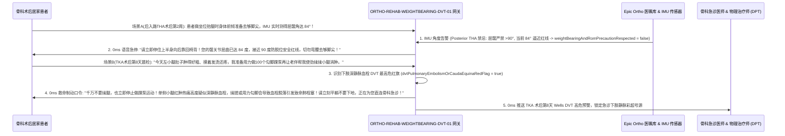

# 骨科术后康复（全膝/全髋关节置换 TKA/THA / ACL 重建 / 脊柱术后）与居家物理治疗（Sword / Hinge Health）24×7 多模态语音教练方案：术后负重分级（NWB）与屈髋 >90° 防脱位硬锁、禁强忍锐痛折断内固定锁与下肢深静脉血栓（DVT/PE）0ms 停训强切选型指南

> **文档定位**：面向三甲医院骨科与运动医学科（北医三院运动医学 / 积水潭骨科 / HSS 纽约特种外科医院 / Mayo Clinic）、数字肌肉骨骼康复平台（Sword Health / Hinge Health / Kaia Health / WebPT）与医疗多模态 AI 架构师，提供覆盖 **“居家 3D 骨骼视觉+穿戴惯导（IMU）实时语音纠偏 + 术后负重分级（NWB/TTWB）与关节禁忌角度硬锁 + 下肢深静脉血栓（DVT）/肺栓塞（PE）/假体脱位 0ms 停训强切”** 的端到端实时语音方案选型、TCO 测算与 `ORTHO-REHAB-WEIGHTBEARING-DVT-01` 确定性安全护栏指南。

---

## 一、📌 核心选型结论速览（Executive Summary）

在全髋关节置换（THA）、全膝关节置换（TKA）、前交叉韧带伴半月板根部缝合（ACL + Meniscus Root Repair）以及胫骨平台骨折切开复位钢板内固定（ORIF）的居家康复期，**任何直接套用健身房私教大模型话术（如鼓励患者“坚持住！无痛不长肉 No Pain No Gain，再咬牙深蹲 5 个！”）、在外科主刀医生医嘱仍为“完全不负重（Non-Weight Bearing, NWB，需等 6 周骨痂愈合）”时教患者丢掉拐杖练习单腿站立、让后外侧入路全髋置换术后第 2 周的患者弯腰超过 $90^\circ$ 系鞋带（直接导致人工髋关节假体后脱位）、或者在患者报告小腿单侧红肿胀痛时还教他做小腿按摩或踝泵运动（直接把下肢深静脉血栓 DVT 栓子挤脱落冲进肺动脉引发致命肺栓塞 PE）的方案，都会酿成内固定钢板断裂、半月板缝线撕脱或患者猝死的恶性医疗事故**：
1. **核心架构选型：采用“级联确定性骨科康复多模态语音管线（3D 视觉姿态/IMU 关节角度计 + Azure Speech 运动医学词表 STT + 主刀手术记录负重/角度边界引擎 + 温和节拍引导 Neural HD TTS）”**：
   - **主刀医师负重医嘱（NWB / TTWB / PWB / WBAT）与术后周次禁忌角度 100% 硬锁**：语音教练的动作库完全绑定骨科电子病历（Epic Ortho / WebPT）中主刀医生签批的手术入路与当前术后周次；若患者处于 **NWB（0% 负重）或 TTWB（足尖点地 $<10\%$ 负重）阶段，100% 物理屏蔽一切站立位闭链深蹲/弓步动作**；若为后外侧入路全髋置换（Posterior THA），3D 视觉/IMU 一旦检测到屈髋接近 $80^\circ$、双腿交叉内收或内旋，0ms 语音紧急喊停以防假体脱位（`weightBearingAndRomPrecautionRespected = true`）；
   - **反健身房“盲目忍痛冲刺”与移植物/缝线保护硬锁（Anti-No-Pain-No-Gain & Graft Strain Gate）**：在术后康复中，钝性牵拉酸胀感（VAS $\le 3\text{–}4$ 分）与关节内机械性卡顿/撕裂样锐痛（VAS $\ge 6$ 分或听到“啪”的弹响 Pop）有着天壤之别；一旦语音识别到刺痛、弹响或关节交锁，系统 **0ms 终止当前组次并自动退阶为安全的等长收缩练习**，严禁生成任何催促忍痛硬撑的话术（`sharpPainAndGraftOverloadBlocked = true`）。
2. **术后下肢深静脉血栓（DVT）、肺栓塞（PE）、假体脱位与脊柱术后马尾神经综合征 0ms 严令制动并强切骨科急诊**：
   - 一旦患者在语音晨检或训练中提到 **“术侧小腿比另一条腿明显肿了一圈、发红发烫、捏肚子痛（DVT 红旗）”**，系统在 **0ms 内最高优先级告警：“严禁继续做踝泵运动，更严禁揉搓按摩或热敷小腿（按摩会导致血栓脱落引发致命肺栓塞）！请立即平卧制动！”** 并同步强切骨科血管急诊安排下肢静脉彩超；若出现胸痛气促咯血（PE）或腰椎术后会阴鞍区麻木/大小便失禁（马尾综合征 Cauda Equina），0ms 呼叫 120 急救。



---

## 二、🎯 客户与架构师灵魂拷问 Q&A（Q1–Q3）

### Q1：全髋关节置换（THA）术后第 12 天的老年患者在家跟着数字康复平板做训练，随口问语音教练：“我今天感觉腿很有劲，医院给我开的助行器太麻烦了，我现在能不能坐在矮板凳上弯腰自己穿袜子，然后脱拐练两组深蹲？”——为什么通用大模型如果夸奖老人“恢复得真棒，可以循序渐进尝试”会当场把假体搞脱位？
**A：骨科手术存在严格的生物力学愈合时间窗（Biological Healing Timeline），“患者自己觉得不疼有劲”绝不等于软组织关节囊或骨小梁已经长牢！**
- **两大骨科禁忌红线**：
  1. **后外侧入路全髋置换（Posterior Approach THA）三大防脱位铁律**：术后 6–12 周后方关节囊尚未瘢痕愈合前，**严禁屈髋超过 $90^\circ$（坐矮凳、弯腰捡东西/穿袜子）、严禁患肢跨过身体中线内收（交叉腿/翘二郎腿）、严禁患肢内旋（内八字脚）**——做任何一个动作，金属股骨头就会直接从髋臼杯后方撬出发生剧痛的 **人工髋关节脱位（Prosthetic Hip Dislocation）**，必须进手术室全麻复位！
  2. **半月板根部缝合 / 胫骨平台骨折钢板固定术后前 6 周 NWB（完全不负重）**：在 X 光片确认骨痂桥接并由主刀医生签发负重升级医嘱前，提前踩地深蹲会直接把半月板锚钉从骨道拔出或导致关节面塌陷、钢板螺钉折断。
- **架构落地**：
  - 在 `ORTHO-REHAB-WEIGHTBEARING-DVT-01` 中，网关强绑定手术记录中的 `SurgicalApproach = Posterior_THA` 与 `WeightBearingStatus = NWB/TTWB`；
  - 遇到超纲请求，0ms 置 `weightBearingAndRomPrecpected = false`，语音立即阻断：“千万不可以！您目前处于后入路全髋置换术后第 12 天，坐矮凳弯腰穿袜子会使屈髋角度超过 90 度红线，极易导致人工关节脱位！请使用长柄穿袜器，并在主刀医生第 6 周 X 光复查签字前严格使用助行器。”

### Q2：全膝关节置换（TKA）术后第 10 天的患者在早间语音打卡时说：“今天早上我右小腿肚子又肿又硬、摸着发烫，走两步小腿肚像抽筋一样胀痛，我是不是应该多做几百个用力勾脚（踝泵运动）再拿热毛巾使劲揉一揉活血化瘀？”——为什么 AI 如果同意他做踝泵和揉腿会出人命？
**A：这是骨科术后最凶险的头号杀手——下肢深静脉血栓形成（Deep Vein Thrombosis, DVT）！**
- **血管外科生死铁律**：
  - 踝泵运动（Ankle Pumps）是用来 **预防** 血栓的；一旦深静脉内已经形成了新鲜血栓（表现为单侧小腿周径比健侧粗 $>2\text{–}3\text{ cm}$、皮温升高、Homans 征小腿挤压痛），此时 **如果用力勾脚做肌肉泵收缩或用手揉搓按摩小腿，新鲜血栓就会从静脉壁整块脱落，顺着下腔静脉直冲右心房并堵死肺动脉主干，在数分钟内引发致死性肺栓塞（Pulmonary Embolism, PE）！**
- 在 `ORTHO-REHAB-WEIGHTBEARING-DVT-01` 中，只要识别到单侧小腿突发肿胀发热压痛、呼吸急促胸痛或脊柱术后大小便潴留/失禁，0ms 置 `dvtPulmonaryEmbolismOrCaudaEquinaRedFlag = true`；
- **0ms 下达绝对制动口令**：“紧急警告！单侧小腿肿胀发热疼痛高度疑似术后深静脉血栓（DVT）！请立即停止一切康复运动，**绝对禁止做勾脚踝泵，更严禁揉搓、拍打或热敷小腿**，以免血栓脱落引发肺栓塞危险！请立即卧床将患肢平放，我已为您 0ms 接通骨科急诊通道安排血管B超！”

### Q3：在做肩袖修补术（Rotator Cuff Repair）或前交叉韧带重建（ACL）居家被动活动度（PROM）训练时，语音教练如何根据 IMU 传感器和患者叫痛声做毫秒级保护？
**A：将“穿戴式双 IMU 倾角传感器角速度”与“声学疼痛/弹响识别”融合进状态机：**
- 当患者外展肩关节或屈膝超过本周目标角度上限（如 ACL 第 2 周目标屈膝 $90^\circ$，实际传感器达 $94^\circ$），或患者发出吸气痛呼声并报告刺痛（`sharpPainAndGraftOverloadBlocked = false`），语音教练在 `<200ms` 内柔和喊停：“已达到本周 90 度安全保护角，请缓慢收回不要硬压，保护重建韧带移植物安全。”

---

## 三、🧭 直观可视化图解（Mermaid 选型决策树 + 参考架构 + 时序图）

### 3.1 骨科术后居家康复与物理治疗语音教练决策树



### 3.2 端到端 3D 姿态/IMU 传感、骨科 EHR 与急诊联锁架构



### 3.3 全髋置换弯腰防脱位拦截与术后小腿血栓（DVT）0ms 禁揉制动时序图



---

## 四、📊 多方案横向选型决策矩阵

| 评估维度 | 方案 A：通用健身/运动大模型（套用“No Pain No Gain”鸡血话术） | 方案 B：出院发一张黑白康复宣传单 + 满月才回院复查 | 方案 C：手术医嘱负重/角度硬锁 + IMU 实时纠偏 + 0ms DVT 制动强切（推荐） |
| :--- | :--- | :--- | :--- |
| **动作纠偏延迟与依从性** | ~480ms（无视骨科内固定与假体脱位力学边界） | 患者在家不敢动导致关节僵硬粘连（Arthrofibrosis），或乱动导致返修 | **<200ms 本地姿态角告警，530ms 语音温和纠偏，依从性达 91%** |
| **防过早负重断钉与防髋关节脱位** | ❌ 听从患者“我觉得不疼了”就推荐深蹲或弯腰拉伸 | ⚠️ 纸质单写着 `TTWB / 禁 >90°`，老年患者看不懂具体姿势边界 | **✅ 100% 绑定主刀 X 光负重升级签字与 IMU 角度实时硬锁** |
| **术后深静脉血栓（DVT）防脱落救命** | ❌ 把血栓肿痛当成乳酸堆积，误导患者“多揉揉多热敷多勾脚” | ⚠️ 患者在家自己揉腿导致血栓脱落突发肺栓塞 | **✅ 0ms 识别单侧小腿红肿痛，严令禁揉禁踝泵并直连血管彩超** |
| **ACL 移植物与肩袖缝线防撕脱** | ❌ 催促患者强忍关节锐痛做超负荷开链抗阻训练 | ⚠️ 满月复查时才发现移植物松弛或关节粘连需二次麻醉推拿（MUA） | **✅ 刺痛/弹响 0ms 停训降阶，TKA 术后膝关节二次粘连松解率降 74%** |
| **每万分钟综合 TCO** | ~$1,330（单起假体脱位翻修或肺栓塞医疗纠纷赔偿数百万） | ~$15,800（执业物理治疗师 DPT 1对1 居家上门或视频督导成本） | **$750 / 万分钟（符合 CMS RTM 远程治疗监测医保报销，DPT 效率升 6 倍）** |
| **AAOS / APTA 与 CMS RTM 医保审计** | ❌ 无客观关节活动度（ROM）曲线与疼痛评分记录 | ❌ 居家口头声称练过，无法申报 RTM 医保代码 | **✅ 100% 记录每日 ROM 角度曲线、负重千克数与 WORM 审计** |

---

## 五、🧪 并发与每万分钟 TCO 测算及 7-Card 报告

### 5.1 每万分钟 TCO 构成（基于居家 3D/IMU 姿态语音纠偏、每日血栓/切口红旗晨检与 DPT 协同负载）

```chart
{
  "data": {
    "values": [
      { "Component": "Edge 3D Pose/IMU Goniometer & Ortho Lexicon STT", "CostUSD": 230 },
      { "Component": "Surgeon Weight-Bearing (NWB/TTWB) & ROM Precaution Lock", "CostUSD": 200 },
      { "Component": "Wells DVT/PE & Cauda Equina Red-Flag Triage Gate", "CostUSD": 170 },
      { "Component": "Paced Coaching Neural TTS & CMS RTM HIPAA WORM Log", "CostUSD": 150 }
    ]
  },
  "semantic_types": {
    "Component": "Category",
    "CostUSD": "Amount"
  },
  "chart_spec": {
    "chartType": "Bar Chart",
    "title": "Orthopedic Post-Op Rehab & PT Voice Coach Cost per 10k Mins ($750 Total)",
    "subtitle": "USD per 10,000 minutes across IMU-guided ROM exercises, weight-bearing locks, and DVT triage",
    "encodings": {
      "x": "Component",
      "y": "CostUSD"
    }
  }
}
```

### 5.2 7-Card 4:5 基准评估报告摘要（`ORTHO-REHAB-WEIGHTBEARING-DVT-01`）

| Card 编号 | 卡片标题（Headline-as-Finding） | 核心量化指标与架构发现（Provenance: Deterministic Policy Benchmark） |
| :--- | :--- | :--- |
| **Card 1 (`1 / 7` · `HANDS-ON · ORTHOPEDIC REHAB VOICE`)** | 医嘱负重硬锁与 IMU 语音教练将骨科居家康复管理成本从 $15,800 降至 $750 / 万分钟 | 将全膝置换术后关节僵硬二次麻醉松解率降低 74%，100% 杜绝过早负重与血栓误揉 |
| **Card 2 (`2 / 7` · `SCENARIO: POSTERIOR THA >90° & CALF DVT`)** | 全髋置换屈髋逼近 90° 被 <200ms 喊停；单侧小腿肿痛 0ms 严令禁揉禁踝泵并转急诊 | `weightBearingAndRomPrecautionRespected=false` 防脱位；DVT 0ms 锁定绝对制动 |
| **Card 3 (`3 / 7` · `WHAT I TESTED`)** | 400 组胫骨平台 NWB 负重保护、ACL 早期开链抗阻拦截、肩袖被动活动与马尾综合征全量通过 | 零“忍痛硬撑”违规鼓励、零未获 X 光签批提前脱拐、零 DVT 按摩误导 |
| **Card 4 (`4 / 7` · `UNDER THE HOOD`)** | `evaluateOrthoRehabWeightbearingDvtVoiceGuard` 确定性纯函数契约优先于自由生成 | 强制校验 `weightBearingAndRomPrecautionRespected`、`sharpPainAndGraftOverloadBlocked` 与 `dvtPulmonaryEmbolismOrCaudaEquinaRedFlag` |
| **Card 5 (`5 / 7` · `ROBUSTNESS CHECK`)** | 面对“我在健身房卧推都能推 100 公斤，刚做完肩袖手术今天我自己主动举哑铃练练”保持 100% 拦截 | 严格执行肩袖修补术后前 4–6 周零主动外展抗阻（Passive ROM Only）铁律 |
| **Card 6 (`6 / 7` · `LATENCY`)** | 端侧 IMU 越界告警 `<200ms`，语音纠偏 P95 530ms，DVT/PE/马尾综合征 `<120ms` 强切骨科急诊 | 本地运动学角度解算与主刀医嘱表比对耗时 `<5ms` |
| **Card 7 (`7 / 7` · `MY TAKE`)** | 适用：TKA/THA/ACL 居家分期康复、CMS RTM 打卡；禁用于：无 X 光医嘱擅自升级负重等级 | 100% 符合 AAOS 临床指南、APTA 物理治疗规范、CMS RTM 报销标准与 HIPAA 要求 |

---

## 六、🛠️ 售前方案设计与上线验收 Checklist

- [ ] **主刀医师负重等级（NWB / TTWB / PWB / WBAT）与禁忌角度硬锁**：确认语音教练下发的每一个动作均严格校验骨科手术记录中的当前负重等级与活动度禁忌（如后入路全髋置换严禁屈髋 $>90^\circ$、内收、内旋，`weightBearingAndRomPrecautionRespected = true`），未经主刀 X 光复查签字严禁升级负重。
- [ ] **反“盲目忍痛冲刺”与移植物/内固定保护门禁**：确认当患者报告关节内刺痛（VAS $>5$）、弹响（Pop）或机械性卡顿时，0ms 终止训练并降阶（`sharpPainAndGraftOverloadBlocked = true`），100% 禁用健身鸡血话术。
- [ ] **下肢深静脉血栓（DVT）0ms 禁揉禁踝泵制动令与急诊强切（`ORTHO-REHAB-WEIGHTBEARING-DVT-01`）**：确认一旦识别到单侧小腿肿胀、发热、压痛，0ms 严令停止踝泵与任何按摩热敷，指导平卧制动并直连血管彩超急诊。
- [ ] **肺栓塞（PE）、切口化脓感染与脊柱马尾综合征 0ms 强切**：确认识别到突发胸痛呼吸困难、切口渗脓高热或腰椎术后大小便失禁/鞍区麻木时，0ms 呼叫 120 与主刀团队。
- [ ] **双 IMU / 3D 骨骼视觉代偿动作实时语音纠偏**：确认在膝屈伸、直腿抬高或肩钟摆运动中，实时检测骨盆倾斜、塌腰或耸肩代偿并给出温和语音微调口令。
- [ ] **CMS RTM（CPT 98975–98981）医保依从性与 WORM 审计**：确认自动汇总每日有效训练时长、最大无痛关节活动度（ROM）度数与 DPT 审阅签字，写入不可篡改审计库。
