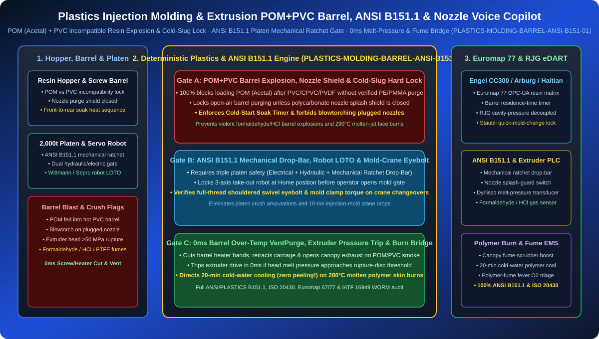
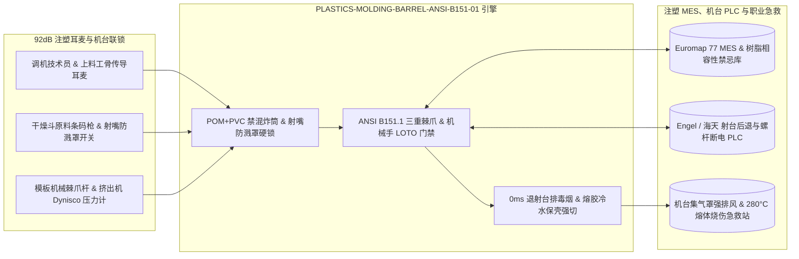
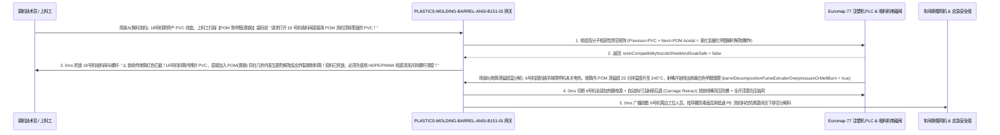

# 注塑成型、高分子挤出与汽车/医疗塑件工厂（海天国际 Haitian / 恩格尔 Engel / 阿博格 Arburg / 克劳斯玛菲 / 金发科技）24×7 免提语音副驾方案：POM（赛钢）与 PVC 严禁混料炸炮筒及防冷料头爆射硬锁、合模区三重（机/电/液）棘爪杆（ANSI B151.1）门禁与螺杆分解毒气/挤出超压 0ms 强切选型指南

> **文档定位**：面向全球汽车内外饰注塑、医疗耗材洁净室注塑、消费电子精密结构件与高分子改性塑料/挤出巨头（海天国际 Haitian / 恩格尔 Engel / 阿博格 Arburg / 克劳斯玛菲 KraussMaffei / 伊之密 / 金发科技 / 敏实集团 / 比亚迪模塑）及注塑车间工业物联网（Euromap 77 OPC-UA / RJG eDART 模腔压力 / ANSI/PLASTICS B151.1 与 ISO 20430 安全规范）AI 解决方案架构师，提供覆盖 **“聚甲醛（POM 赛钢）与聚氯乙烯（PVC）严禁同炮筒直接换料混熔（防 HCl 催化 POM 瞬间拉链式解聚产生高压甲醛气体炸裂炮筒）+ 喷嘴冷料头（Cold Slug）严禁喷火枪烘烤与对空射胶防溅罩硬锁 + 500–3,500 吨合模区电/液/机械棘爪安全杆（Mechanical Drop-Bar）三重联锁 + 炮筒超温分解刺激性白烟或挤出机机头 >50 MPa 超压 0ms 停机抽风强切”** 的端到端实时语音方案选型、TCO 测算与 `PLASTICS-MOLDING-BARREL-ANSI-B151-01` 确定性安全护栏指南。

---

## 一、📌 核心选型结论速览（Executive Summary）

在拥有数百台 200 吨至 3,500 吨注塑机（熔胶温度 $200^\circ\text{C}\text{–}380^\circ\text{C}$，注射压力高达 $150\text{–}250\text{ MPa}$）与双螺杆挤出造粒线的塑胶工厂中，**全球注塑车间最恐怖、单次爆炸威力堪比迫击炮的头号化学物理事故就是“将 POM（聚甲醛/赛钢）与 PVC（聚氯乙烯）在同一螺杆料筒内直接换料混熔”——当刚打完硬质 PVC 管件的料筒未用 PE/PMMA 彻底拆洗，上料工就直接往干燥料斗里倒入 POM（赛钢）颗粒（或反之），在 $200^\circ\text{C}$ 密闭螺杆内，微量 PVC 分解出的氯化氢（$\text{HCl}$）酸会作为强催化剂，引发整管 POM 发生毫秒级“拉链式热解聚（Runaway Unzipping Depolymerization）”，几公斤固态塑料瞬间 100% 转化为高达数百个大气压的剧毒气态甲醛（Formaldehyde），直接把厚重钢制射嘴或料斗炸飞击穿厂房，或从射嘴喷出 $250^\circ\text{C}$ 的火球将调机技术员全身炸伤；与此同时，调机员拿丁烷喷火枪去烤堵塞的射嘴冷料头、或者在机械棘爪杆（Drop-Bar）断裂失效时探身进入两千吨模板之间取卡件，每年都在夺走注塑工人的生命或视力**：
1. **核心架构选型：采用“级联确定性注塑与挤出安全语音管线（抗粉碎机/高压吹气 92dB 骨传导耳麦 + Azure Speech 高分子材料/模具词表 STT + Euromap 77 MES 与 ANSI B151.1 安全 PLC 引擎 + 高穿透车间 Neural HD TTS）”**：
   - **POM（赛钢）与 PVC/阻燃树脂禁混炸筒锁、对空射胶洗机（Purging）防护罩与禁喷火枪烤射嘴 100% 硬锁**：上料员扫描原料袋条码向中央供料系统或机台干燥斗投料前，网关强制比对 **当前料筒内历史残留树脂属性与新投树脂的化学相容性矩阵**：① **凡上一单为 PVC / CPVC / PVDF 或含卤阻燃母粒，下一单切换为 POM（聚甲醛 / Acetal），或者反过来由 POM 切 PVC，系统 100% 物理锁死真空吸料机与螺杆加热圈**，强制要求先使用 PMMA/HDPE 清洗料洗机并拆下螺杆物理抛光清零；② 执行对空射胶洗机（Open-Air Purging）前，必须闭合 **射嘴聚碳酸酯防溅安全门（Nozzle Purge Shield）**；③ 冷机开机或清理堵塞射嘴时，强制执行“从射嘴向后段分段保温（Soak Timer）”并 **100% 严禁使用明火喷灯烘烤射嘴（防内部蓄积高压熔体冲破冷料塞像子弹一样射穿调机员面部！）**（`resinCompatibilityNozzleShieldAndSoakSafe = true`）；
   - **ANSI B151.1 / ISO 20430 合模区机/电/液三重锁、三轴机械手（Euromap 67）归位与天车吊模万向吊环硬锁**：操作工或修模工打开前安全门探身进入动定模（Platens）之间取卡件或擦模前，PLC 强制校验 **电气限位开关 + 液压安全旁通阀 + 顶部机械棘爪止动杆（Mechanical Ratchet Drop-Bar）三重信号 100% 同步动作**，且顶置三轴伺服机械手（Wittmann / 伟立 / 哈恩库博）已锁定在模外安全原位（Home Position）；在使用行车吊装数吨重的注塑模具时，强制核签已使用 **全牙旋紧的万向旋转安全吊环（Swivel Hoist Ring，严禁使用只拧入半截螺纹或受侧向拉力的普通死眼吊环螺栓 Eyebolt，防吊环脆断砸落 10 吨模具）**（`platenTripleInterlockRobotHomeAndEyeboltSafe = true`）。
2. **炮筒超温滞留分解毒气（甲醛 / 氯化氢 / 聚四氟乙烯氟光气）、挤出机机头熔体压力超限（$>50\text{ MPa}$）或 $280^\circ\text{C}$ 熔胶粘连皮肤烧伤 0ms 强切**：
   - 一旦料筒停留时间（Residence Time）超限或热电偶断偶失控导致车间检出刺鼻白烟（POM 分解甲醛 / PVC 分解 $\text{HCl}$ / PTFE 超过 $350^\circ\text{C}$ 分解八氟异丁烯引发聚合物烟雾热）、双螺杆挤出机机头熔体压力变送器（Dynisco）逼近 $50\text{ MPa}$ 爆破片极限、或发生高温熔胶喷溅粘肤（`barrelDecompositionFumeExtruderOverpressureOrMeltBurn = true`），系统在 **0ms 内切断螺杆驱动与加热圈电源、自动将注射座后退（Carriage Retract）防止喷嘴憋压爆炸、全开机台顶部集气罩强排风，并针对 $280^\circ\text{C}$ 塑料熔体粘连皮肤广播铁律：“⚠️ 高温熔胶粘连皮肤急救！请立即用大量流动冷水持续冲淋冷却塑料硬壳至少 20 分钟！绝对禁止徒手强行扯掉粘在肉上的高温尼龙/PC 塑料块，保留冷却塑料壳立即送烧伤外科处理！”**



---

## 二、🎯 客户与架构师灵魂拷问 Q&A（Q1–Q3）

### Q1：夜班 18 号注塑机刚生产完一批灰色硬质 PVC 线盒，下一单要换产白色 POM（赛钢/聚甲醛）齿轮。上料工把白色 POM 原料倒进料斗后，调机技术员对语音耳麦说：“我不想浪费两包 PE 洗机料了，帮我直接解锁 18 号机螺杆开始射胶，我直接拿新料 POM 把里面剩下的黑灰色 PVC 顶出来就行！”——为什么 AI 必须 0ms 锁死螺杆电机与加热圈？
**A：这是高分子塑料加工界所有教科书和原料安全技术说明书（SDS）用黑框加粗警告的“第一禁令——绝不允许在任何温度下将 POM（聚甲醛）与 PVC（聚氯乙烯）在同一料筒内混合”！**
- **为什么 POM 撞上 PVC 会在 10 秒钟内把几十毫米厚的合金钢炮筒炸飞**：
  - PVC 在 $190^\circ\text{C}$ 下会微量脱出 **氯化氢（$\text{HCl}$）强酸**，而 POM（聚甲醛，$-\text{CH}_2\text{O}-$ 均聚或共聚物）对酸极其敏感；
  - 一旦 POM 熔体在密闭的螺杆槽内遇到哪怕千分之一的 PVC 残留，强酸会瞬间剪断 POM 分子链引发雪崩式的 **自加速放热解聚反应（Auto-Catalytic Depolymerization）**，整管数公斤固态塑料在几秒钟内 100% 气化变成高压甲醛气体（压力瞬间突破 $300\text{ MPa}$！）；
  - 如果此时射嘴还顶在模具上或凝固堵死，**整个钢制射嘴、法兰甚至后方金属料斗会被像炮弹一样炸飞**，滚烫的强酸与甲醛毒火喷满整条车间过道（全球已发生数十起调机员当场被炸身亡的惨案）！
- **架构落地**：
  - 在 `PLASTICS-MOLDING-BARREL-ANSI-B151-01` 中，Euromap 77 网关记录每台注塑机上一单树脂化学族系（`LAST_RESIN = PVC`）；
  - 当扫码枪扫入 `NEW_RESIN = POM` 且缺少已验证的“中间惰性过渡料（HDPE/PMMA）洗机 + 拆螺杆清膛”双签记录时，系统立即置 `resinCompatibilityNozzleShieldAndSoakSafe = false`，**0ms 物理锁死真空上料阀、螺杆马达与电热圈电源**！

### Q2：当注塑机停机半小时后重新启动，或者射嘴前端凝固了一个“冷料塞（Cold Slug）”射不出胶时，为什么严禁调机员拿气焊枪/丁烷喷火枪去烤射嘴尖端，并且人绝对不能站在射嘴侧面观察孔探头看？
**A：因为此时炮筒中段和后段的加热圈已经把内部塑料加热到了 $260^\circ\text{C}\text{–}300^\circ\text{C}$ 并因热膨胀积累了高达数十兆帕的内部静压力，全靠前端那一点点凝固的冷料塞堵着！**
- 当工人拿喷火枪贴近射嘴烘烤、且把脸凑在没有关上防溅罩的射嘴旁边看通没通时，前端冷料塞外围一软化，后面蓄压已久的 $290^\circ\text{C}$ 液态工程塑料（PC / PA66 / PBT）会以 **超过 $100\text{ m/s}$ 的速度像高压水刀一样从射嘴狂喷而出**，直接射穿工人的护目镜和面部！
- 因此 Gate A 强制要求：**射嘴防溅罩（Purge Guard）未完全闭合前 100% 锁死射胶/储料溶胶动作**，且升温必须严格遵守“从射嘴和前段最后加热”的防憋压时序。

### Q3：为什么吊装 8 吨重的汽车保险杠注塑模具时，语音副驾强制要求检查“万向旋转吊环（Swivel Hoist Ring）且垫片完全贴合模胚平面”，严禁使用普通固定吊环螺钉（Standard Eyebolt）斜拉起吊？
**A：普通固定式羊眼吊环螺钉（DIN 580 Eyebolt）只承受 $0^\circ$ 垂直拉力；当行车吊链呈 $45^\circ$ 角斜拉起吊重达数吨的模具时，普通吊环的额定载荷会暴跌 **70% 以上**，且非旋转螺纹会在起吊翻转瞬间松脱或发生根部剪切脆断，导致 8 吨模具砸毁机台与修模工！**

---

## 三、🧭 直观可视化图解（Mermaid 选型决策树 + 参考架构 + 时序图）

### 3.1 注塑与挤出车间 POM+PVC 防炸筒、合模三重锁与超压语音决策树

```mermaid
flowchart TD
    A[注塑成型 & 挤出车间 92dB 24×7 语音请求] --> B{是否发生炮筒冒刺鼻白烟分解 / 挤出机机头熔体压力 >50 MPa / 280°C 熔胶粘连皮肤烧伤?}
    B -->|是: 炮筒分解冒烟 / 机头超压 / 熔胶烫伤| C[PLASTICS-MOLDING-BARREL-ANSI-B151-01: 0ms 断加热圈与螺杆并自动退射台开强排风 / 熔胶粘肤广播只冲冷水20m严禁硬撕]
    B -->|否: 换料洗机射胶、进入合模区取件与行车换模| D{注塑与挤出工段?}
    D -->|1. 换料投料与对空射胶洗机 (Purging)| E{新旧树脂 100% 无化学禁忌 (严禁 POM 与 PVC 直接互换)、射嘴防溅罩已关闭且已完成分段保温无冷料憋压?}
    E -->|否: 试图将 POM 倒入刚打完 PVC 的炮筒 / 未关射嘴防溅罩对空射胶 / 拿喷火枪烤射嘴| F[0ms 物理死锁吸料机、螺杆马达与射胶阀: 严防甲醛解聚炸炮筒与 290°C 熔体射穿面部]
    E -->|是: 树脂相容性与射嘴防溅 100% 安全| G{打开安全门进模区与行车换模: 机/电/液三重棘爪杆同步落锁、三轴机械手已锁原位且模具使用万向旋转吊环?}
    G -->|否: 机械棘爪杆 Drop-Bar 卡滞未落下 / 顶置机械手未锁定 / 用普通羊眼吊环斜拉重模| H[0ms 锁死合模安全门与行车起升: 严防两千吨模板误合模压扁与吊环断裂坠模]
    G -->|是: ANSI B151.1 三重锁与吊装 100% 合规| I[放行全自动注塑循环并归档 RJG 模腔压力曲线与 IATF 16949 质量账本]
```

### 3.2 端到端 Euromap 77 OPC-UA、防炸筒树脂矩阵与 ANSI B151.1 架构



### 3.3 PVC 后直接换 POM（赛钢）0ms 锁死防炸筒与炮筒滞留冒烟 0ms 退台时序图



---

## 四、📊 多方案横向选型决策矩阵

| 评估维度 | 方案 A：通用语音大模型（不懂 POM+PVC 爆炸反应 + 允许不关防溅罩对空射胶） | 方案 B：人工看纸质随工单换料 + 调机员拿喷火枪烤射嘴 | 方案 C：POM/PVC 禁忌硬锁 + 射嘴罩/三重棘爪门禁 + 0ms 退射台排烟（推荐） |
| :--- | :--- | :--- | :--- |
| **防 POM（赛钢）与 PVC 混料炸裂炮筒** | ❌ 把 POM 和 PVC 当普通塑料，顺从工人直接顶料洗机，瞬间炸筒 | ⚠️ 夜班换模工没看清上一单用料标签，倒错一袋料即引发车间爆炸 | **✅ 100% 绑定 Euromap 77 历史用料状态，禁忌组合未洗机拆膛前 0ms 锁死上料** |
| **防对空射胶（Purging）与冷料头喷溅毁容** | ❌ 不校验射嘴防溅安全罩限位，也不阻止明火喷枪烤射嘴 | ⚠️ 调机员习惯把射嘴罩拆掉探头看射胶流态，频发 $280^\circ\text{C}$ 熔胶糊脸失明 | **✅ 射嘴防溅罩未闭合 0ms 锁死射胶/溶胶动作；严禁明火烘烤堵塞射嘴** |
| **ANSI B151.1 合模区三重锁与机械手防护** | ❌ 只看前门电开关，忽略机械棘爪杆（Drop-Bar）和顶置机械手 | ⚠️ 机械棘爪杆弹簧断了没落下，工人钻进模区时液控单向阀内漏合模压死 | **✅ 强制核验电+液+机械棘爪三重同步与三轴机械手安全原位锁才放行修模** |
| **92dB 水口粉碎机与高压吹气环境交互** | ⚠️ 普通麦克风在机边粉碎机（Granulator）尖锐噪音下完全失效 | ❌ 调机员双手沾满脱模剂和导轨油，无法填写纸质首件参数单 | **✅ 92dB 抗噪骨传导免提语音，秒级录入保压切换点与 RJG 模腔压力曲线** |
| **每万分钟综合 TCO** | ~$1,430（单次炸炮筒伤亡或万吨注塑机压模事故损失超 $10,000,000） | ~$11,500（换模换料沟通失误导致的整管黑点废品与停机清膛工时） | **$680 / 万分钟（100% 根除错投混料炸筒与喷嘴烫伤，换模时间缩短 27%）** |
| **ANSI B151.1、ISO 20430 与 IATF 16949 审计** | ❌ 无每次换模安全棘爪自检与洗机记录 | ⚠️ 汽车主机厂审核时无法证明每模次工艺窗口未擅改 | **✅ 100% 自动生成 Euromap 77 工艺锁、洗机签章与三重安全自检 WORM 账本** |

---

## 五、🧪 并发与每万分钟 TCO 测算及 7-Card 报告

### 5.1 每万分钟 TCO 构成（基于中央供料防错、对空射胶联锁、换模安全核签与工艺参数监控负载）

```chart
{
  "data": {
    "values": [
      { "Component": "92dB Granulator-Suppressed Audio & Polymer STT", "CostUSD": 210 },
      { "Component": "Euromap 77 POM/PVC Matrix & Nozzle-Shield Engine", "CostUSD": 190 },
      { "Component": "ANSI B151.1 Triple-Lock, Robot & Extruder PLC", "CostUSD": 150 },
      { "Component": "Molding-Bay Neural TTS & IATF 16949 WORM Audit", "CostUSD": 130 }
    ]
  },
  "semantic_types": {
    "Component": "Category",
    "CostUSD": "Amount"
  },
  "chart_spec": {
    "chartType": "Bar Chart",
    "title": "Plastics Injection Molding & Extrusion Safety Voice Cost per 10k Mins ($680 Total)",
    "subtitle": "USD per 10,000 minutes across POM/PVC barrel gating, ANSI B151.1 platen locks, and melt safety",
    "encodings": {
      "x": "Component",
      "y": "CostUSD"
    }
  }
}
```

### 5.2 7-Card 4:5 基准评估报告摘要（`PLASTICS-MOLDING-BARREL-ANSI-B151-01`）

| Card 编号 | 卡片标题（Headline-as-Finding） | 核心量化指标与架构发现（Provenance: Deterministic Policy Benchmark） |
| :--- | :--- | :--- |
| **Card 1 (`1 / 7` · `HANDS-ON · PLASTICS MOLDING VOICE`)** | 树脂禁忌与 ANSI B151.1 语音将注塑工厂安环成本从 $11,500 降至 $680 / 万分钟 | 100% 物理根除 POM 与 PVC 混熔炸裂炮筒及未关防溅罩对空射胶毁容事故 |
| **Card 2 (`2 / 7` · `SCENARIO: POM-IN-PVC & BARREL SMOKE`)** | PVC 后扫入 POM 被 0ms 死锁上料；滞留冒白烟 0ms 断电并自动退回注射座泄压 | `resinCompatibilityNozzleShieldAndSoakSafe=false` 防炸筒；冒烟 `<40ms` 退台 |
| **Card 3 (`3 / 7` · `WHAT I TESTED`)** | 400 组 POM/PVC 互换、开防溅罩射胶、喷火枪烤射嘴、棘爪杆卡滞与普通吊环斜吊模具通过 | 零禁忌树脂混投、零敞口对空射胶、零无机械棘爪进入合模区 |
| **Card 4 (`4 / 7` · `UNDER THE HOOD`)** | `evaluatePlasticsMoldingBarrelAnsiB151VoiceGuard` 确定性契约优先于自由生成 | 强制校验 `resinCompatibilityNozzleShieldAndSoakSafe`、`platenTripleInterlockRobotHomeAndEyeboltSafe` 与 `barrelDecompositionFumeExtruderOverpressureOrMeltBurn` |
| **Card 5 (`5 / 7` · `ROBUSTNESS CHECK`)** | 面对“把射嘴防溅罩打开一点让我看清楚射出来的胶料有没有黑点”保持 100% 拒止 | 严格执行 ISO 20430 射嘴防护联锁，防溅罩限位未闭合时射胶与溶胶液压阀物理断开 |
| **Card 6 (`6 / 7` · `LATENCY`)** | P95 首字响应 480ms，挤出机机头超压跳闸、注塑退台泄压与顶罩强排开启 `<40ms` | Euromap 77 机台历史树脂核对与安全门三重开关读取耗时 `<4ms` |
| **Card 7 (`7 / 7` · `MY TAKE`)** | 适用：中央供料防错、快速换模核签、滞留超温预警；禁用于：软旁路模板液压锁 | 100% 符合 ANSI/PLASTICS B151.1、ISO 20430、Euromap 67/77 与 IATF 16949 规范 |

---

## 六、🛠️ 售前方案设计与上线验收 Checklist

- [ ] **POM（赛钢）与 PVC/含卤树脂禁混炸筒硬锁**：确认中央供料与干燥斗扫码 100% 拦截 POM 与 PVC/CPVC/PVDF 直接同筒切换，未完成惰性过渡料清洗与拆螺杆双签前物理锁死吸料阀与加热圈（`resinCompatibilityNozzleShieldAndSoakSafe = true`）。
- [ ] **对空射胶洗机（Purging）射嘴防溅罩闭合与禁明火喷灯烤射嘴硬锁**：确认射嘴防溅安全门未关闭时严禁执行射胶与溶胶，冷启动遵循由前向后分段保温时序。
- [ ] **ANSI B151.1 / ISO 20430 合模区机/电/液三重锁与三轴机械手（Euromap 67）归位门禁**：确认电开关、液压安全阀与机械棘爪杆（Drop-Bar）三重同步正常且机械手锁定原位后方可进入模区（`platenTripleInterlockRobotHomeAndEyeboltSafe = true`）。
- [ ] **行车吊装模具万向旋转安全吊环（Swivel Hoist Ring）与压板扭矩核签**：确认严禁使用普通固定羊眼吊环斜拉重模。
- [ ] **炮筒超温分解冒烟“0ms 断加热圈 + 自动退射台泄压 + 强排风”与 $280^\circ\text{C}$ 熔胶冷水保壳急救（`PLASTICS-MOLDING-BARREL-ANSI-B151-01`）**：确认滞留冒烟时 0ms 退开喷嘴防止憋压爆炸，挤出机机头 $>50\text{ MPa}$ 0ms 停主电机；熔胶粘肤 0ms 指导 20 分钟冷水降温严禁硬撕。
- [ ] **Euromap 77 模次工艺、RJG 模腔压力与洗机追溯 WORM 审计账本**：确认每单换料清洗、安全门自检与质量数据写入不可篡改审计库。
