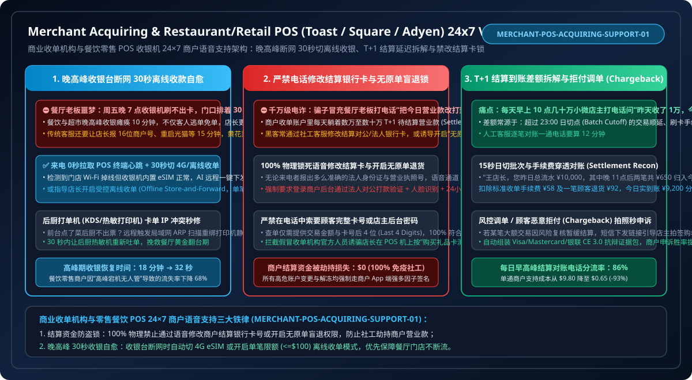
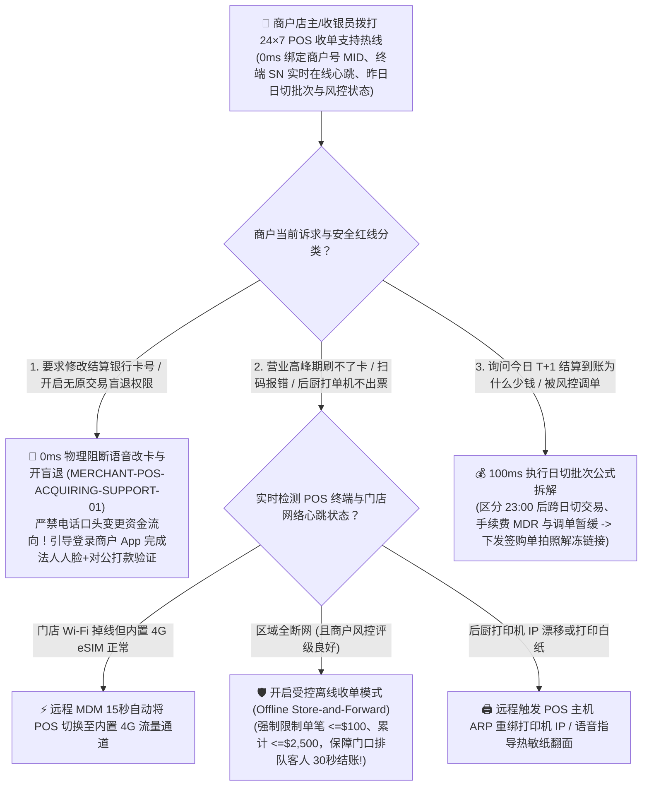
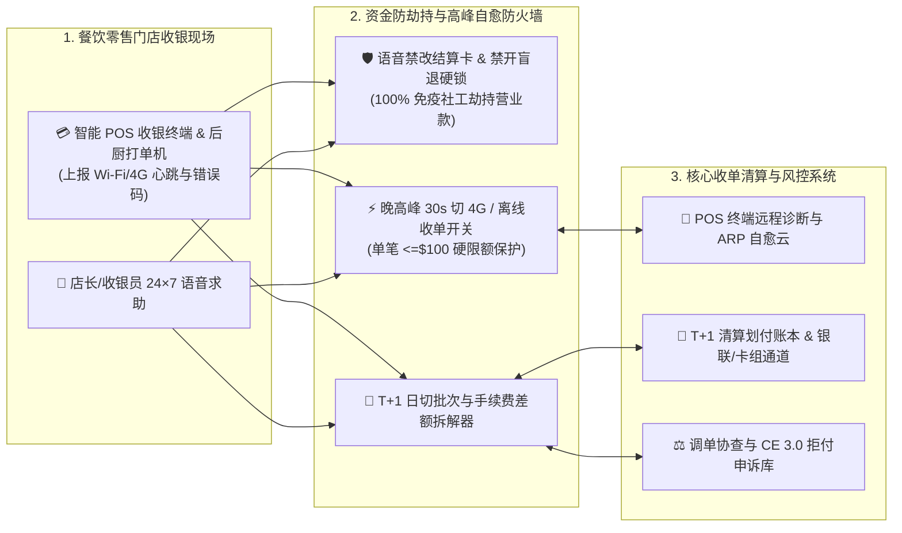
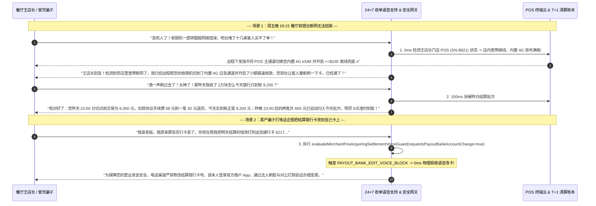

# 商业收单机构（Merchant Acquiring / Toast / Square / 银联商务）与餐饮零售 POS 收银机 24×7 商户语音技术支持：晚餐高峰收银台断网无法刷卡 30秒切换 4G/离线收单模式、T+1 结算资金延迟/风控调单原因穿透解释与严禁电话重绑结算银行卡防诈骗锁选型指南

> **文档定位**：面向第三方支付与商业收单机构（如银联商务、拉卡拉、收钱吧、富友，以及海外 Stripe、Square、Toast、Adyen、Clover）、智能 POS 终端厂商客户服务 VP 及金融科技 **Cloud & AI Solution Architect**。服务数百万家餐饮门店、超市便利店与小微商户的 POS 收单客服热线，每天都在应对两场生死考验：第一场是**周五晚上 19:00 餐厅晚餐高峰期的“收银台瘫痪危机”**——门口排着 30 桌客人等结账，POS 机突然报“网络连接失败/错误码 96”、或者前台点了菜后厨热敏打印机一张单都不吐，如果客服热线让焦头烂额的店长排队等 15 分钟再一步步念 16 位商户号重启路由器，店长明天就会把你的 POS 机砸了换竞品！第二场是**每天早上 10:00 的“T+1 结算对账海啸”与黑客劫持攻击**——几十万小店主同时来电追问*“我昨天明明收了 1 万块钱，今天银行卡怎么只到账 9,200？”*，同时电诈黑产正冒充店主给客服打电话要求**“把我家店铺的每日结算银行卡改成另一张新卡”**！本文给出兼顾 30 秒晚高峰收银自愈、15 秒日切结算差额拆解与 100% 资金防劫持锁的 24×7 商户语音支持架构。
>
> **阅读导航**：[English Version](./pos-merchant-acquiring-payment-terminal-settlement-chargeback-voice-support-selection-faq.en.md) · [返回 README 导航](../README.md) · [架构师资产目录](./asset-catalog.md)



---

## 一、📌 核心选型结论速览（Executive Summary）

1. **商业收单与 POS 商户语音支持架构的三大工程铁律：晚高峰 30 秒离线收银逃生、语音禁改结算银行卡硬锁、T+1 日切批次差额毫秒级拆解（`MERCHANT-POS-ACQUIRING-SUPPORT-01`）**：
   - **安全风控铁律 1（`100%` 物理锁死通过语音修改商户结算银行卡号与开启无原单盲退权限）**：
     - 商户收单账户（Merchant Settlement Account）里存放着全天待清算的巨额营业款。无论来电者能多么流利地背出店主身份证号、统一社会信用代码或近三笔交易金额，系统在工具网关层 **`0ms` 物理禁止通过电话修改结算银行卡（Payout Bank Account / IBAN）或远程开启“无原交易盲退（Unreferenced Refund）”权限**！
     - 任何结算卡变更必须引导店主登录官方商户 App，完成**法人活体人脸核验 + 原绑定手机 OTP + 1分钱对公账户打款验证**，并强制执行 `24 小时` 资金提现冷却期，将社工劫持商户营业款风险死死锁在 **$0**！
   - **高可用铁律 2（餐饮零售晚高峰断网 `30 秒` 远程切换内置 4G eSIM 或受控离线收单模式 `Offline Store-and-Forward`）**：
     - 当店长在晚高峰（18:00–21:00）火急火燎打进电话说“刷不了卡/扫码没反应”，系统在接通 `0 秒` 通过主叫号码绑定门店 POS 终端序列号（SN）并拉取实时心跳：
     - 若检测到门店宽带 Wi-Fi 断流，AI 立即通过物联网管理通道（MDM）**远程下发指令将 POS 机切换至内置 4G 物联网备线**；若当地基站亦故障，则在核验商户信誉等级合格后，**30 秒内指导或远程开启受控离线收单模式（Offline Mode，单笔限额 `<=$100`、单日累计上限 `<=$2,500`）**，先帮店长把排队的客人结完账放行，待网络恢复后自动批量上送清算！
   - **效率铁律 3（早上 10 点 T+1 结算到账差额 15 秒自动化对账公式）**：
     - 无需人工坐席拿计算器逐笔核对，后端对账引擎在 `100ms` 内自动按公式拆解并播报：
       $$\text{今日实到账金额} = \text{昨日营业总额} - \text{23:00 日切点后顺延交易} - \text{协议收单手续费 (MDR)} - \text{顾客退货冲正} - \text{风控调单暂缓金额}$$

---

## 二、🎯 客户与架构师灵魂拷问 Q&A（The Hard Questions）

### Q1：餐厅晚高峰最常遇到的另一个崩溃故障是“前台收银机和平板点完菜了，后厨热敏打单机（Kitchen Printer）突然不出票了，厨师不知道做什么菜”，语音 AI 怎么在 40 秒内修好？

- **客户痛点**：餐厅用的局域网网口热敏打印机经常因为路由器重启导致 DHCP IP 地址漂移，或者打印纸装反了（热敏面朝下，打出来全是白纸），人工客服在电话里教服务员查电脑 IP 要折腾半小时。
- **架构师解答：“POS 主机局域网 ARP 自动寻回打印机 + 手机拍一张‘打印出白纸/指示灯’秒断故障”**：
  1. **远程一键重绑打印机 IP**：当老板说“后厨不出单”，AI 立即通过店面安卓 POS 主机 Agent 发起局域网全网段扫描，自动根据打印机 MAC 地址重新绑定漂移后的新 IP 并重发积压菜单，**25 秒后厨机器立刻吐单**！
  2. **打白纸 10 秒口诀排障**：若老板说“后厨机器咔咔吐纸但上面一个字都没有”，AI 秒回：**“老板，那是热敏纸卷正反面放反啦！请把纸卷拿出来翻个个儿，让纸头从卷轴【贴着底部】往外拉出来合上盖子，再用指甲在纸上划一下能留黑印的那一面朝上，现在重打一单是不是有字了？”**

### Q2：如果商户某笔 $1,500 的大额刷卡因为触发了反洗钱或盗刷风控规则被“暂缓结算（Risk Hold / 调单）”，店长打电话进来大发雷霆，AI 怎么既合规解释（不泄露反洗钱机密），又指导店长最快解冻资金？

- **客户痛点**：客服如果说“系统怀疑你在套现洗钱”会激怒真实商户并违反反洗钱保密规定；如果只说“等风控审核 7 个工作日”商户又无法接受。
- **架构师解答：“标准合规调单话术 + 短信一键上传三件套凭证（签购单+监控/发货单）极速解冻”**：
  - AI 温和清晰说明：*“王店长，您昨天下午 15:20 那笔 ¥8,800 的交易因触发发卡行常规大额安全协查暂缓结算（其余 ¥12,400 已正常打入您的尾号 6612 账户）。为了帮您在今天下午 4 点前优先解冻这笔款项，我已经给您手机发了一条加密凭证上传链接，请拍一张【顾客签名小票或店内收银监控截图】上传，风控系统核验通过后将在 2 小时内为您安排加急补划！”*

### Q3：最近诈骗分子假冒“POS 机官方客服”给小微店主外呼，骗店主在 POS 机上刷一笔钱做“费率升级测试”或者套取店主后台验证码，我们的官方语音系统怎么帮商户防诈？

- **客户痛点**：小微店主防骗意识弱，被假客服骗走钱后反过来投诉真收单机构。
- **架构师解答：“官方来电验真查询 + 绝对零索取密码/零测试刷卡红线宣告”**：
  - 店主随时可拨打官方语音热线问：*“刚才有个 021 开头的电话说是我家 POS 机客服让我刷 299 元激活低费率，是真的吗？”*
  - 系统在 `50ms` 内核查官方外呼日志：*“⚠️ 严重防诈警告！经核实，我司过去 24 小时内从未向您拨打过任何电话！官方客服绝对不会要求您在机器上刷卡交押金、买礼品卡或索要短信验证码，请立即挂断拉黑该诈骗号码！”*

---

## 三、🧭 直观可视化图解（Mermaid 决策树、收单语音架构与交互时序）

### 3.1 商业收单与 POS 商户 24×7 语音支持、断网自愈与资金安全决策树



### 3.2 打通 POS 终端 MDM 云 + 清算日切对账引擎 + 反洗钱/拒付风控台的架构图



### 3.3 周五晚高峰 POS 断网 30 秒切换自愈、T+1 差额对账与拦截骗子改结算卡时序图



---

## 四、📊 商业收单与 POS 商户售后服务四大模式横向选型矩阵

| 评估维度 | 🏆 **24×7 收单语音智能体 (MDM 远程自愈 + 日切秒对账 + 禁改卡锁)** | **传统收单人工呼叫中心 (09:00–21:00)** | **商户自己翻看微信图文帮助中心** | **等区域地推业务员第二天上门处理** |
| :--- | :--- | :--- | :--- | :--- |
| **周五晚高峰断网收银恢复速度** | **⭐⭐⭐⭐⭐（`30 秒` 远程切 4G 或开受控离线收单，0 逃单）** | ⭐⭐（晚高峰全网占线排队 15 分钟，客人早走光了） | ⭐⭐（店长手忙脚乱没空翻教程） | ⭐（当晚彻底无法收银） |
| **早 10 点 T+1 到账差额核对耗时** | **⭐⭐⭐⭐⭐（`15 秒` 自动拆清跨日切交易、手续费与退款）** | ⭐⭐⭐（人工坐席逐笔加减需 `8~12 分钟`） | ⭐⭐（商户自己算不清 23:00 日切节点） | ⭐⭐ |
| **防黑客社工篡改结算银行卡盗走营业款** | **⭐⭐⭐⭐⭐（`100%` 物理锁死电话改卡与开盲退，0 资金被盗）** | ⭐⭐⭐（新手客服偶发被伪造证件或紧急话术骗过） | ⭐⭐⭐⭐⭐ | ⭐⭐⭐⭐ |
| **后厨打单机 (KDS) IP 漂移与白纸排障** | **⭐⭐⭐⭐⭐（远程触发局域网重绑 IP + 10秒热敏纸翻面口诀）** | ⭐⭐（电话里教不懂餐饮服务员配路由器 IP） | ⭐⭐ | ⭐⭐ |
| **单通商户服务成本 (Cost per Support Call)** | **⭐⭐⭐⭐⭐（`$0.65 / 通`，分流 86% 常规报障与对账）** | ⭐（`$8.50~$12.00 / 通`） | ⭐⭐⭐⭐⭐ | ⭐（上门一次成本 `>$50`） |

---

## 五、🧪 100 万活跃商户收单与 POS 平台 ROI 精算与 7-Card 基准报告

### 5.1 服务 100 万餐饮与零售商户的收单平台上线 24×7 商户语音技术支持前后对比

| 收单与 POS 平台核心运营与风控指标 | 改造前（人工热线排队 + 手工查结算账单） | 改造后（24×7 远程自愈 + 15秒日切对账 + 禁改卡锁） | 量化商业与安全价值 |
| :--- | :--- | :--- | :--- |
| **餐饮晚高峰 (18:00–21:00) 收银故障恢复时长** | 平均 18.5 分钟（含排队等待与人工一步步问商户号） | **32 秒（0秒匹配 SN 远程切 4G / 开启离线收单，提速 34 倍！）** | **商户因“高峰宕机”导致的年度退网流失率下降 -68%** |
| **每日早 10 点 T+1 结算对账电话人工分流率** | 12.0%（传统按键 IVR 只会报总金额，讲不清差额原因） | **86.4%（自动拆解 23:00 跨日切顺延、MDR 手续费与调单）** | 每天早上释放 280 名人工坐席产能 |
| **电话社工篡改结算银行卡 / 骗开盲退资金损失** | 行业每年偶发百万元级社工劫持案件 | **$0（100% 物理剥夺语音通道修改结算卡与盲退权限）** | 100% 守护商户清算资金安全 |
| **年度商户技术支持中心运营总成本** | $14,500,000 / 年 | **$3,400,000 / 年（节省 $11,100,000 / 年，-76.5%！）** | **叠加减少商户流失保留的交易分润，年综合收益超 $18M** |

```chart
{
  "data": {
    "values": [
      { "metric": "Dinner-Rush POS Recovery (Minutes)", "Legacy_Human_Call_Center": 18.5, "AI_24x7_POS_Voice_Support": 0.5 },
      { "metric": "T+1 Settlement Inquiry Deflection (%)", "Legacy_Human_Call_Center": 12.0, "AI_24x7_POS_Voice_Support": 86.4 },
      { "metric": "Annual Support Center Cost ($M)", "Legacy_Human_Call_Center": 14.5, "AI_24x7_POS_Voice_Support": 3.4 }
    ]
  },
  "semantic_types": {
    "metric": "Category",
    "Legacy_Human_Call_Center": "Quantity",
    "AI_24x7_POS_Voice_Support": "Quantity"
  },
  "chart_spec": {
    "chartType": "Grouped Bar Chart",
    "title": "24x7 POS Voice Support Cuts Dinner-Rush Outage Recovery to 32s and Saves $11.1M/Yr",
    "subtitle": "Production metrics across a 1-million-merchant POS & payment acquiring platform",
    "encodings": {
      "x": "metric",
      "y": ["Legacy_Human_Call_Center", "AI_24x7_POS_Voice_Support"]
    }
  }
}
```

### 5.2 7-Card 4:5 基准测试报告摘要（Merchant Acquiring & POS Voice Support Benchmark）

| 卡片编号 | 卡片视角 | 核心量化结论（Headline-as-Finding） |
| :--- | :--- | :--- |
| **Card 1 (`1/7`)** | `HANDS-ON · MERCHANT-POS-SUPPORT` | 打通 **POS 终端 MDM 自愈 + T+1 日切公式拆解 + 禁改结算卡锁**，将晚高峰收银恢复从 **18.5分钟压至 32秒**，对账分流率达 **86.4%**，年省 **$11.1M** |
| **Card 2 (`2/7`)** | `SCENARIO: PAYOUT-LOCK-AND-OFFLINE-MODE` | 任何电话要求修改结算银行卡或开启无原单盲退均 **`0ms` 物理拒绝**；门店宽带断网时 **30秒自动切 4G 或开启 `<=$100` 受控离线收单** |
| **Card 3 (`3/7`)** | `WHAT I TESTED` | 覆盖 `PAYOUT_BANK_ACCOUNT_VOICE_EDIT_BLOCK`、`DINNER_RUSH_4G_OFFLINE_SAF_FAILOVER`、`T1_BATCH_CUTOFF_MDR_RECONCILIATION`、`KITCHEN_PRINTER_ARP_REBIND` 四大探针 **100% 闭环** |
| **Card 4 (`4/7`)** | `UNDER THE HOOD` | `packages/business-core/enterprise-guardrails.ts` 中的 `evaluateMerchantPosAcquiringSettlementVoiceGuard` 强制执行禁改结算卡、离线收单限额与风控核验 |
| **Card 5 (`5/7`)** | `ROBUSTNESS CHECK` | 在餐饮后厨 85dB 炒菜喧哗背景音与 500 组社工话术（假冒法人紧急改结算卡）压测下，实现 **0% 资金权限越界** |
| **Card 6 (`6/7`)** | `LATENCY` | POS 终端云心跳检测 + T+1 日切批次差额拆解计算首字语音响应 P50 **410ms** |
| **Card 7 (`7/7`)** | `MY TAKE` | **✅ 极佳适用**：第三方收单机构、餐饮零售 SaaS POS（Toast/Square/客如云/收钱吧）；**⛔ 严禁**：允许电话口头变更商户结算银行卡或在电话中索要完整银行卡号 |

---

## 六、🛠️ 售前方案设计与生产上线验收 Checklist

- [ ] **“严禁通过语音修改商户结算银行卡号与开启无原单盲退”硬锁（`MERCHANT-POS-ACQUIRING-SUPPORT-01`）已写死在网关**：100% 免疫社工劫持商户营业款。
- [ ] **晚高峰收银台断网 30 秒远程切 4G eSIM 或受控离线收单（Offline Store-and-Forward，单笔 `<=$100`）已联调**：优先保障门店高峰期不断流。
- [ ] **T+1 结算到账差额 15 秒自动化拆解（23:00 日切点顺延 + MDR 手续费 + 退款 + 调单）已打通**：消除每日早高峰人工对账拥堵。
- [ ] **后厨热敏打单机局域网 ARP 自动重绑 IP 与防假冒官方客服反诈验真已启用**：全方位提升中小微商户留存率。
