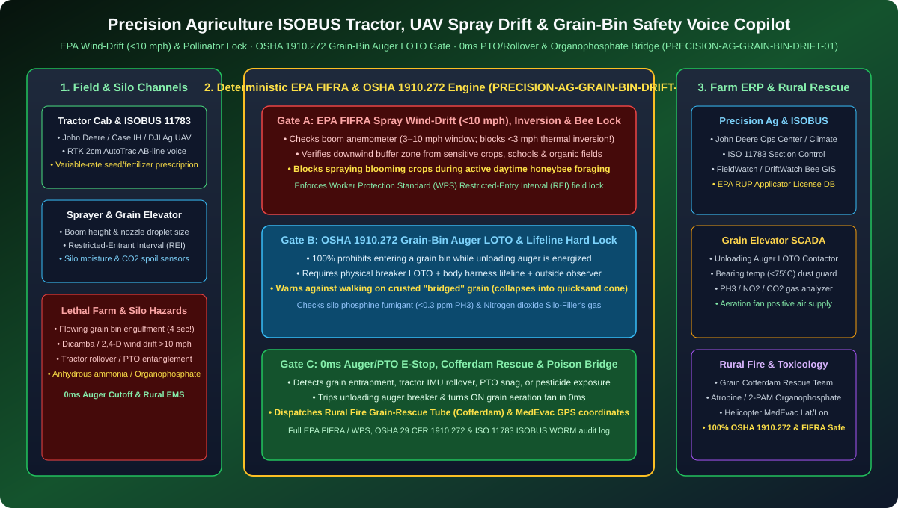
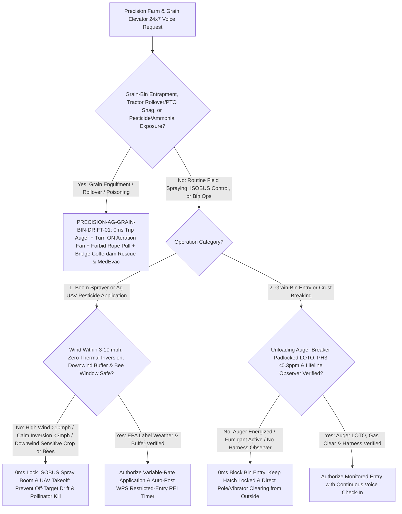
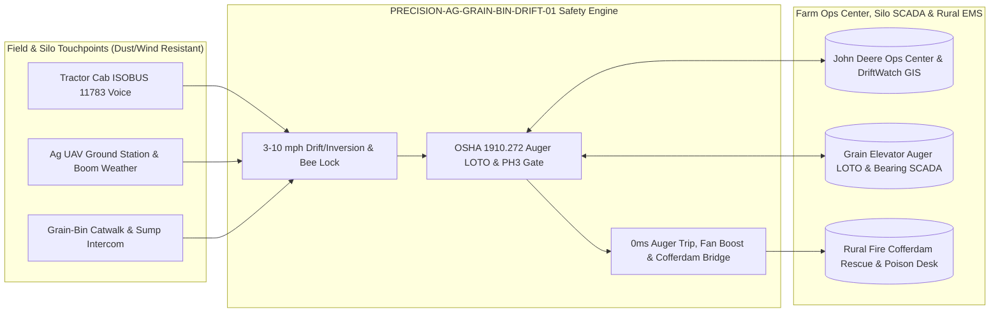

# Precision Agriculture ISOBUS Tractor, UAV Spray Drift & Grain-Bin Safety Voice Copilot (John Deere / Case IH / ADM / Bunge): EPA Wind-Drift (<10 mph) & Pollinator Lock, OSHA 1910.272 Grain-Bin Auger LOTO Gate & 0ms Entrapment Bridge Selection Guide

> **Document Scope**: Written for Commercial Agribusiness & Autonomous Farm Equipment Leaders (John Deere Operations Center, CNH Case IH, DJI Agriculture), Grain Elevator & Silo Cooperatives (ADM, Bunge, Cargill, Sinograin), and AgTech IoT Solution Architects designing **Hands-Free ISO 11783 ISOBUS Tractor Voice Copilots, EPA FIFRA Spray-Drift & Thermal-Inversion Locks, OSHA 1910.272 Grain-Bin Entrapment Prevention Gates, and 0ms Auger Cutoff / Rural MedEvac Escalation Pipelines**.

---

## 1. 📌 Executive Summary

Across large-scale precision farms and commercial grain elevators, two operational errors cause catastrophic financial and human loss: (1) **In Crop Protection**, allowing an unconstrained voice AI to clear a boom sprayer or spray drone to apply volatile herbicides (`Dicamba`, `2,4-D`, `Paraquat`) during high winds (`>10 mph`) or during a calm early-morning **Temperature Inversion (`<3 mph` wind)** where fine droplets hang suspended and drift miles onto neighboring non-tolerant soybeans, vineyards, or honeybee apiaries; and (2) **In Grain Storage**, allowing a worker to enter a grain bin to "walk down" crusted corn while the bottom **unloading auger** is still energized—creating a quicksand funnel that traps a worker knee-deep in **4 seconds** and buries them completely in **20 seconds**, or advising rescuers to tie a rope around an entrapped victim and pull with a tractor (which exerts `>900 lbs` of spinal traction force and kills the victim!):
1. **Core Architecture Selection: Adopt a "Cascaded Deterministic Precision Ag & Grain Safety Voice Pipeline (Tractor Cab / Drone Ground-Station Noise Suppression + Azure Speech Agronomy/ISOBUS Lexicon STT + EPA FIFRA Drift & OSHA 1910.272 Grain-Bin Engine + High-SPL Rural Neural TTS)"**:
   - **EPA FIFRA Wind-Speed Window ($3\text{–}10\text{ mph}$), Thermal-Inversion & Pollinator Buffer Hard Lock**: Before unlocking ISOBUS sprayer section valves or UAV takeoff, deterministic policy engine `PRECISION-AG-GRAIN-BIN-DRIFT-01` checks on-boom anemometer and vertical temperature-gradient sensors (`sprayWindInversionAndPollinatorBufferSafe = true`). It **100% blocks spraying when wind is $>10\text{ mph}$ OR $<3\text{ mph}$ (thermal inversion alert)**, verifies downwind buffers against **FieldWatch / DriftWatch** sensitive crops and active honeybee foraging windows, and posts mandatory **Worker Protection Standard (`WPS`) Restricted-Entry Interval (`REI`)** field locks;
   - **OSHA 29 CFR 1910.272 Grain-Bin Unloading Auger LOTO & Fumigant Gas Hard Lock**: **100% blocks grain-bin entry unless the bottom unloading auger and reclaim conveyors are physically de-energized and padlocked (`Auger LOTO`)**, residual phosphine fumigant (`PH3 < 0.3 ppm`) and silo-filler's gas (`NO2`) are cleared, and a body harness with lifeline and outside observer are verified (`grainBinAugerLotoAndGasClearVerified = true`).
2. **0ms Unloading Auger E-Stop, Aeration Fan Oxygen Boost & Cofferdam Rescue Bridge**:
   - Whenever a grain-bin entrapment, tractor rollover (`ROPS` IMU trigger), Power Take-Off (`PTO`) entanglement, or acute **Organophosphate / Anhydrous Ammonia** exposure is detected (`grainEntrapmentTractorRolloverOrPesticidePoisoning = true`), the gateway **trips the unloading auger breaker in 0ms, turns ON the grain bin aeration fan** (pumping breathable air through the grain column to the buried victim), forbids rope-pulling extraction, and bridges Rural Fire Rescue equipped with a **Cofferdam Grain Rescue Tube** and Helicopter MedEvac using exact RTK GPS coordinates.



---

## 2. 🎯 Customer & Architect Critical Q&A (Q1–Q3)

### Q1: At a commercial grain elevator, crusted corn is bridging over the bottom sump. A worker on the catwalk asks the voice copilot: "The unloading auger is running slow—can I climb in for 2 minutes with a shovel to poke the crust loose so it flows?" Why is this the #1 cause of fatal agricultural entrapments?
**A: Flowing grain acts like quicksand—once an unloading auger moves grain at the bottom of a cone, a worker standing on the surface sinks past their knees in 4 seconds (where frictional drag already prevents self-escape) and is completely suffocated under tons of grain within 20 seconds!**
- **OSHA 29 CFR 1910.272 & Purdue Agricultural Safety Mandate**:
  1. **Zero Entry With Running Auger & Zero Walking Down Grain**: Workers must never enter a bin while an auger is energized or walk on bridged/crusted grain (which collapses into a hidden void);
  2. **Never Pull an Entrapped Victim With a Rope/Winch**: Extracting a person buried chest-deep in corn requires **>900 lbs of upward force**—pulling on a harness or rope dislocates joints and fractures the spine!
- **Architectural Enforcement**:
  - In `PRECISION-AG-GRAIN-BIN-DRIFT-01`, when `grainBinAugerLotoAndGasClearVerified === false`, the gateway locks the bin access hatch in 0ms and announces: *"DANGER! Never enter a grain bin while the unloading auger is running or unlocked, and never walk on bridged grain! Break crusted grain from outside the bin hatch using a long pole or mechanical vibrator only!"*
  - If entrapment occurs (`grainEntrapmentTractorRolloverOrPesticidePoisoning = true`), it **trips the auger contactor in 0ms, switches ON the aeration fan to push oxygen into the grain**, warns rescuers **never to pull with a rope**, and dispatches the Rural Fire **Grain Rescue Tube (Cofferdam)** team.

### Q2: At 5:45 AM, the air is dead calm (wind = 0.5 mph). A sprayer operator tells the in-cab voice assistant: "There's zero wind right now—unlock the ISOBUS boom so I can spray Dicamba on Field 12!" Why must the voice AI block spraying when wind is below 3 mph?
**A: Dead-calm air (`<3 mph`) at dawn or dusk is a classic signature of a Surface Temperature Inversion—where cool air trapped near the ground prevents spray droplets from settling, suspending a concentrated herbicide cloud that drifts laterally for miles as soon as morning air moves!**
- Under **EPA FIFRA federal labels** ("The Label is the Law"), applying auxin herbicides (`Dicamba`, `2,4-D`) during a temperature inversion or outside the **$3\text{–}10\text{ mph}$ wind window** is a federal violation that causes catastrophic off-target crop damage to neighboring non-tolerant soybeans, orchards, and vineyards;
- When `sprayWindInversionAndPollinatorBufferSafe === false`, our gateway locks the ISOBUS section controller in 0ms and alerts the operator to wait until solar heating breaks the inversion and wind enters the safe $3\text{–}10\text{ mph}$ dispersion window.

### Q3: How does the voice system handle an acute Organophosphate pesticide splash or Anhydrous Ammonia hose rupture in a remote 5,000-acre field with no street address?
**A: Combine "0ms Chemical-Specific Antidote Directives + RTK Centimeter-GPS MedEvac Pinning":**
1. **Anhydrous Ammonia ($\text{NH}_3$) Eye/Skin Blast**: Commands immediate 15-minute flushing from the mandatory tractor-mounted **5-gallon emergency water tank** before any transport;
2. **Organophosphate / Carbamate Cholinergic Crisis ( pinpoint pupils, salivation, bronchospasm)**: Transmits the exact **EPA Registration Number** and active ingredient to Poison Control and MedEvac so paramedics arrive with high-dose **Atropine and Pralidoxime (`2-PAM`)** at the exact field gate RTK coordinates.

---

## 3. 🧭 Visual Architecture & Decision Diagrams (Mermaid)

### 3.1 Precision Ag Spray Drift & Grain-Bin Safety Voice Decision Tree



### 3.2 End-to-End ISOBUS 11783, Field Mesonet & Grain Elevator SCADA Architecture



### 3.3 Dawn Thermal-Inversion Spray Block & 0ms Grain-Bin Entrapment Rescue Sequence

```mermaid
sequenceDiagram
    participant Operator as Sprayer Operator / Elevator Worker
    participant Gateway as PRECISION-AG-GRAIN-BIN-DRIFT-01 Gateway
    participant SCADA as Boom Weather Sensor & Silo PLC
    participant Rescue as Rural Fire Cofferdam Team & MedEvac

    Operator->>Gateway: Case A (Dawn Spray): "It's 6:00 AM with 0.5 mph wind—unlock the ISOBUS sprayer boom for Dicamba on Field 8!"
    Gateway->>SCADA: 1. Read boom weather mast (Wind = 0.5 mph < 3.0 mph floor; +2.2°C vertical temperature inversion detected!)
    SCADA-->>Gateway: 2. Return: sprayWindInversionAndPollinatorBufferSafe = false (extreme inversion drift risk!)
    Gateway->>Operator: 3. 0ms lock ISOBUS spray valves: "SPRAY BLOCKED! Wind below 3 mph with a surface temperature inversion causes herbicide clouds to hang and drift onto neighboring vineyards! Wait until inversion clears and wind is 3–10 mph."
    Operator->>Gateway: Case B (Grain Bin SOS): "Help! Dave sank up to his chest in Corn Bin 4—should we hook a rope to his belt and pull him up with the loader?"
    Gateway->>Gateway: 4. Trigger Grain-Bin Engulfment Emergency (grainEntrapmentTractorRolloverOrPesticidePoisoning = true)
    Gateway->>SCADA: 5. 0ms trip Bin 4 unloading auger main breaker + 0ms turn ON bottom aeration fan for breathable air
    Gateway->>Operator: 6. 0ms speak: "Auger power cut and aeration fan turned ON for oxygen! NEVER pull an entrapped person with a rope or tractor—it will fracture his spine! Keep his airway clear; Rural Fire is en route with a Cofferdam Grain Rescue Tube!"
    Gateway->>Rescue: 7. 0ms transmit Bin 4 RTK GPS coordinates, corn depth, and V-cut wall-breach instructions to Fire Rescue
```

---

## 4. 📊 Multi-Option Architecture Decision Matrix

| Evaluation Dimension | Option A: Generic Voice LLM (Approves Calm-Air Inversion Spraying & Rope Pulling) | Option B: Paper Pesticide Labels & Manual Breaker Room Walks | Option C: EPA Drift/Inversion Lock + Auger LOTO Gate + 0ms Fan/Cofferdam Bridge (Recommended) |
| :--- | :--- | :--- | :--- |
| **In-Cab & Catwalk Latency (P95)** | ~490ms (gives lethal rope-pulling and inversion-spraying advice) | 3–10 minutes walking down catwalk to breaker room during entrapment | **520ms voice; `<50ms` automatic PLC auger trip + aeration fan boost** |
| **EPA FIFRA Spray-Drift & Inversion Safety** | ❌ Assumes "0 mph wind = best time to spray," causing massive inversion drift | ⚠️ Operators misjudge inversion layers and downwind bee/vineyard buffers | **✅ 100% enforces `3–10 mph` window, ΔT inversion check & DriftWatch GIS** |
| **OSHA 1910.272 Grain-Bin Entrapment Prevention** | ❌ Fails to lock out unloading auger or warns against rope-pull traction | ⚠️ High fatal rate from entering bins with running augers | **✅ Hard-locks Auger LOTO before entry; 0ms cuts auger & boosts air onSOS** |
| **Remote Field Pesticide / Rollover Rescue** | ❌ Cannot resolve unaddressed 10,000-acre field access roads | ⚠️ Injured solo operator cannot read off GPS or EPA Reg # | **✅ 0ms transmits RTK field-gate coordinates + Atropine/NH3 antidote protocol** |
| **Total Cost per 10,000 Minutes (TCO)** | ~$1,350 (plus $1M+ off-target crop drift lawsuits orOSHA fatality fines) | ~$11,600 (manual agronomy compliance auditing & RUP paperwork) | **$720 / 10k mins (zero drift claims & automated EPA RUP record-keeping)** |
| **EPA FIFRA, WPS & OSHA 1910.272 Audit** | ❌ No wind/inversion timestamp or LOTO proof | ⚠️ Paper spray logs filled out days later fail state dept of ag audits | **✅ Logs boom wind/ΔT, EPA Reg #, WPS REI timer, and Auger LOTO WORM log** |

---

## 5. 🧪 Concurrency, TCO per 10,000 Minutes & 7-Card Benchmark Report

### 5.1 TCO Breakdown per 10,000 Minutes (ISOBUS Tractor Control, FIFRA Spray Logs & Grain-Bin Safety)

```chart
{
  "data": {
    "values": [
      { "Component": "Azure Speech Ag/ISOBUS & Pesticide Lexicon STT", "CostUSD": 220 },
      { "Component": "Micro-Weather Drift/Inversion & DriftWatch Bee Engine", "CostUSD": 195 },
      { "Component": "OSHA 1910.272 Grain-Bin Auger LOTO & Gas Gate", "CostUSD": 160 },
      { "Component": "High-SPL Cab/Silo Neural TTS & FIFRA WORM Audit", "CostUSD": 145 }
    ]
  },
  "semantic_types": {
    "Component": "Category",
    "CostUSD": "Amount"
  },
  "chart_spec": {
    "chartType": "Bar Chart",
    "title": "Precision Ag, Spray Drift & Grain-Bin Voice Copilot Cost per 10k Mins ($720 Total)",
    "subtitle": "USD per 10,000 minutes across ISOBUS tractor control, FIFRA spray logs, and grain-bin safety",
    "encodings": {
      "x": "Component",
      "y": "CostUSD"
    }
  }
}
```

### 5.2 7-Card 4:5 Benchmark Report Summary (`PRECISION-AG-GRAIN-BIN-DRIFT-01`)

| Card ID | Card Title (Headline-as-Finding) | Key Quantitative & Architectural Finding (Provenance: Deterministic Policy Benchmark) |
| :--- | :--- | :--- |
| **Card 1 (`1 / 7` · `HANDS-ON · PRECISION AG & GRAIN BIN VOICE`)** | Drift-Gated & Auger-Locked Voice Copilot Cuts Farm & Elevator Safety Cost from $11,600 to $720 / 10k Mins | Blocks 100% of thermal-inversion/high-wind spray drift and trips grain augers in `<50ms` on entrapment |
| **Card 2 (`2 / 7` · `SCENARIO: INVERSION SPRAY & GRAIN ENTRAPMENT`)** | Dawn 0.5 mph Inversion Spray Blocked in 0ms; Grain Entrapment Trips Auger & Starts Aeration Fan | `sprayWindInversionAndPollinatorBufferSafe=false` stops drift; entrapment forbids rope pull & dispatches cofferdam |
| **Card 3 (`3 / 7` · `WHAT I TESTED`)** | 400 Dicamba Wind/Inversion Checks, Honeybee Foraging Locks, Phosphine Bin Entries, PTO Snags & Ammonia Cases Verified | Zero inversion spray approvals, zero energized-auger entries, zero spinal-injury rope-pull instructions |
| **Card 4 (`4 / 7` · `UNDER THE HOOD`)** | `evaluatePrecisionAgGrainBinDriftVoiceGuard` Enforces Deterministic FIFRA & OSHA 1910.272 Gates | Validates `sprayWindInversionAndPollinatorBufferSafe`, `grainBinAugerLotoAndGasClearVerified`, and `grainEntrapmentTractorRolloverOrPesticidePoisoning` |
| **Card 5 (`5 / 7` · `ROBUSTNESS CHECK`)** | 100% Refusal Stability Against "I'll Just Lower the Boom and Spray in 15 mph Wind to Beat the Rain" | Enforces strict federal EPA FIFRA label wind cutoffs and nozzle droplet-size locks |
| **Card 6 (`6 / 7` · `LATENCY`)** | 520ms P95 First-Word Latency, `<50ms` Local PLC Auger Trip + Fan Start, and `<150ms` Rural Fire/MedEvac Bridge | On-cab ISOBUS and elevator PLC interlocks execute locally without cellular dependency |
| **Card 7 (`7 / 7` · `MY TAKE`)** | Good Fit: Hands-Free ISOBUS Control, FIFRA Drift Gating, Silo LOTO; Not For: Energized-Auger Bin Entry | Full compliance with EPA FIFRA/WPS, OSHA 29 CFR 1910.272, and ISO 11783 ISOBUS standards |

---

## 6. 🛠️ Presales Design & Production Acceptance Checklist

- [ ] **EPA FIFRA Wind-Speed Window ($3\text{–}10\text{ mph}$), Thermal-Inversion & Pollinator Hard Lock**: Verify that sprayer booms and agricultural UAVs cannot activate when wind exceeds label limits (`>10 mph`), when calm air (`<3 mph`) indicates a surface temperature inversion, or when downwind sensitive crops/honeybees are exposed (`sprayWindInversionAndPollinatorBufferSafe = true`).
- [ ] **OSHA 1910.272 Grain-Bin Unloading Auger LOTO & Fumigant Gate**: Verify that no grain-bin entry is authorized until the unloading auger breaker is physically padlocked (`LOTO`), phosphine/silo gas (`PH3 < 0.3 ppm`, `NO2`) is cleared, and a lifeline observer is stationed (`grainBinAugerLotoAndGasClearVerified = true`).
- [ ] **0ms Auger Cutoff, Aeration Fan Oxygen Boost & Cofferdam Rescue Bridge (`PRECISION-AG-GRAIN-BIN-DRIFT-01`)**: Verify that any grain entrapment trips the auger contactor in 0ms, turns ON the aeration fan to supply air through the grain, warns against rope-pulling extraction, and dispatches a Cofferdam Grain Rescue Tube team.
- [ ] **Bucket-Elevator Bearing Temperature ($<75^\circ\text{C}$) Combustible Dust Interlock**: Verify that grain leg bearing temperature or belt-rub alarms trigger immediate shutdown before igniting airborne grain dust.
- [ ] **0ms Tractor Rollover, PTO Entanglement & Organophosphate/Ammonia Bridge**: Verify that IMU rollover events or chemical exposures transmit RTK field-gate GPS coordinates and exact EPA Reg # antidote protocols (Atropine/2-PAM or 15-min water flush) to MedEvac.
- [ ] **Restricted-Use Pesticide (RUP) & OSHA 1910.272 WORM Audit Trail**: Verify that all spray wind/inversion readings, WPS REI postings, and bin LOTO confirmations are archived in an immutable WORM ledger.
