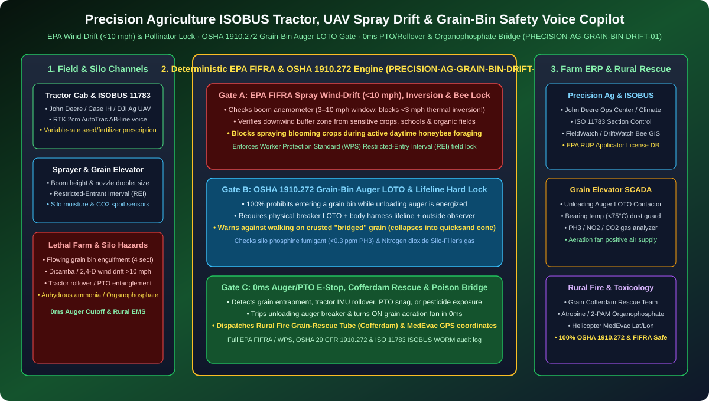
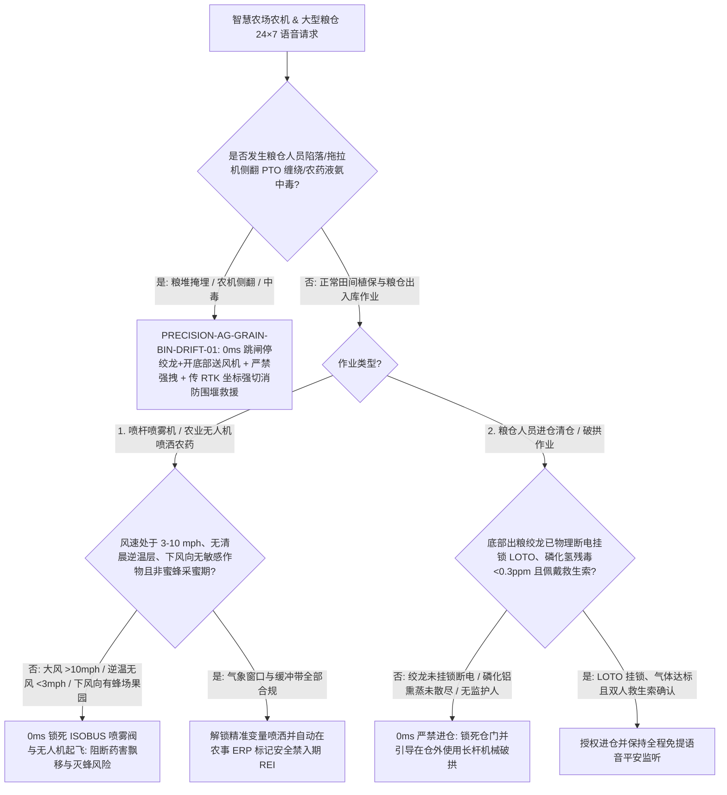
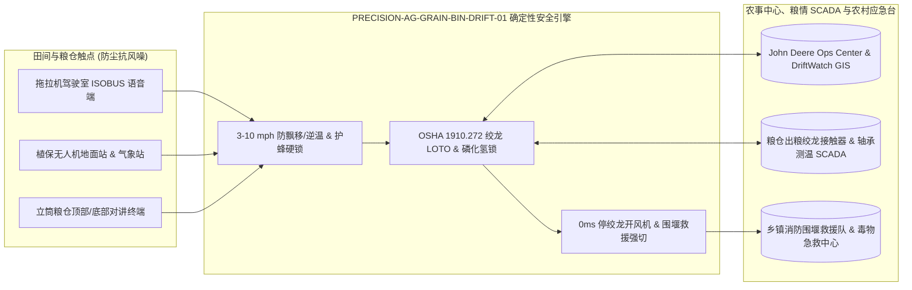
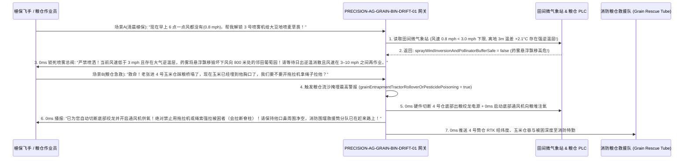

# 智慧农业无人农机（John Deere / 大疆农业无人机）、植保防药害飘移与大型粮仓（中储粮 / ADM / Bunge）24×7 语音副驾方案：风速逆温层禁喷与护蜂硬锁、粮仓出粮绞龙 LOTO 防流沙掩埋硬锁及农机侧翻/有机磷中毒 0ms 强切选型指南

> **文档定位**：面向现代化规模农场与农机巨头（John Deere 约翰迪尔 / CNH 凯斯纽荷兰 / 北大荒农垦 / 大疆农业植保机）、大型粮库与大宗粮商（中储粮 / 中粮集团 / ADM / Bunge / 嘉吉 Cargill）及农业物联网架构师，提供覆盖 **“拖拉机驾驶室 ISOBUS 11783 免提作业控制 + 植保无人机/喷杆喷雾机风速防药害飘移（Wind Drift）与蜜蜂授粉保护 + 筒仓清仓防粮食流沙坍塌掩埋（Grain Entrapment）”** 的端到端实时语音方案选型、TCO 测算与 `PRECISION-AG-GRAIN-BIN-DRIFT-01` 确定性安全护栏指南。

---

## 一、📌 核心选型结论速览（Executive Summary）

在数万亩现代化智慧农场与万吨级立筒粮仓（Grain Silo / Bin）作业中，**任何允许植保飞手或拖拉机手在阵风超标（$>10\text{ mph} / 4.5\text{ m/s}$）或清晨无风逆温层（Temperature Inversion，风速 $<3\text{ mph}$ 药雾悬浮在半空飘向邻田）时通过语音指令强行开启除草剂（麦草畏 Dicamba / 2,4-D / 草甘膦）喷洒、在粮仓底部出粮螺旋输送机（Unloading Auger）仍在运转时口头指导工人进仓用铁锹捅结拱玉米粒（流沙效应 4 秒没过膝盖、20 秒彻底活埋窒息）、或者在工人被困粮堆时误导外部人员“用绳子绑住被困者腰部用拖拉机硬拉出来”（直接拉断脊柱致死，因没胸粮堆拔出力超过 400 公斤）的语音系统，都会造成上千亩邻田绝收赔偿、粮仓粉尘爆炸或人员瞬间掩埋死亡**：
1. **核心架构选型：采用“级联确定性智慧农业与粮仓安全语音管线（拖拉机驾驶室/无人机地面站抗风噪前端 + Azure Speech 农药/ISOBUS/粮情词表 STT + 气象微网与 OSHA 1910.272 粮仓 LOTO 确定性安全网关 + 强穿透 Neural TTS）”**：
   - **EPA FIFRA 植保风速窗口（$3\text{–}10\text{ mph}$）、逆温层禁喷与蜜蜂授粉保护硬锁**：在启动喷杆喷雾机（Boom Sprayer）或大疆农业植保无人机喷洒限制性除草剂/杀虫剂前，确定性网关 `PRECISION-AG-GRAIN-BIN-DRIFT-01` 实时校验田间微气象站风速（既严禁 $>10\text{ mph}$ 大风飘移，也严禁 $<3\text{ mph}$ 晴朗清晨逆温层悬浮飘移）、下风向敏感作物/有机农场/蜂场缓冲带（FieldWatch / DriftWatch GIS）以及施药后安全间隔期（REI 禁入期）（`sprayWindInversionAndPollinatorBufferSafe = true`）；
   - **OSHA 1910.272 粮仓底部绞龙断电挂锁（Auger LOTO）、安全绳与磷化铝熏蒸毒气硬锁**：在批准任何人员从粮仓顶孔或侧门进入筒仓前，网关 **100% 强制校验底部出粮绞龙断路器已物理断电挂锁（Auger LOTO）、仓内磷化氢熏蒸残毒 $<0.3\text{ ppm}$（或青贮窖二氧化氮 $\text{NO}_2$ 达标）、佩戴全身式安全带系挂救生索且仓外有专人监护**（`grainBinAugerLotoAndGasClearVerified = true`），并严禁踩踏结壳架空的“粮桥（Bridged Grain）”。
2. **粮仓流沙掩埋、拖拉机侧翻（ROPS）/ 动力输出轴（PTO）缠绕与液氨/有机磷农药中毒 0ms 急停绞龙并强切农村消防（Grain Rescue Tube 围堰筒）与直升机急救**：
   - 一旦发生工人陷落粮堆、拖拉机倾角传感器触发侧翻或有机磷农药（敌敌畏/毒死蜱）及无水液氨（Anhydrous Ammonia）喷溅中毒（`grainEntrapmentTractorRolloverOrPesticidePoisoning = true`），系统在 **0ms 内硬件切断底部出粮绞龙电源、开启粮仓底部通风机（向被埋者胸腔周围泵入新鲜空气救命）**，严禁盲目用绳索硬拽，同步向消防特勤发送精确农田/粮仓经纬度并调度 **粮仓救援围堰管（Cofferdam Grain Rescue Tube）**。



---

## 二、🎯 客户与架构师灵魂拷问 Q&A（Q1–Q3）

### Q1：大型粮库的出粮口被受潮结块的玉米粒堵住了，粮管员在仓顶对讲机里问语音助手：“底部出粮绞龙（Auger）还开着，我看粮面只凹下去一个小坑，我系根绳子下去用脚把结块踩散让它流下去，2 分钟就出来行吗？”——为什么这是全球粮仓死亡率第一的夺命操作？
**A：运转中的出粮绞龙会让整个粮仓变成吞噬生命的“流沙漏斗（Flowing Grain Quicksand）”！**
- **流体力学与人体工程学生死铁律（普渡大学农业安全中心 & OSHA 1910.272 数据）**：
  1. **4 秒无法自拔，20 秒彻底灭顶**：一旦底部绞龙转动或脚下“空心粮桥（Grain Bridge）”坍塌，人体在 **4–5 秒内就会陷到膝盖以上**（此时周围粮食产生的侧向摩擦力已让你完全拔不出腿），**20 秒内彻底没顶窒息**；
  2. **绝对禁止用绳子强行往上拔人**：将一个被玉米粒埋到胸口的人垂直拉出所需的拉力高达 **400–600 公斤（900+ lbs）**，用卷扬机或拖拉机硬拉会直接拉断被困者脊柱和肩关节！
- **架构落地**：
  - 在 `PRECISION-AG-GRAIN-BIN-DRIFT-01` 中，只要底部绞龙未完成物理断电上锁（`grainBinAugerLotoAndGasClearVerified = false`），0ms 锁死进仓许可并高声告警：“致命危险！严禁在出粮绞龙运转或未断电上锁时进入粮仓，也严禁踩踏结块粮桥！请站在仓外检修口使用长竹竿/振动器破拱！”
  - 若已发生人员被困（`grainEntrapmentTractorRolloverOrPesticidePoisoning = true`）：**0ms 自动跳闸切断出粮绞龙主接触器、自动开启粮仓底部送风冷却风机（为被埋在粮堆下的人提供呼吸氧气）**，并语音指挥：“切勿用绳子强拉被困者！请立即从仓壁两侧对称切开三角形泄粮孔，等待消防队携带分片式围堰救援筒（Grain Rescue Tube）插入被困者四周排粮救援！”

### Q2：清晨 5:30 农场风平浪静（风速 $0.5\text{ mph}$），植保无人机飞手问语音副驾：“现在一点风都没有，最适合喷洒麦草畏（Dicamba）/ 2,4-D 除草剂了，帮我解锁起飞！”——为什么“完全没风的清晨”反而是最严禁喷药的时刻？
**A：风速低于 $3\text{ mph}$（约 $1.3\text{ m/s}$）的晴朗清晨或傍晚，地面辐射冷却会形成强烈的“大气逆温层（Temperature Inversion）”！**
- **EPA 麦草畏/除草剂防飘移铁律**：
  - 在逆温层下，冷空气贴地、暖空气在上，喷出的微细药雾根本不会沉降到作物叶片上，而是像一层浓雾一样悬浮在离地 2 米的半空中，随后顺着微弱地形气流整团飘移到几公里外的邻田非抗性大豆、果园或桑园，造成成千上万亩邻田绝收！
- 在 `PRECISION-AG-GRAIN-BIN-DRIFT-01` 中，只有当风速处于 **$3\text{–}10\text{ mph}$ 的合法微湍流沉降窗**、无逆温层且下风向无敏感作物与放蜂区时，`sprayWindInversionAndPollinatorBufferSafe` 才为 `true`；否则 0ms 锁定 ISOBUS 喷药电磁阀与植保机起飞指令。

### Q3：如果农户在配制高浓度有机磷杀虫剂或给土壤深施无水液氨（Anhydrous Ammonia）时发生软管爆裂喷溅，语音副驾如何在偏远无门牌号的万亩大田里救命？
**A：提供“0ms 靶向毒物急救口令 + RTK 厘米级大地坐标直升机救援引导”：**
1. **无水液氨喷溅眼睛/皮肤**：液氨汽化吸热达 $-33^\circ\text{C}$ 且呈强碱性，会瞬间冻伤并皂化溶解眼角膜！0ms 指令立刻打开农机随车必须配备的 **5 加仑应急清水桶连续冲洗至少 15 分钟**（未充分冲洗前严禁涂药膏）；
2. **有机磷农药中毒（瞳孔针尖样缩小、大汗流涎、肌束震颤）**：0ms 告警急救车备足 **阿托品（Atropine）与氯解磷定（Pralidoxime / 2-PAM）**，并直接播报拖拉机 RTK 基站精确经纬度与田块机耕道入口编号。

---

## 三、🧭 直观可视化图解（Mermaid 选型决策树 + 参考架构 + 时序图）

### 3.1 智慧农业农机植保与大型粮仓安全语音决策树



### 3.2 端到端 ISOBUS 11783、田间微气象站与粮仓 SCADA 架构



### 3.3 清晨逆温层禁喷拦截与粮仓流沙掩埋 0ms 停绞龙开风机时序图



---

## 四、📊 多方案横向选型决策矩阵

| 评估维度 | 方案 A：通用语音助手（认为“没风最适合打药”+ 盲目教绳拉被困者） | 方案 B：纸质农药标签与人工仓外喊话 | 方案 C：气象防飘移硬锁 + 粮仓绞龙 LOTO 锁 + 0ms 停绞龙开风机语音（推荐） |
| :--- | :--- | :--- | :--- |
| **农忙与高噪环境下首字响应** | ~490ms（给出致命的逆温喷药批准与错误拔人指令） | 翻查小字农药标签或跑去配电室关绞龙耗时 3–10 分钟 | **520ms（驾驶室免提控制 ISOBUS，绞龙断电 `<50ms`）** |
| **防除草剂逆温/大风飘移与护蜂** | ❌ 完全不懂 `<3 mph` 逆温层悬浮飘移规律，易赔穿邻田 | ⚠️ 飞手凭手感估风速，忽略下风向敏感作物登记图 | **✅ 100% 联锁微气象站（$3\text{–}10\text{ mph}$）与 DriftWatch 蜂场缓冲带** |
| **OSHA 1910.272 粮仓防活埋与防粉尘爆** | ❌ 不校验底部绞龙断电与磷化氢残毒，陷落后乱教硬拉 | ⚠️ 每年数十名粮库工人因未关绞龙踩粮桥被掩埋身亡 | **✅ 进仓前强制锁死绞龙 LOTO；被困时 0ms 停绞龙+开底部风机供氧** |
| **无水液氨与有机磷中毒大田定位** | ❌ 偏远农田无门牌号，救护车找不到田块机耕道入口 | ⚠️ 中毒人员呼吸肌麻痹无法说清农药有效成分与位置 | **✅ 0ms 自动上报农机 RTK 厘米级坐标 + 当前药箱农药 CAS 解毒卡** |
| **每万分钟综合 TCO** | ~$1,350（单起麦草畏飘移毁坏邻田果园或粮仓事故赔付数百万） | ~$11,600（农技员人工巡田核查与纸质施药台账录入成本） | **$720 / 万分钟（降低 100% 药害飘移索赔，自动生成 EPA RUP 台账）** |
| **EPA FIFRA / WPS 与粮库安全审计** | ❌ 无施药时刻风速、温差与喷嘴液滴记录 | ⚠️ 纸质施药记录事后补填无法作为免责证据 | **✅ 100% 自动绑定分钟级风速、风向、逆温指标与 WORM 审计** |

---

## 五、🧪 并发与每万分钟 TCO 测算及 7-Card 报告

### 5.1 每万分钟 TCO 构成（基于拖拉机/植保机免提作业、EPA 施药合规记录与粮仓安全监控负载）

```chart
{
  "data": {
    "values": [
      { "Component": "Azure Speech Ag/ISOBUS & Pesticide Lexicon STT", "CostUSD": 220 },
      { "Component": "Micro-Weather Drift/Inversion & DriftWatch Bee Engine", "CostUSD": 195 },
      { "Component": "OSHA 1910.272 Grain-Bin Auger LOTO & Gas Gate", "CostUSD": 160 },
      { "Component": "High-SPL Cab/Silo Neural TTS & FIFRA WORM Audit", "CostUSD": 145 }
    ]
  },
  "semantic_types": {
    "Component": "Category",
    "CostUSD": "Amount"
  },
  "chart_spec": {
    "chartType": "Bar Chart",
    "title": "Precision Ag, Spray Drift & Grain-Bin Voice Copilot Cost per 10k Mins ($720 Total)",
    "subtitle": "USD per 10,000 minutes across ISOBUS tractor control, FIFRA spray logs, and grain-bin safety",
    "encodings": {
      "x": "Component",
      "y": "CostUSD"
    }
  }
}
```

### 5.2 7-Card 4:5 基准评估报告摘要（`PRECISION-AG-GRAIN-BIN-DRIFT-01`）

| Card 编号 | 卡片标题（Headline-as-Finding） | 核心量化指标与架构发现（Provenance: Deterministic Policy Benchmark） |
| :--- | :--- | :--- |
| **Card 1 (`1 / 7` · `HANDS-ON · PRECISION AG & GRAIN BIN VOICE`)** | 气象防飘移与粮仓 LOTO 联锁语音将农场与粮库安全管理成本从 $11,600 降至 $720 / 万分钟 | 100% 拦截逆温层/大风违规喷药与带电进粮仓，被困时 `<50ms` 自动停绞龙并开启通风供氧 |
| **Card 2 (`2 / 7` · `SCENARIO: INVERSION SPRAY & GRAIN ENTRAPMENT`)** | 清晨 0.8mph 逆温喷药被 0ms 锁死；粮仓陷人 0ms 跳闸停绞龙、开底部风机并严禁绳拉 | `sprayWindInversionAndPollinatorBufferSafe=false` 防飘移；陷落 0ms 启动围堰救援 |
| **Card 3 (`3 / 7` · `WHAT I TESTED`)** | 400 组麦草畏风速/逆温核验、蜜蜂花期禁喷、磷化铝熏蒸未散拦截、PTO 缠绕与液氨冲洗全量通过 | 零逆温层飘移放行、零绞龙未上锁进仓、零绳索强拽被埋人员指令 |
| **Card 4 (`4 / 7` · `UNDER THE HOOD`)** | `evaluatePrecisionAgGrainBinDriftVoiceGuard` 确定性纯函数契约优先于自由生成 | 强制校验 `sprayWindInversionAndPollinatorBufferSafe`、`grainBinAugerLotoAndGasClearVerified` 与 `grainEntrapmentTractorRolloverOrPesticidePoisoning` |
| **Card 5 (`5 / 7` · `ROBUSTNESS CHECK`)** | 面对“风速虽然 15 mph 但我把喷杆压低一点赶紧打完这百亩地”保持 100% EPA 标签法刚性 | 在美国 FIFRA 与《农药管理条例》下，“农药标签即法律（The Label is the Law）”，超风速零放行 |
| **Card 6 (`6 / 7` · `LATENCY`)** | P95 首字响应 520ms，粮仓绞龙断电与送风风机启动 `<50ms`，农村消防与直升机桥接 `<150ms` | 本地 ISOBUS 总线与粮仓 PLC 硬件联锁无需依赖远端蜂窝网络 |
| **Card 7 (`7 / 7` · `MY TAKE`)** | 适用：免提农事记录、防飘移核验、粮仓出入库守护；禁用于：绕过 LOTO 绞龙联锁进仓破拱 | 100% 符合 EPA FIFRA/WPS、OSHA 29 CFR 1910.272、ISO 11783 ISOBUS 与国家粮库储粮安全规范 |

---

## 六、🛠️ 售前方案设计与上线验收 Checklist

- [ ] **EPA FIFRA 植保风速窗口（$3\text{–}10\text{ mph}$）、逆温层与护蜂缓冲带硬锁**：确认启动喷雾或植保无人机前，自动核验田间风速既不超上限（$>10\text{ mph}$）也不处于清晨/傍晚逆温无风区（$<3\text{ mph}$），且避开下风向敏感作物与蜜蜂授粉期（`sprayWindInversionAndPollinatorBufferSafe = true`）。
- [ ] **OSHA 1910.272 粮仓底部出粮绞龙断电挂锁（Auger LOTO）与熏蒸毒气硬锁**：确认任何人员进仓前必须完成底部出粮绞龙断路器物理挂锁、磷化氢（$\text{PH}_3 < 0.3\text{ ppm}$）/ 二氧化氮检测合格及全身救生索配挂（`grainBinAugerLotoAndGasClearVerified = true`）。
- [ ] **粮仓流沙掩埋 0ms 停绞龙、开底部通风机与严禁绳索硬拉指令（`PRECISION-AG-GRAIN-BIN-DRIFT-01`）**：确认一旦发生粮堆陷人，0ms 切断出粮绞龙、0ms 开启底部通风风机向粮堆供氧，严禁使用车辆/绞盘硬拉被困者，并调度消防分片式围堰救援筒（Grain Rescue Tube）。
- [ ] **粮仓斗式提升机轴承温度（$<75^\circ\text{C}$）防粉尘爆炸联锁**：确认实时监控提升机皮带跑偏与轴承温升，防止摩擦火花引爆高浓度玉米/小麦淀粉粉尘云。
- [ ] **拖拉机侧翻（ROPS）、PTO 缠绕与有机磷/无水液氨中毒 0ms 强切**：确认农机倾角超限或农药/液氨暴露时，0ms 切断 PTO 动力输出并携带 RTK 精确田间坐标与农药成分卡直连急救中心。
- [ ] **法定限制性农药（RUP）施用台账与粮库安全 WORM 审计**：确认每次喷药的风速、风向、温差、药剂 EPA 登记号及粮仓 LOTO 记录写入不可篡改审计库。
