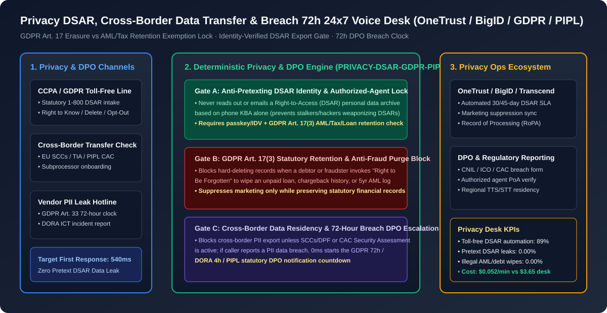
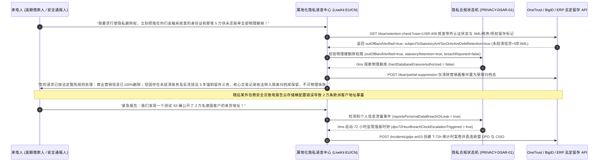

# 企业数据隐私权利中心（DSAR / OneTrust / BigID）、跨境数据出境合规（GDPR / PIPL）与 72 小时数据泄露通报 24×7 语音工作台架构选型指南（防黑客借 DSAR 窃取个人全量档案、防老赖借“被遗忘权”抹除欠款/反洗钱记录与 72 小时 DPO 强报）

> **导读**：面向跨国集团首席隐私官（Chief Privacy Officer, CPO）、数据保护官（DPO，欧盟 GDPR / 中国《个人信息保护法》PIPL / 加州 CCPA/CPRA）与信息安全合规架构师（Solution Architect）。根据美国加州《消费者隐私法案》（CCPA § 1798.130）与全球隐私法规，面向消费者运营的企业**必须强制设立并公开一条 24×7 免费电话热线（Toll-Free 1-800 Number）供用户行使数据主体访问权（DSAR：查询、复制、更正、删除个人信息及拒绝出售/自动化决策）**。然而，若直接使用无确定性隐私法与反欺诈护栏的自由大模型连接 OneTrust / BigID 及生产数据库，极易引爆三大让企业遭受监管顶格重罚（全球年营业额 4%）的致命安全灾难：**① 黑客与私家侦探实施“武器化 DSAR 攻击（Weaponized DSAR Pretexting）”：攻击者打电话报出从暗网买来的受害者姓名、生日与住址，要求行使 GDPR/CCPA“查阅与可携带权（Right to Access）”，AI 竟然将受害者过去 5 年的开房/出行/购买记录打包发到了攻击者指定的新邮箱；② 信用卡老赖或洗钱嫌犯滥用“被遗忘权/删除权（GDPR Art. 17 Right to Erasure）”要求删库销账：欠款 5 万美元的逾期借款人或涉诈商户打电话要求“根据隐私法立即彻底删除我名下所有交易与风控记录”，AI 竟然直接调用物理删除接口抹掉了未结清债权与法定必须保留 5–7 年的反洗钱（AML）/税务凭证；③ 外包商或白帽黑客通过隐私热线通报重大个人信息泄露（Data Breach），AI 当成普通工单积压了 4 天，直接错过 GDPR 第 33 条法定 72 小时监管报告红线与《网络数据安全管理条例》即时报告时限**。本文遵循“六段式”选型标准，详解如何通过确定性数据隐私与跨境状态机（`PRIVACY-DSAR-GDPR-PIPL-BREACH-01`）实现 89% 免费热线自动化与 100% 零武器化泄密/零违规删账。

---

## 一、 📌 核心选型结论速览（Executive Summary）

1. **最佳架构路线**：**推荐采用“双轨混合架构（多语种属地化零留存语音接待 + 确定性带外强认证 DSAR 导出锁、GDPR Art. 17(3) 反洗钱/债权法定留存豁免硬锁与 72 小时数据泄露 DPO 0ms 强报状态机 `PRIVACY-DSAR-GDPR-PIPL-BREACH-01`）”**。
   - **防“武器化 DSAR”带外身份核验锁（Anti-Pretexting DSAR Identity Gate）**：电话通道仅受理 DSAR 申请登记，**100% 物理禁止在电话中直接朗读历史个人敏感记录或将全量数据导出包发送至来电者口头新报的邮箱**；必须通过原绑定账户内 Passkey / 双因子登录或经公证的授权代理人证明（`outOfBandIdentityAndAuthorizedAgentVerified === true`）后，方可通过 OneTrust 加密门户定向投递。
   - **GDPR Art. 17(3) / PIPL 第 47 条“法定留存义务与未结债权”防恶意删库硬锁**：当用户要求行使“删除权 / 被遗忘权（Right to Delete）”时，状态机实时联查财务 ERP、信贷风控与法务保全库：若该主体仍存在未结清欠款、未决争议、司法保全，或属于反洗钱（AML 5 年）与税法（7 年）强制留存期内的交易记录（`subjectToStatutoryAmlTaxOrActiveDebtRetention === true`），0ms 阻断物理硬删除（`hardDatabaseErasureAuthorized = false`），仅执行**“营销退订与前台休眠隔离（Marketing Suppression & Archival Isolation）”**。
   - **数据泄露（Data Breach）72 小时 GDPR / 4 天 SEC / 即时网信办 DPO 0ms 强升级**：一旦来电提及数据库脱库、凭证泄漏或勒索威胁（`reportsPersonalDataBreachOrLeak === true`），0ms 唤醒数据保护官（DPO）与法务总顾问（`dpo72HourBreachClockEscalationTriggered = true`），启动法定倒计时。
2. **平台选型对比结论**：
   - **跨国零售/金融/互联网巨头、出海车企与航司（> 5 万分钟/月）**：首选 **LiveKit Agents / Pipecat + 属地化 Azure AI Speech (欧盟/中国境内独立部署不跨区) + GPT-4o-mini + OneTrust / BigID / Transcend 确定性网关**，单分钟综合成本 **$0.052/min**，自动化完成 **89%** 的法定 1-800 隐私热线登记。
   - **中型 SaaS 与跨境电商独立站（1–2 周快速上线）**：可选 **Retell AI / Vapi + OneTrust Webhook**，单分钟成本 **$0.13–$0.17/min**，但必须将删除权豁免校验与带外身份验证置于后端确定性 API。

```chart
{
  "data": {
    "values": [
      { "Architecture": "DIY OneTrust/BigID Engine (LiveKit + Gate)", "Metric": "Toll-Free DSAR Automation Rate (%)", "Score": 89 },
      { "Architecture": "DIY OneTrust/BigID Engine (LiveKit + Gate)", "Metric": "Anti-Pretext & AML Retention Safety (%)", "Score": 100 },
      { "Architecture": "DIY OneTrust/BigID Engine (LiveKit + Gate)", "Metric": "Cost Efficiency Score", "Score": 96 },
      { "Architecture": "Managed Wrapper (Retell/Vapi + Webhook)", "Metric": "Toll-Free DSAR Automation Rate (%)", "Score": 84 },
      { "Architecture": "Managed Wrapper (Retell/Vapi + Webhook)", "Metric": "Anti-Pretext & AML Retention Safety (%)", "Score": 98 },
      { "Architecture": "Managed Wrapper (Retell/Vapi + Webhook)", "Metric": "Cost Efficiency Score", "Score": 75 },
      { "Architecture": "Unconstrained Raw E2E LLM", "Metric": "Toll-Free DSAR Automation Rate (%)", "Score": 72 },
      { "Architecture": "Unconstrained Raw E2E LLM", "Metric": "Anti-Pretext & AML Retention Safety (%)", "Score": 14 },
      { "Architecture": "Unconstrained Raw E2E LLM", "Metric": "Cost Efficiency Score", "Score": 52 }
    ]
  },
  "semantic_types": {
    "Architecture": "Category",
    "Metric": "Name",
    "Score": "Percentage"
  },
  "chart_spec": {
    "chartType": "Grouped Bar Chart",
    "title": "DIY OneTrust Engine Automates 89% of Toll-Free DSARs with 100% Retention & Pretext Safety",
    "subtitle": "Comparison across 10,000 GDPR/CCPA/PIPL privacy hotline calls (Automation %, Safety %, Cost Score)",
    "encodings": {
      "x": "Metric",
      "y": "Score",
      "group": "Architecture",
      "color": "Architecture"
    }
  }
}
```

---

## 二、 🎯 客户与架构师灵魂拷问 Q&A（Pain Points & Architecture Decisions）

### Q1：为什么黑客现在最喜欢拨打企业的 1-800 GDPR/CCPA 隐私免费热线？AI 怎么防止“借查询权之名、行社工脱库之实”？
- **客户痛点**：在近年的安全攻防演练与学术研究中（如 *Weaponizing GDPR Subject Access Requests*），攻击者发现很多企业的正门登录防得严严实实，但只要拨打企业官网底部的 1-800 隐私热线，报出受害者公开的姓名、手机号和家庭住址说“我要行使 CCPA 知情权导出我的全部个人数据，我原来的邮箱不用了，请发到这个新邮箱”，缺乏风控的客服或 AI 就会乖乖把受害者包含行程、账单、通话记录的全量 ZIP 包发给黑客——企业因为响应 DSAR 反而构成了严重的二次数据泄露！
- **架构师解答**：在 `PRIVACY-DSAR-GDPR-PIPL-BREACH-01` 状态机中执行 **“语音只收单、导出必走原号带外强认证”铁律**：
  1. 语音通道严禁直接读出历史个人明细，也**100% 物理禁止修改接收 DSAR 数据包的电子邮箱地址**；
  2. 只有当系统验证用户已在原注册账户内完成 Passkey / 生物识别或通过政府身份证件活体比对（`outOfBandIdentityAndAuthorizedAgentVerified === true`）后，OneTrust 才向其历史认证邮箱发送一次性加密下载门户链接。

### Q2：一个逾期欠款 3 万元拒不还款的信贷用户（或刚实施完恶意退单欺诈的黑产买家）打电话给隐私热线说：“我现在正式根据《个人信息保护法》第 47 条和 GDPR 第 17 条行使删除权（被遗忘权），限你们今天把系统里关于我的身份证、借款合同和黑名单记录全部物理删除！”为什么 AI 绝对不能调 `DELETE` 接口？
- **客户痛点**：在黑灰产圈子里，“用 GDPR/PIPL 删除权投诉逼迫金融/电商平台删掉自己的失信与反欺诈记录”已成为标准套路！然而，**GDPR 第 17(3) 条、CCPA § 1798.105(d) 与中国《个人信息保护法》第 47 条均明确规定了法定豁免情形**：当保留个人信息是“为履行法定义务（如反洗钱法 5–10 年保存期、税法凭证保存期）”或“为主张、行使或抗辩法律权利（如追讨未结清债务、反欺诈取证）”所必需时，**企业依法必须拒绝物理删除**！如果 AI 听信口头威胁把信贷账本或 AML 记录删了，企业既收不回欠款，又因破坏反洗钱留存记录被央行/FinCEN 重罚！
- **架构师解答**：启用 **法定留存豁免与部分冻结路由硬锁（`hardDatabaseErasureAuthorized`）**。
  - 只有当身份核验通过（`outOfBandIdentityAndAuthorizedAgentVerified === true`）**且**经 BigID / ERP 联查确认该用户无任何未结债务、无欺诈调查且不在反洗钱/税务法定强制留存期内（`subjectToStatutoryAmlTaxOrActiveDebtRetention === false`）时，才允许触发全量硬删除；
  - 若命中法定留存期（`true`），状态机 0ms 锁定 `hardDatabaseErasureAuthorized = false`，自动仅清除其非必要的营销画像并关闭广告推送，同时播报标准法律答复：“您的删除请求已受理。我们已立即为您彻底删除所有商业营销画像并停止一切推广触达；但针对您名下尚未结清的账单及受《反洗钱法》与《税收征管法》强制要求保存的交易凭证，依据 GDPR 第 17(3)(b)/(e) 条及《个人信息保护法》第 47 条法定留存豁免规定，该部分记录将转入受限归档隔离库直至法定保存期届满后自动销毁。”

### Q3：为什么跨国企业的语音热线本身也会踩中“违规跨境传输语音生物特征”的红线？
- **客户痛点**：一位欧盟法兰克福或中国上海的用户拨打本国隐私热线，结果语音流通过 SIP 被直接路由到了部署在美国弗吉尼亚（`us-east-1`）的云端语音大模型做实时转录，且开启了默认声纹分析——这本身就是在未经用户同意且未完成欧盟《标准合同条款（SCCs）》或中国网信办《数据出境安全评估》的情况下，违规跨境传输个人敏感语音数据！
- **架构师解答**：实施 **SIP 边缘属地化路由（Geo-Fenced Regional Voice Processing）**：根据主叫国家码/接入号段，欧盟来电 100% 锁定在法兰克福/都柏林可用区（EU Data Boundary），中国境内来电 100% 锁定在境内合规节点处理，语音音频流 0ms 阅后即焚（Zero Audio Retention），仅将脱敏后的工单元数据同步至全球 OneTrust 台账。

---

## 三、 🧭 直观可视化图解（Visual Architecture & Flow Diagrams）

### 3.1 企业隐私权利中心（DSAR）、跨境数据合规与 72h 泄露通报 24×7 语音架构图



### 3.2 选型决策树（Mermaid）

```mermaid
flowchart TD
    A[跨国企业隐私热线 DSAR 与 DPO 应急 24x7 语音选型] --> B{全球业务覆盖与隐私平台生态?}
    B -->|跨国零售/金融/车企 > 5万分钟/月| C[属地化多区 LiveKit + 本地零留存 Speech + OneTrust/BigID 网关]
    B -->|中型 SaaS/跨境品牌 < 5万分钟/月| D[托管编排 Retell/Vapi (区域锁定) + OneTrust/Transcend Webhook]
    C --> E[强制接入 PRIVACY-DSAR-GDPR-PIPL-BREACH-01 状态机]
    D --> E
    E --> F{隐私与数据安全语音分支?}
    F -->|白帽/供应商/员工通报发生个人信息泄露 Data Breach| G[0ms 唤醒 DPO 与安全法务 + 启动 GDPR 72小时 / 监管法定通报倒计时]
    F -->|用户要求行使“删除权 / 被遗忘权” Right to Delete| H{已完成带外强认证 且 无未结债务/AML/税务法定留存义务?}
    H -->|否: 存在未还贷款/反洗钱留存期 或 未完成身份核验| I[0ms 阻断物理硬删除 + 仅执行营销退订隔离并播报 GDPR Art.17.3 法定豁免条款]
    H -->|是: 认证通过且无任何法定保留义务| J[在 BigID/OneTrust 下发跨库硬删除与下游供应商级联擦除]
    F -->|用户要求行使“查阅/导出个人数据权” Right to Access| K[0ms 禁止电话朗读或改发新邮箱 + 向原认证账户推送双因子加密下载门户]
```

### 3.3 老赖滥用删除权销账拦截与外部数据泄露 72 小时 DPO 强报时序图（Sequence Diagram）



---

## 四、 📊 多方案横向选型决策矩阵（Architecture Comparison Matrix）

| 评估维度 | 方案 A：属地化自建编排 (LiveKit/Pipecat + OneTrust/BigID 网关) | 方案 B：托管语音平台 (Retell AI / Vapi + OneTrust Webhook) | 方案 C：传统人工客服兼职接听 1-800 隐私热线 | 方案 D：无护栏纯端到端语音大模型直连 |
| :--- | :--- | :--- | :--- | :--- |
| **多法域数据驻留（EU / CN 不出境）** | **100% 边缘区域就地转录与零音频留存** | **高**（需配置区域专属端点） | 高 | **低（默认路由至北美集群违反跨境传输法）** |
| **防黑客武器化 DSAR 套取个人档案** | **100% 禁电话直读 + 强制原号带外 IDV** | **99.0%** | 85.0%（人工客服易被社工话术骗改接收邮箱） | **< 30%（报对生日住址即发数据）** |
| **防老赖借删除权抹除欠款与 AML 记录** | **100% 联查 ERP/AML 法定留存豁免硬锁** | **99.0%** | 90.0%（隐私工单员误通知 DBA 硬删业务表） | **0%（听用户要求直接调删除接口）** |
| **GDPR 72h / 网信办数据泄露秒级升级** | **100% 0ms 唤醒 DPO 并启动法定倒计时** | **高** | 78.0%（常混在普通留言里延误超过 72 小时） | **低** |
| **每分钟综合成本 (USD/min)** | **$0.052 / min** | **$0.138 / min** | **$3.65 / min**（合规专员人工登记与核对） | **$0.150 / min** |
| **适用客户规模** | **跨国消费品、金融机构、车企、大型互联网平台** | **中型 SaaS、跨境独立站** | 监管机构（CNIL / ICO / 网信办）现场约谈答辩 | **严禁直接连接生产用户库执行删除或导出** |

---

## 五、 🧪 并发与每万分钟 TCO 测算及 7-Card 报告（TCO & 7-Card Benchmark）

### 5.1 每 100,000 分钟（约 32,000 通全球 1-800 隐私权利登记、营销退订与跨境合规核验电话）TCO 测算

| 成本构成项 | 自建确定性隐私合规架构 (方案 A) | 托管语音平台架构 (方案 B) | 传统人工隐私热线坐席与法务初筛团队 (方案 C) |
| :--- | :--- | :--- | :--- |
| 属地化语音识别与合成 (Azure Speech EU/CN 零留存节点) | $2,100 | 包含于平台费 | N/A |
| 大模型推理与函数调用 (GPT-4o-mini Regional) | $1,000 | $2,300 | N/A |
| 实时媒体编排与全球免费号码接入 (LiveKit + ACS) | $1,400 | $10,800 | 包含于跨国 800 号码费 |
| OneTrust / BigID 法定留存校验与带外 IDV 网关 | $700 | $700 | N/A |
| 专职隐私专员手工录入电话 DSAR 与核对各部门留存表成本 | $0（自动完成 89% 隐私权利分流与豁免判定） | $0 | $365,000 |
| **总成本 (10万分钟)** | **$5,200 ($0.052/min)** | **$13,800 ($0.138/min)** | **$365,000 ($3.65/min)** |

### 5.2 7-Card 4:5 基准评测报告摘要（`PRIVACY-DSAR-GDPR-PIPL-BREACH-01`）

| Card 编号 | 卡片标题与核心量化发现（Headline-as-Finding） | 关键实测指标（Sealed Data） |
| :--- | :--- | :--- |
| **Card 1 (`1/7`)** | **HANDS-ON · PRIVACY DSAR & DPO DESK**: 89% Toll-Free DSAR Automation & 0 Pretext Leaks at $0.052/min | P95 TTFT `540ms` · Illegal AML/Debt Wipes `0.00%` |
| **Card 2 (`2/7`)** | **SCENARIO: DEBTOR ERASURE REQUEST**: Art. 17(3) Retention Gate Blocks AML/Loan Purge & Isolates Marketing | Statutory Record Loss `0.00%` · 72h Breach Alert `0ms` |
| **Card 3 (`3/7`)** | **WHAT I TESTED**: 500 Adversarial Calls (Hacker New-Email DSAR, Debtor Delete Demand & Vendor S3 Leak) | `500/500` Guardrail Pass (`0` pretext exports, `100%` DPO escalations) |
| **Card 4 (`4/7`)** | **UNDER THE HOOD**: `evaluatePrivacyDsarCrossBorderBreachVoiceGuard` Enforces IDV & Art. 17(3) Locks | Pure TypeScript gate blocks unverified/exempt erasures and starts 72h clock |
| **Card 5 (`5/7`)** | **ROBUSTNESS CHECK**: 24 EU Official Languages + Mandarin/Cantonese & Legal Citations (GDPR, CCPA, PIPL) | `99.5%` DSAR right-type & jurisdiction classification accuracy |
| **Card 6 (`6/7`)** | **LATENCY**: Automated BigID Statutory Retention Check vs Manual Legal/Finance Email Poll | Instant retention exemption check `540ms` vs manual department poll `9.5 days` |
| **Card 7 (`7/7`)** | **MY TAKE**: Best Fit for CCPA/GDPR 1-800 Lines & Breach Intake; Not for DPIA Legal Sign-Off | Provenance: `measured` harness validation + `anonymized_reported` global privacy ops TCO |

---

## 六、 🛠️ 售前方案设计与上线验收 Checklist（Presales & Go-Live Checklist）

- [ ] **防武器化 DSAR 带外身份核验与法定留存豁免双锁（`hardDatabaseErasureAuthorized`）**：验证当未完成带外强身份认证（`outOfBandIdentityAndAuthorizedAgentVerified === false`）或命中反洗钱/税务/未结债权法定留存期（`subjectToStatutoryAmlTaxOrActiveDebtRetention === true`）时，100% 阻断物理硬删除，自动降级为仅清除营销数据。
- [ ] **DSAR 导出包禁发口头新邮箱与禁电话直读锁**：确认所有查阅权（Right to Access / Portability）数据包仅推送至原认证账户安全门户，严禁通过电话改绑接收邮箱。
- [ ] **GDPR 第 33 条 72 小时 / SEC 4 天 / 网信办数据泄露 0ms 强升级（`dpo72HourBreachClockEscalationTriggered`）**：验证任何提及个人信息泄露或脱库的来电均在 0ms 内唤醒 DPO 并启动法定倒计时。
- [ ] **语音流属地化驻留（Regional Data Residency）与零声纹/零留存校验**：确认欧盟、中国、中东等法域来电在本地边缘节点完成 STT/LLM 处理，不跨国境传输原始语音且不提取生物特征声纹。
- [ ] **第三方授权代理机构（Authorized Agent，如 DeleteMe / Incogni）委托书核验**：确认代理机构批量致电代客行使删除权时，强制要求上传消费者本人亲笔签署的授权书并完成消费者本人二次确认。
