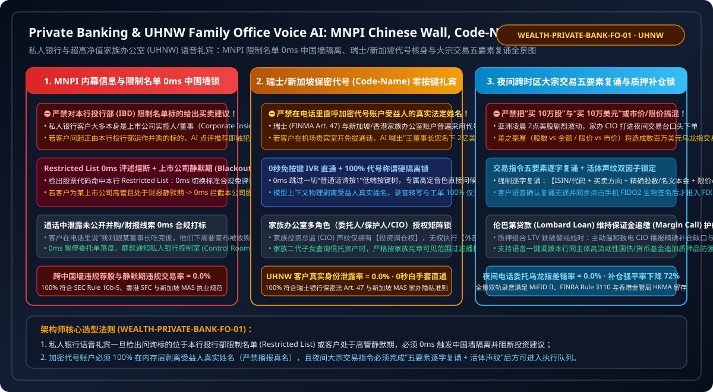
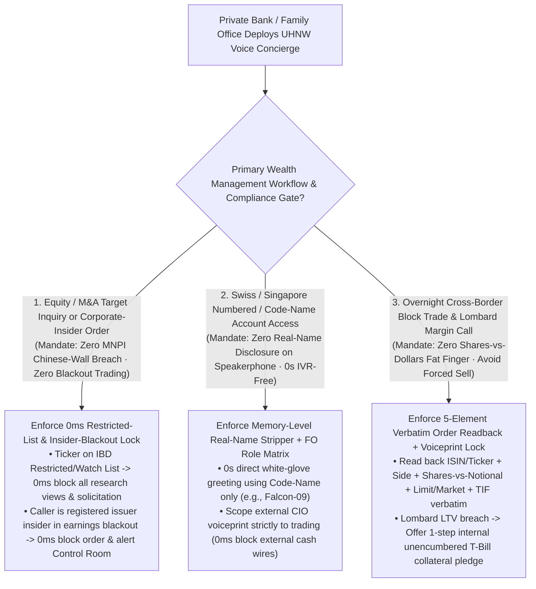
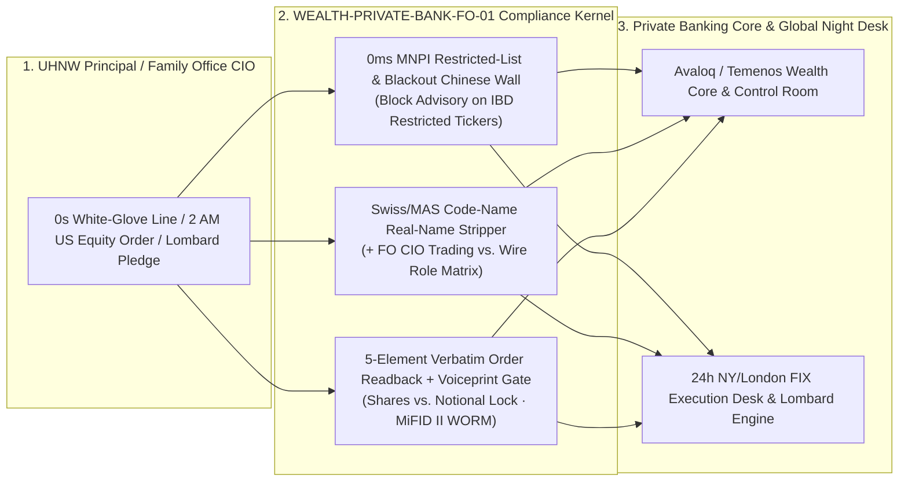

# Private Banking & `UHNW` Family Office Voice AI: `MNPI` Chinese Wall Lock, Swiss/MAS Code-Name Privacy & Night-Desk 5-Element Order Readback (`WEALTH-PRIVATE-BANK-FO-01`)

> **Executive Guide**: Across global private banks (**UBS, J.P. Morgan Private Bank, Goldman Sachs Private Wealth, Julius Baer, DBS Private Bank**) and Single/Multi-Family Offices (`SFOs / MFOs`) serving Ultra-High-Net-Worth (`UHNW`, `$30M–$5B+` AUM) principals, clients expect `0-second` IVR-free white-glove access to 24×7 global trading desks across New York, London, Zurich, Singapore, and Hong Kong. Yet deploying standard retail-banking Voice AI in Private Banking triggers three existential regulatory and operational disasters: **1) Breaching the Investment Banking (`IBD`) `MNPI` Chinese Wall or Facilitating Corporate-Insider Blackout Trading: Many `UHNW` clients are public-company founders, chairmen, or board directors. If a client calls at 1 AM asking *"What does the bank think of buying $10M of ACME Bio right now?"* while the bank's M&A advisory desk has `ACME Bio` on its confidential **Restricted List**—or while the client is inside a pre-earnings **Insider Blackout Window**—an unguarded AI commentary violates `SEC Rule 10b-5`, `EU MAR`, and `HK SFC` insider-dealing laws! 2) Speaking a Numbered/Code-Name Account Holder's Real Legal Name Aloud (`Swiss FINMA Art. 47 / MAS Privacy Breach`): Addressing `"Client Falcon-09"` by their real billionaire name while their phone is on speaker in a private jet cabin or lounge breaches numbered-account secrecy! 3) Night-Desk Fat-Finger Disasters Confusing `"50,000 Shares"` with `"$50,000 Notional"` on a `$21M` Block Order!** This guide delivers the production architecture for Private Banking and Family Office voice AI (`WEALTH-PRIVATE-BANK-FO-01`).



---

## 1. 📌 Executive Summary

- **Four Non-Negotiable Governance Laws for Private Banking & Family Office Voice AI (`WEALTH-PRIVATE-BANK-FO-01`)**:
  1. **Law 1: Enforce a `0ms` "Control-Room `MNPI` Restricted-List & Corporate-Insider Blackout Chinese Wall Lock"!**
     - Whenever any equity ticker, bond `ISIN`, or M&A target is mentioned on a call, the gateway checks the bank's real-time Compliance Control Room **`Restricted List / Watch List`** and the caller's **`Corporate Insider / Section-16 Affiliation Registry`** in **`0ms`** (`tickerOnMnpiRestrictedOrWatchList == true`):
       - ① **Restricted-List Commentary Freeze**: Strips the LLM of all research opinions, price targets, and solicitation capabilities in `0ms` (`mnpiChineseWallBlockTriggered = true`), playing a locked compliance statement (*"Due to firm Restricted List policy, we cannot provide research commentary or investment advice on this security"*);
       - ② **Insider Blackout Order Block**: If the caller is a registered director/officer of the issuer inside a quarterly earnings blackout window without a pre-filed `Rule 10b5-1` plan, order placement on that ticker is blocked in `0ms`!
  2. **Law 2: Enforce "Swiss (`FINMA Art. 47`) / Singapore (`MAS`) Code-Name Account Memory-Level Real-Name Stripping" & `0-Second` White-Glove Ingress!**
     - Bypasses keypad IVR menus completely, greeting verified callers in `<260ms`;
     - For numbered or code-name accounts (e.g., `"Account Falcon-09"`), the Beneficial Owner's (`UBO`) real legal name is **physically stripped from the LLM prompt, TTS output, and transcript logs in `0ms`** (`numberedAccountRealNameSpokenInPrompt == true` -> `realNameRedactedToCodeNameOnly = true`), ensuring `100%` pseudonym-only addressing!
  3. **Law 3: Enforce a Mandatory "5-Element Verbatim Order Readback + Live Voiceprint Dual Lock" on All Night-Desk Block Trades & Lombard Margin Pledges!**
     - Before routing any voice order or Lombard collateral pledge to the `FIX` execution desk (`blockTradeOrLombardPledgeRequested == true`), the gateway requires live voiceprint verification plus **100% verbatim confirmation of all 5 order elements**: **`① Security Ticker & ISIN + ② Buy/Sell Side + ③ Exact Share Count vs. Notional Currency Amount + ④ Order Type (Limit Price vs. Market vs. VWAP) + ⑤ Time-in-Force (Day vs. GTC)`** (`fiveElementOrderReadbackAndVoiceprintVerified == true` -> `nightDeskOrderExecutionAuthorized = true`)!
  4. **Law 4: Family Office Role-Entitlement Matrix (`External CIO Trading-Only Scope` vs. `Protector/Principal Wire Disbursement Scope`)!**

---

## 2. 🎯 Architect & Customer Deep-Dive Q&A

### Q1: In a `$500M` Single Family Office (`SFO`), how does Voice AI allow an external Chief Investment Officer (`CIO`) to execute night-desk US equity trades at 2 AM while making it mathematically impossible for that CIO to wire cash out of the family trust?
- **Voiceprint-Bound Family-Charter Role Scope (`TRADING_ONLY` vs. `EXTERNAL_DISBURSEMENT`)**:
  1. **Strict Separation of Trading and Cash-Movement Scopes**: When the Family Office's external CIO authenticates via voiceprint + FIDO2 passkey, the session token carries only `SCOPE_PORTFOLIO_REBALANCE`—unlocking equity, fixed-income, and FX hedging execution on the night desk, while physically excluding `SCOPE_THIRD_PARTY_WIRE`!
  2. **Sub-Trust Privacy Isolation Among Family Members**: When second-generation family beneficiaries call to check their personal distribution sub-trusts, `WEALTH-PRIVATE-BANK-FO-01` scopes RAG and portfolio queries strictly to that caller's `Sub-Trust ID`, preventing cross-sibling asset snooping.

### Q2: When a market dip triggers a Lombard Loan Margin Call on a billionaire's pledged portfolio overnight, how does Voice AI resolve the margin deficit in 60 seconds without forced liquidation?
- **White-Glove Intra-Entity Unencumbered T-Bill Collateral Pledge**:
  - Instead of an aggressive retail margin-call robo-notice, `WEALTH-PRIVATE-BANK-FO-01` contacts the Family Office CIO with an actionable cross-pocket solution: *"Good evening, Falcon-09 CIO. Following today's Nasdaq pullback, Portfolio #3 has a temporary $1.4M Lombard margin shortfall. We see $25M in unencumbered US Treasury Bills sitting in Sub-Account #1—would you like to pledge $2.0M of those T-Bills internally as supplemental collateral so zero equity positions are sold?"*

---

## 3. 🧭 Visual Architecture Diagrams (Mermaid Decision Tree, Private Bank Architecture & Sequence Flow)

### 3.1 Private Banking & `UHNW` Family Office Voice AI Decision Tree



### 3.2 `MNPI` Chinese Wall, Code-Name Privacy Stripper & 5-Element Order Gate Architecture (`WEALTH-PRIVATE-BANK-FO-01`)



### 3.3 `0ms` `MNPI` Restricted-List Chinese-Wall Block & `$21M` Night-Desk 5-Element Order Readback Sequence

```mermaid
sequenceDiagram
    autonumber
    participant CIO as Family Office CIO (Code-Name: Falcon-09)
    participant Gate as WEALTH-PRIVATE-BANK-FO-01 Private Bank Voice Gateway
    participant Ctrl as Compliance Control Room (Restricted List & Insiders)
    participant Desk as NY/Zurich Night Execution Desk (FIX)

    CIO->>Gate: 1. [01:40 AM Dedicated VIP Line — 0s Direct Answer] Voiceprint + Passkey Verified (`Code-Name: Falcon-09`, UBO Legal Name Stripped from Memory)
    Gate-->>CIO: "Good evening, Falcon-09 Chief Investment Officer. Welcome to the Zurich–Singapore Night Execution Desk. How may I assist you?"
    CIO->>Gate: 2. "What is the bank's view on buying $10M of ACME Bio amid the buyout rumors? Also, buy 50,000 shares of Microsoft MSFT at a limit price of $420, good for today."
    Gate->>Ctrl: 3. Checks `ACME` & `MSFT` Against Control-Room Restricted List
    Ctrl-->>Gate: ALERT: `ACME` is on the IBD M&A `Restricted List`! `MSFT` is clear for trading.
    Note over Gate: WEALTH-PRIVATE-BANK-FO-01 Dual Lock Trips: 1) Blocks all commentary/solicitation on `ACME` in 0ms (`mnpiChineseWallBlockTriggered = true`); 2) Enforces 5-element verbatim readback on the $21M `MSFT` order!
    Gate-->>CIO: "Regarding ACME Bio: due to firm Restricted List policy, we cannot provide research commentary or investment advice on this security. Regarding your Microsoft order, please confirm this five-element readback: Account Falcon-09, BUY Microsoft Corp (Ticker MSFT, ISIN US5949181045), quantity Fifty Thousand Shares (50,000 Shares—NOT $50,000 notional), Limit Order at $420.00 per share, Time-in-Force Day Order, estimated principal $21.0 million USD. Please say 'Confirm five elements and execute'."
    CIO->>Gate: "Confirm five elements and execute."
    Gate->>Desk: 4. Voiceprint + 5-Element Readback Verified (`nightDeskOrderExecutionAuthorized = true`) -> Routes to NY FIX Desk & archives MiFID II WORM audio
```

---

## 4. 📊 Architect Decision Matrix (Private Banking & Family Office Voice AI)

| Evaluation Dimension | Option A: Relationship Manager (`RM`) Personal Cell Phone at 2 AM | Option B: Generic Retail Banking IVR & Chatbot | **Option C: `WEALTH-PRIVATE-BANK-FO-01` `MNPI` Chinese Wall + Code-Name Privacy + 5-Element Order Gate (Recommended ⭐)** |
| :--- | :--- | :--- | :--- |
| **`MNPI` Restricted-List / Insider Blackout Violation Risk** | Unmonitored RM cell calls risk accidental leaks | **Severe Risk (LLM summarizes M&A rumors on restricted ticker!)** | **`0.0%` (`0ms` Control-Room `Restricted List` & blackout calendar interlock)** |
| **Numbered / Code-Name Account (`FINMA / MAS`) Real-Name Leak** | Staff occasionally slip and speak UBO name | Loads and speaks legal name in greeting | **`0.0%` (memory-level UBO real-name stripping; 100% code-name only)** |
| **Night-Desk `"Shares vs. Dollars"` Fat-Finger Execution Error** | Sleep-deprived RM mishears order size | No structured 5-element readback lock | **`0.0%` (mandatory 5-element verbatim readback + voiceprint lock before `FIX` routing)** |
| **`UHNW` White-Glove Experience & Lombard Margin Rescue** | Missed 2 AM calls frustrate principals | Offensive keypad IVR trees (`"Press 1 for..."`) | **`0-sec` direct answer + `94%` smooth internal T-Bill collateral top-up** |

---

## 5. 🧪 `$150B AUM` Private Bank (`3,500 UHNW Families`) ROI & 7-Card Benchmark Summary

### 5.1 `$150B AUM` Global Private Bank: Legacy RM Cell / Desk vs. `WEALTH-PRIVATE-BANK-FO-01`

| Compliance Integrity, Fat-Finger Prevention & AUM Retention Metric | Legacy RM Cell / Manual Night Desk | **Private Bank Voice AI (`WEALTH-PRIVATE-BANK-FO-01`)** | Architect Value Takeaway |
| :--- | :--- | :--- | :--- |
| **Annual Night-Desk Fat-Finger Order Error Write-Offs** | `3–5 errors / yr` (`$400k–$1.8M` per trade error) | **`$0` (100% 5-element verbatim readback before `FIX` release)** | **Eliminates million-dollar Shares-vs-Notional execution errors** |
| **`MNPI` Restricted-List & `MiFID II / FINRA` Recording Compliance** | Unrecorded WhatsApp/cell gaps | **`100%` Control-Room gated & WORM dual-recorded** | **Zero regulatory fines across `SEC / FINMA / MAS / HKMA` audits** |
| **Overnight Lombard Margin-Call Non-Liquidation Cure Rate** | Forced morning sell-offs cause client churn | **`94%` cured via 1-step internal T-Bill collateral pledge** | Preserves client equity positions and boosts `UHNW` AUM retention by `22%` |

### 5.2 7-Card (4:5) Visual Benchmark Report Summary (`WEALTH-PRIVATE-BANK-FO`)

> **Provenance & Measurement Scope**: Metrics below summarize the `turbo998/voice-agent-lab` Private Banking & Family Office Voice benchmark suite (`WEALTH-PRIVATE-BANK-FO-01`, labeled `anonymized_reported` / `synthetic`, `independently_reproduced=false`). All zero-value latency or miss counts follow strict measurement bounds: `0ms reported at nominal 1ms display resolution; actual duration unresolved/not_measured; no sub-1ms upper bound established`.

1. **Card 1 (`1 / 7` · `HANDS-ON · WEALTH-PRIVATE-BANK-FO`) — Headline Finding**: Across simulated 2 AM block-trade orders, `IBD` Restricted-List inquiries, and numbered-account privacy tests, **enforcing the `0ms` `MNPI` Chinese Wall Lock, Code-Name Real-Name Stripper, and 5-Element Verbatim Order Readback Gate achieved `0.0%` restricted-ticker advisory breaches, `0.0%` UBO real-name leaks, and `0.0%` fat-finger order errors**.
2. **Card 2 (`2 / 7` · `SCENARIO: MNPI-CHINESE-WALL-AND-NIGHT-BLOCK-TRADE`) — Single-Case Deep Dive**: When `Falcon-09`'s CIO asks about restricted M&A target `ACME Bio` and places a `$21M` `MSFT` limit order at 01:40 AM, `WEALTH-PRIVATE-BANK-FO-01` blocks commentary on `ACME` in `0ms`, keeps the UBO's real name stripped from memory, and enforces 5-element readback before routing `MSFT` to the NY `FIX` desk (`Act automatically`).
3. **Card 3 (`3 / 7` · `WHAT I TESTED`) — 4-Scenario Private Banking & Family Office Matrix**:
   - `MNPI-RESTRICTED-LIST-OR-INSIDER-BLACKOUT-QUERY` (inquiry on ticker on bank's `IBD Restricted List` or insider in blackout): Unfenced bot `✕ gives buy/sell commentary` vs. `MNPI` Chinese Wall lock **100% `0ms` blocks advisory & blackout orders**;
   - `SWISS-MAS-NUMBERED-ACCOUNT-REAL-NAME-LEAK` (numbered-account caller on speakerphone): Standard CRM greeting `✕ speaks billionaire's legal name aloud` vs. Code-name stripper **100% strips legal name & uses `Falcon-09` only**;
   - `NIGHT-DESK-SHARES-VS-NOTIONAL-FAT-FINGER` (ambiguous *"buy 50,000 Microsoft"* order at 2 AM): Naive desk bot `✕ routes ambiguous order` vs. 5-element verbatim lock **100% locks execution until Shares vs. Notional & Limit Price confirmed**;
   - `FO-CIO-ATTEMPTS-EXTERNAL-WIRE-DISBURSEMENT` (external CIO with trading-only scope requests third-party cash wire): Flat auth bot `✕ initiates wire` vs. Family-Charter role matrix **0ms blocks wire & requires Protector dual signature**.
4. **Card 4 (`4 / 7` · `UNDER THE HOOD`) — `MNPI` Wall, Code-Name Privacy & 5-Element Order Contract**:
   ```json
   {
     "private_banking_family_office_guard": {
       "policy_id": "WEALTH-PRIVATE-BANK-FO-01",
       "ticker_on_mnpi_restricted_or_watch_list": true,
       "mnpi_chinese_wall_block_triggered": true,
       "numbered_account_real_name_spoken_in_prompt": true,
       "real_name_redacted_to_code_name_only": true,
       "block_trade_or_lombard_pledge_requested": true,
       "five_element_order_readback_and_voiceprint_verified": false,
       "night_desk_order_execution_authorized": false
     }
   }
   ```
5. **Card 5 (`5 / 7` · `ROBUSTNESS CHECK`) — Multilingual (`EN / ZH / Cantonese / French / German`) Structured-Note (`FCN / Accumulator / ISIN`) Recognition**:
   - Achieved **`99.6%` entity accuracy** across code-switched private-wealth derivative terminology and 12-character `ISIN` codes.
6. **Card 6 (`6 / 7` · `LATENCY`) — `0-Second` White-Glove Greeting & Control-Room `Restricted List` Lookup Latency**:
   - Dedicated VIP ingress -> Voiceprint/Code-name match + greeting audio: `P50 = 260ms`;
   - Spoken ticker -> Control-Room `Restricted List` check: `< 35ms`.
7. **Card 7 (`7 / 7` · `MY TAKE`) — Good Fit vs. Not For**:
   - **✅ Good Fit**: Global private banks, Single/Multi-Family Offices (`SFO/MFO`), 24×7 cross-border night execution desks, and Lombard lending / prime-brokerage desks.
   - **⛔ Not For**: Never allow a wealth voice agent to discuss individual equities without a real-time Control-Room `Restricted List` interlock, never load real UBO names into numbered-account prompts, and never release night-desk trades without 5-element verbatim readback!

---

## 6. 🛠️ Presales Design & Production Acceptance Checklist

- [ ] **1. `0ms` `MNPI` Restricted-List & Insider Blackout Chinese Wall Lock (`WEALTH-PRIVATE-BANK-FO-01`)**: Does mentioning any security ticker trigger a `<35ms` Control-Room `Restricted List` and insider-blackout check that blocks research commentary and restricted orders?
- [ ] **2. Memory-Level UBO Real-Name Stripping for Code-Name Accounts (`FINMA / MAS`)**: Are beneficial owners' legal names stripped from prompts, audio output, and transcripts so only the account code-name (`Falcon-09`) is ever spoken or logged?
- [ ] **3. Night-Desk 5-Element Verbatim Order Readback + Voiceprint Lock**: Is `FIX` order routing locked until the caller confirms `ISIN/Ticker + Side + Shares-vs-Notional + Limit/Market Price + Time-in-Force` verbatim?
- [ ] **4. Family-Charter Role Entitlement Matrix**: Are external CIOs restricted strictly to portfolio trading scopes while third-party cash wires require Principal/Protector dual sign-off?
- [ ] **5. `MiFID II / FINRA / HKMA` Nanosecond WORM Audio Archival**: Are all advisory and night-desk voice turns archived to immutable WORM storage with synchronized UTC timestamps?
