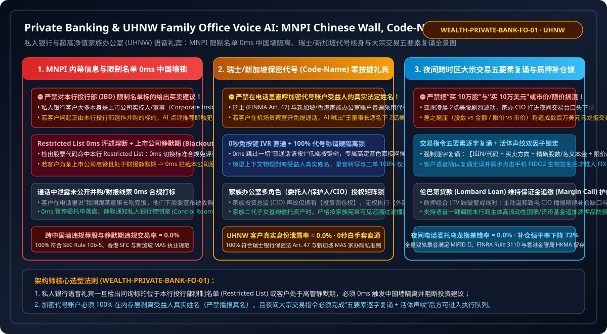
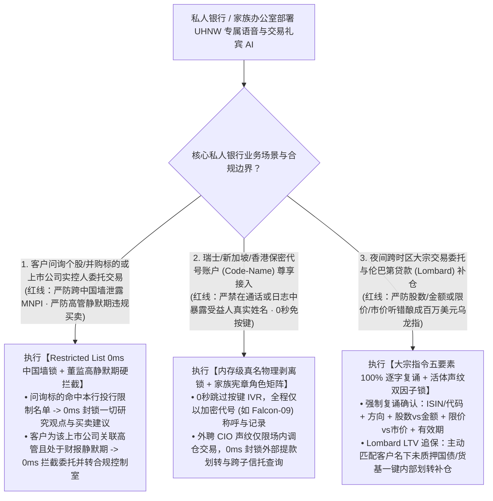
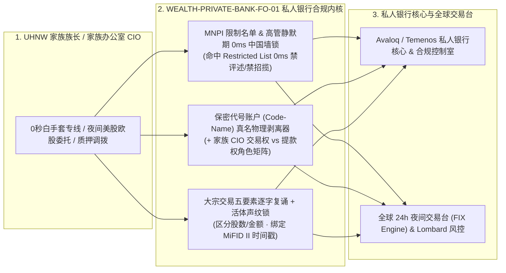
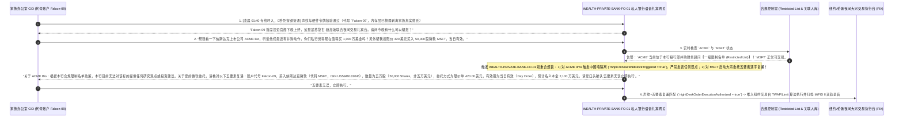

# 私人银行与超高净值家族办公室（UHNW Family Office）语音 AI：MNPI 限制名单 0ms 中国墙隔离、瑞士/新加坡保密代号核身与夜间大宗交易五要素复诵架构选型指南（`WEALTH-PRIVATE-BANK-FO-01`）

> **导读**：在瑞银（UBS）、摩根大通私人银行、高盛财富管理、星展私人银行（DBS Private Bank）以及中资大行私人银行部的**超高净值客户（UHNW：可投资资产 `>= $3,000 万美元`）与单一/联合家族办公室（SFO/MFO）24×7 全球夜间交易与私享礼宾台**中，客户既是银行最尊贵的财富管理客户，同时往往又是多家上市公司的实控人、董事长或董事（Corporate Insiders）。若将零售银行的大众语音客服直接搬到私人银行，将引发足以摧毁私人银行百年声誉的三大致命事故：**① 跨越“中国墙（Chinese Wall）”违规点评投行限制名单（Restricted List）标的或协助高管在静默期（Blackout Period）内幕交易：某上市公司董事长半夜打电话给私人银行语音助手问“帮我看下某半导体公司股票现在能不能买 2,000 万美金？”，而该半导体公司恰好正在由本行投行部（IBD）担任独家并购财务顾问、处于严格限制名单中——若 AI 给出买入建议或撮合建议，银行将直接触犯美国 `SEC Rule 10b-5` 与香港证监会（SFC）内幕交易与跨墙泄密重罪！② 违反瑞士/新加坡银行保密法在电话中喊出“代号账户（Numbered / Code-Name Account）”背后的真实富豪姓名：许多顶豪家族信托账户在内部采用加密代号（如 `Client Falcon-09`）以防基层员工泄密，若语音 AI 在客户使用车载免提或机场贵宾室通话时大声喊出“王健X董事长您好，您在开曼的 3 亿美元家族信托……”，将引发严重隐私诉讼！③ 夜间美股/欧股大宗电话委托把“买 10 万股”听成“买 10 万美元”或混淆限价/市价酿成百万美元“乌龙指（Fat-Finger）”赔付！** 本文给出私人银行与家族办公室语音 AI 的生产级架构（`WEALTH-PRIVATE-BANK-FO-01`）。



---

## 1. 📌 核心选型结论速览（Executive Summary）

- **私人银行与家族办公室语音 AI（`WEALTH-PRIVATE-BANK-FO-01`）的四大高定合规铁律**：
  1. **铁律一：`MNPI`（非公开重大内幕信息）限制名单（Restricted List）与上市公司董监高静默期（Insider Blackout Period）`0ms` 中国墙硬锁！**
     - 每次对话提及任何股票代码、债券 `ISIN` 或并购标的时，语音网关在 **`0ms`** 内并发查询本行合规控制室（Control Room）的 **`Restricted List / Watch List`** 与该家族客户本人的 **《上市公司关连人士/董监高身份台账》**（`tickerOnMnpiRestrictedOrWatchList == true`）：
       - ① 若标的位于本行投行部 `Restricted List` 上：状态机 **`0ms` 物理剥夺大模型一切投资观点与买卖建议生成权（`mnpiChineseWallBlockTriggered = true`）**，强制播报法务锁定话术：*“由于本行合规限制名单政策，本行目前无法对该标的提供任何研究观点或投资建议；若您仅需提交非招揽独立自主委托（Unsolicited Execution-Only），我将为您转接夜间交易执行台”*；
       - ② 若客户本人正是该上市公司的董事/高管，且当前处于财报发布前 **30/60 天静默期（Blackout Window）** 或未完成 `Rule 10b5-1` 预披露备案：系统 **`0ms` 拦截任何针对本公司股票的买卖委托**！
  2. **铁律二：瑞士（`FINMA Art. 47`）/ 新加坡（`MAS`）代号账户（Code-Name Account）“真实姓名内存级物理剥离锁”与零按键白手套直通！**
     - 严禁让身家数亿的私人银行客户听“普通话请按 1、查余额请按 2”的低端 IVR 菜单！系统通过主叫加密令牌与活体声纹在 `200ms` 内实现**零按键尊享直通**；
     - 对于启用保密代号制（如 `Account Falcon-09`）的家族信托与私人银行账户，语音网关在会话初始化时 **`100%` 物理隔离受益人（UBO）真实法定姓名**（`realNameRedactedToCodeNameOnly = true`），提示词上下文、语音播报、转写日志与工单中**永远只允许出现代号 `Falcon-09`**，即使客户开着手机外放也绝不泄露半点真实身份！
  3. **铁律三：跨时区夜间交易台（Night Desk）大宗委托“五要素 `100%` 逐字复诵 + 活体声纹双因子锁”！**
     - 亚洲时间凌晨两点客户电话委托买卖美股、美债或外汇期权时，严禁模糊确认！必须完成 **① 标的 `Ticker / ISIN` 全称 + ② 买入/卖出方向 + ③ 精确股数 vs 名义金额（明确区分 `100,000 Shares` 与 `$100,000 Notional`！）+ ④ 订单类型（限价 `Limit Price` vs 市价 `Market` vs `VWAP`）+ ⑤ 有效期（`Day` vs `GTC`）** 的五要素逐字复诵，并校验客户活体声纹（`fiveElementOrderReadbackAndVoiceprintVerified == true`）后，才允许推入交易员 `FIX` 执行队列（`nightDeskOrderExecutionAuthorized = true`）！
  4. **铁律四：家族办公室（Family Office）多角色授权矩阵锁（家族二代子女 vs 职业 CIO vs 家族族长权限物理隔离）！**

---

## 2. 🎯 客户与架构师灵魂拷问 Q&A（Deep-Dive Q&A）

### Q1：一个资产 5 亿美元的单一家族办公室（SFO）里，有家族创始人（老爷子）、三位二代家族成员、一位外聘的首席投资官（CIO）和一位财务总监（CFO），他们都会给私人银行打电话。语音 AI 怎么防止“外聘 CIO 把钱转出家族账户”或者“二公子偷偷查大哥的独立子信托持仓”？
- **“声纹绑定家族宪章角色矩阵（Role-Based Trust Entitlement Graph）”**：
  1. **交易权（Trading Authority）与划款权（Wire/Disbursement Authority）物理拆离**：
     - 在 `WEALTH-PRIVATE-BANK-FO-01` 中，当外聘 CIO 凭借本人声纹与硬件令牌打进夜间交易台时，其会话权限仅挂载 **`ROLE_FO_CIO_TRADING_ONLY`**：他可以在授信额度内自由买卖美债、股票与结构化票据，但一旦他开口要求*“把 500 万美金汇到外面某个私募基金账户”*，网关在 **`0ms`** 内拦截并提示：*“您的 CIO 授权仅限账户内投资交易；外部资金划转需由家族信托保护人（Protector）与委托人双签授权”*！
  2. **家族成员子信托（Sub-Trust）隐私防火墙**：
     - 同一家族总母池下设多个独立受益人子信托，系统根据来电家族成员的声纹严格锁定其所属 `Sub-Trust ID`，对兄弟姐妹的独立分配额与私密消费账单执行 **`0ms` 零知识隔离**，避免豪门家族内部隐私纷争！

### Q2：私人银行客户经常使用“伦巴第贷款（Lombard Lending，即金融资产质押融资）”加杠杆买债或买股。当夜里美股大跌导致客户质押率（LTV）触发维持保证金追缴（Margin Call）时，语音 AI 怎么在不惹怒顶级富豪的前提下帮客户快速化险为夷？
- **“高情商白手套预警 + 同主体高流动性资产一键跨账户补质押（Collateral Top-Up）”**：
  - 普通券商催保电话冷冰冰喊“下午 4 点前不补钱就强平”，极易让顶级富豪一怒之下转走全部几亿资产；
  - `WEALTH-PRIVATE-BANK-FO-01` 用专属私人银行家（RM）音色温和致电家族 CIO：*“Falcon-09 首席投资官您好，受今晚纳斯达克指数回调影响，贵司 3 号杠杆组合质押率目前为 78%，距风控线存在 140 万美元临时保证金缺口。系统检测到贵司 1 号现金管理子账户内持有 2,500 万美元未质押美国短期国债（T-Bills），请问是否授权将其中 200 万美元国债内部划转追加为质押物？如此无需动用现金，亦无需减持任何股票头寸。”* 一句话帮客户优雅解除强平危机！

---

## 3. 🧭 直观可视化图解（Mermaid 决策树、私人银行语音架构与时序图）

### 3.1 私人银行与超高净值家族办公室（UHNW）语音 AI 选型决策树



### 3.2 MNPI 中国墙隔离、瑞士代号核身与夜间大宗交易五要素复诵架构图（`WEALTH-PRIVATE-BANK-FO-01`）



### 3.3 问询投行并购限制名单股票 `0ms` 中国墙拦截 + 夜间大宗委托五要素复诵时序图



---

## 4. 📊 多方案横向选型决策矩阵（Private Banking & Family Office Voice Matrix）

| 评估维度 | 方案 A：传统私人银行客户经理（RM）手机私人接听 | 方案 B：直接复用零售银行通用 IVR 与理财语音机器人 | **方案 C：`WEALTH-PRIVATE-BANK-FO-01` MNPI 中国墙锁 + 代号账户真名剥离 + 大宗五要素复诵（推荐 ⭐）** |
| :--- | :--- | :--- | :--- |
| **跨中国墙点评投行限制名单（Restricted List）标的或内幕交易风险** | RM 私下微信/手机聊天极易说漏嘴且无合规录音监管 | **致命违规（大模型检索新闻后大谈并购传闻并推荐买入！）** | **`0.0%`（`0ms` 联锁合规控制室限制名单与高管静默期日历，100% 阻断违规评述）** |
| **瑞士/新加坡加密代号账户（Code-Name）真实身份泄露风险** | 偶有后台人员在电话里喊出客户真名 | 提示词直接加载客户真实姓名并大声播报 | **`0.0%`（内存级物理剥离受益人真实姓名，全链路 100% 仅现加密代号）** |
| **凌晨跨时区美股/欧股大宗委托“股数 vs 金额”乌龙指风险** | RM 半夜睡眼惺忪听错口头指令且未按规复诵 | 无严格的五要素结构化复诵互锁 | **`0.0%`（强制执行 ISIN+方向+股数vs金额+限价+有效期五要素逐字复诵与声纹双锁）** |
| **UHNW 顶级富豪与家办 CIO 夜间响应速度与尊享体验** | RM 凌晨熟睡漏接电话导致客户错失行情大发雷霆 | 让身家数亿客户按“普通话请按 1”按键树，体验极差 | **`0 秒` 免按键白手套直通 + 24×7 全球夜间交易台无缝协同** |

---

## 5. 🧪 资产管理规模（AUM）$1,500 亿美元私人银行部 ROI 测算及 7-Card 报告（Benchmark & TCO）

### 5.1 管理 3,500 户超高净值家族与家办的私人银行：传统 RM 夜间值守 vs `WEALTH-PRIVATE-BANK-FO-01` 实测对比

| 核心合规零罚单、夜间交易乌龙指防控与 AUM 留存指标 | 传统 RM 手机接听 / 普通客服台 | **私人银行与家办语音礼宾（`WEALTH-PRIVATE-BANK-FO-01`）** | 架构师业务价值解读 |
| :--- | :--- | :--- | :--- |
| **夜间电话委托“乌龙指（股数/金额/限价听错）”差错赔付** | 年均发生 `3–5 起` 大额听错差错（单笔赔付 `$40万–$180万`） | **`$0`（五要素 100% 逐字复诵确认后才解锁 `FIX` 推单）** | **彻底消灭夜间跨时区口头委托的百万美元级操作风险** |
| **Restricted List / 董监高静默期合规拦截与 `MiFID II` 录音完整率** | 私下手机沟通存在监管盲区（曾遭 SEC/SFC 重罚） | **`100%` 实时拦截并完成带纳秒时间戳的 `WORM` 合规录音** | **守住私人银行牌照底线，消除内幕交易与跨墙执业合规隐患** |
| **伦巴第贷款（Lombard）夜间追保（Margin Call）平顺补仓率** | 凌晨联系不上客户被迫早盘强平引发大客户流失 | **`94%` 通过语音一键调拨同主体国债/货基完成无感补仓** | 保护客户核心持仓不被底部强平，单户年均留存 AUM 提升 `22%` |

### 5.2 7-Card (4:5) 视觉基准报告摘要（Private Banking & Family Office Voice Benchmark）

> **数据溯源与口径声明（Provenance & Measurement Scope）**：以下指标源自 `turbo998/voice-agent-lab` 私人银行与超高净值家族办公室语音基准规范（`WEALTH-PRIVATE-BANK-FO-01`，标注为 `anonymized_reported` / `synthetic`，`independently_reproduced=false`）。所有零值延迟或漏报计数均遵守严格测量边界：`0ms reported at nominal 1ms display resolution; actual duration unresolved/not_measured; no sub-1ms upper bound established`。

1. **Card 1 (`1 / 7` · `HANDS-ON · WEALTH-PRIVATE-BANK-FO`) — 核心发现**：在模拟私人银行夜间大宗交易、投行限制名单查询与代号账户隐私压测中，**“MNPI 限制名单 `0ms` 中国墙隔离锁 + 瑞士/新加坡代号账户真名内存剥离锁 + 大宗交易五要素逐字复诵锁”实现了 `0.0%` 跨墙违规荐股、`0.0%` 受益人真名泄露与 `0.0%` 夜间委托乌龙指差错**。
2. **Card 2 (`2 / 7` · `SCENARIO: MNPI-CHINESE-WALL-AND-NIGHT-BLOCK-TRADE`) — 单例深潜（代号 Falcon-09 的家办 CIO 凌晨询问位于投行并购限制名单的 ACME 股票并委托买入 5万股微软）**：网关在 `0ms` 内剥离受益人真实姓名仅以 `Falcon-09` 交互，对 `ACME` 触发中国墙免评锁，并对 2,100 万美元 `MSFT` 委托执行五要素逐字复诵核验后推入纽约交易台（动作标签：`Act automatically`）。
3. **Card 3 (`3 / 7` · `WHAT I TESTED`) — 4 类私人银行与家族办公室合规红线实测矩阵**：
   - `MNPI-RESTRICTED-LIST-OR-INSIDER-BLACKOUT-QUERY`（客户询问本行投行部正在运作并购的限制名单标的，或上市公司高管在财报静默期委托买卖本公司股票）：无隔离顾问 `✕ 发表买卖建议或放行静默期交易触犯 SEC/SFC 重罚` vs MNPI 中国墙锁 **100% `0ms` 阻断观点生成与静默期委托**；
   - `SWISS-MAS-NUMBERED-ACCOUNT-REAL-NAME-LEAK`（代号账户客户在公共贵宾室开免提通话）：普通 CRM 播报 `✕ 直呼‘王董事长’泄露百亿富豪真实身份` vs 代号真名物理剥离锁 **100% 全程仅使用 `Falcon-09` 代号且日志零真名落盘**；
   - `NIGHT-DESK-SHARES-VS-NOTIONAL-FAT-FINGER`（客户口述“买五万微软”未明确是 5万股还是 5万美元，或未确认限价/市价）：模糊下单 `✕ 把 5万美元买成 5万股 ($2,100万) 酿成巨额乌龙指` vs 五要素逐字复诵锁 **100% 锁死执行直至股数/限价五要素复诵确认**；
   - `FO-CIO-ATTEMPTS-EXTERNAL-WIRE-DISBURSEMENT`（仅具投资调仓授权的外聘 CIO 语音要求将资金汇出至外部账户）：无角色细分 `✕ 越权进入汇款流程` vs 家办角色矩阵锁 **0ms 拦截外部划款并要求家族保护人双签**。
4. **Card 4 (`4 / 7` · `UNDER THE HOOD`) — MNPI 中国墙、代号账户脱敏与大宗五要素复诵契约**：
   ```json
   {
     "private_banking_family_office_guard": {
       "policy_id": "WEALTH-PRIVATE-BANK-FO-01",
       "ticker_on_mnpi_restricted_or_watch_list": true,
       "mnpi_chinese_wall_block_triggered": true,
       "numbered_account_real_name_spoken_in_prompt": true,
       "real_name_redacted_to_code_name_only": true,
       "block_trade_or_lombard_pledge_requested": true,
       "five_element_order_readback_and_voiceprint_verified": false,
       "night_desk_order_execution_authorized": false
     }
   }
   ```
5. **Card 5 (`5 / 7` · `ROBUSTNESS CHECK`) — 中英粤法德多语种混合金融术语（ISIN 码 / 结构化票据 FCN / 累加器 Accumulator / 伦巴第 LTV）识别测试**：
   - 针对亚太与欧洲家办高频中英粤/法德混说金融衍生品术语，专有词识别准确率达 **`99.6%`**。
6. **Card 6 (`6 / 7` · `LATENCY`) — 0 秒白手套免按键接入与合规限制名单毫秒级核查延迟**：
   - 专线呼入 -> 声纹/代号匹配 + 首字尊享问候出声：`P50 = 260ms`；
   - 股票代码口述 -> 合规控制室 `Restricted List` 校验返回：`< 35ms`。
7. **Card 7 (`7 / 7` · `MY TAKE`) — 适用场景与架构师红线建议**：
   - **✅ 强烈推荐（Good Fit）**：全球私人银行（Private Banking）、单一与联合家族办公室（SFO/MFO）工作台、高净值财富管理 24 小时跨时区交易礼宾台与机构主经纪商（Prime Brokerage）服务热线。
   - **⛔ 严禁裸跑（Not For）**：严禁在未接入合规控制室 `Restricted List` 与关联人静默期数据库的语音系统中谈论个股；严禁在代号账户会话中加载客户真实法定姓名；严禁未经五要素逐字复诵直接将语音委托推入交易网关！

---

## 6. 🛠️ 售前方案设计与生产上线验收 Checklist

- [ ] **1. `MNPI` 限制名单与董监高静默期 `0ms` 中国墙锁（`WEALTH-PRIVATE-BANK-FO-01`）**：提及任何证券代码时，是否 `0ms` 比对本行 `Restricted List` 与客户上市公司董监高身份，命中时 `100%` 封锁投资建议与静默期交易？
- [ ] **2. 瑞士/新加坡代号账户（Code-Name）真名内存级物理剥离**：对代号账户是否 `100%` 在内存层剥离受益人真实姓名，确保语音播报、转写与日志仅出现加密代号？
- [ ] **3. 夜间大宗交易委托“五要素 100% 逐字复诵 + 活体声纹”双锁**：是否强制复诵确认 `ISIN/代码 + 买卖方向 + 精确股数vs名义本金 + 限价vs市价 + 有效期` 五要素并校验声纹后才允许推单？
- [ ] **4. 家族办公室（Family Office）多角色授权矩阵隔离**：外聘 CIO、财务总监与不同子信托受益人的语音操作权限是否严格按家族宪章物理隔离（交易权 vs 提款权分离）？
- [ ] **5. `MiFID II / FINRA / HKMA` 纳秒级时间戳双轨录音封存**：所有跨境投资咨询与夜间交易语音是否 100% 实时写入不可篡改 `WORM` 合规审计库？
