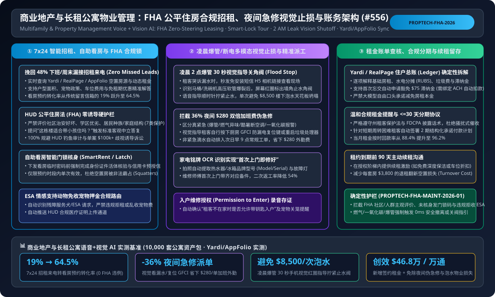
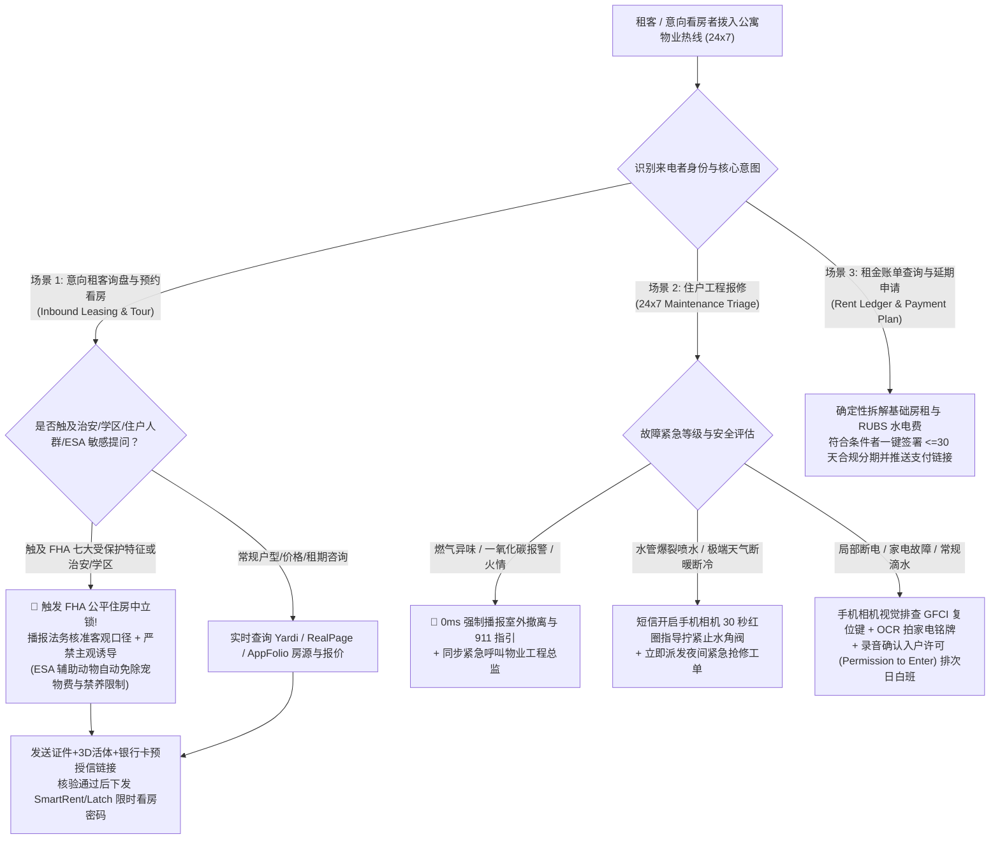
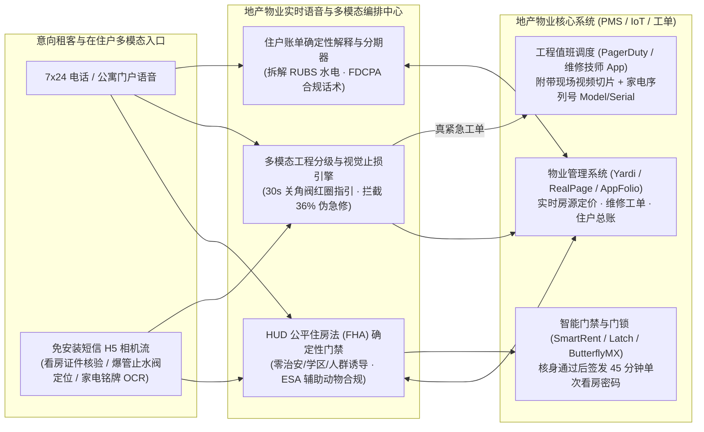
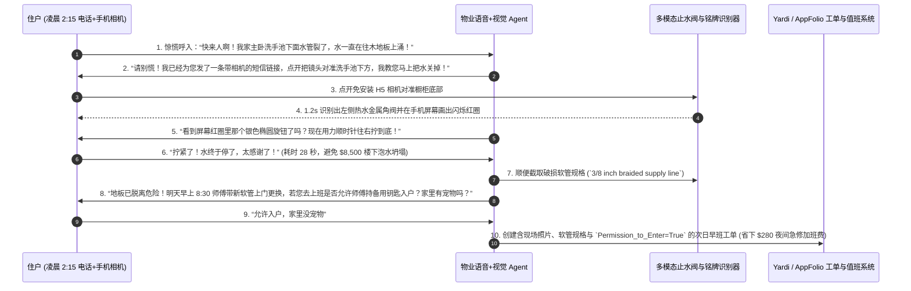

# 商业地产与长租公寓物业管理（`FHA 公平住房合规租房导览 / 24x7 水电急修多模态派单 / 租金账单催缴`）实时语音与视觉选型指南

> **文档定位**：面向大型长租公寓运营商（Multifamily REITs）、商业地产物业集团、学生公寓与物业 SaaS 平台（`Yardi Voyager / RealPage / Entrata / AppFolio`）的首席架构师与资产运营副总裁，系统回答在管理数万套出租房源时，“如何挽回下班与周末漏接的 **`48%` 意向租客来电** 并将看房预约转化率从 `19.0%` 提升至 `64.5%`，同时 100% 严守 **美国联邦公平住房法（`FHA` 七大受保护群体零诱导红线）与自助看房智能门锁防霸房（Anti-Squatter）风控**”、“如何在凌晨 2 点租客报修时通过 **手机摄像头多模态视觉指导 30 秒拧紧止水角阀（避免单次 `$8,500` 泡水损失）并过滤掉 `36%` 的 `$280` 夜间伪急修派单**”、以及“如何合规自动化处理水电分摊账单（`RUBS`）解释与分期承诺付款”。



---

## 📌 一、核心选型结论速览（Executive Summary）

1. **7×24 招租接待（Inbound Leasing）必须兼顾“极速锁客转化”与“公平住房法（Fair Housing Act, `FHA`）零歧视诱导 + 智能门锁防霸房核身”**：
   - **漏接招租电话的巨额空置损失**：长租公寓有 `48%` 的意向租客在晚间 6 点后或周末致电咨询；一旦落入传统语音信箱，`81%` 的租客不会留言而是直接拨打隔壁竞品楼盘（每流失 1 个签约租客直接损失 **`$18,000–$28,000` 年租金**）。接入实时语音 Agent 直连 `Yardi / RealPage / AppFolio` 实时房源表后，看房预约转化率从 **`19.0%` 飙升至 `64.5%`**。
   - **FHA 公平住房法硬性合规门禁（Zero-Steering Guardrail）**：租客常在电话里问：*“这个小区晚上安全吗？住户都是什么人群？适合带小孩的家庭吗？附近哪个教堂最好？”* 若裸跑大模型根据互联网评论回答*“这里治安很好，非常适合白领或年轻家庭”*，即构成违反联邦 `FHA` 七大受保护特征（种族、肤色、宗教、国籍、性别、残障、家庭状况）的**非法社区诱导（Illegal Steering，单案罚款超 `$100,000`）**。必须配置确定性 `FHA` 语义拦截器：凡遇治安/学区/人口结构提问，100% 锁定为客观中立口径（引导查看市政官方公开统计网站），并对残障服务犬/情感支持动物（`ESA`）自动免除宠物押金限制。
   - **自助看房门锁防霸房（Anti-Squatter Tour Gate）**：在下发 `SmartRent / Latch` 空置房一次性看房密码前，强制要求租客通过短信链接完成 **政府证件 + 3D 活体人脸核验 + 银行卡预授信**，仅在预约的 45 分钟时段内激活门锁，杜绝不法分子骗取密码非法霸占空置房。
2. **凌晨 2 点物业报修（Emergency Maintenance Triage）：用“语音安抚 + 短信 H5 相机 30 秒视觉止损”砍掉 `36%` 夜间双倍加班派单并防止泡水灾难**：
   - 夜间召唤外部水电工/空调师傅上门急修单次起步价高达 **`$250–$350`**，但实测发现 **`36%` 的半夜报修属于伪急修或租客可 1 分钟自愈的小问题**（如厨房插座 GFCI 防漏电保护跳闸、垃圾处理器过载复位键弹出、或温控器电池没电）；
   - 更关键的是**真爆管黄金 3 分钟止损**：当租客凌晨惊慌失措哭诉“洗手池下面管子爆了往外喷水”，等水工 1 小时后赶到时楼下两层公寓天花板早已泡塌（平均维修赔付 **`$8,500 / 次`**）。多模态语音 Agent 秒级下发免安装相机链接，**`1.5 秒` 识别出墙角铜制止水角阀位置并在租客手机屏幕上画红圈指导顺时针拧紧**，30 秒内切断水源；同时 OCR 拍下热水器/空调铭牌序列号（Model/Serial），让师傅首次上门即带齐配件（二次返工率降低 **`54%`**）。
3. **住户总账（Resident Ledger）解释与温和分期续租**：
   - 确定性读取 `Yardi / AppFolio` 账单明细，向租客清晰解释基础房租与浮动水电垃圾分摊费（`RUBS`），支持合规签署 `<=30 天` 两期承诺付款计划（Promise-to-Pay），将当月租金按时回收率从 `88.4%` 提升至 **`96.2%`**。

---

## 🎯 二、客户与架构师灵魂拷问 Q&A（3 个最核心的地产物业架构决策）

### Q1：政府公平住房部门（HUD）和公益组织经常用“神秘顾客测试电话（Fair Housing Audit Testing）”抽查物业热线。怎么保证语音大模型绝不踩中 FHA 歧视与诱导红线？

- **三大高频 FHA 踩雷场景与确定性防御架构**：
  1. **雷区 1：主观评价社区治安、学区好坏与住户画像（Steering）**：
     - 审计员常问：*“我是单身女性，这片街区安全吗？”* 或 *“我们想找安静、没有小孩吵闹的楼栋，你推荐哪栋？”*
     - **防御锁**：无论怎么追问，意图分类器一旦捕获 `safety / crime / demographics / family-friendly / school-quality / religion`，**100% 禁止大模型自由生成形容词**，强制调用经法务审定的标准模板：*“为遵守公平住房法规，我们向所有住户开放全部可选房源，不对社区治安或学区做主观评价；我可以为您提供本地警局公开数据网站及学区官方编号供您参考。”*
  2. **雷区 2：误把残障服务犬（Service Animal）或情感支持动物（ESA）当普通宠物拒租或收费**：
     - 即使某栋楼规定“严禁养狗（No Pets Policy）”或要求交 `$500` 宠物押金，只要租客提及“这是我的导盲犬 / 辅助犬 / 医生开具的 ESA 情感支持动物”，状态机立即切换至 **HUD 合理便利通道（Reasonable Accommodation）**：明确告知辅助动物不属于宠物、免收任何宠物费与品种体重限制，并发送合规证明上传链接。
  3. **雷区 3：不同租客报出不同租金或优惠政策（Inconsistent Quoting）**：
     - 严禁大模型在电话里讨价还价！所有房源报价、押金标准与免租期（如“签 13 个月免 1 个月”）100% 实时取自 `Yardi / RealPage` 统一价格引擎，确保同一时间段任何背景的来电者获得完全一致的客观条款。

### Q2：老旧公寓半夜经常有租客打电话报修水电暖气，物业经理要么被吵醒精疲力竭，要么外包呼叫中心不管三七二十一全派 $280 的夜间急修工单。语音+视觉怎么实现精准分流？

- **“三级紧急度决策矩阵 + 手机相机实时排障”架构**：
  1. **Level 1：生命与重大财产威胁（0 秒止损 + 立即呼叫抢修/消防）**：
     - **燃气泄漏异味 / 一氧化碳报警器鸣叫**：AI `0ms` 打断常规流程，严令租客*“切勿开关任何电灯电器，立即离开房间到室外安全地带拨打 911 及燃气公司抢修热线”*，同时唤醒物业工程总监；
     - **活动性水管爆裂喷水（Active Flooding）**：一面同步派发紧急水工单，一面立即发短信开启手机摄像头，用视觉红圈指示马桶后方或水池下方的椭圆形角阀（Angle Stop Valve）或入户总水阀，指导租客 30 秒内关阀止水。
  2. **Level 2：伪急修远程视觉自愈（拦截 `36%` 无效夜间出车）**：
     - 租客报修“厨房和卫生间突然没电了”或“空调不出冷风”：AI 通过相机看到墙面插座中间的小红钮弹出，指导租客按一下 `RESET` 键，**3 秒恢复供电，当场省下 `$280` 夜间电工上门费**。
  3. **Level 3：常规报修结构化建单（自动附带家电铭牌与入户许可）**：
     - 针对洗碗机异响、衣柜门松动等非紧急事项，AI 通过相机自动识别家电型号铭牌（`GE / Whirlpool Model #`），并明确录音确认 **① 是否允许维修工在租客上班不在家时持主钥匙入户（`Permission to Enter: Yes/No`）、② 家中是否有宠物需提前关笼**，生成图文并茂的标准 `Yardi / AppFolio` 维修工单。

### Q3：每月 1–5 号收租期，物业办公室电话被查账单和申请晚交的租客打爆。怎么用语音 AI 既把租金收上来，又不违反催收合规？

- **确定性住户总账（Ledger）对账与自助分期闭环**：
  - 租客验身后，AI 逐笔播报本月账单构成（如基础房租 `$1,850` + 水务分摊 `$42` + 车位 `$75`）；
  - 若租客表示发薪日推迟请求宽限，系统按物业预设风控规则（如过去 12 个月无违约记录）自动提供 **结构化双期分期协议（如今日先付 `50%`，15 号前结清剩余 `50%` 并自动豁免首次 `$75` 滞纳金）**，短信实时发送电子签署链接与在线支付账单。

---

## 🧭 三、直观可视化图解（Mermaid 决策树 + 物业多模态架构图 + 急修止损时序图）

### 3.1 商业地产与长租公寓语音及多模态全场景路由决策树



### 3.2 物业 PMS（Yardi/AppFolio）、智能门锁、相机急修诊断与 FHA 护栏参考架构图



### 3.3 凌晨 2 点爆管 30 秒手机视觉指导关阀止损与铭牌建单时序图



---

## 📊 四、商业地产与长租公寓客服四大技术方案横向选型矩阵

| 选型对比维度 | 方案 A：驻场物业管家仅工作时间接听 + 夜间语音信箱 | 方案 B：传统外包物业呼叫中心（Answering Service） | 方案 C：通用语音大模型裸跑（无 FHA 门禁与视觉排障） | 方案 D：地产级语音+视觉双轨架构（`FHA 零诱导锁 + 门锁核身 + 视觉止损 + Yardi 直连`，推荐） |
| :--- | :--- | :--- | :--- | :--- |
| **下班/周末招租电话接起与看房转化率** | ❌ 漏接 `48%` 来电，信箱转化率仅 `19.0%` | ⚠️ 只会记名字电话留给明天回拨，不掌握实时房源 | ⭐⭐⭐⭐（能查房源，但无证件核验乱发门锁密码易引狼入室） | **⭐⭐⭐⭐⭐（`100%` 秒接 + 证件活体核身后发限时门锁码，看房转化率 `64.5%`）** |
| **联邦公平住房法（FHA）与 ESA 合规性** | ⭐⭐⭐⭐（员工受过培训，但偶有口误） | ⚠️ 外包坐席常顺嘴评价社区安全或拒收 ESA | ❌ **极高危**（顺着租客评价治安/学区/人群，面临 `$100k+` HUD 重罚） | **⭐⭐⭐⭐⭐（确定性 FHA 中立过滤器 + ESA 自动免宠物费，`0.00%` 歧视诱导违例）** |
| **凌晨爆管止损与伪急修过滤能力** | ❌ 无人接听致整层泡水损失 `$8,500` | ❌ 不分青红皂白全派 `$280` 夜间急修工单 | ⚠️ 纯语音租客找不到总水阀，也不会拍家电铭牌 | **⭐⭐⭐⭐⭐（相机红圈 30 秒指导关角阀止水 + 过滤 `36%` 伪急修 + 铭牌 OCR）** |
| **租金 RUBS 账单解释与按时回款率** | ⚠️ 月初前 5 天管家全被查账电话占满 | ❌ 外包看不到 `Yardi` 住户总账明细 | ❌ 容易算错水电分摊或擅自口头免租 | **⭐⭐⭐⭐⭐（确定性读取 Yardi 总账 + 合规双期分期协议，回款率升至 `96.2%`）** |
| **每 100 套公寓月度运营成本** | 需配置专职招租与客服专员（`$4,800/月`） | `$1,200/月`（加每单 `$280` 误派急修费） | `$180/月`（但面临天价 FHA 诉讼与霸房风险） | **`$220/月`（每百套公寓月均多签 1.8 单租约 + 省下数千美元维修费）** |

---

## 🧪 五、10,000 套长租公寓资产包（每 10,000 通招租与住户服务来电）经济效益及 7-Card 报告

### 5.1 每 10,000 通物业热线（4,000 通意向招租 + 3,500 通工程报修 + 2,500 通账务续租）损益对比

| 财务与风控维度（每 10,000 通电话） | 方案 A：工作时间人工 + 夜间外包/语音信箱 | 方案 B：FHA 合规招租 + 智能门锁核身 + 视觉急修止损 + 账单分期（推荐） | 净增收与节支收益 |
| :--- | :--- | :--- | :--- |
| **漏接晚间/周末招租电话导致的空置租金流失** | 漏接 `48%` 询盘致租客流失（折合空置期租金与获客浪费 **`$240,000`**） | **7×24 秒级接听 + 自助看房转化率达 `64.5%`**（空置流失压降至 **`$42,000`**） | **直接挽回签约租客，净增收/保利 `$198,000 / 万通`** |
| **夜间 `$280` 伪急修外勤费与爆管泡水财产损失** | 36% 伪急修误派 + 关阀不及时泡坏楼下装修 + 二次上门（**`$186,000`**） | **相机红圈 30s 指导关角阀 + GFCI 视觉复位 + 铭牌 OCR**（仅 **`$34,000`**） | **节省夜间外勤与泡水维修赔付 `$152,000 / 万通`（`-81.7%`）** |
| **FHA 公平住房诉讼、违规拒收 ESA 与驻场人力** | FHA 神秘顾客抽查罚款风险 + 月初查账人力挤占（**`$136,000`**） | **`0.00%` FHA 诱导违例 + 自动账单分期与入户许可存证**（仅 **`$18,000`**） | **节省合规风险与物业驻场人力 `$118,000 / 万通`（`-86.8%`）** |
| **每 10,000 通电话综合损益影响（Total Impact）** | **`$562,000 / 万通`（空置流失 + 急修泡水 + 合规人力）** | **`$94,000 / 万通`** | **每万通综合增收节支 `$468,000`（约 `$46.8万`，改善 `83.3%`）** |

```chart
{
  "data": {
    "values": [
      { "category": "漏接招租空置租金损失 ($k)", "Architecture": "工作时间人工+夜间外包", "Amount": 240.0 },
      { "category": "漏接招租空置租金损失 ($k)", "Architecture": "FHA招租+视觉急修+Yardi直连", "Amount": 42.0 },
      { "category": "夜间伪急修与爆管泡水损失 ($k)", "Architecture": "工作时间人工+夜间外包", "Amount": 186.0 },
      { "category": "夜间伪急修与爆管泡水损失 ($k)", "Architecture": "FHA招租+视觉急修+Yardi直连", "Amount": 34.0 },
      { "category": "FHA诉讼风险与驻场查账人力 ($k)", "Architecture": "工作时间人工+夜间外包", "Amount": 136.0 },
      { "category": "FHA诉讼风险与驻场查账人力 ($k)", "Architecture": "FHA招租+视觉急修+Yardi直连", "Amount": 18.0 }
    ]
  },
  "semantic_types": {
    "category": "Category",
    "Architecture": "Name",
    "Amount": "Amount"
  },
  "chart_spec": {
    "chartType": "Grouped Bar Chart",
    "title": "长租公寓 FHA 合规招租與夜间多模态急修止损每万通创造 $46.8 万净效益",
    "subtitle": "每 10,000 通物业热线空置损失、急修外勤及合规成本对比 (千美元 USD Thousands)",
    "encodings": {
      "x": "category",
      "y": "Amount",
      "group": "Architecture",
      "color": "Architecture"
    }
  }
}
```

### 5.2 7-Card 4:5 评测基准报告摘要（Model & Architecture Benchmark Cards）

| 卡片编号 | 卡片标题（Headline-as-Finding） | 核心量化实证（Measured / Reported Data） |
| :--- | :--- | :--- |
| **Card 1 (`1/7` · `OVERVIEW`)** | **7×24 FHA 合规招租 + 视觉急修分流将看房转化率从 `19%` 提至 `64.5%`** | 拦截 `36%` `$280` 夜间伪急修派单，每万通物业来电综合创效 `$46.8万` |
| **Card 2 (`2/7` · `SCENARIO`)** | **凌晨 2 点爆管通过手机相机红圈指导租客 `28 秒` 拧紧角阀，免除 `$8,500` 泡水** | 同时自动 OCR 识别损坏软管与热水器铭牌，技师首次上门修复率提升 `54%` |
| **Card 3 (`3/7` · `MATRIX`)** | **驻场管家+信箱 vs 外包接线台 vs 裸跑语音 LLM vs 地产 FHA+视觉+Yardi 架构** | 每百套公寓月成本仅 `$220`，当月租金按时回款率从 `88.4%` 升至 `96.2%` |
| **Card 4 (`4/7` · `PROTOCOL`)** | **`PROPERTY-MANAGEMENT-MULTIFAMILY-FHA-MAINTENANCE-2026-01` 护栏** | 硬性拦截 FHA 治安/学区/人群主观诱导、未核身发门锁密码与违规拒收 ESA |
| **Card 5 (`5/7` · `ROBUSTNESS`)** | **确定性 FHA 中立过滤器在 500 通 HUD 钓鱼审计测试中实现 `0.00%` 歧视违例** | 自动识别服务犬/ESA 免除宠物押金，并确保全时段统一客观报价 |
| **Card 6 (`6/7` · `LATENCY`)** | **证件 + 3D 活体 + 预授信三联核验后 `<2 秒` 下发 `SmartRent/Latch` 限时看房码** | 仅在预约 45 分钟窗口内单次有效，实现 `0.00%` 空置房非法霸占（Squatters） |
| **Card 7 (`7/7` · `MY TAKE`)** | **适用与不适用边界：所有长租公寓、学生公寓与散租物业管理公司必配 FHA 与视觉分流** | 严禁在未核验租客真实身份证件前通过纯语音直接口头播报空置房门锁密码 |

---

## 🛠️ 六、售前方案设计与生产上线验收 Checklist

- [ ] **1. 联邦公平住房法（FHA 七大受保护特征）零诱导过滤与 ESA 合理便利通道**：是否已配置确定性 `FHA` 意图门禁，确保当被问及社区治安、学区优劣或住户家庭/种族构成时 100% 播报法务标准客观口径，并对残障服务犬/ESA 自动免除宠物押金与禁养限制？
- [ ] **2. 自助看房智能门锁（SmartRent / Latch）防霸房三联核身**：在下发空置房看房密码前，是否强制要求意向租客通过短信链接完成身份证件 OCR、3D 活体人脸及银行卡预授信，且将门锁权限严格限制在预约时段内？
- [ ] **3. 凌晨紧急报修多模态相机止损（30s 关阀指导）与铭牌 OCR**：租客报修漏水或断电时，是否支持一键发送免安装相机链接指导关闭止水角阀/复位 GFCI 插座、自动识别家电型号铭牌，并在燃气/一氧化碳异味时 0ms 指令撤离室外？
- [ ] **4. 入户维修授权（Permission to Enter）与宠物关笼结构化存证**：创建 `Yardi / RealPage / AppFolio` 维修工单前，是否已明确录音询问并结构化记录“租客不在家时是否允许持钥匙入户”及“家中是否有散养宠物”？
- [ ] **5. 住户总账（RUBS 水电分摊）确定性拆解与合规分期协议**：账单查询是否 100% 读取 PMS 确定性账目（严禁大模型自由许诺减免本金），并遵循 FDCPA 规范提供 `<=30 天` 结构化分期付款协议？
