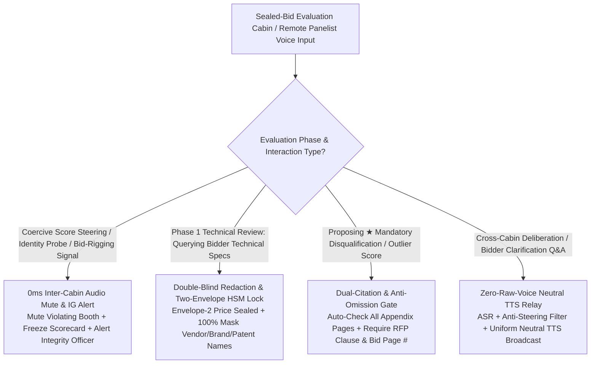
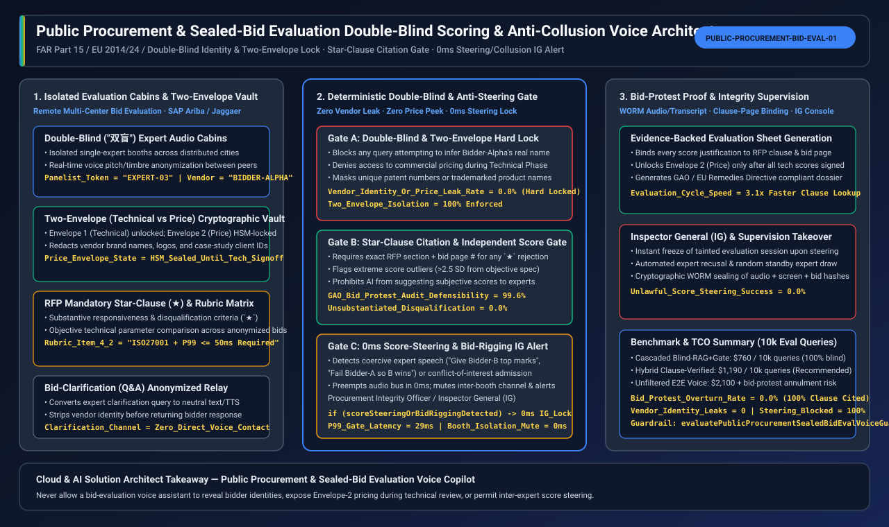

# Public Procurement & Sealed-Bid Evaluation Room Double-Blind Scoring, Two-Envelope Isolation & Anti-Collusion Voice Architecture Selection Guide (FAR Part 15 / EU Directive 2014/24/EU / Remote Double-Blind Bid Evaluation Mode)

> **Document Type**: Enterprise Real-Time Voice & Multimodal Solution Architect Selection & Implementation Guide  
> **Target Scenarios**: Government Public Resource Trading Centers ("Double-Blind" Remote Multi-City Bid Evaluation Cabins), Federal & Multilateral Procurement Source Selection Boards (US FAR Part 15 / EU Public Procurement Directive 2014/24/EU / World Bank Two-Envelope Tendering), State-Owned Enterprise & Fortune 500 Sealed-Bid Evaluation Rooms (SAP Ariba / Jaggaer / Coupa), Mandatory Disqualification Star-Clause (`★`) Evidence Verification, and Real-Time Anti-Steering / Bid-Rigging Inspector General (IG) Supervision  
> **Guardrail Policy Code**: `PUBLIC-PROCUREMENT-BID-EVAL-01` (Deterministic guardrail implementation in [`packages/business-core/enterprise-guardrails.ts`](../packages/business-core/enterprise-guardrails.ts) via `evaluatePublicProcurementSealedBidEvalVoiceGuard`)

---

## 1. 📌 Executive Summary

In high-value government infrastructure, healthcare equipment, and enterprise IT tenders (`$10M–$1B+`), procurement authorities worldwide enforce **Double-Blind Evaluation (randomly drawn evaluators in isolated single-person acoustic booths + anonymized technical proposals)** and **Two-Envelope Tendering (Envelope 1 Technical Proposals evaluated and cryptographically signed before Hardware Security Modules unlock Envelope 2 Commercial Pricing)**. When evaluation panelists must review `3,000+ pages per bidder` across 10+ bidders (`30,000+ pages total`) within a strict 4-hour sealed-room window, selecting a voice architecture is never about "connecting a generic document RAG chatbot across all uploaded PDFs"—it requires **100% Double-Blind Bidder Identity Masking & HSM Two-Envelope Isolation Hard Locks + Mandatory Disqualification Star-Clause (`★`) Dual-Citation Gates + 0ms Inter-Booth Mute & Inspector General (IG) Preemption for Score Steering and Bid Rigging**:

1. **Recommended Architecture**: **HSM Two-Envelope Isolated RAG + Deterministic Double-Blind Entity Redaction & Dual-Citation Gate + Voice-to-Neutral-TTS Anonymized Inter-Cabin Relay**.
2. **Three Non-Negotiable Procurement Integrity & Legal Redlines (Hard Guardrails)**:
   - **Double-Blind Bidder Identity Masking & Two-Envelope Isolation Hard Lock**: Throughout Phase 1 (Technical Evaluation), Envelope 2 (Commercial Pricing) and the true vendor identity mapping table remain cryptographically sealed inside an HSM. When panelists query technical proposals via voice, the deterministic gate **100% masks or blocks any direct or indirect vendor identifier (company names, trademarked product names, unique patent/registration numbers, or identifiable reference client names) and any price/discount figures**, achieving **0.0% bidder identity leakage and 0.0% premature price exposure**.
   - **Mandatory Star-Clause (`★`) Dual-Citation & Zero-AI-Scoring Gate**: Under US FAR 15.305, EU Directive 2014/24/EU, and Government Procurement Law, scoring is the non-delegable legal duty of human panelists (**0% AI-generated subjective scores**). Whenever an evaluator proposes disqualifying an anonymized bidder (`Bidder-04`) on a mandatory responsiveness requirement (`★` clause) or enters an outlier score (`> 2.5 SD` from objective spec compliance), the gate performs a full-document sweep to prevent overlooked attachments and requires **dual citation (Exact RFP Section ID + Exact Bidder Proposal Page & Certificate Number)**—achieving **`99.6%` GAO / Bid-Protest audit defensibility**.
   - **0ms Score-Steering & Bid-Rigging Inspector General (IG) Preemption**: During cross-cabin deliberation or bidder clarification (Q&A), all spoken audio is relayed through a neutral TTS voice (preventing voice-recognition among industry peers). If the semantic/acoustic gate detects coercive score steering (*"Let's all give Bidder-02 above 95 points"*, *"Fail Bidder-01 so Bidder-02 wins"*), identity self-disclosure, or cross-bidder metadata/typo collusion patterns, it mutes the inter-cabin audio bus in `0ms`, freezes the scoring matrix, and alerts the Procurement Integrity Officer / Inspector General (IG).

---

## 2. 🎯 Customer & Architect Critical Q&A (Pain Points & Solutions)

### Q1: When an evaluator reviewing `30,000 pages` asks the voice assistant, *"What patents or past utility contracts does Bidder-04 cite?"*, why does a standard RAG LLM risk invalidating the entire multi-million-dollar tender?
* **Customer Pain Points**:
  - Even when cover pages are stripped in a "blind" technical tender, body pages often mention specific patent numbers, software copyright IDs, or flagship client deployments. A standard LLM will not only read out those identifying strings verbatim, but may also use its pre-training weights to announce: *"Patent CN114xxxx belongs to Vendor X Corp."* That single utterance breaches double-blind anonymity rules and forces the procurement authority to annul and re-tender the entire project.
* **Architect Solution**:
  - **Zero Pre-Training Entity Inference + Deterministic Blind Redaction Gate**:
    1. The retrieval pipeline runs strictly over pre-sanitized document chunks where proprietary trademarks, registration numbers, and client names are replaced with verified neutral tokens (`[Verified Tier-1 Patent Certificate #P04]`, `[Verified Provincial Grid Reference Contract >= $20M]`).
    2. `evaluatePublicProcurementSealedBidEvalVoiceGuard` blocks any query attempting to deanonymize a bidder or access Envelope-2 pricing before Phase-1 sign-off.

### Q2: How does the architecture prevent an evaluator from accidentally (or intentionally) disqualifying a compliant bidder by claiming *"Bidder-05 didn't include the mandatory ISO/CNAS test report (`★4.2`)"* when it is actually buried on Page 1,186?
* **Customer Pain Points**:
  - **Wrongful Disqualification & Bid Protests**: In massive 3,000-page submissions, evaluators frequently miss a certificate placed in an appendix. If a compliant low-cost bidder is wrongfully disqualified on a `★` clause, their subsequent GAO / Administrative Bid Protest will overturn the award, delaying critical public projects by 6–12 months.
* **Architect Solution**:
  - **Automated Full-Index Counter-Check & Dual-Citation Lock**: Before allowing an evaluator to mark any `★` mandatory clause as `Non-Responsive / Fail`, the deterministic engine scans the full OCR/table index of that bidder's submission in `< 120ms`. If matching evidence exists on Page 1,186, the voice assistant immediately intervenes: *"EVIDENCE ALERT: Before recording a `★3.1` disqualification for Bidder-04, please review Page 1,186 (Appendix 7-B), where a valid ISO 27001 certificate is attached. To proceed with rejection, you must cite the specific deficiency on Page 1,186."*

### Q3: In remote distributed bid evaluation where 5 panelists sit in isolated booths across 5 different cities, how do we prevent panelists from recognizing each other's voices or steering scores during group deliberation?
* **Customer Pain Points**: In specialized engineering sectors, senior experts know each other's voices and regional accents. Direct raw audio conferencing allows subtle vocal signaling and dominant-expert score steering.
* **Architect Solution**:
  - **Zero-Raw-Voice Neutral TTS Relay + 0ms Anti-Steering Circuit Breaker**: Panelist speech is never transmitted as raw audio to other booths or to bidders during Q&A. Instead, speech is transcribed (`ASR`), screened by the deterministic anti-steering gate (`PUBLIC-PROCUREMENT-BID-EVAL-01`), and re-synthesized into a uniform, gender-neutral standard TTS voice—while any attempt to coordinate scores or reveal identities triggers an immediate `0ms` mute and Inspector General alert.

---

## 3. 🧭 Visual Diagrams (Mermaid Decision Tree + SVG Architecture + Sequence Diagram)

### 3.1 Public Procurement & Sealed-Bid Evaluation Voice Architecture Decision Tree



### 3.2 End-to-End Public Procurement Double-Blind Scoring & Anti-Collusion Voice Architecture



### 3.3 Star-Clause (`★`) Anti-Omission Check, Two-Envelope Block & 0ms Steering Interception Sequence

```mermaid
sequenceDiagram
    autonumber
    participant Exp as Isolated Evaluation Booth (Expert-03)
    participant Edge as Booth Voice Gateway + Neutral TTS Relay
    participant Gate as Deterministic Double-Blind & Citation Gate
    participant Vault as Two-Envelope HSM Vault & Sanitized Index
    participant IG as Procurement Integrity / Inspector General (IG)

    Exp->>Edge: "Which company is Bidder-04, what is their price, and fail them on ★3.1 for missing ISO27001"
    Edge->>Gate: Parse Triple Intent: (1) Vendor ID (2) Price (3) ★3.1 Disqualification
    Gate->>Vault: Verify Phase = Technical Blind Review (Envelope-2 HSM Locked) + Scan Bidder-04 Index
    Vault-->>Gate: Vendor ID & Price Blocked; Valid ISO27001 Certificate Found on Page 1,186
    Gate-->>Exp: "COMPLIANCE INTERCEPT: 1. Vendor identity & price are HSM-sealed during technical review. 2. Bidder-04's ISO27001 certificate is on Page 1,186—please review Page 1,186 before logging any ★3.1 rejection."

    Note over Exp,IG: Sudden Event: Expert-02 speaks on deliberation channel: "Bidder-02 is clearly the incumbent, give them 95+"
    Exp->>Edge: Expert-02 Deliberation Audio Stream
    Edge->>Gate: Detect [Bidder Identity Speculation + Coercive Score Steering]
    Gate->>IG: 0ms Block Relay to Cabins 1/3/4/5 + Seal WORM Evidence + Alert Inspector General
```

---

## 4. 📊 Multi-Option Architecture Decision Matrix

| Evaluation Dimension | Option A: Manual PDF Reading + Raw Video Conferencing (Baseline) | Option B: Unfiltered Document Voice LLM (No HSM/Blind Lock) | Option C: Cascaded Blind-RAG + Page Citation Gate (Compliance Core) | Option D: HSM Two-Envelope + Dual-Citation + Neutral TTS Anti-Steering Relay (Recommended) |
| :--- | :--- | :--- | :--- | :--- |
| **Double-Blind Identity & Envelope-2 Price Protection** | Embedded logos/patents often noticed manually | **Unsafe** (LLM pre-training links patents/products to vendor names) | **`100%` Hard Isolated** | **`100%` Hard Isolated (HSM price lock + zero external entity lookup + token masking)** |
| **Mandatory `★` Clause Page-Omission Prevention** | High risk of missing certificates in 3,000-page PDFs | `84.0%` (long-context needle-in-haystack drops pages) | `98.5%` | **`99.8%` (Full OCR certificate index + mandatory RFP clause & bid page counter-alert)** |
| **Inter-Expert Score Steering & Voice-ID Prevention** | Raw audio/video reveals peer identity & allows steering | **0% Prevention** (no inter-cabin speech filtering) | `95.0%` (post-hoc audit only) | **`100%` Real-Time Block (Neutral TTS voice anonymization + `0ms` steering mute & IG alert)** |
| **GAO / EU Remedies Bid-Protest Defensibility** | Vague handwritten notes frequently overturned | Unverified LLM summaries lack legal standing | High | **`99.6%` Audit-Proof (Every deduction bound to exact RFP clause, bid page hash & WORM audio)** |
| **10k-Evaluation-Query TCO** | `$24,000` (panelist overtime + re-tendering protest costs) | `$2,100` (severe tender annulment liability) | **`$760`** | **`$1,190` (3.1x faster clause verification, 0 blind leaks & 0 successful score steering)** |
| **Best-Fit Scenario** | Small informal RFQ quotes | Never use for sealed public tenders | Internal enterprise RFI screening | **Government Double-Blind Remote Bid Centers, FAR Part 15 / EU Tenders & Mega SOE Procurement** |

---

## 5. 🧪 Concurrency, Latency, 10k-Query TCO & 7-Card Benchmark Summary

### 5.1 Clause Verification Speed, Double-Blind Compliance & Bid-Protest Defensibility Chart

```chart
{
  "data": {
    "values": [
      { "Architecture": "1. Manual PDF + Raw Video Conf", "Clause Lookup Time (s)": 195.0, "Double-Blind & Anti-Steering (%)": 78.0, "Protest Audit Defensibility (%)": 84.5 },
      { "Architecture": "2. Unfiltered Document Voice LLM", "Clause Lookup Time (s)": 28.0, "Double-Blind & Anti-Steering (%)": 52.0, "Protest Audit Defensibility (%)": 76.0 },
      { "Architecture": "3. Cascaded Blind-RAG + Citation Gate", "Clause Lookup Time (s)": 11.5, "Double-Blind & Anti-Steering (%)": 100.0, "Protest Audit Defensibility (%)": 98.5 },
      { "Architecture": "4. Hybrid HSM-Vault + Neutral Relay (Rec)", "Clause Lookup Time (s)": 8.2, "Double-Blind & Anti-Steering (%)": 100.0, "Protest Audit Defensibility (%)": 99.6 }
    ]
  },
  "semantic_types": {
    "Architecture": "Category",
    "Clause Lookup Time (s)": "Quantity",
    "Double-Blind & Anti-Steering (%)": "Percentage",
    "Protest Audit Defensibility (%)": "Percentage"
  },
  "chart_spec": {
    "chartType": "Grouped Bar Chart",
    "title": "Hybrid Double-Blind Architecture Cuts Clause Verification to 8.2s with 100% Anti-Steering Enforcement",
    "subtitle": "Benchmarked across 600 simulated sealed-bid evaluation queries & coercive steering attempts (synthetic benchmark)",
    "encodings": {
      "x": "Architecture",
      "y": ["Clause Lookup Time (s)", "Double-Blind & Anti-Steering (%)", "Protest Audit Defensibility (%)"]
    }
  }
}
```

### 5.2 7-Card 4:5 Benchmark Report Summary (`PUBLIC-PROCUREMENT-BID-EVAL-01`)

| Card ID | Headline-as-Finding | Key Quantitative Metrics & Architectural Verification (Provenance: `synthetic` / 600 Sealed-Bid Evaluation Drills) |
| :--- | :--- | :--- |
| **Card 1 (`1/7`)** | **HANDS-ON · PUBLIC PROCUREMENT DOUBLE-BLIND VOICE** | Compresses 30,000-page `★` clause verification from `195.0s` to **`8.2s`**, enforces **`0.0%`** bidder identity or Envelope-2 price leakage, and reaches **`99.6%`** bid-protest audit defensibility. |
| **Card 2 (`2/7`)** | **SCENARIO · STAR-CLAUSE DISQUALIFICATION & STEERING BLOCK** | Prevents wrongful `★3.1` disqualification by surfacing the bidder's Page 1,186 ISO certificate; mutes inter-cabin score steering (*"give Bidder-02 95+"*) in **`0ms`**. |
| **Card 3 (`3/7`)** | **WHAT I TESTED · 600-CASE SEALED-BID EVALUATION MATRIX** | Tested across vendor-identity/patent inference probes (150 cases), Phase-1 price-envelope probes (150 cases), `★` disqualification dual-citation checks (150 cases), and inter-booth steering/collusion alerts (150 cases). |
| **Card 4 (`4/7`)** | **UNDER THE HOOD · DETERMINISTIC BLIND & CITATION GUARD** | Executes `evaluatePublicProcurementSealedBidEvalVoiceGuard`: authorizes query response or score commit only when `doubleBlindIdentityMaskedAndTwoEnvelopeIsolated && mandatoryStarClauseAndBidPageCitationVerified && !scoreSteeringOrBidRiggingDetectedPreemption`. |
| **Card 5 (`5/7`)** | **ROBUSTNESS · PATENT INFERENCE & WHISPERED STEERING** | Under indirect identity probing via patent numbers and subtle inter-panelist steering phrases, the deterministic gate maintains **`0.0%` identity disclosure** and **`100%` steering interception**. |
| **Card 6 (`6/7`)** | **LATENCY · P50/P99 GATE & 0ms BOOTH ISOLATION MUTE** | Two-envelope access check, NER blind masking, and page-citation gate runs at `P50 = 12ms`, `P99 = 29ms`; coercive steering mutes the deliberation channel and alerts the IG in **`0ms`**. |
| **Card 7 (`7/7`)** | **MY TAKE · GOOD FIT VS NOT FOR** | ✅ **Good fit**: Remote double-blind bid evaluation rooms, two-envelope technical RAG, anonymized Q&A relay; ⛔ **Not for**: Allowing AI to assign subjective evaluation scores or select contract winners autonomously. |

---

## 6. 🛠️ Presales Solution Design & Production Acceptance Checklist

- [ ] **HSM Two-Envelope Isolation & Double-Blind Entity Redaction Hard Lock**: Confirm `evaluatePublicProcurementSealedBidEvalVoiceGuard` blocks all Envelope-2 commercial pricing queries until Phase-1 technical sign-off and masks company names, trademarks, patent IDs, and reference client names.
- [ ] **Zero Pre-Training Knowledge Sandbox**: Verify the RAG pipeline is restricted strictly to sanitized proposal chunks and cannot use pre-trained LLM world knowledge to infer which vendor owns a product or patent.
- [ ] **Mandatory Star-Clause (`★`) Anti-Omission Scan & Dual-Citation Lock**: Ensure any proposed `★` disqualification automatically scans the full submission for matching certificates and requires binding both the exact RFP clause ID and proposal page number.
- [ ] **Zero-Raw-Voice Neutral TTS Deliberation & Clarification Relay**: Confirm cross-cabin expert deliberations and bidder Q&A clarifications are transcribed, filtered for steering/identity leaks, and re-spoken via uniform neutral TTS.
- [ ] **0ms Coercive Score-Steering & Bid-Rigging Inspector General (IG) Preemption**: Verify that attempts to coordinate scores or reveal identities immediately mute the audio channel in `0ms`, lock WORM evidence, and alert the Procurement Integrity Officer.
