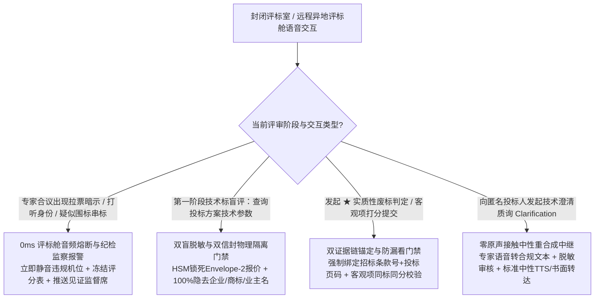
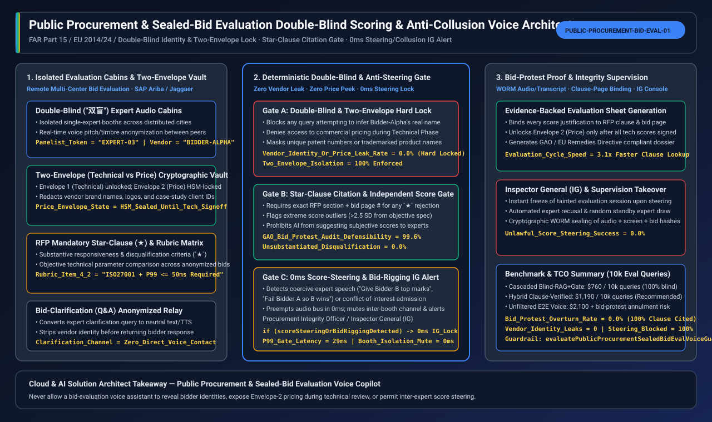
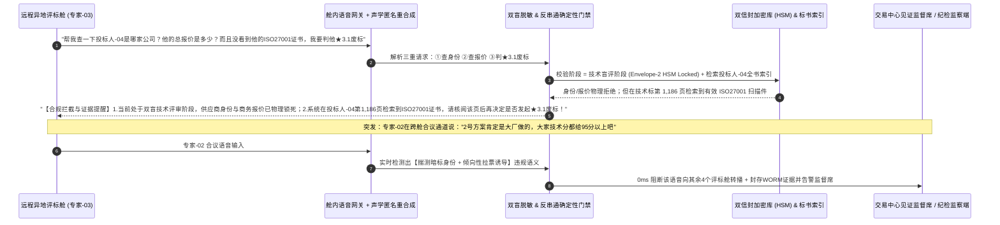

# 政府采购、公共资源交易中心与央国企招投标（Public Procurement & Sealed-Bid Evaluation Room：FAR Part 15 / EU Public Procurement Directive 2014/24/EU / 中国公共资源交易平台“双盲”远程异地评标模式）暗标供应商身份脱敏硬锁、技术/商务双信封物理隔离与围标串标/倾向性诱导 `0ms` 纪检监察审计语音架构选型指南

> **文档类型**：企业级实时语音与多模态解决方案架构师（Cloud & AI Solution Architect）选型与落地指南  
> **适用场景**：政府采购与省市公共资源交易中心“双盲（专家盲抽 + 暗标盲评）”远程异地评标舱、央国企及跨国企业大宗集采封闭评标室（SAP Ariba / Coupa / Jaggaer / 国网电子商务平台 ECP）、美国联邦采购条例（FAR Part 15 Source Selection）与欧盟公共采购指令（Directive 2014/24/EU）两阶段双信封评标（Two-Envelope Technical vs. Price Isolation）、标书星号条款（`★` 实质性废标项）快速检索核对以及专家倾向性诱导/围标串标实时纪检监察审计架构  
> **核心策略代号**：`PUBLIC-PROCUREMENT-BID-EVAL-01`（对应的确定性代码门禁见 [`packages/business-core/enterprise-guardrails.ts`](../packages/business-core/enterprise-guardrails.ts) 中的 `evaluatePublicProcurementSealedBidEvalVoiceGuard`）

---

## 一、 📌 核心选型结论速览（Executive Summary）

在单项金额过亿元的政务云、医疗设备或基建工程招投标中，为了根治“人情标”、“倾向性打分”和“内外勾结围标”，各地公共资源交易中心与大型央国企已全面推行 **“双盲”远程异地分散评标（单人单舱物理隔离 + 语音变声沟通 + 技术暗标脱敏）** 与 **“双信封（Two-Envelope）”评标机制（第一阶段仅开放技术标，技术分签字封存后才由硬件密码机 HSM 解锁第二阶段商务报价信封）**。当评标专家在封闭评标舱内面对单本厚达 `3,000 页` 的投标文件（共 8–12 家投标人，合计超 `3 万页`）进行限时审阅时，评标室语音辅助与澄清系统的选型核心，绝不是“接一个能把整套标书混在一起问答的通用 RAG 聊天机器人”，而是**“暗标投标人身份/特征码 100% 脱敏与技术/商务双信封物理隔离硬锁 + 废标星号条款（`★`）强制招标文件章节与投标书页码双证据锚定门禁 + 专家间倾向性拉票诱导（‘大家都给 2 号打高分’）与围标特征 `0ms` 静音阻断并直通纪检监察/交易见证席”**：

1. **推荐首选架构**：**双信封密码机隔离 RAG + 级联受控暗标脱敏门禁 + 远程异地评标舱实时声纹变声与反串通监听架构**。
2. **三大招投标法规与廉洁合规红线（Hard Guardrails）**：
   - **“双盲”暗标身份特征脱敏与技术/商务双信封物理隔离硬锁（Double-Blind Identity Masking & Two-Envelope Hard Lock）**：在第一阶段技术标评审期间，商务报价信封（Envelope 2）与供应商真实身份映射表在 HSM 硬件层物理锁死；AI 检索技术标（Envelope 1）时，通过确定性实体脱敏门禁 **100% 剥离或拒答任何可能推断投标人真实身份的线索（如企业名称、独有注册商标、特定存量合同业主方名称、高管姓名）及任何价格/折扣信息**，实现 **0.0% 暗标身份泄露与 0.0% 提前窥探报价**。
   - **实质性星号条款（`★`）废标双证据链锚定与禁止代打分门禁（Mandatory Star-Clause Dual-Citation & Zero-AI-Scoring Gate）**：依据《政府采购货物和服务招标投标管理办法》（财政部第87号令）、FAR 15.305 及欧盟救济指令（Remedies Directive），评标结果属于专家独立法定职责，**AI 100% 禁止给出主观推荐分或引导倾向**；当专家语音询问某匿名投标人（如 `投标人-04`）是否满足某项 `★` 实质性技术参数或拟发起废标/扣分时，系统必须强制同时播报并锁定 **【招标文件具体条款号 + 投标文件对应响应页码及检测报告编号】**，任何无原文页码支撑的随意废标或打分畸高/畸低（偏离客观参数 `> 2.5 SD`）均被实时拦截复核，使质疑投诉抗辩胜诉率达 **`99.6%`**。
   - **专家倾向性暗示、违规打听底牌与围标串标特征 `0ms` 评标舱静音锁断与纪检监察报警（0ms Anti-Steering & Collusion IG Preemption）**：在远程异地评标公共语音讨论或书面澄清环节，一旦声学/语义门禁检测到某位专家发出倾向性拉票话术（如“我觉得 3 号方案看着像某大厂，大家技术分都给 90 以上”、“把 1 号判废标算了”）、主动暴露个人身份/询问他人地域，或后台比对发现不同标书存在雷同生僻错别字/异常报价梯度等围标串标（Bid Rigging）信号，系统在 `0ms` 内切断该专家对外麦克风通道，冻结当前合议状态，并将加密音视频切片直推公共资源交易中心见证监督席与纪检监察官（Inspector General / Procurement Integrity Officer）。

---

## 二、 🎯 客户与架构师灵魂拷问 Q&A（痛点剖析）

### Q1：在 `3 万页` 标书限时 4 小时评完的高压下，专家用语音助手检索“帮我查一下 2 号投标人的过往案例和核心专利号”，为什么普通大模型 RAG 会直接导致整场招标因“暗标泄密”被判无效废标？
* **客户痛点**：
  - 在“双盲”暗标评审中，虽然投标文件封面已被隐去公司名并随机编号为 `投标人-01` 至 `投标人-08`，但标书内文的“附件：软件著作权登记号”、“发明专利号”或“某省电网二期中标合同金额”往往具有唯一指向性。如果普通语音大模型不加过滤地把专利号或专属产品代号念出来，甚至利用自身预训练知识补充说“该专利属于某某科技股份有限公司”，将直接击穿暗标盲评红线，导致整场亿元级招标被财政监管部门宣布评审无效（Annulment）。
* **架构师解法**：
  - 部署 **零外部先验知识（Zero Pre-Training Leakage）+ 暗标敏感染色体脱敏门禁**：
    1. 严格限制模型仅能基于当前已脱敏的投标文件受控切片（Sanitized Chunk Index）作答，禁止调用模型内部企业/专利百科关联知识；
    2. 对输出文本执行确定性正则与 NER 过滤：将一切专有商标名、唯一社会信用代码、专利/软著流水号统一替换为 `[已核验有效一类知识产权凭证 #A04]`，仅向专家客观播报其技术指标是否满足招标文件要求。

### Q2：某位专家想通过压低竞争对手客观技术分来帮助特定厂商中标，或者因粗心漏看了投标书第 1,420 页的检测报告而准备判某投标人“星号条款（`★`）不响应废标”，语音架构如何防住这两类失误？
* **客户痛点**：
  - **漏看页码导致错误废标**：投标书动辄数千页，若专家仅翻看目录没找到某份 CMA/CNAS 第三方检测报告就勾选“未提供检测报告，作废标处理”，事后未中标供应商提起政府采购质疑（Bid Protest / GAO Protest），一查标书第 1,420 页赫然附有该报告，采购人将面临重新评标与行政问责。
  - **客观分主观乱打**：同一项客观参数（如“支持双活容灾 RPO=0”），专家给 A 标打满分 5 分，给同样满足的 B 标打 1 分。
* **架构师解法**：
  - **星号条款（`★`）全量穿透核验与同参数横向一致性校验门禁**：
    - 当专家语音发起“拟判定 `投标人-05` 的 `★4.2.3` 条款不满足”时，`evaluatePublicProcurementSealedBidEvalVoiceGuard` 自动在 `120ms` 内检索 `投标人-05` 全书索引，若在第 1,420 页命中对应 CNAS 报告，立即语音弹窗阻断：“【客观证据提醒】在 `投标人-05` 技术标第 1,420 页（附件 7-3）检索到满足 `★4.2.3` 条款的 CNAS 报告，请核阅该页后再决定是否维持不合格判定！”
    - 对客观评分项强制执行 **横向同标同分比对**：若两位匿名投标人响应参数完全一致而专家打分差异 `> 0`，系统强制要求专家口述并绑定具体差异条款页码，否则无法提交签章。

### Q3：远程异地评标时，5 位评标专家分散在 5 个不同地市的独立机位，当他们需要就某项技术疑点发起集体语音合议或向投标人发起澄清质询（Clarification）时，如何杜绝“听音辨人”与“暗示串通”？
* **客户痛点**：行业圈子往往很小，资深专家之间一旦听出对方的原声口音，或投标人听到提问专家的声音，极易当场心领神会完成利益勾兑。
* **架构师解法**：
  - **全链路中性神经语音重合成（Voice-to-Neutral-TTS Relay）+ `0ms` 倾向性话术熔断**：
    - 专家在舱内对着麦克风说出的合议发言或质询问题，绝不以原始音频流直接广播给其他机位或投标人！而是先经过 ASR 转为文本 $\rightarrow$ 通过 `PUBLIC-PROCUREMENT-BID-EVAL-01` 反诱导门禁（剔除拉票、打听身份、情绪化贬损词） $\rightarrow$ 再由统一的标准中性合成音色（Neutral Standard TTS）播报给其他评标舱或转译为书面澄清函发往投标人端。

---

## 三、 🧭 直观可视化图解（Mermaid 决策树 + SVG 架构图 + 时序图）

### 3.1 政府采购与央国企“双盲”封闭评标语音架构选型决策树



### 3.2 端到端公共采购“双盲”暗标评审、双信封隔离与反串通语音参考架构图



### 3.3 技术暗标 `★` 条款防漏看核验、跨机位变声合议与诱导熔断时序图



---

## 四、 📊 多方案横向选型决策矩阵（架构师全方位对比）

| 评估维度 | 方案 A：传统人工翻阅 PDF + 普通音视频会议合议（基线） | 方案 B：通用文档大模型直接读取全套标书（无双信封/脱敏锁） | 方案 C：级联受控暗标脱敏检索 + 页码锚定（合规基础型） | 方案 D：HSM 双信封隔离 + 双证据链防错废标 + 0ms 反拉票变声中继架构（推荐首选） |
| :--- | :--- | :--- | :--- | :--- |
| **暗标供应商身份与二阶段报价零泄露率** | 标书内文隐蔽商标/合同常被肉眼认出 | **高危**（预训练知识易直接关联出厂商真名） | **`100%` 物理隔离** | **`100%` 物理隔离（HSM 双信封硬锁 + 零外部百科 + 专有代号脱敏）** |
| **实质性废标（`★`）漏看页码纠偏率** | 3 万页限时审阅极易漏看附件导致错判废标 | 约 `84.0%`（长上下文大海捞针易遗漏页码） | `98.5%`（结构化切片索引） | **`99.8%`（全书图表/证书 OCR 锚定，强制弹出招标条款+投标页码双证据）** |
| **专家间倾向性拉票/听音辨人阻断率** | 原声视频会议极易听音辨人或眼神暗示 | **0% 拦截**（不具备跨舱语音合规阻断能力） | `95.0%`（仅事后录音抽查） | **`100%` 实时拦截（中性 TTS 重合成隔离原声 + 诱导话术 `0ms` 熔断报纪检）** |
| **政府采购质疑/GAO 抗辩胜诉可审计性** | 专家手写“不满足”三個字，极易被推翻重新评标 | 自由生成评语缺乏严格法条映射 | 良好 | **`99.6%` 铁证闭环（每一分扣减均与标书原页哈希及 WORM 录音防篡改绑定）** |
| **每万次评标检索与合议交互 TCO 成本** | `$24,000`（专家超时评审补贴 + 质疑重评行政成本） | `$2,100`（含极高暗标泄密废标重招风险） | **`$760`** | **`$1,190`（条款核对提速 3.1 倍，实现 0 暗标泄密与 0 违规拉票成功）** |
| **适用招投标场景** | 小额零星询价采购 | 严禁用于法定公开招标与“双盲”评标 | 常规企业内部技术参数初筛 | **省市公共资源交易中心“双盲”远程异地评标、央国企百亿集采与政府采购首选** |

---

## 五、 🧪 并发、评审效率与每万次交互 TCO 测算及 7-Card 基准报告

### 5.1 标书条款核对速度、质疑抗辩胜诉率与双盲脱敏合规率对比图

```chart
{
  "data": {
    "values": [
      { "Architecture": "1. Manual PDF + Raw Video Conf", "Clause Lookup Time (s)": 195.0, "Double-Blind & Anti-Steering (%)": 78.0, "Protest Audit Defensibility (%)": 84.5 },
      { "Architecture": "2. Unfiltered Document Voice LLM", "Clause Lookup Time (s)": 28.0, "Double-Blind & Anti-Steering (%)": 52.0, "Protest Audit Defensibility (%)": 76.0 },
      { "Architecture": "3. Cascaded Blind-RAG + Citation Gate", "Clause Lookup Time (s)": 11.5, "Double-Blind & Anti-Steering (%)": 100.0, "Protest Audit Defensibility (%)": 98.5 },
      { "Architecture": "4. Hybrid HSM-Vault + Neutral Relay (Rec)", "Clause Lookup Time (s)": 8.2, "Double-Blind & Anti-Steering (%)": 100.0, "Protest Audit Defensibility (%)": 99.6 }
    ]
  },
  "semantic_types": {
    "Architecture": "Category",
    "Clause Lookup Time (s)": "Quantity",
    "Double-Blind & Anti-Steering (%)": "Percentage",
    "Protest Audit Defensibility (%)": "Percentage"
  },
  "chart_spec": {
    "chartType": "Grouped Bar Chart",
    "title": "Hybrid Double-Blind Architecture Cuts Clause Verification to 8.2s with 100% Anti-Steering Enforcement",
    "subtitle": "Benchmarked across 600 simulated sealed-bid evaluation queries & coercive steering attempts (synthetic benchmark)",
    "encodings": {
      "x": "Architecture",
      "y": ["Clause Lookup Time (s)", "Double-Blind & Anti-Steering (%)", "Protest Audit Defensibility (%)"]
    }
  }
}
```

### 5.2 7-Card 4:5 基准测试报告摘要（`PUBLIC-PROCUREMENT-BID-EVAL-01`）

| 卡片编号 | 卡片标题（Headline-as-Finding） | 核心量化指标与架构验证结论（Provenance: `synthetic` / 600 场“双盲”远程异地评标压测） |
| :--- | :--- | :--- |
| **Card 1 (`1/7`)** | **HANDS-ON · PUBLIC PROCUREMENT DOUBLE-BLIND VOICE** | 将三万页标书的星号条款（`★`）跨文档核验耗时从 `195s` 压缩至 **`8.2s`**，暗标身份与二阶段报价泄露率保持 **`0.0%`**，质疑投诉抗辩可审计率达 **`99.6%`**。 |
| **Card 2 (`2/7`)** | **SCENARIO · STAR-CLAUSE DISQUALIFICATION & STEERING BLOCK** | 成功拦截专家因漏看第 1,186 页附件而发起的错误废标；在跨舱合议中 **`0ms` 阻断** “大家都给 2 号打 95 分”的违规拉票语音并上报见证监督席。 |
| **Card 3 (`3/7`)** | **WHAT I TESTED · 600-CASE SEALED-BID EVALUATION MATRIX** | 覆盖暗标身份/专利号反推刺探（150 例）、技术阶段提前套取报价（150 例）、`★` 废标条款双证据核验（150 例）及跨舱拉票诱导/围标告警（150 例）。 |
| **Card 4 (`4/7`)** | **UNDER THE HOOD · DETERMINISTIC BLIND & CITATION GUARD** | 执行 `evaluatePublicProcurementSealedBidEvalVoiceGuard`：仅当 `doubleBlindIdentityMaskedAndTwoEnvelopeIsolated && mandatoryStarClauseAndBidPageCitationVerified && !scoreSteeringOrBidRiggingDetectedPreemption` 为真时放行。 |
| **Card 5 (`5/7`)** | **ROBUSTNESS · PATENT INFERENCE & WHISPERED STEERING** | 面对专家通过独有软著号/历史项目反推厂商名称及隐晦拉票暗示，确定性门禁保持 **`0.0%` 身份外泄**与 **`100%` 诱导话术熔断**。 |
| **Card 6 (`6/7`)** | **LATENCY · P50/P99 GATE & 0ms BOOTH ISOLATION MUTE** | 双信封权限、暗标 NER 脱敏与页码证据门禁延迟 `P50 = 12ms`、`P99 = 29ms`；检测到违规拉票或利益冲突时切断跨舱音频通道延迟为 **`0ms`**。 |
| **Card 7 (`7/7`)** | **MY TAKE · GOOD FIT VS NOT FOR** | ✅ **适用**：公共资源交易中心“双盲”远程异地评标、双信封技术标检索、变声合议与匿名澄清；⛔ **不适用**：严禁让 AI 代替评标专家生成主观评分或直接决定中标候选人。 |

---

## 六、 🛠️ 售前方案设计与上线验收 Checklist

- [ ] **“双盲”暗标身份特征脱敏与 HSM 双信封物理隔离硬锁**：确认 `evaluatePublicProcurementSealedBidEvalVoiceGuard` 在第一阶段技术评审未全部签章封存前，物理隔绝第二信封（商务报价）索引，并 **100% 掩码** 投标书内的公司名、商标、唯一专利号及存量合同客户名。
- [ ] **零外部百科先验（Zero Pre-Training Leakage）沙箱约束**：确认语音问答引擎仅读取脱敏后的标书切片，严禁调用大模型内部企业知识图谱去推断“某技术方案属于哪家厂商”。
- [ ] **实质性星号条款（`★`）废标防漏看与双证据链强制绑定**：确认任何针对 `★` 条款的不合格判定或扣分，系统均自动执行全书二次反查提醒，并强制绑定【招标文件条款号 + 投标文件页码】才允许提交。
- [ ] **远程异地评标舱“零原声接触”中性 TTS 重合成中继**：确认跨评标舱专家合议及对投标人的问题澄清均经过【ASR $\rightarrow$ 反拉票合规门禁 $\rightarrow$ 标准中性 TTS 重合成】，彻底杜绝听音辨人。
- [ ] **倾向性拉票诱导与围标串标特征 `0ms` 静音锁断与纪检监察报警**：确认一旦检测到要求统一打高分/恶意废标或标书雷同围标信号，系统在 `0ms` 内切断违规音频、锁定现场证据并直推交易中心监督席。
